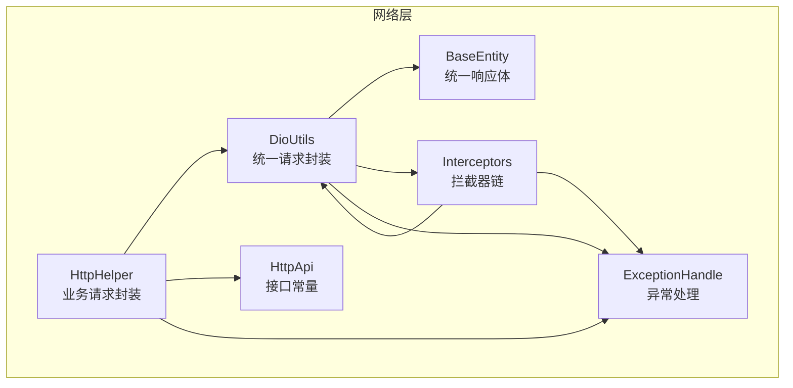
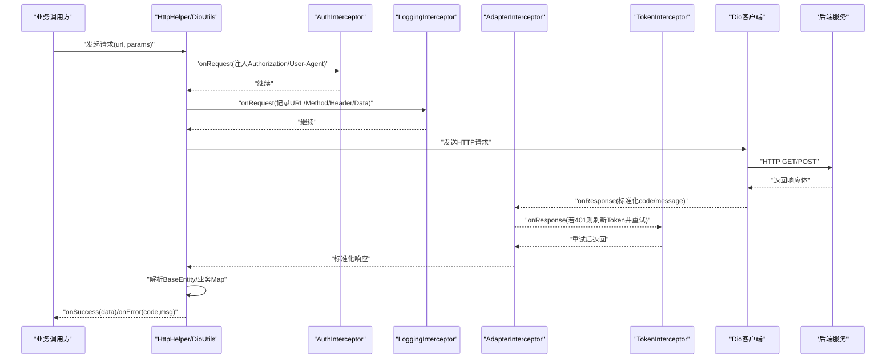
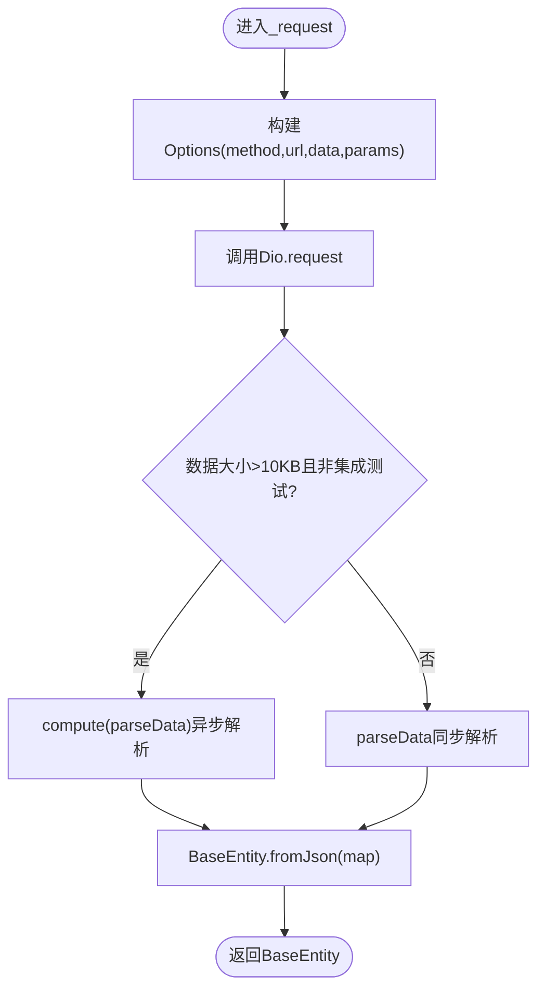
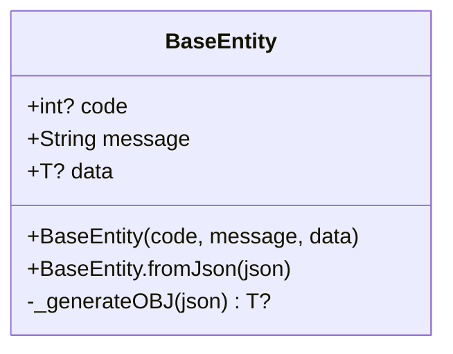
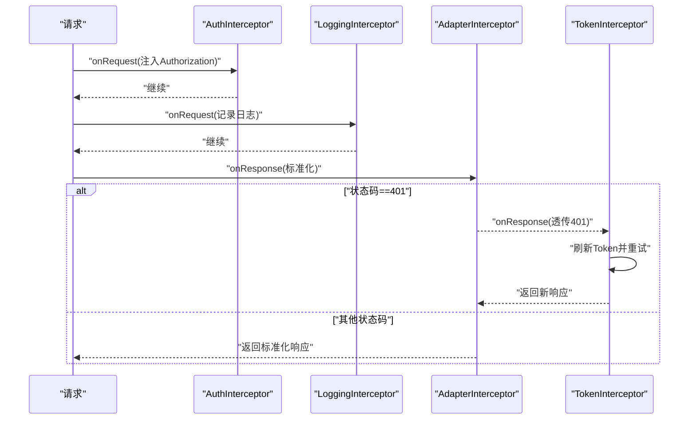
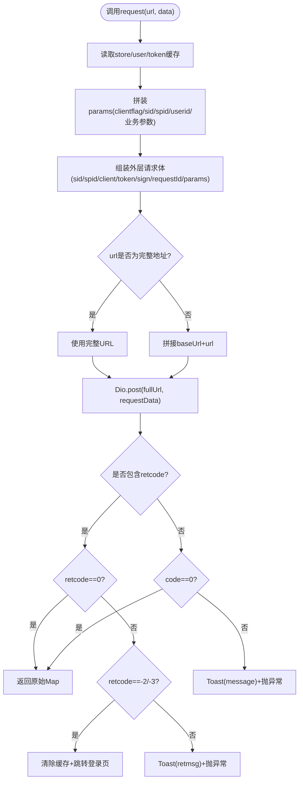
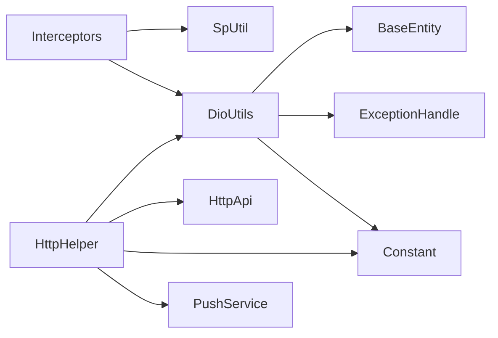

# API参考

<cite>
**本文引用的文件**   
- [dio_utils.dart](file://lib/net/dio_utils.dart)
- [base_entity.dart](file://lib/net/base_entity.dart)
- [intercept.dart](file://lib/net/intercept.dart)
- [http_api.dart](file://lib/net/http_api.dart)
- [error_handle.dart](file://lib/net/error_handle.dart)
- [http_helper.dart](file://lib/net/http_helper.dart)
- [net.dart](file://lib/net/net.dart)
- [constant.dart](file://lib/res/constant.dart)
</cite>

## 目录
1. [简介](#简介)
2. [项目结构](#项目结构)
3. [核心组件](#核心组件)
4. [架构总览](#架构总览)
5. [详细组件分析](#详细组件分析)
6. [依赖关系分析](#依赖关系分析)
7. [性能与稳定性](#性能与稳定性)
8. [错误码与异常处理](#错误码与异常处理)
9. [认证机制与拦截器](#认证机制与拦截器)
10. [HTTP API接口清单](#http-api接口清单)
11. [调用示例与最佳实践](#调用示例与最佳实践)
12. [故障排查指南](#故障排查指南)
13. [结论](#结论)

## 简介
本API参考文档面向灵犀管店Flutter项目的后端对接与前端开发，系统性梳理网络层封装、统一响应体、认证与拦截器机制、错误处理策略，并汇总所有业务HTTP接口的URL模式、请求方法、参数结构与响应格式。文档同时提供调试建议与最佳实践，帮助前后端协同实现稳定可靠的接口交互。

## 项目结构
网络相关代码集中在 `lib/net` 目录下，主要模块职责如下：
- `dio_utils.dart`：Dio基础配置、单例封装、统一请求方法与数据解析调度。
- `base_entity.dart`：统一响应体模型，将后端返回的code/message/data映射为强类型对象。
- `intercept.dart`：请求/响应拦截器集合，包括鉴权、Token刷新、日志记录、响应适配。
- `http_api.dart`：所有业务接口路径常量与基础URL定义。
- `error_handle.dart`：网络异常分类、错误码映射与用户提示文案。
- `http_helper.dart`：面向业务的统一请求封装，负责公共参数拼装、登录失效处理、跳转登录页等。
- `net.dart`：对外导出网络模块入口。
- `constant.dart`：全局常量，包括响应字段名、缓存Key等。

**图示来源**
- [dio_utils.dart:1-200](file://lib/net/dio_utils.dart#L1-L200)
- [base_entity.dart:1-33](file://lib/net/base_entity.dart#L1-L33)
- [intercept.dart:1-213](file://lib/net/intercept.dart#L1-L213)
- [http_api.dart:1-595](file://lib/net/http_api.dart#L1-L595)
- [error_handle.dart:1-82](file://lib/net/error_handle.dart#L1-L82)
- [http_helper.dart:1-351](file://lib/net/http_helper.dart#L1-L351)

**章节来源**
- [dio_utils.dart:1-200](file://lib/net/dio_utils.dart#L1-L200)
- [base_entity.dart:1-33](file://lib/net/base_entity.dart#L1-L33)
- [intercept.dart:1-213](file://lib/net/intercept.dart#L1-L213)
- [http_api.dart:1-595](file://lib/net/http_api.dart#L1-L595)
- [error_handle.dart:1-82](file://lib/net/error_handle.dart#L1-L82)
- [http_helper.dart:1-351](file://lib/net/http_helper.dart#L1-L351)

## 核心组件
- DioUtils：基于Dio的单例封装，提供GET/POST等HTTP方法的统一调用入口；默认返回原始UTF-8字符串，避免Dio自动JSON解析，由上层自行解析；支持超时、baseUrl、拦截器注入；对大数据使用compute异步解析降低主线程压力。
- BaseEntity：统一响应体模型，包含code、message、data三个字段，内部通过JsonConvert进行泛型反序列化，兼容String与Map类型。
- Interceptors：
  - AuthInterceptor：在请求头中注入Authorization（token）与User-Agent。
  - TokenInterceptor：当服务端返回401时，尝试刷新access_token并重试原请求。
  - LoggingInterceptor：打印请求URL、方法、头、体与响应耗时、结果。
  - AdapterInterceptor：将HTTP状态码与业务响应体统一转换为标准code/message结构，保持401透传以触发Token刷新。
- ExceptionHandle：网络异常分类，将Dio异常、Socket/Http/Format异常映射到统一的NetError。
- HttpHelper：面向业务层的request封装，负责sid/spid/userid/clientflag/token/sign/requestId等公共参数拼装，retcode=0成功、-2/-3登录失效跳转登录页，非retcode格式兼容code/message。
- HttpApi：集中维护所有业务接口路径常量与基础URL。
- Constant：全局常量，包括code/message/data字段名、accessToken/refreshToken存储键、user/store/token等业务缓存键。

**章节来源**
- [dio_utils.dart:1-200](file://lib/net/dio_utils.dart#L1-L200)
- [base_entity.dart:1-33](file://lib/net/base_entity.dart#L1-L33)
- [intercept.dart:1-213](file://lib/net/intercept.dart#L1-L213)
- [error_handle.dart:1-82](file://lib/net/error_handle.dart#L1-L82)
- [http_helper.dart:1-351](file://lib/net/http_helper.dart#L1-L351)
- [http_api.dart:1-595](file://lib/net/http_api.dart#L1-L595)
- [constant.dart:1-54](file://lib/res/constant.dart#L1-L54)

## 架构总览
网络请求从业务层进入HttpHelper或DioUtils，经过拦截器链完成鉴权、日志、响应适配后，再交由Dio发起真实HTTP请求。服务端响应经AdapterInterceptor标准化为code/message结构，再由DioUtils/BaseEntity解析为强类型数据，最终回调onSuccess/onError。

**图示来源**
- [dio_utils.dart:1-200](file://lib/net/dio_utils.dart#L1-L200)
- [intercept.dart:1-213](file://lib/net/intercept.dart#L1-L213)
- [http_helper.dart:1-351](file://lib/net/http_helper.dart#L1-L351)

## 详细组件分析

### DioUtils：网络请求封装
- 初始化：支持设置connectTimeout/receiveTimeout/sendTimeout、baseUrl、拦截器列表；默认返回类型为plain字符串，validateStatus恒为true，由AdapterInterceptor判断业务状态。
- 统一请求：_request封装Dio.request，返回Future<BaseEntity<T>>；根据数据长度与测试环境选择是否使用compute异步解析。
- 便捷方法：
  - requestNetwork：返回Future，回调onSuccess/onError。
  - asyncRequestNetwork：基于Stream广播监听，适合需要多次回调的场景。
- 错误处理：捕获DioException，转为NetError并通过_onError回调。

**图示来源**
- [dio_utils.dart:1-200](file://lib/net/dio_utils.dart#L1-L200)

**章节来源**
- [dio_utils.dart:1-200](file://lib/net/dio_utils.dart#L1-L200)

### BaseEntity：统一响应体
- 字段：
  - code：业务状态码，成功通常为0。
  - message：业务消息文本。
  - data：业务数据，支持泛型T，内部根据T的类型进行转换：String直接toString；Map直接强转；其他类型通过JsonConvert.fromJsonAsT反序列化为对象或List。
- 构造：fromJson(json)从Constant.code/Constant.message/Constant.data键读取并生成对象。

**图示来源**
- [base_entity.dart:1-33](file://lib/net/base_entity.dart#L1-L33)

**章节来源**
- [base_entity.dart:1-33](file://lib/net/base_entity.dart#L1-L33)

### 拦截器链
- AuthInterceptor：
  - 从本地缓存读取accessToken，写入请求头Authorization。
  - 非Web环境注入User-Agent。
- TokenInterceptor：
  - 检测到401时调用lgn/refreshToken刷新access_token，成功后更新本地缓存并重试原请求。
  - 使用独立Dio实例避免重复触发拦截器。
- LoggingInterceptor：
  - 记录请求开始时间、URL、Method、Headers、ContentType、Body。
  - 记录响应状态码、响应体、耗时。
- AdapterInterceptor：
  - 将HTTP 200/204视为成功，返回code=0、空body时使用默认“无返回信息”。
  - 将HTTP 404转换为code=404、message=“未找到查询信息”的成功态。
  - 对其他错误：解析后端返回中的message/msg或retcode；若响应体本身是retcode格式，则透传原始内容。
  - 保持401透传，以便TokenInterceptor识别并刷新Token。

**图示来源**
- [intercept.dart:1-213](file://lib/net/intercept.dart#L1-L213)

**章节来源**
- [intercept.dart:1-213](file://lib/net/intercept.dart#L1-L213)

### HttpHelper：业务请求封装
- 公共参数：
  - 外层：sid/spid/client(token)/sign(requestId)/params。
  - params内层：clientflag/sid/spid/userid及业务参数。
- 自动填充：
  - 从SpUtil读取store/user缓存，提取sid/spid/userid。
  - token优先使用commonParams传入，否则从Constant.token读取。
  - client固定为WEBAPP；sign固定为83690002；requestId使用时间戳。
- URL拼接：
  - baseUrl取自HttpApi.baseUrlYlx。
  - 若url以http://或https://开头，则直接使用完整URL；否则拼接baseUrl。
- 响应处理：
  - 若返回retcode：
    - retcode==0：成功，返回原始Map。
    - retcode==-2/-3：登录失效，清除缓存并跳转登录页，抛出_ApiException。
    - 其他：根据showError决定是否Toast，记录日志，抛出_ApiException。
  - 若返回code：
    - code==0：成功，返回原始Map。
    - 其他：根据message显示Toast并抛出_ApiException。
- 登录失效处理：
  - 防抖标志_isRedirectingToLogin防止并发跳转。
  - _clearCachePreservingRemember保留记住密码相关缓存，解绑推送别名/标签后再清空，最后恢复记住密码项。
  - logoutAndRedirect提供主动退出登录入口。

**图示来源**
- [http_helper.dart:1-351](file://lib/net/http_helper.dart#L1-L351)

**章节来源**
- [http_helper.dart:1-351](file://lib/net/http_helper.dart#L1-L351)

## 依赖关系分析
- DioUtils依赖：
  - Dio（HTTP客户端）
  - Constant（code/message/data字段名、isDriverTest）
  - BaseEntity（统一响应体）
  - ExceptionHandle（异常分类）
  - LogUtils（日志输出）
- Interceptors依赖：
  - SpUtil（读取accessToken/refreshToken）
  - DeviceUtils（判断Web平台）
  - OtherUtils/Sprintf（格式化）
  - DioUtils（刷新Token时复用Dio配置）
- HttpHelper依赖：
  - DioUtils（发起HTTP请求）
  - HttpApi（基础URL与接口常量）
  - Constant（缓存键）
  - PushService（解绑推送别名/标签）
  - ToastUtils（错误提示）
  - FileLogWriter（接口操作日志）

**图示来源**
- [dio_utils.dart:1-200](file://lib/net/dio_utils.dart#L1-L200)
- [intercept.dart:1-213](file://lib/net/intercept.dart#L1-L213)
- [http_helper.dart:1-351](file://lib/net/http_helper.dart#L1-L351)
- [http_api.dart:1-595](file://lib/net/http_api.dart#L1-L595)
- [constant.dart:1-54](file://lib/res/constant.dart#L1-L54)

**章节来源**
- [dio_utils.dart:1-200](file://lib/net/dio_utils.dart#L1-L200)
- [intercept.dart:1-213](file://lib/net/intercept.dart#L1-L213)
- [http_helper.dart:1-351](file://lib/net/http_helper.dart#L1-L351)
- [http_api.dart:1-595](file://lib/net/http_api.dart#L1-L595)
- [constant.dart:1-54](file://lib/res/constant.dart#L1-L54)

## 性能与稳定性
- 大响应体异步解析：超过10KB且非集成测试时使用compute异步解析，降低主线程阻塞风险。
- 连接/收发超时：默认connect/receive为15秒，send为10秒，可通过configDio调整。
- 拦截器链顺序：Auth→Logging→Adapter→Token，保证鉴权、日志、标准化、刷新Token的顺序正确。
- 登录失效防抖：_isRedirectingToLogin防止并发跳转登录页，延迟3秒重置标志。
- 日志记录：接口成功/失败均写入FileLogWriter，便于问题定位。

[本节为通用指导，不直接分析具体文件]

## 错误码与异常处理
- HTTP状态码：
  - 200/204：成功，AdapterInterceptor将其标准化为code=0。
  - 404：转换为code=404、message=“未找到查询信息”的成功态。
  - 401：透传给TokenInterceptor进行Token刷新。
- 业务状态码：
  - 0：成功。
  - 非0：失败，message为用户提示文本。
  - retcode=-2/-3：登录失效，HttpHelper执行清理缓存与跳转登录页。
- 网络异常：
  - NetError枚举包括net_error/parse_error/socket_error/http_error/connect_timeout_error/send_timeout_error/receive_timeout_error/cancel_error/unknown_error。
  - DioException类型映射到errorCode，如超时、取消、未知错误。

**章节来源**
- [error_handle.dart:1-82](file://lib/net/error_handle.dart#L1-L82)
- [intercept.dart:1-213](file://lib/net/intercept.dart#L1-L213)
- [http_helper.dart:1-351](file://lib/net/http_helper.dart#L1-L351)

## 认证机制与拦截器
- 认证头：
  - Authorization：Bearer token形式，token来源于Constant.accessToken。
  - User-Agent：非Web环境下注入Mozilla/5.0。
- Token刷新：
  - 触发条件：服务端返回401。
  - 刷新接口：lgn/refreshToken，参数refresh_token来自Constant.refreshToken。
  - 成功后更新Constant.accessToken并重试原请求。
- 登录失效：
  - retcode=-2/-3时，HttpHelper清理缓存（保留记住密码），解绑推送别名/标签，跳转LoginPage。

**章节来源**
- [intercept.dart:1-213](file://lib/net/intercept.dart#L1-L213)
- [http_helper.dart:1-351](file://lib/net/http_helper.dart#L1-L351)
- [constant.dart:1-54](file://lib/res/constant.dart#L1-L54)

## HTTP API接口清单
以下接口均以HttpApi.baseUrlYlx为基础URL，即 https://yun.bypos.net/LxSvr/web/。请求方法默认POST，部分接口可能使用GET或其他方法，具体以业务层调用为准。

- 登录相关
  - getLoginList：获取门店列表（登录第一步）
  - lxlogin：登录（登录第二步）
  - updateEmployeeStorePermission：系统参数列表（启动时刷新登录相关数据）
- 推送设备管理
  - jpush/bind：绑定极光RegistrationID与用户信息
  - jpush/unbind：解绑RegistrationID（退出登录）
- 采购入库
  - cgstockin/findList：列表
  - cgstockin/getInfo：详情
  - cgstockin/save：保存
  - cgstockin/sign：审核
  - cgstockin/retsign：反审核
  - cgstockin/delBill：删除
  - airprint/setWxPrintRw：打印单据
  - cgstockin/updateCgPrice：切换供应商/机构时批量更新采购价格
  - cgstockin/finishReceiveTak：完成收货任务
- 基础数据
  - supplierinfo/findList：供应商列表
  - store/getList：机构列表
  - store/getInfo：机构详情
  - bi/counter/getList：仓库列表
  - sysuser/findList：系统用户列表
  - sysuser/save：保存用户
  - sysuser/delete：删除用户
  - sysuser/getInfo：用户详情
  - sysuser/generateCode：自动生成工号
  - sysuser/add：新增用户（旧）
  - sysuser/update：更新用户（旧）
  - sysuser/getUserRoleConfig：角色配置
  - role/findList：角色列表
  - bi/product/getProductList：商品列表
  - machine/getMachineList：站点设备列表
  - machine/checkMachine：站点校验
  - machine/update：站点更新
  - machine/operate：站点操作（删除）
  - sysseat/findList：用户授权席位列表
  - sysseat/bindSeat：绑定席位
  - sysseat/unbindSeat：解绑席位
  - sysseat/updateStop：启用/停用
  - vas/getVasList：增值服务列表
  - stockproduct/getBacthList：商品批次列表
  - bi/itemclass/getList：商品分类列表
  - bi/brand/getBrandList：品牌列表
  - bi/location/getList：货架编号列表
  - bi/type/getTypeListandCode：分类树（含编码）
  - bi/type/addTypeInfo：新增分类
  - bi/type/updateTypeInfo：修改分类
  - bi/type/delTypeInfo：删除分类
  - bi/type/getCode：获取分类编码
  - bi/product/getTypeOfCode：获取分类编码
  - bi/product/getProductExtendList：商品扩展列表（单位/规格）
  - bi/otherdata/getList：通用数据查询
- 采购订货单
  - cgorder/findList：列表
  - cgorder/getInfo：详情
  - cgorder/save：保存
  - cgorder/sign：审核
  - cgorder/retsign：反审核
  - cgorder/delBill：删除
  - cgorder/stop：停止
  - airprint/setWxPrintRw：打印单据
- 采购退货单（复用cgstockin前缀）
  - cgstockin/findList：列表
  - cgstockin/getInfo：详情
  - cgstockin/save：保存
  - cgstockin/sign：审核
  - cgstockin/retsign：反审核
  - cgstockin/delBill：删除
  - airprint/setWxPrintRw：打印单据
- 采购计划单
  - cgplan/findList：列表
  - cgplan/getInfo：详情
  - cgplan/save：保存
  - cgplan/sign：审核
  - cgplan/retsign：反审核
  - cgplan/delBill：删除
  - airprint/setWxPrintRw：打印单据
- 审批流配置
  - reviewTypeConfig/getNewBillSignUser：获取新单据签字人
  - reviewTypeConfig/getReviewBillTypeList：多级审批列表
- 自采申请单
  - cgzc/findList：列表
  - cgzc/getInfo：详情
  - cgzc/save：保存
  - cgzc/sign：审核
  - cgzc/retsign：反审核
  - cgzc/delBill：删除
  - airprint/setWxPrintRw：打印单据
- 退货申请单
  - cgzc/generateCgStockRet：生成采购退货单
- 调拨申请单
  - dborder/findList：列表
  - dborder/getInfo：详情
  - dborder/save：保存
  - dborder/sign：审核
  - dborder/retsign：反审核
  - dborder/delBill：删除
  - dborder/updateLsPrice：选仓库后刷新商品货架号
  - airprint/setWxPrintRw：打印单据
- 调拨出库单
  - dbstockout/findList：列表
  - dbstockout/getInfo：详情
  - dbstockout/save：保存
  - dbstockout/sign：审核
  - dbstockout/retsign：反审核
  - dbstockout/delBill：删除
  - airprint/setWxPrintRw：打印单据
- 调拨入库单
  - dbstockout/findList：列表（复用）
  - dbstockout/getInfo：详情（复用）
  - dbstockout/inSave：保存
  - dbstockout/inSign：审核
  - dbstockout/retInSign：反审核
  - dbstockout/delBill：删除（复用）
  - airprint/setWxPrintRw：打印单据
- 配送发货单
  - psstockout/findList：列表
  - psstockout/getInfo：详情
  - psstockout/save：保存
  - psstockout/sign：审核
  - psstockout/retsign：反审核
  - psstockout/delBill：删除
  - airprint/setWxPrintRw：打印单据
- 配送收货单
  - psstockin/findList：列表
  - psstockin/getInfo：详情
  - psstockin/save：保存
  - psstockin/sign：审核
  - psstockin/retsign：反审核
  - psstockin/reject：拒收
  - airprint/setWxPrintRw：打印单据
- 配退申请单
  - psrefundapply/findList：列表
  - psrefundapply/getInfo：详情
  - psrefundapply/save：保存
  - psrefundapply/sign：审核
  - psrefundapply/retsign：反审核
  - psrefundapply/delBill：删除
  - airprint/setWxPrintRw：打印单据
- 配退发货单
  - psrefundout/findList：列表
  - psrefundout/getInfo：详情
  - psrefundout/save：保存
  - psrefundout/sign：审核
  - psrefundout/retsign：反审核
  - psrefundout/delBill：删除
  - airprint/setWxPrintRw：打印单据
- 配退收货单
  - psrefundin/findList：列表
  - psrefundin/getInfo：详情
  - psrefundin/save：保存
  - psrefundin/sign：审核
  - psrefundin/retsign：反审核
  - psrefundin/reject：拒收
  - airprint/setWxPrintRw：打印单据
- WMS收货任务
  - wms/task/receive/getWmsReceiveTakList：收货任务列表
  - wms/task/receive/getInfo：收货任务详情
  - wms/task/receive/updateReceiveTak：保存收货数据
  - wms/task/receive/retsign：反审核
  - cgstockin/finishReceiveTak：完成收货
- 其他
  - httpUtil/getGet：通用GET代理（云商品库条码查询）
  - uuc/upload-inco：上传接口
  - users/simplezhli、search/repositories、users/simplezhli/subscriptions：示例接口（GitHub）
  - labelprint/rePrint：重新打印未打印数据
  - labelproductgroup/findList/getInfo/save/delete：商品分组CRUD
  - plugins/get/plugins/setParam：插件数据查询与参数设置
  - vipInfo/*：会员管理相关接口
  - vipTable/getVipCardDetailList：会员储卡明细
  - display/getModelDisplaySetList：通用列设置

**章节来源**
- [http_api.dart:1-595](file://lib/net/http_api.dart#L1-L595)

## 调用示例与最佳实践
- 使用HttpHelper.request：
  - 适用于灵犀管店业务接口，自动拼装sid/spid/userid/clientflag/token/sign/requestId。
  - 推荐始终处理.catchError以捕获_ApiException，并根据response.retcode/response.retmsg做差异化处理。
- 使用DioUtils.instance.requestNetwork：
  - 适用于需要统一BaseEntity响应的场景，onSuccess返回泛型数据，onError返回code和message。
- 最佳实践：
  - 明确区分retcode格式与code格式响应，优先按retcode处理。
  - 对登录失效（retcode=-2/-3）场景，不要重复Toast，交给HttpHelper统一处理。
  - 对长列表或大图数据，建议使用DioUtils的异步解析能力，避免UI卡顿。
  - 使用LoggingInterceptor辅助调试，关注URL、Method、Header、Body与耗时。
  - 谨慎使用Token刷新，避免频繁刷新导致服务器压力。

**章节来源**
- [http_helper.dart:1-351](file://lib/net/http_helper.dart#L1-L351)
- [dio_utils.dart:1-200](file://lib/net/dio_utils.dart#L1-L200)

## 故障排查指南
- 常见错误与定位：
  - 网络异常：检查网络连接、代理配置、防火墙规则。
  - 解析错误：确认后端返回JSON格式是否符合预期，注意retcode与code两种格式。
  - 登录失效：检查Constant.token/Constant.user/Constant.store缓存是否正确，确认jpush/unbind是否调用。
  - 404错误：AdapterInterceptor会转换为code=404，message=“未找到查询信息”，需检查接口路径。
  - 401未刷新：检查TokenInterceptor是否被正确注册，确认lgn/refreshToken接口可用。
- 日志查看：
  - 使用LoggingInterceptor输出请求/响应日志。
  - 使用FileLogWriter查看接口操作日志，重点关注path、params、result、data字段。
- 调试建议：
  - 开启Fiddler代理（注释掉的HttpClientAdapter示例）抓包验证请求/响应。
  - 在DioUtils中增加debugPrint打印isCompute与解析结果。
  - 在HttpHelper中记录retcode与retmsg，便于快速定位业务异常。

**章节来源**
- [intercept.dart:1-213](file://lib/net/intercept.dart#L1-L213)
- [dio_utils.dart:1-200](file://lib/net/dio_utils.dart#L1-L200)
- [http_helper.dart:1-351](file://lib/net/http_helper.dart#L1-L351)

## 结论
灵犀管店Flutter项目的网络层通过DioUtils与HttpHelper双轨封装，既支持统一BaseEntity响应，又兼顾retcode格式的灵犀管店业务接口。拦截器链提供鉴权、日志、标准化与Token刷新能力，错误处理策略覆盖网络、解析与业务异常。结合HttpApi接口清单与最佳实践，前后端可高效协作，确保接口调用的稳定性与可维护性。