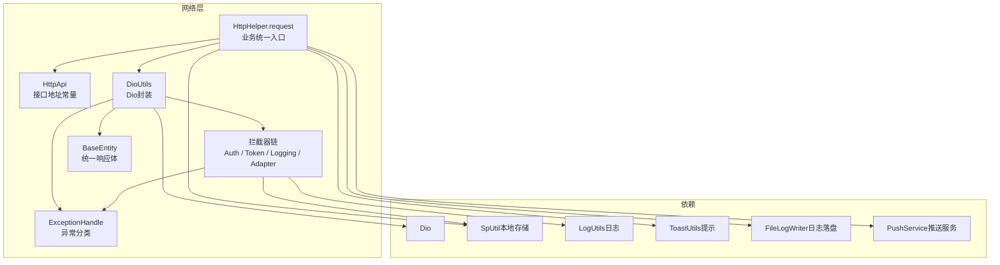
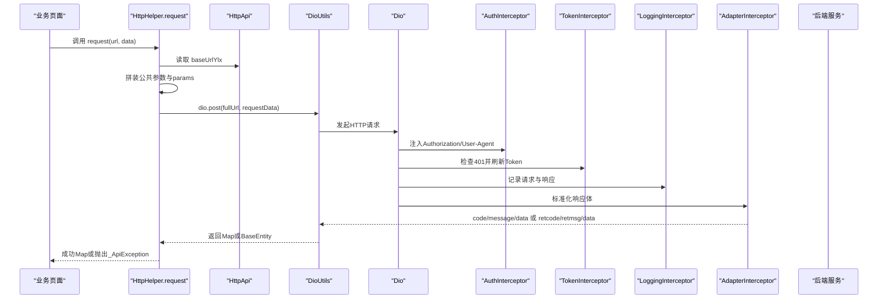
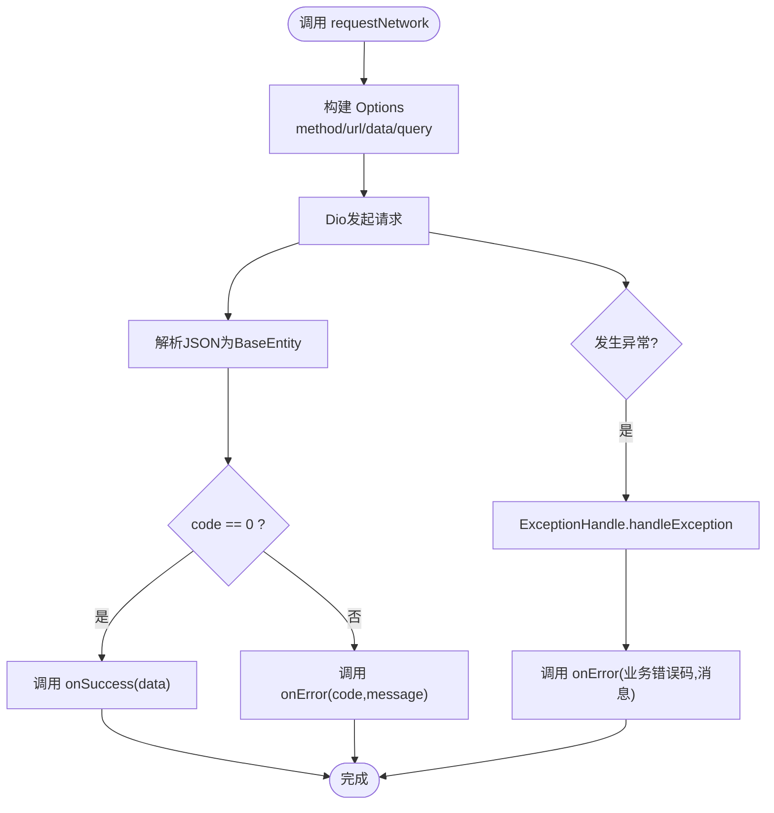
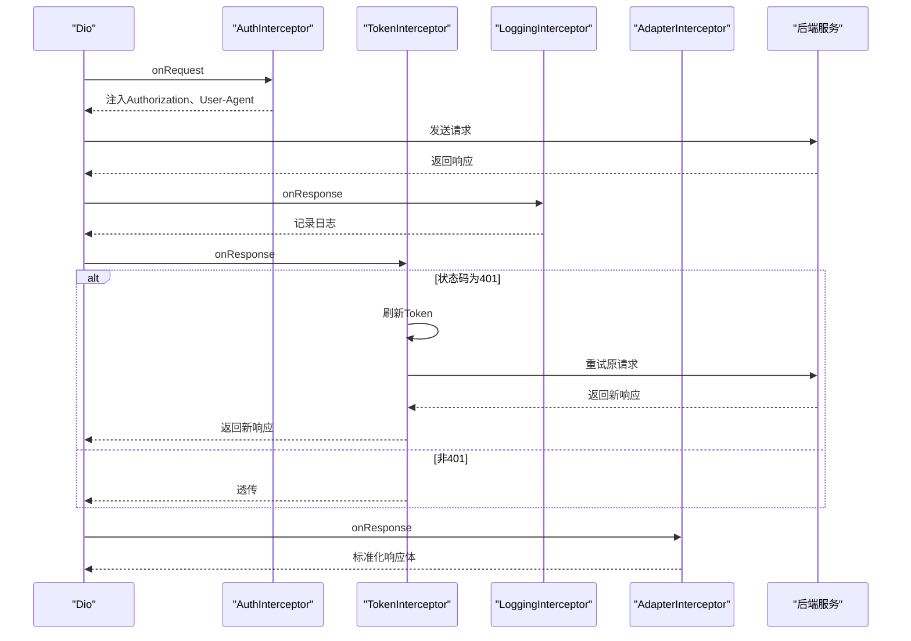
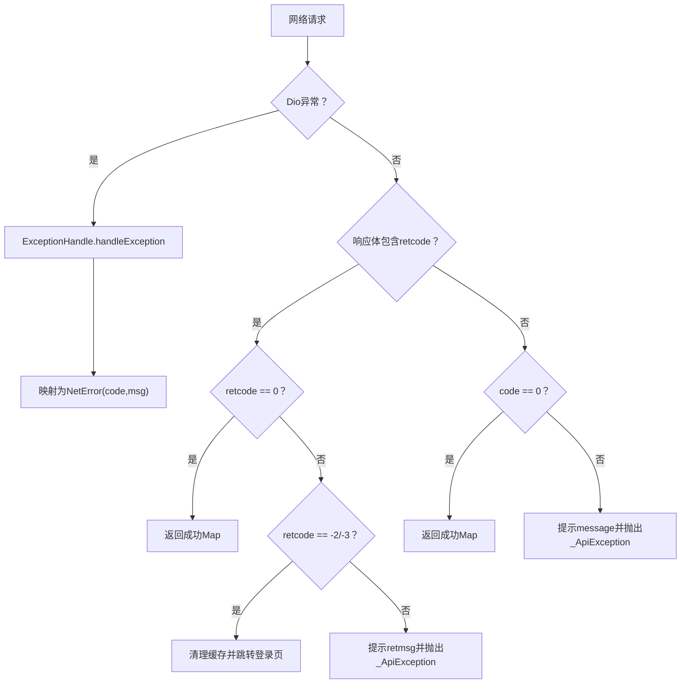

# API概览

<cite>
**本文引用的文件**   
- [dio_utils.dart](file://lib/net/dio_utils.dart)
- [base_entity.dart](file://lib/net/base_entity.dart)
- [intercept.dart](file://lib/net/intercept.dart)
- [http_api.dart](file://lib/net/http_api.dart)
- [http_helper.dart](file://lib/net/http_helper.dart)
- [error_handle.dart](file://lib/net/error_handle.dart)
- [net.dart](file://lib/net/net.dart)
- [constant.dart](file://lib/res/constant.dart)
</cite>

## 目录
1. [简介](#简介)
2. [项目结构与职责划分](#项目结构与职责划分)
3. [核心组件总览](#核心组件总览)
4. [架构总览与请求链路](#架构总览与请求链路)
5. [基础URL、认证与统一响应体](#基础url认证与统一响应体)
6. [DioUtils封装与请求方法](#dioutils封装与请求方法)
7. [拦截器链工作原理](#拦截器链工作原理)
8. [API版本管理与接口清单](#api版本管理与接口清单)
9. [错误码规范与异常处理](#错误码规范与异常处理)
10. [重试机制与超时配置](#重试机制与超时配置)
11. [API调用示例与最佳实践](#api调用示例与最佳实践)
12. [安全注意事项](#安全注意事项)
13. [后端对接与调试指南](#后端对接与调试指南)
14. [结论](#结论)

## 简介
本文件面向灵犀管店 Flutter 项目的后端对接方与前端开发者，系统性梳理 HTTP API 的整体架构、基础URL配置、认证机制、统一响应格式、网络封装、拦截器链、错误码规范、重试策略和超时配置。文档同时提供调用示例、最佳实践与安全建议，帮助双方快速对齐接口契约并提升联调效率。

## 项目结构与职责划分
网络层位于 `lib/net`，主要职责如下：
- `http_api.dart`：集中定义所有接口路径及基础URL常量。
- `dio_utils.dart`：基于 Dio 封装统一的网络请求能力，包括超时、返回类型、解析、回调分发等。
- `intercept.dart`：实现认证、Token刷新、日志记录、响应适配等拦截器。
- `http_helper.dart`：提供业务侧最常用的统一 `request` 方法，负责公共参数拼装、登录失效处理、错误提示与日志落盘。
- `base_entity.dart`：定义通用响应体 `BaseEntity<T>`，用于 Dio 标准 REST 风格接口。
- `error_handle.dart`：统一网络异常分类、HTTP状态码与友好消息映射。
- `net.dart`：对外导出网络模块入口。
- `res/constant.dart`：全局常量，如 JSON 字段名、缓存 key、生产环境标志等。

**图表来源**
- [http_api.dart:1-120](file://lib/net/http_api.dart#L1-L120)
- [dio_utils.dart:1-204](file://lib/net/dio_utils.dart#L1-L204)
- [intercept.dart:1-213](file://lib/net/intercept.dart#L1-L213)
- [http_helper.dart:1-351](file://lib/net/http_helper.dart#L1-L351)
- [base_entity.dart:1-33](file://lib/net/base_entity.dart#L1-L33)
- [error_handle.dart:1-82](file://lib/net/error_handle.dart#L1-L82)
- [constant.dart:1-54](file://lib/res/constant.dart#L1-L54)

**章节来源**
- [http_api.dart:1-120](file://lib/net/http_api.dart#L1-L120)
- [dio_utils.dart:1-204](file://lib/net/dio_utils.dart#L1-L204)
- [intercept.dart:1-213](file://lib/net/intercept.dart#L1-L213)
- [http_helper.dart:1-351](file://lib/net/http_helper.dart#L1-L351)
- [base_entity.dart:1-33](file://lib/net/base_entity.dart#L1-L33)
- [error_handle.dart:1-82](file://lib/net/error_handle.dart#L1-L82)
- [net.dart:1-3](file://lib/net/net.dart#L1-L3)
- [constant.dart:1-54](file://lib/res/constant.dart#L1-L54)

## 核心组件总览
- **HttpApi**：集中管理接口地址常量，包含灵犀管店的基础URL `baseUrlYlx`、登录相关接口、采购入库、基础数据、订单、WMS等大量业务接口。
- **DioUtils**：单例封装 Dio，提供 `configDio` 初始化、`requestNetwork` 与 `asyncRequestNetwork` 两种调用方式；统一将原始JSON字符串解析为 `BaseEntity<T>`。
- **拦截器链**：
  - `AuthInterceptor`：注入 `Authorization` 与 `User-Agent`。
  - `TokenInterceptor`：捕获401自动刷新Token并重试原请求。
  - `LoggingInterceptor`：打印请求URL、方法、头、体、响应耗时。
  - `AdapterInterceptor`：把不同后端返回格式适配为标准 `code/message/data` 或透传 `retcode/retmsg/data`。
- **HttpHelper.request**：业务最常用入口，拼装 `sid/spid/client/token/sign/requestId/params` 双层请求体，处理登录失效、强制下线、错误提示与日志记录。
- **BaseEntity<T>**：统一响应体模型，按 `Constant.code`、`Constant.message`、`Constant.data` 反序列化。
- **ExceptionHandle**：Dio异常到业务错误码的映射，例如超时、连接失败、解析失败、未知错误等。

**章节来源**
- [http_api.dart:1-120](file://lib/net/http_api.dart#L1-L120)
- [dio_utils.dart:1-204](file://lib/net/dio_utils.dart#L1-L204)
- [intercept.dart:1-213](file://lib/net/intercept.dart#L1-L213)
- [http_helper.dart:1-351](file://lib/net/http_helper.dart#L1-L351)
- [base_entity.dart:1-33](file://lib/net/base_entity.dart#L1-L33)
- [error_handle.dart:1-82](file://lib/net/error_handle.dart#L1-L82)

## 架构总览与请求链路
系统存在两条典型调用路径：
1. 业务侧使用 `HttpHelper.request`，适合灵犀管店 ylx-boss 风格接口（`retcode/retmsg/data`）。
2. 直接使用 `DioUtils.instance.dio` 或 `DioUtils.requestNetwork`，适合标准 REST 风格接口（`code/message/data`）。

**图表来源**
- [http_helper.dart:1-351](file://lib/net/http_helper.dart#L1-L351)
- [http_api.dart:1-120](file://lib/net/http_api.dart#L1-L120)
- [dio_utils.dart:1-204](file://lib/net/dio_utils.dart#L1-L204)
- [intercept.dart:1-213](file://lib/net/intercept.dart#L1-L213)

**章节来源**
- [http_helper.dart:1-351](file://lib/net/http_helper.dart#L1-L351)
- [dio_utils.dart:1-204](file://lib/net/dio_utils.dart#L1-L204)
- [intercept.dart:1-213](file://lib/net/intercept.dart#L1-L213)

## 基础URL、认证与统一响应体
### 基础URL
- 灵犀管店基础URL由 `HttpApi.baseUrlYlx` 统一管理，当前值为云端域名前缀。
- `HttpHelper.request` 在拼接完整URL时，会判断传入的 url 是否已经是完整HTTP地址；若不是，则自动加上 `baseUrlYlx`。

### 认证机制
- 传统REST风格接口通过 `Authorization: token <accessToken>` 传递令牌，令牌来自本地缓存 `Constant.accessToken`。
- ylx-boss 风格接口在请求体中携带 `token` 字段，该值优先使用调用方传入的 `commonParams['token']`，否则从本地缓存 `Constant.token` 读取。
- `TokenInterceptor` 会在收到401时尝试刷新Token，成功后用新Token重试原请求。

### 统一响应体
- 标准REST风格：`BaseEntity<T>` 使用 `Constant.code`、`Constant.message`、`Constant.data` 三个键。
- ylx-boss 风格：`HttpHelper.request` 直接返回完整Map，常见键包括 `retcode`、`retmsg`、`data`。
- `AdapterInterceptor` 会把部分非标准响应体包装成标准格式，或透传 `retcode/retmsg/data`，以便上层分别处理。

**章节来源**
- [http_api.dart:1-20](file://lib/net/http_api.dart#L1-L20)
- [http_helper.dart:1-120](file://lib/net/http_helper.dart#L1-L120)
- [intercept.dart:1-40](file://lib/net/intercept.dart#L1-L40)
- [intercept.dart:40-120](file://lib/net/intercept.dart#L40-L120)
- [base_entity.dart:1-33](file://lib/net/base_entity.dart#L1-L33)
- [constant.dart:1-54](file://lib/res/constant.dart#L1-L54)

## DioUtils封装与请求方法
### 初始化与配置
- `configDio` 支持设置连接超时、接收超时、发送超时、基础URL和拦截器列表。
- Dio默认响应类型为纯文本，便于统一解析后再转为业务对象。
- `validateStatus` 返回true，避免直接用HTTP状态码判断业务结果，交由拦截器和上层逻辑处理。

### 核心方法
- `requestNetwork`：Future回调形式，成功回调 `onSuccess`，失败回调 `onError(code, msg)`。
- `asyncRequestNetwork`：Stream广播形式，适合需要多次监听结果的场景。
- 内部 `_request` 会将原始JSON字符串解析为 `BaseEntity<T>`，并在集成测试或大数据量时使用 `compute` 异步解析以降低主线程压力。

### 取消请求与日志
- 当 `CancelToken.isCancel` 时，会输出“取消请求接口”日志，便于定位主动取消行为。
- 所有未捕获异常最终会通过 `ExceptionHandle.handleException` 转换为业务错误码和消息。

**图表来源**
- [dio_utils.dart:60-160](file://lib/net/dio_utils.dart#L60-L160)
- [error_handle.dart:1-82](file://lib/net/error_handle.dart#L1-L82)

**章节来源**
- [dio_utils.dart:1-204](file://lib/net/dio_utils.dart#L1-L204)
- [error_handle.dart:1-82](file://lib/net/error_handle.dart#L1-L82)

## 拦截器链工作原理
### AuthInterceptor
- 从本地缓存读取 `Constant.accessToken`，若存在则写入 `Authorization: token <accessToken>`。
- 在非Web环境下追加 `User-Agent: Mozilla/5.0`，兼容部分后端要求。

### TokenInterceptor
- 监听响应状态码，当为401时：
  1. 调用刷新接口获取新 `access_token`。
  2. 更新本地缓存中的 `Constant.accessToken`。
  3. 使用独立 Dio 实例重试原请求，避免重复触发刷新逻辑。
- 刷新失败时保留原始异常，继续交给后续拦截器处理。

### LoggingInterceptor
- 请求阶段记录URL、方法、Headers、ContentType、Body。
- 响应阶段记录状态码、响应体、耗时。
- 错误阶段输出错误日志。

### AdapterInterceptor
- 对成功响应进行适配：
  - 空响应体时包装为标准成功格式。
  - 非空响应体时保持原样。
- 对失败响应进行适配：
  - 404时包装为未找到信息。
  - 其他状态码尝试提取 `message` 或 `msg`，包装为标准失败格式。
  - 如果响应体本身已包含 `retcode`，则直接透传，不二次包装。
- 特殊处理401状态，保留给 `TokenInterceptor` 做刷新逻辑。

**图表来源**
- [intercept.dart:1-213](file://lib/net/intercept.dart#L1-L213)

**章节来源**
- [intercept.dart:1-213](file://lib/net/intercept.dart#L1-L213)

## API版本管理与接口清单
### 版本管理策略
- 当前代码中未发现显式的API版本号字段或路径前缀。
- 版本演进主要通过新增接口常量、复用已有接口路径、或在业务层区分新旧逻辑来实现。
- 建议在后续版本中引入统一版本策略，例如：
  - URL前缀带版本：`/api/v1/...`
  - 请求头携带版本：`X-Api-Version`
  - 客户端上报版本：请求体或Header中加入 `appVersion`。

### 接口清单结构
`HttpApi` 将接口按业务域分组定义，主要包括：
- 登录相关：`getLoginList`、`lxlogin`。
- 推送设备绑定与解绑：`jpush/bind`、`jpush/unbind`。
- 基础数据：供应商、机构、仓库、用户、角色、商品、分类、品牌、位置等。
- 采购入库、采购订货、采购退货、采购计划、自采申请、审批流配置。
- 调拨申请、调拨出库、调拨入库、配送发货、配送收货、配退申请、配退发货、配退收货。
- WMS收货任务。
- 通用代理接口：`httpUtil/getGet`。

这些常量供 `HttpHelper.request` 或直接使用 `DioUtils.instance.dio` 调用。

**章节来源**
- [http_api.dart:1-595](file://lib/net/http_api.dart#L1-L595)

## 错误码规范与异常处理
### HTTP状态码
- 成功：200、204、304。
- 鉴权失败：401。
- 禁止访问：403。
- 资源不存在：404。

### 业务错误码
- 网络错误：1000。
- 解析错误：1001。
- Socket错误：1002。
- HTTP错误：1003。
- 连接超时：1004。
- 发送超时：1005。
- 接收超时：1006。
- 取消请求：1007。
- 未知错误：9999。

### ylx-boss 风格业务错误码
- `retcode == 0`：成功。
- `retcode == -2` 或 `-3`：登录信息失效，触发清理缓存并跳转登录页。
- 其他 `retcode`：视为业务失败，可显示 `retmsg`。

### 异常处理流程
- `ExceptionHandle.handleException` 根据 `DioExceptionType`、Socket异常、HTTP异常、格式化异常进行分类。
- `HttpHelper.request` 在网络异常时提取真实错误信息，必要时弹出提示，并抛出 `_ApiException`，方便调用方获取完整响应。

**图表来源**
- [error_handle.dart:1-82](file://lib/net/error_handle.dart#L1-L82)
- [http_helper.dart:120-351](file://lib/net/http_helper.dart#L120-L351)

**章节来源**
- [error_handle.dart:1-82](file://lib/net/error_handle.dart#L1-L82)
- [http_helper.dart:120-351](file://lib/net/http_helper.dart#L120-L351)

## 重试机制与超时配置
### 超时配置
- 默认连接超时、接收超时、发送超时均通过 `configDio` 设置，初始值分别为15秒、15秒、10秒。
- `HttpHelper.request` 的网络异常会根据 `DioExceptionType` 给出统一中文提示，例如“当前没有网络，请连接网络”。

### 重试机制
- 未实现通用指数退避或多重重试。
- 唯一自动重试发生在401场景：`TokenInterceptor` 刷新Token后重试原请求一次。
- 业务层如需重试，应在调用处自行实现，例如使用定时器或重试库。

### 取消机制
- 支持 `CancelToken`，取消请求时会输出日志，便于排查。

**章节来源**
- [dio_utils.dart:1-60](file://lib/net/dio_utils.dart#L1-L60)
- [dio_utils.dart:160-204](file://lib/net/dio_utils.dart#L160-L204)
- [http_helper.dart:200-260](file://lib/net/http_helper.dart#L200-L260)
- [intercept.dart:40-120](file://lib/net/intercept.dart#L40-L120)

## API调用示例与最佳实践
### 使用 HttpHelper.request
适用场景：灵犀管店 ylx-boss 风格接口，返回 `retcode/retmsg/data`。

推荐调用方式：
- 传入接口路径常量，例如 `HttpApi.lxlogin`。
- 业务参数以 Map 传入，会自动合并 `clientflag/sid/spid/userid`。
- 如需覆盖公共参数，传入 `commonParams`，例如退出登录解绑时 token 可能已被清空。
- 成功时返回完整Map；失败时抛出 `_ApiException`，可在 `.catchError` 中读取 `response`。

参考路径：
- [http_helper.dart:1-200](file://lib/net/http_helper.dart#L1-L200)

### 使用 DioUtils.requestNetwork
适用场景：标准 REST 风格接口，返回 `code/message/data`。

推荐调用方式：
- 使用 `Method.get/post/put/patch/delete/head`。
- 成功回调 `onSuccess`，失败回调 `onError(code,msg)`。
- 可通过 `CancelToken` 控制取消。
- 大响应体会使用 `compute` 异步解析，降低主线程阻塞风险。

参考路径：
- [dio_utils.dart:60-160](file://lib/net/dio_utils.dart#L60-L160)

### 直接调用 Dio
适用场景：需要精细控制请求头、响应类型或拦截器行为。

推荐方式：
- 通过 `DioUtils.instance.dio` 获取 Dio 实例。
- 注意基础URL已在 Dio 初始化时设置。
- 若使用自定义Transformer，需同步考虑 `AdapterInterceptor` 的适配逻辑。

参考路径：
- [dio_utils.dart:20-60](file://lib/net/dio_utils.dart#L20-L60)

### 最佳实践
- 统一通过 `HttpApi` 引用接口常量，避免硬编码路径。
- 登录相关操作优先使用 `HttpHelper.request`，以复用公共参数和登录失效处理。
- 非登录类接口可根据后端返回格式选择 `DioUtils` 或 `HttpHelper`。
- 所有网络调用应提供 `onError` 或 `.catchError`，避免静默失败。
- 敏感参数不要直接写在常量文件中，应通过运行时参数或加密配置传入。
- 日志落盘已通过 `FileLogWriter` 自动截断摘要，但仍应避免在正常日志中明文打印密码。

**章节来源**
- [http_helper.dart:1-200](file://lib/net/http_helper.dart#L1-L200)
- [dio_utils.dart:60-160](file://lib/net/dio_utils.dart#L60-L160)
- [http_api.dart:1-120](file://lib/net/http_api.dart#L1-L120)

## 安全注意事项
- 令牌传输：
  - REST风格使用 `Authorization: token <accessToken>`。
  - ylx-boss风格在请求体中携带 `token`。
  - 建议确保后端对 `token` 和 `Authorization` 同时校验，且仅接受HTTPS。
- 本地存储：
  - `accessToken`、`refreshToken`、`token`、`user`、`store` 等敏感信息存储在本地。
  - 登录失效或强制下线时会清理缓存，但会保留“记住账号密码”相关数据。
- 签名与公共参数：
  - `sign` 固定为 `83690002`，建议后端逐步改为动态签名算法。
  - `sid/spid/userid/clientflag` 等公共参数应从可信上下文生成，避免被篡改。
- 日志安全：
  - 请求体、响应体会进入日志系统，需确认不落盘敏感信息。
  - 已使用 `FileLogWriter` 截断摘要，但仍需在业务层避免打印密码、签名密钥。
- 跨平台Agent：
  - Web端不强制注入 `User-Agent`，非Web端注入浏览器UA，用于兼容部分后端校验。

**章节来源**
- [intercept.dart:1-40](file://lib/net/intercept.dart#L1-L40)
- [http_helper.dart:1-120](file://lib/net/http_helper.dart#L1-L120)
- [constant.dart:1-54](file://lib/res/constant.dart#L1-L54)

## 后端对接与调试指南
### 请求体结构
- ylx-boss 风格：
  - 外层：`sid`、`spid`、`client`、`token`、`sign`、`requestId`、`params`。
  - 内层 `params`：至少包含 `clientflag`，并根据是否传入业务参数合并其余字段。
- REST 风格：
  - 使用标准JSON Body，由调用方自行构造。

### 响应体结构
- ylx-boss 风格：
  - 成功：`retcode=0`，附带 `retmsg` 和 `data`。
  - 登录失效：`retcode=-2` 或 `-3`，前端会清理缓存并跳转登录页。
- REST 风格：
  - 成功：`code=0`，附带 `message` 和 `data`。
  - 失败：`code!=0`，附带 `message`。

### 调试建议
- 启用 `LoggingInterceptor` 查看完整请求与响应。
- 使用抓包工具时，可通过 `DioUtils` 注释中的代理配置思路配置HTTP代理。
- 遇到401时观察 `TokenInterceptor` 是否成功刷新Token。
- 若后端返回非标准格式，确认 `AdapterInterceptor` 是否能正确适配，或在前端增加对应分支。
- 使用 `HttpApi` 中的接口常量，避免路径不一致导致联调困难。

**章节来源**
- [http_helper.dart:1-200](file://lib/net/http_helper.dart#L1-L200)
- [intercept.dart:120-213](file://lib/net/intercept.dart#L120-L213)
- [dio_utils.dart:1-60](file://lib/net/dio_utils.dart#L1-L60)

## 结论
灵犀管店 Flutter 项目的网络层以 `HttpApi` 集中管理接口地址，以 `DioUtils` 封装基础网络能力，以 `HttpHelper.request` 提供业务最常用入口，并通过拦截器链实现认证、Token刷新、日志记录和响应适配。当前未引入显式API版本控制，建议后续统一版本策略以提升可维护性。错误处理采用分层设计：HTTP状态码、业务错误码、网络异常分类共同构成完整的异常处理体系。对接时应优先使用现有常量与方法，遵循统一请求体与响应体规范，并注意令牌、签名、日志的安全边界。