# WMS仓储API

<cite>
**本文引用的文件**   
- [lib/net/http_api.dart](file://lib/net/http_api.dart)
- [lib/pages/business/wms/launch/list.dart](file://lib/pages/business/wms/launch/list.dart)
- [lib/pages/business/wms/launch/detail.dart](file://lib/pages/business/wms/launch/detail.dart)
- [lib/pages/business/wms/launch/edit.dart](file://lib/pages/business/wms/launch/edit.dart)
- [lib/pages/business/wms/launch/common.dart](file://lib/pages/business/wms/launch/common.dart)
- [lib/pages/business/wms/receive/list.dart](file://lib/pages/business/wms/receive/list.dart)
- [lib/pages/business/wms/restock/list.dart](file://lib/pages/business/wms/restock/list.dart)
- [lib/pages/business/wms/restock/detail.dart](file://lib/pages/business/wms/restock/detail.dart)
- [lib/pages/business/wms/stockQuery/list.dart](file://lib/pages/business/wms/stockQuery/list.dart)
- [lib/pages/business/wms/stockQuery/move_goods.dart](file://lib/pages/business/wms/stockQuery/move_goods.dart)
- [lib/pages/business/wms/wmsSet/page.dart](file://lib/pages/business/wms/wmsSet/page.dart)
- [lib/util/pda_scanner_util.dart](file://lib/util/pda_scanner_util.dart)
</cite>

## 目录
1. [简介](#简介)
2. [项目结构](#项目结构)
3. [核心接口定义](#核心接口定义)
4. [系统架构总览](#系统架构总览)
5. [详细组件分析](#详细组件分析)
6. [依赖关系分析](#依赖关系分析)
7. [性能与精度优化](#性能与精度优化)
8. [PDA扫码与硬件集成](#pda扫码与硬件集成)
9. [部署配置与运维指导](#部署配置与运维指导)
10. [故障排查指南](#故障排查指南)
11. [结论](#结论)

## 简介
本文档为灵犀管店 Flutter 客户端中的 WMS 仓储模块提供面向开发者和运维人员的 API 与实现说明。内容覆盖上架任务、收货任务、补货任务、库存查询和移货等仓储作业，重点解释以下核心接口：
- 上架任务列表：`wmsLaunchList`
- 收货任务列表：`wmsReceiveTakList`
- 补货列表：`wmsReStockList`
- 商品维度库存：`wmsStockByProduct`
- 货位维度库存汇总：`wmsStockSumByShelf`

文档同时说明 WMS 作业流程、PDA 扫码集成、货位管理、库存精度控制机制，并给出完整工作流示例、硬件设备集成方案和性能优化策略。

## 项目结构
WMS 相关代码位于 `lib/pages/business/wms` 下，按业务子域组织：
- `launch`：上架任务（列表、明细、编辑）
- `receive`：收货任务（列表、编辑等）
- `restock`：补货（列表、详情）
- `stockQuery`：库存查询（商品库存、货位库存、移货）
- `wmsSet`：WMS 设置（默认仓库等）

网络接口常量集中在 `lib/net/http_api.dart`，统一维护 WMS 后端路径。

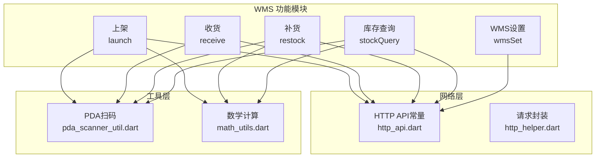

**图表来源**
- [lib/pages/business/wms/launch/list.dart:1-60](file://lib/pages/business/wms/launch/list.dart#L1-L60)
- [lib/pages/business/wms/receive/list.dart:1-60](file://lib/pages/business/wms/receive/list.dart#L1-L60)
- [lib/pages/business/wms/restock/list.dart:1-60](file://lib/pages/business/wms/restock/list.dart#L1-L60)
- [lib/pages/business/wms/stockQuery/list.dart:1-60](file://lib/pages/business/wms/stockQuery/list.dart#L1-L60)
- [lib/pages/business/wms/wmsSet/page.dart:1-60](file://lib/pages/business/wms/wmsSet/page.dart#L1-L60)
- [lib/net/http_api.dart:195-226](file://lib/net/http_api.dart#L195-L226)
- [lib/util/pda_scanner_util.dart:1-65](file://lib/util/pda_scanner_util.dart#L1-L65)

**章节来源**
- [lib/pages/business/wms/launch/list.dart:1-60](file://lib/pages/business/wms/launch/list.dart#L1-L60)
- [lib/pages/business/wms/receive/list.dart:1-60](file://lib/pages/business/wms/receive/list.dart#L1-L60)
- [lib/pages/business/wms/restock/list.dart:1-60](file://lib/pages/business/wms/restock/list.dart#L1-L60)
- [lib/pages/business/wms/stockQuery/list.dart:1-60](file://lib/pages/business/wms/stockQuery/list.dart#L1-L60)
- [lib/pages/business/wms/wmsSet/page.dart:1-60](file://lib/pages/business/wms/wmsSet/page.dart#L1-L60)
- [lib/net/http_api.dart:195-226](file://lib/net/http_api.dart#L195-L226)
- [lib/util/pda_scanner_util.dart:1-65](file://lib/util/pda_scanner_util.dart#L1-L65)

## 核心接口定义
本节整理 WMS 仓储模块使用的主要后端接口，包括方法名、路径、用途及调用方页面。

| 接口名称 | 后端路径 | 主要用途 | 调用方 |
|---|---|---|---|
| `wmsReceiveTakList` | `wms/task/receive/getWmsReceiveTakList` | 获取收货任务列表 | 收货任务列表页 |
| `wmsReceiveGetInfo` | `wms/task/receive/getInfo` | 获取收货任务详情 | 收货任务详情页 |
| `wmsReceiveUpdate` | `wms/task/receive/updateReceiveTak` | 保存收货数据 | 收货任务编辑页 |
| `wmsReceiveRetsign` | `wms/task/receive/retsign` | 反审核收货任务 | 收货任务操作 |
| `wmsFinishReceiveTak` | `cgstockin/finishReceiveTak` | 完成收货 | 收货流程收尾 |
| `wmsReceivePrint` | `airprint/setWxPrintRw` | 打印收货单据 | 收货任务操作 |
| `wmsLaunchList` | `wms/stock/getWmsLaunchList` | 上架任务列表（按单据） | 上架任务列表页 |
| `wmsLaunchProList` | `wms/stock/getWmsLaunchProList` | 上架任务列表（按商品） | 上架任务列表页 |
| `wmsLaunchListByTray` | `wms/task/receive/getWmsLaunchListByTray` | 扫托盘码查上架明细 | 上架任务列表页 |
| `wmsLaunchSave` | `wms/task/receive/WmsLaunch` | 单条上架保存 | 上架编辑页 |
| `wmsLaunchListSave` | `wms/task/receive/WmsLaunchList` | 批量上架保存（按单据分组） | 上架编辑页 |
| `wmsLocationList` | `bi/location/getWmsLocationList` | 货位号列表（上架） | 上架编辑页 |
| `wmsRemoveLocationList` | `bi/location/getWmsRemoveLocationList` | 可移入货位列表 | 移货页 |
| `wmsReStockList` | `wms/stock/getWmsReStockList` | 补货列表 | 补货列表页 |
| `wmsProductLocationStockList` | `wms/stock/report/getProductLocationStockList` | 商品货位库存 | 补货详情页 |
| `wmsRestockSave` | `wms/task/receive/restock` | 补货保存 | 补货详情页 |
| `wmsStockByProduct` | `wms/stock/getWmsStockByProduct` | 商品维度库存 | 库存查询页 |
| `wmsStockSumByShelf` | `wms/stock/getWmsStockSumByShelf` | 货位维度库存汇总 | 库存查询页 |
| `wmsMoveStock` | `wms/task/receive/moveStock` | 移货保存 | 移货页 |
| `wmsSetSave` | `airWmsSet/saveWxWmsSet` | 保存WMS设置 | WMS设置页 |
| `wmsSetGet` | `airWmsSet/getWxWmsSet` | 获取WMS设置 | WMS设置页、库存查询页 |

**章节来源**
- [lib/net/http_api.dart:195-226](file://lib/net/http_api.dart#L195-L226)

## 系统架构总览
WMS 前端采用页面驱动 + 网络常量集中管理的架构：
- 页面层负责用户交互、筛选条件构建、分页加载、扫码输入。
- 网络层通过 `HttpApi` 统一管理后端路径，避免硬编码字符串散落。
- 工具层提供数学计算、权限校验、Toast提示、PDA扫码等能力。
- 选择器组件复用 `SelectLocationPage`、`SelectProductPage`、`CommonSelectSheet` 等通用选择弹窗。

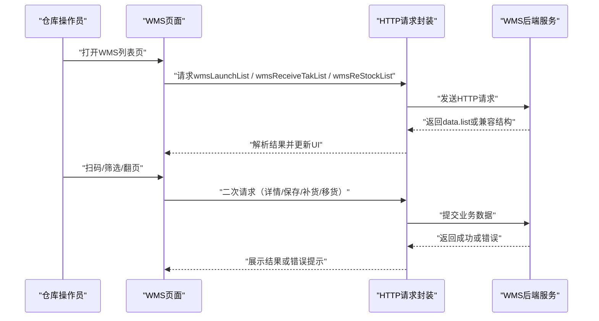

**图表来源**
- [lib/pages/business/wms/launch/list.dart:60-140](file://lib/pages/business/wms/launch/list.dart#L60-L140)
- [lib/pages/business/wms/receive/list.dart:120-220](file://lib/pages/business/wms/receive/list.dart#L120-L220)
- [lib/pages/business/wms/restock/list.dart:60-140](file://lib/pages/business/wms/restock/list.dart#L60-L140)
- [lib/net/http_api.dart:195-226](file://lib/net/http_api.dart#L195-L226)

## 详细组件分析

### 上架任务模块
上架任务包含“按单据”和“按商品”两种视图，支持扫码商品条码、扫托盘码查询、选择货位号、保存上架。

#### 上架任务列表
- 列表数据来源：
  - 按单据：`wmsLaunchList`
  - 按商品：`wmsLaunchProList`
- 分页参数：`is_page=1`、`field`、`type`、`page`、`pagesize`、`sids`、`sidsname`、`cond`
- 搜索行为：
  - 按商品模式：内置扫码入口，扫描商品条码后刷新列表
  - 悬浮按钮：扫描托盘码，调用 `wmsLaunchListByTray` 获取托盘对应的明细
- 排序规则：
  - 按单据：按制单时间降序
  - 按商品：按单号排序

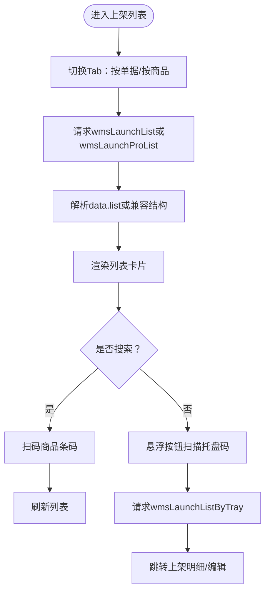

**图表来源**
- [lib/pages/business/wms/launch/list.dart:60-140](file://lib/pages/business/wms/launch/list.dart#L60-L140)
- [lib/pages/business/wms/launch/list.dart:140-200](file://lib/pages/business/wms/launch/list.dart#L140-L200)

#### 上架任务明细
- 根据 `billflag` 决定详情接口：
  - 采购入库：`purchaseInstoreGetInfo`
  - 批发退货：`pfSellGetInfo`
  - 调拨入库：`dbStockOutGetInfo`
  - 配退收货：`psrefundinGetInfo`
- 合并逻辑：
  - `detaillist`：原始明细
  - `mergeDetails`：按商品聚合明细
  - 自动补齐 `billno`、`lunchqty`、`sumlunchqty`

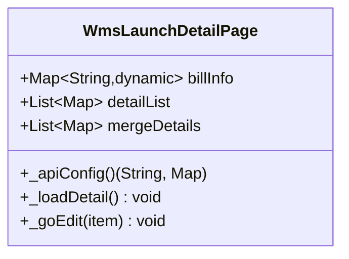

**图表来源**
- [lib/pages/business/wms/launch/detail.dart:1-120](file://lib/pages/business/wms/launch/detail.dart#L1-L120)

#### 上架编辑与保存
- 货位管理：
  - 扫描货位条码后调用 `locationGetList` 校验并插入列表
  - 绑定其他货位号：`SelectLocationPage`
  - 初始货位列表：`wmsLocationList`
- 保存逻辑：
  - 普通模式：构造 `detaillist`，调用 `wmsLaunchSave`
  - 托盘码分组模式：按 `billid` 分组，调用 `wmsLaunchListSave`
- 金额与数量计算：
  - 使用 `MathUtils` 进行累加与格式化
  - 补充 `sellamt`、`psamt`、`ywpsamt`、`ywsellamt`

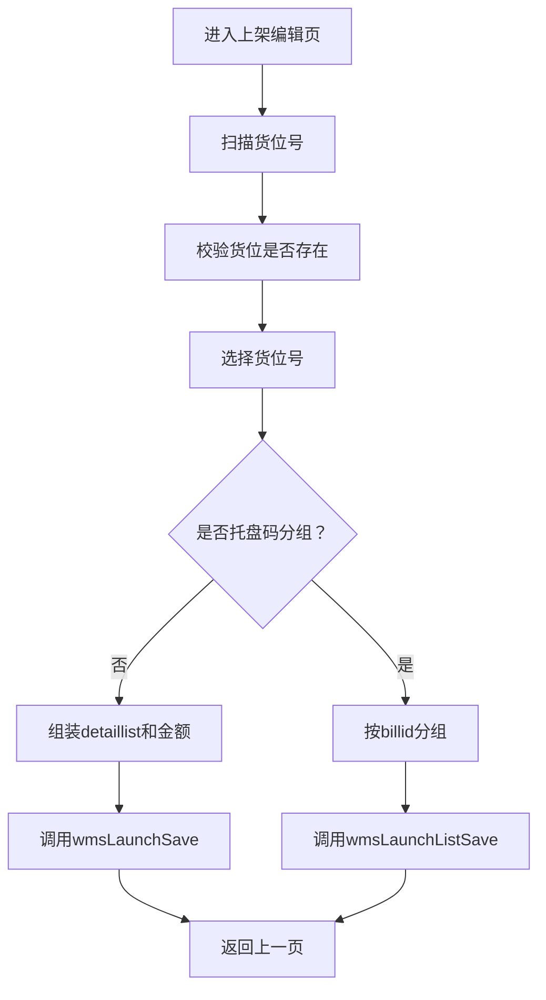

**图表来源**
- [lib/pages/business/wms/launch/edit.dart:200-340](file://lib/pages/business/wms/launch/edit.dart#L200-L340)
- [lib/pages/business/wms/launch/edit.dart:340-520](file://lib/pages/business/wms/launch/edit.dart#L340-L520)

**章节来源**
- [lib/pages/business/wms/launch/list.dart:1-200](file://lib/pages/business/wms/launch/list.dart#L1-L200)
- [lib/pages/business/wms/launch/detail.dart:1-120](file://lib/pages/business/wms/launch/detail.dart#L1-L120)
- [lib/pages/business/wms/launch/edit.dart:1-200](file://lib/pages/business/wms/launch/edit.dart#L1-L200)
- [lib/pages/business/wms/launch/edit.dart:200-520](file://lib/pages/business/wms/launch/edit.dart#L200-L520)
- [lib/pages/business/wms/launch/common.dart:1-185](file://lib/pages/business/wms/launch/common.dart#L1-L185)

### 收货任务模块
收货任务列表页支持状态筛选（全部、待收货、已收货）、日期范围、供应商、制单人、商品等多维筛选，并通过 `wmsReceiveTakList` 拉取数据。

- 状态映射：
  - 全部：`signflag=''`
  - 待收货：`signflag='0'`
  - 已收货：`signflag='1'`
- 分页参数：`is_page=1`、`field='createtime'`、`type='desc'`、`page`、`billnoflag='1'`、`billno`、`datetype='1'`、`signflag`、`sids`、`sidsname`、`starttime`、`endtime`
- 权限控制：
  - 进入时检查权限 `011901`，无权限则提示并在后台调整

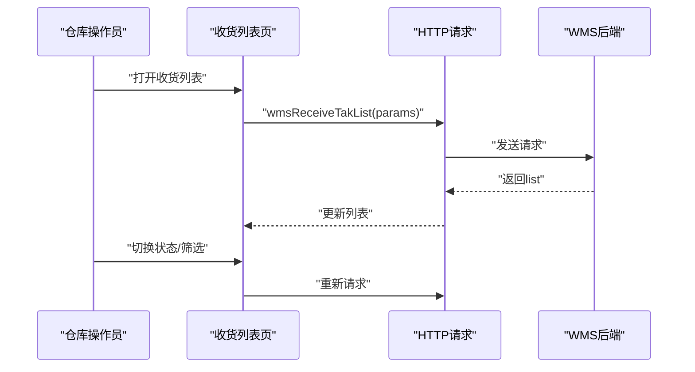

**图表来源**
- [lib/pages/business/wms/receive/list.dart:60-160](file://lib/pages/business/wms/receive/list.dart#L60-L160)

**章节来源**
- [lib/pages/business/wms/receive/list.dart:1-200](file://lib/pages/business/wms/receive/list.dart#L1-L200)

### 补货任务模块
补货列表页支持按拣货位、商品筛选，点击商品进入补货详情，选择移出货位后保存。

- 列表请求：`wmsReStockList`
- 商品货位库存：`wmsProductLocationStockList`
- 补货保存：`wmsRestockSave`

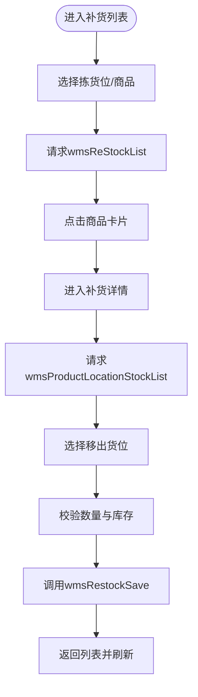

**图表来源**
- [lib/pages/business/wms/restock/list.dart:60-140](file://lib/pages/business/wms/restock/list.dart#L60-L140)
- [lib/pages/business/wms/restock/detail.dart:60-140](file://lib/pages/business/wms/restock/detail.dart#L60-L140)

**章节来源**
- [lib/pages/business/wms/restock/list.dart:1-200](file://lib/pages/business/wms/restock/list.dart#L1-L200)
- [lib/pages/business/wms/restock/detail.dart:1-200](file://lib/pages/business/wms/restock/detail.dart#L1-L200)

### 库存查询与移货模块
库存查询支持两个 Tab：
- 商品库存：`wmsStockByProduct`
- 货位库存汇总：`wmsStockSumByShelf`

移货流程：
- 从原货位移出到目标货位
- 可移入货位列表：`wmsRemoveLocationList`
- 移货保存：`wmsMoveStock`

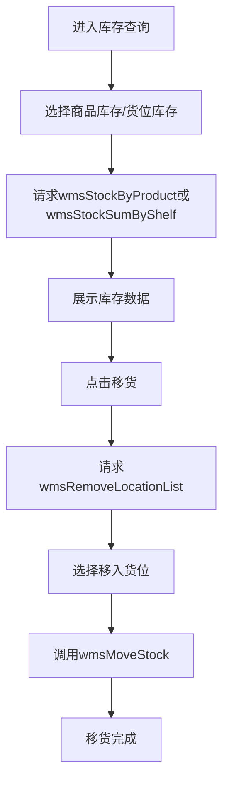

**图表来源**
- [lib/pages/business/wms/stockQuery/list.dart:60-140](file://lib/pages/business/wms/stockQuery/list.dart#L60-L140)
- [lib/pages/business/wms/stockQuery/move_goods.dart:60-140](file://lib/pages/business/wms/stockQuery/move_goods.dart#L60-L140)

**章节来源**
- [lib/pages/business/wms/stockQuery/list.dart:1-200](file://lib/pages/business/wms/stockQuery/list.dart#L1-L200)
- [lib/pages/business/wms/stockQuery/move_goods.dart:1-200](file://lib/pages/business/wms/stockQuery/move_goods.dart#L1-L200)

### WMS设置模块
WMS设置用于配置默认仓库，影响库存查询默认仓库和其他 WMS 相关功能。

- 获取设置：`wmsSetGet`
- 保存设置：`wmsSetSave`
- 仓库选择：`counterGetList`（过滤 `wmsflag=1`）

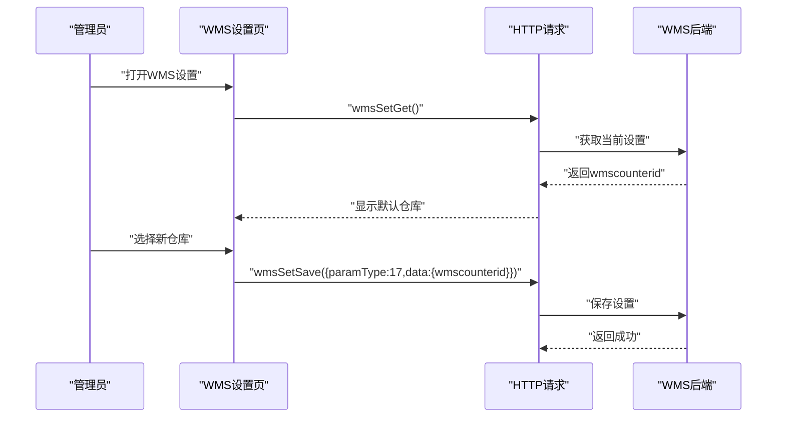

**图表来源**
- [lib/pages/business/wms/wmsSet/page.dart:60-160](file://lib/pages/business/wms/wmsSet/page.dart#L60-L160)

**章节来源**
- [lib/pages/business/wms/wmsSet/page.dart:1-200](file://lib/pages/business/wms/wmsSet/page.dart#L1-L200)

## 依赖关系分析
WMS 模块对以下外部依赖有较强耦合：
- 网络层：`HttpApi` 与 `http_helper.dart`
- 选择器组件：`SelectLocationPage`、`SelectProductPage`、`CommonSelectSheet`
- 工具类：`MathUtils`、`PermissionUtils`、`ToastUtils`
- 平台能力：PDA扫码（Android EventChannel）

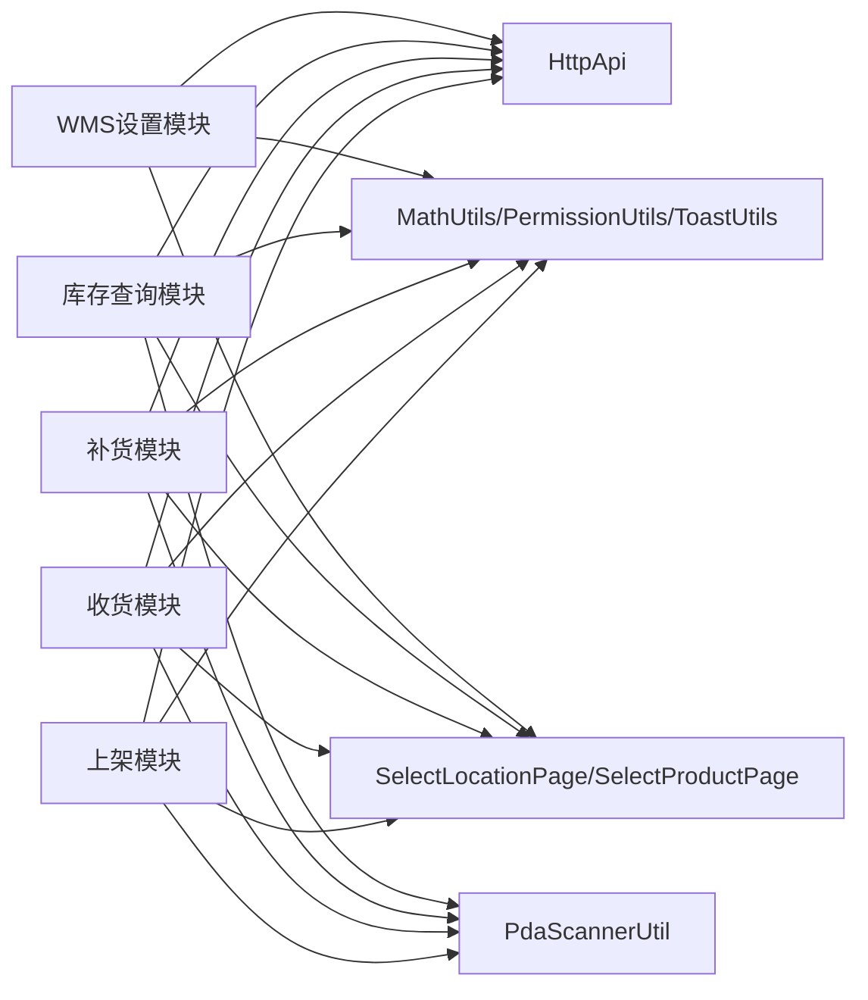

**图表来源**
- [lib/pages/business/wms/launch/edit.dart:200-340](file://lib/pages/business/wms/launch/edit.dart#L200-L340)
- [lib/pages/business/wms/receive/list.dart:120-220](file://lib/pages/business/wms/receive/list.dart#L120-L220)
- [lib/pages/business/wms/restock/detail.dart:60-140](file://lib/pages/business/wms/restock/detail.dart#L60-L140)
- [lib/pages/business/wms/stockQuery/move_goods.dart:60-140](file://lib/pages/business/wms/stockQuery/move_goods.dart#L60-L140)
- [lib/util/pda_scanner_util.dart:1-65](file://lib/util/pda_scanner_util.dart#L1-L65)

**章节来源**
- [lib/net/http_api.dart:195-226](file://lib/net/http_api.dart#L195-L226)
- [lib/util/pda_scanner_util.dart:1-65](file://lib/util/pda_scanner_util.dart#L1-L65)

## 性能与精度优化
- 分页与防抖：
  - 列表页普遍使用 `is_page=1`、`page`、`pagesize` 分页，结合滚动监听增量加载。
  - 收货列表使用防抖搜索，减少频繁请求。
- 数据兼容性：
  - 多处解析 `data.list` 时兼容数组直接返回的结构，降低后端结构变更带来的风险。
- 数值精度：
  - 使用 `MathUtils.add`、`MathUtils.multiply`、`MathUtils.formatDecimal` 保证金额与数量精度一致。
- UI性能：
  - 列表使用 `cacheExtent` 预渲染，提升滑动体验。
  - 商品明细项使用 `RepaintBoundary` 减少重绘范围。

[本节为通用性能建议，不直接分析具体文件]

## PDA扫码与硬件集成
PDA 扫码通过 `PdaScannerUtil` 暴露 EventChannel，在 Android 平台接收硬件扫描广播，将条码以 Stream 形式提供给 Flutter 层。

- 平台支持判断：仅 Android 非 Web 环境可用。
- 生命周期管理：
  - `startListening(onBarcode)` 启动监听
  - `stopListening()` 停止监听
  - `dispose()` 释放资源
- 与 WMS 页面的集成：
  - 上架列表页支持扫码商品条码和托盘码
  - 上架编辑页支持扫描货位条码
  - 补货列表页支持扫码商品条码

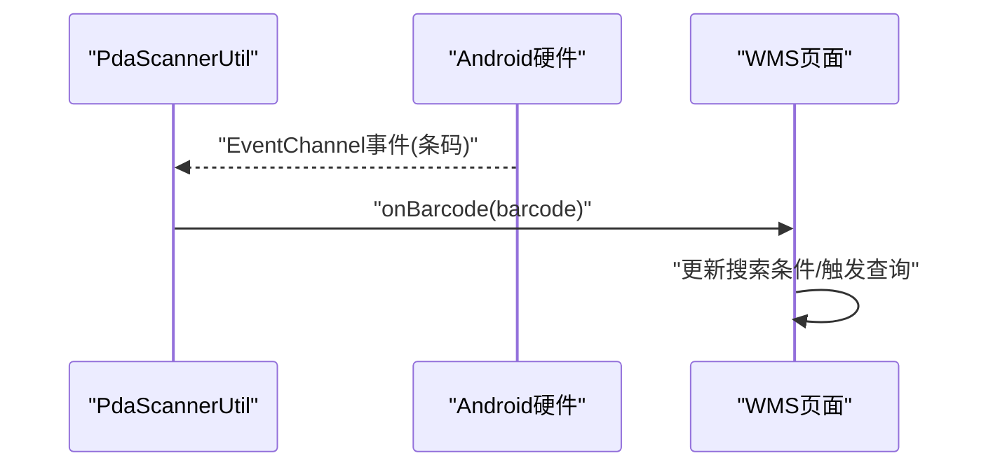

**图表来源**
- [lib/util/pda_scanner_util.dart:1-65](file://lib/util/pda_scanner_util.dart#L1-L65)
- [lib/pages/business/wms/launch/list.dart:140-200](file://lib/pages/business/wms/launch/list.dart#L140-L200)
- [lib/pages/business/wms/launch/edit.dart:200-280](file://lib/pages/business/wms/launch/edit.dart#L200-L280)
- [lib/pages/business/wms/restock/list.dart:140-200](file://lib/pages/business/wms/restock/list.dart#L140-L200)

**章节来源**
- [lib/util/pda_scanner_util.dart:1-65](file://lib/util/pda_scanner_util.dart#L1-L65)
- [lib/pages/business/wms/launch/list.dart:140-200](file://lib/pages/business/wms/launch/list.dart#L140-L200)
- [lib/pages/business/wms/launch/edit.dart:200-280](file://lib/pages/business/wms/launch/edit.dart#L200-L280)
- [lib/pages/business/wms/restock/list.dart:140-200](file://lib/pages/business/wms/restock/list.dart#L140-L200)

## 部署配置与运维指导
- 环境配置：
  - 应用内使用云端域名（如 `yun.bypos.net`），需确保 DNS 解析与出口合规。
- 证书与签名：
  - iOS 端需正确配置证书与签名，避免 App Store 上传失败。
  - Android 端注意密钥串与签名对齐。
- 权限与角色：
  - WMS 功能涉及权限点，例如收货查看权限 `011901`、上架确认权限 `011902`，需在后台为用户分配相应权限。
- 默认仓库配置：
  - 通过 `wmsSetGet` 与 `wmsSetSave` 配置默认仓库，影响库存查询与其他 WMS 功能。
- 日志与监控：
  - 收货列表页集成日志埋点（如 `LogPageMixin`），便于追踪用户操作与性能问题。

[本节为通用部署建议，不直接分析具体文件]

## 故障排查指南
- 无权限访问：
  - 现象：提示“无权查看WMS收货”或“无权上架确认”。
  - 处理：检查后台用户权限点（`011901`、`011902`）。
- 扫码无效：
  - 现象：扫描条码后未触发搜索或报错。
  - 处理：检查 PDA 设备是否启用 EventChannel，Flutter 层是否正确调用 `startListening`。
- 库存为空或异常：
  - 现象：库存查询结果为空或数量异常。
  - 处理：检查默认仓库配置、商品与货位关联、批次号一致性。
- 保存失败：
  - 现象：上架、补货、移货保存时报错。
  - 处理：检查必填字段（货位号、数量、库存限制）、网络状态与后端响应。

**章节来源**
- [lib/pages/business/wms/receive/list.dart:60-120](file://lib/pages/business/wms/receive/list.dart#L60-L120)
- [lib/pages/business/wms/launch/edit.dart:200-340](file://lib/pages/business/wms/launch/edit.dart#L200-L340)
- [lib/pages/business/wms/restock/detail.dart:60-140](file://lib/pages/business/wms/restock/detail.dart#L60-L140)
- [lib/pages/business/wms/stockQuery/move_goods.dart:60-140](file://lib/pages/business/wms/stockQuery/move_goods.dart#L60-L140)

## 结论
本仓库的 WMS 仓储模块以清晰的页面划分与统一的网络接口管理为核心，覆盖上架、收货、补货、库存查询与移货等完整仓储作业流程。通过 PDA 扫码、货位管理与精度控制的配合，形成高效可靠的移动端仓储解决方案。建议在部署时关注权限配置、默认仓库设置与日志监控，以确保业务稳定运行。