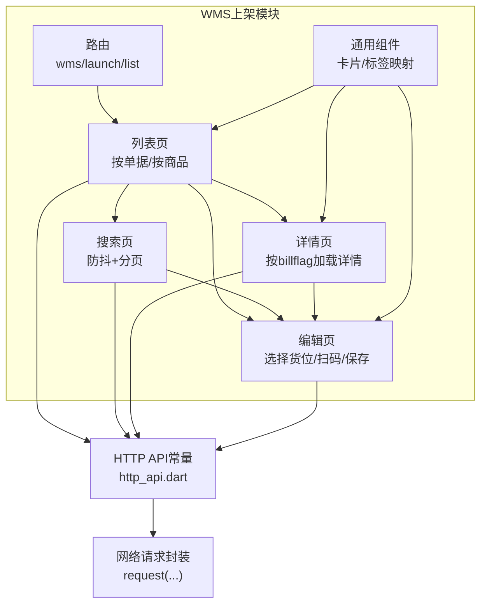
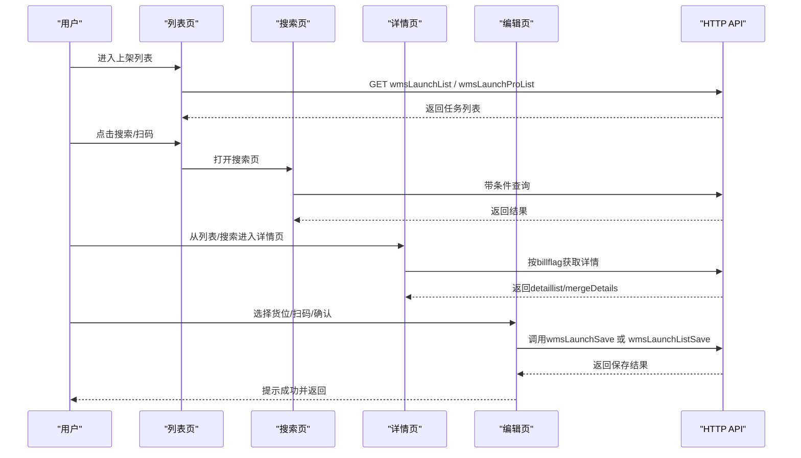
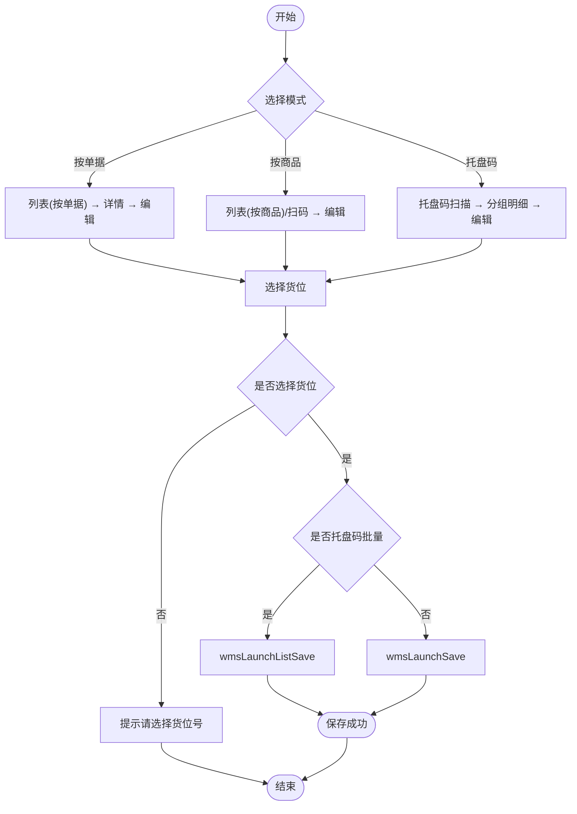
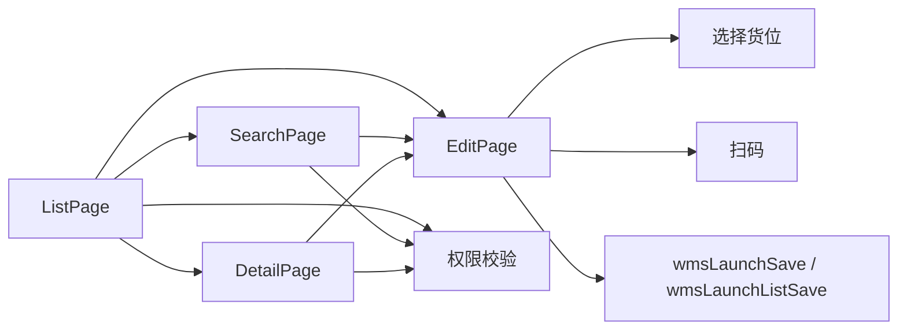

# 上架任务API

<cite>
**本文引用的文件 **
- [lib/net/http_api.dart](file://lib/net/http_api.dart)
- [lib/pages/business/wms/launch/router.dart](file://lib/pages/business/wms/launch/router.dart)
- [lib/pages/business/wms/launch/list.dart](file://lib/pages/business/wms/launch/list.dart)
- [lib/pages/business/wms/launch/detail.dart](file://lib/pages/business/wms/launch/detail.dart)
- [lib/pages/business/wms/launch/search.dart](file://lib/pages/business/wms/launch/search.dart)
- [lib/pages/business/wms/launch/edit.dart](file://lib/pages/business/wms/launch/edit.dart)
- [lib/pages/business/wms/launch/common.dart](file://lib/pages/business/wms/launch/common.dart)
</cite>

## 目录
1. [引言](#引言)
2. [项目结构](#项目结构)
3. [核心组件](#核心组件)
4. [架构总览](#架构总览)
5. [详细组件分析](#详细组件分析)
6. [依赖分析](#依赖分析)
7. [性能考虑](#性能考虑)
8. [故障排查指南](#故障排查指南)
9. [结论](#结论)
10. [附录：部署与运维指导](#附录部署与运维指导)

## 引言
本文件面向灵犀管店Flutter项目的WMS上架作业，围绕以下接口进行完整定义与流程说明：
- wmsLaunchList：上架任务列表（按单据）
- wmsLaunchProList：上架任务列表（按商品）
- wmsLaunchListByTray：扫托盘码查上架明细
- wmsLaunchSave：单条上架保存
- wmsLaunchListSave：上架批量保存（按单据分组）

同时覆盖：
- 上架作业流程
- 货位分配策略
- PDA扫码集成方案
- 库存更新机制（客户端视角）
- 工作流示例、托盘码扫描处理方案
- 性能优化策略
- 部署配置与运维建议

## 项目结构
上架功能位于WMS业务模块下，主要涉及路由、列表、搜索、详情、编辑及通用展示组件。

图表来源
- [lib/pages/business/wms/launch/router.dart:1-17](file://lib/pages/business/wms/launch/router.dart#L1-L17)
- [lib/pages/business/wms/launch/list.dart:1-479](file://lib/pages/business/wms/launch/list.dart#L1-L479)
- [lib/pages/business/wms/launch/detail.dart:1-281](file://lib/pages/business/wms/launch/detail.dart#L1-L281)
- [lib/pages/business/wms/launch/search.dart:1-334](file://lib/pages/business/wms/launch/search.dart#L1-L334)
- [lib/pages/business/wms/launch/edit.dart:1-742](file://lib/pages/business/wms/launch/edit.dart#L1-L742)
- [lib/pages/business/wms/launch/common.dart:1-185](file://lib/pages/business/wms/launch/common.dart#L1-L185)
- [lib/net/http_api.dart:201-240](file://lib/net/http_api.dart#L201-L240)

章节来源
- [lib/pages/business/wms/launch/router.dart:1-17](file://lib/pages/business/wms/launch/router.dart#L1-L17)

## 核心组件
- HTTP API常量：集中定义WMS上架相关接口路径。
- 列表页：支持“按单据”和“按商品”两个Tab，分页加载，内置扫码入口。
- 搜索页：支持按单号或条码/品名/自编码搜索，防抖与分页。
- 详情页：根据单据类型（采购入库、批发退货、调拨入库、配退收货）动态加载详情并聚合明细。
- 编辑页：选择货位、扫码校验货位、计算金额数量、保存单条或批量提交。
- 通用组件：单据类型与来源标签、列表卡片渲染。

章节来源
- [lib/net/http_api.dart:201-240](file://lib/net/http_api.dart#L201-L240)
- [lib/pages/business/wms/launch/list.dart:1-479](file://lib/pages/business/wms/launch/list.dart#L1-L479)
- [lib/pages/business/wms/launch/search.dart:1-334](file://lib/pages/business/wms/launch/search.dart#L1-L334)
- [lib/pages/business/wms/launch/detail.dart:1-281](file://lib/pages/business/wms/launch/detail.dart#L1-L281)
- [lib/pages/business/wms/launch/edit.dart:1-742](file://lib/pages/business/wms/launch/edit.dart#L1-L742)
- [lib/pages/business/wms/launch/common.dart:1-185](file://lib/pages/business/wms/launch/common.dart#L1-L185)

## 架构总览
上架作业在客户端通过四个页面串联完成，后端由统一HTTP API暴露。

图表来源
- [lib/pages/business/wms/launch/list.dart:1-479](file://lib/pages/business/wms/launch/list.dart#L1-L479)
- [lib/pages/business/wms/launch/search.dart:1-334](file://lib/pages/business/wms/launch/search.dart#L1-L334)
- [lib/pages/business/wms/launch/detail.dart:1-281](file://lib/pages/business/wms/launch/detail.dart#L1-L281)
- [lib/pages/business/wms/launch/edit.dart:1-742](file://lib/pages/business/wms/launch/edit.dart#L1-L742)
- [lib/net/http_api.dart:201-240](file://lib/net/http_api.dart#L201-L240)

## 详细组件分析

### WMS上架API定义
本节聚焦服务端接口的客户端侧定义与用途。

- wmsLaunchList
  - 路径：`wms/stock/getWmsLaunchList`
  - 用途：上架任务列表（按单据）
  - 典型参数：is_page、field=createtime、type=desc、page、pagesize、sids、sidsname、cond
  - 返回结构：data.list为单据列表；每项含billid、billno、showname、billflag等

- wmsLaunchProList
  - 路径：`wms/stock/getWmsLaunchProList`
  - 用途：上架任务列表（按商品）
  - 典型参数：is_page、field=billno、type=desc、page、pagesize、sids、sidsname、cond
  - 返回结构：data.list为商品维度条目，含billid、billno、productname、billqty等

- wmsLaunchListByTray
  - 路径：`wms/task/receive/getWmsLaunchListByTray`
  - 用途：扫托盘码查上架明细
  - 入参：palletcode
  - 返回结构：data.list为按billid分组的上架数据，内含detaillist

- wmsLaunchSave
  - 路径：`wms/task/receive/WmsLaunch`
  - 用途：单条上架保存
  - 入参：包含locationcode/locationid/palletcode、detaillist、汇总字段billqty/billamt/ywpsamt/ywsellamt等

- wmsLaunchListSave
  - 路径：`wms/task/receive/WmsLaunchList`
  - 用途：上架批量保存（按单据分组）
  - 入参：receiveList数组，每项为一个单据的合并提交体

- 辅助接口
  - wmsLocationList：`bi/location/getWmsLocationList`，用于上架选择货位
  - locationGetList：`bi/location/getList`，用于扫码校验货位是否存在

章节来源
- [lib/net/http_api.dart:201-240](file://lib/net/http_api.dart#L201-L240)

### 上架任务列表（wmsLaunchList / wmsLaunchProList）
- 列表页提供两个Tab：
  - 按单据：field=createtime，按制单时间倒序
  - 按商品：field=billno，按单号排序
- 分页加载：默认pageSize=20，滚动到底部自动加载更多
- 搜索：跳转搜索页，返回后刷新
- 扫码：
  - 按商品模式：扫码商品条码作为cond条件查询
  - 悬浮托盘码按钮：调用wmsLaunchListByTray，按托盘码拉取明细并跳转到编辑页

关键实现要点
- 使用SpUtil读取当前门店信息（storeId/storeName）
- 列表项点击权限校验（011901）
- 托盘码扫描后，将分组数据展平为mergeDetails/detaillist并传递到编辑页

章节来源
- [lib/pages/business/wms/launch/list.dart:1-479](file://lib/pages/business/wms/launch/list.dart#L1-L479)

### 托盘码扫描查上架明细（wmsLaunchListByTray）
- 触发入口：列表页悬浮扫码按钮
- 输入：托盘码
- 处理逻辑：
  - 调用wmsLaunchListByTray(palletcode)
  - 对返回的按billid分组数据进行展平，计算lunchqty
  - 构造sumlunchqty/lunchqty/palletcode/mergeDetails/detaillist/billGroupedList
  - 跳转至编辑页执行上架
- 异常：无数据时提示“未找到该托盘的上架数据”

章节来源
- [lib/pages/business/wms/launch/list.dart:201-276](file://lib/pages/business/wms/launch/list.dart#L201-L276)

### 上架批量保存（wmsLaunchListSave）
- 适用场景：托盘码扫描后的多单据批量保存
- 参数构建：
  - receiveList为每个单据的聚合对象，包含locationcode/locationid/palletcode
  - 每个单据内汇总billqty/billamt/ywpsamt/ywsellamt
- 提交方式：一次性调用wmsLaunchListSave
- 成功后：提示“保存成功”，延迟返回上一层

章节来源
- [lib/pages/business/wms/launch/edit.dart:280-403](file://lib/pages/business/wms/launch/edit.dart#L280-L403)

### 单条上架保存（wmsLaunchSave）
- 适用场景：按商品或按单据直接编辑的单次保存
- 参数构建：
  - 填充locationcode/locationid/palletcode
  - 计算sellamt/psamt等金额
  - 汇总billqty/billamt/ywpsamt/ywsellamt
- 提交方式：调用wmsLaunchSave
- 成功后：按来源返回层级不同（按单据返回两层，按商品返回一层）

章节来源
- [lib/pages/business/wms/launch/edit.dart:201-279](file://lib/pages/business/wms/launch/edit.dart#L201-L279)

### 货位分配策略
- 可选来源：
  - 扫描货位码：调用locationGetList(code,...)校验并选中
  - 绑定其他货位：SelectLocationPage选择货位
  - 初始化货位：若明细已含locationcode/locationid则预填
- 优先级：
  - 明细行若有locationcode/locationid优先使用
  - 否则使用页面级selectedLocationId
  - 最终提交前统一写入每条明细
- 约束：
  - 保存时必须选择货位，否则提示“请选择货位号”

章节来源
- [lib/pages/business/wms/launch/edit.dart:201-319](file://lib/pages/business/wms/launch/edit.dart#L201-L319)

### 上架作业工作流示例
- 流程A：按单据上架
  1. 列表页（按单据）→ 点击某单据
  2. 详情页按billflag加载对应详情接口
  3. 点击商品进入编辑页
  4. 选择货位 → 确认保存 → 调用wmsLaunchSave
- 流程B：按商品上架
  1. 列表页（按商品）→ 扫码商品条码搜索
  2. 点击商品直接进入编辑页
  3. 选择货位 → 确认保存 → 调用wmsLaunchSave
- 流程C：托盘码批量上架
  1. 列表页点击托盘码按钮
  2. 调用wmsLaunchListByTray获取分组明细
  3. 进入编辑页，批量组装receiveList
  4. 调用wmsLaunchListSave一次提交多个单据

图表来源
- [lib/pages/business/wms/launch/list.dart:1-479](file://lib/pages/business/wms/launch/list.dart#L1-L479)
- [lib/pages/business/wms/launch/detail.dart:1-281](file://lib/pages/business/wms/launch/detail.dart#L1-L281)
- [lib/pages/business/wms/launch/edit.dart:1-742](file://lib/pages/business/wms/launch/edit.dart#L1-L742)

### PDA扫码集成方案
- 扫码入口：
  - 列表页：按商品模式扫码、托盘码悬浮按钮
  - 搜索页：按商品模式扫码
  - 编辑页：扫描货位号
- 扫码组件：QrCodeScannerPage
- 扫码结果处理：
  - 过滤空值
  - 校验条码有效性（如货位码需存在）
  - 回填表单或发起查询
- 权限与提示：
  - 部分操作需权限校验（如011901/011902）
  - 失败统一Toast提示

章节来源
- [lib/pages/business/wms/launch/list.dart:1-479](file://lib/pages/business/wms/launch/list.dart#L1-L479)
- [lib/pages/business/wms/launch/search.dart:1-334](file://lib/pages/business/wms/launch/search.dart#L1-L334)
- [lib/pages/business/wms/launch/edit.dart:201-240](file://lib/pages/business/wms/launch/edit.dart#L201-L240)

### 库存更新机制（客户端视角）
- 客户端不直接操作库存表，而是通过API提交上架结果，由后端完成库存扣减与入库更新。
- 客户端职责：
  - 正确组装提交参数（locationcode/locationid/palletcode、数量、金额）
  - 保证批次/单位/价格字段一致性
  - 处理并发与重试（见性能与可靠性建议）
- 后端可能涉及的实体：
  - 上架任务、商品明细、货位、库存流水
  - 库存变更以wmsLaunchSave/wmsLaunchListSave为事务边界

章节来源
- [lib/net/http_api.dart:201-240](file://lib/net/http_api.dart#L201-L240)
- [lib/pages/business/wms/launch/edit.dart:201-403](file://lib/pages/business/wms/launch/edit.dart#L201-L403)

## 依赖分析
- 组件耦合
  - 列表页依赖搜索页、详情页、编辑页、通用组件
  - 详情页依赖后端详情接口（按billflag切换）
  - 编辑页依赖货位选择、扫码、保存API
- 外部依赖
  - SpUtil：本地存储门店信息
  - PermissionUtils：权限校验
  - QrCodeScannerPage：PDA扫码
  - Dio/HttpHelper：网络请求

图表来源
- [lib/pages/business/wms/launch/list.dart:1-479](file://lib/pages/business/wms/launch/list.dart#L1-L479)
- [lib/pages/business/wms/launch/search.dart:1-334](file://lib/pages/business/wms/launch/search.dart#L1-L334)
- [lib/pages/business/wms/launch/detail.dart:1-281](file://lib/pages/business/wms/launch/detail.dart#L1-L281)
- [lib/pages/business/wms/launch/edit.dart:1-742](file://lib/pages/business/wms/launch/edit.dart#L1-L742)

## 性能考虑
- 分页与无限滚动
  - 列表与搜索均使用分页（pageSize=20），避免一次性加载大量数据
- 防抖搜索
  - 搜索输入350ms防抖，减少频繁请求
- 请求序列号保护
  - 使用_requestSeq避免旧请求覆盖新数据
- 缓存与渲染优化
  - ListView.builder + cacheExtent=800提升滚动性能
  - RepaintBoundary隔离卡片重绘
- 批量提交
  - 托盘码场景使用wmsLaunchListSave减少往返次数
- 并发控制
  - _saving锁防止重复保存
- 数据去重
  - 货位列表插入前检查locationid避免重复

章节来源
- [lib/pages/business/wms/launch/list.dart:1-479](file://lib/pages/business/wms/launch/list.dart#L1-L479)
- [lib/pages/business/wms/launch/search.dart:1-334](file://lib/pages/business/wms/launch/search.dart#L1-L334)
- [lib/pages/business/wms/launch/edit.dart:201-403](file://lib/pages/business/wms/launch/edit.dart#L201-L403)

## 故障排查指南
- 常见问题
  - 托盘码无数据：检查托盘码是否正确；确认后端已有对应上架任务
  - 货位码无效：使用locationGetList校验货位是否存在
  - 权限不足：确认用户具备上架确认权限（011902）
  - 保存失败：检查必填字段（货位、数量、金额）、网络状态、后端错误码
- 日志与调试
  - 观察Toast提示与请求参数
  - 检查返回列表结构是否符合预期（list/map兼容处理）
  - 对比Vue端行为差异（对齐注释中已标明）

章节来源
- [lib/pages/business/wms/launch/list.dart:201-276](file://lib/pages/business/wms/launch/list.dart#L201-L276)
- [lib/pages/business/wms/launch/edit.dart:201-319](file://lib/pages/business/wms/launch/edit.dart#L201-L319)

## 结论
本文件系统梳理了灵犀管店Flutter项目中WMS上架作业的完整链路，明确各API的职责与参数，给出托盘码扫描、货位分配、批量保存的实现细节，并提供性能优化与运维建议。通过前后端对齐的接口与前端稳定的交互流程，上架作业可在PDA环境下高效稳定运行。

## 附录：部署与运维指导
- 环境配置
  - 后端基础地址：yun.bypos.net（详见http_api.dart中的baseUrlYlx）
  - 接口路径：wms/stock/*、wms/task/receive/*、bi/location/*
- 权限与角色
  - 上架查看权限：011901
  - 上架确认权限：011902
- 数据一致性
  - 建议使用wmsLaunchListSave进行托盘码批量提交，降低不一致风险
  - 对locationcode/locationid进行严格校验，确保库存落库准确
- 监控与告警
  - 关注保存接口成功率、耗时、失败原因
  - 针对托盘码无数据、货位不存在等错误建立告警
- 版本管理
  - 保持前后端接口契约一致，注意字段命名与类型变更
  - 客户端保留兼容逻辑（如data可为Map或List）

章节来源
- [lib/net/http_api.dart:201-240](file://lib/net/http_api.dart#L201-L240)