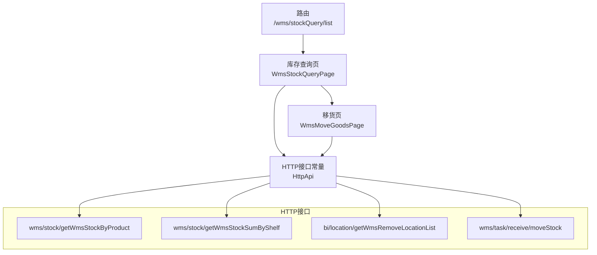
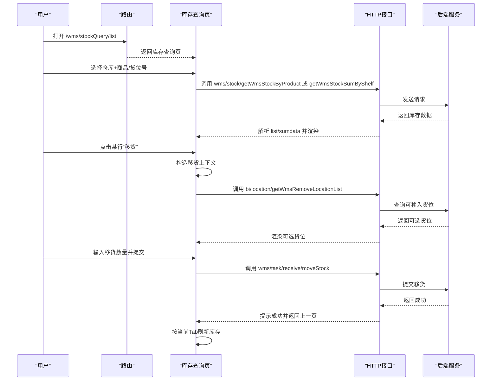
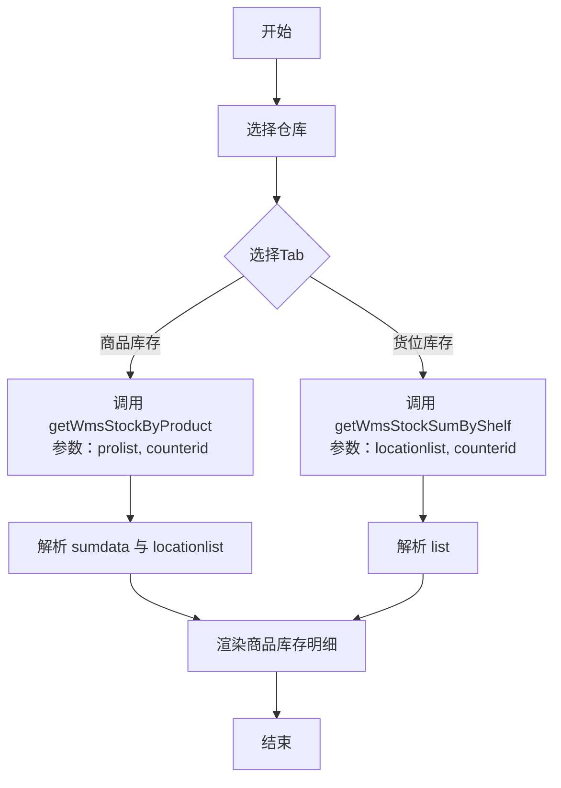
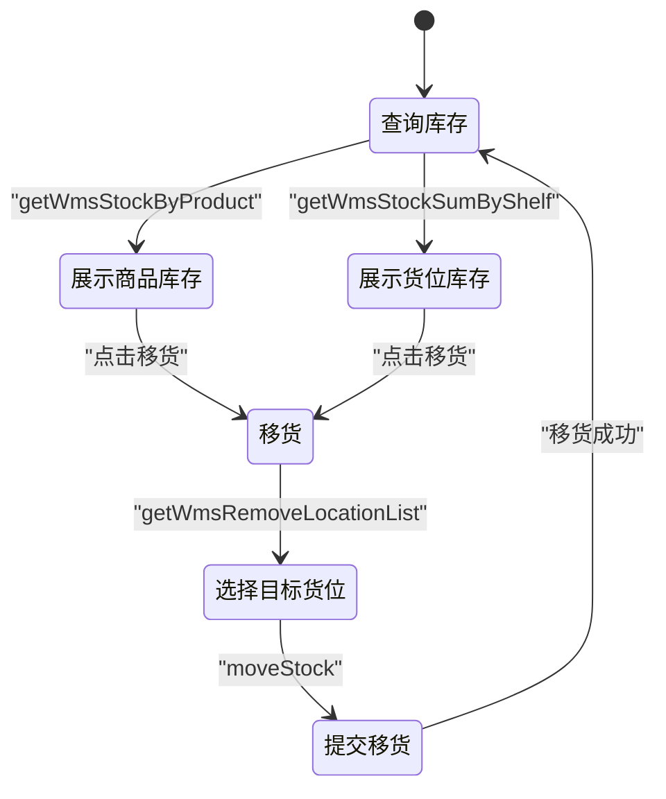
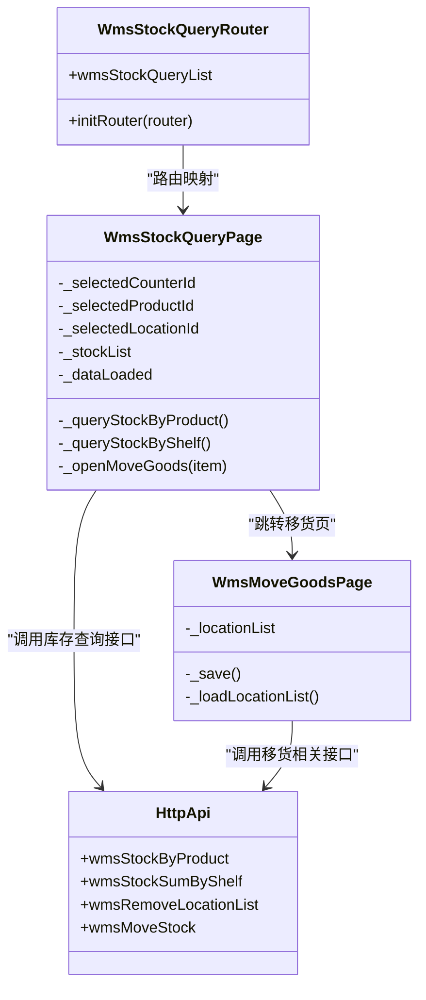

# 库存查询API

<cite>
**本文引用的文件 **
- [lib/pages/business/wms/stockQuery/list.dart](file://lib/pages/business/wms/stockQuery/list.dart)
- [lib/pages/business/wms/stockQuery/router.dart](file://lib/pages/business/wms/stockQuery/router.dart)
- [lib/pages/business/wms/stockQuery/move_goods.dart](file://lib/pages/business/wms/stockQuery/move_goods.dart)
- [lib/net/http_api.dart](file://lib/net/http_api.dart)
</cite>

## 目录
1. [简介](#简介)
2. [项目结构](#项目结构)
3. [核心组件](#核心组件)
4. [架构总览](#架构总览)
5. [详细接口定义](#详细接口定义)
6. [多维度库存查询能力](#多维度库存查询能力)
7. [实时库存与变动追踪](#实时库存与变动追踪)
8. [分页查询优化与大数据量策略](#分页查询优化与大数据量策略)
9. [性能优化与缓存建议](#性能优化与缓存建议)
10. [依赖关系分析](#依赖关系分析)
11. [故障排查指南](#故障排查指南)
12. [结论](#结论)

## 简介
本文面向灵犀管店Flutter项目中的WMS库存查询能力，聚焦以下目标：
- 完整记录库存查询相关接口的调用方式、参数、返回结构与业务语义。
- 说明商品维度与货位维度的多维度库存查询能力。
- 解释实时库存数据获取流程、库存状态标识与库存变动追踪机制（移货）。
- 提供完整的调用示例路径、分页查询优化建议及大数据量处理策略。
- 给出库存查询的性能优化和缓存机制指导。

本项目的库存查询入口位于WMS模块的“货位库存查询”页面，路由为 `/wms/stockQuery/list`，并通过两个Tab分别实现“商品库存”和“货位库存”两种查询视角；库存变动通过“商品移货”页面完成，底层统一由HTTP API层集中管理。

## 项目结构
与库存查询相关的核心代码分布如下：

**图表来源**
- [lib/pages/business/wms/stockQuery/router.dart:1-17](file://lib/pages/business/wms/stockQuery/router.dart#L1-L17)
- [lib/pages/business/wms/stockQuery/list.dart:1-200](file://lib/pages/business/wms/stockQuery/list.dart#L1-L200)
- [lib/pages/business/wms/stockQuery/move_goods.dart:1-200](file://lib/pages/business/wms/stockQuery/move_goods.dart#L1-L200)
- [lib/net/http_api.dart:200-264](file://lib/net/http_api.dart#L200-L264)

**章节来源**
- [lib/pages/business/wms/stockQuery/router.dart:1-17](file://lib/pages/business/wms/stockQuery/router.dart#L1-L17)
- [lib/pages/business/wms/stockQuery/list.dart:1-200](file://lib/pages/business/wms/stockQuery/list.dart#L1-L200)
- [lib/pages/business/wms/stockQuery/move_goods.dart:1-200](file://lib/pages/business/wms/stockQuery/move_goods.dart#L1-L200)
- [lib/net/http_api.dart:200-264](file://lib/net/http_api.dart#L200-L264)

## 核心组件
- WMS库存查询路由：注册页面路由并返回库存查询页实例。
- 库存查询页：负责仓库、商品/货位筛选，调用后端接口展示商品库存或货位库存明细，支持从库存明细进入移货流程。
- 商品移货页：根据当前库存行选择移入货位、校验数量、调用移货接口，成功后返回并刷新库存列表。
- HTTP接口常量：集中声明所有WMS相关接口地址，包括库存查询、可移入货位列表、移货保存等。

**章节来源**
- [lib/pages/business/wms/stockQuery/router.dart:1-17](file://lib/pages/business/wms/stockQuery/router.dart#L1-L17)
- [lib/pages/business/wms/stockQuery/list.dart:1-200](file://lib/pages/business/wms/stockQuery/list.dart#L1-L200)
- [lib/pages/business/wms/stockQuery/move_goods.dart:1-200](file://lib/pages/business/wms/stockQuery/move_goods.dart#L1-L200)
- [lib/net/http_api.dart:200-264](file://lib/net/http_api.dart#L200-L264)

## 架构总览
库存查询的整体交互流程如下：

**图表来源**
- [lib/pages/business/wms/stockQuery/list.dart:201-400](file://lib/pages/business/wms/stockQuery/list.dart#L201-L400)
- [lib/pages/business/wms/stockQuery/move_goods.dart:1-200](file://lib/pages/business/wms/stockQuery/move_goods.dart#L1-L200)
- [lib/net/http_api.dart:200-264](file://lib/net/http_api.dart#L200-L264)

## 详细接口定义

### 接口一：商品维度库存查询
- 接口地址常量：`wms/stock/getWmsStockByProduct`
- 触发场景：库存查询页“商品库存”Tab下，选择仓库与商品后自动查询。
- 请求参数
  - `prolist`: 商品ID数组，当前实现固定传入单个商品ID。
  - `counterid`: 仓库ID。
- 返回结构
  - `data.list`: 库存明细列表；当存在商品扩展信息时，首项可能包含商品级汇总字段，同时包含 `locationlist` 子列表作为货位明细。
  - `data.sumdata`: 汇总数据对象，包含 `sumqty` 表示该商品在选定仓库下的总库存。
- 关键字段
  - 商品级：`name`、`size`、`batchno`、`productid` 等。
  - 货位级：`locationcode`、`qty`、`batchno` 等。
- 业务含义
  - 用于展示指定商品在指定仓库下的各货位库存分布，以及该商品的总库存。

**章节来源**
- [lib/net/http_api.dart:200-264](file://lib/net/http_api.dart#L200-L264)
- [lib/pages/business/wms/stockQuery/list.dart:201-300](file://lib/pages/business/wms/stockQuery/list.dart#L201-L300)

### 接口二：货位维度库存汇总查询
- 接口地址常量：`wms/stock/getWmsStockSumByShelf`
- 触发场景：库存查询页“货位库存”Tab下，选择仓库与货位号后自动查询。
- 请求参数
  - `locationlist`: 货位ID数组，当前实现固定传入单个货位ID。
  - `counterid`: 仓库ID。
- 返回结构
  - `data.list`: 该货位下的库存明细列表，每项代表一个商品在该货位的库存。
- 关键字段
  - 商品级：`name`、`size`、`productid` 等。
  - 库存级：`qty`、`batchno` 等。
- 业务含义
  - 用于展示指定货位下各商品的库存情况。

**章节来源**
- [lib/net/http_api.dart:200-264](file://lib/net/http_api.dart#L200-L264)
- [lib/pages/business/wms/stockQuery/list.dart:300-360](file://lib/pages/business/wms/stockQuery/list.dart#L300-L360)

### 接口三：可移入货位列表查询
- 接口地址常量：`bi/location/getWmsRemoveLocationList`
- 触发场景：商品移货页加载时，查询允许将该商品从原货位移入的目标货位列表。
- 请求参数
  - `counterid`: 仓库ID。
  - `storeid`: 门店ID。
  - `zonetypenot`: 区域类型排除值，当前传 `'3'`，表示排除收货暂存区。
  - `locationIdnot`: 排除的原货位ID，避免把商品移回原位。
  - `productid`: 商品ID，用于限制可选货位范围。
- 返回结构
  - `data.list` 或 `data`：可移入货位列表。
- 关键字段
  - `locationid`、`locationcode`、`locationname`、`zonetype`、`stockqty` 等。
- 业务含义
  - 根据仓库、门店、区域类型、原货位和商品维度过滤出合法移入目标，供用户选择。

**章节来源**
- [lib/net/http_api.dart:200-264](file://lib/net/http_api.dart#L200-L264)
- [lib/pages/business/wms/stockQuery/move_goods.dart:1-120](file://lib/pages/business/wms/stockQuery/move_goods.dart#L1-L120)

### 接口四：移货保存
- 接口地址常量：`wms/task/receive/moveStock`
- 触发场景：用户在移货页选择目标货位并输入移货数量后提交。
- 请求参数
  - `counterid`: 仓库ID。
  - `productid`: 商品ID。
  - `outlocationid`、`outlocationcode`: 移出（原）货位ID与编码。
  - `inlocationid`、`inlocationcode`: 移入（新）货位ID与编码。
  - `stockzoneid`: 库存区域ID。
  - `qty`: 移货数量。
  - `sellamt`、`psamt`: 售价与成本价，优先取非零值。
  - `outbatchno`、`inbatchno`: 批次号，通常保持一致。
- 返回结构
  - 成功时返回业务成功结果；失败时由请求层统一提示错误。
- 业务含义
  - 将指定数量的商品从原货位移至目标货位，更新库存并产生库存变动记录。

**章节来源**
- [lib/net/http_api.dart:200-264](file://lib/net/http_api.dart#L200-L264)
- [lib/pages/business/wms/stockQuery/move_goods.dart:120-200](file://lib/pages/business/wms/stockQuery/move_goods.dart#L120-L200)

## 多维度库存查询能力
库存查询支持两个维度：
- 商品维度：以商品为主键，查询该商品在指定仓库下的全部货位库存明细，并提供该商品总库存。
- 货位维度：以货位为主键，查询该货位下全部商品的库存明细。

这两个维度共享仓库选择，且在不同Tab下自动切换查询条件与数据结构。

**图表来源**
- [lib/pages/business/wms/stockQuery/list.dart:201-360](file://lib/pages/business/wms/stockQuery/list.dart#L201-L360)
- [lib/net/http_api.dart:200-264](file://lib/net/http_api.dart#L200-L264)

**章节来源**
- [lib/pages/business/wms/stockQuery/list.dart:201-360](file://lib/pages/business/wms/stockQuery/list.dart#L201-L360)
- [lib/net/http_api.dart:200-264](file://lib/net/http_api.dart#L200-L264)

## 实时库存与变动追踪
- 实时性：库存查询直接调用后端WMS接口，每次查询都拉取最新数据；不存在前端静态缓存。
- 状态标识：
  - 商品维度返回的 `sumdata.sumqty` 表示商品总库存。
  - 货位维度返回列表中每个商品的 `qty` 表示该货位库存。
  - 移货过程中，可选货位显示 `stockqty`，帮助用户判断目标货位是否具备容纳能力。
- 变动追踪：
  - 移货成功后，页面会根据当前Tab重新执行对应库存查询，确保界面与后端一致。
  - 移货参数中包含原货位与新货位、商品、批次、价格等信息，便于后端生成库存变动流水。

**图表来源**
- [lib/pages/business/wms/stockQuery/list.dart:360-460](file://lib/pages/business/wms/stockQuery/list.dart#L360-L460)
- [lib/pages/business/wms/stockQuery/move_goods.dart:1-200](file://lib/pages/business/wms/stockQuery/move_goods.dart#L1-L200)
- [lib/net/http_api.dart:200-264](file://lib/net/http_api.dart#L200-L264)

**章节来源**
- [lib/pages/business/wms/stockQuery/list.dart:360-460](file://lib/pages/business/wms/stockQuery/list.dart#L360-L460)
- [lib/pages/business/wms/stockQuery/move_goods.dart:1-200](file://lib/pages/business/wms/stockQuery/move_goods.dart#L1-L200)
- [lib/net/http_api.dart:200-264](file://lib/net/http_api.dart#L200-L264)

## 分页查询优化与大数据量策略
当前库存查询实现未使用分页：
- 商品维度库存查询传入单条商品ID，返回该商品的所有货位明细。
- 货位维度库存查询传入单条货位ID，返回该货位下的商品明细。

对于大数据量场景，建议采用以下策略：
- 服务端分页：为 `getWmsStockByProduct` 与 `getWmsStockSumByShelf` 增加分页参数，如 `page`、`pageSize`、`total`，并在响应中返回 `data.list`、`data.total`、`data.pageInfo`。
- 客户端增量加载：结合滚动到底部事件，逐步加载下一页数据；对已加载数据做去重合并。
- 虚拟列表：使用长列表虚拟化方案，仅渲染可视区域内的库存项，降低内存占用与绘制开销。
- 查询条件前置：在商品/货位选择阶段尽量缩小范围，例如限定品类、品牌、有效期区间等。
- 预聚合指标：对频繁展示的汇总字段（如总库存、总件数）由后端直接返回，减少前端计算。

这些是通用优化建议；若未来接口引入分页，应在HTTP层与UI层同步改造。

[本节为通用优化建议，不直接分析具体文件]

## 性能优化与缓存建议
现有实现主要关注功能对齐，并未内置复杂的本地缓存策略。可从以下方面改进：
- 查询结果缓存：
  - 基于 `counterid + prolist` 与 `counterid + locationlist` 构建查询键，缓存最近一次查询结果，设置合理过期时间。
  - 移货成功后失效相关缓存键，保证下次查询重新拉取最新数据。
- 防抖与节流：
  - 仓库/商品/货位变化时进行短延时防抖，避免短时间内多次触发查询。
- 网络重试与降级：
  - 对库存查询失败进行有限次重试；在网络异常时展示上次可用数据或离线提示。
- UI渲染优化：
  - 继续使用 `cacheExtent` 与 `RepaintBoundary` 提升滚动性能。
  - 对大列表使用虚拟化列表组件，减少不可见节点渲染。
- 数据裁剪：
  - 只在需要时请求商品扩展信息；默认只拉取必要字段，详情再懒加载。

[本节为通用优化建议，不直接分析具体文件]

## 依赖关系分析
库存查询相关代码之间的依赖关系如下：

**图表来源**
- [lib/pages/business/wms/stockQuery/router.dart:1-17](file://lib/pages/business/wms/stockQuery/router.dart#L1-L17)
- [lib/pages/business/wms/stockQuery/list.dart:1-200](file://lib/pages/business/wms/stockQuery/list.dart#L1-L200)
- [lib/pages/business/wms/stockQuery/move_goods.dart:1-200](file://lib/pages/business/wms/stockQuery/move_goods.dart#L1-L200)
- [lib/net/http_api.dart:200-264](file://lib/net/http_api.dart#L200-L264)

**章节来源**
- [lib/pages/business/wms/stockQuery/router.dart:1-17](file://lib/pages/business/wms/stockQuery/router.dart#L1-L17)
- [lib/pages/business/wms/stockQuery/list.dart:1-200](file://lib/pages/business/wms/stockQuery/list.dart#L1-L200)
- [lib/pages/business/wms/stockQuery/move_goods.dart:1-200](file://lib/pages/business/wms/stockQuery/move_goods.dart#L1-L200)
- [lib/net/http_api.dart:200-264](file://lib/net/http_api.dart#L200-L264)

## 故障排查指南
常见问题与定位思路：
- 未选择仓库即查询：
  - 现象：商品/货位查询被忽略。
  - 原因：页面在缺少 `counterid` 时不会发起查询。
  - 解决：先选择仓库，再选择商品或货位。
- 移货数量为0或超过可用库存：
  - 现象：无法提交移货。
  - 原因：移货页对数量做了非空与非负校验，并限制不超过源库存。
  - 解决：调整移货数量，确保大于0且不超出可用库存。
- 可选货位为空：
  - 现象：移货页无可选货位。
  - 原因：过滤条件排除了收货暂存区与原货位，或商品/仓库组合下无合法目标货位。
  - 解决：检查仓库配置、区域类型、原货位与商品是否匹配。
- 移货成功但库存未更新：
  - 现象：移货成功提示出现，但列表仍显示旧数据。
  - 原因：页面逻辑会在移货成功后按当前Tab重新查询；若未刷新，检查是否因异步状态导致分支未执行。
  - 解决：确认移货返回值是否为真，并确保当前Tab对应的 `_queryStockByProduct` 或 `_queryStockByShelf` 被调用。

**章节来源**
- [lib/pages/business/wms/stockQuery/list.dart:201-460](file://lib/pages/business/wms/stockQuery/list.dart#L201-L460)
- [lib/pages/business/wms/stockQuery/move_goods.dart:120-200](file://lib/pages/business/wms/stockQuery/move_goods.dart#L120-L200)

## 结论
灵犀管店Flutter项目的WMS库存查询功能围绕两个核心维度展开：商品维度与货位维度。接口定义清晰，调用流程简单明确，并与移货流程形成闭环。当前实现以功能对齐为主，尚未引入分页与复杂缓存；在库存规模增长时，应优先考虑服务端分页、客户端虚拟化与查询结果缓存，以提升体验与稳定性。移货流程通过明确的参数传递与成功后刷新机制，保证了库存状态的实时一致性。

[本节为总结性内容，不直接分析具体文件]