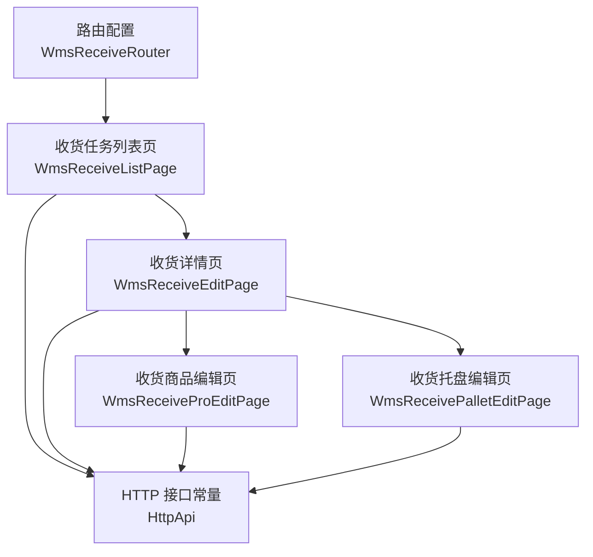
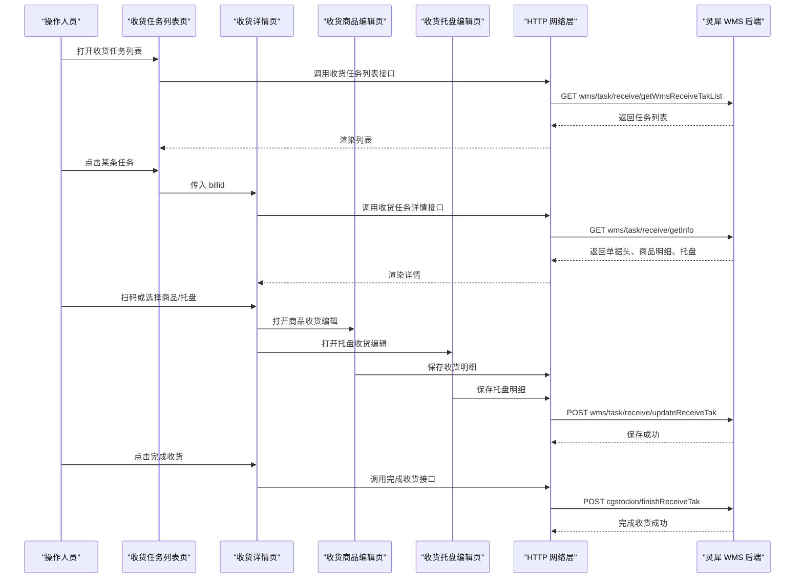
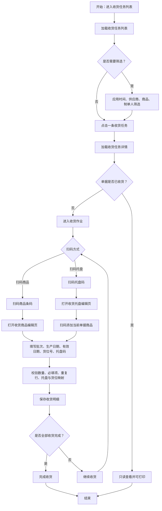
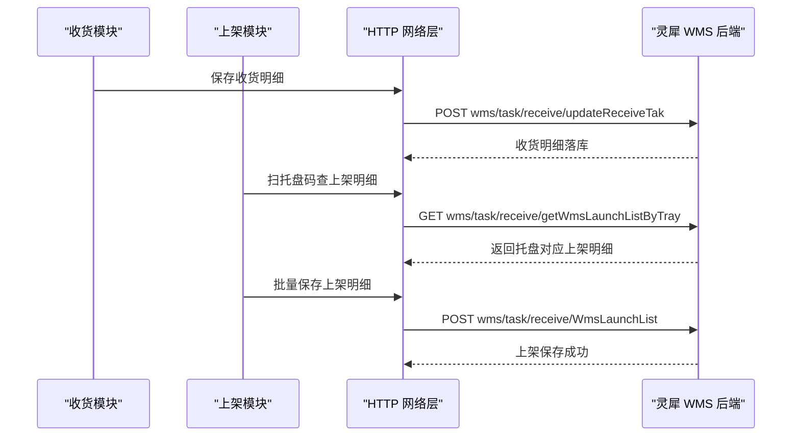
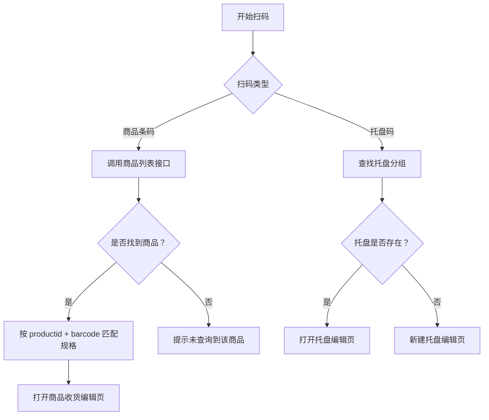
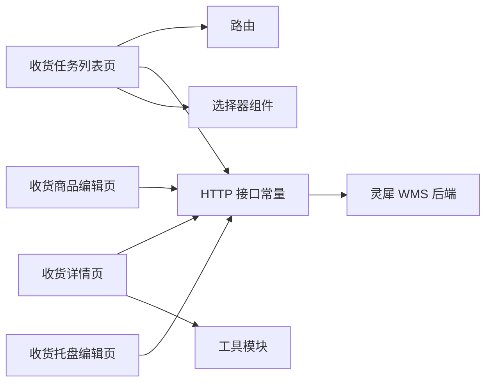

# 收货任务API

<cite>
**本文引用的文件**   
- [http_api.dart](file://lib/net/http_api.dart)
- [list.dart](file://lib/pages/business/wms/receive/list.dart)
- [edit.dart](file://lib/pages/business/wms/receive/edit.dart)
- [pro_edit.dart](file://lib/pages/business/wms/receive/pro_edit.dart)
- [pallet_edit.dart](file://lib/pages/business/wms/receive/pallet_edit.dart)
- [router.dart](file://lib/pages/business/wms/receive/router.dart)
</cite>

## 目录
1. [引言](#引言)
2. [项目结构与入口](#项目结构与入口)
3. [核心组件与职责](#核心组件与职责)
4. [系统架构总览](#系统架构总览)
5. [收货任务接口定义](#收货任务接口定义)
6. [收货作业完整流程](#收货作业完整流程)
7. [到货验收标准](#到货验收标准)
8. [入库上架流程](#入库上架流程)
9. [库存准确性控制机制](#库存准确性控制机制)
10. [条码扫描验证方案](#条码扫描验证方案)
11. [异常处理策略](#异常处理策略)
12. [硬件设备集成与性能优化](#硬件设备集成与性能优化)
13. [依赖关系分析](#依赖关系分析)
14. [故障排查清单](#故障排查清单)
15. [结论](#结论)

## 引言
本文面向灵犀管店 Flutter 仓库中的 WMS 收货能力，围绕“收货任务列表”等后端接口和前端页面实现，给出端到端文档。内容覆盖：
- 收货任务列表、详情、保存、完成收货、反审核、打印等接口的用途、请求数据结构和返回数据结构。
- 从任务发现、扫码校验、批次录入、托盘绑定、货位管理到完成收货的完整工作流。
- 到货验收标准、入库上架流程和库存准确性控制点。
- 条码扫描验证方案、异常处理策略。
- PDA/扫码枪等硬件设备的集成建议和性能优化建议。

## 项目结构与入口
WMS 收货功能集中在 `lib/pages/business/wms/receive` 目录下，对应 Vue 中 `wms/receiveTakList` 的 Flutter 实现。路由注册在 `WmsReceiveRouter`，列表页通过权限 `011901` 控制进入；收货详情页通过权限 `011902` 控制“完成收货”，打印操作受权限 `011907` 控制。

**图表来源**
- [router.dart:1-17](file://lib/pages/business/wms/receive/router.dart#L1-L17)
- [list.dart:20-40](file://lib/pages/business/wms/receive/list.dart#L20-L40)
- [edit.dart:16-40](file://lib/pages/business/wms/receive/edit.dart#L16-L40)
- [pro_edit.dart:10-25](file://lib/pages/business/wms/receive/pro_edit.dart#L10-L25)
- [pallet_edit.dart:10-35](file://lib/pages/business/wms/receive/pallet_edit.dart#L10-L35)

**章节来源**
- [router.dart:1-17](file://lib/pages/business/wms/receive/router.dart#L1-L17)
- [list.dart:20-40](file://lib/pages/business/wms/receive/list.dart#L20-L40)

## 核心组件与职责
| 组件 | 主要职责 | 关键行为 |
|---|---|---|
| 收货任务列表页 | 查询收货任务、筛选、分页加载、跳转详情 | 调用收货任务列表接口；支持时间范围、供应商、商品、制单人筛选；根据状态标签区分待收货和已收货 |
| 收货详情页 | 获取单据详情、展示商品明细和托盘分组、保存收货数据、完成收货、打印 | 调用详情接口；维护 `detaillist`、`prosumlist`、`palletlist`；计算订货数和收货数；提交保存和完成收货 |
| 收货商品编辑页 | 按商品维度维护收货行、批次、生产日期、有效日期、货位号、托盘码 | 校验数量上限、必填字段、重复行、托盘码与货位映射一致性；回传批次级收货数据 |
| 收货托盘编辑页 | 按托盘维度维护商品行、货位号、托盘码、批次信息 | 扫码添加当前单据商品；校验保质期字段；确认时把托盘商品数据回传给父页统一写回明细 |
| HTTP 接口常量 | 集中声明所有后端接口路径 | 包含收货任务列表、详情、保存、反审核、完成收货、上架、补货、移货等 |

**章节来源**
- [list.dart:20-40](file://lib/pages/business/wms/receive/list.dart#L20-L40)
- [edit.dart:16-40](file://lib/pages/business/wms/receive/edit.dart#L16-L40)
- [pro_edit.dart:10-25](file://lib/pages/business/wms/receive/pro_edit.dart#L10-L25)
- [pallet_edit.dart:10-35](file://lib/pages/business/wms/receive/pallet_edit.dart#L10-L35)
- [http_api.dart:195-222](file://lib/net/http_api.dart#L195-L222)

## 系统架构总览
WMS 收货功能采用“页面 + 网络层 + 业务实体”分层结构：
- 页面层负责用户交互、表单校验、状态汇总。
- 网络层通过 `request` 调用 `HttpApi` 定义的接口路径。
- 业务数据以 `Map<String, dynamic>` 形式传递，包括 `billid`、`billno`、`signflag`、`detaillist`、`prosumlist`、`palletlist`、`batchlist`、`locationcode`、`palletcode` 等关键字段。

**图表来源**
- [list.dart:150-190](file://lib/pages/business/wms/receive/list.dart#L150-L190)
- [edit.dart:230-320](file://lib/pages/business/wms/receive/edit.dart#L230-L320)
- [pro_edit.dart:430-520](file://lib/pages/business/wms/receive/pro_edit.dart#L430-L520)
- [pallet_edit.dart:500-575](file://lib/pages/business/wms/receive/pallet_edit.dart#L500-L575)
- [http_api.dart:195-205](file://lib/net/http_api.dart#L195-L205)

## 收货任务接口定义

### 收货任务列表接口
- **接口路径**：`wms/task/receive/getWmsReceiveTakList`
- **用途**：获取当前门店的 WMS 收货任务列表，支持分页、状态筛选、时间范围、供应商、商品、制单人筛选。
- **典型请求参数**：
  - `is_page`：是否分页。
  - `field`：排序字段，例如 `createtime`。
  - `type`：排序方向，例如 `desc`。
  - `page`：页码。
  - `billnoflag`：是否返回单号。
  - `billno`：按单号模糊搜索。
  - `datetype`：日期类型。
  - `signflag`：单据收货状态，全部为空，待收货为 `0`，已收货为 `1`。
  - `sids`：机构 ID 数组，通常为当前门店。
  - `sidsname`：机构名称。
  - `starttime` / `endtime`：时间范围。
  - `supid`：供应商 ID（可选）。
  - `createid`：制单人 ID（可选）。
  - `productname`：商品名称字符串，多个商品用逗号拼接。
  - `prolist`：商品对象数组，包含 `productid`。
- **响应结构**：
  - `data.list`：任务列表数组。
  - 每个任务通常包含 `billid`、`billno`、`signflag`、`bsid`、`storename`、`countername`、`supname`、`createtime`、`createname`、`billqty`、`billreceiptqty` 等字段。
- **错误处理**：
  - 列表页在请求失败时将 `_hasMore` 置为 `false`，并停止加载下一页。
  - 无查看权限时直接提示无权访问。

**章节来源**
- [http_api.dart:195-197](file://lib/net/http_api.dart#L195-L197)
- [list.dart:120-190](file://lib/pages/business/wms/receive/list.dart#L120-L190)
- [list.dart:190-240](file://lib/pages/business/wms/receive/list.dart#L190-L240)

### 收货任务详情接口
- **接口路径**：`wms/task/receive/getInfo`
- **用途**：获取指定收货任务的单据头、商品明细、托盘信息和汇总数据。
- **典型请求参数**：
  - `billid`：任务 ID。
  - `showflag`：显示标志，详情页使用 `2`。
- **响应结构**：
  - `data`：单据主数据对象。
  - `data.billid`：任务 ID。
  - `data.billno`：单号。
  - `data.signflag`：单据收货状态，`1` 表示已收货。
  - `data.bsid`：仓库 ID。
  - `data.countername`：仓库名称。
  - `data.supname`：供应商名称。
  - `data.remark`：备注。
  - `data.createtime`：制单时间。
  - `data.createname`：制单人。
  - `data.billqty`：订货总数。
  - `data.billreceiptqty`：已收货总数。
  - `data.detaillist`：商品明细数组。
  - `data.prosumlist`：商品汇总数组。
  - `data.palletlist`：托盘数组。
- **前端处理要点**：
  - 兼容 `productname` 和 `name` 字段。
  - 优先保留本地备注，避免服务端空值覆盖。
  - 对 `bsid` 做回退处理，防止服务端返回 `0` 或空值导致仓库信息丢失。

**章节来源**
- [http_api.dart:197-198](file://lib/net/http_api.dart#L197-L198)
- [edit.dart:230-320](file://lib/pages/business/wms/receive/edit.dart#L230-L320)

### 保存收货数据接口
- **接口路径**：`wms/task/receive/updateReceiveTak`
- **用途**：保存收货商品明细、托盘明细、删除标记和备注。
- **典型请求参数**：
  - 合并单据主数据，如 `billid`、`billno`、`signflag`、`bsid`、`storename`、`countername`、`supname`、`remark`。
  - `detaillist`：扁平化后的收货明细数组。
  - `delidlist`：需要删除的已保存明细 ID 数组。
- **数据结构说明**：
  - `detaillist` 中的每行通常包含：
    - `id`：已保存行的服务器 ID，新增行为空。
    - `productid`：商品 ID。
    - `barcode` / `code`：条码或商品编码。
    - `size`：规格。
    - `unit`：单位。
    - `orderqty`：订货数。
    - `receiptqty`：收货数。
    - `batchno`：批次号。
    - `birthdate`：生产日期。
    - `validdate`：有效日期。
    - `locationcode`：货位号。
    - `locationid`：货位 ID。
    - `palletcode`：托盘码。
  - `delidlist` 用于标记从旧明细中被移除的记录。
- **前端处理要点**：
  - 提交前格式化 `birthdate` 和 `validdate` 为日期字符串。
  - 仅提交受影响商品的明细和删除标记。
  - 保存成功后刷新详情。

**章节来源**
- [http_api.dart:198-199](file://lib/net/http_api.dart#L198-L199)
- [edit.dart:320-420](file://lib/pages/business/wms/receive/edit.dart#L320-L420)
- [pro_edit.dart:430-520](file://lib/pages/business/wms/receive/pro_edit.dart#L430-L520)
- [pallet_edit.dart:500-575](file://lib/pages/business/wms/receive/pallet_edit.dart#L500-L575)

### 完成收货接口
- **接口路径**：`cgstockin/finishReceiveTak`
- **用途**：当所有商品收货数达到订货数后，完成整张收货任务。
- **典型请求参数**：
  - 合并单据主数据和备注。
- **前置校验**：
  - 商品明细不能为空。
  - 所有商品的 `receiptqty` 必须大于 `0`。
  - 仓库信息 `bsid` 不能为空。
- **结果**：
  - 成功后提示操作成功，并返回上一页。

**章节来源**
- [http_api.dart:205](file://lib/net/http_api.dart#L205)
- [edit.dart:612-700](file://lib/pages/business/wms/receive/edit.dart#L612-L700)

### 反审核接口
- **接口路径**：`wms/task/receive/retsign`
- **用途**：对已完成收货的任务执行反审核，使其回到可继续收货的状态。
- **适用场景**：
  - 已完成收货但需要修改明细。
  - 上游采购单或下游入库单需要调整。

**章节来源**
- [http_api.dart:199](file://lib/net/http_api.dart#L199)

### 打印接口
- **接口路径**：`airprint/setWxPrintRw`
- **用途**：打印收货相关单据。
- **典型请求参数**：
  - `menuid`：菜单标识。
  - `data`：单据数据对象。
- **权限要求**：
  - 需具备打印权限 `011907`。

**章节来源**
- [edit.dart:700-740](file://lib/pages/business/wms/receive/edit.dart#L700-L740)

## 收货作业完整流程
收货作业以“任务列表 → 任务详情 → 商品/托盘收货 → 保存 → 完成收货”为主线。

**图表来源**
- [list.dart:120-190](file://lib/pages/business/wms/receive/list.dart#L120-L190)
- [edit.dart:230-420](file://lib/pages/business/wms/receive/edit.dart#L230-L420)
- [pro_edit.dart:430-520](file://lib/pages/business/wms/receive/pro_edit.dart#L430-L520)
- [pallet_edit.dart:500-575](file://lib/pages/business/wms/receive/pallet_edit.dart#L500-L575)

**章节来源**
- [list.dart:120-190](file://lib/pages/business/wms/receive/list.dart#L120-L190)
- [edit.dart:230-700](file://lib/pages/business/wms/receive/edit.dart#L230-L700)

## 到货验收标准
收货验收在前端通过严格校验保障质量与合规性：
- **数量上限**：
  - 单行收货数不能超过该行允许的最大值。
  - 同一商品所有收货行合计不能超过订货数。
  - 托盘商品数量不能超过订货数。
- **必填字段**：
  - 托盘码必填。
  - 保质期商品的生产日期、批次号必填。
  - 有效期商品在出生日期变更后自动计算有效日期。
- **唯一性与一致性**：
  - 禁止存在批次、货位、托盘码完全相同的重复收货行。
  - 同一托盘码必须对应唯一货位号。
  - 托盘码若已在系统中绑定其他货位，则不允许关联不同货位。
- **商品有效性**：
  - 扫码添加的商品必须属于当前收货任务。
  - 多规格商品按 `productid + barcode` 精准匹配，避免串到其他规格。
- **零收货处理**：
  - 不允许存在收货数为 `0` 的行，必须填写或删除。

这些规则由商品编辑页和托盘编辑页共同承担，最终由父页统一提交。

**章节来源**
- [pro_edit.dart:200-260](file://lib/pages/business/wms/receive/pro_edit.dart#L200-L260)
- [pro_edit.dart:430-520](file://lib/pages/business/wms/receive/pro_edit.dart#L430-L520)
- [pallet_edit.dart:500-575](file://lib/pages/business/wms/receive/pallet_edit.dart#L500-L575)
- [edit.dart:320-420](file://lib/pages/business/wms/receive/edit.dart#L320-L420)

## 入库上架流程
WMS 收货与上架在本代码库中分别体现为：
- **收货阶段**：写入收货暂存区货位，记录托盘码、批次、生产日期、有效日期、货位号和收货数量。
- **上架阶段**：通过托盘码查询上架明细，然后批量保存上架数据。

**图表来源**
- [http_api.dart:206-208](file://lib/net/http_api.dart#L206-L208)
- [edit.dart:320-420](file://lib/pages/business/wms/receive/edit.dart#L320-L420)

**章节来源**
- [http_api.dart:206-208](file://lib/net/http_api.dart#L206-L208)

## 库存准确性控制机制
库存准确性主要通过以下机制控制：
1. **订单与收货数量对齐**：
   - 商品收货总数不能超过订货数。
   - 托盘商品数量不能超过订货数。
   - 完成收货前校验所有商品均有正数收货量。
2. **多规格隔离**：
   - 使用 `productid + barcode` 作为规格键，避免多规格商品数据串改。
   - 更新 `prosumlist` 的 `receiptqty` 时仅汇总同规格行。
3. **历史数据保护**：
   - 通过 `delidlist` 精确提交被删除的旧明细 ID，避免误删其他商品或其他规格的数据。
4. **托盘与货位一致性**：
   - 同一托盘码只能绑定一个货位号。
   - 托盘码变更时校验全局映射，防止重复绑定冲突。
5. **批次与有效期控制**：
   - 保质期商品强制批次和生产日期。
   - 有效日期可由出生日期和保质期天数自动计算。
6. **单据状态控制**：
   - `signflag == 1` 表示已完成收货，界面变为只读。
   - 部分收货、待收货、已收货通过数量和状态综合判断。

**章节来源**
- [edit.dart:120-200](file://lib/pages/business/wms/receive/edit.dart#L120-L200)
- [edit.dart:320-420](file://lib/pages/business/wms/receive/edit.dart#L320-L420)
- [pro_edit.dart:200-260](file://lib/pages/business/wms/receive/pro_edit.dart#L200-L260)
- [pallet_edit.dart:500-575](file://lib/pages/business/wms/receive/pallet_edit.dart#L500-L575)

## 条码扫描验证方案
条码扫描在本项目中由通用扫码页面驱动，收货任务涉及两类扫码：
- **商品条码扫描**：
  - 调用商品列表接口，传入 `scancode`、`is_page`、`page`、`pagesize`、`storeid`。
  - 多规格商品按 `productid + barcode` 匹配，未匹配则提示未查询到该商品。
- **托盘码扫描**：
  - 若托盘存在于当前单据分组中，直接进入托盘编辑。
  - 若不存在，则新建托盘编辑页并带入扫描到的托盘码。
- **托盘内商品扫码添加**：
  - 仅允许添加当前收货任务中的商品。
  - 每次扫码新增一行，并打开批次信息弹窗。

**图表来源**
- [edit.dart:420-520](file://lib/pages/business/wms/receive/edit.dart#L420-L520)
- [pallet_edit.dart:200-260](file://lib/pages/business/wms/receive/pallet_edit.dart#L200-L260)

**章节来源**
- [edit.dart:420-520](file://lib/pages/business/wms/receive/edit.dart#L420-L520)
- [pallet_edit.dart:200-260](file://lib/pages/business/wms/receive/pallet_edit.dart#L200-L260)

## 异常处理策略
- **权限异常**：
  - 无查看收货权限时提示无权查看。
  - 无完成收货权限时提示无权完成收货。
  - 无打印权限时提示无权打印。
- **数据异常**：
  - 仓库信息缺失时提示刷新页面重试。
  - 商品明细为空时阻止完成收货。
  - 存在未完成收货商品时阻止完成收货。
  - 扫码结果为空时提示重新扫描。
  - 商品不在当前收货任务时阻止添加。
- **校验异常**：
  - 托盘码为空、批次为空、生产日期为空时阻断提交。
  - 收货数超过限制时自动限制或提示。
  - 重复收货行或托盘码与货位冲突时阻断提交。
- **网络异常**：
  - 列表加载失败时停止分页。
  - 保存失败时不刷新详情，保持本地数据以便重试。
  - 完成收货失败时不关闭页面，便于重试或修正。

**章节来源**
- [list.dart:60-90](file://lib/pages/business/wms/receive/list.dart#L60-L90)
- [list.dart:170-200](file://lib/pages/business/wms/receive/list.dart#L170-L200)
- [edit.dart:320-420](file://lib/pages/business/wms/receive/edit.dart#L320-L420)
- [edit.dart:612-700](file://lib/pages/business/wms/receive/edit.dart#L612-L700)
- [pallet_edit.dart:200-260](file://lib/pages/business/wms/receive/pallet_edit.dart#L200-L260)

## 硬件设备集成与性能优化
### 硬件设备集成建议
- **扫码枪/PDA**：
  - 推荐使用支持连续扫码的设备，减少手动触发次数。
  - 在输入框失焦或回车时提交扫码结果，符合现有扫码回调逻辑。
  - 对于托盘码和商品条码，保持扫码内容与系统一致，避免空格、大小写、前后缀差异。
- **蓝牙打印机**：
  - 打印功能通过 `airprint/setWxPrintRw` 调用，需确保打印权限和数据格式正确。
  - 建议在收货完成后打印收货凭证，便于线下核对。
- **条码生成与粘贴**：
  - 托盘码建议在入库前打印并粘贴，避免手工输入错误。
  - 批次号、生产日期、有效日期应结合 ERP/WMS 主数据，避免手工录入不一致。

### 性能优化建议
- **列表分页与防抖**：
  - 列表页已实现分页加载和滚动到底自动加载更多。
  - 搜索输入使用防抖，避免频繁请求。
- **数据缓存与复用**：
  - 商品编辑页和托盘编辑页尽量复用已有商品数据，减少重复接口调用。
  - 托盘码与货位号映射在父页构建并传递给子页，避免重复查询。
- **UI 渲染优化**：
  - 列表使用 `cacheExtent` 预渲染，提升滑动流畅度。
  - 商品行和托盘行避免不必要的重建，仅在数据变化时更新。
- **网络请求优化**：
  - 批量保存托盘商品时，父页统一提交，减少多次网络往返。
  - 保存成功后立即刷新详情，保证界面与后端一致。

[本节为通用指导，不直接分析具体源码文件]

## 依赖关系分析
收货任务功能依赖以下核心模块：
- **路由模块**：提供 `/wms/receive/list` 路由。
- **网络模块**：提供 `request` 和 `HttpApi` 常量。
- **选择器组件**：供应商、商品、批次、货位、机构等选择器。
- **工具模块**：数学工具、权限工具、Toast、日志、扫码页面等。
- **外部服务**：灵犀 WMS 后端提供的收货、上架、补货、移货、打印等接口。

**图表来源**
- [router.dart:1-17](file://lib/pages/business/wms/receive/router.dart#L1-L17)
- [http_api.dart:195-222](file://lib/net/http_api.dart#L195-L222)
- [list.dart:1-20](file://lib/pages/business/wms/receive/list.dart#L1-L20)
- [edit.dart:1-20](file://lib/pages/business/wms/receive/edit.dart#L1-L20)

**章节来源**
- [router.dart:1-17](file://lib/pages/business/wms/receive/router.dart#L1-L17)
- [http_api.dart:195-222](file://lib/net/http_api.dart#L195-L222)

## 故障排查清单
| 现象 | 可能原因 | 排查步骤 | 处理建议 |
|---|---|---|---|
| 收货任务列表为空 | 时间范围、供应商、商品、制单人筛选过严 | 检查筛选条件，重置为默认近 30 天 | 清空筛选条件后重试 |
| 无法进入收货任务列表 | 缺少权限 `011901` | 检查后台权限配置 | 联系管理员开通权限 |
| 扫码商品未找到 | 条码与商品不匹配或商品不属于当前任务 | 检查条码、商品主数据、当前任务商品列表 | 更换正确条码或补充商品 |
| 托盘码与货位冲突 | 托盘码已绑定其他货位 | 检查托盘码全局映射 | 使用正确托盘码或解除冲突 |
| 保存失败 | 必填字段缺失、数量超限、重复行 | 检查托盘码、批次、生产日期、收货数 | 修正校验失败字段 |
| 无法完成收货 | 仍有商品未收货或仓库信息缺失 | 检查各商品 `receiptqty` 和 `bsid` | 补齐收货数并刷新页面 |
| 打印失败 | 缺少打印权限或打印接口异常 | 检查权限 `011907` 和打印服务 | 开通权限并检查打印服务 |

**章节来源**
- [list.dart:60-90](file://lib/pages/business/wms/receive/list.dart#L60-L90)
- [list.dart:170-200](file://lib/pages/business/wms/receive/list.dart#L170-L200)
- [edit.dart:320-420](file://lib/pages/business/wms/receive/edit.dart#L320-L420)
- [edit.dart:612-700](file://lib/pages/business/wms/receive/edit.dart#L612-L700)
- [pallet_edit.dart:500-575](file://lib/pages/business/wms/receive/pallet_edit.dart#L500-L575)

## 结论
灵犀管店 Flutter 项目的 WMS 收货任务实现以 `wmsReceiveTakList` 为核心入口，通过列表筛选、详情加载、商品与托盘双维度收货编辑、严格校验、托盘与货位映射、以及完成收货等流程，形成完整的收货闭环。系统在数据一致性、多规格隔离、批次与有效期控制、权限控制和异常处理方面均有明确实现。对接后端时，应重点保证：
- 接口路径与请求参数与前端保持一致。
- 托盘码、货位号、批次、生产日期、有效日期等主数据稳定可靠。
- 完成收货前所有商品收货数与订货数对齐。
- 上架流程与收货流程解耦，托盘码作为关键纽带。
- 在 PDA/扫码枪环境下优化扫码体验和批量保存性能。