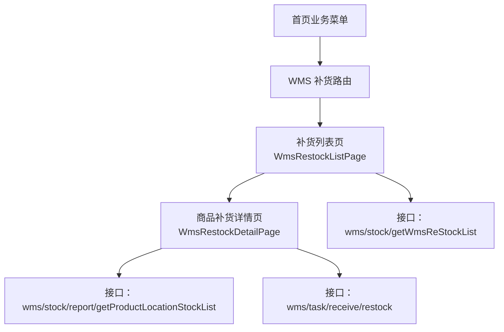
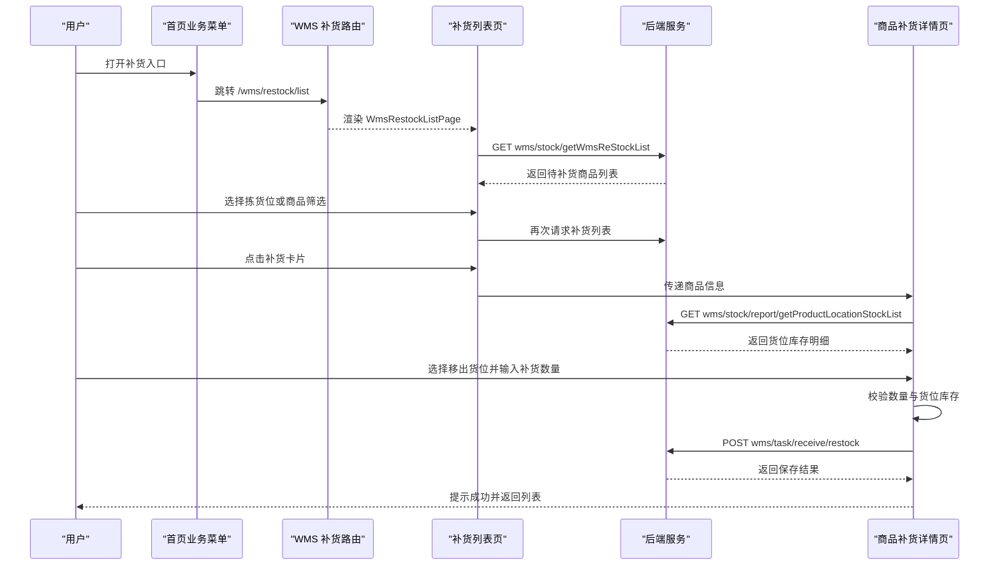

# 补货任务API

<cite>
**本文引用的文件**   
- [http_api.dart](file://lib/net/http_api.dart)
- [list.dart](file://lib/pages/business/wms/restock/list.dart)
- [detail.dart](file://lib/pages/business/wms/restock/detail.dart)
- [router.dart](file://lib/pages/business/wms/restock/router.dart)
- [business_page.dart](file://lib/pages/home/business_page.dart)
</cite>

## 目录
1. [文档目标与适用范围](#文档目标与适用范围)
2. [项目结构中的补货入口](#项目结构中的补货入口)
3. [核心接口总览](#核心接口总览)
4. [补货列表接口 wmsReStockList](#补货列表接口-wmsrestocklist)
5. [商品货位库存接口 wmsProductLocationStockList](#商品货位库存接口-wmsproductlocationstocklist)
6. [补货保存接口 wmsRestockSave](#补货保存接口-wmsrestocksave)
7. [补货触发条件与阈值监控](#补货触发条件与阈值监控)
8. [自动补货算法与优先级排序](#自动补货算法与优先级排序)
9. [补货任务完整工作流](#补货任务完整工作流)
10. [库存预警机制](#库存预警机制)
11. [配置参数说明](#配置参数说明)
12. [性能调优建议](#性能调优建议)
13. [常见问题排查](#常见问题排查)
14. [结论](#结论)

## 文档目标与适用范围
本文面向灵犀管店Flutter端WMS补货功能，围绕以下目标展开：
- 记录补货相关后端接口的调用方式、请求参数和返回结构。
- 解释补货列表的筛选逻辑、补货详情页的数据模型、校验规则和提交流程。
- 梳理补货任务的端到端工作流，包括从列表发现待补货商品到确认移出货位并提交补货。
- 明确当前代码中由后端负责的业务规则，例如补货触发条件、库存阈值、自动补货算法和优先级策略。
- 提供补货系统的客户端配置项和性能优化建议。

需要特别说明的是：仓库中没有独立的“补货业务算法服务”或“补货策略引擎”源代码；补货的计算结果（如待补货数量）通常由后端在生成补货列表时计算并返回，Flutter端主要负责查询、展示、用户选择和保存提交。

## 项目结构中的补货入口
补货能力在Flutter项目中以WMS模块下的子页面形式组织，并通过路由注册到主业务菜单中。

**图表来源**
- [business_page.dart:589](file://lib/pages/home/business_page.dart#L589)
- [router.dart:1-17](file://lib/pages/business/wms/restock/router.dart#L1-L17)
- [list.dart:1-120](file://lib/pages/business/wms/restock/list.dart#L1-L120)
- [detail.dart:1-120](file://lib/pages/business/wms/restock/detail.dart#L1-L120)
- [http_api.dart:214-218](file://lib/net/http_api.dart#L214-L218)

**章节来源**
- [business_page.dart:589](file://lib/pages/home/business_page.dart#L589)
- [router.dart:1-17](file://lib/pages/business/wms/restock/router.dart#L1-L17)

## 核心接口总览
当前补货链路涉及三个关键后端接口，全部通过 `HttpApi` 常量集中管理：

| 接口标识 | 后端路径 | 用途 | 主要调用方 |
|---|---|---|---|
| `wmsReStockList` | `wms/stock/getWmsReStockList` | 获取补货任务列表 | 补货列表页 |
| `wmsProductLocationStockList` | `wms/stock/report/getProductLocationStockList` | 查询商品在各货位的库存明细 | 商品补货详情页 |
| `wmsRestockSave` | `wms/task/receive/restock` | 提交补货执行数据 | 商品补货详情页 |

**章节来源**
- [http_api.dart:214-218](file://lib/net/http_api.dart#L214-L218)

## 补货列表接口 wmsReStockList
### 接口定义
- 方法：GET
- 路径：`wms/stock/getWmsReStockList`
- 目的：根据门店、拣货位、商品等条件查询待补货商品清单。

### 客户端请求参数
补货列表页 `_loadData` 构造的请求参数如下：

| 参数名 | 类型 | 是否必填 | 默认值 | 说明 |
|---|---|---|---|---|
| `is_page` | 整数 | 是 | `1` | 分页开关标志 |
| `page` | 整数 | 是 | `1` | 当前页码 |
| `pagesize` | 整数 | 是 | `20` | 每页条数 |
| `sids` | 字符串数组 | 是 | 当前门店ID数组 | 机构/门店过滤 |
| `locationid` | 字符串 | 否 | 空 | 按拣货位ID过滤 |
| `locationcode` | 字符串 | 否 | 空 | 按拣货位编码过滤 |
| `productid` | 字符串 | 否 | 空 | 按商品ID过滤 |
| `prolist` | 字符串数组 | 否 | 空数组 | 商品ID列表，当选择商品时传入单元素数组 |

### 返回结构约定
客户端对返回数据的处理逻辑表明：
- 外层响应包含 `data`。
- `data` 可能为对象或数组。
- 若 `data` 是对象，则进一步取 `data['list']`。
- 兼容 `list[0]` 仍为数组的结构，即真正行数据来自 `rawList.first`（如果它是数组）。
- 最终将行数据转换为 `Map<String, dynamic>` 列表渲染卡片。

这意味着后端返回结构存在两种兼容形态：
1. `data.list` 直接为行数组。
2. `data.list[0]` 为行数组，前端会将其作为实际行集合。

### 列表字段含义
补货卡片展示的字段包括：
- `name` 或 `productname`：商品名称。
- `size`：规格。
- `barcode`：条码。
- `stockqty`：当前库存。
- `needqty`：待补货数量。
- `locationcode`：拣货位编码。
- `maxstockqty`：最大储存量。

这些字段用于判断是否需要补货以及展示补货上下文，但具体阈值计算（例如为什么 `needqty` 等于某个值）由后端决定。

**章节来源**
- [list.dart:1-120](file://lib/pages/business/wms/restock/list.dart#L1-L120)
- [list.dart:120-260](file://lib/pages/business/wms/restock/list.dart#L120-L260)
- [list.dart:260-475](file://lib/pages/business/wms/restock/list.dart#L260-L475)
- [http_api.dart:214-215](file://lib/net/http_api.dart#L214-L215)

## 商品货位库存接口 wmsProductLocationStockList
### 接口定义
- 方法：GET
- 路径：`wms/stock/report/getProductLocationStockList`
- 目的：查询指定商品在当前门店下各货位的库存明细，供补货详情页选择移出货位。

### 客户端请求参数
详情页 `_loadLocationStockList` 构造的参数如下：

| 参数名 | 类型 | 是否必填 | 默认值 | 说明 |
|---|---|---|---|---|
| `productid` | 字符串 | 是 | 商品ID | 当前补货商品ID |
| `sids` | 字符串数组 | 是 | 当前门店ID数组 | 机构/门店过滤 |
| `is_page` | 整数 | 是 | `0` | 关闭分页 |
| `zonetype` | 整数 | 是 | `2` | 区域类型，表示WMS货位维度 |

### 返回结构约定
- 外层响应包含 `data`。
- `data` 可直接为行数组，或为对象后取 `data['list']`。
- 行数据中包含货位号、库存数量、批次、最后上架时间、最大储量、有效期等字段。

### 行数据字段含义
| 字段 | 含义 | 使用场景 |
|---|---|---|
| `locationcode` | 存货位号 | 显示并选择移出货位 |
| `qty` | 该货位可用库存 | 限制补货数量上限 |
| `batchno` | 批次号 | 库存批次信息 |
| `lastintime` | 最后上架时间 | 库存时效参考 |
| `maxstockqty` | 最大储量 | 展示库容信息 |
| `validdate` | 有效期 | 展示效期信息 |
| `sellprice` / `psprice` | 销售价/成本价 | 计算销售额与成本额 |
| `sellamt` / `psamt` | 销售额/成本额 | 保存时根据补货数量重新计算 |

**章节来源**
- [detail.dart:1-120](file://lib/pages/business/wms/restock/detail.dart#L1-L120)
- [detail.dart:480-571](file://lib/pages/business/wms/restock/detail.dart#L480-L571)
- [http_api.dart:215-216](file://lib/net/http_api.dart#L215-L216)

## 补货保存接口 wmsRestockSave
### 接口定义
- 方法：POST
- 路径：`wms/task/receive/restock`
- 目的：提交一次补货执行操作，包括补货数量、门店、金额和货位明细。

### 客户端请求参数
详情页 `_save` 构造的请求体包含：

| 参数名 | 类型 | 是否必填 | 说明 |
|---|---|---|---|
| `lunchqty` | 数值 | 是 | 本次补货数量 |
| `bsid` | 字符串 | 是 | 门店ID |
| `sellamt` | 数值 | 是 | 预计销售额 |
| `psamt` | 数值 | 是 | 预计成本额 |
| `detaillist` | 对象数组 | 是 | 补货明细，至少包含一条货位行 |
| 其他商品字段 | 动态 | 视实现 | 由 `_productInfo` 透传，例如商品ID、名称、条码等 |

`detaillist` 中选择的货位行还会补充：
- `lunchqty`：补货数量。
- `sellamt`：销售金额。
- `psamt`：成本金额。

### 校验规则
客户端在保存前执行以下校验：
1. 必须选择一个移出货位。
2. 补货数量必须大于0。
3. 补货数量不能超过所选货位的可用库存。
4. 补货数量不能超过商品的待补货数 `needqty`。
5. 防止重复提交：保存过程中 `_saving` 为真时忽略再次点击。

### 成功与失败处理
- 成功后提示“补货成功”，并返回上一页。
- 失败时依赖网络层统一错误提示。

**章节来源**
- [detail.dart:120-220](file://lib/pages/business/wms/restock/detail.dart#L120-L220)
- [http_api.dart:217-218](file://lib/net/http_api.dart#L217-L218)

## 补货触发条件与阈值监控
从现有Flutter代码看，补货触发条件和库存阈值监控主要由后端完成。客户端只消费后端计算出的补货结果。

### 前端体现的阈值线索
- 补货列表卡片展示 `needqty`（待补货数）、`stockqty`（库存）、`maxstockqty`（最大储存量）。
- 补货详情页将 `needqty` 初始化为默认补货数量。
- 保存时限制补货数量不超过 `needqty`。

### 典型业务含义
结合字段语义，可以理解为：
- 当商品当前库存低于某个阈值时，系统计算出需要补货的数量。
- 最大储存量用于控制补货上限。
- 拣货位用于定位补货应从哪里出库。

但具体阈值公式、安全库存、周转天数、促销预测等策略不在Flutter端实现，因此不能断言其精确算法。

**章节来源**
- [list.dart:260-475](file://lib/pages/business/wms/restock/list.dart#L260-L475)
- [detail.dart:1-120](file://lib/pages/business/wms/restock/detail.dart#L1-L120)
- [detail.dart:120-220](file://lib/pages/business/wms/restock/detail.dart#L120-L220)

## 自动补货算法与优先级排序
### 代码现状
仓库中没有找到以下内容的本地实现：
- 自动补货调度器。
- 补货优先级排序算法。
- 库存阈值监控定时任务。
- 补货计划生成引擎。

因此，自动补货算法和优先级排序应视为**后端职责**。Flutter端仅负责：
- 查询补货列表。
- 展示补货优先级相关的可视化信息（如待补货数量）。
- 让用户确认并按需调整补货数量。
- 提交补货执行。

### 可推断的排序线索
虽然排序逻辑在后端，但客户端行为提供了部分线索：
- 列表支持按拣货位和商品筛选。
- 扫码后通过商品条码查找商品，再进入补货。
- 补货数量默认取 `needqty`，且不允许超过 `needqty`。

这些行为适合配合后端按紧急程度、缺货程度、销量热度或供应商交期进行排序。

**章节来源**
- [list.dart:1-120](file://lib/pages/business/wms/restock/list.dart#L1-L120)
- [list.dart:200-260](file://lib/pages/business/wms/restock/list.dart#L200-L260)
- [detail.dart:1-120](file://lib/pages/business/wms/restock/detail.dart#L1-L120)

## 补货任务完整工作流
下图描述一个典型的补货任务从入口到提交的流程：

**图表来源**
- [business_page.dart:589](file://lib/pages/home/business_page.dart#L589)
- [router.dart:1-17](file://lib/pages/business/wms/restock/router.dart#L1-L17)
- [list.dart:1-120](file://lib/pages/business/wms/restock/list.dart#L1-L120)
- [list.dart:90-120](file://lib/pages/business/wms/restock/list.dart#L90-L120)
- [detail.dart:60-120](file://lib/pages/business/wms/restock/detail.dart#L60-L120)
- [detail.dart:120-220](file://lib/pages/business/wms/restock/detail.dart#L120-L220)

## 库存预警机制
补货系统与库存预警密切相关，但当前代码将“哪些商品需要补货”的判断放在后端。Flutter端提供的关联能力包括：
- 补货列表展示库存、待补货数和最大储存量。
- 扫码查询商品后若无结果，提示未查询到该商品。
- 补货详情页展示货位库存、批次、有效期等信息，帮助判断库存健康度。

此外，仓库中还包含其他库存相关页面，例如库存预警、负库存、滞销等，但这些页面不属于补货任务API范围，不在此文档详细展开。

**章节来源**
- [list.dart:200-260](file://lib/pages/business/wms/restock/list.dart#L200-L260)
- [list.dart:260-475](file://lib/pages/business/wms/restock/list.dart#L260-L475)
- [detail.dart:480-571](file://lib/pages/business/wms/restock/detail.dart#L480-L571)

## 配置参数说明
### 接口基础地址
补货接口属于灵犀系统接口，基础地址由 `HttpApi.baseUrlYlx` 统一管理。当前仓库中设置为云端地址：

| 配置项 | 值 | 说明 |
|---|---|---|
| `baseUrlYlx` | `https://yun.bypos.net/LxSvr/web/` | 灵犀系统接口基础地址 |

### 分页配置
补货列表采用固定分页大小：

| 配置项 | 值 | 说明 |
|---|---|---|
| `_pageSize` | `20` | 补货列表每页条数 |

### 门店上下文
补货列表和补货详情都从本地存储读取当前门店信息：

| 配置项 | 来源 | 说明 |
|---|---|---|
| `_storeId` | `SpUtil.getString(Constant.store)` | 当前登录门店ID |
| `sids` | 请求参数 | 传递给后端的门店ID数组 |

### 筛选配置
| 配置项 | 默认值 | 说明 |
|---|---|---|
| 拣货位筛选 | 空 | 可选择拣货位ID和编码 |
| 商品筛选 | 空 | 单选模式下选择单个商品 |
| 扫码查询 | 无默认条码 | 扫描条码后查询商品 |

**章节来源**
- [http_api.dart:1-20](file://lib/net/http_api.dart#L1-L20)
- [list.dart:1-120](file://lib/pages/business/wms/restock/list.dart#L1-L120)
- [detail.dart:1-60](file://lib/pages/business/wms/restock/detail.dart#L1-L60)

## 性能调优建议
### 列表加载
- 当前列表页使用下拉刷新和滚动加载更多。
- 每页20条，适合移动端浏览。
- 建议在数据量大时考虑服务端排序和索引优化，避免前端对大数组做复杂排序。

### 图片与文本渲染
- 补货卡片使用少量文本展示，整体复杂度较低。
- 列表使用 `cacheExtent: 800` 预渲染，可减少滚动卡顿。
- 建议使用 `RepaintBoundary` 包裹稳定卡片，减少重绘。

### 网络请求
- 补货列表、货位库存、补货保存都是简单请求。
- 应避免频繁重复请求，例如快速滚动时不应重复触发 `_loadData`。
- 建议在接口层增加去抖、重试和超时控制。

### 大数据场景优化
- 如果补货列表增长到数百条，应考虑服务端分页增强，例如支持按紧急程度、缺货比例排序。
- 对于货位库存明细，如果单个商品货位过多，可考虑分页或懒加载。
- 对金额字段建议保持精度一致，避免浮点误差。

**章节来源**
- [list.dart:1-120](file://lib/pages/business/wms/restock/list.dart#L1-L120)
- [list.dart:120-260](file://lib/pages/business/wms/restock/list.dart#L120-L260)
- [list.dart:260-475](file://lib/pages/business/wms/restock/list.dart#L260-L475)
- [detail.dart:1-120](file://lib/pages/business/wms/restock/detail.dart#L1-L120)

## 常见问题排查
### 问题：补货列表为空
可能原因：
- 当前门店没有待补货商品。
- 拣货位或商品筛选过严。
- 后端未生成补货任务。
- 门店ID为空导致查询不到数据。

排查步骤：
1. 检查 `_storeId` 是否正确从本地存储读取。
2. 清空拣货位和商品筛选后重试。
3. 查看后端日志，确认 `wms/stock/getWmsReStockList` 是否返回有效数据。

**章节来源**
- [list.dart:1-120](file://lib/pages/business/wms/restock/list.dart#L1-L120)
- [list.dart:90-120](file://lib/pages/business/wms/restock/list.dart#L90-L120)

### 问题：扫码未找到商品
现象：
- 扫码后提示“未查询到该商品”。

可能原因：
- 条码不存在。
- 商品被停用或不在库存范围内。
- 商品条码与系统不一致。

排查步骤：
1. 确认条码正确。
2. 检查商品基础数据。
3. 核对商品筛选条件是否排除了该商品。

**章节来源**
- [list.dart:200-260](file://lib/pages/business/wms/restock/list.dart#L200-L260)

### 问题：无法提交补货
常见错误：
- 未选择移出货位。
- 补货数量为0或负数。
- 补货数量超过货位库存。
- 补货数量超过待补货数。
- 重复提交被拦截。

排查步骤：
1. 确认已选择货位。
2. 检查补货数量是否为正数。
3. 检查所选货位库存是否足够。
4. 检查商品 `needqty` 是否大于0。
5. 等待保存状态释放后再试。

**章节来源**
- [detail.dart:120-220](file://lib/pages/business/wms/restock/detail.dart#L120-L220)

## 结论
灵犀管店Flutter项目的WMS补货功能以三个核心接口为基础：补货列表、商品货位库存、补货保存。Flutter端承担角色主要是：
- 提供补货入口和路由。
- 查询并展示补货任务。
- 选择移出货位。
- 校验补货数量。
- 提交补货执行。

补货触发条件、库存阈值监控、自动补货算法和补货优先级排序应由后端负责。客户端可通过合理筛选、分页、缓存和校验提升用户体验，但不能替代后端补货策略。若未来需要扩展补货能力，建议在后端暴露更多补货计划、优先级和策略配置接口，并在Flutter端按需展示和调整。