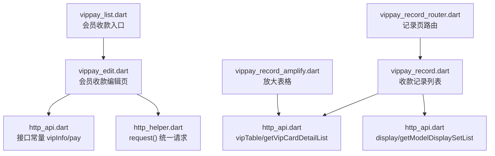
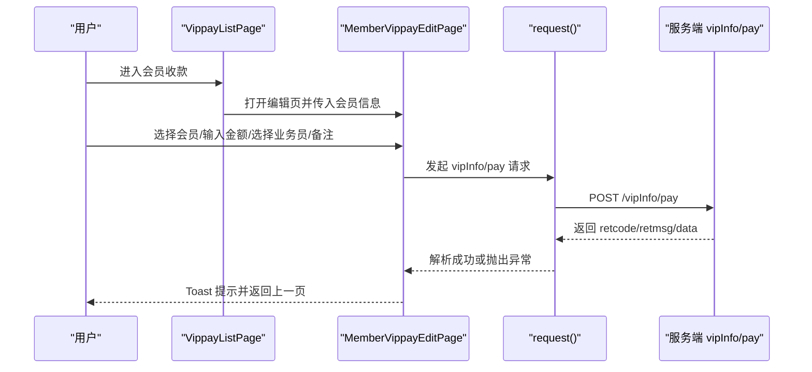
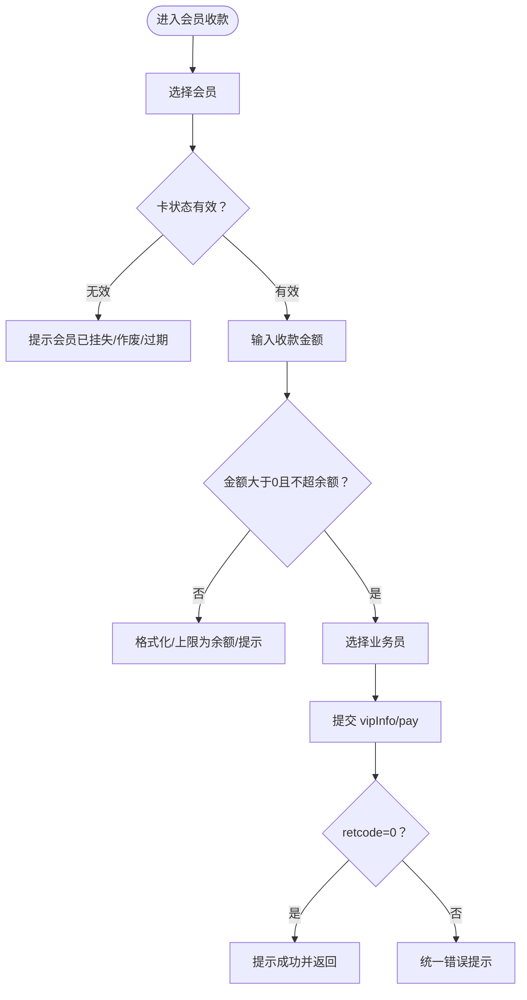
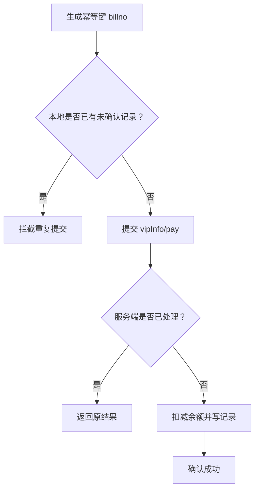
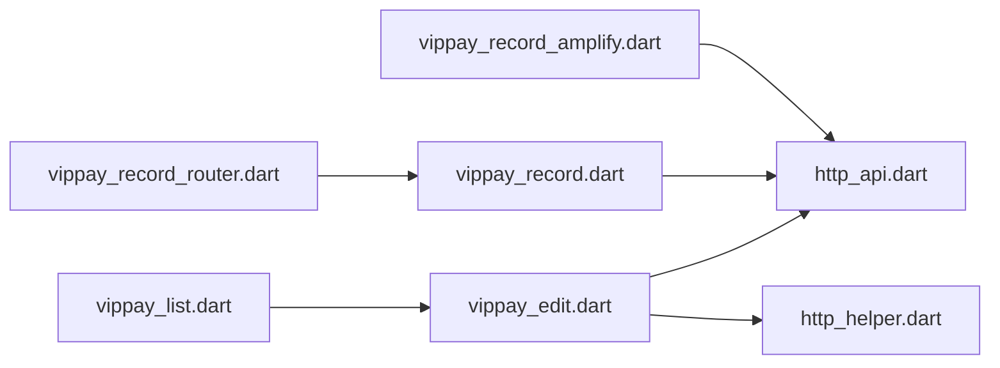

# VIP支付API

<cite>
**本文引用的文件 **
- [http_api.dart](file://lib/net/http_api.dart)
- [http_helper.dart](file://lib/net/http_helper.dart)
- [vippay_edit.dart](file://lib/pages/business/members/vippay/vippay_edit.dart)
- [vippay_list.dart](file://lib/pages/business/members/vippay/vippay_list.dart)
- [vippay_record.dart](file://lib/pages/business/members/vippay/vippay_record.dart)
- [vippay_record_amplify.dart](file://lib/pages/business/members/vippay/vippay_record_amplify.dart)
- [vippay_record_router.dart](file://lib/pages/business/members/vippay/vippay_record_router.dart)
</cite>

## 目录
1. [简介](#简介)
2. [项目结构](#项目结构)
3. [核心组件](#核心组件)
4. [架构总览](#架构总览)
5. [接口详细定义：vipInfo/pay（会员收款-会员卡结算）](#接口详细定义vipinfopay会员收款会员卡结算)
6. [业务流程与余额扣减机制](#业务流程与余额扣减机制)
7. [支付记录管理与对账报表](#支付记录管理与对账报表)
8. [异常处理、幂等性与安全风控](#异常处理幂等性与安全风控)
9. [依赖关系分析](#依赖关系分析)
10. [性能与可观测性](#性能与可观测性)
11. [故障排查指南](#故障排查指南)
12. [结论](#结论)

## 简介
本文面向灵犀管店 Flutter 项目中的“VIP支付”能力，聚焦于会员收款场景下的 `vipInfo/pay` 接口。文档基于仓库中会员收款页面、列表页、收款记录页及网络层实现进行梳理，说明：
- 会员收款入口与交互；
- `vipInfo/pay` 的完整请求参数、响应语义与权限控制；
- 会员卡余额扣减的业务流程；
- 收款记录查询、放大表格展示与汇总；
- 异常处理、幂等性建议与安全风控落地方案；
- 审计日志与对账报表的使用方式。

## 项目结构
VIP支付相关代码集中在业务模块 `lib/pages/business/members/vippay`，并依赖通用网络层 `lib/net`：
- 收款编辑页：`vippay_edit.dart`，负责选择会员、输入金额、提交 `vipInfo/pay`。
- 收款列表页：`vippay_list.dart`，复用会员选择器并导航至编辑页。
- 收款记录页：`vippay_record.dart`，查询并展示 `vipTable/getVipCardDetailList` 数据，支持列设置、排序、分页、放大表格跳转。
- 放大表格页：`vippay_record_amplify.dart`，按固定比例渲染关键列并计算合计。
- 路由：`vippay_record_router.dart`，注册收款记录与放大表格路由。
- 网络接口常量：`http_api.dart`，声明 `vipInfo/pay`、充值、积分操作、会员详情、收款记录等接口地址。
- 统一请求封装：`http_helper.dart`，负责公共参数、签名、错误码、登录失效、异常日志写入。

**图表来源**
- [vippay_list.dart:1-18](file://lib/pages/business/members/vippay/vippay_list.dart#L1-L18)
- [vippay_edit.dart:1-200](file://lib/pages/business/members/vippay/vippay_edit.dart#L1-L200)
- [vippay_record.dart:1-200](file://lib/pages/business/members/vippay/vippay_record.dart#L1-L200)
- [vippay_record_amplify.dart:1-120](file://lib/pages/business/members/vippay/vippay_record_amplify.dart#L1-L120)
- [vippay_record_router.dart:1-24](file://lib/pages/business/members/vippay/vippay_record_router.dart#L1-L24)
- [http_api.dart:575-595](file://lib/net/http_api.dart#L575-L595)
- [http_helper.dart:1-220](file://lib/net/http_helper.dart#L1-L220)

**章节来源**
- [vippay_list.dart:1-18](file://lib/pages/business/members/vippay/vippay_list.dart#L1-L18)
- [vippay_edit.dart:1-200](file://lib/pages/business/members/vippay/vippay_edit.dart#L1-L200)
- [vippay_record.dart:1-200](file://lib/pages/business/members/vippay/vippay_record.dart#L1-L200)
- [vippay_record_amplify.dart:1-120](file://lib/pages/business/members/vippay/vippay_record_amplify.dart#L1-L120)
- [vippay_record_router.dart:1-24](file://lib/pages/business/members/vippay/vippay_record_router.dart#L1-L24)
- [http_api.dart:575-595](file://lib/net/http_api.dart#L575-L595)
- [http_helper.dart:1-220](file://lib/net/http_helper.dart#L1-L220)

## 核心组件
- 会员收款编辑页 `MemberVippayEditPage`：负责选择会员、校验卡状态、限制收款金额不超过储卡余额、选择业务员和备注，最终调用 `vipInfo/pay`。
- 会员收款列表页 `VippayListPage`：复用会员选择器，打开编辑页。
- 收款记录页 `VippayRecordPage`：加载列配置、筛选条件、分页数据，提供排序、汇总、放大表格跳转。
- 放大表格页 `VippayRecordAmplifyPage`：按比例渲染交易金额、本金、赠金等关键列，并显示合计行。
- 网络层 `HttpApi`：集中维护会员相关接口地址，包括 `vipInfo/pay`、充值、积分、会员详情、收款记录等。
- 统一请求 `request()`：构造公共参数、token、签名、requestId，统一处理 retcode/code、登录过期、Toast 提示与日志落盘。

**章节来源**
- [vippay_edit.dart:1-200](file://lib/pages/business/members/vippay/vippay_edit.dart#L1-L200)
- [vippay_list.dart:1-18](file://lib/pages/business/members/vippay/vippay_list.dart#L1-L18)
- [vippay_record.dart:1-200](file://lib/pages/business/members/vippay/vippay_record.dart#L1-L200)
- [vippay_record_amplify.dart:1-120](file://lib/pages/business/members/vippay/vippay_record_amplify.dart#L1-L120)
- [http_api.dart:575-595](file://lib/net/http_api.dart#L575-L595)
- [http_helper.dart:1-220](file://lib/net/http_helper.dart#L1-L220)

## 架构总览
VIP支付在客户端侧采用“页面 + 网络层”的分层模式：
- 页面层负责业务交互、表单校验、权限检查、结果反馈。
- 网络层负责接口地址管理、统一请求封装、错误处理与日志记录。
- 后端服务由 `vipInfo/pay`、`vipTable/getVipCardDetailList`、`display/getModelDisplaySetList` 等接口组成，Flutter 端仅作为消费方。

**图表来源**
- [vippay_list.dart:1-18](file://lib/pages/business/members/vippay/vippay_list.dart#L1-L18)
- [vippay_edit.dart:100-170](file://lib/pages/business/members/vippay/vippay_edit.dart#L100-L170)
- [http_helper.dart:60-220](file://lib/net/http_helper.dart#L60-L220)

## 接口详细定义：vipInfo/pay（会员收款-会员卡结算）

### 接口定位
- 接口名称：会员收款（会员卡结算）
- 接口地址常量：`HttpApi.vipInfoPay`，对应字符串为 `vipInfo/pay`
- 主要用途：使用会员卡余额完成收款，扣减会员储卡余额，生成收款记录。

**章节来源**
- [http_api.dart:588](file://lib/net/http_api.dart#L588)

### 请求方式
- HTTP 方法：POST
- 请求体：由 `request()` 统一构造，外层包含 `sid/spid/client/token/sign/requestId/params`，业务参数位于 `params` 内。

**章节来源**
- [http_helper.dart:120-220](file://lib/net/http_helper.dart#L120-L220)

### 必填业务参数
| 字段 | 类型 | 是否必填 | 含义 | 客户端行为 |
|---|---|---:|---|---|
| vipid | String | 是 | 会员ID | 从所选会员对象传入 |
| vipno | String | 是 | 会员卡号 | 从所选会员对象传入 |
| vipname | String | 是 | 会员姓名 | 从所选会员对象传入 |
| typeid | String | 是 | 会员分类ID | 从所选会员对象传入 |
| saleid | String | 否 | 业务员ID | 可选，为空时不传业务员信息 |
| salename | String | 否 | 业务员名称 | 与 saleid 配套 |
| memo | String | 否 | 备注 | 允许为空 |
| opertype | Number | 是 | 操作类型 | 固定为 `8`，表示收款 |
| billno | String | 是 | 单据编号 | 客户端生成随机单号 |
| payid | String | 是 | 支付方式ID | 固定为 `02`，表示会员卡 |
| payname | String | 是 | 支付方式名称 | 固定为 `会员卡` |
| vipCardPay.amt | String | 是 | 收款金额 | 与 orderAmt/addmoney 一致 |
| vipCardPay.orderAmt | String | 是 | 订单金额 | 与 amt/addmoney 一致 |
| vipCardPay.addmoney | String | 是 | 储值入账金额 | 与 amt/orderAmt 一致 |

上述参数由 `MemberVippayEditPage._payBtn()` 组装后通过 `request(HttpApi.vipInfoPay, ...)` 提交。

**章节来源**
- [vippay_edit.dart:120-170](file://lib/pages/business/members/vippay/vippay_edit.dart#L120-L170)

### 响应语义
- 成功：`retcode == 0`，`request()` 返回完整响应 Map，调用方可读取 `retmsg` 提示用户。
- 失败：`retcode != 0`，`request()` 会弹出 `retmsg` 并抛出业务异常；若为登录失效（`retcode -2/-3`），会清理缓存并跳转登录页。
- 非标准格式：若响应不含 `retcode` 而含 `code/message`，则按该结构处理。

注意：当前 `MemberVippayEditPage` 在成功后直接显示 `retmsg` 或默认成功提示，并在延迟后返回上一页，未显式根据 `data` 字段做进一步分支。

**章节来源**
- [http_helper.dart:150-220](file://lib/net/http_helper.dart#L150-L220)
- [vippay_edit.dart:130-170](file://lib/pages/business/members/vippay/vippay_edit.dart#L130-L170)

### 权限控制
- 前端按钮仅在拥有权限 `0110` 时可点击。
- 无权限时按钮禁用，防止误触。

**章节来源**
- [vippay_edit.dart:201-220](file://lib/pages/business/members/vippay/vippay_edit.dart#L201-L220)

### 请求示例路径
由于 `request()` 将业务参数放入 `params`，且外层注入 `clientflag/sid/spid/userid/client/token/sign/requestId`，因此实际请求体并非纯业务参数，而是两层结构。具体字段组合请参考：
- 业务参数构造：[vippay_edit.dart:120-170](file://lib/pages/business/members/vippay/vippay_edit.dart#L120-L170)
- 外层公共参数构造：[http_helper.dart:120-220](file://lib/net/http_helper.dart#L120-L220)

## 业务流程与余额扣减机制

### 会员收款主流程

**图表来源**
- [vippay_edit.dart:60-170](file://lib/pages/business/members/vippay/vippay_edit.dart#L60-L170)

### 余额扣减规则（客户端可见）
- 收款金额不能为空且必须大于0。
- 收款金额不能超过会员当前储卡余额 `nowmoney`。
- 前端在失焦时自动格式化并限制金额上限。
- 页面展示的余额字段包括：
  - `nowmoney`：储卡余额
  - `capitalmoney`：本金
  - `givemoney`：赠金
  - `nowpoint`：会员积分
  - `pocketmoney`：零钱余额

这些字段用于界面展示与前端校验；具体后端如何拆分本金、赠金、余额扣减逻辑，由服务端实现决定，客户端以这些字段作为可信展示与校验依据。

**章节来源**
- [vippay_edit.dart:300-420](file://lib/pages/business/members/vippay/vippay_edit.dart#L300-L420)

### 典型业务场景
1. 正常收款：选择有效会员卡，输入小于等于余额的金额，选择业务员，提交成功。
2. 金额超限：输入金额超过余额，前端自动调整为余额值或清空非法输入。
3. 卡片无效：卡状态为挂失、作废、过期时，直接提示并阻止提交。
4. 未选业务员：业务员字段可选，不强制填写。
5. 备注为空：备注可为空，不影响提交。

**章节来源**
- [vippay_edit.dart:80-170](file://lib/pages/business/members/vippay/vippay_edit.dart#L80-L170)

## 支付记录管理与对账报表

### 收款记录数据来源
- 列表接口：`vipTable/getVipCardDetailList`
- 列设置接口：`display/getModelDisplaySetList`，mcode 为 `091401`
- 收款记录页默认筛选 `opertype = 8`，即“收款”

**章节来源**
- [http_api.dart:589-595](file://lib/net/http_api.dart#L589-L595)
- [vippay_record.dart:420-440](file://lib/pages/business/members/vippay/vippay_record.dart#L420-L440)

### 记录页关键能力
- 列配置：优先拉取后台列设置，否则使用本地兜底列；仅渲染原型白名单字段。
- 筛选条件：门店、时间快捷选择、搜索框、会员分类、业务员、收银员。
- 排序：支持单据编号、交易金额、本金、赠金等列排序。
- 分页：每页20条，下拉加载更多。
- 汇总：底部显示合计行，取 `sumdata` 中对应字段。
- 放大表格：跳转到放大表格页，按固定比例渲染关键列。

**章节来源**
- [vippay_record.dart:1-200](file://lib/pages/business/members/vippay/vippay_record.dart#L1-L200)
- [vippay_record.dart:380-450](file://lib/pages/business/members/vippay/vippay_record.dart#L380-L450)

### 放大表格关键列
| 列名 | 标签 | 比例 | 对齐 | 数值类型 |
|---|---|---:|---|---|
| billno | 单据编号 | 0.26 | 左 | 文本 |
| vipno | 会员卡号 | 0.19 | 左 | 文本 |
| vipname | 会员姓名 | 0.15 | 左 | 文本 |
| addmoney | 交易金额 | 0.15 | 右 | 数值 |
| capitalmoney | 本金 | 0.12 | 右 | 数值 |
| givemoney | 赠金 | 0.13 | 右 | 数值 |

**章节来源**
- [vippay_record_amplify.dart:40-80](file://lib/pages/business/members/vippay/vippay_record_amplify.dart#L40-L80)

### 对账报表使用建议
- 使用收款记录页按门店、时间范围、会员分类、业务员筛选导出或统计。
- 结合放大表格查看交易金额、本金、赠金的明细分布。
- 若需扩展报表维度，可在后端新增聚合接口；客户端可复用现有筛选框架。

[本节为概念性指导，不直接分析具体代码片段]

## 异常处理、幂等性与安全风控

### 异常处理机制
- 网络层 `request()` 统一处理：
  - `retcode == 0`：成功。
  - `retcode == -2/-3`：登录失效，清理缓存并跳转登录页。
  - 其他 `retcode != 0`：弹出 `retmsg` 并抛业务异常。
  - 非标准响应：按 `code/message` 处理。
  - 网络异常：区分超时、连接拒绝等，给出友好中文提示。
- 会员收款页捕获异常后不做额外弹窗，依赖 `request()` 的统一提示。

**章节来源**
- [http_helper.dart:150-220](file://lib/net/http_helper.dart#L150-L220)
- [vippay_edit.dart:130-170](file://lib/pages/business/members/vippay/vippay_edit.dart#L130-L170)

### 幂等性保证方案
当前客户端实现未在 `vipInfo/pay` 中引入强幂等键。建议在以下层面增强：
- 客户端：
  - 使用持久化幂等键，例如 `billno` 与服务端约定一致，避免重复提交。
  - 提交前检查本地是否存在相同 `billno` 的未完成订单。
  - 提交后等待服务端确认再释放 UI 锁。
- 服务端：
  - 基于 `billno` 建立唯一索引。
  - 对同一 `billno` 的重复请求返回已有结果而非再次扣款。
  - 对重复 `vipCardPay` 请求增加去重窗口。

**图表来源**
- [vippay_edit.dart:130-170](file://lib/pages/business/members/vippay/vippay_edit.dart#L130-L170)

### 支付安全机制
- 统一请求封装注入 `token/sign/requestId`，所有接口经统一通道访问。
- 登录失效统一处理，避免脏状态继续操作。
- 前端权限控制：仅拥有 `0110` 权限的用户可提交会员收款。
- 输入校验：金额必须为正数且不超过余额，卡状态必须有效。

**章节来源**
- [http_helper.dart:120-220](file://lib/net/http_helper.dart#L120-L220)
- [vippay_edit.dart:201-220](file://lib/pages/business/members/vippay/vippay_edit.dart#L201-L220)
- [vippay_edit.dart:100-170](file://lib/pages/business/members/vippay/vippay_edit.dart#L100-L170)

### 风控策略建议
- 单笔限额：结合会员等级、历史消费、风险评分设置单笔收款上限。
- 频率限制：同一会员、同一操作员、同一设备在短时间内的收款次数限制。
- 黑名单：高风险会员或操作员禁止收款。
- 二次确认：大额收款弹出确认对话框，记录操作人、时间、设备信息。
- 风控日志：记录高风险事件，供审计与对账使用。

[本节为通用风控建议，不直接分析具体代码片段]

### 审计日志
- 所有接口调用均通过 `_logApi()` 写入 crash_log 分类，包含 URL、参数摘要、结果摘要。
- 登录失效、网络异常、业务失败均有日志记录。
- 建议在会员收款成功后追加业务审计事件，记录 `vipid/vipno/billno/opertype/payid/amt` 等关键字段。

**章节来源**
- [http_helper.dart:20-40](file://lib/net/http_helper.dart#L20-L40)
- [http_helper.dart:150-220](file://lib/net/http_helper.dart#L150-L220)

## 依赖关系分析

**图表来源**
- [vippay_edit.dart:1-200](file://lib/pages/business/members/vippay/vippay_edit.dart#L1-L200)
- [vippay_list.dart:1-18](file://lib/pages/business/members/vippay/vippay_list.dart#L1-L18)
- [vippay_record.dart:1-200](file://lib/pages/business/members/vippay/vippay_record.dart#L1-L200)
- [vippay_record_amplify.dart:1-120](file://lib/pages/business/members/vippay/vippay_record_amplify.dart#L1-L120)
- [vippay_record_router.dart:1-24](file://lib/pages/business/members/vippay/vippay_record_router.dart#L1-L24)
- [http_api.dart:575-595](file://lib/net/http_api.dart#L575-L595)
- [http_helper.dart:1-220](file://lib/net/http_helper.dart#L1-L220)

**章节来源**
- [vippay_edit.dart:1-200](file://lib/pages/business/members/vippay/vippay_edit.dart#L1-L200)
- [vippay_list.dart:1-18](file://lib/pages/business/members/vippay/vippay_list.dart#L1-L18)
- [vippay_record.dart:1-200](file://lib/pages/business/members/vippay/vippay_record.dart#L1-L200)
- [vippay_record_amplify.dart:1-120](file://lib/pages/business/members/vippay/vippay_record_amplify.dart#L1-L120)
- [vippay_record_router.dart:1-24](file://lib/pages/business/members/vippay/vippay_record_router.dart#L1-L24)
- [http_api.dart:575-595](file://lib/net/http_api.dart#L575-L595)
- [http_helper.dart:1-220](file://lib/net/http_helper.dart#L1-L220)

## 性能与可观测性
- 网络请求：统一使用 Dio，具备超时、重试、拦截器等基础能力。
- 日志记录：所有请求成功/失败均写入文件日志，便于线上问题回溯。
- 列表性能：收款记录页使用分页加载，避免一次性拉取全量数据。
- 放大表格：按固定比例渲染，减少横向滚动，提升可读性。
- 建议：
  - 对高频查询接口启用本地缓存或短期缓存。
  - 对大额收款增加服务端耗时埋点，辅助性能监控。
  - 对错误率高的接口增加告警。

[本节为通用优化建议，不直接分析具体代码片段]

## 故障排查指南
- 提交失败但无明确提示：检查 `request()` 是否被 `showError=false` 调用；会员收款页使用默认 `showError=true`，应由后端返回 `retmsg`。
- 登录后仍无法调用接口：检查 `token/sid/spid` 是否正确注入，登录失效后会清理缓存并跳转登录页。
- 收款金额被自动调整：确认输入金额是否超过 `nowmoney`，前端会在失焦时限制为余额。
- 收款记录为空：确认筛选条件、时间范围、门店、`opertype=8` 是否正确。
- 放大表格列不对齐：检查列配置 mcode 是否为 `091401`，以及后端返回的 `sumdata` 字段是否与前端期望一致。

**章节来源**
- [http_helper.dart:150-220](file://lib/net/http_helper.dart#L150-L220)
- [vippay_edit.dart:100-170](file://lib/pages/business/members/vippay/vippay_edit.dart#L100-L170)
- [vippay_record.dart:380-450](file://lib/pages/business/members/vippay/vippay_record.dart#L380-L450)
- [vippay_record_amplify.dart:70-120](file://lib/pages/business/members/vippay/vippay_record_amplify.dart#L70-L120)

## 结论
灵犀管店 Flutter 项目的 VIP 支付能力围绕 `vipInfo/pay` 展开，客户端通过会员收款编辑页完成会员选择、金额校验、权限控制与提交；网络层统一封装请求、错误处理和日志记录；收款记录页与放大表格页提供对账与报表基础。为保障资金安全，建议在后端实现基于 `billno` 的幂等控制，并补充风控策略、审计日志和对账报表扩展能力。