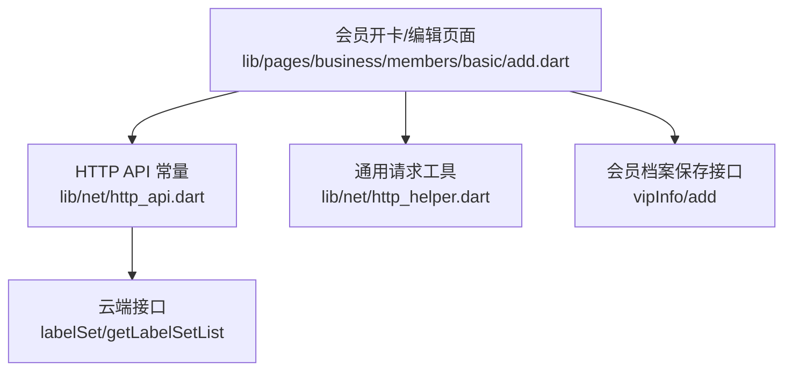
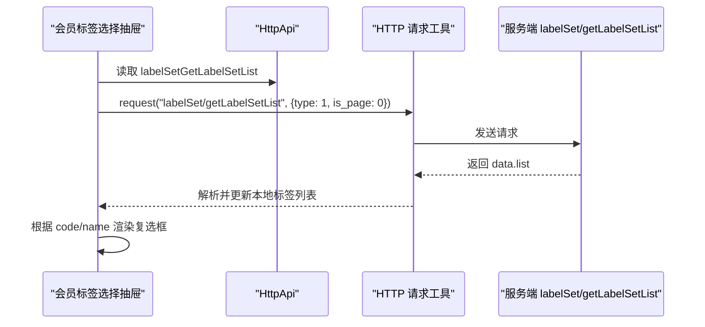
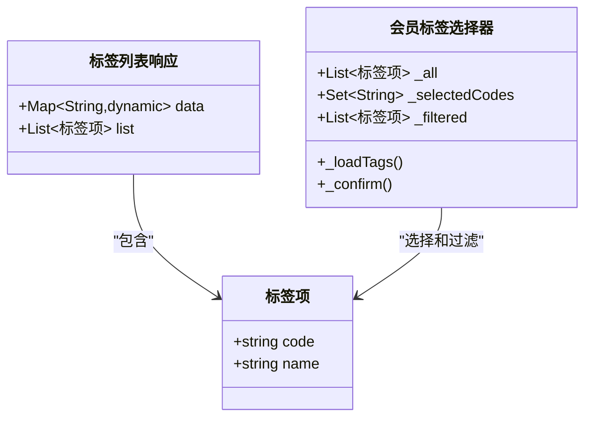
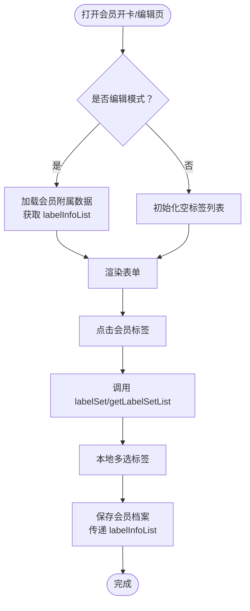
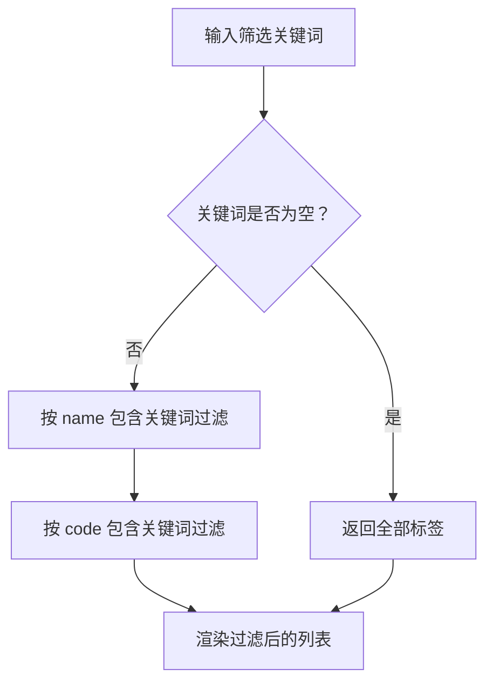
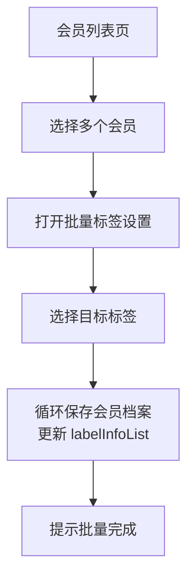
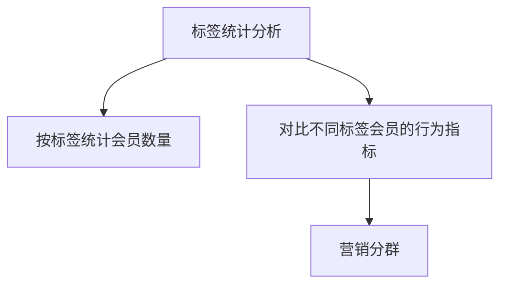
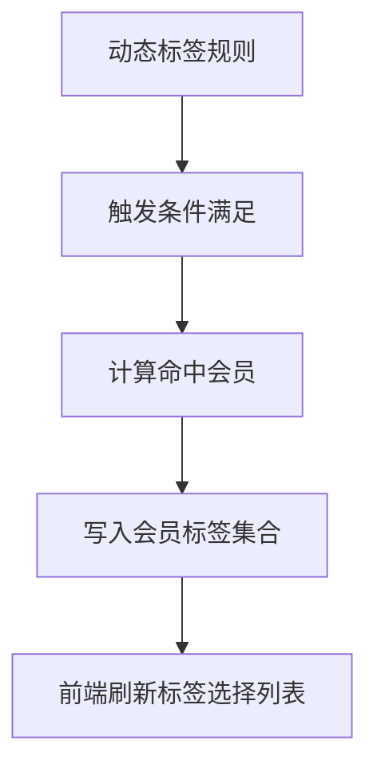
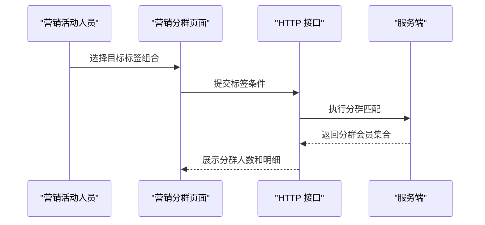
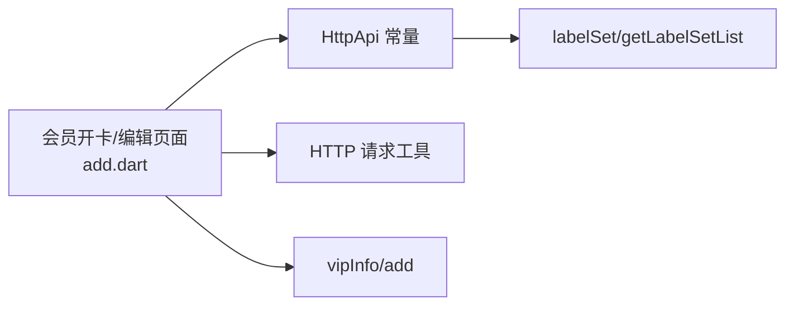

# 会员标签API

<cite>
**本文引用的文件**   
- [lib/net/http_api.dart](file://lib/net/http_api.dart)
- [lib/pages/business/members/basic/add.dart](file://lib/pages/business/members/basic/add.dart)
</cite>

## 目录
1. [引言](#引言)
2. [项目结构定位](#项目结构定位)
3. [核心接口定义](#核心接口定义)
4. [标签体系结构设计](#标签体系结构设计)
5. [标签关联机制](#标签关联机制)
6. [标签筛选功能](#标签筛选功能)
7. [增删改查操作说明](#增删改查操作说明)
8. [批量标签操作](#批量标签操作)
9. [标签统计分析](#标签统计分析)
10. [动态生成规则与自动化标签管理](#动态生成规则与自动化标签管理)
11. [营销分群实现指导](#营销分群实现指导)
12. [依赖关系分析](#依赖关系分析)
13. [性能与错误处理建议](#性能与错误处理建议)
14. [故障排查指南](#故障排查指南)
15. [结论](#结论)

## 引言
本文件面向灵犀管店 Flutter 项目中的“会员标签”能力，重点围绕 `labelSet/getLabelSetList`（会员标签列表）接口进行完整 API 文档化，并结合现有代码实现，说明标签体系设计、标签与会员的关联方式、标签筛选交互、以及如何在当前架构下扩展批量操作、统计分析、动态标签和营销分群。

需要特别说明的是：在当前仓库中，已实现的标签相关能力主要集中在以下两点：
- 通过 HTTP API 常量定义会员标签列表接口；
- 在会员开卡/编辑页面中，调用该接口加载标签列表，并在本地完成多选、搜索过滤，最终将选中标签随会员档案一起保存。

因此，本文对“标签创建、删除、修改、统计”等能力的说明会明确区分“仓库已有实现”和“建议扩展方向”，避免把后端未提供的能力误写成现有行为。

## 项目结构定位
会员标签能力涉及两个关键位置：
- 网络接口常量定义位于业务网络层；
- 标签选择与提交逻辑位于会员基础信息维护页面。

**图示来源**
- [lib/pages/business/members/basic/add.dart:1172-1185](file://lib/pages/business/members/basic/add.dart#L1172-L1185)
- [lib/net/http_api.dart:574-584](file://lib/net/http_api.dart#L574-L584)

**章节来源**
- [lib/net/http_api.dart:574-584](file://lib/net/http_api.dart#L574-L584)
- [lib/pages/business/members/basic/add.dart:1139-1204](file://lib/pages/business/members/basic/add.dart#L1139-L1204)

## 核心接口定义
### 会员标签列表接口
- 接口名称：`labelSet/getLabelSetList`
- 前端常量名：`HttpApi.labelSetGetLabelSetList`
- 用途：获取会员标签列表，供会员开卡/编辑时选择标签使用。
- 调用方：会员开卡/编辑页面的标签选择抽屉。
- 主要参数：
  - `type`：类型标识，当前调用传值为 `1`。
  - `is_page`：是否分页，当前调用传值为 `0`，表示获取全部标签用于下拉选择。
- 返回结构要点：
  - 返回数据放在响应体的 `data` 字段中；
  - `data` 可能是对象或数组；
  - 当 `data` 是对象时，标签列表位于 `data.list`；
  - 每个标签至少包含 `code` 和 `name` 字段。

**图示来源**
- [lib/pages/business/members/basic/add.dart:1172-1185](file://lib/pages/business/members/basic/add.dart#L1172-L1185)
- [lib/net/http_api.dart:583-583](file://lib/net/http_api.dart#L583-L583)

**章节来源**
- [lib/net/http_api.dart:583-583](file://lib/net/http_api.dart#L583-L583)
- [lib/pages/business/members/basic/add.dart:1172-1185](file://lib/pages/business/members/basic/add.dart#L1172-L1185)

## 标签体系结构设计
从现有实现可以看出，会员标签是一个扁平化的标签集合，而不是多层分类树。其设计特征如下：

| 维度 | 说明 |
| --- | --- |
| 标签标识 | `code`，作为唯一键用于选中判断和结果回传 |
| 标签名称 | `name`，用于界面展示 |
| 标签类型 | 由调用方传入的 `type=1` 表示这是会员标签；具体类型语义由后端决定 |
| 分页策略 | 前端以 `is_page=0` 拉取全量列表，适合移动端标签选择场景 |
| 显示格式 | 界面以 `[编码]名称` 形式展示，例如 `[TAG001]高价值会员` |
| 存储格式 | 会员保存时，只传递 `{code, name}` 数组，不携带其他复杂属性 |

**图示来源**
- [lib/pages/business/members/basic/add.dart:1151-1204](file://lib/pages/business/members/basic/add.dart#L1151-L1204)
- [lib/pages/business/members/basic/add.dart:1240-1270](file://lib/pages/business/members/basic/add.dart#L1240-L1270)

**章节来源**
- [lib/pages/business/members/basic/add.dart:1151-1204](file://lib/pages/business/members/basic/add.dart#L1151-L1204)
- [lib/pages/business/members/basic/add.dart:1240-1270](file://lib/pages/business/members/basic/add.dart#L1240-L1270)

## 标签关联机制
会员与标签的关联发生在会员档案保存流程中。

1. 用户进入会员开卡或编辑页面。
2. 如果是编辑模式，先加载会员详情和附属数据，其中附属数据包含 `labelInfoList`，即会员当前已绑定的标签。
3. 用户打开“会员标签”选择器，调用 `labelSet/getLabelSetList` 获取标签列表。
4. 用户在本地勾选多个标签。
5. 保存会员档案时，将 `_labelInfoList` 作为 `labelInfoList` 字段传给 `vipInfo/add`。

**图示来源**
- [lib/pages/business/members/basic/add.dart:186-198](file://lib/pages/business/members/basic/add.dart#L186-L198)
- [lib/pages/business/members/basic/add.dart:517-527](file://lib/pages/business/members/basic/add.dart#L517-L527)
- [lib/pages/business/members/basic/add.dart:606-614](file://lib/pages/business/members/basic/add.dart#L606-L614)

**章节来源**
- [lib/pages/business/members/basic/add.dart:186-198](file://lib/pages/business/members/basic/add.dart#L186-L198)
- [lib/pages/business/members/basic/add.dart:517-527](file://lib/pages/business/members/basic/add.dart#L517-L527)
- [lib/pages/business/members/basic/add.dart:606-614](file://lib/pages/business/members/basic/add.dart#L606-L614)

## 标签筛选功能
当前标签筛选是本地筛选，不是服务端筛选。

- 触发方式：在标签选择抽屉中输入文本。
- 筛选范围：标签名称 `name` 和标签编码 `code`。
- 筛选结果：仅影响界面展示，不影响已选中的标签。
- 确认结果：点击确定后，返回所有被选中项的 `{code, name}`。

**图示来源**
- [lib/pages/business/members/basic/add.dart:1187-1195](file://lib/pages/business/members/basic/add.dart#L1187-L1195)

**章节来源**
- [lib/pages/business/members/basic/add.dart:1187-1195](file://lib/pages/business/members/basic/add.dart#L1187-L1195)

## 增删改查操作说明
### 查询：会员标签列表
- 接口：`labelSet/getLabelSetList`
- 使用场景：会员开卡/编辑时加载可选标签。
- 参数示例：`{type: 1, is_page: 0}`
- 返回字段：`data.list` 中的 `code`、`name`

**章节来源**
- [lib/net/http_api.dart:583-583](file://lib/net/http_api.dart#L583-L583)
- [lib/pages/business/members/basic/add.dart:1172-1185](file://lib/pages/business/members/basic/add.dart#L1172-L1185)

### 新增：会员标签
- 当前仓库未提供独立的“新增标签”前端页面。
- 如需新增标签，通常由后台管理系统完成；Flutter 端只负责选择已有标签。
- 若未来要在本端新增标签，建议新增一个标签管理页面，并在保存成功后重新调用 `labelSet/getLabelSetList` 刷新选择列表。

### 修改：会员标签
- 当前仓库没有独立的“修改标签定义”入口。
- 现有“修改”语义体现在会员档案保存时替换会员的 `labelInfoList`：新提交的标签列表会覆盖旧标签集合。

### 删除：会员标签
- 当前仓库没有“删除标签定义”的前端接口。
- 如果目标是取消某个会员的标签，可通过再次保存会员档案时不包含该标签实现；如果目标是删除标签本身，则需要后端接口和本端标签管理页面配合。

**章节来源**
- [lib/pages/business/members/basic/add.dart:606-614](file://lib/pages/business/members/basic/add.dart#L606-L614)

## 批量标签操作
当前仓库中没有“为多个会员批量添加或移除标签”的独立页面。但可以从现有实现推导可复用模式：

- 单会员批量选标签：已在标签选择器中支持多选，并以 `labelInfoList` 数组保存。
- 多会员批量改标签：可在会员列表页增加“批量操作 → 修改标签”，然后遍历所选会员 ID，逐个调用会员档案保存接口，或在后端扩展批量标签接口。

[此图为概念流程图，不对应具体源码片段]

**章节来源**
- [lib/pages/business/members/basic/add.dart:606-614](file://lib/pages/business/members/basic/add.dart#L606-L614)

## 标签统计分析
当前仓库中没有专门的“标签统计分析”页面。现有与会员数据相关的统计模块包括消费排行、充值分析等，但未直接暴露标签维度的统计。

建议在后续迭代中补充两类统计：
1. 标签使用统计：哪些标签被最多会员使用；
2. 会员行为对比：不同标签会员的消费金额、活跃度、复购率等差异。

[此图为概念流程图，不对应具体源码片段]

## 动态生成规则与自动化标签管理
当前代码没有体现“动态标签规则引擎”。现有标签是静态标签，由后端维护，前端只做选择。

如果要实现动态标签和自动化管理，建议采用以下分层思路：

| 层级 | 职责 | 建议实现方式 |
| --- | --- | --- |
| 标签定义层 | 定义标签、编码、名称、类型、状态 | 后端维护标签元数据 |
| 规则层 | 定义自动打标规则，如“近 90 天消费满 3 次打为活跃会员” | 可扩展规则表达式或可视化规则配置 |
| 执行层 | 定时任务或事件触发时计算命中会员 | 后端服务周期性运行 |
| 应用层 | 前端展示标签、允许人工修正 | 复用现有 `labelSet/getLabelSetList` 和会员保存流程 |

[此图为概念流程图，不对应具体源码片段]

## 营销分群实现指导
营销分群可以基于标签组合形成目标人群。结合现有实现，推荐路径如下：

1. 使用 `labelSet/getLabelSetList` 获取可用标签；
2. 在前端构建标签组合条件，例如“高价值会员 AND 近一个月有消费 AND 非流失会员”；
3. 将标签编码集合传给后端，由后端根据会员标签集合匹配目标人群；
4. 前端展示分群结果，并支持导出或推送。

[此图为概念流程图，不对应具体源码片段]

## 依赖关系分析
会员标签功能的依赖关系如下：

- 会员开卡/编辑页面依赖 HTTP API 常量；
- 标签选择抽屉依赖通用请求工具发起网络请求；
- 标签列表数据来自后端 `labelSet/getLabelSetList`；
- 会员标签最终随会员档案保存到 `vipInfo/add`。

**图示来源**
- [lib/pages/business/members/basic/add.dart:1172-1185](file://lib/pages/business/members/basic/add.dart#L1172-L1185)
- [lib/net/http_api.dart:574-584](file://lib/net/http_api.dart#L574-L584)

**章节来源**
- [lib/pages/business/members/basic/add.dart:1172-1185](file://lib/pages/business/members/basic/add.dart#L1172-L1185)
- [lib/net/http_api.dart:574-584](file://lib/net/http_api.dart#L574-L584)

## 性能与错误处理建议
### 性能建议
- 标签列表通常不大，当前以 `is_page=0` 拉取全量是合理的；
- 标签筛选在客户端执行，避免每次输入都请求后端；
- 如果标签规模增长到上千级，应考虑后端分页或模糊搜索接口；
- 会员保存时使用 `labelInfoList` 数组，结构简单，序列化开销较低。

### 错误处理现状
- 标签加载失败时，会将加载状态置为 `false`，界面上可能表现为空列表；
- 会员附属数据加载失败时，标签列表会被初始化为空；
- 会员保存失败时，会恢复保存按钮状态，但当前 catch 块未提示具体错误。

**章节来源**
- [lib/pages/business/members/basic/add.dart:1172-1185](file://lib/pages/business/members/basic/add.dart#L1172-L1185)
- [lib/pages/business/members/basic/add.dart:186-198](file://lib/pages/business/members/basic/add.dart#L186-L198)
- [lib/pages/business/members/basic/add.dart:606-620](file://lib/pages/business/members/basic/add.dart#L606-L620)

## 故障排查指南
### 标签列表为空
可能原因：
- 后端尚未配置任何会员标签；
- `labelSet/getLabelSetList` 返回的 `data` 不是预期结构；
- 网络请求失败导致 `_loading` 被置为 `false` 但列表为空。

排查步骤：
1. 检查 `HttpApi.labelSetGetLabelSetList` 是否正确指向 `labelSet/getLabelSetList`；
2. 查看请求参数是否为 `type=1` 且 `is_page=0`；
3. 确认返回结构中是否存在 `data.list`；
4. 确认每条标签是否包含 `code` 和 `name`。

**章节来源**
- [lib/net/http_api.dart:583-583](file://lib/net/http_api.dart#L583-L583)
- [lib/pages/business/members/basic/add.dart:1172-1185](file://lib/pages/business/members/basic/add.dart#L1172-L1185)

### 选中标签未生效
可能原因：
- 用户未点击确定；
- 返回的标签项缺少 `code`；
- 保存会员时未正确传递 `labelInfoList`。

排查步骤：
1. 检查 `_selectedCodes` 是否正确维护；
2. 检查 `_confirm` 是否返回 `{code, name}` 数组；
3. 检查会员保存请求中是否包含 `labelInfoList`。

**章节来源**
- [lib/pages/business/members/basic/add.dart:1197-1204](file://lib/pages/business/members/basic/add.dart#L1197-L1204)
- [lib/pages/business/members/basic/add.dart:606-614](file://lib/pages/business/members/basic/add.dart#L606-L614)

### 编辑会员时标签未回显
可能原因：
- 会员附属数据接口未返回 `labelInfoList`；
- 附属数据结构与前端期望不一致。

排查步骤：
1. 检查 `vipInfo/getVipInfoOtherData` 返回值；
2. 确认 `data.labelInfoList` 是否为数组；
3. 确认每项是否包含 `code` 和 `name`。

**章节来源**
- [lib/pages/business/members/basic/add.dart:186-198](file://lib/pages/business/members/basic/add.dart#L186-L198)

## 结论
当前灵犀管店 Flutter 项目的会员标签能力已经具备“标签列表查询、标签多选、标签随会员档案保存”的基础闭环。核心接口是 `labelSet/getLabelSetList`，核心交互位于会员开卡/编辑页面的标签选择抽屉，核心保存字段是 `labelInfoList`。

若需要进一步完善会员标签体系，建议优先补齐：
- 标签定义管理（新增、修改、启用停用）；
- 标签统计（使用频次、覆盖会员数）；
- 动态标签规则与自动化打标；
- 基于标签的营销分群能力。

这些扩展可以在不破坏现有 `labelSet/getLabelSetList` 契约的前提下，逐步增加后端接口与前端的标签管理、统计、分群页面。