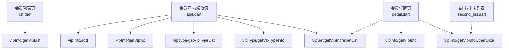
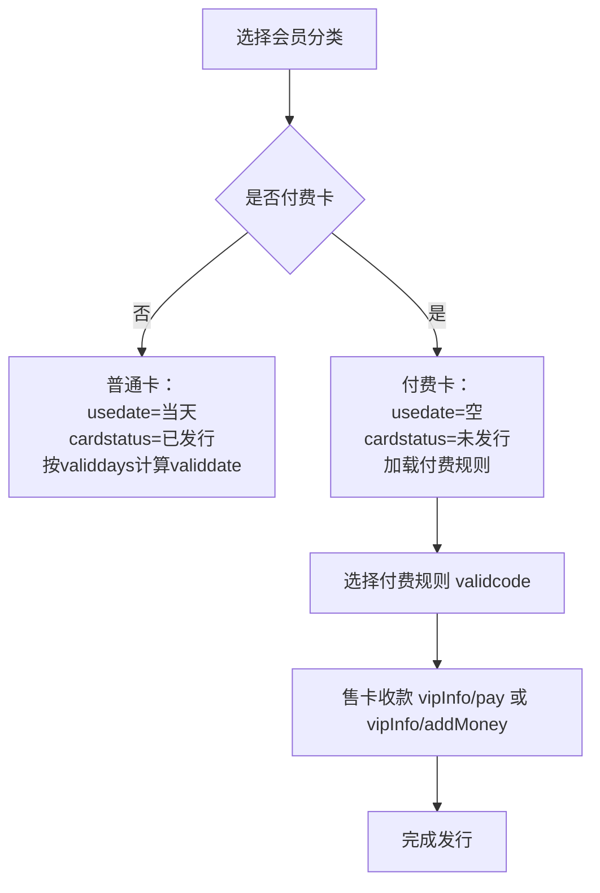
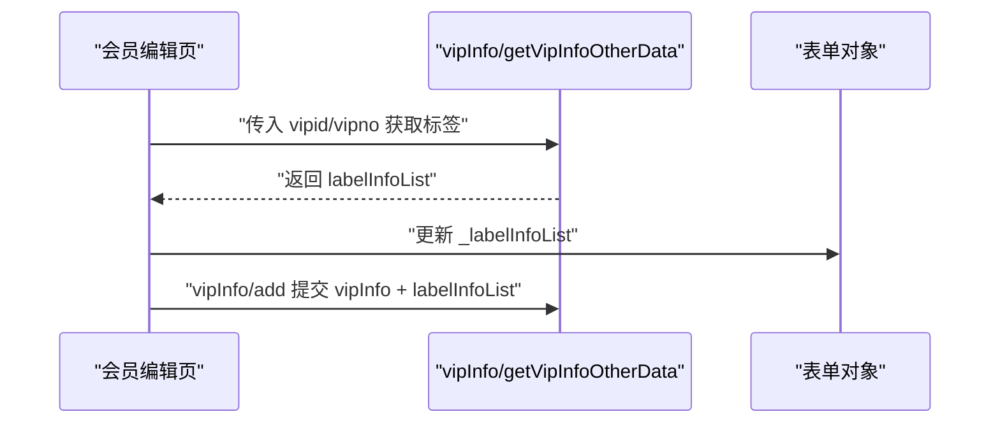
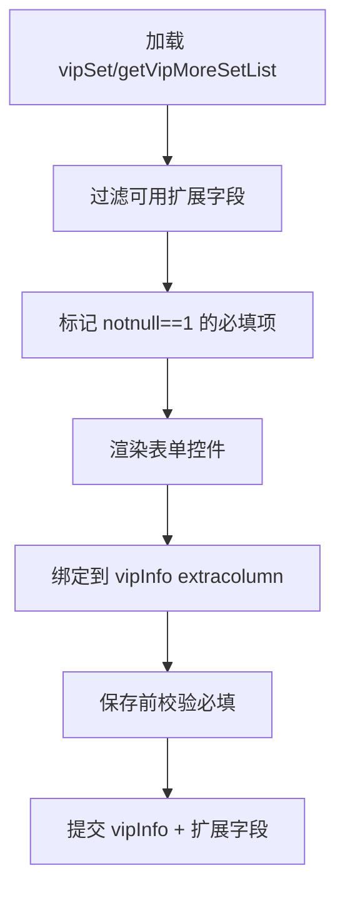
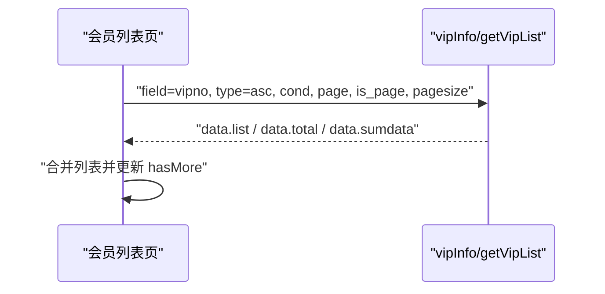
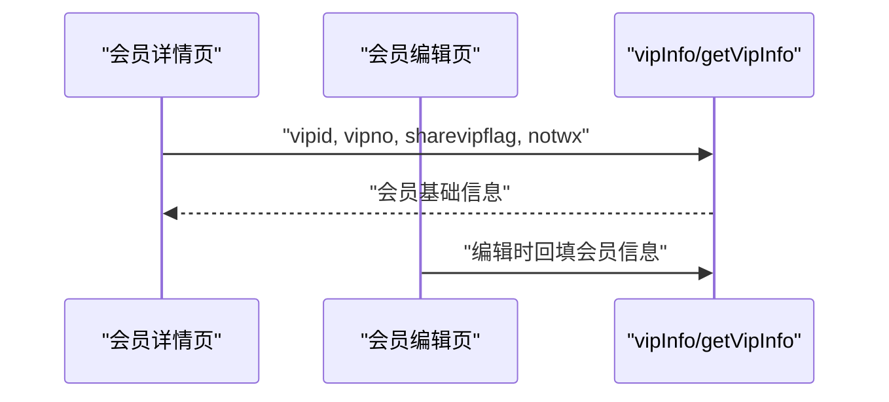
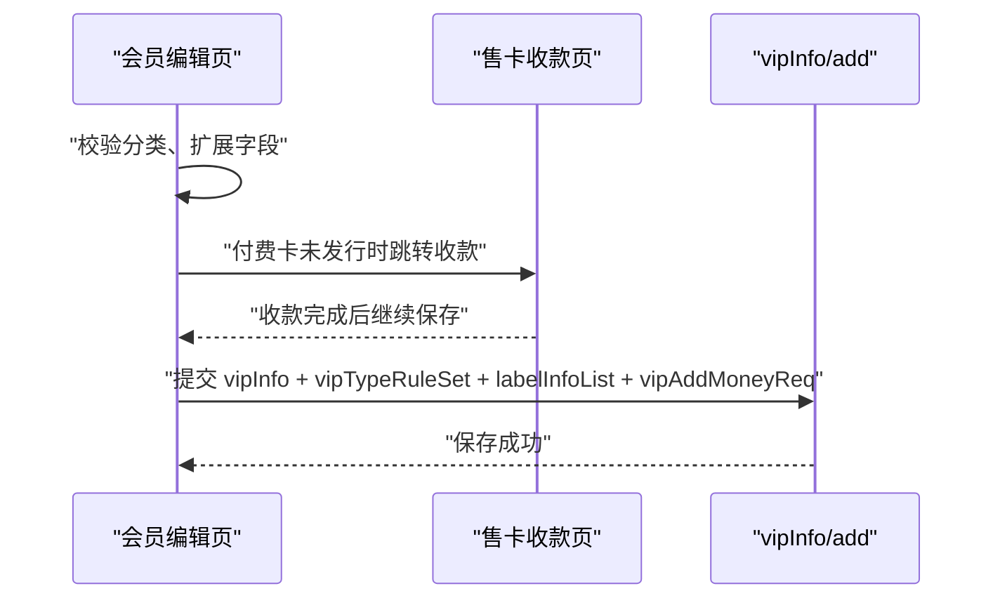
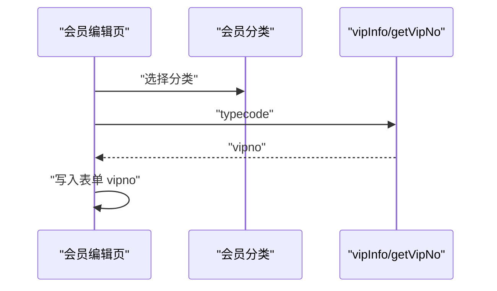
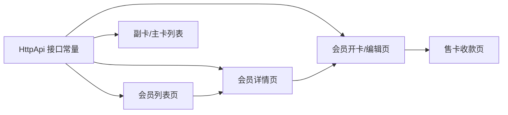

# 会员档案API

<cite>
**本文引用的文件**   
- [lib/net/http_api.dart](file://lib/net/http_api.dart)
- [lib/pages/business/members/basic/list.dart](file://lib/pages/business/members/basic/list.dart)
- [lib/pages/business/members/basic/add.dart](file://lib/pages/business/members/basic/add.dart)
- [lib/pages/business/members/basic/detail.dart](file://lib/pages/business/members/basic/detail.dart)
- [lib/pages/business/members/basic/second_list.dart](file://lib/pages/business/members/basic/second_list.dart)
</cite>

## 目录
1. [引言](#引言)
2. [项目结构定位](#项目结构定位)
3. [核心接口清单](#核心接口清单)
4. [会员基础信息结构](#会员基础信息结构)
5. [会员分类体系](#会员分类体系)
6. [标签管理系统](#标签管理系统)
7. [扩展字段机制](#扩展字段机制)
8. [CRUD 调用流程与示例](#crud-调用流程与示例)
9. [批量处理方案](#批量处理方案)
10. [性能优化建议](#性能优化建议)
11. [导入导出与数据同步策略](#导入导出与数据同步策略)
12. [依赖关系分析](#依赖关系分析)
13. [故障排查指南](#故障排查指南)
14. [结论](#结论)

## 引言
本文面向灵犀管店 Flutter 客户端中的会员档案模块，系统化整理会员列表、详情、附属数据、新增/编辑/售卡保存、删除以及会员卡号生成等 API 的调用约定。文档基于仓库中 `HttpApi` 常量定义与会员业务页面实现进行归纳，重点说明：
- 会员基础数据结构；
- 会员分类体系及付费规则联动；
- 标签管理与副卡关系；
- 自定义扩展字段的配置、校验与提交；
- 会员 CRUD 的完整前端调用路径；
- 批量操作、性能优化、导入导出与多端数据同步建议。

## 项目结构定位
会员档案功能在 Flutter 工程中的组织方式如下：
- 接口常量集中定义在 `lib/net/http_api.dart` 的 `HttpApi` 类中；
- 会员列表、开卡/编辑、详情、副卡列表位于 `lib/pages/business/members/basic/`；
- 所有网络请求通过统一的 `request` 方法发起，接口地址以 `vipInfo/*`、`vipType/*`、`vipSet/*`、`labelSet/*` 前缀为主。

**图示来源**
- [lib/net/http_api.dart:468-595](file://lib/net/http_api.dart#L468-L595)
- [lib/pages/business/members/basic/list.dart:1-120](file://lib/pages/business/members/basic/list.dart#L1-L120)
- [lib/pages/business/members/basic/add.dart:1-180](file://lib/pages/business/members/basic/add.dart#L1-L180)
- [lib/pages/business/members/basic/detail.dart:1-120](file://lib/pages/business/members/basic/detail.dart#L1-L120)
- [lib/pages/business/members/basic/second_list.dart:1-60](file://lib/pages/business/members/basic/second_list.dart#L1-L60)

**章节来源**
- [lib/net/http_api.dart:468-595](file://lib/net/http_api.dart#L468-L595)
- [lib/pages/business/members/basic/list.dart:1-120](file://lib/pages/business/members/basic/list.dart#L1-L120)

## 核心接口清单
以下接口均来自 `HttpApi` 会员管理区域，统一由 `vipInfo` 命名空间承载。

| 接口常量 | 后端路径 | 用途 | 主要调用方 |
|---|---|---|---|
| `vipInfoGetVipList` | `vipInfo/getVipList` | 会员列表分页查询 | 会员列表页 |
| `vipInfoGetVipInfo` | `vipInfo/getVipInfo` | 会员详情 | 会员详情页、会员编辑页 |
| `vipInfoGetVipInfoOtherData` | `vipInfo/getVipInfoOtherData` | 会员标签、副卡等附属数据 | 会员详情页、副卡列表、会员编辑页 |
| `vipInfoAdd` | `vipInfo/add` | 新增、编辑、售卡保存会员 | 会员开卡/编辑页 |
| `vipInfoDelete` | `vipInfo/delete` | 删除会员 | 会员管理后台或后续删除入口 |
| `vipInfoGetVipNo` | `vipInfo/getVipNo` | 根据会员分类编码生成会员卡号 | 会员开卡页 |
| `vipTypeGetVipTypeList` | `vipType/getVipTypeList` | 会员分类列表 | 会员开卡/编辑页 |
| `vipTypeGetVipTypeInfo` | `vipType/getVipTypeInfo` | 会员分类详情与付费规则 | 会员开卡/编辑页 |
| `labelSetGetLabelSetList` | `labelSet/getLabelSetList` | 会员标签列表（系统配置） | 标签选择相关逻辑 |
| `vipSetGetVipMoreSetList` | `vipSet/getVipMoreSetList` | 会员档案自定义扩展字段 | 会员开卡/编辑页、详情页 |
| `vipInfoPointOperate` | `vipInfo/pointOperate` | 积分冲减、积分转储值 | 积分相关页面 |
| `vipInfoAddMoney` | `vipInfo/addMoney` | 会员充值 | 充值相关页面 |
| `vipInfoPay` | `vipInfo/pay` | 会员收款、会员卡结算 | 售卡收款、收银结算 |

上述路径是客户端侧对外暴露的接口契约；实际 HTTP 基址由 `HttpApi.baseUrlYlx` 指向云端环境。

**章节来源**
- [lib/net/http_api.dart:468-595](file://lib/net/http_api.dart#L468-L595)

## 会员基础信息结构
会员基础信息由会员编辑页初始化并作为 `vipInfo` 主体提交给后端。该结构同时用于列表展示、详情回显和新增保存。

### 关键字段说明
| 字段 | 类型 | 含义 | 行为说明 |
|---|---|---|---|
| `typeid` | 字符串 | 会员分类ID | 必填；影响有效期、状态、付费规则 |
| `typeidname` | 字符串 | 会员分类名称 | 展示用，通常由分类列表加载 |
| `viptype` | 数字 | 会员分类类型 | 1 普通卡；2 付费卡 |
| `vipid` | 字符串 | 会员记录ID | 编辑时携带；新增时为空 |
| `vipno` | 字符串 | 会员卡号 | 由 `vipInfo/getVipNo` 生成 |
| `vipname` | 字符串 | 会员姓名 | 基础身份信息 |
| `mobile` | 字符串 | 手机号 | 支持格式校验 |
| `sex` | 字符串 | 性别 | 常见值“男”“女” |
| `birthday` | 字符串 | 公历生日 | 支持从身份证号自动识别 |
| `birthdaylan` | 字符串 | 农历生日 | 与公历生日互斥切换 |
| `idcardno` | 字符串 | 身份证号 | 可自动推导生日 |
| `address` | 字符串 | 地址 | 自由文本 |
| `password` | 字符串 | 会员密码 | 视业务安全策略使用 |
| `validflag` | 数字 | 是否设置有效期 | 0 长期有效；1 设置有效期 |
| `validdate` | 字符串 | 到期日期 | 可按分类有效期天数计算 |
| `usedate` | 字符串 | 启用日期 | 普通卡默认当天；付费卡可能为空 |
| `cardstatus` | 数字 | 卡片状态 | 普通卡常为已发行；付费卡未售卡时为未发行 |
| `overflag` | 数字 | 是否透支标志 | 余额控制相关 |
| `overmoney` | 数字 | 透支额度 | 与透支标志配合 |
| `nowpoint` | 数字 | 当前积分 | 可通过积分接口调整 |
| `nowmoney` | 数字 | 当前余额 | 付费规则或充值后更新 |
| `pocketmoney` | 数字 | 零钱或钱包余额 | 视业务语义使用 |
| `capitalmoney` | 数字 | 本金余额 | 充值赠送场景常用 |
| `givemoney` | 数字 | 赠送金额 | 充值赠送规则结果 |
| `validcode` | 字符串 | 付费规则编码 | 付费卡分类下选择的具体规则 |
| `additionalcardflag` | 数字 | 是否副卡标志 | 用于主副卡关系 |
| `parentcardid` | 字符串 | 主卡ID | “1”表示主卡；其他值表示副卡所属主卡 |
| `memo` | 字符串 | 备注 | 自由文本 |
| `status` | 数字 | 会员状态 | 如启用/停用 |
| `createtime` | 字符串 | 创建时间 | 新增时默认当前日期 |

### 数据来源
- 列表页通过 `vipInfo/getVipList` 返回分页数据和汇总数据；
- 详情页通过 `vipInfo/getVipInfo` 获取完整会员信息；
- 新增页初始化默认结构，并在编辑模式下回填；
- 付费卡分类会联动 `viptype`、`cardstatus`、`usedate`、`validflag`、`validdate`、`validcode`。

**章节来源**
- [lib/pages/business/members/basic/add.dart:40-120](file://lib/pages/business/members/basic/add.dart#L40-L120)
- [lib/pages/business/members/basic/detail.dart:1-120](file://lib/pages/business/members/basic/detail.dart#L1-L120)

## 会员分类体系
会员分类由 `vipType/getVipTypeList` 和 `vipType/getVipTypeInfo` 共同描述。

### 分类字段
| 字段 | 含义 |
|---|---|
| `typeid` | 分类ID |
| `name` | 分类名称 |
| `code` | 分类编码，用于生成会员卡号 |
| `viptype` | 分类类型：普通卡或付费卡 |
| `validdays` | 有效期天数：大于0表示有固定有效期 |

### 分类行为
- 新增会员时，默认选中第一个分类并调用 `vipInfo/getVipNo` 生成卡号；
- 普通卡：
  - `viptype = 1`；
  - `usedate` 默认为当天；
  - `cardstatus` 通常为已发行；
  - 若 `validdays > 0`，则自动计算 `validdate`；
- 付费卡：
  - `viptype = 2`；
  - `usedate` 初始为空；
  - `cardstatus` 初始为未发行；
  - 需要进一步加载 `vipType/getVipTypeInfo` 获取 `ruleSets`；
  - 用户需选择具体付费规则 `validcode`；
  - 售卡时需进入收款流程，最终才完成发行。

**图示来源**
- [lib/pages/business/members/basic/add.dart:201-360](file://lib/pages/business/members/basic/add.dart#L201-L360)

**章节来源**
- [lib/pages/business/members/basic/add.dart:201-360](file://lib/pages/business/members/basic/add.dart#L201-L360)

## 标签管理系统
会员标签通过 `vipInfo/getVipInfoOtherData` 返回的 `labelInfoList` 维护，同时系统标签配置可由 `labelSet/getLabelSetList` 提供。

### 标签模型
| 字段 | 含义 |
|---|---|
| `labelId` | 标签ID |
| `labelName` | 标签名称 |
| 其他字段 | 由后端标签模型决定，客户端以通用映射对象处理 |

### 使用方式
- 会员详情加载时并行请求附属数据；
- 会员编辑页打开编辑模式时也加载附属数据；
- 标签选择器返回多选结果，保存在 `_labelInfoList`；
- 保存会员时将 `labelInfoList` 随 `vipInfo` 一起提交给 `vipInfo/add`。

**图示来源**
- [lib/pages/business/members/basic/add.dart:120-180](file://lib/pages/business/members/basic/add.dart#L120-L180)
- [lib/pages/business/members/basic/detail.dart:40-100](file://lib/pages/business/members/basic/detail.dart#L40-L100)

**章节来源**
- [lib/pages/business/members/basic/add.dart:120-180](file://lib/pages/business/members/basic/add.dart#L120-L180)
- [lib/pages/business/members/basic/detail.dart:40-100](file://lib/pages/business/members/basic/detail.dart#L40-L100)

## 扩展字段机制
会员档案支持通过 `vipSet/getVipMoreSetList` 动态配置扩展字段，客户端据此渲染表单、执行必填校验并提交。

### 扩展字段关键属性
| 属性 | 含义 |
|---|---|
| `extracolumn` | 扩展字段键名，对应 `vipInfo` 中的字段 |
| `title` | 显示标题 |
| `extratext` | 备用标题 |
| `coltype` | 字段类型；1 表示文本/日期型字段 |
| `columntype` | 列类型；客户端过滤时优先判断此字段 |
| `status` | 字段启用状态 |
| `onlinestatus` | 在线可见状态 |
| `notnull` | 是否必填 |
| `modify` | 编辑模式是否允许修改 |

### 行为规则
- 只渲染 `coltype == 1` 且 `status == 1` 且 `onlinestatus == 1` 的扩展字段；
- 对 `notnull == 1` 的字段建立必填校验规则；
- 编辑模式下若 `modify == 0`，则该字段禁止修改；
- 文本型扩展字段会创建控制器并双向绑定到 `vipInfo[extracolumn]`；
- 保存前将扩展字段输入值同步回 `vipInfo`。

**图示来源**
- [lib/pages/business/members/basic/add.dart:300-420](file://lib/pages/business/members/basic/add.dart#L300-L420)

**章节来源**
- [lib/pages/business/members/basic/add.dart:300-420](file://lib/pages/business/members/basic/add.dart#L300-L420)

## CRUD 调用流程与示例

### 1. 查询会员列表：vipInfo/getVipList
- 分页参数：`page`、`is_page`、`pagesize`；
- 排序参数：`field`、`type`；
- 搜索参数：`cond`；
- 机构筛选：`issuesids`；
- 其他参数：`sharevipids`、`cardstatus`、`notwx`；
- 返回列表结构：`data.list`、`data.total`、`data.sumdata`。

典型调用顺序：
1. 页面初始化时调用列表接口；
2. 滚动到底部加载更多；
3. 输入关键词防抖后重置第1页并重新加载；
4. 下拉刷新时重置分页状态。

**图示来源**
- [lib/pages/business/members/basic/list.dart:60-120](file://lib/pages/business/members/basic/list.dart#L60-L120)

**章节来源**
- [lib/pages/business/members/basic/list.dart:60-120](file://lib/pages/business/members/basic/list.dart#L60-L120)

### 2. 查询会员详情：vipInfo/getVipInfo
- 入参包含 `vipid`、`vipno`、`sharevipflag`、`notwx`；
- 返回会员基础信息；
- 编辑页会根据返回数据填充表单，包括分类名称、生日、有效期等；
- 详情页并行加载详情、附属数据和扩展字段。

**图示来源**
- [lib/pages/business/members/basic/detail.dart:40-100](file://lib/pages/business/members/basic/detail.dart#L40-L100)
- [lib/pages/business/members/basic/add.dart:120-180](file://lib/pages/business/members/basic/add.dart#L120-L180)

**章节来源**
- [lib/pages/business/members/basic/detail.dart:40-100](file://lib/pages/business/members/basic/detail.dart#L40-L100)
- [lib/pages/business/members/basic/add.dart:120-180](file://lib/pages/business/members/basic/add.dart#L120-L180)

### 3. 查询会员附属数据：vipInfo/getVipInfoOtherData
- 用于获取标签、副卡等附属数据；
- 详情页、副卡列表、编辑页均使用该接口；
- 返回结构中至少包含 `labelInfoList`。

**章节来源**
- [lib/pages/business/members/basic/detail.dart:40-100](file://lib/pages/business/members/basic/detail.dart#L40-L100)
- [lib/pages/business/members/basic/second_list.dart:30-60](file://lib/pages/business/members/basic/second_list.dart#L30-L60)

### 4. 新增/编辑/售卡保存：vipInfo/add
- 提交主体：`vipInfo`；
- 付费规则：`vipTypeRuleSet`；
- 标签：`labelInfoList`；
- 充值/售卡附加请求：`vipAddMoneyReq`；
- 保存前校验：
  - 必须选择会员分类；
  - 必填扩展字段不能为空；
  - 付费卡未发行时会先跳转收款流程；
- 成功后返回成功提示并关闭页面。

**图示来源**
- [lib/pages/business/members/basic/add.dart:520-656](file://lib/pages/business/members/basic/add.dart#L520-L656)

**章节来源**
- [lib/pages/business/members/basic/add.dart:520-656](file://lib/pages/business/members/basic/add.dart#L520-L656)

### 5. 删除会员：vipInfo/delete
- 接口常量存在，但当前仓库未直接展示删除按钮调用；
- 建议调用方式：
  - 传入会员标识，如 `vipid` 或 `vipno`；
  - 删除前应确认权限和数据归属；
  - 删除成功后刷新列表。

**章节来源**
- [lib/net/http_api.dart:560-595](file://lib/net/http_api.dart#L560-L595)

### 6. 获取会员卡号：vipInfo/getVipNo
- 入参：`typecode`，即会员分类编码；
- 返回值：会员卡号字符串；
- 触发时机：新增会员选中分类后自动生成。

**图示来源**
- [lib/pages/business/members/basic/add.dart:280-320](file://lib/pages/business/members/basic/add.dart#L280-L320)

**章节来源**
- [lib/pages/business/members/basic/add.dart:280-320](file://lib/pages/business/members/basic/add.dart#L280-L320)

## 批量处理方案
仓库中会员列表采用单条分页加载，未直接实现批量删除或批量标签变更。可基于现有接口设计如下批量策略：

| 场景 | 方案 | 注意事项 |
|---|---|---|
| 批量查询 | 使用 `vipInfo/getVipList` 分页+条件组合 | 避免一次拉取过多数据，保持 `pagesize` 合理 |
| 批量删除 | 循环调用 `vipInfo/delete`，或使用服务端批量接口（若后端提供） | 失败重试、幂等、事务边界需明确 |
| 批量改标签 | 先查询会员附属数据，再逐个更新或调用批量接口 | 注意并发限制和网络错误恢复 |
| 批量生成卡号 | 按分类分批调用 `vipInfo/getVipNo` | 防止重复号冲突，保留失败明细 |
| 批量导入 | 本地解析Excel/CSV后逐条调用 `vipInfo/add` | 校验失败应返回行级错误 |

推荐批量调用原则：
- 串行+限流：避免瞬时大量请求压垮服务端；
- 失败隔离：单条失败不影响其余成功记录；
- 进度反馈：向用户展示已完成、失败、跳过数量；
- 日志记录：保留失败原因以便人工复核。

## 性能优化建议
- 列表分页：
  - 使用 `is_page=1`、`pagesize=20` 控制单次负载；
  - 滚动加载时去重并仅追加新数据；
  - 搜索时使用防抖，避免频繁请求；
- 并行请求：
  - 详情页并行加载详情、附属数据、扩展字段；
  - 使用 `Future.wait` 减少总等待时间；
- 缓存策略：
  - 会员分类、扩展字段等低频变化数据可做短期内存缓存；
  - 会员详情可在短暂编辑期间缓存，避免重复请求；
- 渲染优化：
  - 长列表使用懒加载；
  - 图片资源注意占位和错误兜底；
- 网络层：
  - 统一异常处理；
  - 超时与重试策略应区分读操作与写操作；
  - 敏感字段避免重复上传。

## 导入导出与数据同步策略

### 导入
- 输入格式：Excel、CSV 或 JSON；
- 字段映射：
  - 基础字段：姓名、手机号、身份证、生日、地址等；
  - 分类字段：按分类名称或编码映射到 `typeid`；
  - 标签字段：按标签名称映射到 `labelInfoList`；
  - 扩展字段：按 `extracolumn` 映射到 `vipInfo`；
- 校验顺序：
  1. 文件格式与编码；
  2. 必填字段；
  3. 手机号、身份证号格式；
  4. 会员分类是否存在；
  5. 标签是否存在；
  6. 扩展字段必填；
- 提交方式：
  - 小批量：逐条调用 `vipInfo/add`；
  - 大批量：分批次、限流、记录失败行；
  - 售卡导入：如需发卡，应先完成 `vipInfo/pay` 或 `vipInfo/addMoney`。

### 导出
- 导出内容：
  - 会员基础信息；
  - 会员分类名称；
  - 标签名称；
  - 扩展字段；
  - 余额、积分、状态等业务指标；
- 导出格式：
  - Excel：适合门店运营人员查看；
  - CSV：适合批量导入系统对接；
  - JSON：适合程序化同步。

### 数据同步策略
- 单向同步：
  - 后台系统 → 移动端：适用于总部下发会员数据；
  - 移动端 → 后台系统：适用于门店新增会员、售卡；
- 冲突解决：
  - 以时间戳为准：最后修改者胜出；
  - 以门店维度隔离：独立管理门店数据不跨店同步；
  - 以业务阶段隔离：未售卡会员与已售卡会员分开处理；
- 增量同步：
  - 使用更新时间字段或流水号；
  - 首次全量，后续增量；
- 离线能力：
  - 本地暂存新增会员；
  - 网络恢复后重试；
  - 失败任务进入待办队列。

## 依赖关系分析
会员档案模块的核心依赖如下：

**图示来源**
- [lib/net/http_api.dart:468-595](file://lib/net/http_api.dart#L468-L595)
- [lib/pages/business/members/basic/list.dart:1-120](file://lib/pages/business/members/basic/list.dart#L1-L120)
- [lib/pages/business/members/basic/add.dart:1-180](file://lib/pages/business/members/basic/add.dart#L1-L180)
- [lib/pages/business/members/basic/detail.dart:1-120](file://lib/pages/business/members/basic/detail.dart#L1-L120)
- [lib/pages/business/members/basic/second_list.dart:1-60](file://lib/pages/business/members/basic/second_list.dart#L1-L60)

**章节来源**
- [lib/net/http_api.dart:468-595](file://lib/net/http_api.dart#L468-L595)
- [lib/pages/business/members/basic/list.dart:1-120](file://lib/pages/business/members/basic/list.dart#L1-L120)
- [lib/pages/business/members/basic/add.dart:1-180](file://lib/pages/business/members/basic/add.dart#L1-L180)
- [lib/pages/business/members/basic/detail.dart:1-120](file://lib/pages/business/members/basic/detail.dart#L1-L120)

## 故障排查指南
- 会员列表为空：
  - 检查搜索条件是否为空；
  - 检查机构筛选 `issuesids`；
  - 检查分页参数 `is_page`、`pagesize`；
  - 检查网络层是否返回标准结构；
- 会员详情无法加载：
  - 检查 `vipid`、`vipno` 是否正确；
  - 检查 `notwx`、`sharevipflag` 是否符合预期；
  - 并行请求失败时确认降级展示；
- 会员分类未生效：
  - 检查 `typeid`、`viptype`、`validdays`；
  - 付费卡是否选择了 `validcode`；
  - 付费规则列表是否为空；
- 扩展字段不显示或不校验：
  - 检查 `coltype`、`status`、`onlinestatus`；
  - 检查 `notnull` 与必填校验逻辑；
  - 编辑模式下 `modify == 0` 会导致字段不可编辑；
- 会员卡号未生成：
  - 检查分类编码 `typecode` 是否为空；
  - 检查 `vipInfo/getVipNo` 返回值；
- 保存失败：
  - 检查必填扩展字段；
  - 检查付费卡是否完成售卡收款；
  - 检查 `vipInfo`、`labelInfoList`、`vipTypeRuleSet`、`vipAddMoneyReq` 是否完整。

**章节来源**
- [lib/pages/business/members/basic/list.dart:60-120](file://lib/pages/business/members/basic/list.dart#L60-L120)
- [lib/pages/business/members/basic/add.dart:201-656](file://lib/pages/business/members/basic/add.dart#L201-L656)
- [lib/pages/business/members/basic/detail.dart:40-120](file://lib/pages/business/members/basic/detail.dart#L40-L120)

## 结论
灵犀管店 Flutter 项目的会员档案模块围绕 `vipInfo`、`vipType`、`vipSet`、`labelSet` 四个核心命名空间构建，实现了会员列表、详情、分类、标签、扩展字段、会员卡号、新增/编辑、售卡保存等完整能力。  
在实际使用中，应重点关注：
- 会员分类与付费规则的联动；
- 扩展字段的动态配置与必填校验；
- 标签与副卡等附属数据的分离加载；
- 批量操作的限流、失败隔离与结果统计；
- 导入导出的字段映射与冲突解决；
- 多端数据同步的时间戳、门店隔离与离线重试策略。

以上规范可与后端接口保持一致，提升会员数据在移动端与云端之间的准确性、一致性和可维护性。