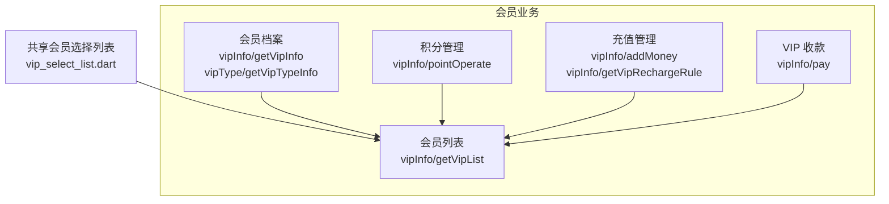
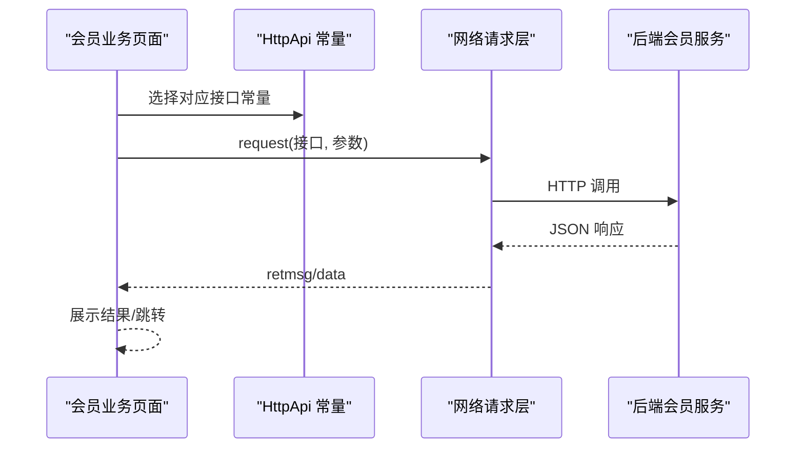
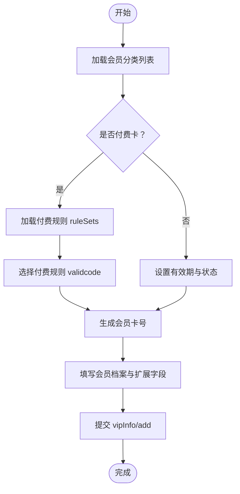
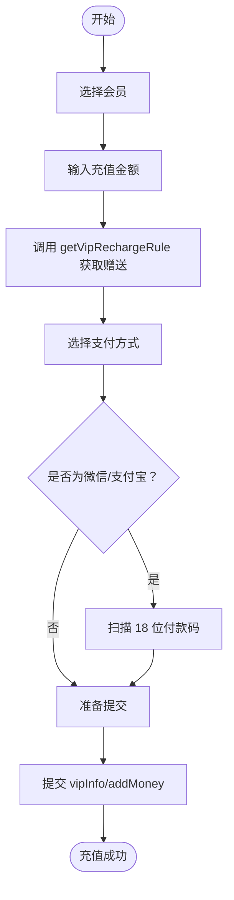
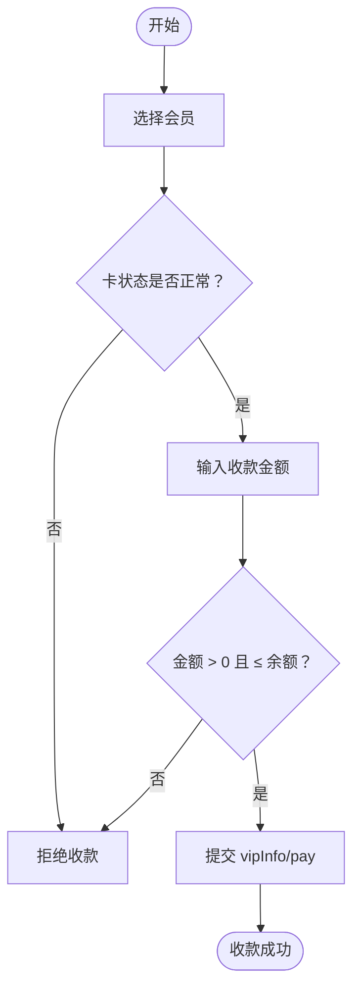
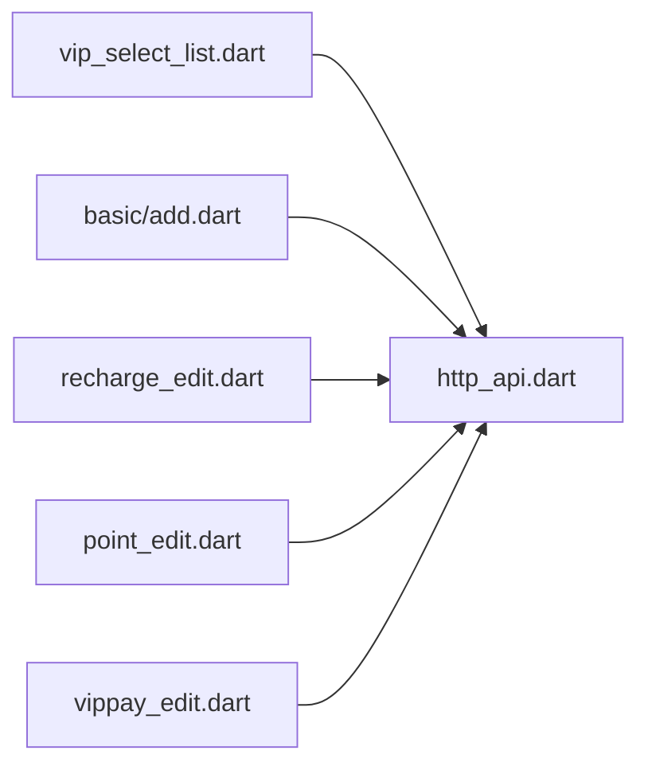

# 会员管理API

<cite>
**本文引用的文件**   
- [lib/net/http_api.dart](file://lib/net/http_api.dart)
- [lib/pages/business/members/shared/vip_select_list.dart](file://lib/pages/business/members/shared/vip_select_list.dart)
- [lib/pages/business/members/basic/add.dart](file://lib/pages/business/members/basic/add.dart)
- [lib/pages/business/members/recharge/recharge_edit.dart](file://lib/pages/business/members/recharge/recharge_edit.dart)
- [lib/pages/business/members/point/point_edit.dart](file://lib/pages/business/members/point/point_edit.dart)
- [lib/pages/business/members/vippay/vippay_edit.dart](file://lib/pages/business/members/vippay/vippay_edit.dart)
</cite>

## 目录
1. [引言](#引言)
2. [项目结构](#项目结构)
3. [核心接口总览](#核心接口总览)
4. [架构概览](#架构概览)
5. [详细接口定义](#详细接口定义)
6. [会员业务完整工作流](#会员业务完整工作流)
7. [会员等级与积分规则引擎](#会员等级与积分规则引擎)
8. [数据安全与隐私合规](#数据安全与隐私合规)
9. [扩展开发与营销集成方案](#扩展开发与营销集成方案)
10. [依赖分析](#依赖分析)
11. [故障排查指南](#故障排查指南)
12. [结论](#结论)

## 引言
本文件为灵犀管店 Flutter 项目的会员管理 API 文档，聚焦会员档案、积分管理、充值管理与 VIP 收款等会员业务。文档基于仓库中会员模块的页面实现和 HTTP API 常量整理，面向后端开发者、前端工程师、实施顾问和产品运营人员，帮助统一接口契约、理解业务闭环，并指导后续扩展与营销活动接入。

## 项目结构
会员相关功能主要集中在 `lib/pages/business/members` 目录下：
- 基础档案：会员开卡、编辑、查询附属数据、分类与付费规则
- 积分管理：积分冲减、积分转储值
- 充值管理：会员充值、充值赠送规则
- VIP 收款：会员卡余额结算、收款记录路由
- 共享组件：会员选择列表（搜索、扫码、分页）

**图示来源**
- [lib/pages/business/members/shared/vip_select_list.dart:1-120](file://lib/pages/business/members/shared/vip_select_list.dart#L1-L120)
- [lib/pages/business/members/basic/add.dart:180-300](file://lib/pages/business/members/basic/add.dart#L180-L300)
- [lib/pages/business/members/point/point_edit.dart:200-300](file://lib/pages/business/members/point/point_edit.dart#L200-L300)
- [lib/pages/business/members/recharge/recharge_edit.dart:180-260](file://lib/pages/business/members/recharge/recharge_edit.dart#L180-L260)
- [lib/pages/business/members/vippay/vippay_edit.dart:100-160](file://lib/pages/business/members/vippay/vippay_edit.dart#L100-L160)

**章节来源**
- [lib/pages/business/members/shared/vip_select_list.dart:1-120](file://lib/pages/business/members/shared/vip_select_list.dart#L1-L120)

## 核心接口总览
以下接口由会员业务页面调用，是会员系统的核心 API：

| 接口 | 路径 | 用途 | 主要入参 | 关键行为 |
|---|---|---|---|---|
| 会员列表 | `vipInfo/getVipList` | 获取门店会员列表，支持搜索、分页 | field、type、cond、page、is_page、pagesize、issuesids、issuesidname、sharevipids、cardstatus、notwx | 返回 list 分页数据；列表页按 vipno 升序 |
| 会员详情 | `vipInfo/getVipInfo` | 获取会员档案及余额、积分、有效期等 | vipid、vipno 等标识字段 | 回显会员主体信息 |
| 会员附属数据 | `vipInfo/getVipInfoOtherData` | 标签、副卡等附属信息 | vipid、vipno 等标识字段 | 返回 labelInfoList 等附属数据 |
| 会员新增/编辑 | `vipInfo/add` | 保存会员档案、售卡、付费规则 | 见“会员档案”一节 | 权限点 010703 |
| 删除会员 | `vipInfo/delete` | 删除会员 | vipid、vipno 等标识字段 | — |
| 生成会员卡号 | `vipInfo/getVipNo` | 根据分类编码生成卡号 | typecode | 自动填充 vipno |
| 会员分类列表 | `vipType/getVipTypeList` | 获取会员分类 | field、type、is_page、page、pagesize、cond | 联动 viptype、有效期、状态 |
| 会员分类详情 | `vipType/getVipTypeInfo` | 获取分类付费规则 ruleSets | typeid | 付费卡时生效 |
| 自定义扩展字段 | `vipSet/getVipMoreSetList` | 读取会员档案扩展列配置 | 空对象 | 控制必填项、是否可修改 |
| 积分操作 | `vipInfo/pointOperate` | 积分冲减、积分转储值 | operateType、point、amt、endpoint 等 | 权限点 010901/010902/010904 |
| 会员充值 | `vipInfo/addMoney` | 会员储值充值 | amt、giveamt、ruleid、payid、authcode 等 | 微信/支付宝需 18 位付款码 |
| 充值赠送规则 | `vipInfo/getVipRechargeRule` | 计算充值赠送金额/积分 | vipid、vipno、typeid、amt | 回传 ruleid/givepoint/giveamt |
| VIP 收款 | `vipInfo/pay` | 会员卡余额结算 | vipCardPay、payid=02、opertype=8 | 权限点 0110 |

**章节来源**
- [lib/net/http_api.dart:575-595](file://lib/net/http_api.dart#L575-L595)

## 架构概览
会员系统采用“页面 → HTTP API 常量 → 后端服务”的分层调用模式：
- 页面负责 UI、表单校验、权限检查、参数组装
- HTTP API 常量集中维护接口路径
- 后端提供会员档案、积分、充值、收款等能力

**图示来源**
- [lib/net/http_api.dart:575-595](file://lib/net/http_api.dart#L575-L595)
- [lib/pages/business/members/vippay/vippay_edit.dart:100-160](file://lib/pages/business/members/vippay/vippay_edit.dart#L100-L160)
- [lib/pages/business/members/recharge/recharge_edit.dart:200-300](file://lib/pages/business/members/recharge/recharge_edit.dart#L200-L300)

## 详细接口定义

### 会员列表：vipInfo/getVipList
- **接口路径**: `vipInfo/getVipList`
- **方法**: 通常为 GET/POST（以页面封装为准）
- **用途**: 查询会员列表，供积分、充值、收款等入口使用
- **典型入参**:
  - field: 排序字段，示例 `vipno`
  - type: 排序方向，示例 `asc`
  - cond: 搜索关键字
  - page/is_page/pagesize: 分页参数
  - issuesids/issuesidname: 当前门店 ID 与名称
  - sharevipids: 共享会员 ID 列表
  - cardstatus: 卡状态过滤
  - notwx: 非小程序标记
- **返回结构**:
  - data.list: 会员条目数组
  - 其他分页元信息（由后端约定）
- **前端行为**:
  - 默认按 vipno 升序
  - 支持滚动加载与搜索防抖
  - 支持扫码回填搜索条件

**章节来源**
- [lib/pages/business/members/shared/vip_select_list.dart:120-200](file://lib/pages/business/members/shared/vip_select_list.dart#L120-L200)
- [lib/net/http_api.dart:575-580](file://lib/net/http_api.dart#L575-L580)

### 会员档案：vipInfo/getVipInfo、vipInfo/getVipInfoOtherData、vipInfo/add、vipInfo/delete、vipInfo/getVipNo
- **vipInfo/getVipInfo**: 获取会员详情，用于编辑回显
- **vipInfo/getVipInfoOtherData**: 获取标签、副卡等附属数据
- **vipInfo/add**: 新增或编辑会员，含售卡保存逻辑
- **vipInfo/delete**: 删除会员
- **vipInfo/getVipNo**: 根据分类编码生成会员卡号
- **关联接口**:
  - vipType/getVipTypeList: 分类列表
  - vipType/getVipTypeInfo: 分类详情与付费规则
  - vipSet/getVipMoreSetList: 自定义扩展字段
- **关键业务规则**:
  - 免费卡 viptype=1：自动设置有效期和卡状态
  - 付费卡 viptype=2：需选择付费规则 validcode，并加载 ruleSets
  - 扩展字段根据 coltype/notnull/status/onlinestatus 控制显示与必填
  - 编辑模式下 modify=0 的扩展字段禁止修改
  - 权限点：保存 010703

**章节来源**
- [lib/pages/business/members/basic/add.dart:180-420](file://lib/pages/business/members/basic/add.dart#L180-L420)
- [lib/net/http_api.dart:575-590](file://lib/net/http_api.dart#L575-L590)

### 积分管理：vipInfo/pointOperate
- **接口路径**: `vipInfo/pointOperate`
- **用途**: 积分冲减（可为负数）或积分转储值
- **主要入参**:
  - vipid/vipno/vipname/typeid: 会员标识
  - operateType: 1=积分冲减，2=积分转储值
  - point: 积分变动值（冲减允许负数）
  - endpoint: 剩余积分展示
  - amt: 兑换储值金额（仅积分转储值）
  - saleid/salename/memo/billno: 业务员、备注、流水号
- **权限点**:
  - 010901 积分增加
  - 010902 积分减少
  - 010904 积分转储值
- **业务规则**:
  - 积分冲减时，若 nowpoint + point < 0，则自动取 -nowpoint
  - 积分转储值需开启 potoamtflag，并按 potoamtusepoint/potoamtgetmoney 计算 amt
  - 未开启 potoamtflag 时提示后台设置

**章节来源**
- [lib/pages/business/members/point/point_edit.dart:200-300](file://lib/pages/business/members/point/point_edit.dart#L200-L300)
- [lib/net/http_api.dart:585-590](file://lib/net/http_api.dart#L585-L590)

### 充值管理：vipInfo/addMoney、vipInfo/getVipRechargeRule
- **vipInfo/getVipRechargeRule**: 根据会员与充值金额获取赠送规则
  - 入参: vipid、vipno、typeid、amt
  - 返回: ruleid、givepoint、giveamt
- **vipInfo/addMoney**: 会员充值
  - 入参:
    - vipid/vipno/vipname/typeid: 会员标识
    - billno: 16 位随机单号
    - amt: 充值本金
    - giveamt/givepoint/ruleid: 赠送金额、赠送积分、规则 ID
    - payid/payname: 支付方式编码与名称
    - saleid/salename/memo: 业务员与备注
    - authcode/auth_code: 微信/支付宝 18 位付款码（当 payid 为 03/04 时必须）
  - 权限点: 010801
  - 支付限制:
    - payid=02 会员卡不支持充值
    - payid=03/04 必须先扫描 18 位付款码
  - 返回: retmsg 提示成功或错误信息

**章节来源**
- [lib/pages/business/members/recharge/recharge_edit.dart:180-300](file://lib/pages/business/members/recharge/recharge_edit.dart#L180-L300)
- [lib/net/http_api.dart:585-590](file://lib/net/http_api.dart#L585-L590)

### VIP 收款：vipInfo/pay
- **接口路径**: `vipInfo/pay`
- **用途**: 会员卡余额结算
- **主要入参**:
  - vipid/vipno/vipname/typeid: 会员标识
  - saleid/salename/memo: 业务员与备注
  - opertype: 固定 8
  - billno: 随机订单号
  - vipCardPay: 储值支付信息
    - amt: 收款金额
    - orderAmt: 订单金额
    - addmoney: 加款金额（通常等于 amt）
  - payid: 固定 02 会员卡
  - payname: 固定 会员卡
- **权限点**: 0110
- **校验规则**:
  - 会员卡状态必须为正常（cardstatus=1），否则拒绝
  - 收款金额必须大于 0，且不超过储卡余额 nowmoney

**章节来源**
- [lib/pages/business/members/vippay/vippay_edit.dart:100-160](file://lib/pages/business/members/vippay/vippay_edit.dart#L100-L160)
- [lib/net/http_api.dart:588-590](file://lib/net/http_api.dart#L588-L590)

## 会员业务完整工作流

### 会员开卡与编辑流程

**图示来源**
- [lib/pages/business/members/basic/add.dart:180-420](file://lib/pages/business/members/basic/add.dart#L180-L420)

### 会员充值流程

**图示来源**
- [lib/pages/business/members/recharge/recharge_edit.dart:180-300](file://lib/pages/business/members/recharge/recharge_edit.dart#L180-L300)

### VIP 收款流程

**图示来源**
- [lib/pages/business/members/vippay/vippay_edit.dart:100-160](file://lib/pages/business/members/vippay/vippay_edit.dart#L100-L160)

## 会员等级与积分规则引擎

### 会员等级体系
- 会员分类通过 `vipType/getVipTypeList` 获取，包含 viptype 字段：
  - viptype=1：免费卡，自动设置有效期与状态
  - viptype=2：付费卡，需要选择 validcode 并加载 ruleSets
- 分类详情 `vipType/getVipTypeInfo` 返回 ruleSets，每个规则包含：
  - validcode: 规则编码
  - nowmoney: 初始余额
  - 其他付费属性由后端补充
- 会员档案中 viptype、validdate、cardstatus 随分类与规则联动变化

**章节来源**
- [lib/pages/business/members/basic/add.dart:180-300](file://lib/pages/business/members/basic/add.dart#L180-L300)

### 积分规则引擎
- 积分操作通过 `vipInfo/pointOperate` 实现：
  - 积分冲减：point 可为负数，下限约束为 nowpoint + point ≥ 0
  - 积分转储值：需开启 potoamtflag，并根据 potoamtusepoint/potoamtgetmoney 计算 amt
- 充值赠送规则通过 `vipInfo/getVipRechargeRule` 计算：
  - 依据会员分类、充值金额返回 ruleid/givepoint/giveamt
- 积分与储值在会员档案中分别由 nowpoint、nowmoney/capitalmoney/givemoney 体现

**章节来源**
- [lib/pages/business/members/point/point_edit.dart:200-300](file://lib/pages/business/members/point/point_edit.dart#L200-L300)
- [lib/pages/business/members/recharge/recharge_edit.dart:180-260](file://lib/pages/business/members/recharge/recharge_edit.dart#L180-L260)

## 数据安全与隐私合规
- 敏感字段：
  - 手机号 mobile、身份证号 idcardno、银行卡信息（如有）
- 权限控制：
  - 会员保存 010703
  - 会员充值 010801
  - 积分增加 010901、积分减少 010902、积分转储值 010904
  - VIP 收款 0110
- 合规建议：
  - 列表与详情页对敏感字段进行脱敏展示
  - 上传至云端的日志中避免明文记录手机号、身份证、付款码
  - 对第三方渠道（如微信支付、支付宝）的 authcode 做最小化传输与加密存储
  - 用户协议与隐私政策应在注册/登录环节明确告知

[本节为通用安全与合规建议，不直接分析具体代码文件]

## 扩展开发与营销集成方案
- 营销活动接入点：
  - 充值赠送规则：通过 `vipInfo/getVipRechargeRule` 返回 ruleid/giveamt/givepoint，可在后端结合活动规则动态计算
  - 会员分类与付费规则：通过 `vipType/getVipTypeInfo` 的 ruleSets 扩展营销权益
  - 会员标签：通过 `vipInfo/getVipInfoOtherData` 的 labelInfoList 进行人群分层与定向营销
- 扩展字段：
  - 通过 `vipSet/getVipMoreSetList` 动态配置会员档案扩展列，支持文本/日期类型与必填校验
- 支付方式扩展：
  - 通过 `plugins/get` 拉取支付方式列表，过滤 vipaddflag=1 且 payid≠02 的方式用于充值
- 数据报表：
  - 会员消费 Top、优惠券分析、储值明细等可通过现有报表页面对接会员维度数据

**章节来源**
- [lib/pages/business/members/basic/add.dart:300-420](file://lib/pages/business/members/basic/add.dart#L300-L420)
- [lib/pages/business/members/recharge/recharge_edit.dart:120-180](file://lib/pages/business/members/recharge/recharge_edit.dart#L120-L180)

## 依赖分析
会员业务页面的依赖关系如下：

**图示来源**
- [lib/pages/business/members/shared/vip_select_list.dart:1-120](file://lib/pages/business/members/shared/vip_select_list.dart#L1-L120)
- [lib/net/http_api.dart:575-595](file://lib/net/http_api.dart#L575-L595)

**章节来源**
- [lib/pages/business/members/shared/vip_select_list.dart:1-120](file://lib/pages/business/members/shared/vip_select_list.dart#L1-L120)
- [lib/net/http_api.dart:575-595](file://lib/net/http_api.dart#L575-L595)

## 故障排查指南
- 会员状态异常导致无法充值或收款：
  - 现象：提示挂失、作废、已过期或无效
  - 排查：确认 cardstatus 是否为 1
- 充值金额与赠送不一致：
  - 现象：giveamt/givepoint 与预期不符
  - 排查：检查 amt 是否正确传入，是否触发 `vipInfo/getVipRechargeRule`
- 微信/支付宝充值失败：
  - 现象：提示请扫描正确的付款码
  - 排查：确认 payid 为 03/04 时是否提供 18 位 authcode
- 积分转储值不可用：
  - 现象：提示前往后台设置积分转储
  - 排查：检查 viptype.potoamtflag 是否开启，potoamtusepoint/potoamtgetmoney 是否为正数
- 权限不足：
  - 现象：按钮禁用或弹窗提示无权限
  - 排查：核对权限点 010703/010801/010901/010902/010904/0110

**章节来源**
- [lib/pages/business/members/recharge/recharge_edit.dart:200-300](file://lib/pages/business/members/recharge/recharge_edit.dart#L200-L300)
- [lib/pages/business/members/point/point_edit.dart:200-300](file://lib/pages/business/members/point/point_edit.dart#L200-L300)
- [lib/pages/business/members/vippay/vippay_edit.dart:100-160](file://lib/pages/business/members/vippay/vippay_edit.dart#L100-L160)

## 结论
本文档整理了灵犀管店 Flutter 项目中会员管理的核心 API 与业务逻辑，覆盖会员档案、积分、充值与 VIP 收款四个关键环节。通过统一的接口契约与清晰的流程图，帮助团队在后端设计、前端实现与运营活动中保持一致。建议在后续迭代中持续完善敏感字段脱敏、活动规则引擎与数据报表维度，以提升会员业务的灵活性与合规性。