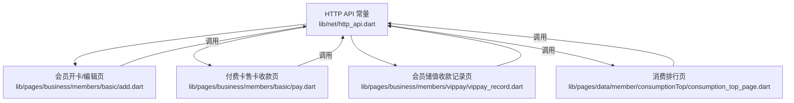
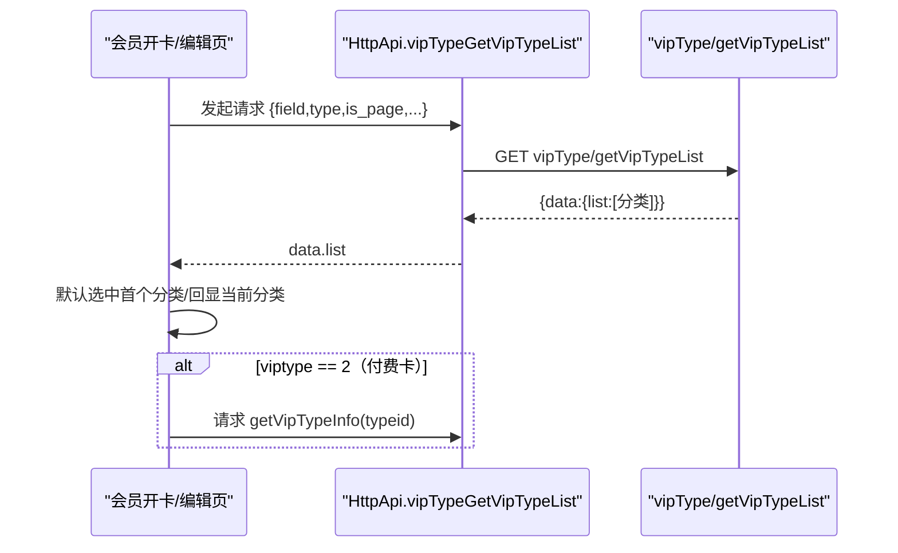
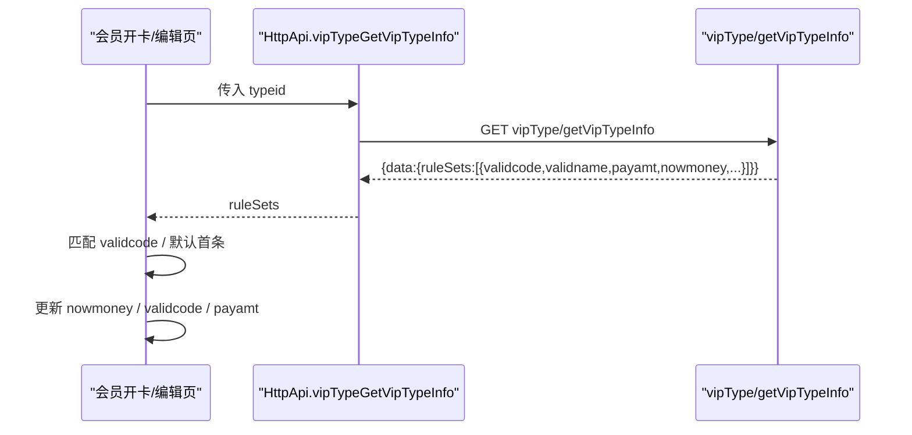
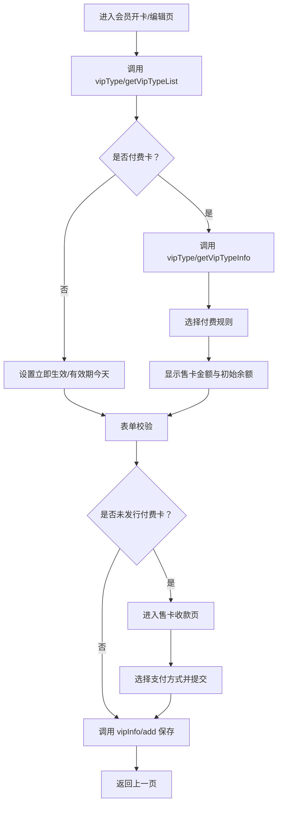
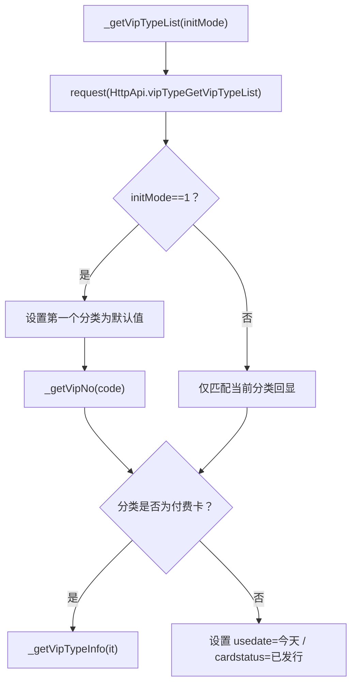
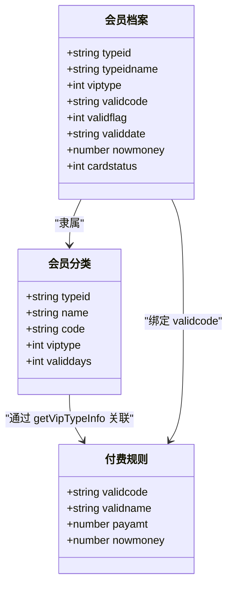
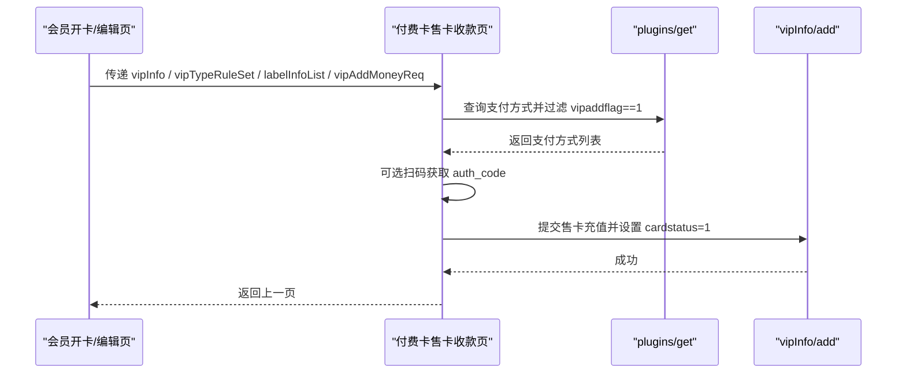
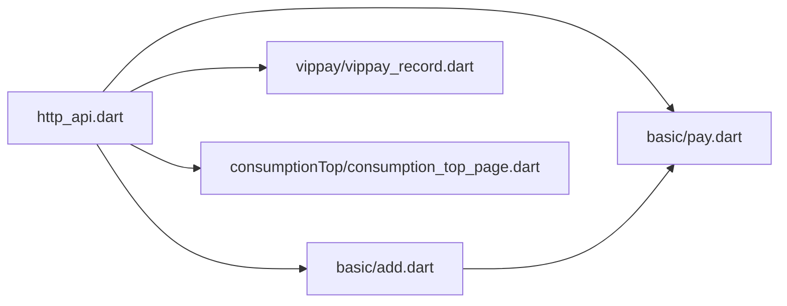

# 会员类型API

<cite>
**本文引用的文件**   
- [lib/net/http_api.dart](file://lib/net/http_api.dart)
- [lib/pages/business/members/basic/add.dart](file://lib/pages/business/members/basic/add.dart)
- [lib/pages/business/members/basic/pay.dart](file://lib/pages/business/members/basic/pay.dart)
- [lib/pages/business/members/vippay/vippay_record.dart](file://lib/pages/business/members/vippay/vippay_record.dart)
- [lib/pages/data/member/consumptionTop/consumption_top_page.dart](file://lib/pages/data/member/consumptionTop/consumption_top_page.dart)
</cite>

## 目录
1. [简介](#简介)
2. [项目结构定位](#项目结构定位)
3. [核心接口定义](#核心接口定义)
4. [架构总览](#架构总览)
5. [详细组件分析](#详细组件分析)
6. [依赖关系分析](#依赖关系分析)
7. [性能与可用性考虑](#性能与可用性考虑)
8. [故障排查指南](#故障排查指南)
9. [结论](#结论)
10. [附录：扩展建议](#附录扩展建议)

## 简介
本文面向灵犀管店 Flutter 客户端中的“会员类型”能力，围绕以下两个后端接口展开：
- `vipType/getVipTypeList`：获取会员分类列表。
- `vipType/getVipTypeInfo`：获取会员分类详情，并返回该分类下的付费规则集合。

文档将结合 Flutter 前端实现，说明会员等级体系设计、权益配置机制、付费规则引擎，以及会员类型的增删改查流程、权限控制、继承关系管理思路，并提供自动升级与到期提醒的实现方案建议。

## 项目结构定位
会员类型能力在 Flutter 项目中由以下模块协作完成：
- 接口常量集中定义在 HTTP API 层。
- 会员开卡/编辑页面负责加载会员分类、选择付费规则、联动有效期和卡状态。
- 付费卡售卡收款页负责支付方式选择、扫码、提交售卡充值请求。
- 会员储值收款记录页使用会员分类作为筛选维度，并在筛选弹窗中复用会员分类下拉数据源。
- 消费排行页面通过会员分类过滤消费数据。

**图表来源**
- [lib/net/http_api.dart:569-593](file://lib/net/http_api.dart#L569-L593)
- [lib/pages/business/members/basic/add.dart:200-300](file://lib/pages/business/members/basic/add.dart#L200-L300)
- [lib/pages/business/members/basic/pay.dart:1-120](file://lib/pages/business/members/basic/pay.dart#L1-L120)
- [lib/pages/business/members/vippay/vippay_record.dart:350-420](file://lib/pages/business/members/vippay/vippay_record.dart#L350-L420)
- [lib/pages/data/member/consumptionTop/consumption_top_page.dart:80-120](file://lib/pages/data/member/consumptionTop/consumption_top_page.dart#L80-L120)

**章节来源**
- [lib/net/http_api.dart:569-593](file://lib/net/http_api.dart#L569-L593)
- [lib/pages/business/members/basic/add.dart:200-300](file://lib/pages/business/members/basic/add.dart#L200-L300)
- [lib/pages/business/members/basic/pay.dart:1-120](file://lib/pages/business/members/basic/pay.dart#L1-L120)
- [lib/pages/business/members/vippay/vippay_record.dart:350-420](file://lib/pages/business/members/vippay/vippay_record.dart#L350-L420)
- [lib/pages/data/member/consumptionTop/consumption_top_page.dart:80-120](file://lib/pages/data/member/consumptionTop/consumption_top_page.dart#L80-L120)

## 核心接口定义

### 接口一：vipType/getVipTypeList（会员分类列表）
- **用途**：获取会员分类列表，用于开卡时默认选中、编辑回显、筛选弹窗选择等。
- **路径常量**：`HttpApi.vipTypeGetVipTypeList`，对应后端路径为 `vipType/getVipTypeList`。
- **典型入参**：
  - `field`：排序字段，例如 `name`。
  - `type`：排序方向，例如 `asc`。
  - `is_page`：是否分页，新增场景常传 `0`，选择器场景常传 `1`。
  - `page`、`pagesize`：分页参数。
  - `cond`：搜索关键字，支持按名称或编码检索。
  - `sids`：门店范围，用于限制可选择的会员分类。
- **返回结构**：
  - 通用响应体包含 `data`。
  - `data` 可能是 Map 且含 `list`，也可能是直接 List。
  - 列表中每个元素代表一个会员分类，常见字段包括：
    - `typeid`：分类编号。
    - `name`：分类名称。
    - `code`：分类编码。
    - `viptype`：会员类型，例如 `1` 表示免费卡，`2` 表示付费卡。
    - `validdays`：有效天数；大于 `0` 表示有固定有效期。
- **前端行为**：
  - 新增会员时，首次拉取列表并自动选中第一个分类，同时根据分类编码生成会员卡号。
  - 编辑会员时，仅匹配当前分类回显。
  - 当分类为付费卡时，进一步调用 `vipType/getVipTypeInfo` 获取付费规则。

**图表来源**
- [lib/pages/business/members/basic/add.dart:200-300](file://lib/pages/business/members/basic/add.dart#L200-L300)
- [lib/net/http_api.dart:581](file://lib/net/http_api.dart#L581)

**章节来源**
- [lib/pages/business/members/basic/add.dart:200-300](file://lib/pages/business/members/basic/add.dart#L200-L300)
- [lib/pages/business/members/vippay/vippay_record.dart:1000-1045](file://lib/pages/business/members/vippay/vippay_record.dart#L1000-L1045)
- [lib/net/http_api.dart:581](file://lib/net/http_api.dart#L581)

### 接口二：vipType/getVipTypeInfo（会员分类详情-含付费规则）
- **用途**：获取指定会员分类的付费规则集合，用于付费卡开卡时的规则选择、金额计算、余额初始化、有效期码绑定。
- **路径常量**：`HttpApi.vipTypeGetVipTypeInfo`，对应后端路径为 `vipType/getVipTypeInfo`。
- **典型入参**：
  - `typeid`：会员分类编号。
- **返回结构**：
  - 通用响应体包含 `data`。
  - `data.ruleSets` 是付费规则数组；若不存在则降级为直接 `data` 列表。
  - 每条规则通常包含：
    - `validcode`：有效期规则编码，用于关联会员档案中的 `validcode`。
    - `validname`：规则名称，用于界面展示。
    - `payamt`：售卡金额。
    - `nowmoney`：开卡初始余额。
    - 其他可能字段如赠送金额、赠送积分等，由服务端扩展。
- **前端行为**：
  - 当会员分类为付费卡时，加载规则集。
  - 优先匹配会员档案中已有的 `validcode`，否则默认选中第一条规则。
  - 选择规则后更新会员档案中的 `validcode`、`nowmoney`，并显示售卡金额。

**图表来源**
- [lib/pages/business/members/basic/add.dart:200-300](file://lib/pages/business/members/basic/add.dart#L200-L300)
- [lib/net/http_api.dart:582](file://lib/net/http_api.dart#L582)

**章节来源**
- [lib/pages/business/members/basic/add.dart:200-300](file://lib/pages/business/members/basic/add.dart#L200-L300)
- [lib/net/http_api.dart:582](file://lib/net/http_api.dart#L582)

## 架构总览
会员类型能力在前端形成“分类列表 → 分类详情 → 付费规则 → 售卡收款 → 保存会员档案”的完整链路。

**图表来源**
- [lib/pages/business/members/basic/add.dart:500-700](file://lib/pages/business/members/basic/add.dart#L500-L700)
- [lib/pages/business/members/basic/pay.dart:1-120](file://lib/pages/business/members/basic/pay.dart#L1-L120)
- [lib/net/http_api.dart:578-582](file://lib/net/http_api.dart#L578-L582)

**章节来源**
- [lib/pages/business/members/basic/add.dart:500-700](file://lib/pages/business/members/basic/add.dart#L500-L700)
- [lib/pages/business/members/basic/pay.dart:1-120](file://lib/pages/business/members/basic/pay.dart#L1-L120)
- [lib/net/http_api.dart:578-582](file://lib/net/http_api.dart#L578-L582)

## 详细组件分析

### 会员分类列表加载与默认选中逻辑
- 新增模式下，拉取会员分类列表并按名称升序排序。
- 自动选中第一条分类，同时回填分类编号、分类名称。
- 根据分类编码调用会员号生成接口，避免手工输入错误。
- 如果分类为付费卡，继续加载付费规则；如果是免费卡，直接设置有效期为当天、卡状态为已发行。

**图表来源**
- [lib/pages/business/members/basic/add.dart:200-300](file://lib/pages/business/members/basic/add.dart#L200-L300)

**章节来源**
- [lib/pages/business/members/basic/add.dart:200-300](file://lib/pages/business/members/basic/add.dart#L200-L300)

### 付费规则引擎与有效期联动
- 付费规则来自 `vipType/getVipTypeInfo` 返回的 `ruleSets`。
- 前端优先按会员档案中的 `validcode` 匹配规则；若无匹配则默认选中第一条。
- 选择规则后：
  - 更新会员档案中的 `validcode`。
  - 更新 `nowmoney`，即开卡初始余额。
  - 界面展示 `payamt`，即待收售卡金额。
- 分类变更时，会联动 `validflag`、`validdate`：
  - `validdays > 0` 表示有效期类型开启。
  - `validdate = 当前日期 + validdays 天`。
  - 付费卡默认未发行，需进入收款页完成支付后才变为已发行。

**图表来源**
- [lib/pages/business/members/basic/add.dart:200-300](file://lib/pages/business/members/basic/add.dart#L200-L300)
- [lib/pages/business/members/basic/add.dart:500-700](file://lib/pages/business/members/basic/add.dart#L500-L700)

**章节来源**
- [lib/pages/business/members/basic/add.dart:200-300](file://lib/pages/business/members/basic/add.dart#L200-L300)
- [lib/pages/business/members/basic/add.dart:500-700](file://lib/pages/business/members/basic/add.dart#L500-L700)

### 售卡收款流程
- 当会员类型为付费卡且尚未发行时，保存前跳转至售卡收款页。
- 收款页从父页面接收：
  - `vipInfo`：会员档案主体。
  - `vipTypeRuleSet`：当前选中的付费规则。
  - `labelInfoList`：会员标签。
  - `vipAddMoneyReq`：充值附加请求体。
- 支付方式通过插件接口 `plugins/get` 获取，并过滤出支持会员充值的支付方式。
- 微信或支付宝需要扫描 18 位付款码，扫码成功后回填 `auth_code`。
- 提交时调用 `vipInfo/add`，并将 `cardstatus` 置为已发行。

**图表来源**
- [lib/pages/business/members/basic/add.dart:500-700](file://lib/pages/business/members/basic/add.dart#L500-L700)
- [lib/pages/business/members/basic/pay.dart:1-120](file://lib/pages/business/members/basic/pay.dart#L1-L120)
- [lib/net/http_api.dart:569-582](file://lib/net/http_api.dart#L569-L582)

**章节来源**
- [lib/pages/business/members/basic/add.dart:500-700](file://lib/pages/business/members/basic/add.dart#L500-L700)
- [lib/pages/business/members/basic/pay.dart:1-120](file://lib/pages/business/members/basic/pay.dart#L1-L120)
- [lib/net/http_api.dart:569-582](file://lib/net/http_api.dart#L569-L582)

### 会员分类在报表与筛选中的复用
- 会员储值收款记录页将会员分类作为筛选条件之一，并通过 `vipType/getVipTypeList` 提供分类下拉选择。
- 消费排行页也支持按会员分类过滤消费数据。
- 这些场景体现了会员分类作为基础主数据的复用性。

**章节来源**
- [lib/pages/business/members/vippay/vippay_record.dart:1000-1045](file://lib/pages/business/members/vippay/vippay_record.dart#L1000-L1045)
- [lib/pages/data/member/consumptionTop/consumption_top_page.dart:80-120](file://lib/pages/data/member/consumptionTop/consumption_top_page.dart#L80-L120)

## 依赖关系分析
会员类型相关的前端依赖集中在 HTTP API 常量与各业务页面之间。

**图表来源**
- [lib/net/http_api.dart:569-593](file://lib/net/http_api.dart#L569-L593)
- [lib/pages/business/members/basic/add.dart:200-700](file://lib/pages/business/members/basic/add.dart#L200-L700)
- [lib/pages/business/members/basic/pay.dart:1-120](file://lib/pages/business/members/basic/pay.dart#L1-L120)
- [lib/pages/business/members/vippay/vippay_record.dart:350-420](file://lib/pages/business/members/vippay/vippay_record.dart#L350-L420)
- [lib/pages/data/member/consumptionTop/consumption_top_page.dart:80-120](file://lib/pages/data/member/consumptionTop/consumption_top_page.dart#L80-L120)

**章节来源**
- [lib/net/http_api.dart:569-593](file://lib/net/http_api.dart#L569-L593)
- [lib/pages/business/members/basic/add.dart:200-700](file://lib/pages/business/members/basic/add.dart#L200-L700)
- [lib/pages/business/members/basic/pay.dart:1-120](file://lib/pages/business/members/basic/pay.dart#L1-L120)
- [lib/pages/business/members/vippay/vippay_record.dart:350-420](file://lib/pages/business/members/vippay/vippay_record.dart#L350-L420)
- [lib/pages/data/member/consumptionTop/consumption_top_page.dart:80-120](file://lib/pages/data/member/consumptionTop/consumption_top_page.dart#L80-L120)

## 性能与可用性考虑
- 会员分类列表在新增场景中通常不需要分页，因此使用 `is_page=0` 一次性加载，减少网络往返。
- 在选择器场景中，使用分页与搜索关键字 `cond`，提升大数据量下的交互体验。
- 付费规则仅在付费卡分类下触发，避免不必要的二次请求。
- 列表类页面采用分页加载与滚动到底加载更多，降低首屏压力。
- 权限控制按钮禁用态，避免无效请求。

[本节为通用优化建议，不直接分析具体代码行]

## 故障排查指南
- 会员分类为空：
  - 检查 `vipType/getVipTypeList` 是否返回空 `list`。
  - 确认前端是否正确解析 `data` 为 Map 或直接 List。
- 付费规则未加载：
  - 确认会员分类的 `viptype` 是否为付费卡。
  - 检查 `vipType/getVipTypeInfo` 是否返回 `ruleSets`。
- 售卡金额异常：
  - 检查当前付费规则的 `payamt` 和 `nowmoney`。
  - 确认支付方式是否被正确过滤。
- 扫码失败：
  - 确认付款码长度为 18 位。
  - 确认微信/支付宝支付方式的 `auth_code` 是否回填到请求体。
- 保存失败：
  - 检查必填项校验，尤其是会员分类、自定义扩展字段。
  - 检查权限点 `010703` 是否可用。

**章节来源**
- [lib/pages/business/members/basic/add.dart:200-700](file://lib/pages/business/members/basic/add.dart#L200-L700)
- [lib/pages/business/members/basic/pay.dart:1-120](file://lib/pages/business/members/basic/pay.dart#L1-L120)
- [lib/pages/business/members/vippay/vippay_record.dart:350-420](file://lib/pages/business/members/vippay/vippay_record.dart#L350-L420)

## 结论
本项目的会员类型能力以 `vipType/getVipTypeList` 与 `vipType/getVipTypeInfo` 为核心，构建了“分类列表 → 分类详情 → 付费规则 → 售卡收款 → 保存会员档案”的闭环。Flutter 前端对两类会员分类进行了差异化处理：免费卡即时生效，付费卡需收款后发行。会员分类在主数据层面被多个业务页面复用，具备较好的可扩展性。后续可在后端完善自动升级与到期提醒策略，并在前端补充相应的提醒入口与展示逻辑。

[本节为总结性内容，不直接分析具体代码行]

## 附录扩展建议

### 会员等级体系设计与继承关系管理
- 等级体系：
  - 以 `viptype` 区分免费卡与付费卡。
  - 以 `validdays` 表达固定有效期。
  - 以 `validcode` 绑定具体付费规则，便于多规则并存。
- 继承关系管理建议：
  - 在后端引入父级分类字段，允许子类继承父类的权益与规则。
  - 前端在选择分类时，展示继承链，便于管理员理解权益来源。
  - 规则合并策略建议：子类覆盖父类同名字段，未覆盖字段继承父类。

[本节为概念性设计建议，不直接分析具体代码行]

### 会员类型 CRUD 操作示例
- 创建会员类型：
  - 建议在后端提供 `vipType/add` 或复用现有分类新增接口。
  - 前端表单包含分类名称、编码、类型、有效期、是否启用等字段。
- 修改会员类型：
  - 后端提供 `vipType/update`。
  - 前端复用分类选择器，避免重复录入。
- 删除会员类型：
  - 后端提供 `vipType/delete`。
  - 前端在删除前校验是否存在使用该分类的会员档案。
- 查询会员类型详情：
  - 直接使用 `vipType/getVipTypeInfo`。

[本节为建议性操作示例，不直接分析具体代码行]

### 权限控制与继承关系管理
- 权限控制：
  - 保存会员档案需要权限 `010703`。
  - 建议对会员类型管理页面增加独立权限点，例如 `010704`，控制分类维护入口。
- 继承关系管理：
  - 前端在编辑会员类型时，展示继承来源。
  - 规则冲突时提示管理员手动处理。

**章节来源**
- [lib/pages/business/members/basic/add.dart:700-850](file://lib/pages/business/members/basic/add.dart#L700-L850)

### 自动升级规则与到期提醒机制实现方案
- 自动升级规则：
  - 基于消费金额、消费次数、会员年龄增长等维度，在服务端定时任务中判断是否满足升级条件。
  - 升级后更新会员档案的 `typeid`、`validcode`，并保留升级流水。
- 到期提醒机制：
  - 服务端根据 `validdate` 与当前时间计算剩余天数，达到阈值时生成提醒消息。
  - 前端通过推送或站内信展示到期提醒，并提供续费入口。
- 前端展示建议：
  - 在会员详情页展示有效期倒计时。
  - 在首页或会员列表展示即将到期会员数量。
  - 点击提醒跳转到续费或续费套餐选择页。

[本节为通用实现方案建议，不直接分析具体代码行]