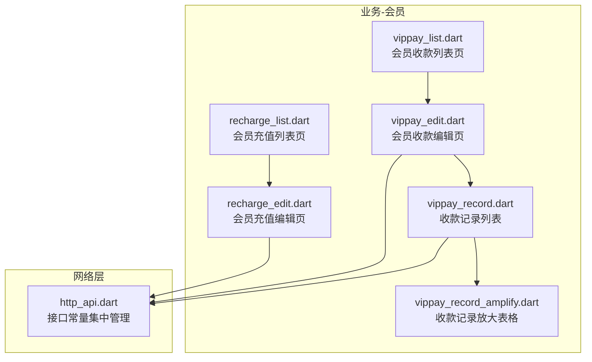
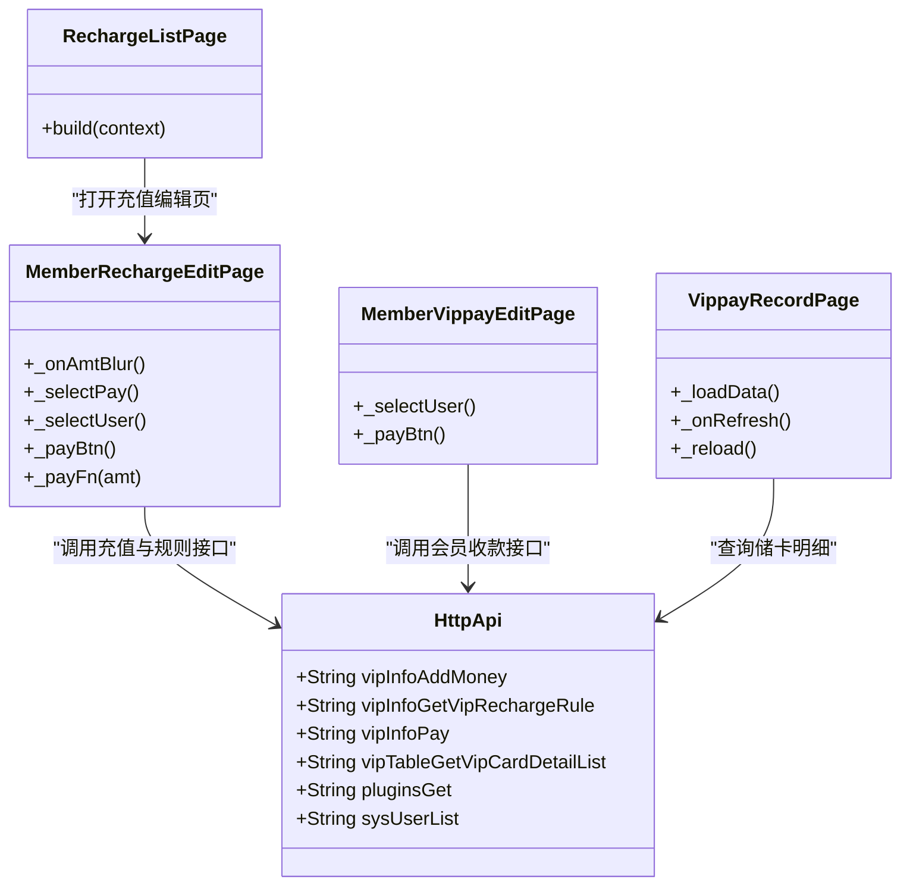
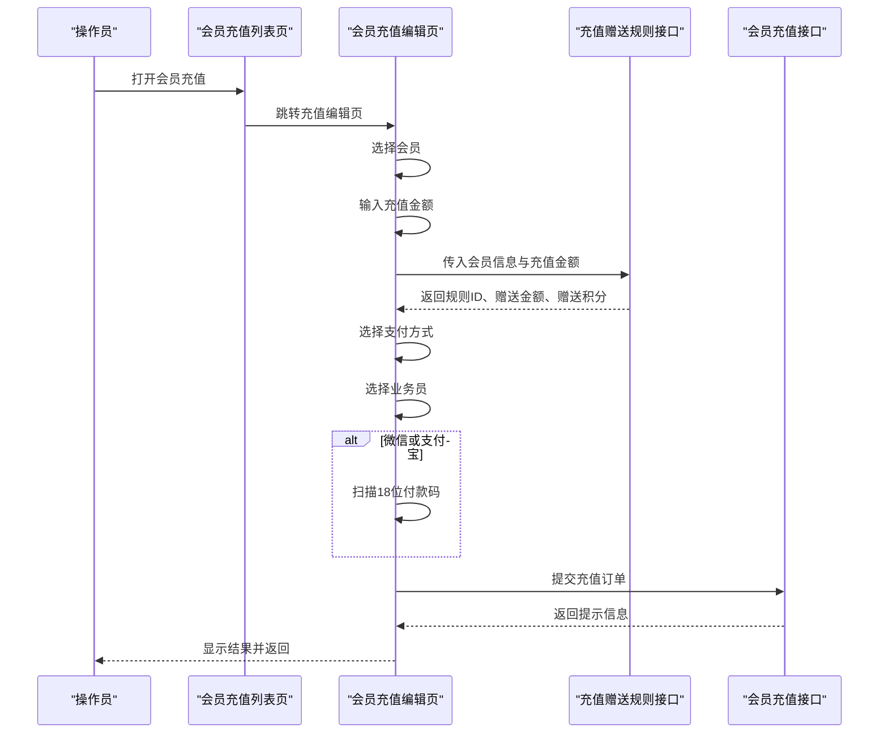
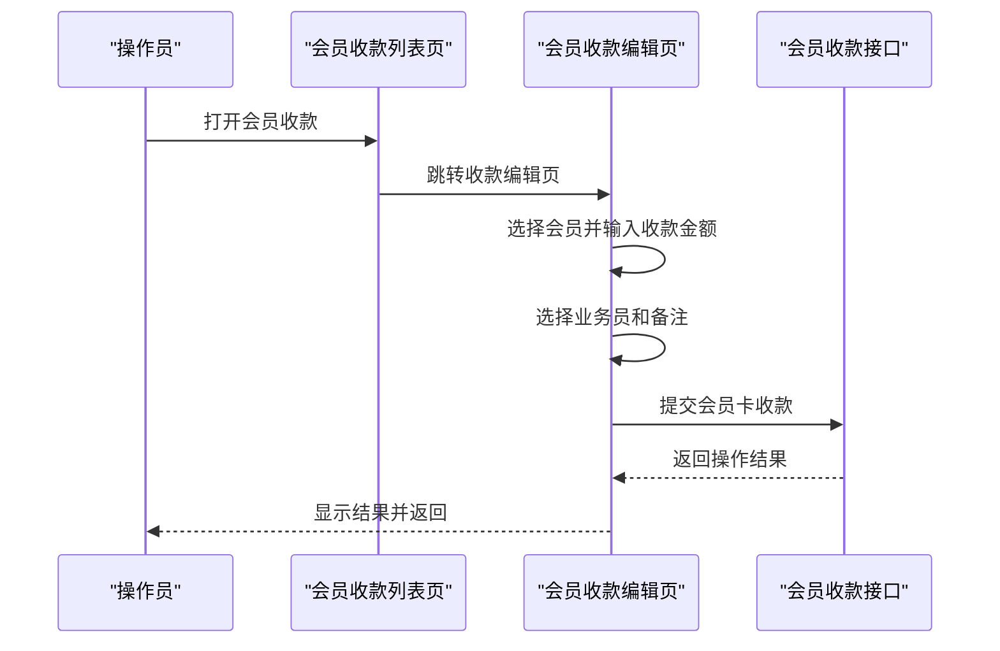
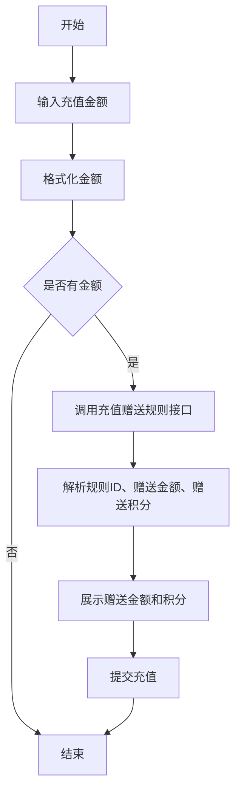
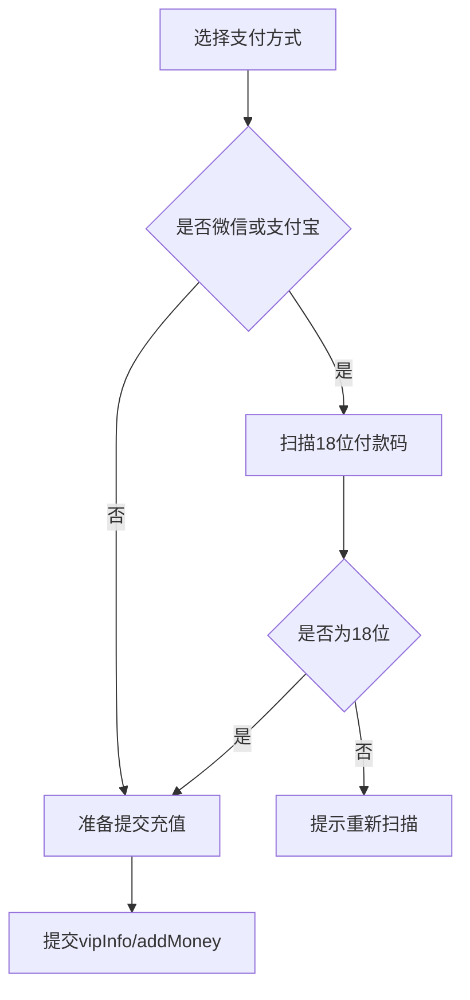
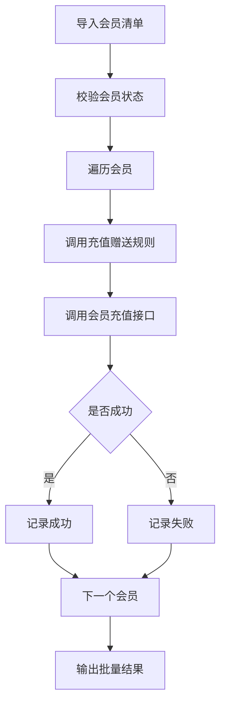
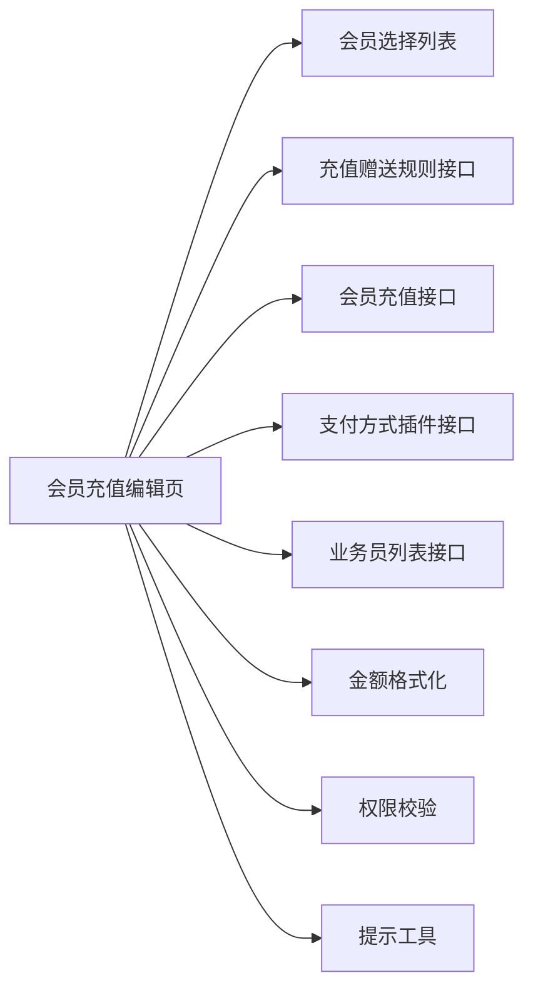

# 充值管理API

<cite>
**本文引用的文件**   
- [http_api.dart](file://lib/net/http_api.dart)
- [recharge_edit.dart](file://lib/pages/business/members/recharge/recharge_edit.dart)
- [recharge_list.dart](file://lib/pages/business/members/recharge/recharge_list.dart)
- [vippay_edit.dart](file://lib/pages/business/members/vippay/vippay_edit.dart)
- [vippay_record.dart](file://lib/pages/business/members/vippay/vippay_record.dart)
- [vippay_record_amplify.dart](file://lib/pages/business/members/vippay/vippay_record_amplify.dart)
</cite>

## 目录
1. [引言](#引言)
2. [项目结构与入口](#项目结构与入口)
3. [核心接口定义](#核心接口定义)
4. [系统架构与组件关系](#系统架构与组件关系)
5. [详细业务流程分析](#详细业务流程分析)
6. [金额计算与赠送规则引擎](#金额计算与赠送规则引擎)
7. [支付集成方案](#支付集成方案)
8. [充值记录管理与财务对账](#充值记录管理与财务对账)
9. [退款处理机制](#退款处理机制)
10. [充值模板配置与批量充值指南](#充值模板配置与批量充值指南)
11. [依赖关系分析](#依赖关系分析)
12. [性能与可用性建议](#性能与可用性建议)
13. [常见问题排查](#常见问题排查)
14. [结论](#结论)

## 引言
本文面向灵犀管店 Flutter 客户端中的“会员充值”功能，围绕以下目标展开：
- 明确 `vipInfo/addMoney`（会员充值）和 `vipInfo/getVipRechargeRule`（充值赠送规则）两个接口的调用方、请求参数、返回字段和业务含义。
- 解释充值金额、本金、赠金、积分之间的关系。
- 梳理从选择会员到完成充值的完整流程。
- 说明微信支付/支付宝付款码接入方式、会员卡收款流程和充值记录查询。
- 给出退款现状、模板配置思路及批量充值实现建议。

该文档以代码仓库中实际实现的页面和网络接口为依据，不虚构后端 API 的协议细节；涉及后端内部逻辑时，仅根据前端入参与注释进行可验证推断。

## 项目结构与入口
会员充值相关的前端能力集中在业务模块“会员”下：

**图表来源**
- [recharge_list.dart:1-20](file://lib/pages/business/members/recharge/recharge_list.dart#L1-L20)
- [recharge_edit.dart:1-200](file://lib/pages/business/members/recharge/recharge_edit.dart#L1-L200)
- [vippay_edit.dart:1-200](file://lib/pages/business/members/vippay/vippay_edit.dart#L1-L200)
- [vippay_record.dart:1-200](file://lib/pages/business/members/vippay/vippay_record.dart#L1-L200)
- [vippay_record_amplify.dart:1-200](file://lib/pages/business/members/vippay/vippay_record_amplify.dart#L1-L200)
- [http_api.dart:569-595](file://lib/net/http_api.dart#L569-L595)

**章节来源**
- [recharge_list.dart:1-20](file://lib/pages/business/members/recharge/recharge_list.dart#L1-L20)
- [http_api.dart:569-595](file://lib/net/http_api.dart#L569-L595)

## 核心接口定义
本节聚焦充值相关接口在客户端中的声明和调用位置。

### 接口常量定义
| 常量名 | 接口路径 | 用途 | 前端调用方 |
|---|---|---|---|
| `vipInfoAddMoney` | `vipInfo/addMoney` | 会员充值 | 会员充值编辑页 |
| `vipInfoGetVipRechargeRule` | `vipInfo/getVipRechargeRule` | 查询充值赠送规则 | 会员充值编辑页 |
| `vipInfoPay` | `vipInfo/pay` | 会员收款（会员卡结算） | 会员收款编辑页 |
| `vipTableGetVipCardDetailList` | `vipTable/getVipCardDetailList` | 会员储卡明细列表 | 收款记录列表/放大表格 |
| `pluginsGet` | `plugins/get` | 获取支付方式等插件数据 | 会员充值编辑页 |
| `sysUserList` | `sysuser/findList` | 业务员列表 | 会员充值/收款编辑页 |

**章节来源**
- [http_api.dart:569-595](file://lib/net/http_api.dart#L569-L595)

### 会员充值接口：`vipInfo/addMoney`
- **作用**：提交一次会员储值充值。
- **调用位置**：会员充值编辑页的“立即充值”按钮。
- **主要入参**：
  - `vipid`：会员 ID。
  - `vipno`：会员卡号。
  - `vipname`：会员姓名。
  - `typeid`：会员分类 ID。
  - `billno`：16 位随机单号。
  - `amt`：充值金额。
  - `giveamt`：赠送金额。
  - `givepoint`：赠送积分。
  - `ruleid`：充值赠送规则 ID。
  - `authcode` / `auth_code`：微信/支付宝付款码。
  - `payid`：支付方式编码。
  - `payname`：支付方式名称。
  - `saleid` / `salename`：业务员 ID 和名称。
  - `memo`：备注。
- **返回语义**：
  - 成功时返回消息提示，页面延迟关闭并返回编辑结果。
  - 失败时由网络层统一弹出错误提示。

**章节来源**
- [recharge_edit.dart:180-270](file://lib/pages/business/members/recharge/recharge_edit.dart#L180-L270)
- [http_api.dart:586-588](file://lib/net/http_api.dart#L586-L588)

### 充值赠送规则接口：`vipInfo/getVipRechargeRule`
- **作用**：根据会员信息和充值金额，返回适用的充值赠送规则、赠送金额和赠送积分。
- **调用时机**：充值金额输入框失焦或提交时触发。
- **主要入参**：
  - `vipid`：会员 ID。
  - `vipno`：会员卡号。
  - `typeid`：会员分类 ID。
  - `amt`：充值金额。
- **主要返回字段**：
  - `ruleid`：规则 ID。
  - `givepoint`：赠送积分。
  - `giveamt`：赠送金额。
- **前端处理**：将规则写入本地状态，用于后续提交 `vipInfo/addMoney`。

**章节来源**
- [recharge_edit.dart:98-128](file://lib/pages/business/members/recharge/recharge_edit.dart#L98-L128)
- [http_api.dart:587](file://lib/net/http_api.dart#L587)

## 系统架构与组件关系
会员充值属于“业务-会员”子域，其关键组件如下：

**图表来源**
- [http_api.dart:569-595](file://lib/net/http_api.dart#L569-L595)
- [recharge_edit.dart:1-200](file://lib/pages/business/members/recharge/recharge_edit.dart#L1-L200)
- [vippay_edit.dart:1-200](file://lib/pages/business/members/vippay/vippay_edit.dart#L1-L200)
- [vippay_record.dart:1-200](file://lib/pages/business/members/vippay/vippay_record.dart#L1-L200)
- [recharge_list.dart:1-20](file://lib/pages/business/members/recharge/recharge_list.dart#L1-L20)

## 详细业务流程分析

### 会员充值完整流程
会员充值的核心流程是：选择会员 → 输入充值金额 → 自动匹配赠送规则 → 选择支付方式 → 选择业务员 → 扫码（微信/支付宝）→ 提交充值。

**图表来源**
- [recharge_list.dart:1-20](file://lib/pages/business/members/recharge/recharge_list.dart#L1-L20)
- [recharge_edit.dart:98-270](file://lib/pages/business/members/recharge/recharge_edit.dart#L98-L270)

**章节来源**
- [recharge_list.dart:1-20](file://lib/pages/business/members/recharge/recharge_list.dart#L1-L20)
- [recharge_edit.dart:98-270](file://lib/pages/business/members/recharge/recharge_edit.dart#L98-L270)

### 会员收款流程
会员收款使用 `vipInfo/pay`，支付方式固定为会员卡，操作类型固定为 8，主要用于消费扣减余额。

**图表来源**
- [vippay_list.dart:1-18](file://lib/pages/business/members/vippay/vippay_list.dart#L1-L18)
- [vippay_edit.dart:1-200](file://lib/pages/business/members/vippay/vippay_edit.dart#L1-L200)

**章节来源**
- [vippay_list.dart:1-18](file://lib/pages/business/members/vippay/vippay_list.dart#L1-L18)
- [vippay_edit.dart:1-200](file://lib/pages/business/members/vippay/vippay_edit.dart#L1-L200)

## 金额计算与赠送规则引擎

### 充值金额、本金、赠金、积分的关系
- `amt`：用户实际支付的充值金额。
- `giveamt`：本次充值获得的赠金。
- `givepoint`：本次充值获得的积分。
- `ruleid`：决定赠送规则的标识。
- 会员余额卡片展示 `nowmoney`（总余额）、`capitalmoney`（本金）、`givemoney`（赠金）、`nowpoint`（当前积分）。

这些字段在充值编辑页中被格式化展示，并在提交时作为充值请求的一部分传给后端。

**章节来源**
- [recharge_edit.dart:270-672](file://lib/pages/business/members/recharge/recharge_edit.dart#L270-L672)

### 赠送规则引擎行为
从前端实现看，赠送规则引擎位于后端；Flutter 侧只做“查询+应用”：
1. 用户输入充值金额后，调用 `vipInfo/getVipRechargeRule`。
2. 前端接收 `ruleid`、`givepoint`、`giveamt`。
3. 用户确认充值时，将这些值随 `vipInfo/addMoney` 一起提交。

这意味着：
- 前端不负责判定具体赠送金额；
- 前端只负责校验输入格式、展示规则结果、透传规则信息；
- 最终资金变动由服务端保证一致性。

**图表来源**
- [recharge_edit.dart:98-128](file://lib/pages/business/members/recharge/recharge_edit.dart#L98-L128)

**章节来源**
- [recharge_edit.dart:98-128](file://lib/pages/business/members/recharge/recharge_edit.dart#L98-L128)

## 支付集成方案

### 支付方式选择
会员充值通过 `plugins/get` 获取支付方式列表，并按以下条件过滤：
- `vipaddflag` 必须为 `1`，表示支持会员充值；
- `payid` 不能为 `02`，因为 `02` 是会员卡结算，不是外部充值渠道。

可选支付方式包括现金、微信、支付宝等，具体由后台插件配置决定。

**章节来源**
- [recharge_edit.dart:128-168](file://lib/pages/business/members/recharge/recharge_edit.dart#L128-L168)
- [http_api.dart:569-570](file://lib/net/http_api.dart#L569-L570)

### 微信与支付宝付款码
当支付方式为微信或支付宝时，前端要求扫描 18 位付款码：
- 若未扫描，则跳转到二维码扫描页面；
- 扫描完成后，将付款码同时放入 `authcode` 和 `auth_code`；
- 提交充值时携带付款码给后端完成支付授权。

**图表来源**
- [recharge_edit.dart:180-230](file://lib/pages/business/members/recharge/recharge_edit.dart#L180-L230)

**章节来源**
- [recharge_edit.dart:180-230](file://lib/pages/business/members/recharge/recharge_edit.dart#L180-L230)

### 会员卡收款
会员收款走 `vipInfo/pay`，参数特点：
- `payid` 固定为 `02`；
- `opertype` 固定为 `8`；
- 金额封装在 `vipCardPay` 中，包含 `amt`、`orderAmt`、`addmoney`；
- 用于扣减会员卡余额，而非新增储值。

**章节来源**
- [vippay_edit.dart:1-200](file://lib/pages/business/members/vippay/vippay_edit.dart#L1-L200)

## 充值记录管理与财务对账

### 收款记录列表
收款记录通过 `vipTable/getVipCardDetailList` 查询，主要字段包括：
- `billno`：单据编号；
- `vipno`：会员卡号；
- `vipname`：会员姓名；
- `mobile`：手机号；
- `addmoney`：交易金额；
- `capitalmoney`：本金；
- `givemoney`：赠金；
- `endcapitalmoney`、`endgivemoney`、`endmoney`：变更后余额；
- `createtime`：交易时间；
- `salename` / `opername`：业务员/收银员；
- `memo`：备注。

列表页还支持：
- 门店筛选；
- 时间快捷筛选；
- 搜索条件；
- 会员分类筛选；
- 业务员筛选；
- 分页加载；
- 列设置；
- 合计行。

**章节来源**
- [vippay_record.dart:1-200](file://lib/pages/business/members/vippay/vippay_record.dart#L1-L200)

### 放大表格
放大表格用于快速查看关键列，包括：
- 单据编号；
- 会员卡号；
- 会员姓名；
- 交易金额；
- 本金；
- 赠金。

它复用同一明细接口，只是渲染列更精简，并保留底部合计。

**章节来源**
- [vippay_record_amplify.dart:1-200](file://lib/pages/business/members/vippay/vippay_record_amplify.dart#L1-L200)

### 财务对账视角
从客户端可见的对账维度包括：
- 按门店统计；
- 按时间段统计；
- 按会员分类统计；
- 按业务员统计；
- 按支付方式统计（需结合支付方式列表与记录明细）；
- 按交易金额、本金、赠金汇总。

但需要注意：当前 Flutter 实现并未直接提供独立的“财务对账报表”，而是通过会员收款记录的筛选与汇总来近似完成对账需求。真正完整的对账应以后端财务模块为准。

## 退款处理机制
在当前代码库中：
- 没有发现专门的“会员充值退款”页面；
- 没有发现明确的 `vipInfo/refund` 或类似退款接口；
- 也没有看到针对充值记录的“撤销充值”“退款”操作按钮。

因此，就本仓库而言：
- **会员充值退款**应由后端另行提供接口，并由管理员或具备权限的操作员在对应业务模块处理；
- 前端如需支持退款，应在现有会员业务模块中新增退款页面，并调用后端退款接口；
- 当前可用的最接近能力是“会员收款记录”，用于核对已发生的储值交易，但不能直接执行退款。

**章节来源**
- [http_api.dart:569-595](file://lib/net/http_api.dart#L569-L595)
- [vippay_record.dart:1-200](file://lib/pages/business/members/vippay/vippay_record.dart#L1-L200)

## 充值模板配置与批量充值指南

### 充值模板配置
仓库中没有独立的“充值模板”页面；充值规则由后端通过 `vipInfo/getVipRechargeRule` 返回。前端仅做展示和透传。

如果要在前端引入“充值模板”概念，可参考以下设计：
- 在后端增加充值模板配置接口；
- 在前端增加“充值模板选择器”，将模板映射到 `ruleid`、`giveamt`、`givepoint`；
- 用户选择模板后自动填充充值金额和赠送信息；
- 提交时仍调用 `vipInfo/addMoney`。

这种方案的优势是：
- 模板变更无需频繁发版；
- 运营人员可在后台配置不同充值档位；
- 前端保持轻量，只负责选择和展示。

### 批量充值实现指南
当前仓库只有单笔充值流程，没有批量充值入口。批量充值可按以下步骤扩展：
1. 新增“批量充值”页面，支持导入 Excel 或通过扫码批量选择会员。
2. 对每个会员执行单笔充值逻辑：
   - 调用 `vipInfo/getVipRechargeRule`；
   - 生成唯一 `billno`；
   - 调用 `vipInfo/addMoney`。
3. 增加事务性保障：
   - 单个会员失败时记录失败原因；
   - 全部成功后再统一提交；
   - 失败会员可重试或导出失败清单。
4. 增加权限控制：
   - 批量充值应比单笔充值更高权限；
   - 建议新增独立权限码。
5. 增加审计字段：
   - 记录操作员；
   - 记录批次号；
   - 记录导入文件名；
   - 记录成功/失败数量。

**图表来源**
- [recharge_edit.dart:98-270](file://lib/pages/business/members/recharge/recharge_edit.dart#L98-L270)

**章节来源**
- [recharge_edit.dart:98-270](file://lib/pages/business/members/recharge/recharge_edit.dart#L98-L270)

## 依赖关系分析
会员充值功能依赖多个基础能力：

**图表来源**
- [recharge_edit.dart:1-200](file://lib/pages/business/members/recharge/recharge_edit.dart#L1-L200)
- [http_api.dart:569-595](file://lib/net/http_api.dart#L569-L595)

**章节来源**
- [recharge_edit.dart:1-200](file://lib/pages/business/members/recharge/recharge_edit.dart#L1-L200)
- [http_api.dart:569-595](file://lib/net/http_api.dart#L569-L595)

## 性能与可用性建议
- **避免重复请求规则**：充值金额变化较快，但不应每次按键都请求规则接口；建议在失焦或点击“立即充值”前再请求。
- **防重复提交**：已有 `_submitting` 标志，应继续保证在网络超时、异常分支也恢复状态。
- **单号生成策略**：当前使用随机数生成 16 位单号，应避免极端冲突；建议结合业务流水号或后端分配。
- **扫码体验优化**：扫码失败时应允许用户重新进入扫码页，而不是清空整个表单。
- **金额精度**：所有金额均使用字符串格式化后再提交，有助于减少浮点误差。

[本节为通用建议，不直接分析特定代码片段]

## 常见问题排查

| 问题 | 可能原因 | 排查建议 |
|---|---|---|
| 充值金额为空 | 未输入或格式化后为空 | 检查输入框格式化逻辑和失焦回调 |
| 赠送金额为 0 | 规则未匹配或后端未配置 | 检查 `vipInfo/getVipRechargeRule` 返回 |
| 微信/支付宝充值失败 | 未扫描付款码或付款码非 18 位 | 检查扫码返回值和长度校验 |
| 会员状态无效 | 会员挂失、作废或过期 | 检查 `cardstatus` 分支提示 |
| 支付方式不可选 | 支付方式不支持会员充值或被过滤 | 检查 `plugins/get` 返回的 `vipaddflag` 和 `payid` |
| 收款记录无数据 | 时间范围、门店、筛选条件不正确 | 检查日期和筛选条件 |
| 批量充值部分失败 | 个别会员状态异常或网络异常 | 记录失败明细并重试 |

**章节来源**
- [recharge_edit.dart:180-270](file://lib/pages/business/members/recharge/recharge_edit.dart#L180-L270)
- [vippay_record.dart:1-200](file://lib/pages/business/members/vippay/vippay_record.dart#L1-L200)

## 结论
灵犀管店 Flutter 项目中的会员充值能力由“会员充值编辑页”和“会员收款编辑页”共同构成：
- `vipInfo/getVipRechargeRule` 负责查询充值赠送规则；
- `vipInfo/addMoney` 负责提交充值；
- `vipInfo/pay` 负责会员卡收款；
- `vipTable/getVipCardDetailList` 负责查询储卡明细；
- `plugins/get` 和 `sysuser/findList` 分别支撑支付方式和业务员选择。

当前实现已经覆盖了会员充值的主要前台流程，但在退款和批量充值方面需要后端接口与前端页面的进一步补充。对于财务对账，当前更适合通过收款记录筛选和汇总来辅助完成，完整对账体系应以后端财务模块为准。

[本节为总结性内容，不直接分析特定代码片段]