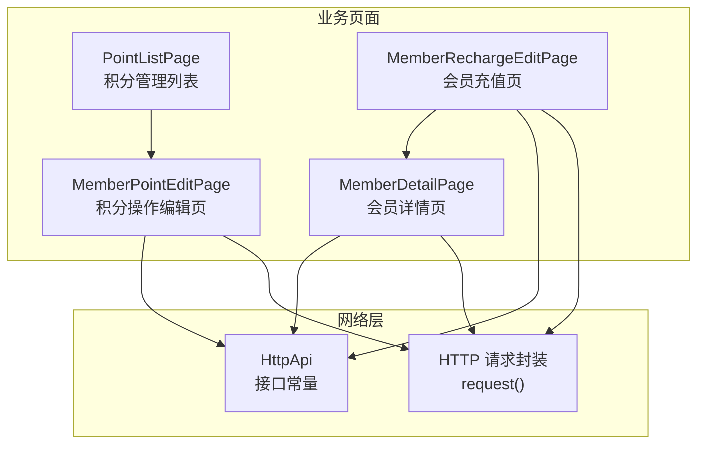
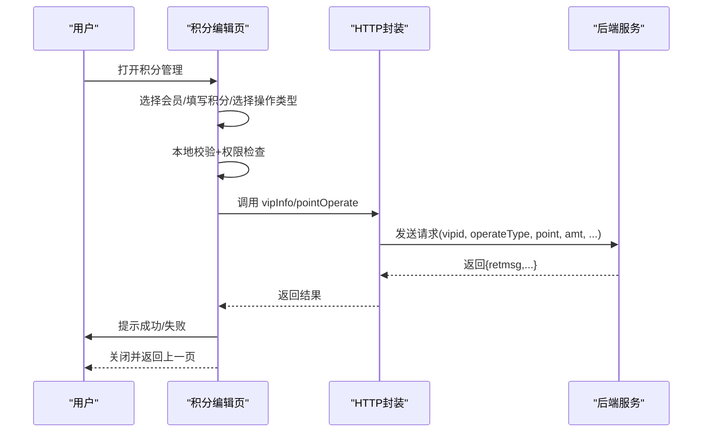
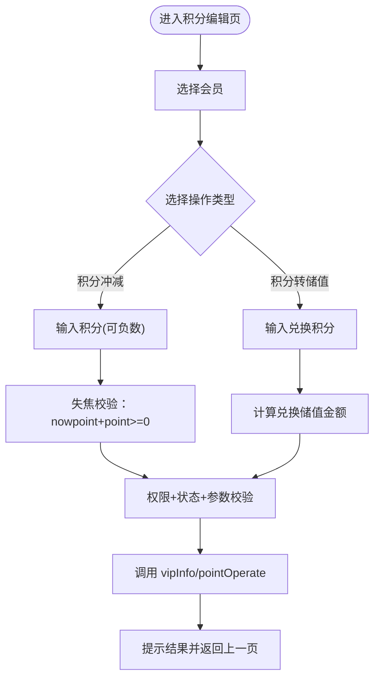
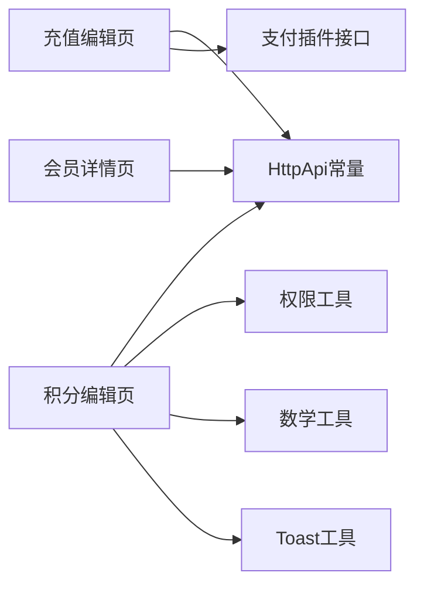

# 积分管理API

<cite>
**本文引用的文件**   
- [lib/net/http_api.dart](file://lib/net/http_api.dart)
- [lib/pages/business/members/point/point_list.dart](file://lib/pages/business/members/point/point_list.dart)
- [lib/pages/business/members/point/point_edit.dart](file://lib/pages/business/members/point/point_edit.dart)
- [lib/pages/business/members/recharge/recharge_edit.dart](file://lib/pages/business/members/recharge/recharge_edit.dart)
- [lib/pages/business/members/basic/detail.dart](file://lib/pages/business/members/basic/detail.dart)
</cite>

## 目录
1. [引言](#引言)
2. [项目结构与相关入口](#项目结构与相关入口)
3. [核心接口定义](#核心接口定义)
4. [架构总览](#架构总览)
5. [详细组件分析](#详细组件分析)
6. [依赖关系分析](#依赖关系分析)
7. [性能与并发建议](#性能与并发建议)
8. [故障排查指南](#故障排查指南)
9. [结论](#结论)
10. [附录：数据模型与字段说明](#附录数据模型与字段说明)

## 引言
本文面向灵犀管店 Flutter 客户端，围绕“会员积分”能力，聚焦以下目标：
- 完整记录 `vipInfo/pointOperate`（积分冲减、积分转储值）接口的调用方式、参数、权限与业务语义。
- 梳理积分规则引擎在客户端的体现：分类维度下的积分转储值兑换比例、自动/手动计算、输入校验与剩余积分展示。
- 描述积分变更历史与有效期管理的现有实现现状与建议扩展点。
- 给出积分操作端到端工作流示例，并补充事务处理与并发控制建议。
- 提供积分统计报表与数据分析的对接思路，以及动态配置能力的落地位置。

本说明以仓库中实际代码为依据；未在后端 API 层发现的字段或行为，将明确标注为“后端需确认”。

## 项目结构与相关入口
积分功能在 Flutter 前端由“列表页 + 编辑页”构成，并通过 HTTP API 常量集中管理接口路径。

图表来源
- [lib/pages/business/members/point/point_list.dart:1-17](file://lib/pages/business/members/point/point_list.dart#L1-L17)
- [lib/pages/business/members/point/point_edit.dart:1-200](file://lib/pages/business/members/point/point_edit.dart#L1-L200)
- [lib/pages/business/members/recharge/recharge_edit.dart:1-200](file://lib/pages/business/members/recharge/recharge_edit.dart#L1-L200)
- [lib/pages/business/members/basic/detail.dart:1-200](file://lib/pages/business/members/basic/detail.dart#L1-L200)
- [lib/net/http_api.dart:575-588](file://lib/net/http_api.dart#L575-L588)

章节来源
- [lib/pages/business/members/point/point_list.dart:1-17](file://lib/pages/business/members/point/point_list.dart#L1-L17)
- [lib/net/http_api.dart:575-588](file://lib/net/http_api.dart#L575-L588)

## 核心接口定义
本节重点定义积分操作主接口，并列出与积分相关的其他会员接口。

### vipInfo/pointOperate：积分冲减 / 积分转储值
- 接口标识：`vipInfo/pointOperate`
- 触发位置：积分操作编辑页提交时调用
- 主要用途：
  - 积分冲减：允许正数（增加积分）或负数（扣减积分），受当前积分下限约束。
  - 积分转储值：按会员分类配置的兑换比例，把积分兑换成储值金额。

请求参数
| 字段 | 类型 | 必填 | 说明 |
| --- | --- | --- | --- |
| vipid | String | 是 | 会员ID |
| vipno | String | 是 | 会员卡号 |
| vipname | String | 是 | 会员姓名 |
| typeid | String | 是 | 会员分类ID |
| operateType | Int | 是 | 操作类型：1=积分冲减，2=积分转储值 |
| point | String | 是 | 积分数量（字符串形式传入） |
| endpoint | String | 是 | 剩余积分（冲减后或兑换后剩余） |
| amt | Double | 条件 | 当 operateType=2 时必须大于0；兑换储值金额 |
| saleid | String | 否 | 业务员ID（当前传空） |
| salename | String | 否 | 业务员名称（当前传空） |
| memo | String | 否 | 备注 |
| billno | String | 是 | 16位随机单号（客户端生成） |

返回结构
- 统一响应包含 `retmsg`；若成功，客户端提示“操作成功”，否则显示服务端返回的消息。
- 具体余额更新、积分明细等以服务端为准；客户端不维护本地积分状态。

权限控制
- 积分增加（operateType=1 且 point>0）：需要权限码 `010901`
- 积分减少（operateType=1 且 point<0）：需要权限码 `010902`
- 积分转储值（operateType=2）：需要权限码 `010904`

注意事项
- 当会员卡状态不是“正常”时，前端直接拒绝提交。
- 当 operateType=2 且分类未开启积分转储时，前端提示后台配置。
- 当分类开启自动兑换但未配置兑换比例时，前端禁止继续计算。

章节来源
- [lib/pages/business/members/point/point_edit.dart:1-200](file://lib/pages/business/members/point/point_edit.dart#L1-L200)
- [lib/pages/business/members/point/point_edit.dart:201-565](file://lib/pages/business/members/point/point_edit.dart#L201-L565)
- [lib/net/http_api.dart:585-586](file://lib/net/http_api.dart#L585-L586)

### 关联会员接口
| 接口 | 标识 | 作用 |
| --- | --- | --- |
| 会员详情 | `vipInfo/getVipInfo` | 获取会员基本信息，含当前积分等 |
| 会员附属数据 | `vipInfo/getVipInfoOtherData` | 标签、副卡等附属信息 |
| 自定义扩展字段 | `vipSet/getVipMoreSetList` | 会员档案扩展字段 |
| 会员充值 | `vipInfo/addMoney` | 会员账户充值 |
| 充值赠送规则 | `vipInfo/getVipRechargeRule` | 根据金额匹配充值赠送规则 |
| 会员收款结算 | `vipInfo/pay` | 使用会员卡进行收款结算 |

章节来源
- [lib/net/http_api.dart:575-588](file://lib/net/http_api.dart#L575-L588)
- [lib/pages/business/members/basic/detail.dart:1-200](file://lib/pages/business/members/basic/detail.dart#L1-L200)
- [lib/pages/business/members/recharge/recharge_edit.dart:1-200](file://lib/pages/business/members/recharge/recharge_edit.dart#L1-L200)

## 架构总览
积分操作在客户端遵循“页面选择会员 → 表单校验 → 权限检查 → 生成单号 → 调用后端 → 提示结果 → 返回列表刷新”的流程。

图表来源
- [lib/pages/business/members/point/point_edit.dart:201-565](file://lib/pages/business/members/point/point_edit.dart#L201-L565)
- [lib/net/http_api.dart:585-586](file://lib/net/http_api.dart#L585-L586)

## 详细组件分析

### 积分操作编辑页 MemberPointEditPage
职责
- 支持两种操作：积分冲减、积分转储值。
- 本地完成输入校验、剩余积分计算、兑换储值金额计算。
- 权限检查通过后发起网络请求。

关键逻辑
- 积分冲减
  - 输入失焦时若 nowpoint + point < 0，则自动修正为 -nowpoint，避免负余额。
- 积分转储值
  - 当分类未开启 potoamtflag 时，提示“请前往后台设置积分转储”。
  - 当 potoamtflag=1 且 potoamtautoflag=0 时，按 usePoint/getMoney 计算兑换金额。
  - 剩余积分 endpoint = nowpoint - 兑换积分。
- 提交
  - 校验会员状态、积分输入、兑换金额、权限。
  - 生成16位随机单号，调用 `vipInfo/pointOperate`。
  - 成功后延迟关闭页面，回传刷新标记。

图表来源
- [lib/pages/business/members/point/point_edit.dart:1-200](file://lib/pages/business/members/point/point_edit.dart#L1-L200)
- [lib/pages/business/members/point/point_edit.dart:201-565](file://lib/pages/business/members/point/point_edit.dart#L201-L565)

章节来源
- [lib/pages/business/members/point/point_edit.dart:1-565](file://lib/pages/business/members/point/point_edit.dart#L1-L565)

### 会员充值页 MemberRechargeEditPage
职责
- 选择会员、输入充值金额。
- 调用 `vipInfo/getVipRechargeRule` 匹配充值赠送规则。
- 选择支付方式与业务员，调用 `vipInfo/addMoney` 完成充值。

要点
- 金额失焦时格式化并拉取赠送规则，回填 ruleid/givepoint/giveamt。
- 支付方式需满足 vipaddflag=1 且 payid≠02。
- 微信/支付宝需先扫描付款码。

章节来源
- [lib/pages/business/members/recharge/recharge_edit.dart:1-200](file://lib/pages/business/members/recharge/recharge_edit.dart#L1-L200)

### 会员详情页 MemberDetailPage
职责
- 并行加载会员详情、附属数据、扩展字段。
- 展示会员基础信息与积分等信息，并提供编辑入口。

章节来源
- [lib/pages/business/members/basic/detail.dart:1-200](file://lib/pages/business/members/basic/detail.dart#L1-L200)

## 依赖关系分析
- 页面依赖 HttpApi 常量，集中声明接口路径，便于统一管理。
- 积分编辑页依赖：
  - 会员选择列表页：用于选择目标会员。
  - 权限工具：校验积分操作权限。
  - 数学工具：数值格式化。
  - Toast工具：提示信息。
- 充值页依赖：
  - 支付方式插件接口：获取可用支付方式。
  - 系统用户接口：获取业务员列表。

图表来源
- [lib/pages/business/members/point/point_edit.dart:1-200](file://lib/pages/business/members/point/point_edit.dart#L1-L200)
- [lib/pages/business/members/recharge/recharge_edit.dart:1-200](file://lib/pages/business/members/recharge/recharge_edit.dart#L1-L200)
- [lib/net/http_api.dart:575-588](file://lib/net/http_api.dart#L575-L588)

章节来源
- [lib/pages/business/members/point/point_edit.dart:1-200](file://lib/pages/business/members/point/point_edit.dart#L1-L200)
- [lib/pages/business/members/recharge/recharge_edit.dart:1-200](file://lib/pages/business/members/recharge/recharge_edit.dart#L1-L200)
- [lib/net/http_api.dart:575-588](file://lib/net/http_api.dart#L575-L588)

## 性能与并发建议
- 幂等性
  - 建议后端基于 billno 做幂等控制，防止重复提交导致多次积分变动。
- 事务一致性
  - 积分变动、历史记录写入、储值转账应放在同一事务中；失败整体回滚。
- 并发控制
  - 对同一会员的积分/储值操作，建议使用分布式锁或数据库行级锁，避免同户并发扣减。
- 限流与防抖
  - 客户端已通过 submitting 状态限制重复点击；服务端仍需对高频接口做限流。
- 缓存策略
  - 会员详情和分类配置可短期缓存，但涉及余额的关键查询建议实时读取。
- 异步批量
  - 充值赠送规则与支付方式等下拉数据可使用分页或懒加载，减少首屏压力。

[本节为通用建议，不直接分析具体文件]

## 故障排查指南
常见问题与定位方法
- 会员状态异常
  - 现象：提交前即被拦截，提示挂失/作废/过期等。
  - 原因：cardstatus≠1。
  - 处理：联系管理员处理会员卡状态。
- 权限不足
  - 现象：提示无积分增加/减少/转储值权限。
  - 原因：未具备 010901/010902/010904 权限。
  - 处理：在系统权限管理中分配对应权限。
- 积分转储值未配置
  - 现象：提示“请前往后台设置积分转储”或兑换金额为0。
  - 原因：分类未开启 potoamtflag，或未配置 usePoint/getMoney。
  - 处理：在会员分类中启用积分转储并设置兑换比例。
- 输入校验失败
  - 现象：提示请输入积分或兑换储值。
  - 原因：point 为空或 operateType=2 时 amt<=0。
  - 处理：补齐输入值。
- 网络或后端错误
  - 现象：弹出服务端 retmsg。
  - 处理：查看后端日志，核对 vipid、billno、operateType、point、amt 是否合法。

章节来源
- [lib/pages/business/members/point/point_edit.dart:201-565](file://lib/pages/business/members/point/point_edit.dart#L201-L565)

## 结论
- 前端已完整实现 `vipInfo/pointOperate` 的调用链路，包括操作类型、输入校验、权限控制与结果提示。
- 积分规则引擎在前端表现为会员分类维度下的兑换比例计算与开关控制；复杂规则应由后端统一决策。
- 积分变更历史、有效期管理与积分兑换机制的核心落库应由后端保证；前端负责参数组装与交互校验。
- 建议在后续迭代中补充：
  - 统一的积分操作流水查询接口。
  - 积分有效期规则与到期提醒。
  - 更完善的并发与幂等保障。
  - 积分统计报表与数据分析接口，支撑运营分析。

[本节为总结性内容，不直接分析具体文件]

## 附录：数据模型与字段说明

### 积分操作输入输出
- 输入关键字段
  - vipid、vipno、vipname、typeid：用于识别会员及分类。
  - operateType：1=积分冲减，2=积分转储值。
  - point：积分数量。
  - endpoint：剩余积分。
  - amt：兑换储值金额（仅 operateType=2）。
  - saleid、salename：业务员信息（当前为空）。
  - memo：备注。
  - billno：16位随机单号。
- 输出关键字段
  - retmsg：操作结果消息。

章节来源
- [lib/pages/business/members/point/point_edit.dart:201-565](file://lib/pages/business/members/point/point_edit.dart#L201-L565)

### 会员分类积分转储相关字段
- potoamtflag：是否开启积分转储值。
- potoamtautoflag：是否自动计算兑换金额。
- potoamtusepoint：兑换所需积分。
- potoamtgetmoney：可获得的储值金额。

章节来源
- [lib/pages/business/members/point/point_edit.dart:1-200](file://lib/pages/business/members/point/point_edit.dart#L1-L200)

### 积分规则引擎与动态配置
- 前端体现
  - 分类下 potoamtflag/potoamtautoflag/potoamtusepoint/potoamtgetmoney 控制兑换流程。
- 后端建议
  - 将积分获取、消费、兑换、转储值规则统一到规则引擎。
  - 支持规则版本化、灰度发布与回滚。
  - 提供规则查询与管理接口，供前端或运营平台使用。

章节来源
- [lib/pages/business/members/point/point_edit.dart:1-200](file://lib/pages/business/members/point/point_edit.dart#L1-L200)

### 积分变更历史与有效期管理
- 现状
  - 前端未提供积分流水列表；积分历史与有效期管理依赖后端。
- 建议
  - 新增积分流水查询接口，支持按会员、时间范围、操作类型筛选。
  - 为积分条目引入有效期字段，并在扣费时优先扣除即将过期的积分。

[本节为扩展建议，不直接分析具体文件]

### 积分统计报表与数据分析
- 建议接口
  - 会员积分累计、消耗、兑换、转储值统计。
  - 分时段、分门店、分分类的积分趋势分析。
  - 积分贡献排名与兑换偏好分析。
- 数据来源
  - 积分流水表、会员表、分类表、交易结算表。

[本节为扩展建议，不直接分析具体文件]