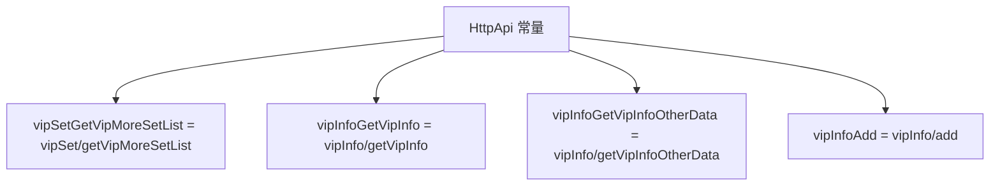
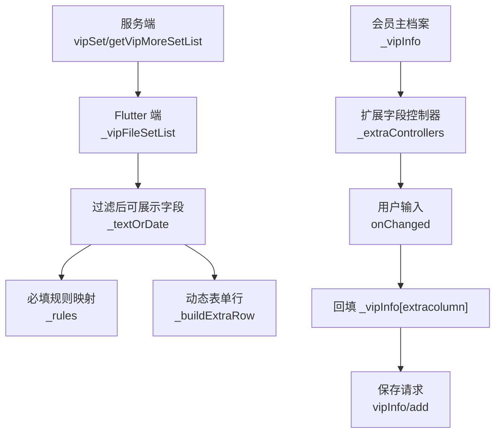
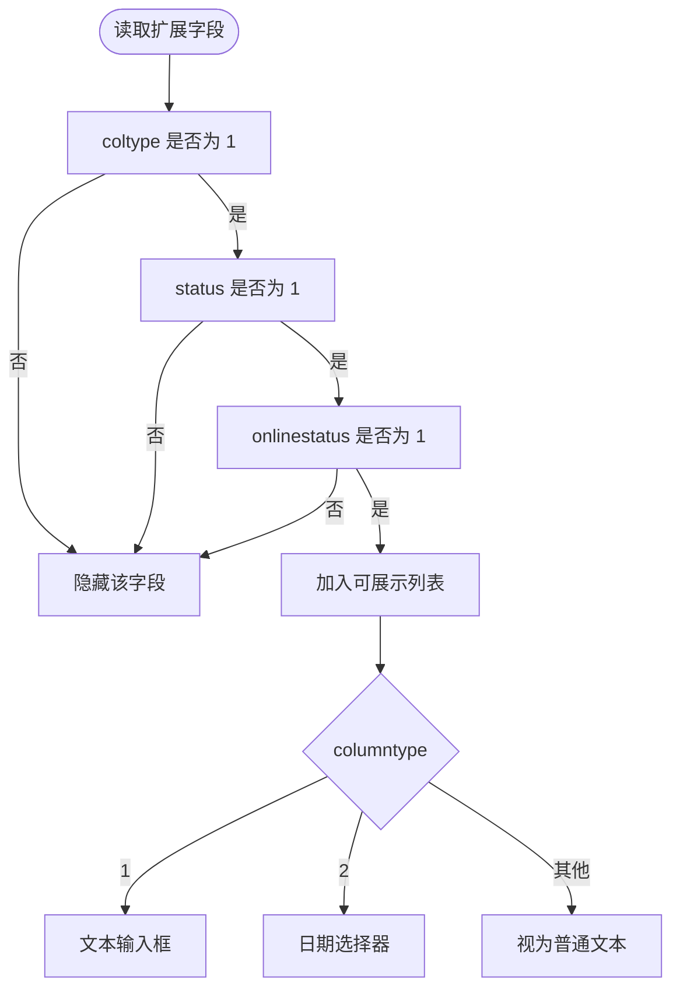
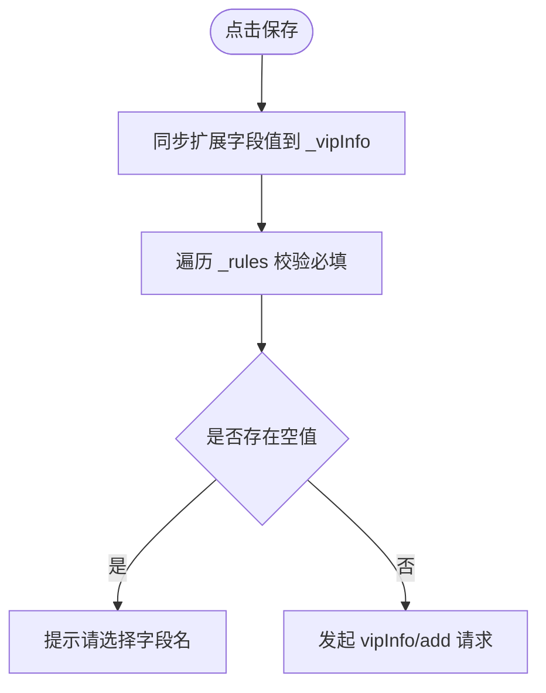
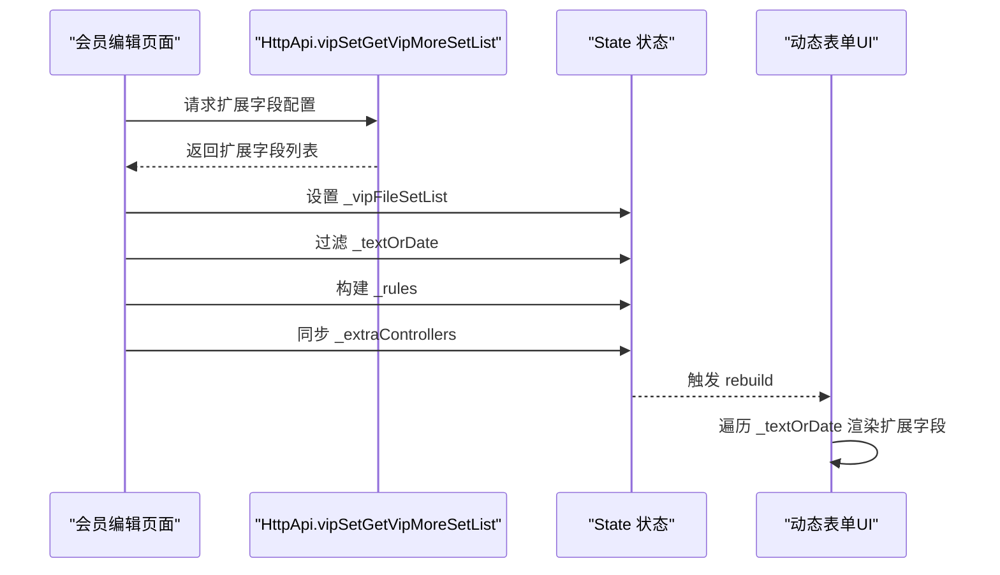
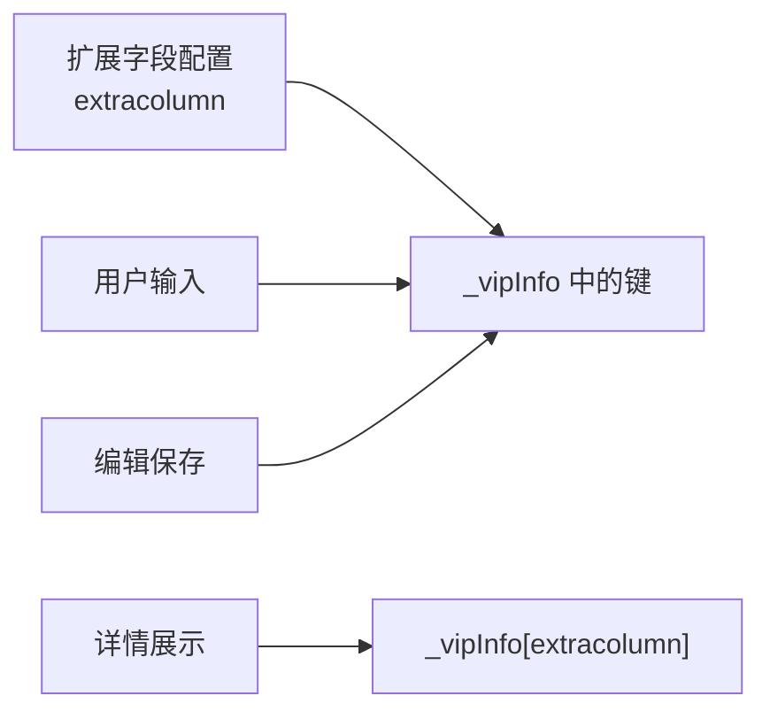
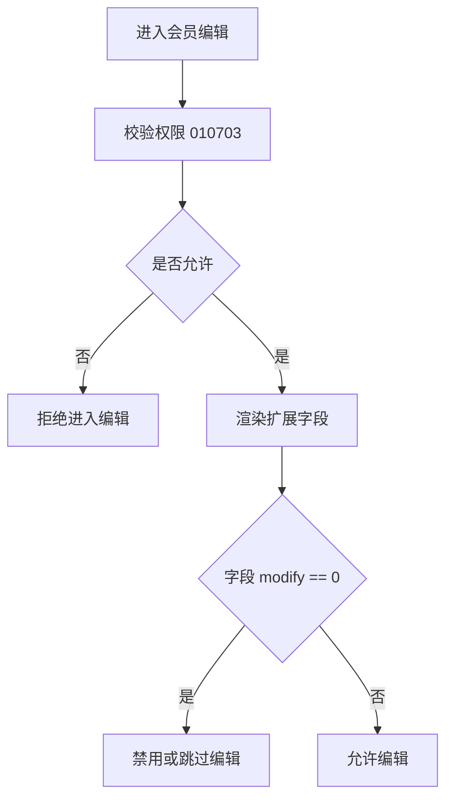

# 自定义字段API

<cite>
**本文引用的文件**   
- [http_api.dart](file://lib/net/http_api.dart)
- [会员编辑页 add.dart](file://lib/pages/business/members/basic/add.dart)
- [会员详情页 detail.dart](file://lib/pages/business/members/basic/detail.dart)
</cite>

## 目录
1. [文档目标与适用范围](#文档目标与适用范围)
2. [接口总览](#接口总览)
3. [扩展字段数据模型](#扩展字段数据模型)
4. [字段类型系统与渲染规则](#字段类型系统与渲染规则)
5. [验证规则与必填控制](#验证规则与必填控制)
6. [动态表单生成流程](#动态表单生成流程)
7. [数据绑定机制](#数据绑定机制)
8. [权限控制方案](#权限控制方案)
9. [数据迁移与版本兼容性](#数据迁移与版本兼容性)
10. [常见问题排查](#常见问题排查)
11. [总结](#总结)

## 文档目标与适用范围
本文面向灵犀管店 Flutter 项目中“会员档案自定义扩展字段”的实现，重点记录 `vipSet/getVipMoreSetList` 接口在客户端的使用方式、扩展字段的数据模型、字段类型系统、验证规则、动态表单生成机制，以及字段权限、数据迁移和版本兼容性的处理方案。

该能力主要服务于以下业务场景：
- 会员开卡时按需展示文本或日期类型的扩展字段。
- 会员编辑时根据服务端配置动态生成输入控件，并执行必填校验。
- 会员详情中只读展示已启用的扩展字段值。
- 将用户填写的扩展字段值合并到会员主档案数据中，随保存请求一并提交。

## 接口总览

### 接口定义

| 名称 | 方法 | 路径常量 | 说明 |
|---|---:|---|---|
| 获取会员档案自定义扩展字段列表 | GET/POST（由通用网络层决定） | `vipSet/getVipMoreSetList` | 返回服务端配置的会员档案扩展字段集合 |
| 获取会员基本信息 | GET/POST | `vipInfo/getVipInfo` | 返回会员主档案数据，扩展字段值通常作为独立键存在于该对象中 |
| 获取会员附属数据 | GET/POST | `vipInfo/getVipInfoOtherData` | 返回标签、副卡等附属信息；扩展字段不在此处返回 |
| 新增或编辑会员 | POST | `vipInfo/add` | 提交会员主档案、分类规则、标签及扩展字段值 |

其中，“会员档案自定义扩展字段”接口的客户端常量定义如下：

**图表来源**   
- [http_api.dart:574-585](file://lib/net/http_api.dart#L574-L585)

**章节来源**   
- [http_api.dart:574-585](file://lib/net/http_api.dart#L574-L585)

### 请求参数

| 接口 | 参数 | 类型 | 是否必填 | 说明 |
|---|---|---|---:|---|
| `vipSet/getVipMoreSetList` | 无 | — | 否 | 当前实现以空参数调用，服务端按店铺或租户上下文返回扩展字段配置 |
| `vipInfo/getVipInfo` | `vipid` | String | 是 | 会员编号或内部标识 |
| `vipInfo/getVipInfo` | `vipno` | String | 是 | 会员卡号 |
| `vipInfo/getVipInfo` | `sharevipflag` | String | 否 | 共享会员相关标志 |
| `vipInfo/getVipInfo` | `notwx` | Boolean | 否 | 是否忽略微信相关数据 |
| `vipInfo/getVipInfoOtherData` | 同会员详情参数 | — | — | 用于加载标签、副卡等附属数据 |
| `vipInfo/add` | `vipInfo` | Map | 是 | 会员主档案，包含扩展字段键值对 |
| `vipInfo/add` | `vipTypeRuleSet` | Map | 否 | 付费卡分类规则 |
| `vipInfo/add` | `labelInfoList` | List | 否 | 会员标签 |
| `vipInfo/add` | `vipAddMoneyReq` | Map | 否 | 售卡收款请求体 |

**章节来源**   
- [http_api.dart:574-585](file://lib/net/http_api.dart#L574-L585)
- [会员编辑页 add.dart:40-61](file://lib/pages/business/members/basic/add.dart#L40-L61)
- [会员编辑页 add.dart:560-615](file://lib/pages/business/members/basic/add.dart#L560-L615)
- [会员详情页 detail.dart:30-70](file://lib/pages/business/members/basic/detail.dart#L30-L70)

## 扩展字段数据模型

`vipSet/getVipMoreSetList` 返回的是一个扩展字段配置列表。Flutter 端没有为每个扩展字段定义强类型实体，而是使用 `Map<String, dynamic>` 进行解析。因此，字段契约由服务端返回结构和客户端解析逻辑共同约定。

### 核心字段清单

| 字段名 | 类型 | 语义 | 客户端使用方式 |
|---|---|---|---|
| `coltype` | Number/String | 字段类别标识；客户端将其转为整数后判断是否为文本或日期类扩展字段 | 过滤出可展示的扩展字段 |
| `columntype` | Number/String | 字段显示类型；`1` 表示文本，`2` 表示日期 | 决定渲染为文本框还是日期选择器 |
| `extracolumn` | String | 扩展字段的数据库列名或业务键名 | 作为 `_vipInfo` 中的键，存储和提交扩展字段值 |
| `title` | String | 字段显示标题 | 优先作为表单标签 |
| `extratext` | String | 备用标题或提示文本 | 当 `title` 为空时使用 |
| `status` | Number/String | 字段启用状态；`1` 表示启用 | 参与可见性过滤 |
| `onlinestatus` | Number/String | 在线启用状态；`1` 表示在前端可用 | 参与可见性过滤 |
| `notnull` | Number/String | 是否必填；`1` 表示必填 | 构建必填校验规则 |
| `modify` | Number/String | 编辑模式下的可修改标志；`0` 表示不可修改 | 控制编辑态下字段禁用 |

### 数据流关系

**图表来源**   
- [会员编辑页 add.dart:57-61](file://lib/pages/business/members/basic/add.dart#L57-L61)
- [会员编辑页 add.dart:284-335](file://lib/pages/business/members/basic/add.dart#L284-L335)
- [会员编辑页 add.dart:560-615](file://lib/pages/business/members/basic/add.dart#L560-L615)
- [会员编辑页 add.dart:1035-1075](file://lib/pages/business/members/basic/add.dart#L1035-L1075)

**章节来源**   
- [会员编辑页 add.dart:57-61](file://lib/pages/business/members/basic/add.dart#L57-L61)
- [会员编辑页 add.dart:284-335](file://lib/pages/business/members/basic/add.dart#L284-L335)

## 字段类型系统与渲染规则

客户端目前显式支持两类扩展字段：

| columntype | 中文含义 | 输入控件 | 行为说明 |
|---:|---|---|---|
| `1` | 文本 | 文本输入框 | 实时将输入内容写入 `_vipInfo[extracolumn]` |
| `2` | 日期 | 日期选择器 | 选择后将格式化后的日期字符串写入 `_vipInfo[extracolumn]` |

### 过滤条件

只有满足以下条件的扩展字段才会进入动态表单：

| 条件 | 值 | 作用 |
|---|---|---|
| `coltype == 1` | 数值 `1` | 表示属于“文本或日期”类扩展字段 |
| `status == 1` | 数值 `1` | 表示字段已启用 |
| `onlinestatus == 1` | 数值 `1` | 表示字段在前端可用 |

注意：过滤阶段使用 `coltype`，而具体控件渲染阶段使用 `columntype`。若服务端同时提供这两个字段，应以实际解析逻辑为准；若缺失或类型异常，客户端通过整型转换兜底为 `0`，从而被过滤掉。

### 标题解析优先级

扩展字段标题解析顺序如下：

1. `title`
2. `extratext`
3. `extracolumn`

如果以上字段都为空，表单可能显示为空标签，但不会崩溃。

**图表来源**   
- [会员编辑页 add.dart:284-335](file://lib/pages/business/members/basic/add.dart#L284-L335)
- [会员编辑页 add.dart:1035-1075](file://lib/pages/business/members/basic/add.dart#L1035-L1075)

**章节来源**   
- [会员编辑页 add.dart:284-335](file://lib/pages/business/members/basic/add.dart#L284-L335)
- [会员编辑页 add.dart:1035-1075](file://lib/pages/business/members/basic/add.dart#L1035-L1075)

## 验证规则与必填控制

### 必填规则来源

必填规则由扩展字段配置中的以下三个字段共同决定：

| 字段 | 值 | 含义 |
|---|---:|---|
| `notnull` | `1` | 服务端声明该字段必填 |
| `status` | `1` | 字段启用 |
| `onlinestatus` | `1` | 字段前端可用 |

客户端会将满足条件的 `extracolumn` 映射到标题或备用标题，形成 `_rules` 映射表。保存前会遍历该映射表执行非空校验。

### 校验时机

表单校验发生在点击保存之后、发起保存请求之前：

1. 先将所有扩展字段控制器中的值同步回 `_vipInfo`。
2. 遍历 `_rules`，检查对应键的值是否为空。
3. 若为空，弹出提示“请选择{字段名}”，并阻止提交。

### 字段禁用规则

在编辑模式下，如果某个扩展字段的 `modify == 0`，则该字段应被视为不可修改。客户端通过 `_isRules` 判断：

- 仅当页面处于编辑模式且字段 `modify == 0` 时，返回“禁止修改”。
- 该逻辑可用于禁用 UI 控件或跳过编辑交互。

**图表来源**   
- [会员编辑页 add.dart:560-575](file://lib/pages/business/members/basic/add.dart#L560-L575)
- [会员编辑页 add.dart:330-335](file://lib/pages/business/members/basic/add.dart#L330-L335)

**章节来源**   
- [会员编辑页 add.dart:284-335](file://lib/pages/business/members/basic/add.dart#L284-L335)
- [会员编辑页 add.dart:560-615](file://lib/pages/business/members/basic/add.dart#L560-L615)

## 动态表单生成流程

会员开卡和编辑页面会根据 `vipSet/getVipMoreSetList` 返回的配置动态渲染扩展字段。

### 生命周期要点

1. 页面初始化时调用 `_getVipMoreSetList()`。
2. 成功返回后，将完整配置存入 `_vipFileSetList`。
3. 过滤出可展示的文本或日期字段，存入 `_textOrDate`。
4. 构建必填规则映射 `_rules`。
5. 为文本型扩展字段创建或同步 `TextEditingController`。
6. 在表单区域遍历 `_textOrDate`，依次渲染扩展字段行。

### 渲染结构

**图表来源**   
- [会员编辑页 add.dart:77-80](file://lib/pages/business/members/basic/add.dart#L77-L80)
- [会员编辑页 add.dart:284-335](file://lib/pages/business/members/basic/add.dart#L284-L335)
- [会员编辑页 add.dart:717-721](file://lib/pages/business/members/basic/add.dart#L717-L721)

**章节来源**   
- [会员编辑页 add.dart:77-80](file://lib/pages/business/members/basic/add.dart#L77-L80)
- [会员编辑页 add.dart:284-335](file://lib/pages/business/members/basic/add.dart#L284-L335)
- [会员编辑页 add.dart:717-721](file://lib/pages/business/members/basic/add.dart#L717-L721)

## 数据绑定机制

### 扩展字段值存储位置

扩展字段的值并不单独存放在某个扩展字段实体中，而是直接作为键值对嵌入会员主档案 `_vipInfo`，键名为 `extracolumn`。

例如，如果某个扩展字段的 `extracolumn` 为 `custom_field_a`，则其值保存在 `_vipInfo['custom_field_a']`。

### 文本型字段绑定

对于 `columntype == 1` 的文本型扩展字段：

- 首次渲染时，从 `_vipInfo[column]` 初始化对应 `TextEditingController`。
- 输入变化时，立即将输入值写回 `_vipInfo[column]`。
- 保存前再次同步所有控制器值，确保后端收到最新输入。

### 日期型字段绑定

对于 `columntype == 2` 的日期型扩展字段：

- 不维护独立的控制器。
- 直接从 `_vipInfo[column]` 读取当前值。
- 选择日期后，将格式化后的日期字符串写回 `_vipInfo[column]`。

### 详情展示绑定

会员详情页在加载会员信息和扩展字段配置后，直接遍历 `_textOrDate`，并按 `extracolumn` 从 `_vipInfo` 中取值展示。

**图表来源**   
- [会员编辑页 add.dart:314-329](file://lib/pages/business/members/basic/add.dart#L314-L329)
- [会员编辑页 add.dart:1035-1075](file://lib/pages/business/members/basic/add.dart#L1035-L1075)
- [会员详情页 detail.dart:385-394](file://lib/pages/business/members/basic/detail.dart#L385-L394)

**章节来源**   
- [会员编辑页 add.dart:314-329](file://lib/pages/business/members/basic/add.dart#L314-L329)
- [会员编辑页 add.dart:1035-1075](file://lib/pages/business/members/basic/add.dart#L1035-L1075)
- [会员详情页 detail.dart:385-394](file://lib/pages/business/members/basic/detail.dart#L385-L394)

## 权限控制方案

### 页面级权限

会员编辑入口受权限点 `010703` 控制。详情页面的编辑按钮在进入编辑页前会先校验该权限。

### 字段级权限

字段级权限主要通过扩展字段配置中的 `modify` 字段体现：

- `modify == 0`：编辑模式下禁止修改该扩展字段。
- 该逻辑由 `_isRules` 封装，可在 UI 层用于禁用控件或隐藏编辑入口。

**图表来源**   
- [会员详情页 detail.dart:92-109](file://lib/pages/business/members/basic/detail.dart#L92-L109)
- [会员编辑页 add.dart:330-335](file://lib/pages/business/members/basic/add.dart#L330-L335)

**章节来源**   
- [会员详情页 detail.dart:92-109](file://lib/pages/business/members/basic/detail.dart#L92-L109)
- [会员编辑页 add.dart:330-335](file://lib/pages/business/members/basic/add.dart#L330-L335)

## 数据迁移与版本兼容性

### 向后兼容策略

当前实现采用弱类型解析，对扩展字段具备一定容错能力：

| 风险场景 | 现有处理方式 | 建议增强方案 |
|---|---|---|
| 新增扩展字段 | 旧客户端仍可通过配置动态渲染 | 保持 `coltype`、`columntype`、`extracolumn` 语义稳定 |
| 删除扩展字段 | 不再出现在配置列表中，旧客户端不会主动发送 | 避免保留废弃键，防止脏数据 |
| 字段类型变更 | 客户端用 `_toInt` 做兜底，失败值为 `0` | 明确废弃旧字段，新增新字段并通过版本号区分 |
| 必填规则变更 | 客户端每次重新拉取配置 | 增加本地缓存失效策略 |
| 标题字段缺失 | 降级使用 `extratext` 或 `extracolumn` | 要求服务端至少返回一个可读标题 |

### 推荐的数据迁移步骤

1. **新增字段**：在服务端添加新扩展字段，并确保 `coltype=1`、`columntype=1` 或 `2`、`status=1`、`onlinestatus=1`。
2. **灰度发布**：先对小部分门店开放，确认客户端能正确渲染和提交。
3. **全局上线**：逐步扩大范围，观察保存结果和报表输出。
4. **清理历史数据**：如需废弃某字段，先停止 `onlinestatus`，再下线服务端字段。
5. **客户端升级**：如需要新的渲染类型或校验规则，通过应用商店更新 Flutter 客户端。

### 版本兼容性注意事项

- 不要依赖 `coltype` 和 `columntype` 之外的隐式字段顺序。
- 不要把业务键放在易变字段中，`extracolumn` 应长期稳定。
- 对旧客户端无法识别的新字段，应保持默认值或空值兼容。
- 对必填字段，应在服务端也做二次校验，避免仅依赖前端校验。

**章节来源**   
- [会员编辑页 add.dart:284-335](file://lib/pages/business/members/basic/add.dart#L284-L335)
- [会员编辑页 add.dart:560-615](file://lib/pages/business/members/basic/add.dart#L560-L615)

## 常见问题排查

| 问题现象 | 可能原因 | 排查建议 |
|---|---|---|
| 扩展字段不显示 | `coltype != 1`、`status != 1` 或 `onlinestatus != 1` | 检查服务端返回的扩展字段配置 |
| 文本框无法输入 | `columntype` 不是 `1` | 确认字段类型为文本 |
| 日期选择器无效 | `columntype` 不是 `2` | 确认字段类型为日期 |
| 必填校验未生效 | `notnull != 1` 或字段未启用 | 检查 `notnull`、`status`、`onlinestatus` |
| 字段无法修改 | `modify == 0` 且处于编辑模式 | 调整服务端字段配置或前端禁用逻辑 |
| 保存后扩展字段丢失 | 值未写入 `_vipInfo[extracolumn]` | 检查 `_syncExtraControllers` 和 `onChanged` 逻辑 |
| 详情页不显示扩展字段值 | `_vipInfo` 中缺少对应键 | 检查保存流程和后端落库逻辑 |
| 标题为空 | `title` 和 `extratext` 都为空 | 确保服务端至少返回一个标题字段 |

**章节来源**   
- [会员编辑页 add.dart:284-335](file://lib/pages/business/members/basic/add.dart#L284-L335)
- [会员编辑页 add.dart:560-615](file://lib/pages/business/members/basic/add.dart#L560-L615)
- [会员编辑页 add.dart:1035-1075](file://lib/pages/business/members/basic/add.dart#L1035-L1075)
- [会员详情页 detail.dart:385-394](file://lib/pages/business/members/basic/detail.dart#L385-L394)

## 总结

灵犀管店 Flutter 项目的会员档案自定义扩展字段能力，以 `vipSet/getVipMoreSetList` 为核心配置接口，结合会员详情、会员编辑和保存流程，实现了可扩展、可配置、可校验的动态表单体系。

关键点包括：

- 扩展字段配置通过 `coltype`、`status`、`onlinestatus` 控制可见性。
- `columntype` 控制渲染为文本或日期。
- `notnull`、`status`、`onlinestatus` 共同决定必填校验。
- 扩展字段值以 `extracolumn` 为键，直接嵌入会员主档案 `_vipInfo`。
- 字段级编辑权限通过 `modify` 控制。
- 客户端使用弱类型解析，具备基础容错能力，但建议服务端保证字段契约稳定，以降低版本兼容风险。