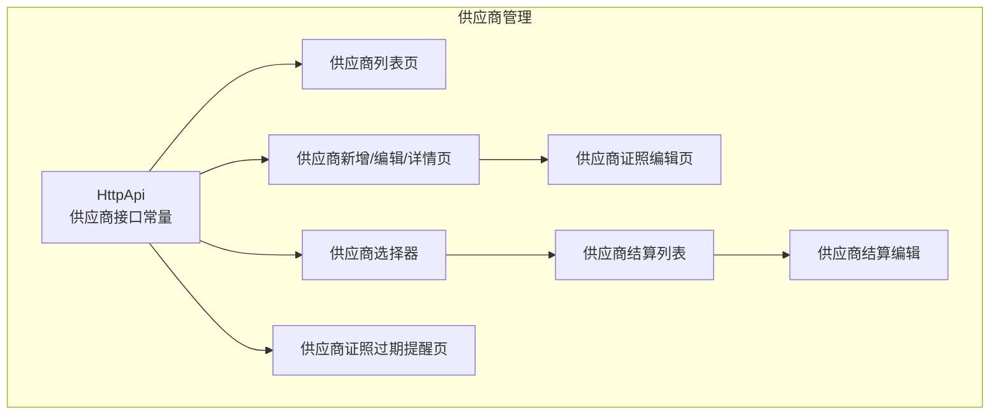
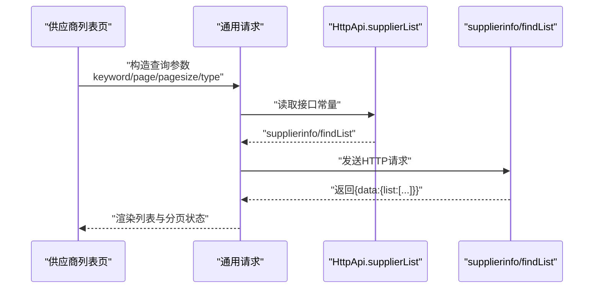
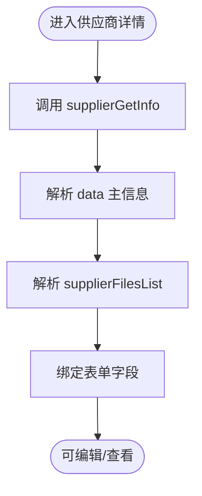
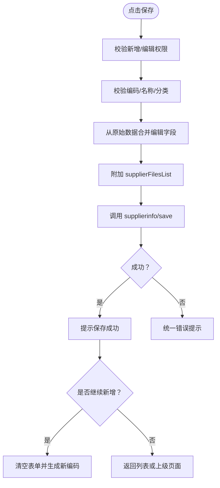
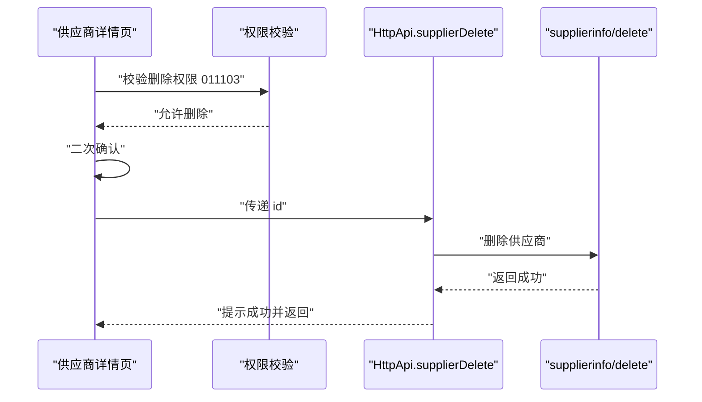
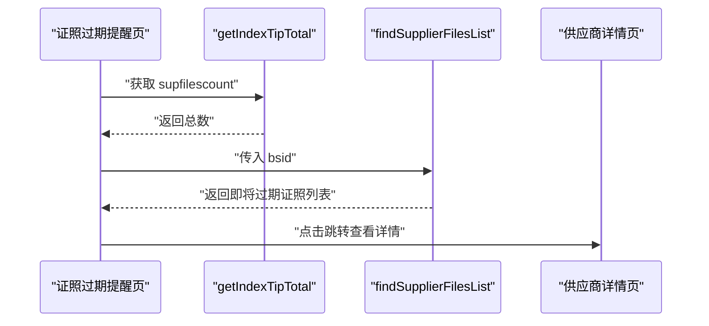
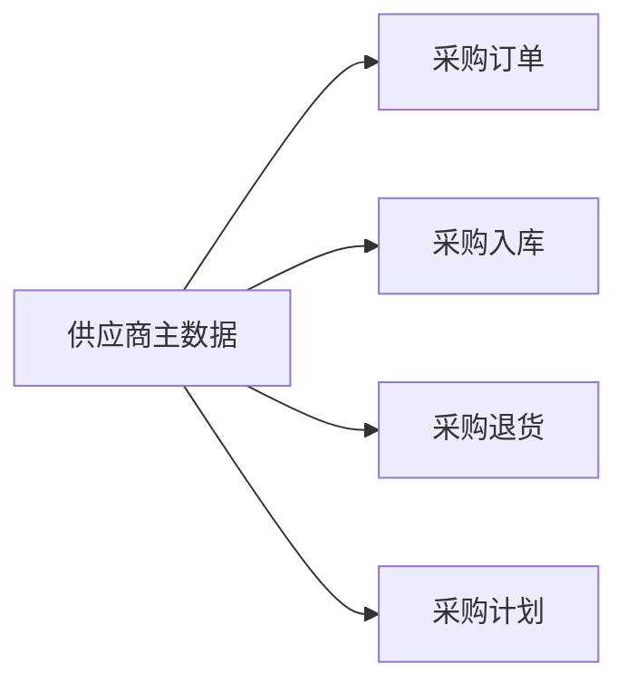
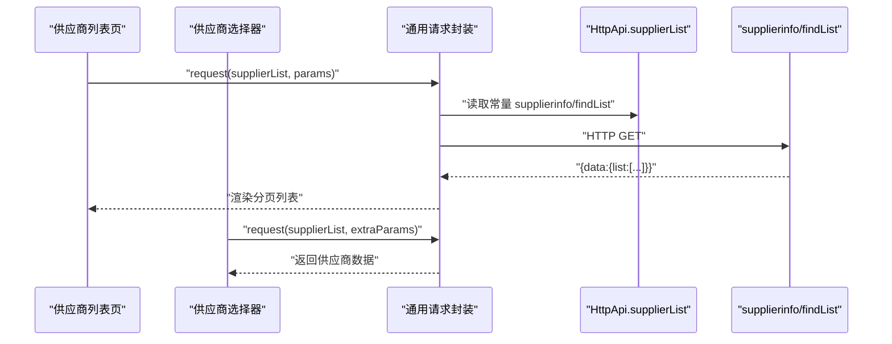
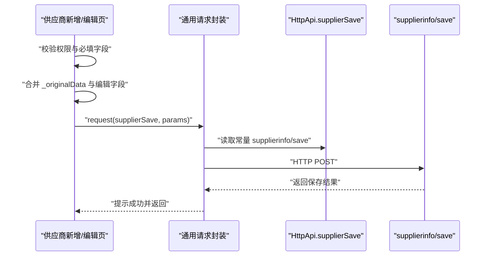
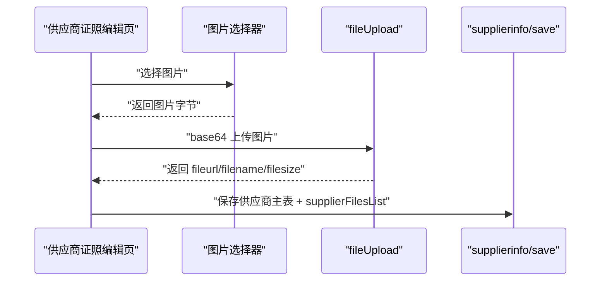

# 供应商管理API

<cite>
**本文引用的文件**   
- [http_api.dart](file://lib/net/http_api.dart)
- [list.dart](file://lib/pages/business/purchase/supplier/list.dart)
- [add.dart](file://lib/pages/business/purchase/supplier/add.dart)
- [select_supplier.dart](file://lib/components/select/select_supplier.dart)
- [sup_file_warn_page.dart](file://lib/pages/home/custom/sup_file_warn_page.dart)
- [file_edit.dart](file://lib/pages/business/purchase/supplier/file_edit.dart)
- [supplier_pay_list.dart](file://lib/pages/business/finance/supplier_pay/list.dart)
- [supplier_pay_edit.dart](file://lib/pages/business/finance/supplier_pay/edit.dart)
</cite>

## 目录
1. [简介](#简介)
2. [项目结构与定位](#项目结构与定位)
3. [供应商管理接口总览](#供应商管理接口总览)
4. [核心接口规范](#核心接口规范)
5. [辅助接口规范](#辅助接口规范)
6. [数据结构定义](#数据结构定义)
7. [业务关联关系](#业务关联关系)
8. [高级功能与扩展点](#高级功能与扩展点)
9. [依赖与调用链分析](#依赖与调用链分析)
10. [性能与使用建议](#性能与使用建议)
11. [故障排查](#故障排查)
12. [结论](#结论)

## 简介
本文件面向灵犀管店 Flutter 客户端中的“供应商管理”能力，基于仓库中已实现的供应商相关页面、选择器与网络常量，整理出供应商基础信息、联系方式、银行账户、合同信息等字段，并明确供应商编码生成规则、分类查询方式、证照过期提醒等辅助能力。文档同时说明供应商与采购订单、应付账款（供应商结算）之间的业务关联，以及评分、信用等高级能力的当前实现状态与建议扩展方向。

## 项目结构与定位
供应商管理在项目中由以下职责清晰的模块共同组成：

- 接口常量集中维护：`HttpApi` 统一声明所有供应商相关后端路径。
- 供应商列表页：负责分页查询、搜索、筛选与加载。
- 供应商新增/编辑/详情页：负责详情加载、表单校验、保存、删除、分类树、证照资料编辑。
- 供应商选择器：供采购单、库存等业务页面复用，以门店维度过滤供应商。
- 证照过期提醒页：展示即将过期的供应商证照，并跳转至供应商详情。
- 供应商结算业务：采购结算入口与供应商选择复用同一选择器。

**图表来源**
- [http_api.dart:41-41](file://lib/net/http_api.dart#L41-L41)
- [http_api.dart:380-386](file://lib/net/http_api.dart#L380-L386)
- [list.dart:76-100](file://lib/pages/business/purchase/supplier/list.dart#L76-L100)
- [add.dart:156-170](file://lib/pages/business/purchase/supplier/add.dart#L156-L170)
- [select_supplier.dart:39-66](file://lib/components/select/select_supplier.dart#L39-L66)
- [sup_file_warn_page.dart:37-59](file://lib/pages/home/custom/sup_file_warn_page.dart#L37-L59)
- [file_edit.dart:1-30](file://lib/pages/business/purchase/supplier/file_edit.dart#L1-L30)
- [supplier_pay_list.dart:1-40](file://lib/pages/business/finance/supplier_pay/list.dart#L1-L40)

**章节来源**
- [http_api.dart:41-41](file://lib/net/http_api.dart#L41-L41)
- [http_api.dart:380-386](file://lib/net/http_api.dart#L380-L386)

## 供应商管理接口总览
| 接口名称 | 常量键 | 后端路径 | 用途 | 主要调用方 |
|---|---|---|---|---|
| 供应商列表 | `supplierList` | `supplierinfo/findList` | 分页查询供应商，支持关键词、分类、状态、经销方式等筛选 | 供应商列表页、供应商选择器 |
| 供应商详情 | `supplierGetInfo` | `supplierinfo/getSupplierInfo` | 获取单个供应商完整信息，含证照列表 | 供应商新增/编辑/详情页 |
| 保存供应商 | `supplierSave` | `supplierinfo/save` | 新增或更新供应商主信息及证照资料 | 供应商新增/编辑/详情页 |
| 删除供应商 | `supplierDelete` | `supplierinfo/delete` | 按供应商记录ID删除 | 供应商新增/编辑/详情页 |
| 生成供应商编码 | `supplierGenerateCode` | `supplierinfo/generateCode` | 自动生成供应商编码 | 供应商新增页 |
| 供应商分类列表 | `supplierTypeGetList` | `suppliertype/getTypeListandCode` | 获取供应商分类树及编码 | 供应商新增/编辑/详情页 |
| 供应商证照过期提醒列表 | `supplierFindSupplierFilesList` | `supplierinfo/findSupplierFilesList` | 返回即将过期的供应商证照清单 | 证照过期提醒页 |

**章节来源**
- [http_api.dart:41-41](file://lib/net/http_api.dart#L41-L41)
- [http_api.dart:380-386](file://lib/net/http_api.dart#L380-L386)

## 核心接口规范

### supplierList：供应商列表
- **后端路径**：`supplierinfo/findList`
- **请求方法**：GET（通过通用请求封装发起）
- **典型请求参数**：
  - `is_page`：是否分页标记，示例值为 `1`。
  - `field`：排序字段，示例为 `name`。
  - `type`：排序类型，示例为 `asc`。
  - `cond`：关键词搜索，支持名称或编码模糊匹配。
  - `page`：当前页码。
  - `pagesize`：每页数量，默认 `20`。
  - `typename`：供应商分类名称筛选。
  - `suptype`：供应商分类编码筛选。
  - `stopflag`：供应商停用状态筛选。
  - `supselltype`：经销方式筛选，常见值包括购销、联营、代销、租赁等。
  - `notwx`：过滤微信相关数据标记，示例为 `1`。
  - 选择器场景下还会携带：
    - `bsid`：门店ID。
    - `stopflag`：默认包含启用和待审核等状态，例如 `0,3`。
    - `supselltypes`：默认允许的销售类型组合，例如 `1,3,4`。
- **响应结构**：
  - 外层为统一结果对象，其中 `data` 为供应商数据容器。
  - `data.list` 为供应商记录数组。
  - 每条记录至少包含：`supid`、`name`、`code`、`supselltype` 等字段；前端显示名称时优先拼接 `[code]name`。
- **分页行为**：
  - 列表页采用滚动触底下一页机制。
  - 当返回的 list 长度等于 `pagesize` 时认为还有更多数据。
- **权限控制**：
  - 进入列表前校验查看权限码 `011101`。

**图表来源**
- [list.dart:76-100](file://lib/pages/business/purchase/supplier/list.dart#L76-L100)
- [select_supplier.dart:39-66](file://lib/components/select/select_supplier.dart#L39-L66)
- [http_api.dart:41-41](file://lib/net/http_api.dart#L41-L41)

**章节来源**
- [list.dart:76-100](file://lib/pages/business/purchase/supplier/list.dart#L76-L100)
- [select_supplier.dart:39-66](file://lib/components/select/select_supplier.dart#L39-L66)

### supplierGetInfo：供应商详情
- **后端路径**：`supplierinfo/getSupplierInfo`
- **请求参数**：供应商记录ID，直接作为字符串参数传递。
- **响应结构**：
  - `data` 为供应商主信息对象。
  - 主信息字段包括：
    - 标识：`id`、`supid`。
    - 基本信息：`code`、`name`、`linkman`、`mobile`、`fax`、`address`、`remark`。
    - 分类：`suptype`、`suptypename`。
    - 经销方式：`supselltype`。
    - 业务员：`salesmanid`、`salesmanname`。
    - 银行信息：`bank`、`bankaccount`。
    - 税务与资质：`businesslicense`、`taxid`。
    - 金额与授信：`initamt`、`advance`、`maxbillamt`。
    - 扣率：`joinrate`。
    - 扩展字段：`mnemoniccode`、`initamtflag`、`wxsupbillsignflag`、`suparea`、`imgurl`、`certoforigimgurl`、`supusercode`、`supuserpwd`、`supuserrole`、`infomore`。
  - 证照资料：`supplierFilesList` 是随详情返回的证照数组，用于在详情页展示并在保存时整体提交。
- **前端处理特点**：
  - 获取详情后先深拷贝原始数据，保存时以该原始数据为基础合并用户修改字段，避免后端下发的隐藏字段丢失。
  - 金额字段以三位小数格式化。
  - 证照列表解析后交由证照编辑组件统一管理。

**图表来源**
- [add.dart:168-220](file://lib/pages/business/purchase/supplier/add.dart#L168-L220)

**章节来源**
- [add.dart:168-220](file://lib/pages/business/purchase/supplier/add.dart#L168-L220)

### supplierSave：保存供应商
- **后端路径**：`supplierinfo/save`
- **请求参数**：以供应商主信息对象形式提交，关键字段包括：
  - 标识：`id`、`supid`。
  - 基本信息：`code`、`name`、`linkman`、`mobile`、`fax`、`address`、`remark`。
  - 分类：`suptype`、`suptypename`。
  - 经销方式：`supselltype`。
  - 业务员：`salesmanid`、`salesmanname`。
  - 区域：`suparea`。
  - 银行信息：`bank`、`bankaccount`。
  - 税务与资质：`businesslicense`、`taxid`。
  - 金额与授信：`initamt`、`advance`、`maxbillamt`。
  - 标志位：`initamtflag`、`wxsupbillsignflag`、`stopflag`。
  - 图片与扩展：`imgurl`、`certoforigimgurl`、`supusercode`、`supuserpwd`、`supuserrole`、`infomore`。
  - 助记码：`mnemoniccode`。
  - 扣率：`joinrate`。
  - 证照资料：`supplierFilesList`。
- **保存策略**：
  - 新增模式需要权限码 `011102`。
  - 编辑模式需要权限码 `011104`。
  - 必填校验：供应商编码、供应商名称、供应商分类。
  - 若扣率输入为空，则不覆盖后端已有值；若原始数据中不存在该字段，则传空值。
  - 保存成功后支持“保存并继续新增”，此时清空表单并重新生成供应商编码。
- **错误处理**：
  - 异常由通用网络层统一提示。

**图表来源**
- [add.dart:220-330](file://lib/pages/business/purchase/supplier/add.dart#L220-L330)

**章节来源**
- [add.dart:220-330](file://lib/pages/business/purchase/supplier/add.dart#L220-L330)

### supplierDelete：删除供应商
- **后端路径**：`supplierinfo/delete`
- **请求参数**：`id`，表示要删除的供应商记录ID。
- **权限控制**：删除前校验权限码 `011103`。
- **删除逻辑**：
  - 优先使用内部记录ID `_id`。
  - 其次回退到 `supid`。
  - 最后回退到路由传入的 `supplierId`。
- **交互流程**：弹出确认对话框，确认后调用删除接口，成功则关闭页面并返回结果。

**图表来源**
- [add.dart:412-430](file://lib/pages/business/purchase/supplier/add.dart#L412-L430)

**章节来源**
- [add.dart:412-430](file://lib/pages/business/purchase/supplier/add.dart#L412-L430)

## 辅助接口规范

### supplierGenerateCode：生成供应商编码
- **后端路径**：`supplierinfo/generateCode`
- **请求参数**：无业务参数，通常传空对象。
- **响应**：`data` 为生成的供应商编码字符串。
- **使用场景**：供应商新增页面初始化时自动调用，填充编码输入框。

**章节来源**
- [add.dart:156-170](file://lib/pages/business/purchase/supplier/add.dart#L156-L170)
- [http_api.dart:380-386](file://lib/net/http_api.dart#L380-L386)

### suppliertype/getTypeListandCode：供应商分类管理
- **后端路径**：`suppliertype/getTypeListandCode`
- **请求参数**：
  - `is_page`：示例值为 `0`。
  - `stopflag`：停用状态过滤，示例为空字符串。
  - `cond`：关键词搜索，示例为空字符串。
- **响应结构**：返回供应商分类树，包含分类编码、名称及子分类。
- **用途**：
  - 供应商新增/编辑时选择供应商分类。
  - 与商品分类等树形选择模式保持一致。

**章节来源**
- [http_api.dart:380-386](file://lib/net/http_api.dart#L380-L386)
- [add.dart:430-470](file://lib/pages/business/purchase/supplier/add.dart#L430-L470)

### findSupplierFilesList：供应商证照过期提醒
- **后端路径**：`supplierinfo/findSupplierFilesList`
- **请求参数**：
  - `bsid`：当前门店ID，从本地登录门店信息中提取。
- **响应结构**：
  - 可为列表，也可为包含 `list` 字段的对象。
  - 每条证照记录包含供应商标识、证照名称、有效期等信息。
- **配套总数接口**：
  - 首页提示总数来自 `getIndexTipTotal`，字段为 `supfilescount`。
- **交互**：
  - 顶部摘要显示“共 X 条供应商证照7天内过期”。
  - 点击某条记录跳转到供应商详情查看证照。

**图表来源**
- [sup_file_warn_page.dart:37-59](file://lib/pages/home/custom/sup_file_warn_page.dart#L37-L59)

**章节来源**
- [sup_file_warn_page.dart:37-59](file://lib/pages/home/custom/sup_file_warn_page.dart#L37-L59)
- [http_api.dart:380-386](file://lib/net/http_api.dart#L380-L386)

## 数据结构定义

### 供应商主信息
| 字段 | 类型 | 含义 | 必填 | 备注 |
|---|---|---|---:|---|
| `id` | 字符串 | 供应商记录ID | 否 | 删除、编辑时使用 |
| `supid` | 字符串 | 供应商业务ID | 否 | 保存时回填 |
| `code` | 字符串 | 供应商编码 | 是 | 新增时自动生成，不可为空 |
| `name` | 字符串 | 供应商名称 | 是 | 不可为空 |
| `linkman` | 字符串 | 联系人 | 否 | |
| `mobile` | 字符串 | 联系电话 | 否 | |
| `fax` | 字符串 | 传真 | 否 | |
| `address` | 字符串 | 地址 | 否 | |
| `remark` | 字符串 | 备注 | 否 | |
| `suptype` | 字符串 | 供应商分类编码 | 是 | 不可为空 |
| `suptypename` | 字符串 | 供应商分类名称 | 否 | 跟随分类选择 |
| `supselltype` | 整数 | 经销方式 | 否 | 默认 `1`，常见值包括购销、联营、成本代销、扣率代销、租赁 |
| `salesmanid` | 字符串 | 业务员ID | 否 | |
| `salesmanname` | 字符串 | 业务员名称 | 否 | |
| `bank` | 字符串 | 开户行 | 否 | |
| `bankaccount` | 字符串 | 银行账号 | 否 | |
| `businesslicense` | 字符串 | 营业执照号 | 否 | |
| `taxid` | 字符串 | 纳税人识别号 | 否 | |
| `initamt` | 数值 | 期初金额 | 否 | 前端以三位小数格式化 |
| `advance` | 数值 | 预付款 | 否 | 前端以三位小数格式化 |
| `maxbillamt` | 数值 | 最大账单金额 | 否 | 前端以三位小数格式化 |
| `joinrate` | 数值或空 | 扣率 | 否 | 联营、扣率代销、租赁时常用 |
| `mnemoniccode` | 字符串 | 助记码 | 否 | |
| `initamtflag` | 整数 | 是否生成期初金额 | 否 | |
| `wxsupbillsignflag` | 整数 | 微信单据签名标志 | 否 | |
| `suparea` | 字符串 | 供应商区域 | 否 | |
| `imgurl` | 字符串 | 货商图片URL | 否 | |
| `certoforigimgurl` | 字符串 | 产品证明图片URL | 否 | |
| `supusercode` | 字符串 | 账户 | 否 | |
| `supuserpwd` | 字符串 | 密码 | 否 | |
| `supuserrole` | 字符串 | 货商角色 | 否 | |
| `infomore` | 字符串 | 合同范本信息 | 否 | |
| `stopflag` | 整数 | 停用状态 | 否 | 保存时固定传入 `0` |
| `supplierFilesList` | 数组 | 证照资料列表 | 否 | 随主表保存 |

### 供应商证照资料
| 字段 | 类型 | 含义 | 必填 | 备注 |
|---|---|---|---:|---|
| `id` | 字符串 | 证照记录ID | 否 | 新增时为空 |
| `tempkey` | 字符串 | 临时键 | 否 | 新增时使用 |
| `spid` | 字符串 | 门店ID | 否 | 新增时默认填入 |
| `sid` | 字符串 | 公司ID | 否 | 新增时默认填入 |
| `supid` | 字符串 | 供应商ID | 否 | 新增时默认填入 |
| `documentcode` | 字符串 | 证照编号 | 否 | |
| `documentname` | 字符串 | 证照名称 | 是 | |
| `validtime` | 日期字符串 | 有效期至 | 否 | 新增默认90天后 |
| `remark` | 字符串 | 备注 | 否 | |
| `status` | 整数 | 状态 | 否 | 新增默认 `1` |
| `fileid` | 字符串 | 文件ID | 否 | |
| `filename` | 字符串 | 文件名 | 否 | |
| `fileurl` | 字符串 | 文件URL | 否 | 上传成功后回填 |
| `filesize` | 整数 | 文件大小 | 否 | |
| `createtime` | 日期时间 | 创建时间 | 否 | 上传成功后回填 |
| `operid` | 字符串 | 操作人ID | 否 | 上传成功后回填 |
| `opername` | 字符串 | 操作人姓名 | 否 | 上传成功后回填 |

**章节来源**
- [add.dart:168-220](file://lib/pages/business/purchase/supplier/add.dart#L168-L220)
- [add.dart:220-330](file://lib/pages/business/purchase/supplier/add.dart#L220-L330)
- [file_edit.dart:30-120](file://lib/pages/business/purchase/supplier/file_edit.dart#L30-L120)

## 业务关联关系

### 供应商与采购订单
供应商是采购业务的基础主数据。采购订单、采购入库、采购退货、采购计划等页面均可能通过供应商选择器选择供应商，从而将供应商ID带入业务单据。供应商的经销方式会影响价格计算、结算方式和对账逻辑。

[本图为概念关系图，不直接映射具体代码文件，因此不提供图表来源]

### 供应商与应付账款（供应商结算）
供应商结算用于汇总并支付供应商相关应付金额。结算列表和编辑页复用供应商选择器，结算单据中包含供应商ID、结算区间、支付方式、银行信息、预付款、免费额度、预付金额、账单数、账单金额等字段。

- 结算列表页：
  - 支持按供应商、供应商名称、制单人、经办人、支付方式、银行、供应商对账状态筛选。
  - 支持按机构筛选。
  - 支持多Tab状态切换：全部、待审核、已审核、已驳回。
- 结算编辑页：
  - 根据结算单ID加载明细。
  - 支持金额失焦结算，将总金额分配到明细。
  - 支持多级审批配置。

**章节来源**
- [select_supplier.dart:39-66](file://lib/components/select/select_supplier.dart#L39-L66)
- [supplier_pay_list.dart:1-160](file://lib/pages/business/finance/supplier_pay/list.dart#L1-L160)
- [supplier_pay_edit.dart:1-180](file://lib/pages/business/finance/supplier_pay/edit.dart#L1-L180)

## 高级功能与扩展点

### 供应商评分
当前仓库中没有发现专门的“供应商评分”接口定义或评分模型。若后续引入供应商评分，建议在供应商详情与列表中增加评分字段，并提供评分历史、评分维度、权重配置等扩展接口。

### 信用管理
当前仓库中没有发现专门的“供应商信用分”“信用评级”“信用额度”等独立接口。可在现有供应商主数据基础上扩展信用相关字段，例如：
- `creditScore`：信用评分。
- `creditLevel`：信用等级。
- `creditLimit`：信用额度。
- `creditUsed`：已用信用额度。
- `creditStatus`：信用状态。

这些字段可与供应商结算、采购下单风控结合，形成更完整的供应链风控体系。

### 其他可扩展能力
- 供应商黑名单/白名单。
- 供应商准入审核流程。
- 供应商绩效统计（交货及时率、质量合格率）。
- 供应商合同到期提醒（除证照外）。
- 供应商对账差异分析与调整单。

[本节为概念性扩展建议，不直接分析具体文件]

## 依赖与调用链分析

### 供应商列表调用链

**图表来源**
- [list.dart:76-100](file://lib/pages/business/purchase/supplier/list.dart#L76-L100)
- [select_supplier.dart:39-66](file://lib/components/select/select_supplier.dart#L39-L66)
- [http_api.dart:41-41](file://lib/net/http_api.dart#L41-L41)

### 供应商保存调用链

**图表来源**
- [add.dart:220-330](file://lib/pages/business/purchase/supplier/add.dart#L220-L330)
- [http_api.dart:380-386](file://lib/net/http_api.dart#L380-L386)

### 供应商证照上传与保存调用链

**图表来源**
- [file_edit.dart:120-200](file://lib/pages/business/purchase/supplier/file_edit.dart#L120-L200)
- [add.dart:220-330](file://lib/pages/business/purchase/supplier/add.dart#L220-L330)

**章节来源**
- [list.dart:76-100](file://lib/pages/business/purchase/supplier/list.dart#L76-L100)
- [add.dart:220-330](file://lib/pages/business/purchase/supplier/add.dart#L220-L330)
- [file_edit.dart:120-200](file://lib/pages/business/purchase/supplier/file_edit.dart#L120-L200)

## 性能与使用建议
- 列表分页：
  - 默认每页20条，适合移动端滚动加载。
  - 建议保持 `is_page=1`，避免后端返回非分页结构导致前端解析异常。
- 搜索防抖：
  - 列表页已实现搜索防抖，避免频繁请求。
- 选择器过滤：
  - 通过 `bsid` 限定门店范围，减少无关供应商数据。
  - 通过 `supselltypes` 限制销售类型，提升选择效率。
- 证照图片：
  - 图片大小限制为5MB，避免过大传输影响性能。
  - 上传成功后立即回填 `fileurl`、`filename`、`filesize`，减少重复上传。
- 表单保存：
  - 使用原始数据合并策略，避免因只传编辑字段而丢失后端下发字段。
  - 金额字段统一三位小数，避免精度问题。

[本节为通用性能建议，不直接分析具体文件]

## 故障排查

### 无法加载供应商列表
- 检查是否具备查看权限 `011101`。
- 检查 `bsid` 是否为有效门店ID。
- 检查 `is_page`、`page`、`pagesize` 是否合理。
- 检查网络层是否返回标准 `{data:{list:[...]}}` 结构。

### 供应商详情为空
- 检查传入的供应商ID是否正确。
- 检查 `supplierinfo/getSupplierInfo` 是否返回 `data`。
- 检查前端是否对 `data` 做深拷贝后再保存原始数据。

### 保存失败
- 检查必填字段：编码、名称、分类。
- 检查 `joinrate` 是否被误置为空字符串。
- 检查 `supplierFilesList` 是否存在非法结构。
- 检查权限码 `011102`、`011104` 是否配置正确。

### 证照上传失败
- 检查图片大小是否超过5MB。
- 检查 base64 格式是否正确。
- 检查 `fileUpload` 返回的 `imgurl` 是否为空。
- 检查上传成功后是否回填 `createtime`、`operid`、`opername`。

### 证照过期提醒无数据
- 检查本地门店信息是否有效。
- 检查 `bsid` 是否正确传递。
- 检查 `getIndexTipTotal` 返回的 `supfilescount` 是否为预期值。

**章节来源**
- [list.dart:76-100](file://lib/pages/business/purchase/supplier/list.dart#L76-L100)
- [add.dart:220-330](file://lib/pages/business/purchase/supplier/add.dart#L220-L330)
- [file_edit.dart:120-200](file://lib/pages/business/purchase/supplier/file_edit.dart#L120-L200)
- [sup_file_warn_page.dart:37-59](file://lib/pages/home/custom/sup_file_warn_page.dart#L37-L59)

## 结论
本项目已在 Flutter 端实现了供应商管理的核心闭环：供应商列表查询、详情加载、编码自动生成、分类选择、新增编辑保存、删除、证照资料上传与过期提醒。供应商作为采购与结算的基础主数据，贯穿多个业务模块。当前未实现供应商评分与信用管理等高级能力，但预留了扩展空间。建议后续在后端补充评分、信用额度、黑名单等接口，并在前端增加对应展示与风控逻辑，以完善供应商全生命周期管理能力。