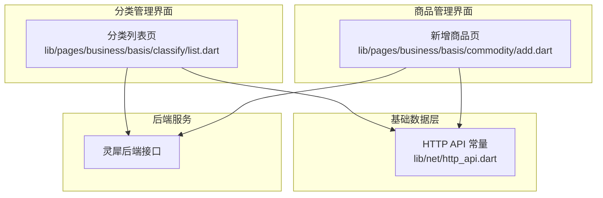
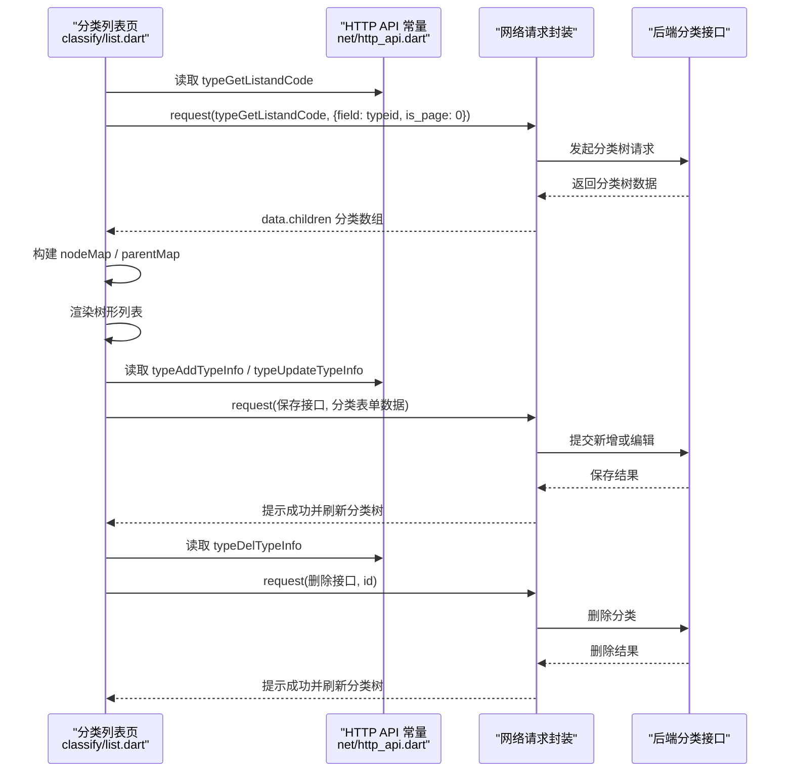
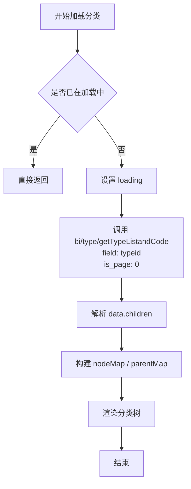
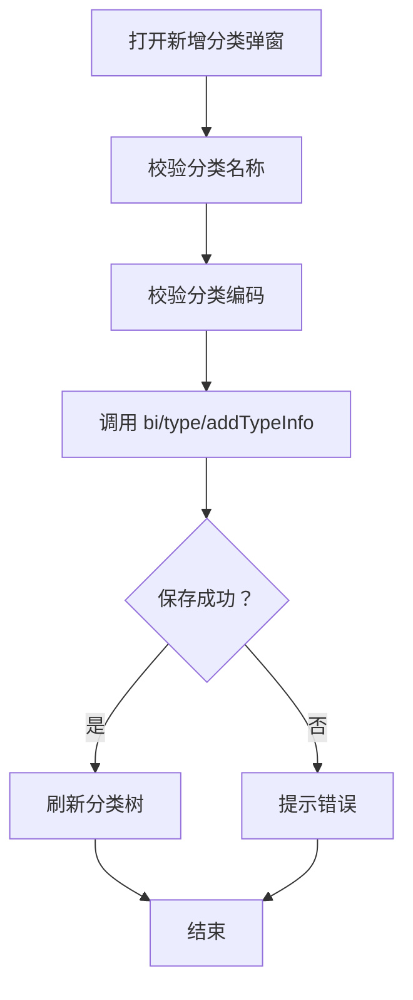
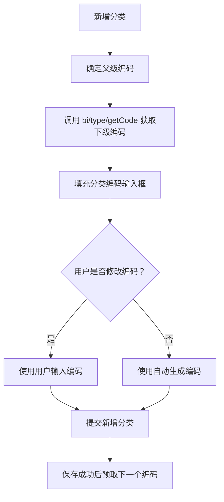
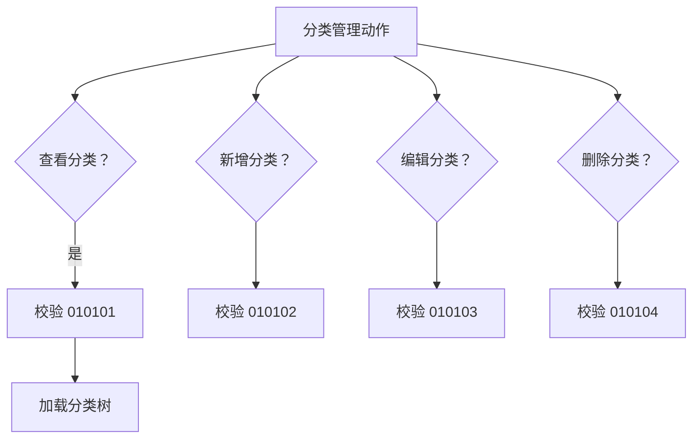
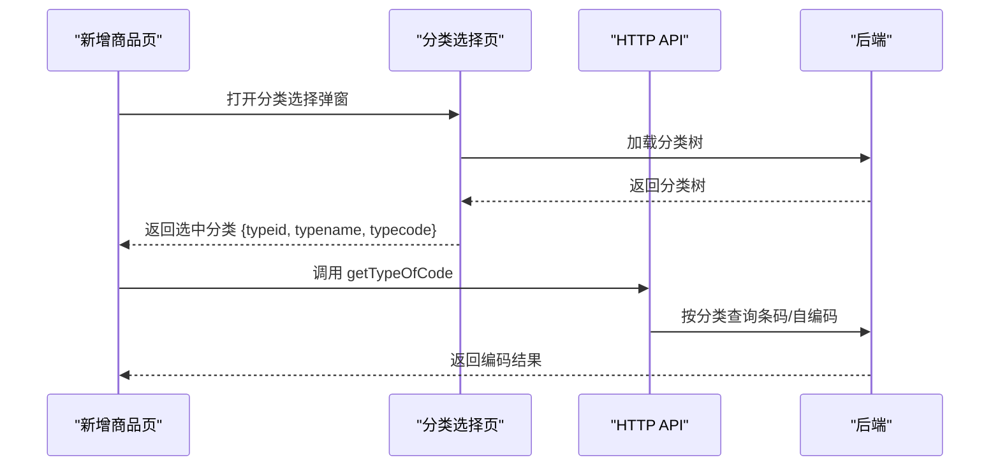
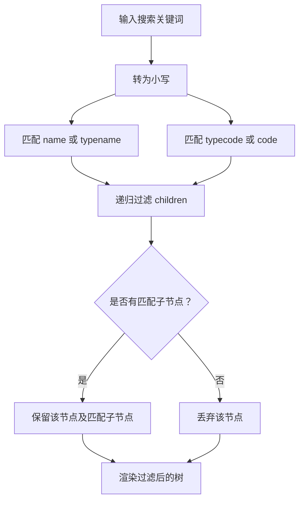
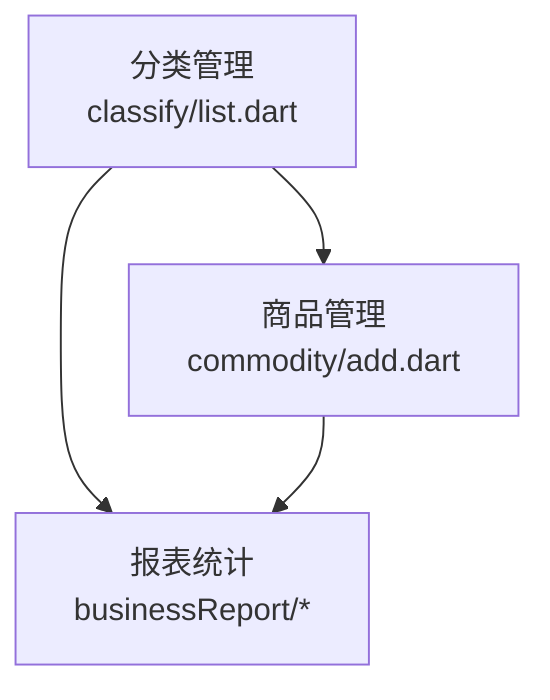

# 分类管理API

<cite>
**本文引用的文件**   
- [http_api.dart](file://lib/net/http_api.dart)
- [list.dart（商品分类列表）](file://lib/pages/business/basis/classify/list.dart)
- [add.dart（新增商品）](file://lib/pages/business/basis/commodity/add.dart)
</cite>

## 目录
1. [引言](#引言)
2. [项目结构定位](#项目结构定位)
3. [核心接口总览](#核心接口总览)
4. [体系结构与数据流](#体系结构与数据流)
5. [详细接口规范](#详细接口规范)
6. [分类数据结构与层级规则](#分类数据结构与层级规则)
7. [分类编码规则](#分类编码规则)
8. [分类状态与管理权限](#分类状态与管理权限)
9. [分类与商品的关联关系](#分类与商品的关联关系)
10. [搜索与过滤逻辑](#搜索与过滤逻辑)
11. [在报表统计中的使用场景](#在报表统计中的使用场景)
12. [性能优化建议](#性能优化建议)
13. [常见问题与排错](#常见问题与排错)
14. [结论](#结论)

## 引言
本文面向灵犀管店 Flutter 客户端，围绕“商品分类管理”能力，重点说明以下事项：
- 分类树形数据的获取、展示、选择、新增、编辑、删除。
- 分类编码生成、分类状态控制、分类权限控制。
- 分类与商品的关联方式、分类在报表统计中的参与方式。
- 基于现有代码可确认的约束、行为与边界条件。

需要特别说明的是：Flutter 端只负责调用后端接口并消费返回数据；关于服务端字段校验、唯一性约束、业务规则等细节，应以服务端接口文档为准。本文所有“字段定义”“返回值格式”均仅反映 Flutter 端当前实际读取和提交的字段。

## 项目结构定位
分类管理相关代码主要分布在以下位置：
- 接口常量集中定义在 `lib/net/http_api.dart`。
- 分类树页面、分类选择弹窗、分类增删改交互集中在 `lib/pages/business/basis/classify/list.dart`。
- 新增商品时选择分类、按分类查询分类编码等行为在 `lib/pages/business/basis/commodity/add.dart`。

**图示来源**
- [http_api.dart:65-73](file://lib/net/http_api.dart#L65-L73)
- [list.dart（商品分类列表）:1-24](file://lib/pages/business/basis/classify/list.dart#L1-L24)
- [add.dart（新增商品）:1652](file://lib/pages/business/basis/commodity/add.dart#L1652)

**章节来源**
- [http_api.dart:65-73](file://lib/net/http_api.dart#L65-L73)
- [list.dart（商品分类列表）:1-24](file://lib/pages/business/basis/classify/list.dart#L1-L24)
- [add.dart（新增商品）:1652](file://lib/pages/business/basis/commodity/add.dart#L1652)

## 核心接口总览
Flutter 中与分类相关的接口常量如下：

| 用途 | 接口常量名 | 接口路径 | Flutter 端使用方 |
|---|---|---|---|
| 商品分类列表 | `itemClassGetList` | `bi/itemclass/getList` | 当前分类列表页未直接调用，但属于同类接口家族 |
| 分类树（含编码） | `typeGetListandCode` | `bi/type/getTypeListandCode` | 分类列表页加载分类树 |
| 新增分类 | `typeAddTypeInfo` | `bi/type/addTypeInfo` | 分类列表页新增或保存新分类 |
| 修改分类 | `typeUpdateTypeInfo` | `bi/type/updateTypeInfo` | 分类列表页编辑分类 |
| 删除分类 | `typeDelTypeInfo` | `bi/type/delTypeInfo` | 分类列表页删除分类 |
| 获取分类编码 | `typeGetCode` | `bi/type/getCode` | 分类列表页新增分类时自动生成编码 |
| 按分类查询编码 | `getTypeOfCode` | `bi/product/getTypeOfCode` | 新增商品时根据分类计算条码或自编码 |

其中，“商品分类列表”这一概念在 Flutter 中主要有两类实现：
1. `itemClassGetList`：从命名看是“商品分类列表”，但当前分类列表页实际调用的是 `typeGetListandCode`。
2. `typeGetListandCode`：当前分类管理界面真正使用的分类树接口，返回带子节点的树形数据，同时包含分类编码信息。

因此，本文以 **`typeGetListandCode`** 作为分类树主接口进行详细说明，并把 `itemClassGetList` 作为同族接口补充说明。

**章节来源**
- [http_api.dart:65-73](file://lib/net/http_api.dart#L65-L73)
- [list.dart（商品分类列表）:40-70](file://lib/pages/business/basis/classify/list.dart#L40-L70)

## 体系结构与数据流
分类管理的数据流可以分为三类：
- 分类树加载：分类列表页请求 `bi/type/getTypeListandCode`，构建父子节点映射，渲染树形结构。
- 分类增删改：通过 `bi/type/addTypeInfo`、`bi/type/updateTypeInfo`、`bi/type/delTypeInfo` 操作分类。
- 分类选择：新增商品或其他业务入口进入分类选择模式，返回选中分类的 ID、名称、编码。

**图示来源**
- [list.dart（商品分类列表）:40-70](file://lib/pages/business/basis/classify/list.dart#L40-L70)
- [list.dart（商品分类列表）:557-640](file://lib/pages/business/basis/classify/list.dart#L557-L640)
- [list.dart（商品分类列表）:640-730](file://lib/pages/business/basis/classify/list.dart#L640-L730)

**章节来源**
- [list.dart（商品分类列表）:40-70](file://lib/pages/business/basis/classify/list.dart#L40-L70)
- [list.dart（商品分类列表）:557-730](file://lib/pages/business/basis/classify/list.dart#L557-L730)

## 详细接口规范

### 分类树查询接口：`bi/type/getTypeListandCode`
这是当前分类管理页面实际使用的接口。

- **调用位置**：分类列表页初始化加载分类树。
- **请求参数**：
  - `field`：固定传 `typeid`。
  - `is_page`：固定传 `0`，表示不分页。
- **响应结构**：
  - 顶层 `data` 是一个对象，Flutter 端读取其 `children` 字段作为分类根节点列表。
  - 每个分类节点至少包含：
    - `typeid`：分类标识。
    - `name` 或 `typename`：分类名称。
    - `typecode` 或 `code`：分类编码。
    - `children`：子分类数组。
    - `parenttypeid`：父分类 ID。
    - `stopflag`：状态标记。
    - `id`：用于删除时的原始 ID。
- **空数据行为**：如果树为空，界面显示“暂无分类数据”。

**图示来源**
- [list.dart（商品分类列表）:40-70](file://lib/pages/business/basis/classify/list.dart#L40-L70)

**章节来源**
- [http_api.dart:68](file://lib/net/http_api.dart#L68)
- [list.dart（商品分类列表）:40-70](file://lib/pages/business/basis/classify/list.dart#L40-L70)

### 新增分类接口：`bi/type/addTypeInfo`
- **触发时机**：分类列表页点击“保存并继续”或“确定”创建新分类。
- **请求体字段**：
  - `parenttypeid`：父分类 ID，未传时使用 `'0'`。
  - `name`：分类名称。
  - `code`：分类编码。
  - `stopflag`：状态标记。
- **成功后行为**：Toast 提示保存成功，并重新加载分类树。

**图示来源**
- [list.dart（商品分类列表）:557-640](file://lib/pages/business/basis/classify/list.dart#L557-L640)

**章节来源**
- [http_api.dart:69](file://lib/net/http_api.dart#L69)
- [list.dart（商品分类列表）:557-640](file://lib/pages/business/basis/classify/list.dart#L557-L640)

### 修改分类接口：`bi/type/updateTypeInfo`
- **触发时机**：分类列表页编辑已有分类。
- **请求体字段**：
  - 复用原节点数据，剔除 `alllist` 和 `children`。
  - 覆盖 `name`、`code`、`stopflag`。
  - 将 `id` 设为 `editNode['typeid']`。
- **成功后行为**：Toast 提示保存成功，并重新加载分类树。

**章节来源**
- [http_api.dart:70](file://lib/net/http_api.dart#L70)
- [list.dart（商品分类列表）:557-640](file://lib/pages/business/basis/classify/list.dart#L557-L640)

### 删除分类接口：`bi/type/delTypeInfo`
- **触发时机**：分类列表页编辑模式下点击“删除”，二次确认后调用。
- **请求参数**：分类原始 ID，类型为字符串。
- **权限控制**：删除前检查权限码 `010104`。
- **成功后行为**：Toast 提示删除成功，并重新加载分类树。

**章节来源**
- [http_api.dart:71](file://lib/net/http_api.dart#L71)
- [list.dart（商品分类列表）:640-730](file://lib/pages/business/basis/classify/list.dart#L640-L730)

### 获取分类编码接口：`bi/type/getCode`
- **触发时机**：新增分类时，根据上级分类编码自动填充下一个编码。
- **参数形式**：Flutter 端传入的是父级编码原始字符串，默认值为 `'0'`。
- **返回值**：返回生成的分类编码字符串。

**章节来源**
- [http_api.dart:72](file://lib/net/http_api.dart#L72)
- [list.dart（商品分类列表）:230-260](file://lib/pages/business/basis/classify/list.dart#L230-L260)

### 按分类查询编码接口：`bi/product/getTypeOfCode`
- **触发时机**：新增商品时，根据已选分类计算条码或自编码。
- **典型参数**：包含 `type`、`value`、`typeid`、`code`。
- **作用**：辅助商品新增流程中选择分类后自动补齐条码/自编码。

**章节来源**
- [http_api.dart:73](file://lib/net/http_api.dart#L73)
- [add.dart（新增商品）:3733-3789](file://lib/pages/business/basis/commodity/add.dart#L3733-L3789)

### 商品分类列表接口：`bi/itemclass/getList`
- **定义位置**：`HttpApi.itemClassGetList`。
- **当前使用情况**：分类管理页面未直接调用该常量，而是使用 `typeGetListandCode`。
- **建议**：若未来要对接旧版分类列表或商品库分类列表，应优先复用该常量。

**章节来源**
- [http_api.dart:65](file://lib/net/http_api.dart#L65)

## 分类数据结构与层级规则

### 分类节点关键字段
Flutter 端实际读写的关键字段如下：

| 字段 | 类型 | 含义 | 说明 |
|---|---|---|---|
| `typeid` | 字符串 | 分类标识 | 用于选择、级联、回显 |
| `name` | 字符串 | 分类名称 | 显示名称，也可用 `typename` |
| `typecode` | 字符串 | 分类编码 | 显示时可拼接为 `[编码]名称`，也可用 `code` |
| `children` | 数组 | 子分类 | 支持多层嵌套树形结构 |
| `parenttypeid` | 字符串 | 父分类 ID | 新增和编辑时用于确定上级分类 |
| `stopflag` | 字符串或数字 | 状态标记 | `'1'` 表示停用；前端 Switch 取反后传给后端 |
| `id` | 字符串 | 删除用原始 ID | 删除接口使用此字段 |

### 层级结构
- 分类数据以树形结构返回，根节点来自 `data.children`。
- 每个节点可包含 `children`，形成多级分类。
- 前端维护 `nodeMap` 和 `parentMap`，用于父子关系判断、半选状态计算、祖先节点同步。
- 前端没有硬编码最大层级数；层级限制应由后端保证。

### 树形展开与展平
- 用户手动展开/收起节点。
- 搜索时自动展开匹配分支。
- 列表渲染前先 DFS 展平为扁平节点，避免每次渲染重复递归，降低复杂度。

**章节来源**
- [list.dart（商品分类列表）:40-70](file://lib/pages/business/basis/classify/list.dart#L40-L70)
- [list.dart（商品分类列表）:201-360](file://lib/pages/business/basis/classify/list.dart#L201-L360)
- [list.dart（商品分类列表）:900-1000](file://lib/pages/business/basis/classify/list.dart#L900-L1000)

## 分类编码规则
分类编码在前端体现为以下行为：
- 新增分类时，根据父级编码调用 `bi/type/getCode` 生成下级编码。
- 父级编码为空时使用默认值 `'0'`。
- 新增成功后，再次调用 `bi/type/getCode` 预填下一个编码，提升录入效率。
- 编辑分类时，分类编码不可自动生成，只能手动修改。
- 分类名称和编码均为必填项。

**图示来源**
- [list.dart（商品分类列表）:230-260](file://lib/pages/business/basis/classify/list.dart#L230-L260)
- [list.dart（商品分类列表）:557-640](file://lib/pages/business/basis/classify/list.dart#L557-L640)

**章节来源**
- [http_api.dart:72](file://lib/net/http_api.dart#L72)
- [list.dart（商品分类列表）:230-260](file://lib/pages/business/basis/classify/list.dart#L230-L260)
- [list.dart（商品分类列表）:557-640](file://lib/pages/business/basis/classify/list.dart#L557-L640)

## 分类状态与管理权限

### 分类状态
- 分类状态由 `stopflag` 控制。
- 前端使用 Switch 控件：Switch 开启表示启用，关闭表示停用。
- 前端传给后端的 `stopflag` 是数值 `0` 或 `1`。
- 编辑时根据 `stopflag == '1'` 判断初始是否为停用状态。

### 权限控制
分类管理涉及多个权限点：

| 行为 | 权限码 | 说明 |
|---|---:|---|
| 查看分类 | `010101` | 无权限时提示无权查看 |
| 新增分类 | `010102` | 控制顶部新增按钮和节点新增子分类 |
| 编辑分类 | `010103` | 编辑模式点击确定前校验 |
| 删除分类 | `010104` | 删除前校验 |

权限不足时，前端直接 Toast 提示并在后台调整权限后再操作。

**图示来源**
- [list.dart（商品分类列表）:30-40](file://lib/pages/business/basis/classify/list.dart#L30-L40)
- [list.dart（商品分类列表）:730-760](file://lib/pages/business/basis/classify/list.dart#L730-L760)
- [list.dart（商品分类列表）:640-730](file://lib/pages/business/basis/classify/list.dart#L640-L730)

**章节来源**
- [list.dart（商品分类列表）:30-40](file://lib/pages/business/basis/classify/list.dart#L30-L40)
- [list.dart（商品分类列表）:640-760](file://lib/pages/business/basis/classify/list.dart#L640-L760)

## 分类与商品的关联关系
分类在商品管理中的作用主要体现在两个方面：

1. **新增商品时选择分类**
   - 新增商品页通过路由打开分类选择页面 `CategoryListPage(isSelect: true)`。
   - 分类选择页返回选中分类的 `typeid`、`typename`、`typecode`。
   - 如果分类编码存在，前端会将显示名称格式化为 `[编码]名称`。

2. **按分类查询条码或自编码**
   - 新增商品时，如果已经选择分类，会调用 `bi/product/getTypeOfCode`。
   - 典型参数包括 `type`、`value`、`typeid`、`code`。
   - 用于根据分类规则自动生成条码或自编码。

**图示来源**
- [add.dart（新增商品）:1652](file://lib/pages/business/basis/commodity/add.dart#L1652)
- [add.dart（新增商品）:3733-3789](file://lib/pages/business/basis/commodity/add.dart#L3733-L3789)

**章节来源**
- [add.dart（新增商品）:1652](file://lib/pages/business/basis/commodity/add.dart#L1652)
- [add.dart（新增商品）:3733-3789](file://lib/pages/business/basis/commodity/add.dart#L3733-L3789)

## 搜索与过滤逻辑
分类列表支持按分类名称和分类编码搜索：
- 搜索关键词同时匹配 `name`/`typename` 和 `typecode`/`code`。
- 搜索时自动展开匹配的父级节点。
- 搜索结果仍保持树形结构，只显示匹配节点及其必要祖先。
- 清空搜索关键词后恢复完整树结构。

**图示来源**
- [list.dart（商品分类列表）:201-230](file://lib/pages/business/basis/classify/list.dart#L201-L230)

**章节来源**
- [list.dart（商品分类列表）:201-230](file://lib/pages/business/basis/classify/list.dart#L201-L230)

## 在报表统计中的使用场景
分类在灵犀管店中不仅是商品组织维度，也是报表统计的重要维度。从仓库结构可以看出，多个报表页面可能使用分类作为筛选或分组维度，例如：
- 业务分析类报表。
- 销售排行、品类分析。
- ABC 分析、库存预警、滞销商品分析等。

虽然这些报表页面的具体请求字段不在本文件中展开，但它们通常依赖分类 ID、分类名称、分类编码来筛选数据。因此，分类管理的准确性直接影响报表统计质量。

**图示来源**
- [list.dart（商品分类列表）:1-24](file://lib/pages/business/basis/classify/list.dart#L1-L24)
- [add.dart（新增商品）:1652](file://lib/pages/business/basis/commodity/add.dart#L1652)

**章节来源**
- [list.dart（商品分类列表）:1-24](file://lib/pages/business/basis/classify/list.dart#L1-L24)
- [add.dart（新增商品）:1652](file://lib/pages/business/basis/commodity/add.dart#L1652)

## 性能优化建议
当前分类列表页已经做了多项前端优化，后续仍可参考以下方向：

| 优化点 | 当前实现 | 建议 |
|---|---|---|
| 树形遍历 | 使用 DFS 构建 `nodeMap`、`parentMap` | 保持 O(N) 复杂度，避免重复递归 |
| 列表渲染 | 先将树展平为 `_flatNodes` | 减少每个节点重复查找成本 |
| 展开状态 | 使用 `_expandedIds` 缓存 | 搜索时按需展开，避免全量展开 |
| 多选级联 | 使用 `_getDescendantIds`、`_syncUp` | 注意大数据量时子孙节点数量增长 |
| 下拉刷新 | 使用 `RefreshIndicator` | 保持分页策略与服务端一致 |
| 空数据体验 | 空树显示“暂无分类数据” | 可增加加载失败态和重试机制 |

需要注意：
- 多选模式下，一个父节点可能包含大量子孙节点，全选或取消全选都会批量更新 `_selectedIds`，应避免在频繁回调中重复计算。
- 搜索过滤会递归处理 `children`，分类树过深或过宽时应考虑后端分页或懒加载。

**章节来源**
- [list.dart（商品分类列表）:40-70](file://lib/pages/business/basis/classify/list.dart#L40-L70)
- [list.dart（商品分类列表）:201-360](file://lib/pages/business/basis/classify/list.dart#L201-L360)
- [list.dart（商品分类列表）:900-1000](file://lib/pages/business/basis/classify/list.dart#L900-L1000)

## 常见问题与排错

### 问题一：分类列表无法加载
- 检查是否已通过权限 `010101`。
- 检查 `typeGetListandCode` 返回的 `data.children` 是否为数组。
- 检查网络请求是否被拦截或返回非预期结构。

### 问题二：新增分类后编码不正确
- 检查父级编码是否正确传入 `bi/type/getCode`。
- 检查用户是否手动覆盖了自动生成编码。
- 检查新增成功后是否重新拉取了下一个编码。

### 问题三：编辑分类时报权限错误
- 编辑确认前会校验 `010103`。
- 如果权限不足，应先联系管理员开通分类编辑权限。

### 问题四：删除分类无效
- 删除前会校验 `010104`。
- 删除参数应为分类原始 ID，不是名称或编码。
- 删除成功后需重新加载分类树。

### 问题五：新增商品时未选择分类
- 新增商品流程中多处校验分类是否已选择。
- 如果未选择分类，前端会提示“请先选择商品分类”或“请选择商品分类”。

**章节来源**
- [list.dart（商品分类列表）:30-40](file://lib/pages/business/basis/classify/list.dart#L30-L40)
- [list.dart（商品分类列表）:640-760](file://lib/pages/business/basis/classify/list.dart#L640-L760)
- [add.dart（新增商品）:3733-3789](file://lib/pages/business/basis/commodity/add.dart#L3733-L3789)

## 结论
灵犀管店 Flutter 项目的分类管理能力以 `bi/type/getTypeListandCode` 为核心，配合分类编码生成、分类状态切换、分类权限控制和分类选择模式，形成了完整的分类树管理闭环。虽然 `itemClassGetList` 也定义了商品分类列表接口，但当前分类管理页面实际使用的是 `typeGetListandCode`。

在实际使用中，开发者应重点关注：
- 分类树数据结构以 `children` 表达层级。
- 分类编码由后端生成，前端仅负责获取和回填。
- 分类状态由 `stopflag` 控制，前端 Switch 取反后提交。
- 分类权限由 `010101`、`010102`、`010103`、`010104` 控制。
- 分类与商品通过 `typeid`、`typecode`、`typename` 关联，并在商品新增时参与条码/自编码计算。
- 分类在报表统计中作为重要维度，应保持数据准确、层级清晰、编码稳定。