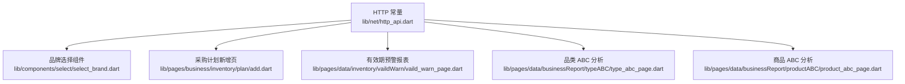
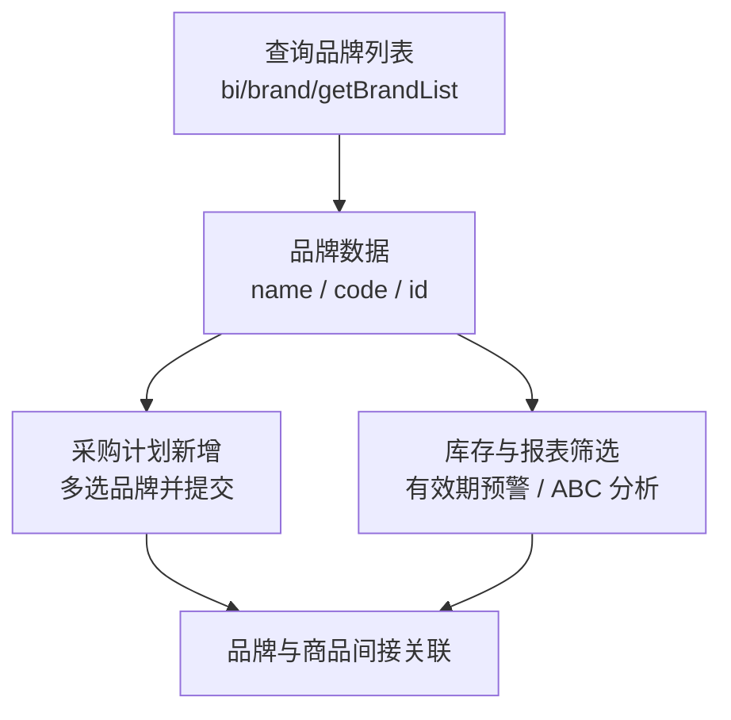
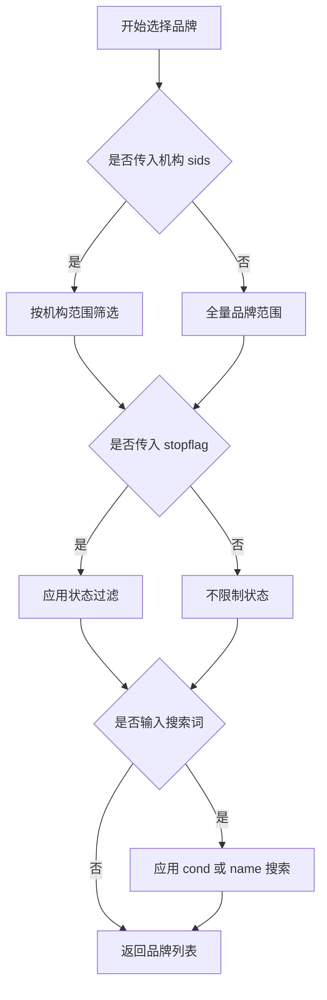
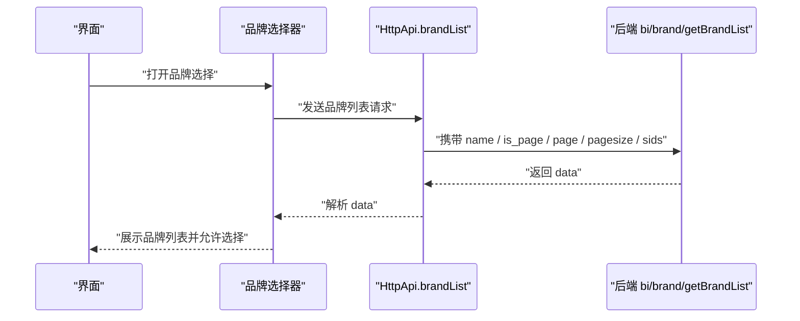
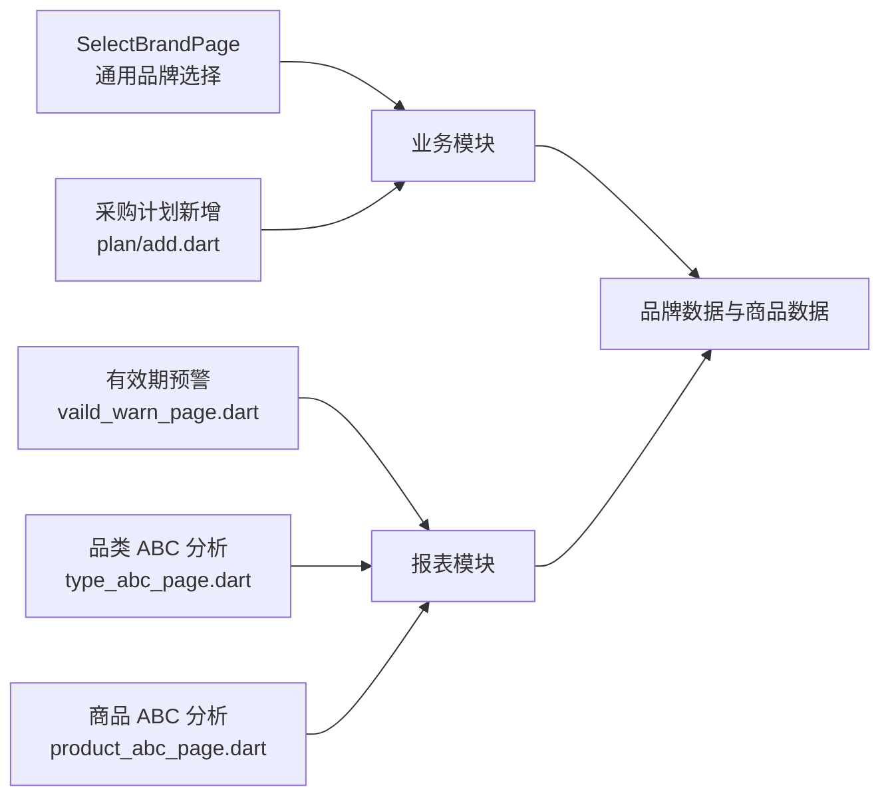

# 品牌管理API

<cite>
**本文引用的文件**   
- [lib/net/http_api.dart](file://lib/net/http_api.dart)
- [lib/components/select/select_brand.dart](file://lib/components/select/select_brand.dart)
- [lib/pages/business/inventory/plan/add.dart](file://lib/pages/business/inventory/plan/add.dart)
- [lib/pages/data/inventory/vaildWarn/vaild_warn_page.dart](file://lib/pages/data/inventory/vaildWarn/vaild_warn_page.dart)
- [lib/pages/data/businessReport/typeABC/type_abc_page.dart](file://lib/pages/data/businessReport/typeABC/type_abc_page.dart)
- [lib/pages/data/businessReport/productABC/product_abc_page.dart](file://lib/pages/data/businessReport/productABC/product_abc_page.dart)
</cite>

## 目录
1. [简介](#简介)
2. [项目结构中的品牌能力](#项目结构中的品牌能力)
3. [核心接口：品牌列表 brandList](#核心接口品牌列表-brandlist)
4. [品牌数据结构与字段说明](#品牌数据结构与字段说明)
5. [品牌与商品的关联关系](#品牌与商品的关联关系)
6. [品牌状态管理与过滤参数](#品牌状态管理与过滤参数)
7. [品牌搜索与分页行为](#品牌搜索与分页行为)
8. [调用方与业务场景](#调用方与业务场景)
9. [数据同步、缓存与性能建议](#数据同步缓存与性能建议)
10. [排错指南](#排错指南)
11. [结论](#结论)

## 简介
本文面向灵犀管店 Flutter 项目的品牌管理相关能力，重点梳理品牌列表接口 `brandList` 的完整规范，并结合代码中实际调用方式，总结品牌数据的组织结构、品牌与商品的关系、品牌状态、搜索分页、以及在库存报表等业务中的使用方式。需要特别说明的是：当前仓库中品牌能力的后端接口集中在“查询品牌列表”，并未出现品牌新增、删除、修改、图片上传、排序或分类管理的专用 API；这些能力在现有前端代码中没有直接体现，文档会明确区分“已实现”和“尚未发现”。

## 项目结构中的品牌能力
品牌能力在代码库中以“基础数据查询 + 通用选择器 + 报表筛选”的形式存在：

- 接口地址集中定义在 HTTP 常量类中，便于统一管理和切换环境。
- 品牌选择组件封装了统一的底部抽屉式选择交互。
- 多个库存报表和业务页面通过通用选择器或自定义选择弹窗调用品牌列表接口。

**图表来源**
- [lib/net/http_api.dart:66](file://lib/net/http_api.dart#L66)
- [lib/components/select/select_brand.dart:1-79](file://lib/components/select/select_brand.dart#L1-L79)
- [lib/pages/business/inventory/plan/add.dart:1240-1285](file://lib/pages/business/inventory/plan/add.dart#L1240-L1285)
- [lib/pages/data/inventory/vaildWarn/vaild_warn_page.dart:190-215](file://lib/pages/data/inventory/vaildWarn/vaild_warn_page.dart#L190-L215)
- [lib/pages/data/businessReport/typeABC/type_abc_page.dart:1070-1090](file://lib/pages/data/businessReport/typeABC/type_abc_page.dart#L1070-L1090)
- [lib/pages/data/businessReport/productABC/product_abc_page.dart:920-945](file://lib/pages/data/businessReport/productABC/product_abc_page.dart#L920-L945)

**章节来源**
- [lib/net/http_api.dart:60-70](file://lib/net/http_api.dart#L60-L70)

## 核心接口：品牌列表 brandList
- 接口名称：`brandList`
- 后端路径：`bi/brand/getBrandList`
- 请求类型：GET（由通用网络请求方法发起）
- 主要用途：根据关键词、机构范围、状态等条件查询品牌列表，支持分页和无分页两种模式。

该接口是品牌能力的唯一入口。现有前端代码未暴露品牌的增删改、图片上传、排序维护、分类管理等专用接口。

**章节来源**
- [lib/net/http_api.dart:66](file://lib/net/http_api.dart#L66)

## 品牌数据结构与字段说明
从品牌选择组件和报表选择器的使用方式可以归纳出品牌对象的核心字段：

| 字段 | 类型 | 是否必需 | 含义 | 典型用途 |
|---|---|---|---|---|
| `name` | 字符串 | 是 | 品牌名称 | 列表展示、搜索匹配、结果映射 |
| `code` | 字符串 | 否 | 品牌编码 | 与名称组合显示为“[编码]名称” |
| `id` | 字符串或数字 | 常见 | 品牌标识 | 作为选择器 ID 字段、报表筛选条件 |
| `is_page` | 整数 | 调用侧传入 | 是否启用分页 | 控制后端分页逻辑 |
| `page` | 整数 | 分页时传入 | 当前页码 | 分页查询 |
| `pagesize` | 整数 | 分页时传入 | 每页数量 | 分页查询，默认多为 20 |
| `sids` | 字符串数组 | 可选 | 机构范围 | 限定品牌按门店或机构过滤 |
| `cond` | 字符串 | 可选 | 通用搜索条件 | 部分报表用于模糊搜索品牌 |
| `stopflag` | 字符串 | 可选 | 状态过滤 | 例如“0,3”表示特定启用/停用状态组合 |

注意：
- 品牌选择组件会把 `name` 作为 ID 字段，把 `code` 和 `name` 组合成展示名。
- 报表选择器通常以 `id` 作为品牌标识，并以 `name` 作为展示名。
- 不同调用方对返回结构的解析略有差异：有的期望 `data` 直接是 Map，有的期望 `data.list` 是 List。

**章节来源**
- [lib/components/select/select_brand.dart:12-45](file://lib/components/select/select_brand.dart#L12-L45)
- [lib/pages/data/inventory/vaildWarn/vaild_warn_page.dart:190-215](file://lib/pages/data/inventory/vaildWarn/vaild_warn_page.dart#L190-L215)
- [lib/pages/data/businessReport/typeABC/type_abc_page.dart:1070-1090](file://lib/pages/data/businessReport/typeABC/type_abc_page.dart#L1070-L1090)
- [lib/pages/data/businessReport/productABC/product_abc_page.dart:920-945](file://lib/pages/data/businessReport/productABC/product_abc_page.dart#L920-L945)

## 品牌与商品的关联关系
当前仓库没有独立的“品牌-商品绑定表”或“品牌维护页面”，但品牌与商品的关系体现在以下层面：

1. **商品维度依赖品牌信息**  
   品牌选择组件注释明确指出其用于商品相关业务场景，并通过 `name` 字段代表品牌名称。

2. **采购计划新增页使用品牌多选**  
   在采购计划新增流程中，品牌作为多选维度参与计划创建，品牌项被转换为包含 `stypeid`、`stypename`、`stypecode` 的结构，用于后续提交。

3. **报表筛选使用品牌维度**  
   库存预警、ABC 分析、销售率分析等报表通过品牌筛选聚合商品或单据数据。

**图表来源**
- [lib/components/select/select_brand.dart:9-45](file://lib/components/select/select_brand.dart#L9-L45)
- [lib/pages/business/inventory/plan/add.dart:1240-1285](file://lib/pages/business/inventory/plan/add.dart#L1240-L1285)
- [lib/pages/data/inventory/vaildWarn/vaild_warn_page.dart:190-215](file://lib/pages/data/inventory/vaildWarn/vaild_warn_page.dart#L190-L215)
- [lib/pages/data/businessReport/productABC/product_abc_page.dart:920-945](file://lib/pages/data/businessReport/productABC/product_abc_page.dart#L920-L945)

**章节来源**
- [lib/components/select/select_brand.dart:9-45](file://lib/components/select/select_brand.dart#L9-L45)
- [lib/pages/business/inventory/plan/add.dart:1240-1285](file://lib/pages/business/inventory/plan/add.dart#L1240-L1285)

## 品牌状态管理与过滤参数
现有代码展示了品牌状态的几种使用方式：

| 参数 | 示例值 | 含义 | 使用位置 |
|---|---:|---|---|
| `stopflag` | `"0,3"` | 控制品牌启用/停用状态 | 有效期预警报表的品牌选择 |
| `sids` | 机构 ID 数组 | 按机构范围筛选品牌 | 采购计划新增、有效期预警 |
| `cond` | 搜索关键词 | 通用搜索条件 | 有效期预警 |
| `name` | 关键词 | 品牌名称搜索 | 品牌选择组件、采购计划新增 |

这意味着品牌状态可能由后端枚举或标志位控制，前端通过 `stopflag` 进行过滤，而不是通过独立的状态维护接口。

**图表来源**
- [lib/pages/data/inventory/vaildWarn/vaild_warn_page.dart:190-215](file://lib/pages/data/inventory/vaildWarn/vaild_warn_page.dart#L190-L215)
- [lib/pages/business/inventory/plan/add.dart:1252-1265](file://lib/pages/business/inventory/plan/add.dart#L1252-L1265)

**章节来源**
- [lib/pages/data/inventory/vaildWarn/vaild_warn_page.dart:190-215](file://lib/pages/data/inventory/vaildWarn/vaild_warn_page.dart#L190-L215)
- [lib/pages/business/inventory/plan/add.dart:1252-1265](file://lib/pages/business/inventory/plan/add.dart#L1252-L1265)

## 品牌搜索与分页行为
品牌列表接口在不同调用方中表现出两种典型模式：

### 分页模式
- 适用场景：品牌选择组件、采购计划新增页。
- 关键参数：
  - `is_page: 1`
  - `page`：页码
  - `pagesize: 20`
- 返回处理：取 `result['data']`，并要求其为 Map。

### 无分页模式
- 适用场景：有效期预警报表。
- 关键参数：
  - `is_page: 0`
  - `cond`：搜索关键词
  - `sids`：机构范围
  - `stopflag`：状态过滤
- 返回处理：兼容 `data` 为 List 或 `data.list` 为 List。

**图表来源**
- [lib/components/select/select_brand.dart:12-45](file://lib/components/select/select_brand.dart#L12-L45)
- [lib/pages/business/inventory/plan/add.dart:1252-1265](file://lib/pages/business/inventory/plan/add.dart#L1252-L1265)

**章节来源**
- [lib/components/select/select_brand.dart:12-45](file://lib/components/select/select_brand.dart#L12-L45)
- [lib/pages/business/inventory/plan/add.dart:1252-1265](file://lib/pages/business/inventory/plan/add.dart#L1252-L1265)
- [lib/pages/data/inventory/vaildWarn/vaild_warn_page.dart:190-215](file://lib/pages/data/inventory/vaildWarn/vaild_warn_page.dart#L190-L215)

## 调用方与业务场景
目前代码中涉及品牌列表的主要调用方如下：

| 调用方 | 页面或组件 | 使用方式 | 业务意义 |
|---|---|---|---|
| 品牌选择组件 | `SelectBrandPage` | 底部抽屉 + 全页路由 | 通用品牌选择入口 |
| 采购计划新增 | `plan/add.dart` | 多选品牌，传入机构范围 | 创建采购计划时按品牌聚合 |
| 有效期预警报表 | `vaild_warn_page.dart` | 单选品牌，带状态过滤 | 查看品牌维度的有效期预警 |
| 品类 ABC 分析 | `type_abc_page.dart` | 通过选择器调用品牌列表 | 按品牌参与品类分析 |
| 商品 ABC 分析 | `product_abc_page.dart` | 通过选择器调用品牌列表 | 按品牌参与商品分析 |

**图表来源**
- [lib/components/select/select_brand.dart:1-79](file://lib/components/select/select_brand.dart#L1-L79)
- [lib/pages/business/inventory/plan/add.dart:1240-1285](file://lib/pages/business/inventory/plan/add.dart#L1240-L1285)
- [lib/pages/data/inventory/vaildWarn/vaild_warn_page.dart:190-215](file://lib/pages/data/inventory/vaildWarn/vaild_warn_page.dart#L190-L215)
- [lib/pages/data/businessReport/typeABC/type_abc_page.dart:1070-1090](file://lib/pages/data/businessReport/typeABC/type_abc_page.dart#L1070-L1090)
- [lib/pages/data/businessReport/productABC/product_abc_page.dart:920-945](file://lib/pages/data/businessReport/productABC/product_abc_page.dart#L920-L945)

**章节来源**
- [lib/components/select/select_brand.dart:1-79](file://lib/components/select/select_brand.dart#L1-L79)
- [lib/pages/business/inventory/plan/add.dart:1240-1285](file://lib/pages/business/inventory/plan/add.dart#L1240-L1285)
- [lib/pages/data/inventory/vaildWarn/vaild_warn_page.dart:190-215](file://lib/pages/data/inventory/vaildWarn/vaild_warn_page.dart#L190-L215)
- [lib/pages/data/businessReport/typeABC/type_abc_page.dart:1070-1090](file://lib/pages/data/businessReport/typeABC/type_abc_page.dart#L1070-L1090)
- [lib/pages/data/businessReport/productABC/product_abc_page.dart:920-945](file://lib/pages/data/businessReport/productABC/product_abc_page.dart#L920-L945)

## 数据同步、缓存与性能建议
### 已观察到的行为
- 品牌列表接口通过通用网络请求调用，返回结构中 `data` 可能为 Map 或包含 `list` 的 Map。
- 分页默认每页 20 条。
- 报表侧同时支持 `data` 直接为 List 和 `data.list` 为 List 的兼容写法。

### 推荐的数据同步策略
1. **启动时按需加载**  
   如果品牌数据变化频率较低，可在登录成功后或进入基础数据模块时预加载品牌列表，减少重复请求。
2. **按机构隔离缓存键**  
   由于 `sids` 会影响品牌结果，缓存时应将机构范围纳入缓存键，避免不同门店看到错误品牌集合。
3. **搜索词去抖**  
   品牌选择组件支持关键词搜索，应结合本地去抖或节流策略，避免频繁触发接口。
4. **分页增量更新**  
   下拉加载更多时追加品牌项，而不是整页替换，提升滚动体验。

### 性能优化建议
- 列表渲染使用虚拟列表或分页懒加载。
- 搜索结果优先使用后端 `cond` 或 `name` 过滤，减少前端计算。
- 对品牌名称和编码做稳定排序，保证相同结果下 UI 顺序一致。
- 若品牌图片未来接入，应避免在主列表渲染大图，改用缩略图或占位图。

### 当前未发现的能力
- 品牌新增、删除、修改接口
- 品牌图片上传接口
- 品牌排序维护接口
- 品牌分类管理接口
- 品牌数据统计和推广专用接口

以上能力在现有仓库中未见对应实现，如需扩展，应在后端补充接口，并在前端增加对应页面和网络层调用。

**章节来源**
- [lib/components/select/select_brand.dart:12-45](file://lib/components/select/select_brand.dart#L12-L45)
- [lib/pages/data/inventory/vaildWarn/vaild_warn_page.dart:190-215](file://lib/pages/data/inventory/vaildWarn/vaild_warn_page.dart#L190-L215)

## 排错指南
| 现象 | 可能原因 | 排查建议 |
|---|---|---|
| 品牌列表为空 | 未传入 `sids` 或机构范围不正确 | 检查调用方是否传入当前门店或机构 ID |
| 搜索不到品牌 | 搜索参数不一致 | 确认使用的是 `name` 还是 `cond`，并与后端约定保持一致 |
| 品牌状态不符合预期 | `stopflag` 未传或值不匹配 | 检查报表选择器是否传入 `stopflag`，以及后端状态枚举 |
| 分页数据异常 | `is_page`、`page`、`pagesize` 配置不一致 | 核对分页模式下三个参数是否同时传入 |
| 返回数据解析失败 | `data` 不是预期的 Map 或 List | 检查调用方对 `data` 的类型判断逻辑 |
| 品牌展示缺少编码 | 后端未返回 `code` | 检查品牌对象是否包含 `code` 字段 |

**章节来源**
- [lib/components/select/select_brand.dart:12-45](file://lib/components/select/select_brand.dart#L12-L45)
- [lib/pages/data/inventory/vaildWarn/vaild_warn_page.dart:190-215](file://lib/pages/data/inventory/vaildWarn/vaild_warn_page.dart#L190-L215)
- [lib/pages/business/inventory/plan/add.dart:1252-1265](file://lib/pages/business/inventory/plan/add.dart#L1252-L1265)

## 结论
灵犀管店 Flutter 项目中的品牌管理能力目前以品牌列表查询为核心，围绕品牌选择组件、采购计划和报表筛选展开。`brandList` 接口提供基于名称、机构范围和状态的品牌数据查询能力，支持分页和无分页两种模式。品牌与商品的关联主要通过业务页面选择品牌和报表维度体现，而非独立的绑定维护页面。

当前仓库没有品牌新增、删除、修改、图片上传、排序和分类管理的专用接口。若产品需要完善品牌管理，建议在后端补充品牌维护接口，并在前端新增品牌维护页面，同时保持与现有品牌选择组件、报表筛选器和商品业务的兼容性。