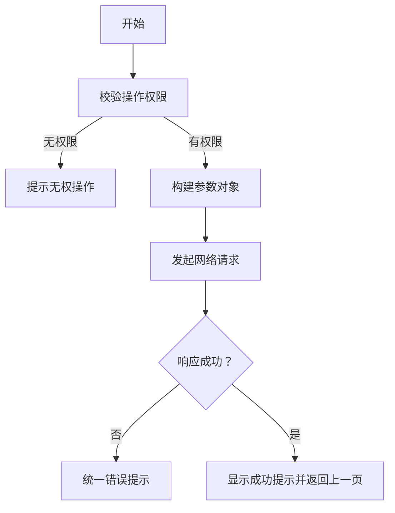
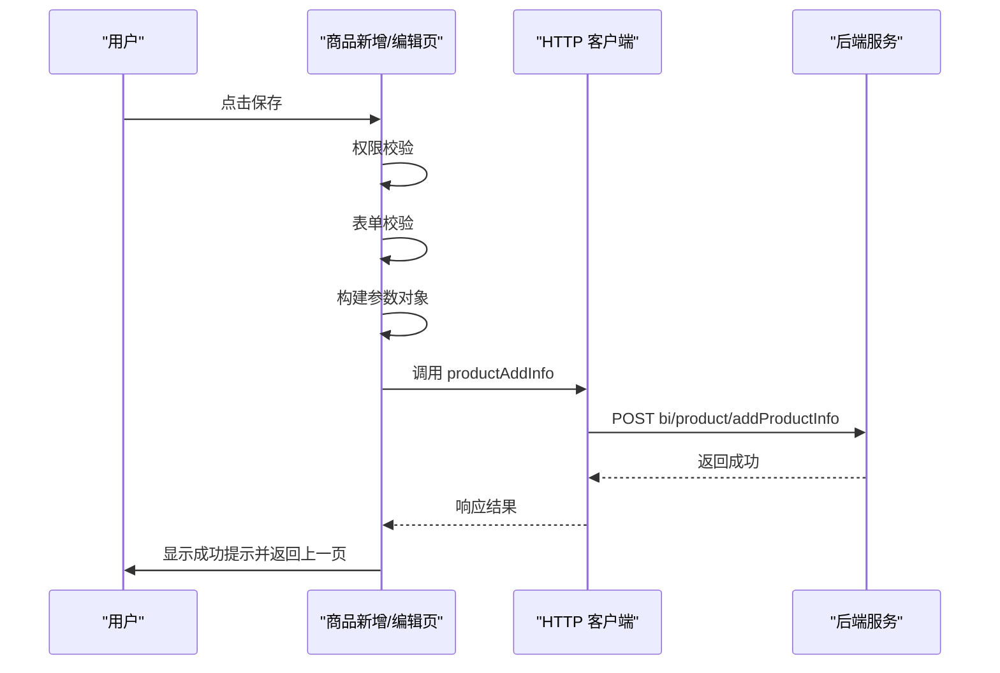
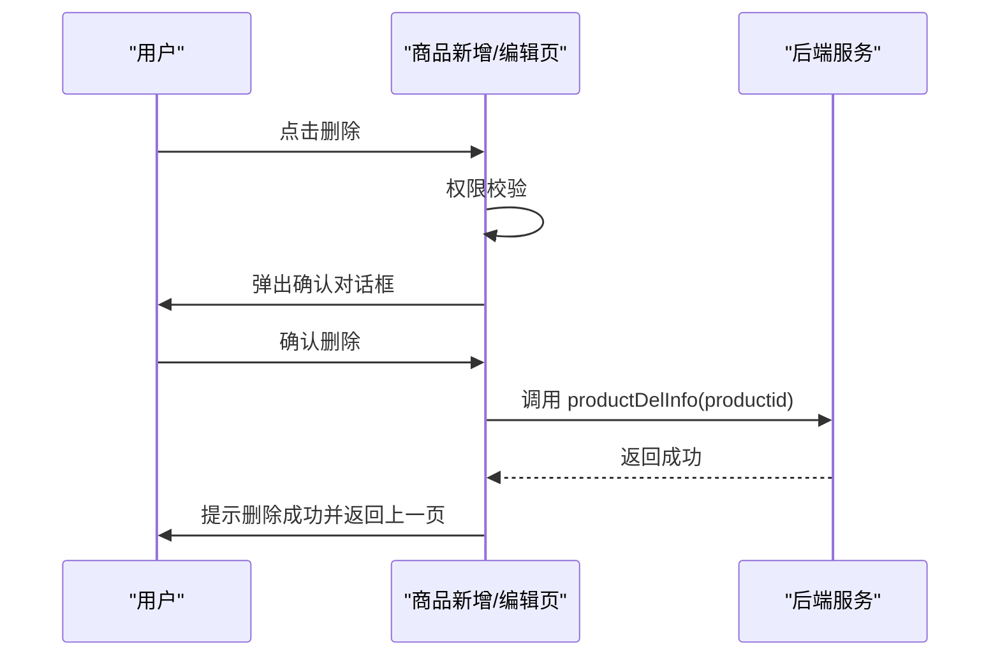
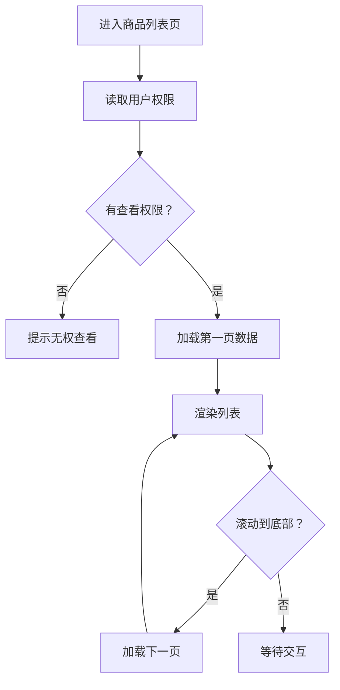
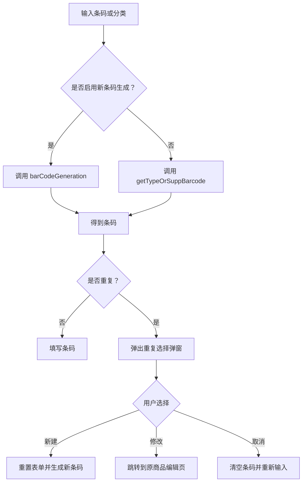
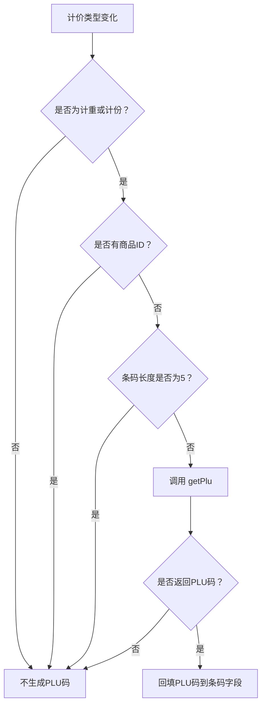
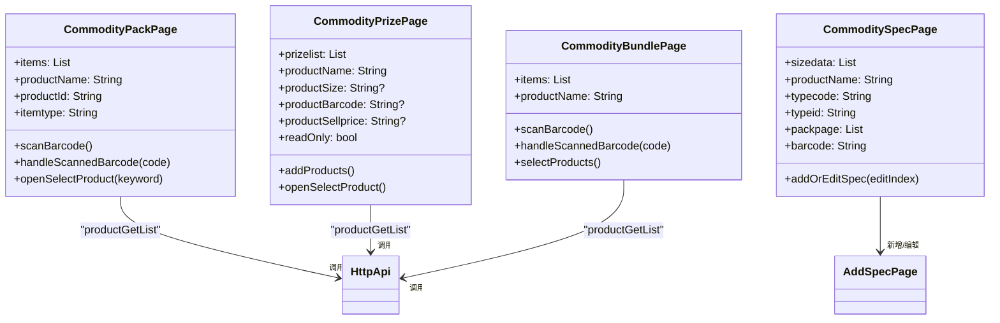
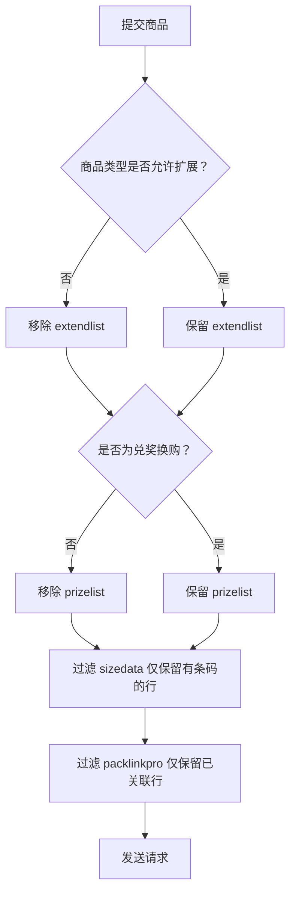
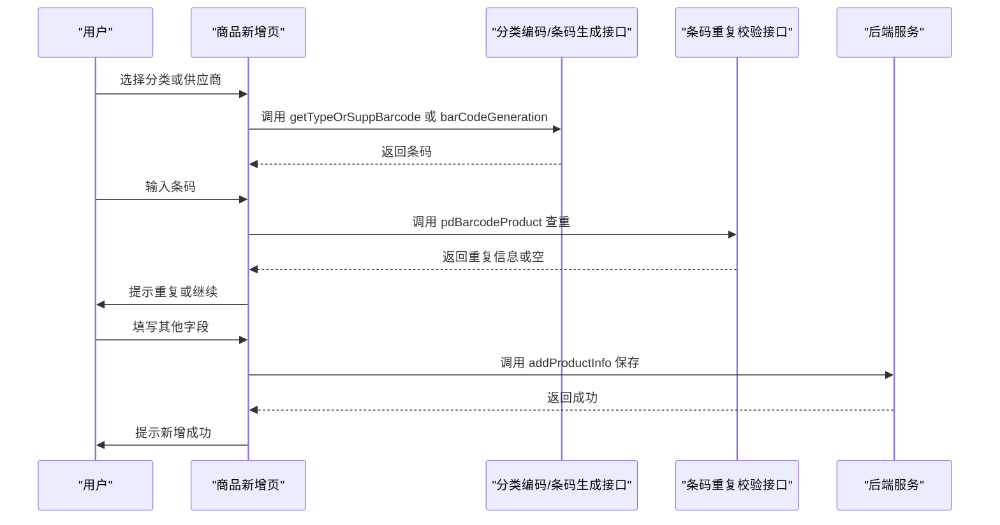
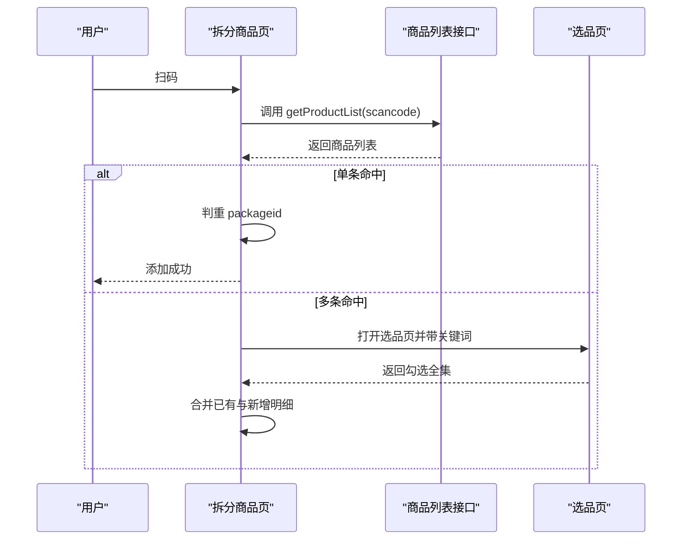

# 商品管理API

<cite>
**本文引用的文件**   
- [http_api.dart](file://lib/net/http_api.dart)
- [list.dart](file://lib/pages/business/basis/commodity/list.dart)
- [add.dart](file://lib/pages/business/basis/commodity/add.dart)
- [product.dart](file://lib/pages/business/basis/commodity/product.dart)
- [spec.dart](file://lib/pages/business/basis/commodity/spec.dart)
- [prize.dart](file://lib/pages/business/basis/commodity/prize.dart)
- [bundle.dart](file://lib/pages/business/basis/commodity/bundle.dart)
</cite>

## 目录
1. [文档定位与适用范围](#文档定位与适用范围)
2. [接口总览](#接口总览)
3. [通用约定](#通用约定)
4. [商品详情接口 productGetInfo](#商品详情接口-productgetinfo)
5. [保存或新增商品接口 productAddInfo](#保存或新增商品接口-productaddinfo)
6. [删除商品接口 productDelInfo](#删除商品接口-productdelinfo)
7. [商品列表接口 productGetList](#商品列表接口-productgetlist)
8. [条码与编码辅助接口](#条码与编码辅助接口)
9. [分类编码与PLU码接口](#分类编码与plu码接口)
10. [扩展信息与关联商品接口](#扩展信息与关联商品接口)
11. [批量操作、导入导出与价格库存关联](#批量操作导入导出与价格库存关联)
12. [业务规则与约束](#业务规则与约束)
13. [错误处理方案](#错误处理方案)
14. [典型调用流程](#典型调用流程)
15. [排错建议](#排错建议)

## 文档定位与适用范围
本文面向灵犀管店 Flutter 端的商品管理功能，聚焦以下能力：
- 商品核心 CRUD：商品详情、保存/新增、删除、商品列表。
- 条码与编码：自动生成条码、条码重复校验、分类编码获取、PLU 码获取。
- 扩展信息：单位/规格扩展项查询与提交。
- 关联商品：拆分/组装明细、兑奖换购、特价打包、按条码查找关联商品。
- 高级场景：批量操作、导入导出、价格管理、库存关联的 API 使用方式说明。

本说明以 Flutter 端实际调用的 HTTP 接口常量及页面参数构造为依据，不虚构后端字段实现细节；对于仅由前端 UI 表达但未见后端定义的行为，会明确标注为“前端行为”。

**章节来源**
- [http_api.dart:346-360](file://lib/net/http_api.dart#L346-L360)
- [http_api.dart:54-74](file://lib/net/http_api.dart#L54-L74)

## 接口总览
| 接口名称 | HTTP 路径常量 | 用途 | 主要调用方 |
|---|---|---|---|
| 商品详情 | `bi/product/getProductInfo` | 加载商品完整数据，用于编辑、查看、新品申请回显 | 商品新增/编辑页 |
| 保存或新增商品 | `bi/product/addProductInfo` | 新增商品或更新已有商品 | 商品新增/编辑页 |
| 删除商品 | `bi/product/delProductInfo` | 删除指定商品 | 商品新增/编辑页 |
| 商品列表 | `bi/product/getProductList` | 分页查询商品列表、扫码搜索 | 商品列表页、选品组件 |
| 获取分类编码 | `bi/product/getTypeOfCode` | 根据分类生成自编码 | 商品新增/编辑页 |
| 自动生成条码 | `bi/product/barCodeGeneration` | 按分类或供应商生成条码 | 商品新增/编辑页 |
| 条码重复校验 | `bi/product/pdBarcodeProduct` | 检查条码是否重复并返回已存在商品信息 | 商品新增/编辑页 |
| 获取类型或供应商条码 | `bi/product/getTypeOrSuppBarcode` | 兼容旧逻辑的分类/供应商条码生成 | 商品新增/编辑页 |
| 获取PLU码 | `bi/product/getPlu` | 计价类型为计重/计份时生成 PLU 码 | 商品新增/编辑页 |
| 按条码查关联商品 | `bi/product/findProductBarcodeCode` | 通过条码反查商品编码，供包装配置等使用 | 商品新增/编辑页 |
| 商品扩展列表 | `bi/product/getProductExtendList` | 查询单位/规格等扩展项 | 商品新增/编辑页 |

**章节来源**
- [http_api.dart:346-360](file://lib/net/http_api.dart#L346-L360)
- [http_api.dart:54-74](file://lib/net/http_api.dart#L54-L74)

## 通用约定
- 请求方式：均为后端统一封装的 HTTP 接口；Flutter 端通过 `request(HttpApi.xxx, params)` 发起。
- 参数组织：参数对象为键值映射，常见键包括 `productid`、`barcode`、`code`、`typeid`、`typecode`、`supid`、`itemtype`、`pricetype`、`sizedata`、`extendlist`、`packpage`、`prizelist` 等。
- 分页参数：商品列表使用 `is_page`、`page`、`pagesize`、`cond`、`field`、`type`。
- 权限控制：商品列表、新增、编辑、删除均受菜单权限控制；无权限时前端直接提示“无权查看/新增/编辑/删除商品档案或新品申请”。
- 展示权限：进价、毛利率、配送价、库存等字段是否可见由登录用户信息和系统参数决定。

[本图为通用流程示意，不直接映射具体代码结构]

**章节来源**
- [list.dart:43-75](file://lib/pages/business/basis/commodity/list.dart#L43-L75)
- [add.dart:200-220](file://lib/pages/business/basis/commodity/add.dart#L200-L220)

## 商品详情接口 productGetInfo
### 接口信息
- 接口标识：`HttpApi.productGetInfo`
- 后端路径：`bi/product/getProductInfo`
- 用途：加载商品完整信息，用于编辑模式、查看模式、新品申请流程回显。

### 请求参数
| 字段 | 类型 | 必填 | 说明 |
|---|---|---|---|
| `productid` | 字符串 | 编辑/查看/审核模式必填 | 商品唯一标识 |
| `applynewflag` | 字符串或空值 | 可选 | 新品申请流程标记，用于区分商品档案与新品申请数据来源 |

### 响应数据
响应数据是一个商品对象，包含基础信息、价格信息、库存信息、状态标志、扩展信息、规格明细、包装信息、兑奖换购信息等。前端会将该对象合并到表单中心数据 `_form`，并同步到各输入控件。

关键字段包括：
- 基础信息：`barcode`、`name`、`productname`、`shortname`、`helpcode`、`code`、`imageurl`、`typeid`、`typename`、`typecode`、`size`、`unit`、`brandname`、`remark`。
- 商品属性：`itemtype`、`pricetype`、`selltype`、`pstype`、`memorytype`。
- 供应商：`supid`、`supname`。
- 价格：`inprice`、`sellprice`、`grossrate`、`mprice1/2/3`、`pfprice1/2/3`、`psprice`、`minsellprice`。
- 库存：`maxstock`、`minstock`、`initstorage`、`locationcode`、`locationid`。
- 积分与促销：`pointbase`、`point`、`promotionprice`、`promotionbegintime`、`promotionendtime`。
- 税务：`intaxrate`、`outtaxrate`。
- 其他标志：`stockflag`、`validflag`、`sellflag`、`changepriceflag`、`snflag`、`freshflag`、`freepriceflag`、`saleweighflag`、`nousecouponsflag`、`promotionflag`、`home`、`itemstatus`、`deducttype`、`deductvalue`、`validday`、`joinrate`。
- 明细数据：`extendlist`、`sizedata`、`packpage`、`packlinkpro`、`prizelist`。

### 前端行为
- 编辑模式进入时调用详情接口。
- 接口返回后填充表单，并根据 `itemtype` 和登录参数中的 `packagSettingMode` 动态切换 Tab。
- 对数值字段进行小数位格式化。

**章节来源**
- [http_api.dart:347](file://lib/net/http_api.dart#L347)
- [add.dart:531-575](file://lib/pages/business/basis/commodity/add.dart#L531-L575)
- [add.dart:576-600](file://lib/pages/business/basis/commodity/add.dart#L576-L600)

## 保存或新增商品接口 productAddInfo
### 接口信息
- 接口标识：`HttpApi.productAddInfo`
- 后端路径：`bi/product/addProductInfo`
- 用途：新增商品或保存已有商品信息；新品申请流程中也可使用该接口提交申请。

### 请求参数
参数对象由表单中心数据 `_form` 构建，包含以下分组：

#### 基础字段
| 字段 | 类型 | 说明 |
|---|---|---|
| `barcode` | 字符串 | 商品条码 |
| `name` / `productname` | 字符串 | 商品名称（双字段兼容） |
| `shortname` | 字符串 | 简称 |
| `helpcode` | 字符串 | 助记码 |
| `code` | 字符串 | 自编码 |
| `imageurl` | 字符串 | 图片地址 |
| `typeid` | 字符串 | 分类ID |
| `typename` | 字符串 | 分类名称 |
| `typecode` | 字符串 | 分类编码 |
| `size` | 字符串 | 规格尺寸 |
| `unit` | 字符串 | 基本单位 |
| `defcgunit` | 字符串 | 默认采购单位 |
| `defpfunit` | 字符串 | 默认批发单位 |
| `defpsunit` | 字符串 | 默认配送单位 |
| `brandname` | 字符串 | 品牌 |
| `remark` | 字符串 | 备注 |
| `itemtype` | 数字 | 商品类型：普通、拆分、组装、自动拆分、自动组装、特价打包、包装单位等 |
| `pricetype` | 数字 | 计价方式：普通商品、计重商品、计份商品 |
| `selltype` | 数字 | 经销方式 |
| `pstype` | 数字 | 配送方式 |
| `memorytype` | 数字 | 存储条件 |
| `supid` / `supname` | 字符串 | 供应商 |
| `home` | 字符串 | 货区 |
| `locationcode` / `locationid` | 字符串 | 货位 |

#### 价格与库存
| 字段 | 类型 | 说明 |
|---|---|---|
| `inprice` | 字符串或数字 | 进价 |
| `sellprice` | 字符串或数字 | 零售价 |
| `grossrate` | 字符串或数字 | 毛利率 |
| `mprice1/2/3` | 字符串或数字 | 会员价 |
| `pfprice1/2/3` | 字符串或数字 | 批发价 |
| `psprice` | 字符串或数字 | 配送价 |
| `minsellprice` | 字符串或数字 | 最低售价 |
| `maxstock` | 字符串或数字 | 最大库存 |
| `minstock` | 字符串或数字 | 最小库存 |
| `initstorage` | 字符串或数字 | 初始库存 |
| `custorderqtymin` | 字符串或数字 | 客户订单最小数量 |

#### 标志位
| 字段 | 类型 | 说明 |
|---|---|---|
| `stockflag` | 数字 | 参与库存标志 |
| `initstorageflag` | 数字 | 初始库存标志 |
| `pointflag` / `pointtype` | 数字 | 积分标志与类型 |
| `validflag` | 数字 | 有效标志 |
| `sellflag` | 数字 | 销售标志 |
| `changepriceflag` | 数字 | 允许调价标志 |
| `snflag` | 数字 | 序列号标志 |
| `freshflag` | 数字 | 生鲜标志 |
| `freepriceflag` | 数字 | 免费价标志 |
| `saleweighflag` | 数字 | 称重销售标志 |
| `nousecouponsflag` | 数字 | 不可用优惠券标志 |
| `promotionflag` | 数字 | 参与促销标志 |
| `itemstatus` | 数字 | 商品状态：正常、新品、冻结、停购、停用 |
| `deducttype` / `deductvalue` | 数字/字符串 | 扣减方式与金额 |
| `dscflag` / `presentflag` | 数字 | 折扣/赠送标志 |
| `validday` | 字符串 | 有效期天数 |
| `intaxrate` / `outtaxrate` | 字符串或数字 | 进项税率/销项税率 |
| `joinrate` | 字符串或数字 | 分成比例 |

#### 明细与扩展
| 字段 | 类型 | 说明 |
|---|---|---|
| `packagenum` | 数字 | 包装数量 |
| `packpage` | 数组 | 包装单位数据 |
| `packlinkpro` | 数组 | 包装关联商品，仅保留已关联行 |
| `extendlist` | 数组 | 扩展信息，仅在拆分/组装/自动拆分/自动组装/特价打包时提交 |
| `sizedata` | 数组 | 规格明细，仅保留有条码的规格 |
| `prizelist` | 数组 | 兑奖换购明细，仅在 `itemtype=10` 时提交 |

### 业务规则
- 新增或编辑时先执行权限校验与表单校验。
- 提交成功后返回成功提示，并关闭当前页面。
- “保存并继续”会重置表单，保留分类、供应商、单位，并重新生成条码与自编码。
- 新品申请模式下，保存后可能走额外提交流程。

**图表来源**
- [add.dart:1248-1270](file://lib/pages/business/basis/commodity/add.dart#L1248-L1270)
- [add.dart:1272-1310](file://lib/pages/business/basis/commodity/add.dart#L1272-L1310)

**章节来源**
- [http_api.dart:348](file://lib/net/http_api.dart#L348)
- [add.dart:1200-1270](file://lib/pages/business/basis/commodity/add.dart#L1200-L1270)
- [add.dart:1272-1310](file://lib/pages/business/basis/commodity/add.dart#L1272-L1310)

## 删除商品接口 productDelInfo
### 接口信息
- 接口标识：`HttpApi.productDelInfo`
- 后端路径：`bi/product/delProductInfo`
- 用途：删除指定商品。

### 请求参数
| 字段 | 类型 | 必填 | 说明 |
|---|---|---|---|
| `productid` | 字符串 | 是 | 要删除的商品ID |

### 前端行为
- 删除前弹出确认对话框。
- 删除前校验删除权限。
- 删除成功后提示并返回上一页。

**图表来源**
- [add.dart:1330-1360](file://lib/pages/business/basis/commodity/add.dart#L1330-L1360)

**章节来源**
- [http_api.dart:349](file://lib/net/http_api.dart#L349)
- [add.dart:1330-1360](file://lib/pages/business/basis/commodity/add.dart#L1330-L1360)

## 商品列表接口 productGetList
### 接口信息
- 接口标识：`HttpApi.productGetList`
- 后端路径：`bi/product/getProductList`
- 用途：分页查询商品列表，支持关键词搜索、分类筛选、供应商筛选、商品类型筛选、计价方式筛选、商品状态筛选。

### 请求参数
| 字段 | 类型 | 必填 | 说明 |
|---|---|---|---|
| `is_page` | 数字 | 是 | 是否分页，固定为 1 |
| `page` | 数字 | 是 | 当前页码 |
| `pagesize` | 数字 | 是 | 每页条数，示例为 20 |
| `cond` | 字符串 | 可选 | 关键词搜索，支持名称、条码、自编码等 |
| `field` | 字符串 | 可选 | 排序字段，示例为 `createtime` |
| `type` | 字符串 | 可选 | 排序方向，示例为 `desc` |
| `typeid` | 字符串 | 可选 | 分类ID |
| `supid` | 字符串 | 可选 | 供应商ID |
| `itemtype` | 数字或字符串 | 可选 | 商品类型 |
| `pricetype` | 数字或字符串 | 可选 | 计价方式 |
| `itemstatus` | 字符串 | 可选 | 商品状态，多选时逗号分隔 |
| `scancode` | 字符串 | 可选 | 扫码搜索时使用 |

### 响应数据
响应数据包含 `data.list` 商品列表数组。每条记录至少包含商品标识、名称、条码、自编码、分类、供应商、价格、状态等字段。

### 前端行为
- 首次加载调用一次列表接口。
- 滚动到底部自动加载更多。
- 搜索框防抖 500ms 触发搜索。
- 扫码搜索将扫描结果填入关键词并触发搜索。
- 无权限查看商品档案时直接提示。

**图表来源**
- [list.dart:24-75](file://lib/pages/business/basis/commodity/list.dart#L24-L75)
- [list.dart:85-150](file://lib/pages/business/basis/commodity/list.dart#L85-L150)

**章节来源**
- [http_api.dart:54](file://lib/net/http_api.dart#L54)
- [list.dart:24-75](file://lib/pages/business/basis/commodity/list.dart#L24-L75)
- [list.dart:85-150](file://lib/pages/business/basis/commodity/list.dart#L85-L150)

## 条码与编码辅助接口
### 获取分类编码 getTypeOfCode
- 接口标识：`HttpApi.productGetTypeOfCode`
- 后端路径：`bi/product/getTypeOfCode`
- 用途：根据分类生成商品自编码。
- 使用场景：计价方式为普通商品时，或需要按分类生成自编码的场景。

### 自动生成条码 productBarCodeGeneration
- 接口标识：`HttpApi.productBarCodeGeneration`
- 后端路径：`bi/product/barCodeGeneration`
- 用途：根据分类或供应商生成商品条码。
- 使用场景：当登录参数 `notAutoGenerateBarcode==1` 时，前端改用该端点生成条码。

### 获取类型或供应商条码 getTypeOrSuppBarcode
- 接口标识：`HttpApi.productGetTypeOrSuppBarcode`
- 后端路径：`bi/product/getTypeOrSuppBarcode`
- 用途：兼容旧逻辑，根据分类或供应商生成条码。
- 使用场景：未启用新条码生成端点时的默认路径。

### 条码重复校验 productPdBarcode
- 接口标识：`HttpApi.productPdBarcode`
- 后端路径：`bi/product/pdBarcodeProduct`
- 用途：校验条码是否重复，若重复则返回已存在商品信息。
- 使用场景：
  - 条码回车时：判断重复并提示“商品条码重复，请修改”。
  - 条码失焦时：若重复则弹出选择弹窗，提供“建立同码新商品”“修改原商品”“取消重新输入”三种操作。

### 按条码查关联商品 productFindBarcodeCode
- 接口标识：`HttpApi.productFindBarcodeCode`
- 后端路径：`bi/product/findProductBarcodeCode`
- 用途：根据条码反查商品编码，常用于包装配置等场景。

### 请求参数与响应说明
| 接口 | 入参 | 出参 | 说明 |
|---|---|---|---|
| `getTypeOfCode` | `type`、`value`、`typeid`、`code` | 自编码字符串 | 根据分类生成自编码 |
| `productBarCodeGeneration` | `type`、`value`、`typeid`、`code` | 条码字符串 | 新条码生成端点 |
| `getTypeOrSuppBarcode` | `type`、`value` | 条码字符串 | 旧条码生成端点 |
| `productPdBarcode` | `barcode` | 重复商品信息或空 | 返回重复条码对应商品 |
| `productFindBarcodeCode` | `barcode` | 商品编码或空 | 按条码反查商品 |

**图表来源**
- [add.dart:3523-3560](file://lib/pages/business/basis/commodity/add.dart#L3523-L3560)
- [add.dart:3598-3660](file://lib/pages/business/basis/commodity/add.dart#L3598-L3660)

**章节来源**
- [http_api.dart:348-355](file://lib/net/http_api.dart#L348-L355)
- [http_api.dart:358-360](file://lib/net/http_api.dart#L358-L360)
- [add.dart:3523-3560](file://lib/pages/business/basis/commodity/add.dart#L3523-L3560)
- [add.dart:3598-3660](file://lib/pages/business/basis/commodity/add.dart#L3598-L3660)

## 分类编码与PLU码接口
### 分类编码获取 getTypeOfCode
- 适用场景：普通计价商品按分类生成自编码。
- 参数要求：需传入分类相关参数，如 `type`、`value`、`typeid`、`code`。
- 返回值：自编码字符串。

### PLU码获取 getPlu
- 接口标识：`HttpApi.productGetPlu`
- 后端路径：`bi/product/getPlu`
- 用途：当计价类型为计重或计份商品时，生成 PLU 码。
- 使用场景：
  - 计价类型 `pricetype` 为 2 或 3 时，若商品ID为空且条码长度不等于 5，则调用该接口生成 PLU 码。
  - 计重商品 `pricetype==2` 且未设置单位时，前端默认单位为 KG。

**图表来源**
- [add.dart:3746-3760](file://lib/pages/business/basis/commodity/add.dart#L3746-L3760)

**章节来源**
- [http_api.dart:360](file://lib/net/http_api.dart#L360)
- [add.dart:3746-3760](file://lib/pages/business/basis/commodity/add.dart#L3746-L3760)

## 扩展信息与关联商品接口
### 商品扩展列表 getProductExtendList
- 接口标识：`HttpApi.productGetExtendList`
- 后端路径：`bi/product/getProductExtendList`
- 用途：查询商品的扩展信息，例如单位、规格等扩展项。
- 使用场景：商品新增/编辑时加载扩展项选项。

### 拆分/组装商品 product.dart
- 用途：管理拆分/组装商品的成份列表。
- 扫码添加：调用 `productGetList(scancode)`，单条命中直接添加，多条命中跳转选品页。
- 判重逻辑：基于 `packageid` 判重，避免重复添加同一子商品。

### 多规格 spec.dart
- 用途：管理商品规格列表，支持新增、编辑、删除。
- 默认规格：设置某规格为默认规格时，会取消其他规格的默认标记。
- 有效规格：仅有条码的规格被视为有效规格并展示。

### 兑奖换购 prize.dart
- 用途：管理兑换商品列表，最多支持 5 个兑换商品。
- 扫码/选品：支持扫码添加和多选商品，重复商品会被过滤。
- 字段映射：兑换商品行包含 `packageid`、`barcode`、`name`、`productid`、`prizenum`、`addprice`、`costprice` 等。

### 特价打包 bundle.dart
- 用途：管理打包商品列表。
- 扫码添加：调用 `productGetList(scancode)`，单条命中直接添加，多条命中跳转选品页。
- 判重逻辑：优先比较 `sbarcode`，为空时回退到 `barcode`。

**图表来源**
- [product.dart:1-120](file://lib/pages/business/basis/commodity/product.dart#L1-L120)
- [spec.dart:1-120](file://lib/pages/business/basis/commodity/spec.dart#L1-L120)
- [prize.dart:1-120](file://lib/pages/business/basis/commodity/prize.dart#L1-L120)
- [bundle.dart:1-120](file://lib/pages/business/basis/commodity/bundle.dart#L1-L120)

**章节来源**
- [http_api.dart:73-74](file://lib/net/http_api.dart#L73-L74)
- [product.dart:1-120](file://lib/pages/business/basis/commodity/product.dart#L1-L120)
- [spec.dart:1-120](file://lib/pages/business/basis/commodity/spec.dart#L1-L120)
- [prize.dart:1-120](file://lib/pages/business/basis/commodity/prize.dart#L1-L120)
- [bundle.dart:1-120](file://lib/pages/business/basis/commodity/bundle.dart#L1-L120)

## 批量操作、导入导出与价格库存关联
### 批量操作
- 商品列表页目前实现分页加载、关键词搜索、分类/供应商/类型/计价方式/状态筛选，以及扫码搜索。
- 批量删除、批量修改等批量操作在商品列表页未直接暴露；如需批量操作，可结合后端提供的批量接口（若存在）在前端扩展批量选择与提交逻辑。

### 导入导出
- 商品管理模块在当前 Flutter 端未直接实现 Excel 导入导出入口。
- 若需要导入导出，可在商品列表页增加“导入”“导出”按钮，调用后端对应的导入导出接口；前端负责文件选择、进度提示、结果反馈。

### 价格管理
- 商品价格相关字段包括进价、零售价、会员价、批发价、配送价、最低售价等。
- 毛利率、最低售价、最高库存、最低库存等字段在失焦时会进行格式化和联动计算。
- 新品申请流程中的价格字段与普通商品档案保持一致。

### 库存关联
- 商品与库存通过商品ID关联。
- 库存相关接口包括库存汇总、库存商品详情、仓库维度库存、WMS 上架任务、WMS 库存查询等。
- 商品新增/编辑时可设置初始库存、最小库存、最大库存、货位等信息。

**章节来源**
- [list.dart:24-200](file://lib/pages/business/basis/commodity/list.dart#L24-L200)
- [add.dart:576-600](file://lib/pages/business/basis/commodity/add.dart#L576-L600)
- [http_api.dart:434-438](file://lib/net/http_api.dart#L434-L438)
- [http_api.dart:483](file://lib/net/http_api.dart#L483)

## 业务规则与约束
### 商品类型
- 普通商品：`itemtype=1`
- 拆分商品：`itemtype=2`
- 组装商品：`itemtype=3`
- 自动拆分商品：`itemtype=4`
- 自动组装商品：`itemtype=5`
- 特价打包商品：`itemtype=8`
- 包装单位商品：`itemtype=9`（包装配置模式下出现）

### 计价方式
- 普通商品：`pricetype=1`
- 计重商品：`pricetype=2`
- 计份商品：`pricetype=3`

### 商品状态
- 正常：`itemstatus=1`
- 新品：`itemstatus=2`
- 冻结：`itemstatus=3`
- 停购：`itemstatus=4`
- 停用：`itemstatus=5`

### 条码规则
- 条码长度为 13 位时才会触发条码回车处理和云商品库回填。
- 条码重复时，根据登录参数 `codeOnlyBarcodeRecord` 决定是否跳过重复判断。
- 云商品库开启时，条码回车后会尝试从云端商品库回填进价、售价、名称、单位、规格、货区等信息。

### 扩展信息提交规则
- `extendlist` 仅在 `itemtype` 为 2、3、4、5、8 时提交。
- `prizelist` 仅在 `itemtype=10` 时提交。
- `sizedata` 仅提交有条码的规格行。
- `packlinkpro` 仅提交已关联商品的包装行。

**图表来源**
- [add.dart:1200-1248](file://lib/pages/business/basis/commodity/add.dart#L1200-L1248)

**章节来源**
- [add.dart:200-240](file://lib/pages/business/basis/commodity/add.dart#L200-L240)
- [add.dart:1200-1248](file://lib/pages/business/basis/commodity/add.dart#L1200-L1248)
- [add.dart:3598-3660](file://lib/pages/business/basis/commodity/add.dart#L3598-L3660)

## 错误处理方案
- 权限错误：无查看、新增、编辑、删除权限时，前端直接提示“你无权查看/新增/编辑/删除商品档案或新品申请”。
- 网络错误：网络请求失败由拦截器统一提示。
- 条码错误：
  - 条码长度不为 13 位时提示“请扫描13位条码”。
  - 条码重复时提示“商品条码重复，请修改”。
  - 条码重复弹窗可选择“建立同码新商品”“修改原商品”“取消重新输入”。
- 云商品库错误：云商品库查询失败时不阻断主流程，仅忽略回填。
- 选品错误：选品页返回重复商品时提示“重复商品,已过滤”；扫码未查询到商品时提示“未查询到该商品”。

**章节来源**
- [list.dart:43-75](file://lib/pages/business/basis/commodity/list.dart#L43-L75)
- [add.dart:3560-3660](file://lib/pages/business/basis/commodity/add.dart#L3560-L3660)
- [product.dart:60-120](file://lib/pages/business/basis/commodity/product.dart#L60-L120)
- [bundle.dart:60-120](file://lib/pages/business/basis/commodity/bundle.dart#L60-L120)

## 典型调用流程
### 新增商品并生成条码

**图表来源**
- [add.dart:3523-3560](file://lib/pages/business/basis/commodity/add.dart#L3523-L3560)
- [add.dart:3598-3660](file://lib/pages/business/basis/commodity/add.dart#L3598-L3660)
- [add.dart:1248-1270](file://lib/pages/business/basis/commodity/add.dart#L1248-L1270)

### 扫码添加拆分商品

**图表来源**
- [product.dart:60-120](file://lib/pages/business/basis/commodity/product.dart#L60-L120)

**章节来源**
- [add.dart:3523-3560](file://lib/pages/business/basis/commodity/add.dart#L3523-L3560)
- [product.dart:60-120](file://lib/pages/business/basis/commodity/product.dart#L60-L120)

## 排错建议
1. **商品详情加载失败**
   - 检查 `productid` 是否正确。
   - 检查新品申请标志 `applynewflag` 是否符合当前流程。
   - 检查网络权限和登录状态。

2. **保存商品失败**
   - 检查必填字段是否完整。
   - 检查商品类型与扩展信息提交规则。
   - 检查价格、库存字段是否为合法数值。

3. **条码重复**
   - 确认条码长度是否为 13 位。
   - 检查登录参数 `codeOnlyBarcodeRecord` 是否禁用重复判断。
   - 检查云商品库是否开启。

4. **PLU码未生成**
   - 检查计价类型是否为 2 或 3。
   - 检查商品ID是否为空。
   - 检查条码长度是否为 5。

5. **扩展信息未提交**
   - 检查商品类型是否允许提交扩展信息。
   - 检查规格是否有条码。
   - 检查包装关联商品是否已关联。

**章节来源**
- [add.dart:531-575](file://lib/pages/business/basis/commodity/add.dart#L531-L575)
- [add.dart:1200-1270](file://lib/pages/business/basis/commodity/add.dart#L1200-L1270)
- [add.dart:3598-3660](file://lib/pages/business/basis/commodity/add.dart#L3598-L3660)
- [add.dart:3746-3760](file://lib/pages/business/basis/commodity/add.dart#L3746-L3760)