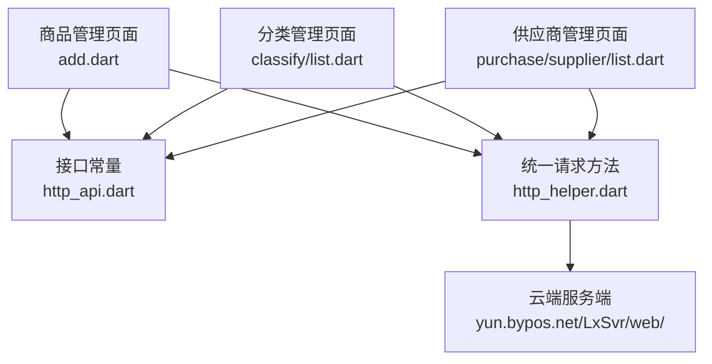
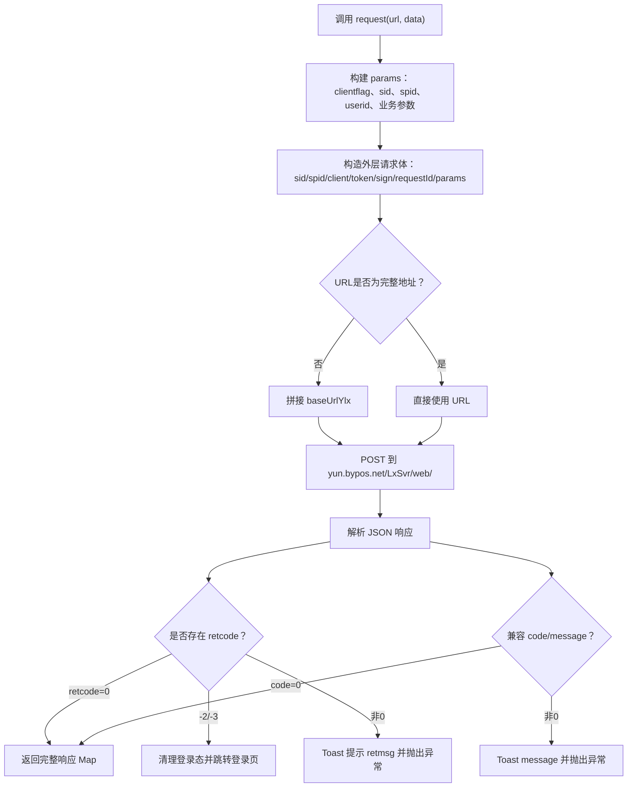
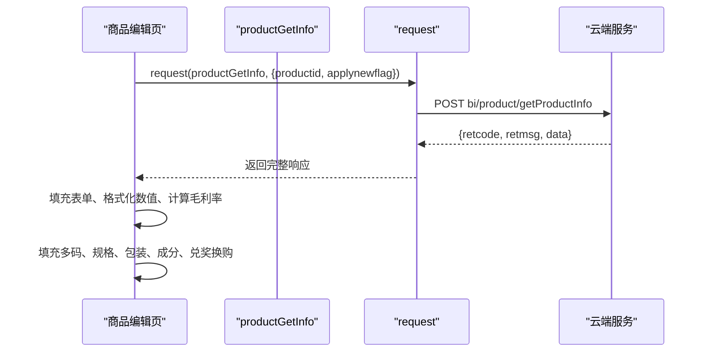
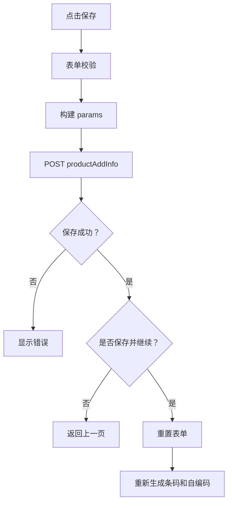
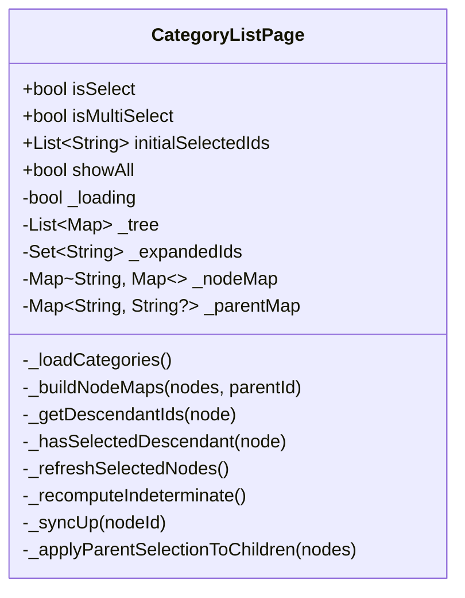
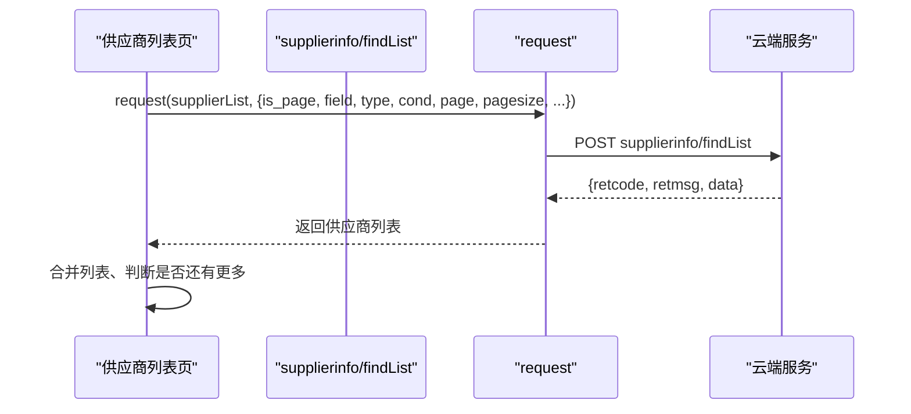
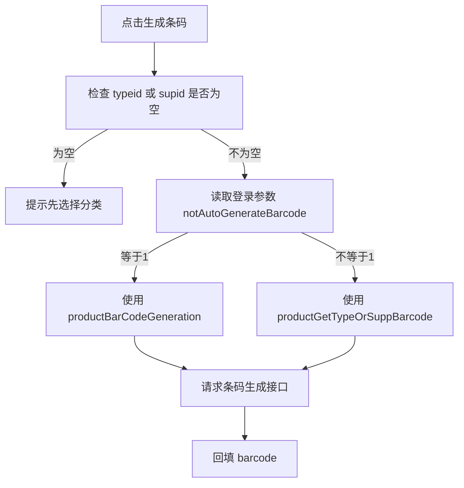
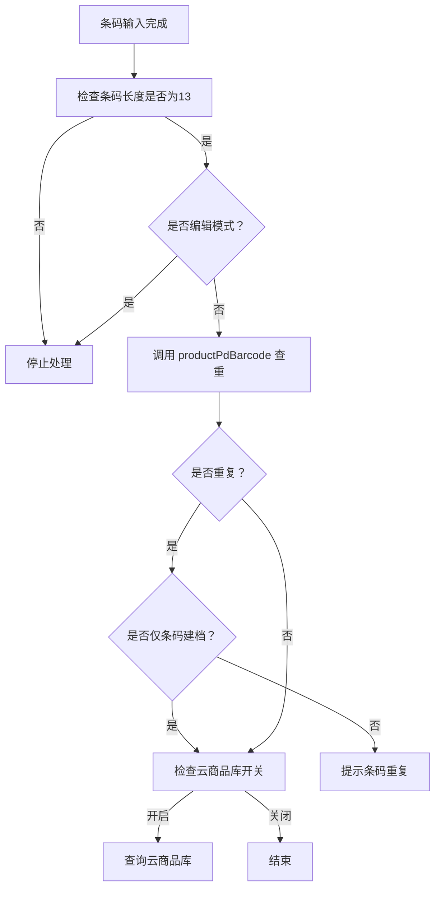
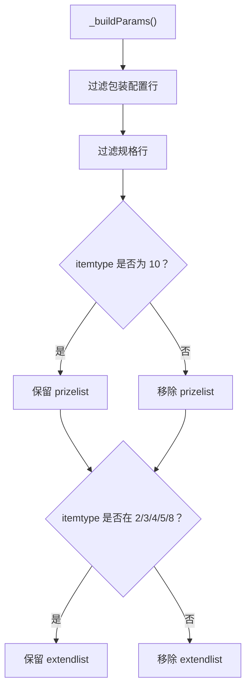

# 基础数据API

<cite>
**本文引用的文件**   
- [lib/net/http_api.dart](file://lib/net/http_api.dart)
- [lib/net/http_helper.dart](file://lib/net/http_helper.dart)
- [lib/pages/business/basis/commodity/add.dart](file://lib/pages/business/basis/commodity/add.dart)
- [lib/pages/business/basis/classify/list.dart](file://lib/pages/business/basis/classify/list.dart)
- [lib/pages/business/purchase/supplier/list.dart](file://lib/pages/business/purchase/supplier/list.dart)
</cite>

## 目录
1. [文档目标与范围](#文档目标与范围)
2. [项目结构定位](#项目结构定位)
3. [核心接口总览](#核心接口总览)
4. [统一请求模型与错误模型](#统一请求模型与错误模型)
5. [商品管理API](#商品管理api)
6. [分类管理API](#分类管理api)
7. [供应商管理API](#供应商管理api)
8. [品牌及其他基础数据](#品牌及其他基础数据)
9. [编码生成规则](#编码生成规则)
10. [条码校验机制](#条码校验机制)
11. [批量操作与关联关系](#批量操作与关联关系)
12. [数据同步、缓存与性能优化](#数据同步缓存与性能优化)
13. [业务场景调用示例](#业务场景调用示例)
14. [常见问题与排错指南](#常见问题与排错指南)
15. [结论](#结论)

## 文档目标与范围
本文面向灵犀管店 Flutter 客户端中的“基础数据”模块，重点记录以下能力：
- 商品管理：商品详情查询、新增/编辑保存、删除、条码重复校验、条码自动生成、自编码生成。
- 分类管理：商品分类树列表加载、选择模式、多级父子联动。
- 供应商管理：供应商分页列表、搜索与筛选。
- 品牌管理：品牌列表接口定义位置及扩展方式。
- 编码生成：商品条码、PLU码、商品自编码、供应商编码。
- 条码校验：本地条码长度校验、后台条码重复校验、云商品库回填开关。
- 批量操作：商品包装配置过滤、规格行过滤、新品申请提交等流程。
- 数据同步策略、缓存机制和性能优化建议：基于现有网络层、权限控制、防抖、分页加载等行为进行说明。

本说明严格依据仓库中实际代码与接口常量推导，不虚构后端字段；若某字段未在仓库中出现，则不会作为必填或返回字段写入。

**章节来源**
- [lib/net/http_api.dart:283-467](file://lib/net/http_api.dart#L283-L467)
- [lib/pages/business/basis/commodity/add.dart:500-700](file://lib/pages/business/basis/commodity/add.dart#L500-L700)
- [lib/pages/business/basis/commodity/add.dart:1200-1645](file://lib/pages/business/basis/commodity/add.dart#L1200-L1645)
- [lib/pages/business/basis/classify/list.dart:1-200](file://lib/pages/business/basis/classify/list.dart#L1-L200)
- [lib/pages/business/purchase/supplier/list.dart:1-200](file://lib/pages/business/purchase/supplier/list.dart#L1-L200)

## 项目结构定位
基础数据在 Flutter 项目中按“功能域 + 页面”组织：
- 网络层集中在 `lib/net/http_api.dart` 与 `lib/net/http_helper.dart`。
- 商品管理集中在 `lib/pages/business/basis/commodity/add.dart`。
- 分类管理集中在 `lib/pages/business/basis/classify/list.dart`。
- 供应商管理集中在 `lib/pages/business/purchase/supplier/list.dart`。
- 品牌、单位、其他基础数据接口以常量形式集中在 `lib/net/http_api.dart`。

**图表来源**
- [lib/net/http_api.dart:1-120](file://lib/net/http_api.dart#L1-L120)
- [lib/net/http_helper.dart:1-120](file://lib/net/http_helper.dart#L1-L120)
- [lib/pages/business/basis/commodity/add.dart:500-700](file://lib/pages/business/basis/commodity/add.dart#L500-L700)
- [lib/pages/business/basis/classify/list.dart:1-120](file://lib/pages/business/basis/classify/list.dart#L1-L120)
- [lib/pages/business/purchase/supplier/list.dart:1-120](file://lib/pages/business/purchase/supplier/list.dart#L1-L120)

**章节来源**
- [lib/net/http_api.dart:1-120](file://lib/net/http_api.dart#L1-L120)
- [lib/net/http_helper.dart:1-120](file://lib/net/http_helper.dart#L1-L120)

## 核心接口总览
| 业务 | 接口常量名 | 接口路径 | 主要用途 | 前端入口 |
|---|---|---|---|---|
| 商品详情 | `productGetInfo` | `bi/product/getProductInfo` | 获取商品完整档案，用于编辑页填充表单 | 商品新增/编辑页详情加载 |
| 新增/保存商品 | `productAddInfo` | `bi/product/addProductInfo` | 新增商品、编辑保存、新品申请保存 | 商品保存按钮 |
| 删除商品 | `productDelInfo` | `bi/product/delProductInfo` | 删除商品 | 商品详情页删除 |
| 条码重复校验 | `productPdBarcode` | `bi/product/pdBarcodeProduct` | 校验条码是否重复、返回已有商品信息 | 条码失焦、回车 |
| 自动生成条码 | `productGetTypeOrSuppBarcode` | `bi/product/getTypeOrSuppBarcode` | 根据分类或供应商生成条码 | 自动生成条码 |
| 条码生成端点切换 | `productBarCodeGeneration` | `bi/product/barCodeGeneration` | 登录参数控制时使用的条码生成接口 | 登录参数为特定值时启用 |
| 自编码生成 | `productGetTypeOfCode` | `bi/product/getTypeOfCode` | 根据分类信息生成商品自编码 | 自编码生成 |
| PLU码生成 | `productGetPlu` | `bi/product/getPlu` | 计价方式为 2/3 时生成 PLU 码 | 价格类型 2/3 时触发 |
| 分类列表 | `typeGetListandCode` | `bi/type/getTypeListandCode` | 获取分类树（含编码），供分类管理与商品选择使用 | 分类管理页 |
| 分类编码 | `getTypeOfCode` | `bi/type/getCode` | 根据 typecode 生成分类编码 | 仅条码建档模式 |
| 供应商列表 | `supplierList` | `supplierinfo/findList` | 分页查询供应商 | 供应商列表页 |
| 品牌列表 | `brandList` | `bi/brand/getBrandList` | 获取品牌列表 | 品牌选择组件 |
| 分类树增删改 | `typeAddTypeInfo` / `typeUpdateTypeInfo` / `typeDelTypeInfo` | `bi/type/addTypeInfo` / `updateTypeInfo` / `delTypeInfo` | 分类树的维护 | 分类管理页 |
| 分类编码获取 | `typeGetCode` | `bi/type/getCode` | 获取分类编码 | 分类管理页 |

上述接口均通过 `HttpApi` 常量集中声明，并由 `request` 方法统一封装。

**章节来源**
- [lib/net/http_api.dart:283-467](file://lib/net/http_api.dart#L283-L467)
- [lib/pages/business/basis/classify/list.dart:70-90](file://lib/pages/business/basis/classify/list.dart#L70-L90)
- [lib/pages/business/purchase/supplier/list.dart:60-100](file://lib/pages/business/purchase/supplier/list.dart#L60-L100)

## 统一请求模型与错误模型
### 请求模型
所有业务接口通过 `request(url, data)` 发起，默认 POST，外层请求体包含公共参数与业务参数两层结构：
- 外层公共参数：`sid`、`spid`、`client`、`token`、`sign`、`requestId`。
- 内层 `params`：默认包含 `clientflag=1`、门店标识、用户标识以及业务参数。
- `client` 固定为 `WEBAPP`。
- 如果传入的 `data` 是字符串等非 Map 类型，会直接作为 `params` 原始值透传，例如删除商品时传商品ID。

**图表来源**
- [lib/net/http_helper.dart:1-180](file://lib/net/http_helper.dart#L1-L180)

### 错误模型
- 成功：`retcode == 0` 或兼容格式下 `code == 0`。
- 登录失效：`retcode == -2` 或 `-3`，清除本地缓存并跳转登录页。
- 业务失败：显示 `retmsg` 或 `message`，并抛出 `_ApiException`。
- 网络异常：提取 Dio 响应中的真实错误信息，避免只显示“网络请求异常”。

**章节来源**
- [lib/net/http_helper.dart:1-200](file://lib/net/http_helper.dart#L1-L200)

## 商品管理API

### 商品详情接口
- **接口名称**：`productGetInfo`
- **接口路径**：`bi/product/getProductInfo`
- **请求方式**：POST
- **请求参数**：
  - `productid`：商品ID，来自编辑页传入的 `productData['productid']`。
  - `applynewflag`：新品申请标记，可选，来自页面状态。
- **返回结构**：
  - 外层包含 `retcode`、`retmsg`、`data`。
  - `data` 为商品完整档案，包括商品基本信息、图片、条码、分类、供应商、价格、库存、包装、规格、成分、兑奖换购等字段。
- **前端处理逻辑**：
  - 加载详情后填充 `_form`。
  - 兼容 `name` 与 `productname` 双字段。
  - 将数值字段按 1 位或 2 位小数格式化。
  - 重新计算毛利率。
  - 填充多码、规格、包装单位、包装配置、成分、兑奖换购明细。
  - 同步 Tab 控制器数量。

**图表来源**
- [lib/pages/business/basis/commodity/add.dart:500-700](file://lib/pages/business/basis/commodity/add.dart#L500-L700)
- [lib/net/http_api.dart:340-360](file://lib/net/http_api.dart#L340-L360)

### 新增/保存商品接口
- **接口名称**：`productAddInfo`
- **接口路径**：`bi/product/addProductInfo`
- **请求方式**：POST
- **请求参数**：
  - 由 `_buildParams()` 组装，包含商品基本字段、价格、库存、包装、规格、成分、兑奖换购等。
  - 特殊字段：
    - `packpage`：包装单位列表。
    - `packlinkpro`：包装配置，仅提交已关联商品的行。
    - `sizedata`：规格列表，仅提交有 `sbarcode` 的行。
    - `prizelist`：兑奖换购明细，仅在 `itemtype==10` 时提交。
    - `extendlist`：成分明细，仅在 `itemtype` 为 2/3/4/5/8 时提交。
    - `applynewflag`：新品申请标记，提交申请时为 1。
- **返回结构**：
  - 成功时 `data` 可能包含新生成的 `productid`，用于新品申请后续提交。
- **前端处理逻辑**：
  - 普通保存成功后返回上一页。
  - “保存并继续”会重置表单并重新生成条码与自编码。
  - 新品申请保存成功后再调用申请状态更新接口。

**图表来源**
- [lib/pages/business/basis/commodity/add.dart:1200-1300](file://lib/pages/business/basis/commodity/add.dart#L1200-L1300)
- [lib/pages/business/basis/commodity/add.dart:1580-1645](file://lib/pages/business/basis/commodity/add.dart#L1580-L1645)

### 删除商品接口
- **接口名称**：`productDelInfo`
- **接口路径**：`bi/product/delProductInfo`
- **请求方式**：POST
- **请求参数**：
  - 直接传商品ID字符串，由 `request` 的非 Map 透传逻辑处理。
- **前端处理逻辑**：
  - 弹出确认对话框。
  - 权限校验通过后调用删除接口。
  - 成功后返回上一页。

**章节来源**
- [lib/pages/business/basis/commodity/add.dart:1320-1400](file://lib/pages/business/basis/commodity/add.dart#L1320-L1400)
- [lib/net/http_helper.dart:60-120](file://lib/net/http_helper.dart#L60-L120)

## 分类管理API

### 分类列表接口
- **接口名称**：`typeGetListandCode`
- **接口路径**：`bi/type/getTypeListandCode`
- **请求方式**：POST
- **请求参数**：
  - `field`：排序字段，分类页传 `typeid`。
  - `is_page`：是否分页，分类页传 0。
- **返回结构**：
  - `data.children` 为分类树数组。
  - 节点包含 `typeid`、`name`、`typename`、`typecode`、`code`、`children` 等。
- **前端处理逻辑**：
  - 权限校验通过后加载分类树。
  - 构建节点映射和父级映射。
  - 支持多选时的父子级联选中、半选状态、全选状态。
  - 支持搜索过滤，按名称或编码匹配。

**图表来源**
- [lib/pages/business/basis/classify/list.dart:1-200](file://lib/pages/business/basis/classify/list.dart#L1-L200)

**章节来源**
- [lib/pages/business/basis/classify/list.dart:70-120](file://lib/pages/business/basis/classify/list.dart#L70-L120)
- [lib/net/http_api.dart:30-40](file://lib/net/http_api.dart#L30-L40)

## 供应商管理API

### 供应商列表接口
- **接口名称**：`supplierList`
- **接口路径**：`supplierinfo/findList`
- **请求方式**：POST
- **请求参数**：
  - `is_page`：是否分页，传 1。
  - `field`：排序字段，传 `name`。
  - `type`：排序方向，传 `asc`。
  - `cond`：搜索关键词。
  - `page`、`pagesize`：分页参数。
  - `typename`、`suptype`、`stopflag`、`supselltype`：筛选条件。
  - `notwx`：固定传 1。
- **返回结构**：
  - `data.list` 为供应商列表数组。
- **前端处理逻辑**：
  - 权限校验通过后加载数据。
  - 支持下拉加载更多。
  - 搜索框输入防抖 500ms。
  - 提供底部抽屉筛选器。

**图表来源**
- [lib/pages/business/purchase/supplier/list.dart:60-120](file://lib/pages/business/purchase/supplier/list.dart#L60-L120)

**章节来源**
- [lib/pages/business/purchase/supplier/list.dart:60-120](file://lib/pages/business/purchase/supplier/list.dart#L60-L120)
- [lib/net/http_api.dart:370-390](file://lib/net/http_api.dart#L370-L390)

## 品牌及其他基础数据

### 品牌列表
- **接口名称**：`brandList`
- **接口路径**：`bi/brand/getBrandList`
- **用途**：品牌选择组件可调用该接口获取品牌列表。
- **注意**：当前仓库未提供品牌页面对应实现，但接口常量已存在，可作为品牌基础数据的扩展点。

### 其他基础数据接口
- 单位列表：`unitGetList`，路径 `bi/unit/getUnitList`。
- 通用数据查询：`otherdataGetList`，路径 `bi/otherdata/getList`。
- 分类树增删改：`typeAddTypeInfo`、`typeUpdateTypeInfo`、`typeDelTypeInfo`。
- 分类编码：`typeGetCode`。

这些接口适合用于商品新增页的下拉选项加载、分类维护、基础字典数据加载等场景。

**章节来源**
- [lib/net/http_api.dart:30-40](file://lib/net/http_api.dart#L30-L40)
- [lib/net/http_api.dart:340-360](file://lib/net/http_api.dart#L340-L360)

## 编码生成规则

### 商品条码生成
- **主接口**：`productGetTypeOrSuppBarcode`
- **切换接口**：`productBarCodeGeneration`
- **触发条件**：
  - 必须选择商品分类或供应商。
  - 自动调用模式下，若已有条码则跳过。
  - 登录参数 `notAutoGenerateBarcode==1` 时切换到 `productBarCodeGeneration`。
- **参数**：
  - `type=1`。
  - `value`：分类编码。
  - 切换模式下额外传入 `typeid`、`code`。

**图表来源**
- [lib/pages/business/basis/commodity/add.dart:3500-3550](file://lib/pages/business/basis/commodity/add.dart#L3500-L3550)

### 商品自编码生成
- **接口**：`productGetTypeOfCode`
- **触发条件**：
  - 正常计价方式（非价格类型 2/3）。
  - 已选择分类。
- **参数**：
  - `type=1`。
  - `value`：分类编码。
  - `typeid`：分类ID。
  - `code`：当前自编码。
- **价格类型 2/3 的特殊逻辑**：
  - 优先调用 `productGetPlu` 生成 PLU 码。
  - 价格类型为 2 且无单位时默认单位为 KG。

**章节来源**
- [lib/pages/business/basis/commodity/add.dart:3730-3780](file://lib/pages/business/basis/commodity/add.dart#L3730-L3780)
- [lib/net/http_api.dart:340-360](file://lib/net/http_api.dart#L340-L360)

### 供应商编码生成
- **接口**：`supplierGenerateCode`
- **路径**：`supplierinfo/generateCode`
- **用途**：供应商新增页可调用该接口生成供应商编码。
- **注意**：仓库中供应商列表页未展示具体生成逻辑，但接口常量已存在。

**章节来源**
- [lib/net/http_api.dart:380-390](file://lib/net/http_api.dart#L380-L390)

## 条码校验机制

### 本地条码长度校验
- 扫码结果为 13 位时才允许继续处理。
- 非 13 位条码会提示“请扫描13位条码”。

### 后台条码重复校验
- **接口**：`productPdBarcode`
- **路径**：`bi/product/pdBarcodeProduct`
- **触发时机**：
  - 条码回车。
  - 条码失焦。
- **逻辑**：
  - 仅新增商品时校验。
  - 若登录参数 `codeOnlyBarcodeRecord==1`，则跳过重复判断。
  - 若检测到重复条码，提示“商品条码重复，请修改”，或弹出重复商品选择弹窗。
  - 若开启云商品库，则进一步尝试云商品库信息回填。

**图表来源**
- [lib/pages/business/basis/commodity/add.dart:3580-3650](file://lib/pages/business/basis/commodity/add.dart#L3580-L3650)

**章节来源**
- [lib/pages/business/basis/commodity/add.dart:3580-3650](file://lib/pages/business/basis/commodity/add.dart#L3580-L3650)
- [lib/net/http_api.dart:350-360](file://lib/net/http_api.dart#L350-L360)

## 批量操作与关联关系

### 商品包装配置批量过滤
- 提交时仅保留已关联商品的包装配置行。
- 规格行仅保留有 `sbarcode` 的行。
- 兑奖换购明细仅在 `itemtype==10` 时提交。
- 成分明细仅在 `itemtype` 为 2/3/4/5/8 时提交。

### 新品申请批量操作
- 新品申请保存成功后，使用返回的 `productid` 调用申请状态更新接口。
- 支持撤回、审核、驳回等操作，对应不同权限标识。

**图表来源**
- [lib/pages/business/basis/commodity/add.dart:1200-1280](file://lib/pages/business/basis/commodity/add.dart#L1200-L1280)

**章节来源**
- [lib/pages/business/basis/commodity/add.dart:1200-1280](file://lib/pages/business/basis/commodity/add.dart#L1200-L1280)
- [lib/pages/business/basis/commodity/add.dart:1580-1645](file://lib/pages/business/basis/commodity/add.dart#L1580-L1645)

## 数据同步、缓存与性能优化

### 数据同步策略
- 登录相关数据：系统参数、员工门店权限、推送设备绑定等在启动或登录后刷新。
- 基础数据：分类、品牌、单位、供应商等通过各自列表接口按需加载。
- 商品数据：详情接口用于编辑页填充，列表接口用于商品列表、ABC分析、库存分析等。

### 缓存机制
- 登录态：token、store、user 从本地存储读取。
- 登录参数配置：`loginParamResp` 影响条码生成、云商品库开关、仅条码建档模式。
- 权限配置：通过权限工具类判断页面可见性和操作权限。

### 性能优化建议
- 列表页已实现分页加载和滚动加载更多。
- 搜索框使用防抖减少频繁请求。
- 分类页构建节点映射和父级映射，提升父子级联性能。
- 商品表单使用中心 `_form` 对象，避免逐字段手动收集。
- 数值字段按位数格式化，减少后端处理压力。
- 批量提交前过滤无效行，减少无效数据传输。

**章节来源**
- [lib/net/http_helper.dart:1-120](file://lib/net/http_helper.dart#L1-L120)
- [lib/pages/business/basis/classify/list.dart:70-120](file://lib/pages/business/basis/classify/list.dart#L70-L120)
- [lib/pages/business/purchase/supplier/list.dart:60-120](file://lib/pages/business/purchase/supplier/list.dart#L60-L120)

## 业务场景调用示例

### 场景一：新增商品并生成条码
1. 进入商品新增页。
2. 选择商品分类。
3. 点击“生成条码”，调用 `productGetTypeOrSuppBarcode` 或 `productBarCodeGeneration`。
4. 填写商品名称、供应商、价格等信息。
5. 点击“保存”，调用 `productAddInfo`。
6. 如需继续新增，点击“保存并继续”，表单重置并重新生成条码和自编码。

**章节来源**
- [lib/pages/business/basis/commodity/add.dart:3500-3550](file://lib/pages/business/basis/commodity/add.dart#L3500-L3550)
- [lib/pages/business/basis/commodity/add.dart:1240-1280](file://lib/pages/business/basis/commodity/add.dart#L1240-L1280)

### 场景二：编辑商品详情
1. 从商品列表点击进入编辑页。
2. 调用 `productGetInfo` 加载商品详情。
3. 页面填充表单、格式化数值、计算毛利率。
4. 修改后点击“保存”，调用 `productAddInfo`。

**章节来源**
- [lib/pages/business/basis/commodity/add.dart:500-700](file://lib/pages/business/basis/commodity/add.dart#L500-L700)
- [lib/pages/business/basis/commodity/add.dart:1240-1280](file://lib/pages/business/basis/commodity/add.dart#L1240-L1280)

### 场景三：分类选择与多选
1. 打开分类选择页。
2. 调用 `typeGetListandCode` 获取分类树。
3. 支持父子级联选中、半选、全选。
4. 支持搜索过滤。
5. 确认后返回选中的分类ID集合。

**章节来源**
- [lib/pages/business/basis/classify/list.dart:70-120](file://lib/pages/business/basis/classify/list.dart#L70-L120)

### 场景四：供应商搜索与筛选
1. 打开供应商列表页。
2. 调用 `supplierinfo/findList` 获取分页数据。
3. 输入关键词触发搜索，防抖 500ms。
4. 下拉加载更多。
5. 使用底部抽屉进行多维度筛选。

**章节来源**
- [lib/pages/business/purchase/supplier/list.dart:60-120](file://lib/pages/business/purchase/supplier/list.dart#L60-L120)

## 常见问题与排错指南

### 问题一：接口返回登录失效
- **现象**：多次调用接口后跳转到登录页。
- **原因**：`retcode == -2` 或 `-3`。
- **处理**：清除本地缓存，跳转登录页。

### 问题二：条码重复提示
- **现象**：输入条码后提示“商品条码重复，请修改”。
- **原因**：`productPdBarcode` 返回重复条码。
- **处理**：修改条码或启用仅条码建档模式。

### 问题三：分类无法加载
- **现象**：分类页空白或报错。
- **原因**：权限不足或接口返回异常。
- **处理**：检查权限标识 `010101`，确认接口返回结构。

### 问题四：供应商列表无数据
- **现象**：供应商列表为空。
- **原因**：搜索条件过严或后端无数据。
- **处理**：清空筛选条件，重试加载。

**章节来源**
- [lib/net/http_helper.dart:120-200](file://lib/net/http_helper.dart#L120-L200)
- [lib/pages/business/basis/commodity/add.dart:3580-3650](file://lib/pages/business/basis/commodity/add.dart#L3580-L3650)
- [lib/pages/business/basis/classify/list.dart:70-90](file://lib/pages/business/basis/classify/list.dart#L70-L90)
- [lib/pages/business/purchase/supplier/list.dart:60-120](file://lib/pages/business/purchase/supplier/list.dart#L60-L120)

## 结论
灵犀管店 Flutter 项目的基础数据API以 `HttpApi` 常量为中心，通过 `request` 方法统一封装请求、错误处理和日志记录。商品、分类、供应商等基础数据页面分别实现各自的列表、详情、新增、编辑、删除逻辑，并在条码生成、条码校验、编码生成等方面与后端保持一致。

对于后续扩展：
- 品牌管理可基于 `bi/brand/getBrandList` 补充品牌选择组件。
- 分类管理可继续使用 `bi/type/*` 系列接口完善分类树维护。
- 商品管理可继续沿用现有 `bi/product/*` 接口扩展更多业务字段。
- 数据同步和缓存机制可结合登录参数配置进一步优化用户体验。