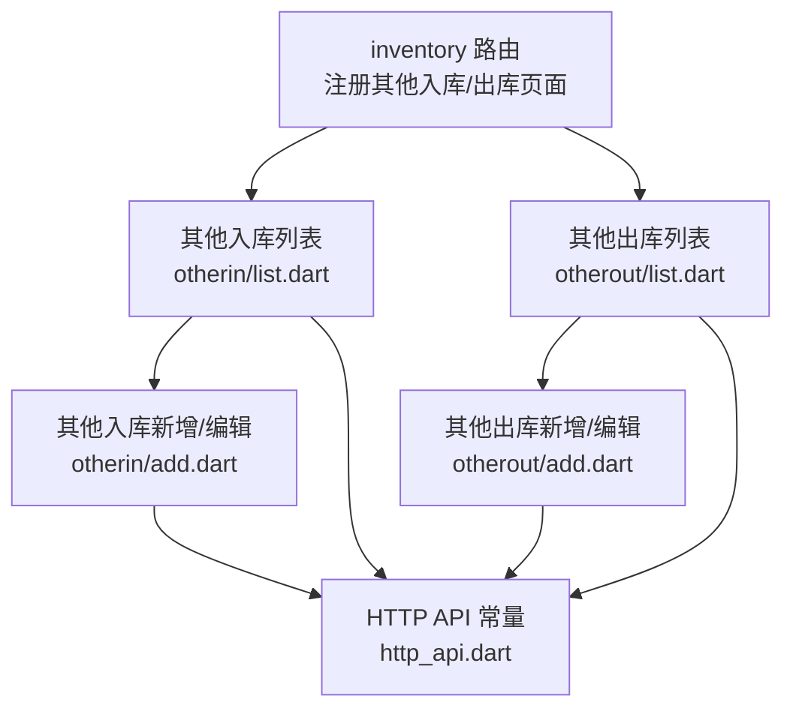
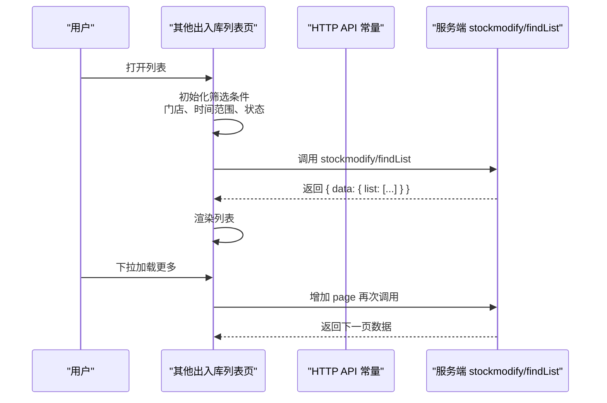
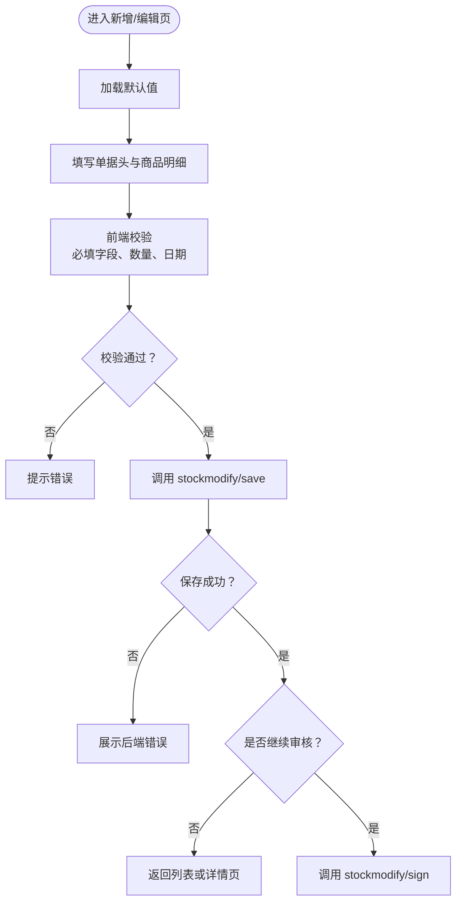
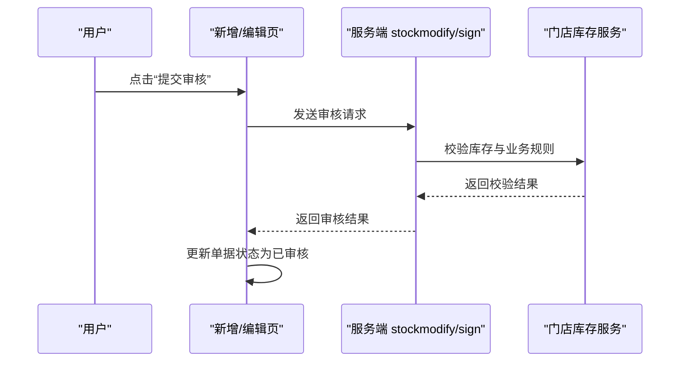
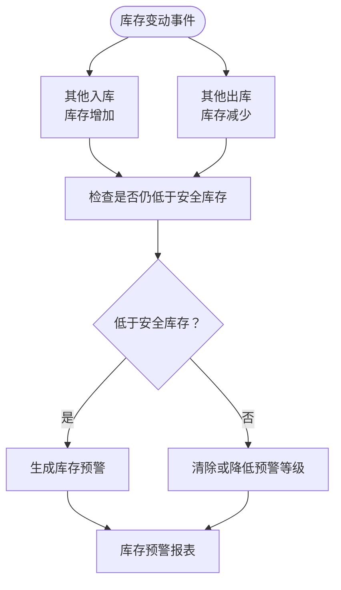
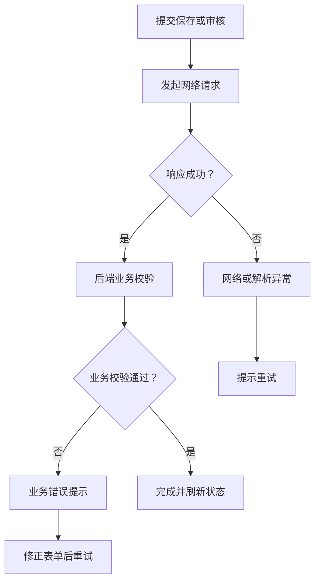
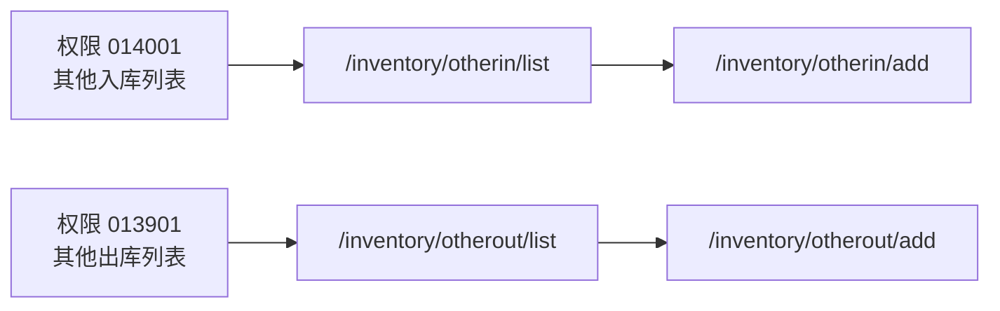

# 其他出入库API

<cite>
**本文引用的文件**   
- [lib/net/http_api.dart](file://lib/net/http_api.dart)
- [lib/pages/business/inventory/otherin/list.dart](file://lib/pages/business/inventory/otherin/list.dart)
- [lib/pages/business/inventory/otherout/list.dart](file://lib/pages/business/inventory/otherout/list.dart)
- [lib/pages/business/inventory/otherin/add.dart](file://lib/pages/business/inventory/otherin/add.dart)
- [lib/pages/business/inventory/otherout/add.dart](file://lib/pages/business/inventory/otherout/add.dart)
- [lib/pages/business/inventory/router.dart](file://lib/pages/business/inventory/router.dart)
</cite>

## 目录
1. [引言](#引言)
2. [项目结构与入口](#项目结构与入口)
3. [接口总览](#接口总览)
4. [请求与返回约定](#请求与返回约定)
5. [其他出入库列表 stockmodify/findList](#其他出入库列表-stockmodifyfindlist)
6. [新增与编辑 stockmodify/save](#新增与编辑-stockmodifysave)
7. [审核 stockmodify/sign](#审核-stockmodifysign)
8. [反审核 stockmodify/resign](#反审核-stockmodifyresign)
9. [入库单字段定义与业务规则](#入库单字段定义与业务规则)
10. [出库单字段定义与业务规则](#出库单字段定义与业务规则)
11. [批次管理、有效期控制与库存预警](#批次管理有效期控制与库存预警)
12. [完整业务流程示例](#完整业务流程示例)
13. [异常处理策略](#异常处理策略)
14. [数据一致性保证方案](#数据一致性保证方案)
15. [性能与可维护性建议](#性能与可维护性建议)
16. [附录：路由与权限映射](#附录路由与权限映射)

## 引言
本文面向灵犀管店 Flutter 客户端中与“其他出入库”相关的代码实现，整理并扩展出后端 `stockmodify` 系列接口的完整规范。重点覆盖：
- `stockmodify/findList`：其他入库单与其他出库单列表查询。
- `stockmodify/save`：新增或编辑其他出入库单据。
- `stockmodify/sign`：提交审核。
- `stockmodify/resign`：反审核（撤销已审核状态）。

文档同时说明入库单与出库单的字段结构、业务规则、库存变动逻辑，以及批次管理、有效期控制和库存预警的触发机制，并提供完整的操作步骤和异常处理方案。

## 项目结构与入口
其他出入库功能由以下 Flutter 模块共同构成：
- 接口常量集中定义在 HTTP API 常量类中。
- 列表页分别位于其他入库和其他出库目录下。
- 新增/编辑页分别位于对应 add.dart 文件中。
- 路由通过 inventory 子路由注册。

**图表来源**
- [lib/pages/business/inventory/router.dart:8-30](file://lib/pages/business/inventory/router.dart#L8-L30)
- [lib/pages/business/inventory/otherin/list.dart:1-10](file://lib/pages/business/inventory/otherin/list.dart#L1-L10)
- [lib/pages/business/inventory/otherout/list.dart:1-10](file://lib/pages/business/inventory/otherout/list.dart#L1-L10)
- [lib/pages/business/inventory/otherin/add.dart:1-10](file://lib/pages/business/inventory/otherin/add.dart#L1-L10)
- [lib/pages/business/inventory/otherout/add.dart:1-10](file://lib/pages/business/inventory/otherout/add.dart#L1-L10)
- [lib/net/http_api.dart:400-425](file://lib/net/http_api.dart#L400-L425)

**章节来源**
- [lib/pages/business/inventory/router.dart:8-30](file://lib/pages/business/inventory/router.dart#L8-L30)

## 接口总览
Flutter 端将其他出入库相关接口集中在 `HttpApi` 常量类中，统一以 `stockmodify` 前缀命名：

| 接口名称 | 常量名 | 用途 | 主要调用方 |
|---|---|---|---|
| 其他出入库列表 | `stockModifyFindList` | 查询其他入库单与其他出库单列表 | otherin/list.dart、otherout/list.dart |
| 其他出入库详情 | `stockModifyGetInfo` | 加载单据详情用于新增/编辑 | otherin/add.dart、otherout/add.dart |
| 其他出入库保存 | `stockModifySave` | 新增或编辑其他出入库单据 | otherin/add.dart、otherout/add.dart |
| 其他出入库审核 | `stockModifySign` | 提交审核或撤回审核 | otherin/add.dart、otherout/add.dart |
| 其他出入库删除 | `stockModifyDelBill` | 删除单据（常量存在） | 未在本文档当前片段中直接调用 |
| 其他出入库反审核 | `stockModifyResign` | 反审核单据（常量存在） | 未在本文档当前片段中直接调用 |

上述常量定义位置如下：

**章节来源**
- [lib/net/http_api.dart:400-425](file://lib/net/http_api.dart#L400-L425)

## 请求与返回约定
从 Flutter 端调用方式可以看出，通用网络层使用统一的 `request` 方法发起请求，参数为接口常量键与 JSON 参数对象；成功时回调中的 `result` 包含业务结果，列表页通常读取 `result['data']`，详情页也读取 `result['data']`。

### 通用约定
- 请求方法：HTTP 层封装后统一为 POST/GET 调用，具体由 `http_helper.dart` 决定，Flutter 端只关心业务路径和参数。
- 成功响应结构：
  - `result['code']`：业务码（Flutter 端常见校验逻辑会基于此判断是否成功）。
  - `result['message']`：提示信息。
  - `result['data']`：业务数据。
- 列表数据：`result['data']['list']`。
- 详情数据：`result['data']` 为单据对象。

### 分页约定
列表查询默认携带：
- `is_page: 1`
- `field: 'createtime'`
- `type: 'desc'`
- `page`：当前页码。
- `billno`：单号模糊搜索。
- `datetype: '1'`
- `starttime` / `endtime`：时间范围字符串。
- `signflag`：审核状态筛选。
- `sids`：门店 ID 列表。

**章节来源**
- [lib/pages/business/inventory/otherin/list.dart:96-148](file://lib/pages/business/inventory/otherin/list.dart#L96-L148)
- [lib/pages/business/inventory/otherout/list.dart:140-190](file://lib/pages/business/inventory/otherout/list.dart#L140-L190)

## 其他出入库列表 stockmodify/findList

### 接口定位
`stockmodify/findList` 是其他入库单与其他出库单共享的列表查询接口。Flutter 端两个列表页都调用该接口，但传入的业务筛选条件不同。

### 其他入库单列表参数
其他入库单列表固定筛选：
- `outtype: 2`
- `billtypes: [4]`

此外支持：
- `signflag`：待审核、已审核、已驳回等状态。
- `billno`：单号搜索。
- `sids`：门店过滤。
- `starttime` / `endtime`：创建时间范围。
- `createid` / `counterid`：制单人、仓库过滤。

### 其他出库单列表参数
其他出库单列表支持按“单据类型”筛选：
- 全部：`billtypes: [1, 2, 4]`
- 报损：`billtypes: [1]`
- 领用：`billtypes: [2]`
- 其他出库：`billtypes: [4]`，并且附加 `outtype: 1`

同样支持：
- `signflag`
- `billno`
- `sids`
- `starttime` / `endtime`
- `createid` / `counterid`

### 列表数据模型
列表项来自 `result['data']['list']`，每条记录至少包含：
- 单号
- 门店信息
- 仓库信息
- 单据类型
- 审核状态
- 创建时间
- 制单人
- 商品明细条数

Flutter 端根据 `signflag` 显示“待审核”“已审核”“已驳回”三种状态。

### 列表交互流程

**图表来源**
- [lib/pages/business/inventory/otherin/list.dart:96-148](file://lib/pages/business/inventory/otherin/list.dart#L96-L148)
- [lib/pages/business/inventory/otherout/list.dart:140-190](file://lib/pages/business/inventory/otherout/list.dart#L140-L190)

**章节来源**
- [lib/pages/business/inventory/otherin/list.dart:96-148](file://lib/pages/business/inventory/otherin/list.dart#L96-L148)
- [lib/pages/business/inventory/otherout/list.dart:140-190](file://lib/pages/business/inventory/otherout/list.dart#L140-L190)

## 新增与编辑 stockmodify/save

### 接口定位
`stockmodify/save` 负责其他出入库单据的新增和编辑。Flutter 端在新增页和编辑页都会组装表单数据，然后调用该接口。

### 其他入库单保存参数
其他入库单保存时固定：
- `billtype: 4`
- `outtype: 2`
- `billtypeid: '0803'`

基础字段包括：
- 门店 ID、门店名称
- 仓库 ID、仓库名称
- 经办人 ID、经办人姓名
- 备注
- 附件列表
- 商品明细列表

商品明细一般包含：
- 商品编码
- 商品名称
- 数量
- 批次日期
- 有效期
- 货架编号
- 单位
- 单价
- 金额
- 批号
- 辅助数量
- 其他扩展字段

### 其他出库单保存参数
其他出库单保存时：
- `billtype`：根据单据类型动态设置，默认为 4。
- `outtype`：当 `billtype == 4` 时为 `1`；否则为 `0`。
- `billtypeid`：其他出库场景使用 `'0802'`。

基础字段包括：
- 门店 ID、门店名称
- 仓库 ID、仓库名称
- 单据类型
- 收货人 ID、收货人姓名
- 经办人 ID、经办人姓名
- 备注
- 附件列表
- 商品明细列表

商品明细字段与其他入库类似，但业务含义是减少库存。

### 保存流程

**图表来源**
- [lib/pages/business/inventory/otherin/add.dart:320-382](file://lib/pages/business/inventory/otherin/add.dart#L320-L382)
- [lib/pages/business/inventory/otherout/add.dart:335-401](file://lib/pages/business/inventory/otherout/add.dart#L335-L401)

**章节来源**
- [lib/pages/business/inventory/otherin/add.dart:320-382](file://lib/pages/business/inventory/otherin/add.dart#L320-L382)
- [lib/pages/business/inventory/otherout/add.dart:335-401](file://lib/pages/business/inventory/otherout/add.dart#L335-L401)

## 审核 stockmodify/sign

### 接口定位
`stockModifySign` 在 Flutter 端既用于“提交审核”，也用于部分场景下的“撤回审核”。审核操作需要单据处于可审核状态。

### 其他入库单审核参数
其他入库单审核参数包含：
- 单据 ID
- 门店 ID
- 仓库 ID
- 经办人 ID、姓名
- 备注
- 单据类型
- 出库类型
- 单据类型编码
- 商品明细
- 附件
- 审批流信息

### 其他出库单审核参数
其他出库单审核参数与其他入库单类似，区别在于：
- `billtype` 可能为 1、2、4。
- `outtype` 根据 `billtype` 计算。
- `billtypeid` 使用其他出库对应的编码。

### 审核流程

**图表来源**
- [lib/pages/business/inventory/otherin/add.dart:447-470](file://lib/pages/business/inventory/otherin/add.dart#L447-L470)
- [lib/pages/business/inventory/otherout/add.dart:466-493](file://lib/pages/business/inventory/otherout/add.dart#L466-L493)

**章节来源**
- [lib/pages/business/inventory/otherin/add.dart:447-470](file://lib/pages/business/inventory/otherin/add.dart#L447-L470)
- [lib/pages/business/inventory/otherout/add.dart:466-493](file://lib/pages/business/inventory/otherout/add.dart#L466-L493)

## 反审核 stockmodify/resign

### 接口定位
`stockModifyResign` 在 `HttpApi` 中已声明，表示其他出入库单据的反审核能力。不过在当前分析片段中，Flutter 端新增/编辑页没有直接使用 `stockModifyResign`，而是复用 `stockModifySign` 进行某些撤回逻辑。因此，严格来说：
- 常量存在：`stockmodify/resign`。
- 列表页与新增/编辑页当前未直接调用该常量。
- 实际反审核行为可能由后端统一处理，或后续版本接入。

### 反审核语义
- 适用于已审核的其他出入库单据。
- 反审核后单据回到可编辑状态。
- 反审核可能触发库存回滚，需由后端保证事务一致性。

**章节来源**
- [lib/net/http_api.dart:400-425](file://lib/net/http_api.dart#L400-L425)
- [lib/pages/business/inventory/otherin/add.dart:625-635](file://lib/pages/business/inventory/otherin/add.dart#L625-L635)
- [lib/pages/business/inventory/otherout/add.dart:644-654](file://lib/pages/business/inventory/otherout/add.dart#L644-L654)

## 入库单字段定义与业务规则

### 单据头字段
| 字段 | 类型 | 必填 | 说明 |
|---|---|---:|---|
| 门店 ID | 字符串或数字 | 是 | 当前登录门店或选择门店 |
| 门店名称 | 字符串 | 否 | 展示用 |
| 仓库 ID | 字符串或数字 | 是 | 其他入库目标仓库 |
| 仓库名称 | 字符串 | 否 | 展示用 |
| 经办人 ID | 字符串或数字 | 是 | 业务经办人 |
| 经办人姓名 | 字符串 | 否 | 展示用 |
| 备注 | 字符串 | 否 | 业务说明 |
| 附件列表 | 数组 | 否 | 图片、凭证等附件 |
| 单据类型 | 数字 | 是 | 其他入库固定为 4 |
| 出库类型 | 数字 | 是 | 其他入库固定为 2 |
| 单据类型编码 | 字符串 | 是 | 其他入库使用 `0803` |

### 商品明细字段
| 字段 | 类型 | 必填 | 说明 |
|---|---|---:|---|
| 商品编码 | 字符串 | 是 | 唯一标识商品 |
| 商品名称 | 字符串 | 否 | 展示用 |
| 数量 | 数字 | 是 | 入库数量，必须大于 0 |
| 批次日期 | 日期字符串 | 视配置而定 | 批次生产日期 |
| 有效期 | 日期字符串 | 视配置而定 | 到期日 |
| 货架编号 | 字符串 | 否 | 仓库货架位 |
| 单位 | 字符串 | 是 | 计量单位 |
| 单价 | 数字 | 否 | 成本价或参考单价 |
| 金额 | 数字 | 否 | 数量乘以单价 |
| 批号 | 字符串 | 视配置而定 | 批次编号 |
| 辅助数量 | 数字 | 否 | 辅助单位换算 |

### 入库业务规则
1. 仓库不能为空。
2. 商品不能为空。
3. 数量必须大于 0。
4. 若启用批次管理，批次日期和有效期应满足业务规则。
5. 审核通过后，对应仓库中该商品库存增加。
6. 若商品启用了有效期控制，系统可根据有效期生成预警。
7. 若商品当前库存低于安全库存，系统可触发库存预警。

**章节来源**
- [lib/pages/business/inventory/otherin/add.dart:320-382](file://lib/pages/business/inventory/otherin/add.dart#L320-L382)
- [lib/pages/business/inventory/otherin/add.dart:796-857](file://lib/pages/business/inventory/otherin/add.dart#L796-L857)
- [lib/pages/business/inventory/otherin/add.dart:933-974](file://lib/pages/business/inventory/otherin/add.dart#L933-L974)

## 出库单字段定义与业务规则

### 单据头字段
| 字段 | 类型 | 必填 | 说明 |
|---|---|---:|---|
| 门店 ID | 字符串或数字 | 是 | 当前登录门店或选择门店 |
| 门店名称 | 字符串 | 否 | 展示用 |
| 仓库 ID | 字符串或数字 | 是 | 其他出库目标仓库 |
| 仓库名称 | 字符串 | 否 | 展示用 |
| 单据类型 | 数字 | 是 | 报损、领用、其他出库等 |
| 收货人 ID | 字符串或数字 | 视单据类型而定 | 领用人或接收方 |
| 收货人姓名 | 字符串 | 否 | 展示用 |
| 经办人 ID | 字符串或数字 | 是 | 业务经办人 |
| 经办人姓名 | 字符串 | 否 | 展示用 |
| 备注 | 字符串 | 否 | 业务说明 |
| 附件列表 | 数组 | 否 | 图片、凭证等附件 |
| 出库类型 | 数字 | 是 | 其他出库通常为 1；非其他出库为 0 |
| 单据类型编码 | 字符串 | 是 | 其他出库使用 `0802` |

### 商品明细字段
出库单商品明细字段与入库单基本一致，区别在于：
- 数量为出库数量。
- 审核通过后，对应仓库中该商品库存减少。
- 若批次管理开启，应优先扣减符合先进先出或指定批次的库存。
- 若库存不足，应拒绝出库。

### 出库业务规则
1. 仓库必须有足够库存。
2. 商品必须存在且启用。
3. 数量必须大于 0。
4. 若启用批次管理，应按批次规则扣减库存。
5. 若商品启用了有效期控制，过期商品不应允许正常出库，除非有特殊审批。
6. 若商品当前库存低于安全库存，系统可触发库存预警。
7. 单据类型影响 `outtype`：
   - 其他出库：`billtype == 4`，`outtype == 1`。
   - 报损、领用等其他出库：`outtype == 0`。

**章节来源**
- [lib/pages/business/inventory/otherout/add.dart:335-401](file://lib/pages/business/inventory/otherout/add.dart#L335-L401)
- [lib/pages/business/inventory/otherout/list.dart:118-138](file://lib/pages/business/inventory/otherout/list.dart#L118-L138)

## 批次管理、有效期控制与库存预警

### 批次管理
Flutter 端新增/编辑页对商品明细中的批次日期和有效期做了格式化与默认值处理，说明系统支持批次维度库存管理。典型字段包括：
- 批次日期
- 有效期
- 批号
- 货架编号

批次管理的影响：
- 库存扣减或增加时可区分批次。
- 出库可按批次规则选择批次。
- 报表可统计批次库存、临期批次、过期批次。

### 有效期控制
商品明细加载详情时会格式化 `birthdate` 与 `validdate`，表明后端返回的是原始日期格式，前端转换为展示格式。有效期控制通常意味着：
- 超过有效期的商品应被标记为不可用或需特殊处理。
- 列表或报表中可展示临期预警。
- 出库时若选择过期批次，应阻止或给出强提示。

### 库存预警
虽然其他出入库列表本身不直接计算库存预警，但仓库库存变化会影响库存预警：
- 入库增加库存，可能缓解低库存预警。
- 出库减少库存，可能触发低库存预警。
- 报损、领用等出库类型也会减少库存，从而可能触发预警。

[本图为概念流程图，不对应具体源码行]

**章节来源**
- [lib/pages/business/inventory/otherin/add.dart:170-191](file://lib/pages/business/inventory/otherin/add.dart#L170-L191)
- [lib/pages/business/inventory/otherout/add.dart:170-191](file://lib/pages/business/inventory/otherout/add.dart#L170-L191)

## 完整业务流程示例

### 新增其他入库单
1. 进入“其他入库单”列表页。
2. 点击新增按钮进入新增页。
3. 选择仓库、经办人、填写备注。
4. 添加商品明细：
   - 扫描或选择商品。
   - 填写数量、单位、单价。
   - 如启用批次管理，填写批次日期、有效期、批号。
5. 点击“保存”提交到 `stockmodify/save`。
6. 保存成功后可选择：
   - 直接返回列表。
   - 继续点击“提交审核”调用 `stockmodify/sign`。
7. 审核通过后，仓库库存增加。

### 新增其他出库单
1. 进入“其他出库单”列表页。
2. 点击新增按钮进入新增页。
3. 选择仓库、经办人、收货人。
4. 选择单据类型：
   - 报损
   - 领用
   - 其他出库
5. 添加商品明细并填写数量。
6. 点击“保存”提交到 `stockmodify/save`。
7. 保存成功后点击“提交审核”调用 `stockmodify/sign`。
8. 审核通过后，仓库库存减少。

### 审核与反审核
- 审核：单据状态由“待审核”变为“已审核”。
- 反审核：单据状态由“已审核”恢复为“待审核”或可编辑状态。
- 反审核可能回滚库存变动，应由后端事务保证。

**章节来源**
- [lib/pages/business/inventory/otherin/add.dart:320-470](file://lib/pages/business/inventory/otherin/add.dart#L320-L470)
- [lib/pages/business/inventory/otherout/add.dart:335-493](file://lib/pages/business/inventory/otherout/add.dart#L335-L493)

## 异常处理策略

### 前端校验失败
- 必填字段为空。
- 数量为 0 或负数。
- 开始日期晚于结束日期。
- 结束日期早于开始日期。

处理方式：
- 前端直接提示用户修正。
- 不发起网络请求。

### 后端业务校验失败
- 库存不足。
- 商品不存在或禁用。
- 批次或有效期不符合规则。
- 单据状态不允许审核或反审核。

处理方式：
- 显示后端返回的错误消息。
- 保持表单数据以便用户修改后重试。

### 网络异常
- 连接超时。
- 服务器返回非预期结构。

处理方式：
- 捕获异常。
- 重置加载状态。
- 提示用户重试。

**图表来源**
- [lib/pages/business/inventory/otherin/add.dart:382-443](file://lib/pages/business/inventory/otherin/add.dart#L382-L443)
- [lib/pages/business/inventory/otherout/add.dart:401-465](file://lib/pages/business/inventory/otherout/add.dart#L401-L465)

**章节来源**
- [lib/pages/business/inventory/otherin/add.dart:382-443](file://lib/pages/business/inventory/otherin/add.dart#L382-L443)
- [lib/pages/business/inventory/otherout/add.dart:401-465](file://lib/pages/business/inventory/otherout/add.dart#L401-L465)

## 数据一致性保证方案

### 前端层面
- 表单基线快照：新增/编辑页在进入、加载详情、保存完成后建立表单快照，避免误退出丢失数据。
- 提交状态锁：保存、审核、删除等操作期间禁用重复提交。
- 权限校验：列表页进入时校验权限，无权限则提示并阻止访问。

### 后端层面
- 库存变动应在事务中执行。
- 审核与反审核应幂等。
- 已审核单据不允许直接修改。
- 反审核前应校验单据状态。
- 库存不足时应拒绝出库。
- 批次与有效期校验应在后端强制实现。

### 审计与日志
- 单据创建、修改、审核、反审核都应记录操作日志。
- 库存变动应与单据关联，便于追溯。
- 异常操作应记录错误日志并上报。

**章节来源**
- [lib/pages/business/inventory/otherin/add.dart:120-200](file://lib/pages/business/inventory/otherin/add.dart#L120-L200)
- [lib/pages/business/inventory/otherout/add.dart:120-200](file://lib/pages/business/inventory/otherout/add.dart#L120-L200)
- [lib/pages/business/inventory/otherin/list.dart:40-80](file://lib/pages/business/inventory/otherin/list.dart#L40-L80)
- [lib/pages/business/inventory/otherout/list.dart:40-80](file://lib/pages/business/inventory/otherout/list.dart#L40-L80)

## 性能与可维护性建议

### 列表性能
- 使用分页加载，避免一次性拉取大量数据。
- 搜索输入防抖，减少频繁请求。
- 下拉刷新与上拉加载更多分离。

### 表单性能
- 商品明细变更时局部更新。
- 扫描输入防抖，避免重复匹配。
- 详情加载完成后重建表单快照。

### 可维护性
- 接口常量集中管理，便于统一替换。
- 入库与出库逻辑尽量复用公共组件。
- 审核与反审核逻辑在后端统一，前端只做状态流转。

**章节来源**
- [lib/pages/business/inventory/otherin/list.dart:200-260](file://lib/pages/business/inventory/otherin/list.dart#L200-L260)
- [lib/pages/business/inventory/otherout/list.dart:200-260](file://lib/pages/business/inventory/otherout/list.dart#L200-L260)

## 附录：路由与权限映射

### 路由
其他出入库路由通过 inventory 模块注册：
- 其他出库列表：`/inventory/otherout/list`
- 其他出库新增：`/inventory/otherout/add`
- 其他入库列表：`/inventory/otherin/list`
- 其他入库新增：`/inventory/otherin/add`

### 权限
- 其他入库列表：权限码 `014001`。
- 其他出库列表：权限码 `013901`。

**图表来源**
- [lib/pages/business/inventory/router.dart:8-30](file://lib/pages/business/inventory/router.dart#L8-L30)
- [lib/pages/business/inventory/otherin/list.dart:60-80](file://lib/pages/business/inventory/otherin/list.dart#L60-L80)
- [lib/pages/business/inventory/otherout/list.dart:60-80](file://lib/pages/business/inventory/otherout/list.dart#L60-L80)

**章节来源**
- [lib/pages/business/inventory/router.dart:8-30](file://lib/pages/business/inventory/router.dart#L8-L30)
- [lib/pages/business/inventory/otherin/list.dart:60-80](file://lib/pages/business/inventory/otherin/list.dart#L60-L80)
- [lib/pages/business/inventory/otherout/list.dart:60-80](file://lib/pages/business/inventory/otherout/list.dart#L60-L80)