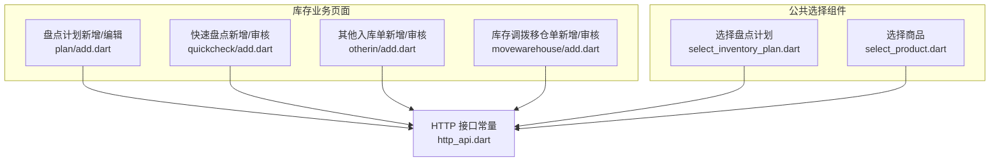
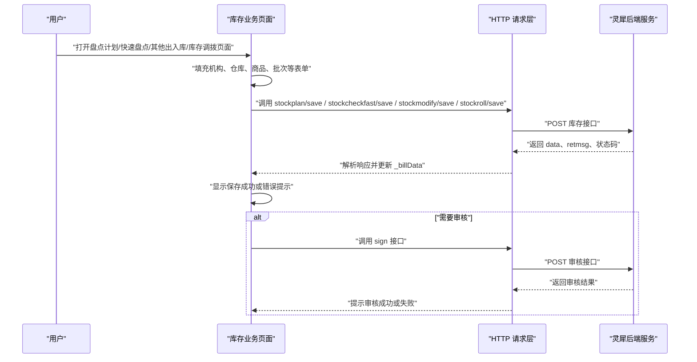
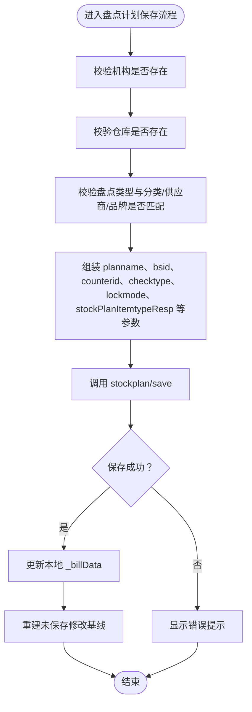
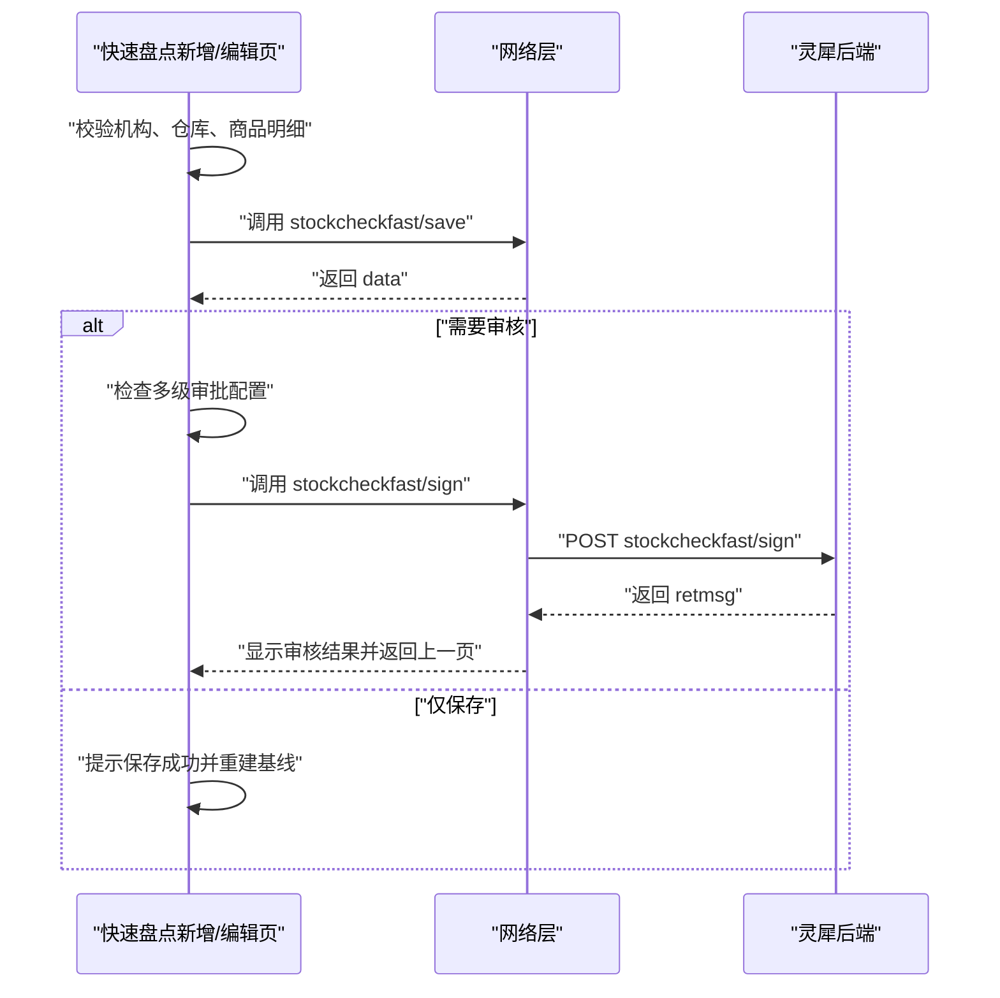
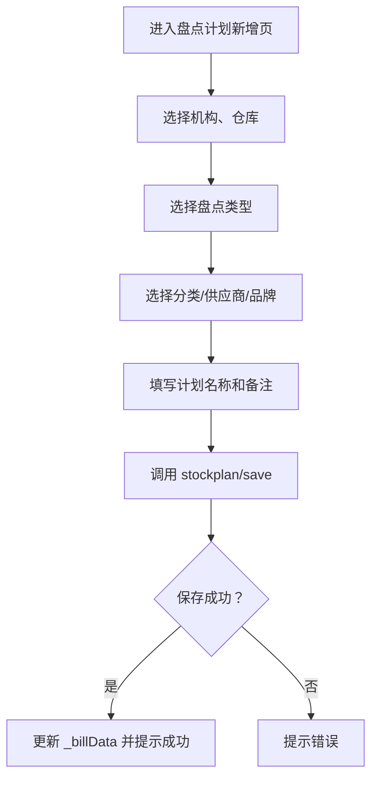
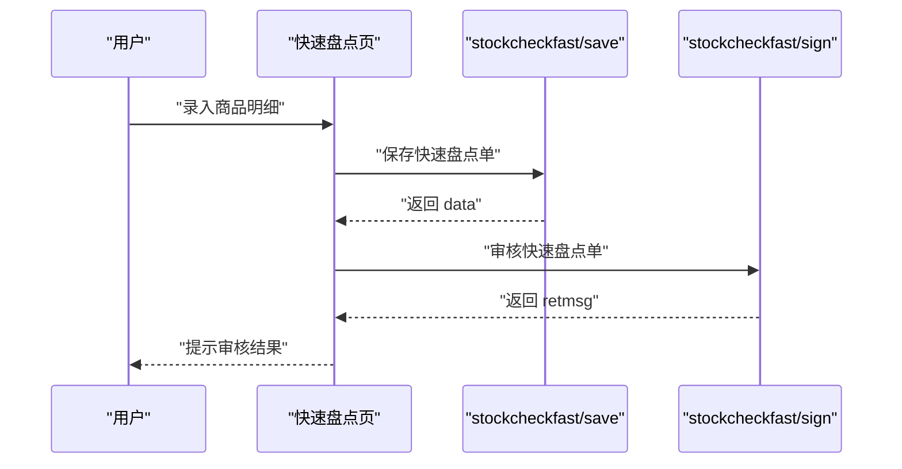
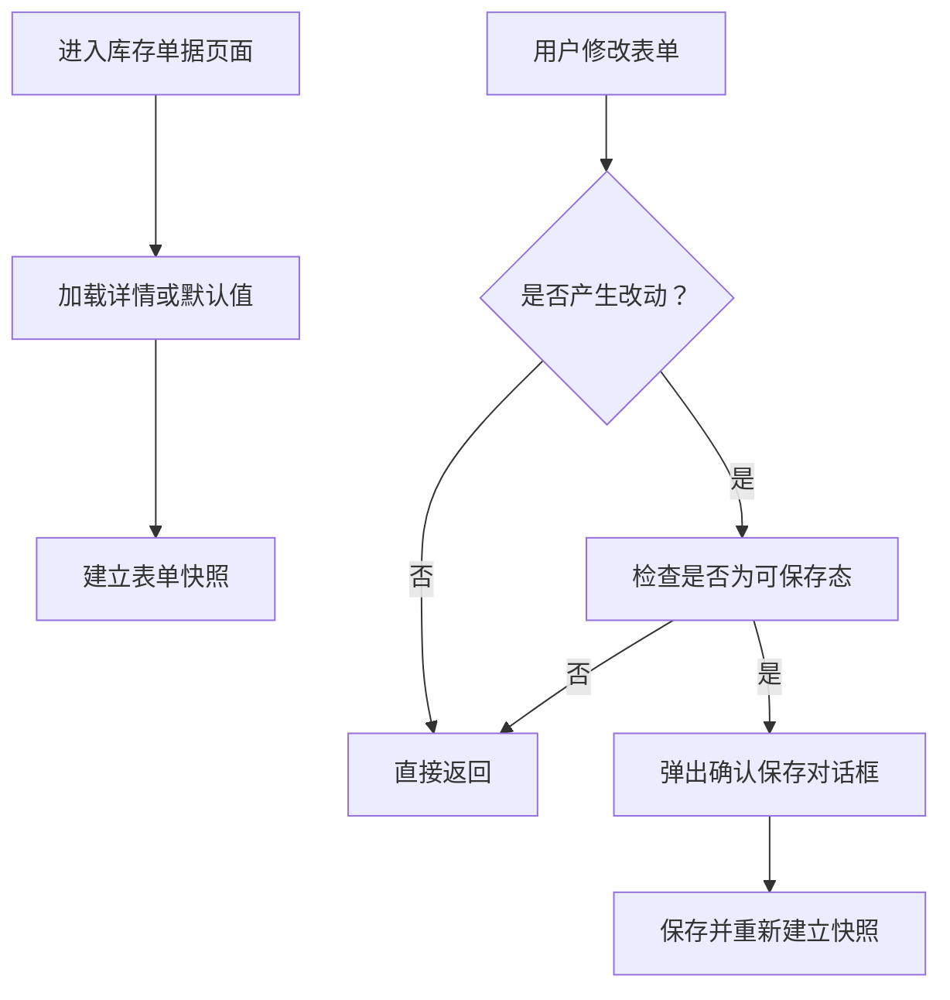

# 库存管理API

<cite>
**本文引用的文件**   
- [lib/net/http_api.dart](file://lib/net/http_api.dart)
- [lib/pages/business/inventory/plan/add.dart](file://lib/pages/business/inventory/plan/add.dart)
- [lib/pages/business/inventory/quickcheck/add.dart](file://lib/pages/business/inventory/quickcheck/add.dart)
- [lib/pages/business/inventory/otherin/add.dart](file://lib/pages/business/inventory/otherin/add.dart)
- [lib/pages/business/inventory/movewarehouse/add.dart](file://lib/pages/business/inventory/movewarehouse/add.dart)
- [lib/components/select/select_inventory_plan.dart](file://lib/components/select/select_inventory_plan.dart)
- [lib/components/select/select_product.dart](file://lib/components/select/select_product.dart)
</cite>

## 目录
1. [简介](#简介)
2. [项目结构与范围](#项目结构与范围)
3. [核心接口清单](#核心接口清单)
4. [架构总览](#架构总览)
5. [详细接口定义](#详细接口定义)
6. [库存业务规则](#库存业务规则)
7. [业务流程示例](#业务流程示例)
8. [数据一致性保证](#数据一致性保证)
9. [性能优化建议](#性能优化建议)
10. [异常处理与故障恢复](#异常处理与故障恢复)
11. [结论](#结论)

## 简介
本文件面向灵犀管店 Flutter 客户端中的库存管理功能，围绕其他出入库、盘点计划、快速盘点、库存调拨等库存操作进行 API 文档化。文档重点包括：
- 基于前端 `HttpApi` 常量定义的库存相关后端接口名称与用途；
- 盘点计划保存、快速盘点审核、其他出入库列表与保存、库存调拨保存等接口的参数结构、校验规则和返回值约定；
- 库存变动的业务规则，包括批次管理、有效期控制、库存预警机制；
- 完整业务流程、数据一致性策略和性能优化建议；
- 异常处理和故障恢复方案。

需要特别说明的是：仓库中并未直接定义完整的 JSON Schema，本文的参数与返回结构均来源于前端调用处构造的请求体及错误提示逻辑，可作为前后端对接的契约参考。

## 项目结构与范围
库存管理相关代码主要分布在以下位置：
- 接口地址集中定义在 HTTP 层；
- 各业务页面负责组装请求参数、执行权限校验、调用网络层并展示结果；
- 通用选择组件用于选择盘点计划、商品、仓库等基础数据。

**图表来源**
- [lib/pages/business/inventory/plan/add.dart:240-315](file://lib/pages/business/inventory/plan/add.dart#L240-L315)
- [lib/pages/business/inventory/quickcheck/add.dart:300-460](file://lib/pages/business/inventory/quickcheck/add.dart#L300-L460)
- [lib/pages/business/inventory/otherin/add.dart:220-420](file://lib/pages/business/inventory/otherin/add.dart#L220-L420)
- [lib/pages/business/inventory/movewarehouse/add.dart:220-460](file://lib/pages/business/inventory/movewarehouse/add.dart#L220-L460)
- [lib/components/select/select_inventory_plan.dart:267-332](file://lib/components/select/select_inventory_plan.dart#L267-L332)
- [lib/components/select/select_product.dart:46-55](file://lib/components/select/select_product.dart#L46-L55)

**章节来源**
- [lib/net/http_api.dart:370-430](file://lib/net/http_api.dart#L370-L430)
- [lib/pages/business/inventory/plan/add.dart:240-315](file://lib/pages/business/inventory/plan/add.dart#L240-L315)
- [lib/pages/business/inventory/quickcheck/add.dart:300-460](file://lib/pages/business/inventory/quickcheck/add.dart#L300-L460)
- [lib/pages/business/inventory/otherin/add.dart:220-420](file://lib/pages/business/inventory/otherin/add.dart#L220-L420)
- [lib/pages/business/inventory/movewarehouse/add.dart:220-460](file://lib/pages/business/inventory/movewarehouse/add.dart#L220-L460)

## 核心接口清单
以下接口由前端统一通过 `HttpApi` 常量引用，并与后端 `/LxSvr/web/` 路径组合使用。

| 业务 | 接口常量 | 实际接口名 | 主要用途 |
|---|---|---|---|
| 盘点计划 | `stockplanFindList` | `stockplan/findList` | 查询盘点计划列表 |
| 盘点计划 | `stockplanGetInfo` | `stockplan/getInfo` | 获取盘点计划详情 |
| 盘点计划 | `stockplanSave` | `stockplan/save` | 新增或修改盘点计划 |
| 盘点计划 | `stockplanDelBill` | `stockplan/delBill` | 删除盘点计划 |
| 快速盘点 | `stockcheckfastFindList` | `stockcheckfast/findList` | 查询快速盘点列表 |
| 快速盘点 | `stockcheckfastGetInfo` | `stockcheckfast/getInfo` | 获取快速盘点详情 |
| 快速盘点 | `stockcheckfastSave` | `stockcheckfast/save` | 新增或修改快速盘点单 |
| 快速盘点 | `stockcheckfastSign` | `stockcheckfast/sign` | 审核快速盘点单 |
| 快速盘点 | `stockcheckfastDelBill` | `stockcheckfast/delBill` | 删除快速盘点单 |
| 其他出入库 | `stockModifyFindList` | `stockmodify/findList` | 查询其他出入库列表 |
| 其他出入库 | `stockModifyGetInfo` | `stockmodify/getInfo` | 获取其他出入库详情 |
| 其他出入库 | `stockModifySave` | `stockmodify/save` | 新增或修改其他出入库单 |
| 其他出入库 | `stockModifySign` | `stockmodify/sign` | 审核其他出入库单 |
| 其他出入库 | `stockModifyDelBill` | `stockmodify/delBill` | 删除其他出入库单 |
| 其他出入库 | `stockModifyResign` | `stockmodify/resign` | 反审核其他出入库单 |
| 库存调拨 | `stockRollFindList` | `stockroll/findList` | 查询库存调拨列表 |
| 库存调拨 | `stockRollGetInfo` | `stockroll/getInfo` | 获取库存调拨详情 |
| 库存调拨 | `stockRollSave` | `stockroll/save` | 新增或修改库存调拨单 |
| 库存调拨 | `stockRollSign` | `stockroll/sign` | 审核库存调拨单 |
| 库存调拨 | `stockRollDelBill` | `stockroll/delBill` | 删除库存调拨单 |
| 库存调拨 | `stockRollResign` | `stockroll/resign` | 反审核库存调拨单 |

此外，前端还包含预盘单、成本变更单等库存相关接口，但本文件聚焦于题目要求的其他出入库、盘点计划、快速盘点和库存调拨。

**章节来源**
- [lib/net/http_api.dart:370-430](file://lib/net/http_api.dart#L370-L430)

## 架构总览
库存管理在前端采用“页面 + HTTP 常量 + 选择组件”的结构：
- 每个库存单据类型对应一个新增/编辑页面；
- 所有接口路径集中在 `HttpApi` 类中；
- 盘点计划选择、商品选择等通用能力封装为独立组件；
- 页面负责表单校验、权限校验、金额重算、批量提交、多级审批和错误提示。

**图表来源**
- [lib/pages/business/inventory/plan/add.dart:240-315](file://lib/pages/business/inventory/plan/add.dart#L240-L315)
- [lib/pages/business/inventory/quickcheck/add.dart:300-460](file://lib/pages/business/inventory/quickcheck/add.dart#L300-L460)
- [lib/pages/business/inventory/otherin/add.dart:220-420](file://lib/pages/business/inventory/otherin/add.dart#L220-L420)
- [lib/pages/business/inventory/movewarehouse/add.dart:220-460](file://lib/pages/business/inventory/movewarehouse/add.dart#L220-L460)

## 详细接口定义

### 盘点计划接口

#### 盘点计划列表
- 接口名：`stockplan/findList`
- 前端调用位置：盘点计划列表页直接请求该接口；选择盘点计划组件也会调用该接口加载可选计划。
- 典型请求参数：
  - 分页参数：如当前页、每页数量（由列表组件决定）；
  - 筛选条件：如机构、仓库、时间范围、计划名称等（由列表筛选控件决定）。
- 返回结构：
  - `data`：通常为列表对象，包含计划条目集合；
  - 列表项至少应包含计划编号、计划名称、机构、仓库、创建时间、审核状态等字段；
  - 非 `data` 部分可能包含 `retmsg`、状态码等业务信息。

**章节来源**
- [lib/pages/business/inventory/plan/list.dart:132](file://lib/pages/business/inventory/plan/list.dart#L132)
- [lib/components/select/select_inventory_plan.dart:267-332](file://lib/components/select/select_inventory_plan.dart#L267-L332)
- [lib/net/http_api.dart:370-395](file://lib/net/http_api.dart#L370-L395)

#### 盘点计划详情
- 接口名：`stockplan/getInfo`
- 前端调用位置：盘点计划新增/编辑页根据传入单据数据加载详情。
- 典型请求参数：
  - `billid`：盘点计划编号；
  - 其他上下文参数如机构、仓库等（由页面已有数据提供）。
- 返回结构：
  - `data`：盘点计划完整信息，包括计划名称、机构、仓库、盘点类型、锁定模式、备注、分类明细等。

**章节来源**
- [lib/pages/business/inventory/plan/add.dart:89](file://lib/pages/business/inventory/plan/add.dart#L89)
- [lib/net/http_api.dart:370-395](file://lib/net/http_api.dart#L370-L395)

#### 盘点计划保存
- 接口名：`stockplan/save`
- 主要用途：新增或修改盘点计划。
- 请求体关键字段：
  - `planname`：盘点计划名称；
  - `bsid`：机构编号；
  - `storename`：机构名称；
  - `counterid`：仓库编号；
  - `countername`：仓库名称；
  - `clearflag`：清空标志；
  - `openflag`：启用标志；
  - `checktype`：盘点类型；
  - `lockmode`：锁定模式；
  - `lockflag`：是否立即锁定；
  - `remark`：备注；
  - `stockPlanItemtypeResp`：盘点计划关联的分类列表；
  - `billid`：编辑时必填，表示修改现有计划。
- 返回结构：
  - `data`：服务端回写的完整计划数据，例如生成 `billid`；
  - 非 `data` 字段用于提示保存结果。

**图表来源**
- [lib/pages/business/inventory/plan/add.dart:240-315](file://lib/pages/business/inventory/plan/add.dart#L240-L315)

**章节来源**
- [lib/pages/business/inventory/plan/add.dart:240-315](file://lib/pages/business/inventory/plan/add.dart#L240-L315)
- [lib/net/http_api.dart:370-395](file://lib/net/http_api.dart#L370-L395)

### 快速盘点接口

#### 快速盘点列表
- 接口名：`stockcheckfast/findList`
- 前端调用位置：快速盘点列表页直接请求该接口。
- 典型请求参数：
  - 分页参数；
  - 机构、仓库、时间、状态等筛选条件。
- 返回结构：
  - `data`：快速盘点单列表；
  - 每项包含单据编号、机构、仓库、商品行数量、审核状态、创建时间等。

**章节来源**
- [lib/pages/business/inventory/quickcheck/list.dart:120](file://lib/pages/business/inventory/quickcheck/list.dart#L120)
- [lib/net/http_api.dart:395-410](file://lib/net/http_api.dart#L395-L410)

#### 快速盘点详情
- 接口名：`stockcheckfast/getInfo`
- 前端调用位置：快速盘点新增/编辑页加载已有单据。
- 典型请求参数：
  - `billid`；
  - 其他上下文数据。
- 返回结构：
  - `data`：快速盘点单完整信息，包括头信息和 `detaillist`。

**章节来源**
- [lib/pages/business/inventory/quickcheck/add.dart:153](file://lib/pages/business/inventory/quickcheck/add.dart#L153)
- [lib/net/http_api.dart:395-410](file://lib/net/http_api.dart#L395-L410)

#### 快速盘点保存
- 接口名：`stockcheckfast/save`
- 主要用途：新增或修改快速盘点单。
- 请求体关键字段：
  - `bsid`：机构编号；
  - `storename`：机构名称；
  - `counterid`：盘点仓库编号；
  - `countername`：盘点仓库名称；
  - `signflag`：审核状态标记，保存时为暂存状态；
  - `remark`：备注；
  - `fileLists`：附件列表；
  - `detaillist`：商品明细列表；
  - `billid`：编辑时必填。
- 返回结构：
  - `data`：服务端返回的完整单据数据，尤其是新增时生成的 `billid`；
  - 非 `data` 字段用于提示保存结果。

**章节来源**
- [lib/pages/business/inventory/quickcheck/add.dart:300-360](file://lib/pages/business/inventory/quickcheck/add.dart#L300-L360)
- [lib/net/http_api.dart:395-410](file://lib/net/http_api.dart#L395-L410)

#### 快速盘点审核
- 接口名：`stockcheckfast/sign`
- 主要用途：对快速盘点单进行审核。
- 请求体关键字段：
  - 透传当前表单完整数据，包括 `bsid`、`storename`、`counterid`、`countername`、`remark`、`fileLists`、`detaillist`；
  - `signflag`：审核状态，通常为 1；
  - `reviewsignflag`：多级审批结果；
  - `reviewremark`：多级审批备注。
- 返回结构：
  - `retmsg`：审核提示信息；
  - 成功时返回后通常关闭当前编辑页并刷新列表。

**图表来源**
- [lib/pages/business/inventory/quickcheck/add.dart:300-460](file://lib/pages/business/inventory/quickcheck/add.dart#L300-L460)

**章节来源**
- [lib/pages/business/inventory/quickcheck/add.dart:300-460](file://lib/pages/business/inventory/quickcheck/add.dart#L300-L460)
- [lib/net/http_api.dart:395-410](file://lib/net/http_api.dart#L395-L410)

### 其他出入库接口

#### 其他出入库列表
- 接口名：`stockmodify/findList`
- 前端调用位置：其他出入库列表页使用该接口查询数据。
- 典型请求参数：
  - 分页参数；
  - 机构、仓库、单据类型、时间、状态等筛选条件。
- 返回结构：
  - `data`：其他出入库单列表；
  - 每项包含单据编号、机构、仓库、单据类型、数量、金额、审核状态等。

**章节来源**
- [lib/net/http_api.dart:409-415](file://lib/net/http_api.dart#L409-L415)

#### 其他出入库详情
- 接口名：`stockmodify/getInfo`
- 前端调用位置：其他入库单新增/编辑页加载已有单据。
- 典型请求参数：
  - `billid`；
  - 其他上下文数据。
- 返回结构：
  - `data`：其他出入库单完整信息，包括头信息和 `detaillist`。

**章节来源**
- [lib/pages/business/inventory/otherin/add.dart:170-220](file://lib/pages/business/inventory/otherin/add.dart#L170-L220)
- [lib/net/http_api.dart:409-415](file://lib/net/http_api.dart#L409-L415)

#### 其他出入库保存
- 接口名：`stockmodify/save`
- 主要用途：新增或修改其他出入库单。
- 请求体关键字段：
  - `bsid`：机构编号；
  - `storename`：机构名称；
  - `counterid`：仓库编号；
  - `countername`：仓库名称；
  - `billtype`：单据类型标识；
  - `outflag`：出入库方向；
  - `outtype`：业务类型；
  - `signflag`：审核状态；
  - `handlerid`、`handlername`：经办人；
  - `remark`：备注；
  - `fileLists`：附件；
  - `billamt`：总金额；
  - `billqty`：总数量；
  - `billsellamt`：销售金额；
  - `detaillist`：商品明细。
- 返回结构：
  - `data`：服务端回写单据数据；
  - 非 `data` 字段用于提示保存结果。

**章节来源**
- [lib/pages/business/inventory/otherin/add.dart:220-420](file://lib/pages/business/inventory/otherin/add.dart#L220-L420)
- [lib/net/http_api.dart:409-415](file://lib/net/http_api.dart#L409-L415)

#### 其他出入库审核
- 接口名：`stockmodify/sign`
- 主要用途：对其他出入库单进行审核。
- 请求体：通常包含当前表单完整数据及审核相关信息；
- 返回结构：
  - `retmsg`：审核提示信息；
  - 成功后返回上一页。

**章节来源**
- [lib/net/http_api.dart:409-415](file://lib/net/http_api.dart#L409-L415)

### 库存调拨接口

#### 库存调拨列表
- 接口名：`stockroll/findList`
- 前端调用位置：库存调拨列表页查询调拨单。
- 返回结构：
  - `data`：调拨单列表；
  - 每项包含机构、移出仓库、移入仓库、单据类型、数量、金额、审核状态等。

**章节来源**
- [lib/net/http_api.dart:415-430](file://lib/net/http_api.dart#L415-L430)

#### 库存调拨详情
- 接口名：`stockroll/getInfo`
- 前端调用位置：库存调拨新增/编辑页加载已有单据。
- 返回结构：
  - `data`：调拨单完整信息，包括 `outcounterid`、`incounterid`、`detaillist` 等。

**章节来源**
- [lib/pages/business/inventory/movewarehouse/add.dart:120-170](file://lib/pages/business/inventory/movewarehouse/add.dart#L120-L170)
- [lib/net/http_api.dart:415-430](file://lib/net/http_api.dart#L415-L430)

#### 库存调拨保存
- 接口名：`stockroll/save`
- 主要用途：新增或修改库存调拨单。
- 请求体关键字段：
  - `bsid`：机构编号；
  - `storename`：机构名称；
  - `outcounterid`、`outcountername`：移出仓库；
  - `incounterid`、`incountername`：移入仓库；
  - `billtype`：单据类型；
  - `signflag`：审核状态；
  - `remark`：备注；
  - `fileLists`：附件；
  - `billamt`、`billinamt`、`billqty`、`billsellamt`：汇总金额和数量；
  - `detaillist`：商品明细。
- 返回结构：
  - `data`：服务端回写单据数据；
  - 非 `data` 字段用于提示保存结果。

**章节来源**
- [lib/pages/business/inventory/movewarehouse/add.dart:220-460](file://lib/pages/business/inventory/movewarehouse/add.dart#L220-L460)
- [lib/net/http_api.dart:415-430](file://lib/net/http_api.dart#L415-L430)

## 库存业务规则

### 库存变动业务规则
- 其他出入库：
  - 使用 `stockmodify` 前缀接口；
  - 单据类型和出入库方向通过 `billtype`、`outflag`、`outtype` 区分；
  - 入库场景下，前端会将 `modifyqty` 计算为现有库存加上本次入库数量；
  - 金额字段按成本价、售价、税率计算，并使用统一精度格式化。
- 盘点计划：
  - 支持按分类、供应商、品牌筛选盘点范围；
  - 支持锁定模式，控制盘点期间库存是否锁定；
  - 可立即锁定或暂不锁定。
- 快速盘点：
  - 适用于临时盘点，无需先建计划；
  - 支持扫码录入商品、批次、数量和日期；
  - 审核时可携带多级审批结果。
- 库存调拨：
  - 必须指定移出仓库和移入仓库；
  - 前端禁止将相同仓库作为移出和移入仓库；
  - 分别计算出库成本、入库成本和售价金额。

**章节来源**
- [lib/pages/business/inventory/otherin/add.dart:220-420](file://lib/pages/business/inventory/otherin/add.dart#L220-L420)
- [lib/pages/business/inventory/plan/add.dart:240-315](file://lib/pages/business/inventory/plan/add.dart#L240-L315)
- [lib/pages/business/inventory/movewarehouse/add.dart:220-460](file://lib/pages/business/inventory/movewarehouse/add.dart#L220-L460)

### 批次管理
- 商品明细中包含批次号、生产日期、有效期等字段；
- 快速盘点和其他出入库页面会读取批次信息，并在界面只读展示生产/有效日期；
- 盘点类商品选择器会根据是否预盘单或快速盘点调整数量字段名和批次相关逻辑；
- 库存调拨和其他出入库页面在加载详情时会格式化批次日期并设置默认值。

**章节来源**
- [lib/components/select/select_product.dart:46-55](file://lib/components/select/select_product.dart#L46-L55)
- [lib/components/select/select_product.dart:1671-1902](file://lib/components/select/select_product.dart#L1671-L1902)
- [lib/pages/business/inventory/otherin/add.dart:170-220](file://lib/pages/business/inventory/otherin/add.dart#L170-L220)
- [lib/pages/business/inventory/movewarehouse/add.dart:120-170](file://lib/pages/business/inventory/movewarehouse/add.dart#L120-L170)

### 有效期控制
- 商品批次有效期字段由后端商品批次数据提供；
- 前端盘点类和出入库类页面会格式化并展示有效期，但不允许直接修改；
- 若后端存在过期或临期策略，应在服务器端校验并返回提示信息。

**章节来源**
- [lib/components/select/select_product.dart:1902](file://lib/components/select/select_product.dart#L1902)
- [lib/pages/business/inventory/otherin/add.dart:170-220](file://lib/pages/business/inventory/otherin/add.dart#L170-L220)
- [lib/pages/business/inventory/movewarehouse/add.dart:120-170](file://lib/pages/business/inventory/movewarehouse/add.dart#L120-L170)

### 库存预警机制
- 前端存在库存预警、滞销、临期、零库存、负库存等数据报表页面；
- 这些页面通常依赖后端统计接口返回的库存分析数据；
- 本仓库中库存预警更多体现为“查看和分析”，而非直接触发库存扣减；
- 建议在库存变动审核后，由后端统一计算并推送预警指标。

**章节来源**
- [lib/pages/data/inventory/inventoryWarn/inventory_warn_page.dart](file://lib/pages/data/inventory/inventoryWarn/inventory_warn_page.dart)
- [lib/pages/data/inventory/vaildWarn/vaild_warn_page.dart](file://lib/pages/data/inventory/vaildWarn/vaild_warn_page.dart)
- [lib/pages/data/inventory/zeroStock/zero_stock_page.dart](file://lib/pages/data/inventory/zeroStock/zero_stock_page.dart)
- [lib/pages/home/custom/stock_warning_page.dart](file://lib/pages/home/custom/stock_warning_page.dart)

## 业务流程示例

### 盘点计划创建流程
1. 用户进入盘点计划新增页面；
2. 选择机构、仓库、盘点类型、锁定模式；
3. 选择盘点计划关联的分类、供应商或品牌；
4. 填写计划名称和备注；
5. 调用 `stockplan/save`；
6. 成功后更新本地单据数据并提示保存成功；
7. 可选择删除计划。

**图表来源**
- [lib/pages/business/inventory/plan/add.dart:240-315](file://lib/pages/business/inventory/plan/add.dart#L240-L315)

### 快速盘点审核流程
1. 用户进入快速盘点新增页；
2. 选择机构、仓库、商品明细、批次、数量；
3. 点击保存，调用 `stockcheckfast/save`；
4. 如需审核，检查多级审批配置；
5. 调用 `stockcheckfast/sign`；
6. 根据 `retmsg` 提示审核结果并返回上一页。

**图表来源**
- [lib/pages/business/inventory/quickcheck/add.dart:300-460](file://lib/pages/business/inventory/quickcheck/add.dart#L300-L460)

### 其他出入库流程
1. 用户进入其他入库单新增页；
2. 选择机构、仓库、商品、批次、数量、价格；
3. 前端计算 `amt`、`sellamt`、`notaxamt`、`modifyqty`；
4. 调用 `stockmodify/save`；
5. 如需审核，调用 `stockmodify/sign`。

**章节来源**
- [lib/pages/business/inventory/otherin/add.dart:220-420](file://lib/pages/business/inventory/otherin/add.dart#L220-L420)
- [lib/net/http_api.dart:409-415](file://lib/net/http_api.dart#L409-L415)

### 库存调拨流程
1. 用户进入库存调拨新增页；
2. 选择移出仓库、移入仓库、商品、批次、数量；
3. 前端校验两个仓库不能相同；
4. 计算出库成本、入库成本、售价金额；
5. 调用 `stockroll/save`；
6. 如需审核，调用 `stockroll/sign`。

**章节来源**
- [lib/pages/business/inventory/movewarehouse/add.dart:220-460](file://lib/pages/business/inventory/movewarehouse/add.dart#L220-L460)
- [lib/net/http_api.dart:415-430](file://lib/net/http_api.dart#L415-L430)

## 数据一致性保证

### 表单快照与未保存拦截
多个库存单据页面都实现了“未保存修改检测”：
- 在初始化、加载详情、保存成功后重建表单快照；
- 离开页面时比对当前表单与快照；
- 仅在待审核态允许保存，已审核或已驳回单据放行；
- 防止误操作导致库存单据数据丢失。

**图表来源**
- [lib/pages/business/inventory/otherin/add.dart:280-360](file://lib/pages/business/inventory/otherin/add.dart#L280-L360)
- [lib/pages/business/inventory/movewarehouse/add.dart:280-360](file://lib/pages/business/inventory/movewarehouse/add.dart#L280-L360)

**章节来源**
- [lib/pages/business/inventory/otherin/add.dart:280-360](file://lib/pages/business/inventory/otherin/add.dart#L280-L360)
- [lib/pages/business/inventory/movewarehouse/add.dart:280-360](file://lib/pages/business/inventory/movewarehouse/add.dart#L280-L360)

### 权限控制
- 新增、编辑、审核、删除操作前都会检查权限码；
- 无权限时直接提示“请在后台修改权限”；
- 权限码因业务模块不同而不同，例如快速盘点、其他出入库、库存调拨、盘点计划各自有独立权限标识。

**章节来源**
- [lib/pages/business/inventory/quickcheck/add.dart:300-460](file://lib/pages/business/inventory/quickcheck/add.dart#L300-L460)
- [lib/pages/business/inventory/otherin/add.dart:300-420](file://lib/pages/business/inventory/otherin/add.dart#L300-L420)
- [lib/pages/business/inventory/movewarehouse/add.dart:300-460](file://lib/pages/business/inventory/movewarehouse/add.dart#L300-L460)
- [lib/pages/business/inventory/plan/add.dart:240-315](file://lib/pages/business/inventory/plan/add.dart#L240-L315)

### 数值精度与金额重算
- 数量字段一般保留一位小数；
- 价格字段保留两位小数；
- 金额字段保留三位小数；
- 每次写入数量或价格时重新计算金额；
- 避免浮点误差影响库存和财务数据。

**章节来源**
- [lib/pages/business/inventory/otherin/add.dart:220-280](file://lib/pages/business/inventory/otherin/add.dart#L220-L280)
- [lib/pages/business/inventory/movewarehouse/add.dart:220-300](file://lib/pages/business/inventory/movewarehouse/add.dart#L220-L300)

## 性能优化建议

### 列表分页与筛选
- 盘点计划、快速盘点、其他出入库、库存调拨都应使用分页接口；
- 前端应根据筛选条件构建请求参数，避免全量拉取；
- 下拉选择盘点计划时应限制返回条数或支持搜索。

### 减少重复请求
- 加载详情后再进行保存，避免多次 `getInfo`；
- 只在新增时覆盖 `_billData`，编辑时保留原完整数据；
- 审核失败时不要破坏已有表单数据。

### 批量计算与渲染
- 商品明细较多时应延迟计算或分批计算金额；
- 扫描输入时使用防抖；
- 列表滚动时避免频繁重建复杂组件。

### 缓存基础数据
- 机构、仓库、商品分类、品牌等基础数据可考虑短期缓存；
- 盘点计划选择列表可根据用户角色和权限做轻量缓存。

[本节为通用性能建议，不直接分析具体代码文件]

## 异常处理与故障恢复

### 前端校验失败
- 机构、仓库、商品为空时直接提示；
- 库存调拨不允许移出仓库等于移入仓库；
- 盘点计划未选择分类、供应商或品牌时报错；
- 这些校验发生在请求发送前，避免无效网络请求。

**章节来源**
- [lib/pages/business/inventory/plan/add.dart:240-276](file://lib/pages/business/inventory/plan/add.dart#L240-L276)
- [lib/pages/business/inventory/movewarehouse/add.dart:340-380](file://lib/pages/business/inventory/movewarehouse/add.dart#L340-L380)

### 权限不足
- 无新增、编辑、审核、删除权限时，前端直接拒绝操作；
- 提示文案统一指向“后台修改权限”。

**章节来源**
- [lib/pages/business/inventory/quickcheck/add.dart:330-424](file://lib/pages/business/inventory/quickcheck/add.dart#L330-L424)
- [lib/pages/business/inventory/otherin/add.dart:300-420](file://lib/pages/business/inventory/otherin/add.dart#L300-L420)
- [lib/pages/business/inventory/movewarehouse/add.dart:300-460](file://lib/pages/business/inventory/movewarehouse/add.dart#L300-L460)
- [lib/pages/business/inventory/plan/add.dart:276-315](file://lib/pages/business/inventory/plan/add.dart#L276-L315)

### 网络与服务端异常
- 保存和审核失败时通过 `retmsg` 提示用户；
- 审核失败不应清空表单，应保留用户输入；
- 建议在网络层增加重试机制和超时处理；
- 对于关键库存操作，可在本地记录日志并支持稍后重试。

**章节来源**
- [lib/pages/business/inventory/quickcheck/add.dart:412-424](file://lib/pages/business/inventory/quickcheck/add.dart#L412-L424)
- [lib/pages/business/inventory/otherin/add.dart:360-420](file://lib/pages/business/inventory/otherin/add.dart#L360-L420)
- [lib/pages/business/inventory/movewarehouse/add.dart:420-460](file://lib/pages/business/inventory/movewarehouse/add.dart#L420-L460)

### 多级审批异常
- 当配置多级审批时，前端会弹出审批操作弹窗；
- 若用户取消审批，不应继续调用审核接口；
- 审批结果需正确映射到 `reviewsignflag` 和 `reviewremark`。

**章节来源**
- [lib/pages/business/inventory/quickcheck/add.dart:340-412](file://lib/pages/business/inventory/quickcheck/add.dart#L340-L412)

## 结论
灵犀管店 Flutter 项目的库存管理模块以 `HttpApi` 为中心，围绕盘点计划、快速盘点、其他出入库和库存调拨形成清晰的接口契约。前端在表单校验、权限控制、数值精度、未保存拦截和多级审批方面做了较完整的实现。为保证库存数据准确一致，建议：
- 后端严格校验批次、有效期、库存可用量；
- 审核接口保持幂等；
- 对库存变动操作增加审计日志；
- 对高频列表和基础数据提供分页与缓存；
- 对异常场景提供明确提示和可恢复路径。