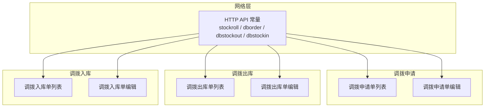
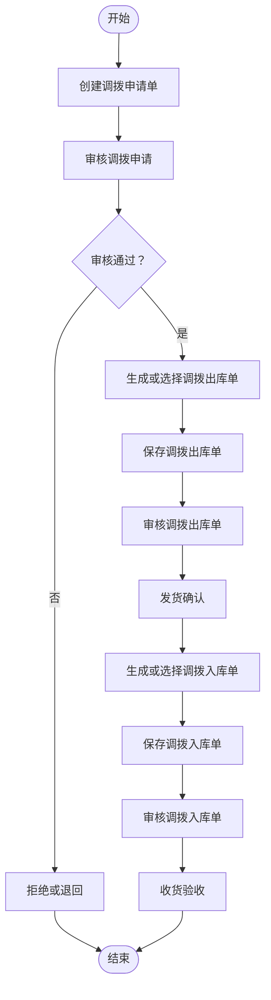
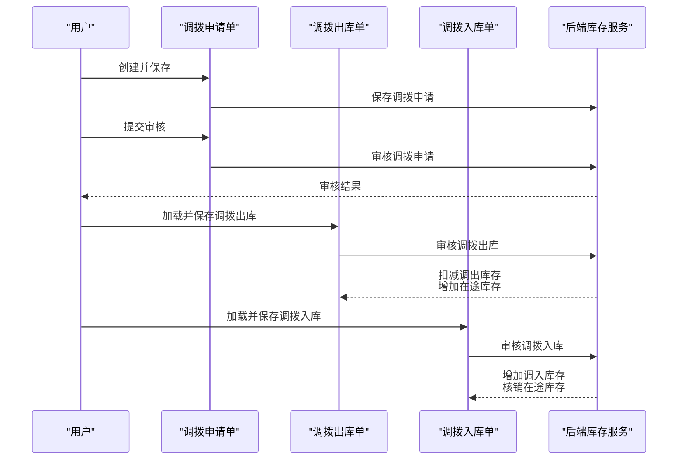
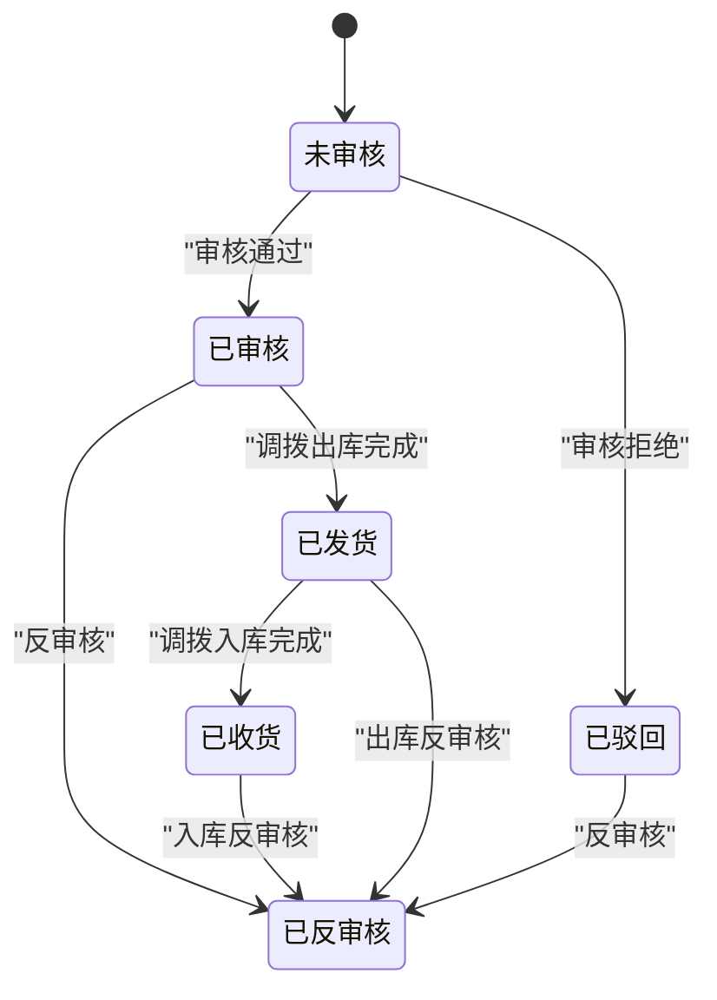

# 库存调拨API

<cite>
**本文引用的文件**   
- [http_api.dart](file://lib/net/http_api.dart)
- [allot_apply_list.dart](file://lib/pages/business/chain/allot_apply/list.dart)
- [allot_apply_edit.dart](file://lib/pages/business/chain/allot_apply/edit.dart)
- [allot_delivery_list.dart](file://lib/pages/business/chain/allot_delivery/list.dart)
- [allot_delivery_edit.dart](file://lib/pages/business/chain/allot_delivery/edit.dart)
- [allot_entry_list.dart](file://lib/pages/business/chain/allot_entry/list.dart)
- [allot_entry_edit.dart](file://lib/pages/business/chain/allot_entry/edit.dart)
</cite>

## 目录
1. [引言](#引言)
2. [项目结构与定位](#项目结构与定位)
3. [核心概念与业务模型](#核心概念与业务模型)
4. [接口总览](#接口总览)
5. [接口详细规范](#接口详细规范)
6. [完整业务流程与示例](#完整业务流程与示例)
7. [在途库存与库存一致性方案](#在途库存与库存一致性方案)
8. [异常处理与错误码建议](#异常处理与错误码建议)
9. [性能与可观测性建议](#性能与可观测性建议)
10. [常见问题排查](#常见问题排查)
11. [结论](#结论)

## 引言
本文件面向灵犀管店 Flutter 客户端中的“库存调拨”能力，围绕以下目标展开：
- 明确调拨申请、调拨出库（发货）、调拨入库（收货）三张单据的关系。
- 基于前端代码反推并整理后端 `stockroll/findList`、`stockroll/getInfo`、`stockroll/save`、`stockroll/sign`、`stockroll/resign` 等接口的调用语义和约束。
- 说明仓库间调拨的业务流程、关键节点、在途库存管理方式。
- 给出从调拨申请到发货、收货的全链路操作示例，以及异常处理和库存一致性保障建议。

需要特别说明的是：Flutter 端并未直接实现 `stockroll/*` 的列表或详情编辑页；调拨相关页面使用的是另一组 API 常量，例如 `dborder/*`（调拨申请单）、`dbstockout/*`（调拨出库单）、`dbstockin/*`（调拨入库单）。因此，本文对 `stockroll/*` 的描述以 HTTP 常量定义和业务语义为基础进行规范化说明，并结合现有调拨页面行为补充库存状态流转。

**章节来源**
- [http_api.dart:418-423](file://lib/net/http_api.dart#L418-L423)
- [allot_apply_list.dart:188-200](file://lib/pages/business/chain/allot_apply/list.dart#L188-L200)
- [allot_delivery_list.dart:174-186](file://lib/pages/business/chain/allot_delivery/list.dart#L174-L186)
- [allot_entry_list.dart:175-187](file://lib/pages/business/chain/allot_entry/list.dart#L175-L187)

## 项目结构与定位
库存调拨能力在 Flutter 项目中按“业务链+库存”组织：
- 网络层统一声明接口路径常量。
- 业务链模块提供调拨申请、调拨出库、调拨入库三个入口。
- 每个业务链包含“列表页 + 编辑详情页”，用于查询、创建、审核、反审核、删除、打印等操作。

**图示来源**
- [http_api.dart:418-423](file://lib/net/http_api.dart#L418-L423)
- [allot_apply_list.dart:1-50](file://lib/pages/business/chain/allot_apply/list.dart#L1-L50)
- [allot_delivery_list.dart:1-50](file://lib/pages/business/chain/allot_delivery/list.dart#L1-L50)
- [allot_entry_list.dart:1-50](file://lib/pages/business/chain/allot_entry/list.dart#L1-L50)

**章节来源**
- [http_api.dart:418-423](file://lib/net/http_api.dart#L418-L423)
- [allot_apply_list.dart:1-50](file://lib/pages/business/chain/allot_apply/list.dart#L1-L50)
- [allot_delivery_list.dart:1-50](file://lib/pages/business/chain/allot_delivery/list.dart#L1-L50)
- [allot_entry_list.dart:1-50](file://lib/pages/business/chain/allot_entry/list.dart#L1-L50)

## 核心概念与业务模型
### 三张调拨单据
| 单据 | 前端模块 | 主要职责 | 前端使用的 API 前缀 |
|---|---|---|---|
| 调拨申请单 | 调拨申请 | 发起仓库间调拨需求，填写调出机构、调入机构及商品明细 | `dborder/*` |
| 调拨出库单 | 调拨出库 | 调出仓库执行发货，扣减调出仓库库存，形成在途库存 | `dbstockout/*` |
| 调拨入库单 | 调拨入库 | 调入仓库执行收货验收，增加调入仓库库存，核销在途库存 | `dbstockin/*` |

### 关键业务字段
- **单据号**：调拨申请单、调拨出库单、调拨入库单的编号。
- **调出机构**：发出商品的仓库或门店。
- **调入机构**：接收商品的仓库或门店。
- **制单人**：创建单据的人员。
- **审核状态**：不同单据使用不同的审核字段：
  - 调拨申请单使用 `signflag`。
  - 调拨出库单使用 `signflag`。
  - 调拨入库单使用 `insignflag`。
- **审批撤回标记**：部分编辑逻辑会维护 `reviewsignflag`，用于区分正常审核、待撤回、已撤回等状态。

### 调拨申请与调拨执行的区别
- **调拨申请**是“计划阶段”：记录调拨意图、商品数量和预期流向，不一定立即改变库存。
- **调拨执行**是“物流阶段”：调拨出库单负责发货，调拨入库单负责收货，真正触发库存变动。

**章节来源**
- [allot_apply_list.dart:1-50](file://lib/pages/business/chain/allot_apply/list.dart#L1-L50)
- [allot_delivery_list.dart:1-50](file://lib/pages/business/chain/allot_delivery/list.dart#L1-L50)
- [allot_entry_list.dart:1-50](file://lib/pages/business/chain/allot_entry/list.dart#L1-L50)
- [allot_apply_edit.dart:255-260](file://lib/pages/business/chain/allot_apply/edit.dart#L255-L260)
- [allot_delivery_edit.dart:127-129](file://lib/pages/business/chain/allot_delivery/edit.dart#L127-L129)
- [allot_entry_edit.dart:105-108](file://lib/pages/business/chain/allot_entry/edit.dart#L105-L108)

## 接口总览
### stockroll 系列接口
| 接口 | 常量名 | 方法语义 | 典型用途 |
|---|---|---|---|
| `stockroll/findList` | `stockRollFindList` | 查询转仓单/库存调拨列表 | 列表展示、分页、筛选 |
| `stockroll/getInfo` | `stockRollGetInfo` | 查询转仓单/库存调拨详情 | 详情加载、编辑回显 |
| `stockroll/save` | `stockRollSave` | 新增或保存转仓单/库存调拨 | 创建调拨申请 |
| `stockroll/sign` | `stockRollSign` | 审核转仓单/库存调拨 | 批准调拨申请 |
| `stockroll/delBill` | `stockRollDelBill` | 删除转仓单/库存调拨单据 | 作废未生效单据 |
| `stockroll/resign` | `stockRollResign` | 反审核转仓单/库存调拨 | 撤销已审核调拨 |

这些常量集中在网络层，表明系统存在一个独立的“转仓单/库存调拨”领域，与 `dborder`、`dbstockout`、`dbstockin` 并列。

### 当前 Flutter 调拨页面的实际调用
| 页面 | 列表请求 | 详情请求 | 保存/审核/反审核 |
|---|---|---|---|
| 调拨申请单列表 | `dborder/findList` | — | — |
| 调拨申请单编辑 | `dborder/getInfo` | `dborder/save` | `dborder/sign`、`dborder/retsign`、`dborder/delBill` |
| 调拨出库单列表 | `dbstockout/findList` | — | — |
| 调拨出库单编辑 | `dbstockout/getInfo` | `dbstockout/save` | `dbstockout/sign`、`dbstockout/retsign`、`dbstockout/delBill` |
| 调拨入库单列表 | `dbstockin/findList` | — | — |
| 调拨入库单编辑 | `dbstockin/getInfo` | `dbstockin/save` | `dbstockin/sign`、`dbstockin/retsign`、`dbstockin/delBill` |

这说明：**Flutter 端的库存调拨主流程由 `dborder/dbstockout/dbstockin` 驱动，而 `stockroll` 可能是更上层的转仓单抽象，或者由其他端/后台服务统一暴露。**

**章节来源**
- [http_api.dart:418-423](file://lib/net/http_api.dart#L418-L423)
- [allot_apply_list.dart:188-200](file://lib/pages/business/chain/allot_apply/list.dart#L188-L200)
- [allot_delivery_list.dart:174-186](file://lib/pages/business/chain/allot_delivery/list.dart#L174-L186)
- [allot_entry_list.dart:175-187](file://lib/pages/business/chain/allot_entry/list.dart#L175-L187)
- [allot_apply_edit.dart:463-470](file://lib/pages/business/chain/allot_apply/edit.dart#L463-L470)
- [allot_delivery_edit.dart:551-560](file://lib/pages/business/chain/allot_delivery/edit.dart#L551-L560)
- [allot_entry_edit.dart:474-483](file://lib/pages/business/chain/allot_entry/edit.dart#L474-L483)

## 接口详细规范
以下规范基于常量定义和现有调拨页面的调用模式整理。由于 Flutter 端没有直接调用 `stockroll/*` 的列表和编辑逻辑，字段级契约以后端文档为准；此处重点说明“方法语义、状态字段、与调拨业务的关系”。

### stockroll/findList：库存调拨列表
- **目的**：获取转仓单或库存调拨的列表数据。
- **分页参数**：通常包含页码、每页数量、排序字段、时间范围、机构过滤等。
- **筛选维度**：可能包括单据号、调出机构、调入机构、制单人、审核状态、创建时间等。
- **返回结构**：一般包含分页元信息和列表数组。

建议后端返回：
- 列表项至少包含：单据号、调出机构、调入机构、制单人、创建时间、审核状态、关联的调拨出库/入库情况。
- 若该接口同时承载“调拨申请 + 调拨执行”的汇总视图，应通过类型字段区分。

### stockroll/getInfo：库存调拨详情
- **目的**：根据调拨单据编号或主键获取完整详情。
- **适用场景**：查看调拨申请、调拨执行进度、历史操作日志。
- **返回结构**：建议包含主表信息与行项目集合，并可扩展显示关联的调拨出库单、调拨入库单状态。

### stockroll/save：库存调拨保存
- **目的**：新建或更新调拨单据。
- **保存时机**：调拨申请创建时；也可能用于暂存草稿。
- **前置校验**：调出机构与调入机构不应相同；商品明细数量应为正数；必填字段完整。
- **影响**：保存本身不必然产生库存变动，但可能生成调拨申请记录。

### stockroll/sign：库存调拨审核
- **目的**：审核并通过调拨申请。
- **状态变化**：将调拨申请从“待审核”变为“已审核”。
- **后续影响**：审核通过后，允许生成或关联调拨出库单；是否自动锁定库存取决于后端实现。

### stockroll/resign：库存调拨反审核
- **目的**：撤销已通过审核的调拨申请。
- **约束**：仅已审核单据可反审核；若已有调拨出库或入库发生，应禁止反审核或提示风险。
- **状态变化**：从“已审核”回到“待审核”或“已驳回”状态。

### stockroll/delBill：删除调拨单据
- **目的**：删除尚未生效或尚未执行的调拨单据。
- **约束**：已审核或已关联物流执行的单据通常不允许删除。

**章节来源**
- [http_api.dart:418-423](file://lib/net/http_api.dart#L418-L423)

## 完整业务流程与示例
### 整体流程图

### 步骤一：创建调拨申请
- 用户进入调拨申请单编辑页。
- 填写调出机构、调入机构、商品明细、备注等信息。
- 点击保存，调用 `dborder/save`。
- 保存成功后，单据处于“待审核”状态。

### 步骤二：审核调拨申请
- 审核人员进入调拨申请单编辑页。
- 检查调拨信息、库存可用性、审批配置。
- 点击审核，调用 `dborder/sign`。
- 审核通过后，单据变为“已审核”，可继续执行调拨出库。

### 步骤三：调拨出库与发货
- 调出仓库进入调拨出库单编辑页。
- 加载调拨出库单详情，核对商品、数量、调拨申请来源。
- 保存后审核，调用 `dbstockout/sign`。
- 审核通过后执行发货，系统应扣减调出仓库库存，并在库存账中体现“在途库存”。

### 步骤四：调拨入库与收货
- 调入仓库进入调拨入库单编辑页。
- 加载调拨入库单详情，核对到货商品与数量。
- 保存后审核，调用 `dbstockin/sign`。
- 审核通过后执行收货，系统应增加调入仓库库存，并核销对应在途库存。

### 步骤五：反审核与撤回
- 若调拨申请审核错误或需要调整，可调用反审核接口：
  - 调拨申请：`dborder/retsign`
  - 调拨出库：`dbstockout/retsign`
  - 调拨入库：`dbstockin/retsign`
- 撤回操作在某些页面还会设置 `reviewsignflag=2`，再调用保存或审核接口完成撤回语义。

**图示来源**
- [allot_apply_edit.dart:463-470](file://lib/pages/business/chain/allot_apply/edit.dart#L463-L470)
- [allot_apply_edit.dart:539-545](file://lib/pages/business/chain/allot_apply/edit.dart#L539-L545)
- [allot_delivery_edit.dart:551-560](file://lib/pages/business/chain/allot_delivery/edit.dart#L551-L560)
- [allot_delivery_edit.dart:632-640](file://lib/pages/business/chain/allot_delivery/edit.dart#L632-L640)
- [allot_entry_edit.dart:474-483](file://lib/pages/business/chain/allot_entry/edit.dart#L474-L483)
- [allot_entry_edit.dart:540-548](file://lib/pages/business/chain/allot_entry/edit.dart#L540-L548)

**章节来源**
- [allot_apply_edit.dart:463-470](file://lib/pages/business/chain/allot_apply/edit.dart#L463-L470)
- [allot_apply_edit.dart:539-545](file://lib/pages/business/chain/allot_apply/edit.dart#L539-L545)
- [allot_delivery_edit.dart:551-560](file://lib/pages/business/chain/allot_delivery/edit.dart#L551-L560)
- [allot_delivery_edit.dart:632-640](file://lib/pages/business/chain/allot_delivery/edit.dart#L632-L640)
- [allot_entry_edit.dart:474-483](file://lib/pages/business/chain/allot_entry/edit.dart#L474-L483)
- [allot_entry_edit.dart:540-548](file://lib/pages/business/chain/allot_entry/edit.dart#L540-L548)

## 在途库存与库存一致性方案
### 在途库存的含义
在库存在调拨场景中可以分为三类：
1. **可用库存**：仓库中可销售或可调拨的实体库存。
2. **在途库存**：已发货但未完成收货的库存，属于“跨仓库移动中”的数量。
3. **锁定库存**：被订单、调拨申请或其他业务占用的数量。

### 关键节点与库存变化
| 节点 | 调出仓库 | 调入仓库 | 在途库存 | 说明 |
|---|---:|---:|---:|---|
| 创建调拨申请 | 不变 | 不变 | 不变 | 仅记录调拨计划 |
| 审核调拨申请 | 不变 | 不变 | 不变 | 允许后续发货 |
| 调拨出库审核/发货 | 减少 | 不变 | 增加 | 发货确认时扣减调出库存 |
| 调拨入库审核/收货 | 不变 | 增加 | 减少 | 收货验收时增加调入库存 |

### 库存一致性保证建议
- **原子写入**：库存扣减、在途增加、在途核销应在数据库事务内完成，避免中间态。
- **唯一调拨关系**：一条调拨申请应对应明确的调拨出库、调拨入库关系，防止重复发货或重复收货。
- **状态机约束**：
  - 只有审核通过的调拨申请才允许发货。
  - 只有存在对应调拨出库且未完全收货的情况下才允许收货。
  - 反审核前应检查是否存在后续单据。
- **防重机制**：前端应避免重复提交；后端应通过单据号、行项目组合键做幂等保护。
- **审计日志**：记录每次库存变动的单据号、操作人、操作时间、变动前后数量。

**图示来源**
- [allot_delivery_edit.dart:127-129](file://lib/pages/business/chain/allot_delivery/edit.dart#L127-L129)
- [allot_entry_edit.dart:105-108](file://lib/pages/business/chain/allot_entry/edit.dart#L105-L108)

**章节来源**
- [allot_delivery_edit.dart:127-129](file://lib/pages/business/chain/allot_delivery/edit.dart#L127-L129)
- [allot_entry_edit.dart:105-108](file://lib/pages/business/chain/allot_entry/edit.dart#L105-L108)

## 异常处理与错误码建议
### 常见异常场景
| 异常场景 | 前端表现 | 后端建议 |
|---|---|---|
| 调出机构等于调入机构 | 保存失败 | 返回业务错误码，提示“调出机构与调入机构不能相同” |
| 商品数量为负或为零 | 保存失败 | 返回业务错误码，提示“商品数量必须大于零” |
| 未审核调拨申请就发货 | 审核失败 | 返回业务错误码，提示“请先审核调拨申请” |
| 调出仓库库存不足 | 审核失败 | 返回业务错误码，提示“库存不足” |
| 重复发货 | 保存或审核失败 | 返回业务错误码，提示“该调拨申请已发货或部分发货” |
| 重复收货 | 保存或审核失败 | 返回业务错误码，提示“该调拨出库已完成或部分收货” |
| 反审核受限 | 反审核失败 | 返回业务错误码，提示“存在后续单据，无法反审核” |
| 权限不足 | 页面提示无权限 | 返回权限错误码，前端显示“你无权执行该操作” |

### 前端错误处理参考
调拨页面普遍使用统一的网络请求封装，并在请求失败时降级分页状态或停止加载。例如：
- 列表请求失败时，将“还有更多”置为假。
- 加载完成后关闭 loading。
- 权限不足时弹出提示。

这提示后端应返回清晰的结构化错误，以便前端区分网络错误、业务错误和权限错误。

**章节来源**
- [allot_apply_list.dart:200-220](file://lib/pages/business/chain/allot_apply/list.dart#L200-L220)
- [allot_delivery_list.dart:200-220](file://lib/pages/business/chain/allot_delivery/list.dart#L200-L220)
- [allot_entry_list.dart:200-220](file://lib/pages/business/chain/allot_entry/list.dart#L200-L220)

## 性能与可观测性建议
### 列表性能
- 默认分页大小约为 20，适合移动端滚动体验。
- 支持快速时间筛选、单据号搜索、机构筛选、制单人筛选。
- 下拉加载更多时需注意去重和状态重置。

### 详情性能
- 调拨详情可能包含多个商品行项目和审批记录，应避免一次性加载过大图片或非必要附件。
- 审核日志、操作历史建议懒加载或分页加载。

### 可观测性
- 建议在关键操作处埋点：创建调拨申请、审核调拨申请、调拨出库、调拨入库、反审核。
- 记录单据号、操作类型、耗时、错误码，便于追踪调拨链路异常。

**章节来源**
- [allot_apply_list.dart:170-220](file://lib/pages/business/chain/allot_apply/list.dart#L170-L220)
- [allot_delivery_list.dart:160-220](file://lib/pages/business/chain/allot_delivery/list.dart#L160-L220)
- [allot_entry_list.dart:160-220](file://lib/pages/business/chain/allot_entry/list.dart#L160-L220)

## 常见问题排查
### 问题一：为什么调拨页面没有直接调用 `stockroll/findList`？
因为 Flutter 调拨模块当前使用 `dborder/dbstockout/dbstockin` 作为调拨申请、调拨出库、调拨入库的具体实现；`stockroll` 更像是“转仓单”层面的抽象接口。如果需要在 Flutter 中直接使用 `stockroll/*`，需新增对应的列表和编辑页面，或在现有页面中切换 API 常量。

### 问题二：调拨申请审核后为何不能直接修改？
调拨申请审核通过后，通常会进入执行阶段。前端会根据审核状态禁用编辑按钮，并引导用户进入调拨出库或调拨入库流程。若确实需要修改，应先反审核，再由有权限的用户重新编辑。

### 问题三：发货后发现数量错误怎么办？
优先检查是否已收货：
- 若尚未收货，可尝试对调拨出库单执行反审核。
- 若已部分或全部收货，通常需要走退货、调整单或其他冲销流程，而不是简单反审核。

### 问题四：如何判断调拨是否完结？
可通过调拨申请关联的调拨出库、调拨入库状态判断：
- 调拨出库完成表示发货完成。
- 调拨入库完成表示收货完成。
- 两者均完成时，调拨链路基本闭环。

**章节来源**
- [allot_apply_edit.dart:539-545](file://lib/pages/business/chain/allot_apply/edit.dart#L539-L545)
- [allot_delivery_edit.dart:743-770](file://lib/pages/business/chain/allot_delivery/edit.dart#L743-L770)
- [allot_entry_edit.dart:556-585](file://lib/pages/business/chain/allot_entry/edit.dart#L556-L585)

## 结论
- Flutter 端库存调拨的主流程由调拨申请、调拨出库、调拨入库三张单据构成，分别对应 `dborder`、`dbstockout`、`dbstockin`。
- `stockroll/*` 常量表明系统还存在“转仓单/库存调拨”的统一抽象，可用于高层查询、审核、删除、反审核。
- 调拨的核心在于“计划与执行分离”：调拨申请负责计划，调拨出库和调拨入库负责实际库存移动。
- 在途库存是调拨一致性的关键：发货增加在途库存，收货核销在途库存。
- 异常处理应以清晰的业务错误码和前端友好提示为主，同时通过事务、幂等、状态机保证库存一致性。