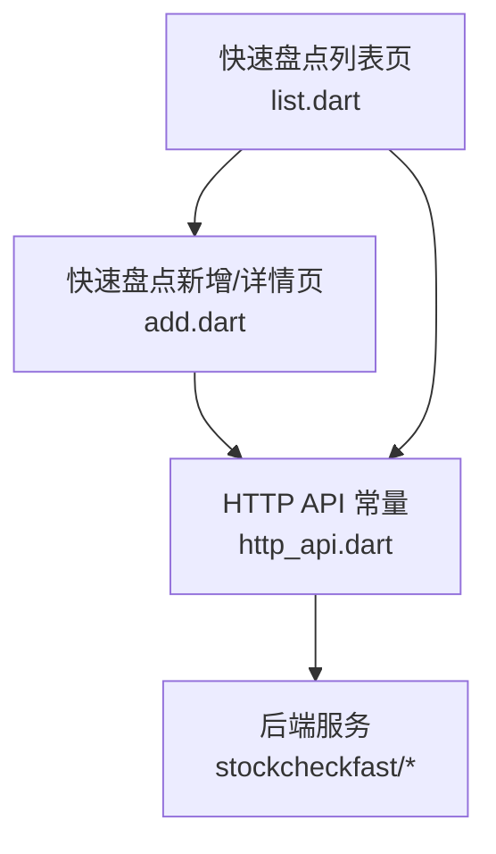
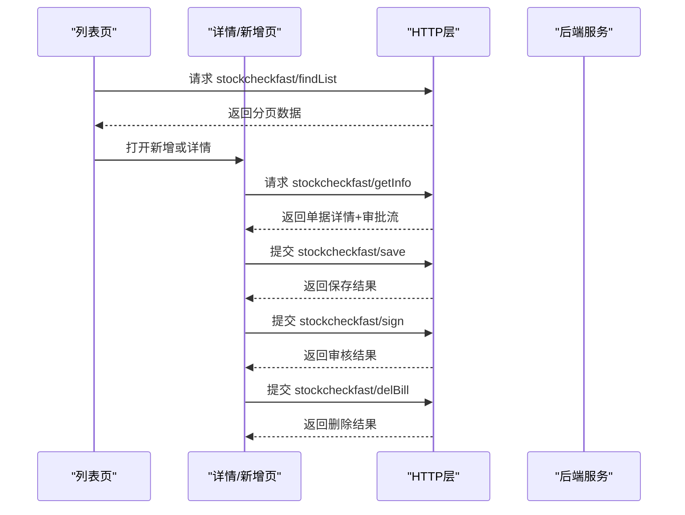
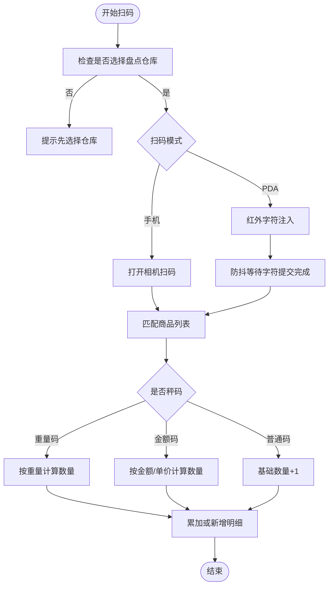
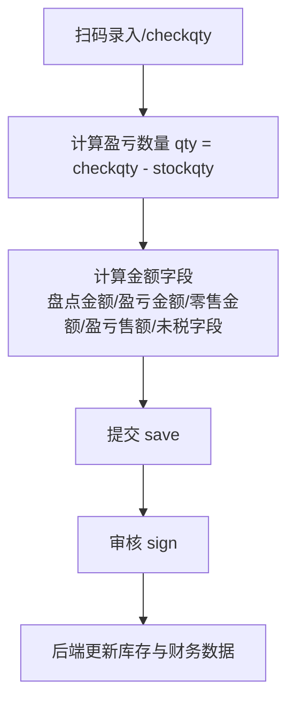

# 快速盘点API

<cite>
**本文引用的文件**   
- [lib/net/http_api.dart](file://lib/net/http_api.dart)
- [lib/pages/business/inventory/quickcheck/list.dart](file://lib/pages/business/inventory/quickcheck/list.dart)
- [lib/pages/business/inventory/quickcheck/add.dart](file://lib/pages/business/inventory/quickcheck/add.dart)
</cite>

## 目录
1. [引言](#引言)
2. [项目结构定位](#项目结构定位)
3. [核心组件总览](#核心组件总览)
4. [架构与调用关系](#架构与调用关系)
5. [接口规范总表](#接口规范总表)
6. [详细接口说明](#详细接口说明)
7. [扫码盘点流程](#扫码盘点流程)
8. [实时库存更新机制](#实时库存更新机制)
9. [与传统盘点效率对比](#与传统盘点效率对比)
10. [完整使用示例](#完整使用示例)
11. [性能优化建议](#性能优化建议)
12. [移动端适配方案](#移动端适配方案)
13. [故障排查](#故障排查)
14. [结论](#结论)

## 引言
本文件为灵犀管店 Flutter 项目中“快速盘点”功能的 API 与业务流程文档，聚焦以下能力：
- 快速盘点列表查询
- 快速盘点详情加载
- 快速盘点保存
- 快速盘点审核与撤回
- 快速盘点删除
- 扫码盘点、数量核对、即时审核
- 快速盘点与传统盘点的效率对比及优势
- 移动端扫码与 PDA 红外扫描体验
- 性能优化与移动端适配建议

快速盘点适用于门店高频、小批量、以条码或自编码为主的日常盘点场景，强调“扫码即录、边扫边核、可审可撤”。

## 项目结构定位
快速盘点功能主要位于业务模块的库存目录下，包含两个页面：
- 快速盘点列表页：负责筛选、分页、跳转新增和详情。
- 快速盘点新增/详情页：负责选择机构仓库、扫码录入、明细编辑、保存、审核、撤回、删除、打印。

**图表来源**
- [lib/pages/business/inventory/quickcheck/list.dart:1-200](file://lib/pages/business/inventory/quickcheck/list.dart#L1-L200)
- [lib/pages/business/inventory/quickcheck/add.dart:1-200](file://lib/pages/business/inventory/quickcheck/add.dart#L1-L200)
- [lib/net/http_api.dart:403-407](file://lib/net/http_api.dart#L403-L407)

**章节来源**
- [lib/pages/business/inventory/quickcheck/list.dart:1-200](file://lib/pages/business/inventory/quickcheck/list.dart#L1-L200)
- [lib/pages/business/inventory/quickcheck/add.dart:1-200](file://lib/pages/business/inventory/quickcheck/add.dart#L1-L200)
- [lib/net/http_api.dart:403-407](file://lib/net/http_api.dart#L403-L407)

## 核心组件总览
| 组件 | 职责 | 关键行为 |
|---|---|---|
| 快速盘点列表页 | 展示快速盘点单据列表，支持按状态、时间、制单人、机构筛选 | 调用 findList 分页；点击进入新增或详情 |
| 快速盘点新增/详情页 | 选择机构仓库、扫码或手动添加商品、编辑盘点数量、保存、审核、撤回、删除、打印 | 调用 getInfo/save/sign/delBill；处理多级审批；维护表单未保存变更保护 |
| HTTP API 常量 | 集中声明后端接口路径 | stockcheckfast/findList/getInfo/save/sign/delBill |
| 扫码与匹配工具 | 解析秤码、模糊匹配扫码结果、PDA 输入防抖 | 自动识别重量码/金额码；防抖避免漏字符 |

**章节来源**
- [lib/pages/business/inventory/quickcheck/list.dart:1-200](file://lib/pages/business/inventory/quickcheck/list.dart#L1-L200)
- [lib/pages/business/inventory/quickcheck/add.dart:1-200](file://lib/pages/business/inventory/quickcheck/add.dart#L1-L200)
- [lib/net/http_api.dart:403-407](file://lib/net/http_api.dart#L403-L407)

## 架构与调用关系
快速盘点的前端调用链如下：
- 列表页通过 request 调用 stockcheckfast/findList。
- 详情页通过 request 调用 stockcheckfast/getInfo 加载单据详情与审批流信息。
- 保存时提交 stockcheckfast/save。
- 审核时提交 stockcheckfast/sign（含多级审批字段）。
- 撤回时同样调用 stockcheckfast/sign，但携带撤回标志。
- 删除时调用 stockcheckfast/delBill。
- 打印复用通用打印接口。

**图表来源**
- [lib/pages/business/inventory/quickcheck/list.dart:1-200](file://lib/pages/business/inventory/quickcheck/list.dart#L1-L200)
- [lib/pages/business/inventory/quickcheck/add.dart:201-500](file://lib/pages/business/inventory/quickcheck/add.dart#L201-L500)
- [lib/net/http_api.dart:403-407](file://lib/net/http_api.dart#L403-L407)

## 接口规范总表
| 接口名称 | 方法 | 作用 | 权限控制 | 典型入参关键字段 | 典型出参关键字段 |
|---|---|---|---|---|---|
| stockcheckfast/findList | POST | 查询快速盘点列表 | 查看权限校验 | is_page、page、billno、datetype、signflag、sids、starttime、endtime、createid | data.list、data.total（分页） |
| stockcheckfast/getInfo | POST | 获取快速盘点详情 | 查看详情权限 | billid 等原单据参数 | data.billData、detaillist、reviewFlowUsers、reviewBillFlows、fileLists |
| stockcheckfast/save | POST | 新增或修改快速盘点 | 新增/编辑权限 | bsid、counterid、remark、fileLists、detaillist、billid（编辑） | data（新增时返回服务端生成字段） |
| stockcheckfast/sign | POST | 审核、驳回或撤回 | 审核/反审核权限 | 完整表单数据 + signflag=1 + reviewremark/reviewsignflag | retmsg、审核状态变化 |
| stockcheckfast/delBill | POST | 删除快速盘点 | 删除权限 | billid 等原单据参数 | 成功提示 |

**章节来源**
- [lib/net/http_api.dart:403-407](file://lib/net/http_api.dart#L403-L407)
- [lib/pages/business/inventory/quickcheck/list.dart:1-200](file://lib/pages/business/inventory/quickcheck/list.dart#L1-L200)
- [lib/pages/business/inventory/quickcheck/add.dart:201-500](file://lib/pages/business/inventory/quickcheck/add.dart#L201-L500)

## 详细接口说明

### stockcheckfast/findList：快速盘点列表
- 用途：分页查询快速盘点单据，支持状态、单号、时间范围、制单人、机构筛选。
- 关键入参：
  - is_page：启用分页标记
  - page：当前页码
  - billno：单据编号模糊搜索
  - datetype：日期类型标记
  - signflag：状态过滤，0=待审核，1=已审核，2=已驳回
  - sids：机构ID数组
  - starttime/endtime：创建时间范围
  - createid：制单人ID
- 关键出参：
  - data.list：单据列表
  - data.total：总数（由分页逻辑决定）
- 前端行为：
  - 首次加载清空列表，后续滚动追加
  - 根据标签切换状态重置页码与列表
  - 搜索框带防抖延迟触发查询
  - 下拉刷新重置到第一页

**章节来源**
- [lib/pages/business/inventory/quickcheck/list.dart:1-200](file://lib/pages/business/inventory/quickcheck/list.dart#L1-L200)
- [lib/pages/business/inventory/quickcheck/list.dart:201-500](file://lib/pages/business/inventory/quickcheck/list.dart#L201-L500)

### stockcheckfast/getInfo：快速盘点详情
- 用途：加载快速盘点单据详情，包括机构、仓库、备注、附件、明细、审批流用户与审批历史。
- 关键入参：继承原单据参数（如 billid）。
- 关键出参：
  - data.billData：主单据信息
  - data.detaillist：明细行集合
  - data.reviewFlowUsers：当前审批节点用户
  - data.reviewBillFlows：审批历史或可操作用户
  - data.fileLists：附件列表
- 前端行为：
  - 加载后初始化 remark、store、warehouse、counter、detail 列表
  - 确保每条明细 checkqty 有值，并计算金额字段
  - 构建表单快照用于未保存变更检测

**章节来源**
- [lib/pages/business/inventory/quickcheck/add.dart:1-200](file://lib/pages/business/inventory/quickcheck/add.dart#L1-L200)
- [lib/pages/business/inventory/quickcheck/add.dart:201-500](file://lib/pages/business/inventory/quickcheck/add.dart#L201-L500)

### stockcheckfast/save：快速盘点保存
- 用途：新增或编辑快速盘点单据。
- 权限：新增需新增权限，编辑需编辑权限。
- 关键入参：
  - bsid：机构ID
  - storename：机构名称
  - counterid：仓库ID
  - countername：仓库名称
  - signflag：默认新建为0
  - remark：备注
  - fileLists：附件
  - detaillist：明细行集合（包含 qty、singleamt、costamt、retailamt、sellamt 等计算字段）
  - billid：编辑时必填
- 关键出参：
  - data：新增时返回服务端生成的单据字段，用于后续审核等操作
- 前端行为：
  - 保存前重新计算所有明细行金额字段
  - 新增成功后重建表单快照，避免重复提示未保存
  - 支持“保存并审核”，审核后走多级审批或直接审核

**章节来源**
- [lib/pages/business/inventory/quickcheck/add.dart:201-500](file://lib/pages/business/inventory/quickcheck/add.dart#L201-L500)

### stockcheckfast/sign：快速盘点审核
- 用途：对快速盘点进行审核、驳回或撤回。
- 权限：需要审核或反审核权限。
- 关键入参：
  - 完整表单数据（含 detaillist、fileLists、bsid、counterid、remark 等）
  - signflag：审核时为1
  - reviewremark：审批备注
  - reviewsignflag：
    - 正常审核：非2且非0时传1
    - 撤回：传2
- 关键出参：
  - retmsg：提示信息
- 前端行为：
  - 若配置多级审批，弹出审批弹窗选择通过/驳回并填写备注
  - 无多级审批则简单确认
  - 撤回时需再次确认，并将 reviewsignflag 置为2
  - 审核完成后关闭页面并提示结果

**章节来源**
- [lib/pages/business/inventory/quickcheck/add.dart:201-500](file://lib/pages/business/inventory/quickcheck/add.dart#L201-L500)

### stockcheckfast/delBill：删除快速盘点
- 用途：删除整张快速盘点单据。
- 权限：需要删除权限。
- 关键入参：原单据参数（如 billid）。
- 关键出参：删除成功提示。
- 前端行为：
  - 二次确认删除
  - 成功后关闭页面并返回列表

**章节来源**
- [lib/pages/business/inventory/quickcheck/add.dart:201-500](file://lib/pages/business/inventory/quickcheck/add.dart#L201-L500)

## 扫码盘点流程
快速盘点支持两种扫码方式：
- 手机摄像头扫码：调用二维码/条形码扫描页，扫码后匹配商品并加入明细。
- PDA 红外扫描：通过 IME 注入字符，配合 FocusNode 与防抖定时器，保证末尾字符不丢失。

**图表来源**
- [lib/pages/business/inventory/quickcheck/add.dart:501-881](file://lib/pages/business/inventory/quickcheck/add.dart#L501-L881)

**章节来源**
- [lib/pages/business/inventory/quickcheck/add.dart:501-881](file://lib/pages/business/inventory/quickcheck/add.dart#L501-L881)

## 实时库存更新机制
快速盘点在保存时提交的是“盘点结果”，而非直接扣减或增加库存。具体机制如下：
- 明细行中 stockqty 表示系统当前库存数量。
- checkqty 表示盘点实际数量。
- qty 表示盈亏数量，等于 checkqty 减去 stockqty。
- 保存时会计算 singleamt、costamt、retailamt、sellamt 等金额字段，以及未税价格字段。
- 审核通过后，后端根据盘点结果调整库存与财务相关数据；前端不再主动修改库存。
- 因此，“实时库存更新”发生在服务端审核完成后，前端仅负责准确记录盘点差异并传递金额计算结果。

**图表来源**
- [lib/pages/business/inventory/quickcheck/add.dart:201-500](file://lib/pages/business/inventory/quickcheck/add.dart#L201-L500)

**章节来源**
- [lib/pages/business/inventory/quickcheck/add.dart:201-500](file://lib/pages/business/inventory/quickcheck/add.dart#L201-L500)

## 与传统盘点效率对比
| 维度 | 传统盘点 | 快速盘点 |
|---|---|---|
| 数据采集方式 | 通常手工抄录或批量导入 | 扫码即录，支持重量码、金额码 |
| 录入速度 | 较慢，易出错 | 快，重复扫码自动累加 |
| 批次管理 | 可能需单独维护批次 | 支持多批次拆行，自动合并旧行 |
| 现场核验 | 事后核对为主 | 边扫边核，数量差额即时显示 |
| 审核效率 | 纸质或离线流转 | 线上多级审批，支持撤回与日志查看 |
| 适用场景 | 全仓大盘、低频盘点 | 门店高频、小批量、条码密集 |

快速盘点的优势在于移动端友好、扫码效率高、金额计算自动化、审批流程在线化。

[本节为概念性内容，不直接分析具体文件]

## 完整使用示例
以下为快速盘点的标准操作流程：

1. 打开快速盘点列表页
   - 可选择全部机构或指定机构
   - 可按待审核、已审核、已驳回筛选
   - 可设置最近今天/本周/本月/自定义时间
   - 可筛选制单人
   - 点击新增按钮进入快速盘点新增页

2. 选择机构与仓库
   - 必须选择盘点机构与盘点仓库
   - 默认值可从本地存储读取上次登录机构

3. 扫码录入
   - 手机端：点击扫码图标，调用相机扫描条码
   - PDA：聚焦扫码输入框，红外扫码枪自动注入字符
   - 扫码后自动匹配商品，重复扫码累加数量
   - 支持秤码：重量码直接取重量，金额码按金额除以单价得到数量

4. 数量核对
   - 每条明细显示 stockqty、checkqty、qty
   - qty 正数为盘盈，负数为盘亏
   - 可手动修改 checkqty 或 saleprice 等字段

5. 保存
   - 保存前自动计算金额字段
   - 新增成功后会重建表单快照
   - 支持“保存并审核”

6. 审核
   - 若无多级审批，直接确认审核
   - 若有审批流，弹出审批弹窗选择通过/驳回并填写备注
   - 审核成功后返回上一页

7. 撤回
   - 对处于撤回待处理状态的单据执行撤回
   - 撤回后所有审批步骤需重新处理

8. 删除
   - 二次确认后删除整张单据
   - 删除成功返回列表

9. 打印
   - 复用通用打印接口，传入菜单ID与单据数据

**章节来源**
- [lib/pages/business/inventory/quickcheck/list.dart:1-200](file://lib/pages/business/inventory/quickcheck/list.dart#L1-L200)
- [lib/pages/business/inventory/quickcheck/add.dart:201-500](file://lib/pages/business/inventory/quickcheck/add.dart#L201-L500)
- [lib/pages/business/inventory/quickcheck/add.dart:501-881](file://lib/pages/business/inventory/quickcheck/add.dart#L501-L881)

## 性能优化建议
- 列表分页与防抖
  - 使用 is_page 与 page 分页，避免一次性拉取大量数据
  - 搜索框使用防抖延迟触发，减少频繁请求
- 滚动加载
  - 滚动到底部再加载下一页，降低首屏压力
- 扫码防抖
  - PDA 扫码注入极快，使用定时器延迟读取，避免漏掉末尾字符
- 明细计算缓存
  - 仅在保存或数量变化时重新计算金额字段，避免频繁重算
- 表单快照
  - 使用表单快照比对未保存变更，减少不必要的保存提示与网络请求
- 权限预检
  - 在进入保存、审核、删除前先检查权限，失败立即提示，避免无效请求

[本节为通用优化建议，不直接分析具体文件]

## 移动端适配方案
- 扫码入口
  - 手机端使用二维码扫描页
  - 非移动平台暂不支持扫码，给出提示
- PDA 红外扫描
  - 使用 FocusNode 监听键盘事件，拦截 Enter 键
  - 使用文本输入通道隐藏软键盘
  - 使用防抖定时器兜底处理 IME 注入延迟
- 屏幕适配
  - 列表与筛选弹窗使用响应式布局
  - 底部弹窗高度按屏幕比例设置
- 权限与提示
  - 使用统一权限工具检查查看、新增、编辑、审核、删除权限
  - 使用统一提示工具显示错误与成功消息

**章节来源**
- [lib/pages/business/inventory/quickcheck/add.dart:1-200](file://lib/pages/business/inventory/quickcheck/add.dart#L1-L200)
- [lib/pages/business/inventory/quickcheck/add.dart:501-881](file://lib/pages/business/inventory/quickcheck/add.dart#L501-L881)

## 故障排查
| 现象 | 可能原因 | 处理方式 |
|---|---|---|
| 扫码提示未找到商品 | 条码不匹配或仓库未选择 | 先选择仓库；检查条码是否正确；必要时跳转到商品选择页 |
| PDA 扫码漏字符 | 字符注入过快或 Enter 先到达 | 使用防抖定时器延迟读取；确保 FocusNode 正确拦截 |
| 保存时报售价字段为空 | 明细 saleprice 未填充 | 保存前统一计算 saleprice，对齐后端要求 |
| 审核提示不属于审批人 | 多级审批配置中不包含当前用户 | 联系管理员调整审批流或更换审核人 |
| 返回列表仍显示旧数据 | 分页状态未重置 | 刷新或重新加载第一页 |
| 退出页面重复提示未保存 | 表单快照未更新 | 保存成功后调用刷新快照方法 |

**章节来源**
- [lib/pages/business/inventory/quickcheck/add.dart:201-500](file://lib/pages/business/inventory/quickcheck/add.dart#L201-L500)
- [lib/pages/business/inventory/quickcheck/add.dart:501-881](file://lib/pages/business/inventory/quickcheck/add.dart#L501-L881)

## 结论
快速盘点围绕 stockcheckfast 系列接口构建，覆盖从列表查询、详情加载、扫码录入、金额计算、保存、审核、撤回到删除的全流程。其核心价值在于移动端高效扫码、自动金额计算、在线多级审批与撤回机制，适合门店高频小批量盘点场景。建议在实施中重视扫码防抖、表单快照、权限预检与分页加载，以提升用户体验与系统稳定性。

[本节为总结性内容，不直接分析具体文件]