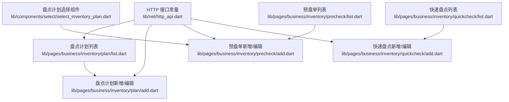
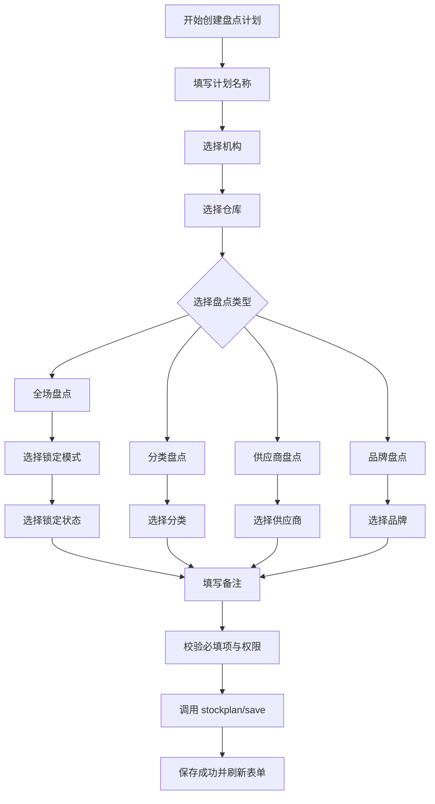
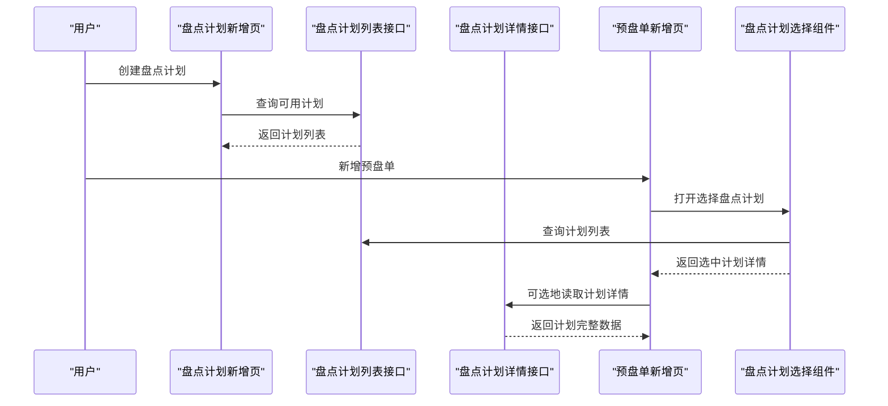
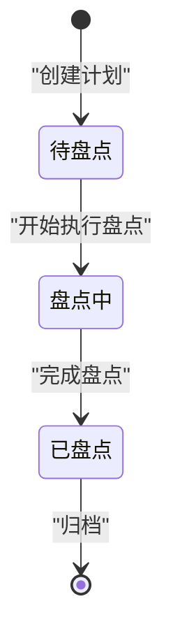
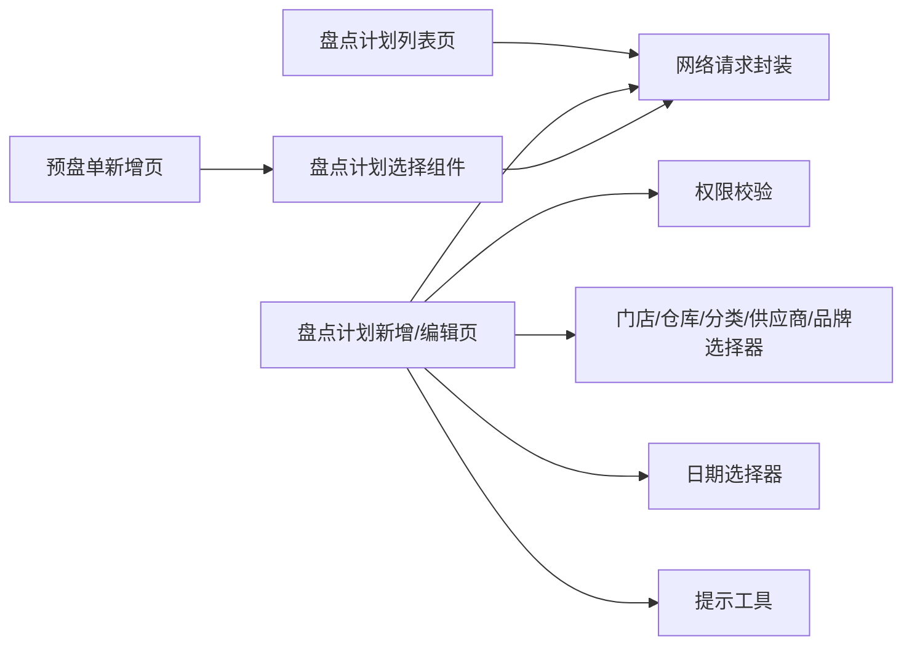

# 盘点计划API

<cite>
**本文引用的文件**   
- [http_api.dart](file://lib/net/http_api.dart)
- [list.dart](file://lib/pages/business/inventory/plan/list.dart)
- [add.dart](file://lib/pages/business/inventory/plan/add.dart)
- [select_inventory_plan.dart](file://lib/components/select/select_inventory_plan.dart)
- [precheck_list.dart](file://lib/pages/business/inventory/precheck/list.dart)
- [precheck_add.dart](file://lib/pages/business/inventory/precheck/add.dart)
- [quickcheck_list.dart](file://lib/pages/business/inventory/quickcheck/list.dart)
- [quickcheck_add.dart](file://lib/pages/business/inventory/quickcheck/add.dart)
</cite>

## 目录
1. [引言](#引言)
2. [项目结构定位](#项目结构定位)
3. [接口总览](#接口总览)
4. [通用请求与返回规范](#通用请求与返回规范)
5. [盘点计划列表 stockplan/findList](#盘点计划列表-stockplanfindlist)
6. [盘点计划详情 stockplan/getInfo](#盘点计划详情-stockplangetinfo)
7. [盘点计划保存 stockplan/save](#盘点计划保存-stockplansave)
8. [盘点计划删除 stockplan/delBill](#盘点计划删除-stockplandelbill)
9. [业务规则与字段语义](#业务规则与字段语义)
10. [与预盘单、快速盘点的关系和流转](#与预盘单快速盘点的关系和流转)
11. [完整操作示例](#完整操作示例)
12. [状态管理与审批流程](#状态管理与审批流程)
13. [依赖分析](#依赖分析)
14. [性能与错误处理建议](#性能与错误处理建议)
15. [故障排查](#故障排查)
16. [结论](#结论)

## 引言
本文面向灵犀管店 Flutter 客户端中与“盘点计划”相关的后端 API，重点覆盖以下四个接口：
- stockplan/findList：盘点计划列表查询
- stockplan/getInfo：盘点计划详情查询
- stockplan/save：新增或修改盘点计划
- stockplan/delBill：删除盘点计划

文档同时说明盘点计划创建流程、商品范围选择、计划时间设置、负责人分配等前端体现的业务规则，并解释盘点计划与预盘单、快速盘点之间的关系及典型流转路径。

## 项目结构定位
盘点计划能力集中在 Flutter 的库存模块中，主要涉及以下文件：
- 接口常量定义：`lib/net/http_api.dart`
- 盘点计划列表页：`lib/pages/business/inventory/plan/list.dart`
- 盘点计划新增/编辑页：`lib/pages/business/inventory/plan/add.dart`
- 盘点计划选择组件（被预盘单使用）：`lib/components/select/select_inventory_plan.dart`
- 预盘单列表/新增页：`lib/pages/business/inventory/precheck/{list,add}.dart`
- 快速盘点列表/新增页：`lib/pages/business/inventory/quickcheck/{list,add}.dart`

**图表来源**
- [http_api.dart:389-406](file://lib/net/http_api.dart#L389-L406)
- [list.dart:1-60](file://lib/pages/business/inventory/plan/list.dart#L1-L60)
- [add.dart:1-70](file://lib/pages/business/inventory/plan/add.dart#L1-L70)
- [select_inventory_plan.dart:1-30](file://lib/components/select/select_inventory_plan.dart#L1-L30)
- [precheck_list.dart:1-40](file://lib/pages/business/inventory/precheck/list.dart#L1-L40)
- [precheck_add.dart:1-50](file://lib/pages/business/inventory/precheck/add.dart#L1-L50)
- [quickcheck_list.dart:1-40](file://lib/pages/business/inventory/quickcheck/list.dart#L1-L40)
- [quickcheck_add.dart:1-50](file://lib/pages/business/inventory/quickcheck/add.dart#L1-L50)

**章节来源**
- [http_api.dart:389-406](file://lib/net/http_api.dart#L389-L406)
- [list.dart:1-60](file://lib/pages/business/inventory/plan/list.dart#L1-L60)
- [add.dart:1-70](file://lib/pages/business/inventory/plan/add.dart#L1-L70)

## 接口总览
盘点计划相关接口由 HTTP 常量集中声明，并在页面中通过通用网络层调用。

| 接口别名 | 实际接口路径 | 用途 | 前端主要入口 |
|---|---|---|---|
| stockplanFindList | `stockplan/findList` | 查询盘点计划列表 | 盘点计划列表页 |
| stockplanGetInfo | `stockplan/getInfo` | 获取盘点计划详情 | 盘点计划新增/编辑页 |
| stockplanSave | `stockplan/save` | 新增或修改盘点计划 | 盘点计划新增/编辑页 |
| stockplanDelBill | `stockplan/delBill` | 删除盘点计划 | 盘点计划详情页 |

此外，预盘单与快速盘点分别对应：
- 预盘单：`stockprecheck/findList`、`stockprecheck/getInfo`、`stockprecheck/save`、`stockprecheck/delBill`
- 快速盘点：`stockcheckfast/findList`、`stockcheckfast/getInfo`、`stockcheckfast/save`、`stockcheckfast/delBill`

**章节来源**
- [http_api.dart:389-406](file://lib/net/http_api.dart#L389-L406)

## 通用请求与返回规范
### 通用请求模式
盘点计划列表和详情查询都基于统一的网络调用方式：
- 列表接口直接传入分页参数、筛选条件和时间范围。
- 详情接口以单据主键作为入参，通常包含 `billid`。
- 保存接口传入表单数据；编辑时额外携带 `billid`。
- 删除接口以当前单据对象为主键参数。

### 列表响应结构
盘点计划列表接口返回的通用结构中，业务数据位于 `data.list`：
- `result.data`：顶层业务数据容器。
- `result.data.list`：盘点计划明细数组。
- 若 `data` 不是预期结构，前端会降级为空列表。

### 详情响应结构
盘点计划详情接口返回的通用结构中，业务数据位于 `result.data`：
- `result.data.planname`：计划名称
- `result.data.bsid`：机构ID
- `result.data.storename`：机构名称
- `result.data.counterid`：仓库ID
- `result.data.countername`：仓库名称
- `result.data.clearflag`：库存清零标志
- `result.data.openflag`：营业状态标志
- `result.data.checktype`：盘点类型
- `result.data.lockmode`：锁定模式
- `result.data.lockflag`：锁定状态
- `result.data.remark`：备注
- `result.data.stockPlanItemtypeResp`：商品范围明细列表
- `result.data.signflag`：审核状态标志
- `result.data.billid`：单据ID（用于编辑和删除）

**章节来源**
- [list.dart:100-160](file://lib/pages/business/inventory/plan/list.dart#L100-L160)
- [add.dart:80-110](file://lib/pages/business/inventory/plan/add.dart#L80-L110)

## 盘点计划列表 stockplan/findList
### 接口说明
- 接口路径：`stockplan/findList`
- 用途：查询盘点计划列表，支持分页、关键字、日期范围、制单人、盘点范围等筛选。

### 请求参数
| 参数名 | 类型 | 必填 | 说明 |
|---|---|---|---|
| is_page | Number | 是 | 分页开关，固定为 `1` |
| cond | String | 否 | 条件字符串，前端默认传空字符串 |
| field | String | 是 | 排序字段，固定为 `createtime` |
| type | String | 是 | 排序方向，固定为 `desc` |
| page | Number | 是 | 当前页码 |
| billno | String | 否 | 单据号关键字 |
| datetype | String | 是 | 日期类型，固定为 `1` |
| signflag | String | 否 | 状态筛选；空表示全部，`0` 表示待盘点，`2` 表示盘点中，`1` 表示已盘点 |
| sids | Array\<Number\> | 否 | 门店ID列表，用于按门店筛选 |
| starttime | String | 是 | 开始时间，格式为 `yyyy-MM-dd HH:mm:ss` |
| endtime | String | 是 | 结束时间，格式为 `yyyy-MM-dd HH:mm:ss` |
| createid | String | 否 | 制单人ID |
| checktype | String | 否 | 盘点范围；空表示全部，`1` 全场，`2` 分类，`3` 供应商，`4` 品牌 |

### 状态映射
前端 Tab 与后端 `signflag` 的映射如下：
- 全部：不传或传空
- 待盘点：`0`
- 盘点中：`2`
- 已盘点：`1`

### 响应数据
- 成功时 `result.data.list` 为盘点计划数组。
- 失败或无数据时，前端将 `hasMore` 置为 false，停止加载更多。

### 列表交互要点
- 默认时间范围为最近 30 天。
- 支持上拉加载更多。
- 支持搜索框模糊匹配单据号。
- 支持筛选抽屉：快速时间、自定义起止时间、制单人、盘点范围。
- 权限控制：用户需具备查看盘点计划权限，否则提示无权查看。

**章节来源**
- [list.dart:20-60](file://lib/pages/business/inventory/plan/list.dart#L20-L60)
- [list.dart:100-160](file://lib/pages/business/inventory/plan/list.dart#L100-L160)
- [list.dart:201-500](file://lib/pages/business/inventory/plan/list.dart#L201-L500)

## 盘点计划详情 stockplan/getInfo
### 接口说明
- 接口路径：`stockplan/getInfo`
- 用途：根据单据主键获取盘点计划详情，用于编辑和查看。

### 请求参数
| 参数名 | 类型 | 必填 | 说明 |
|---|---|---|---|
| billid | String | 是 | 盘点计划单据ID |

### 响应数据
详情返回对象包含计划基础信息、仓库信息、盘点范围、锁定策略、备注、审核状态等。前端在加载成功后回填表单控件，并重建“未保存修改基线”。

### 典型数据字段
| 字段 | 类型 | 说明 |
|---|---|---|
| planname | String | 计划名称 |
| bsid | String | 机构ID |
| storename | String | 机构名称 |
| counterid | String | 仓库ID |
| countername | String | 仓库名称 |
| clearflag | String | 库存清零标志，`1` 表示库存清零，`0` 表示库存不变 |
| openflag | String | 营业状态标志，`1` 表示营业中盘点，`0` 表示停业盘点 |
| checktype | Number | 盘点类型：`1` 全场，`2` 分类，`3` 供应商，`4` 品牌 |
| lockmode | Number | 锁定模式：`1` 系统立即锁定，`2` 人工手动锁定 |
| lockflag | Number | 锁定状态：`0` 暂不锁定，`1` 立即锁定 |
| remark | String | 备注 |
| stockPlanItemtypeResp | Array | 商品范围明细 |
| signflag | String | 审核状态标志 |
| billid | String | 单据ID |

**章节来源**
- [add.dart:80-110](file://lib/pages/business/inventory/plan/add.dart#L80-L110)

## 盘点计划保存 stockplan/save
### 接口说明
- 接口路径：`stockplan/save`
- 用途：新增或修改盘点计划。
- 编辑场景下必须携带 `billid`。

### 请求参数
| 参数名 | 类型 | 必填 | 说明 |
|---|---|---|---|
| planname | String | 是 | 计划名称 |
| bsid | String | 是 | 机构ID |
| storename | String | 否 | 机构名称 |
| counterid | String | 是 | 仓库ID |
| countername | String | 否 | 仓库名称 |
| clearflag | String | 是 | 库存清零标志 |
| openflag | String | 是 | 营业状态标志 |
| checktype | Number | 是 | 盘点类型 |
| lockmode | Number | 是 | 锁定模式 |
| lockflag | Number | 是 | 锁定状态 |
| remark | String | 否 | 备注 |
| stockPlanItemtypeResp | Array | 条件必填 | 商品范围明细 |
| billid | String | 编辑时必填 | 盘点计划单据ID |

### 校验规则
- 计划名称不能为空。
- 必须选择机构。
- 必须选择仓库。
- 非全场盘点时，必须选择对应的商品范围：
  - 分类盘点：必须选择分类。
  - 供应商盘点：必须选择供应商。
  - 品牌盘点：必须选择品牌。
- 保存前会根据是否编辑进行权限检查：
  - 新增需要新增权限。
  - 编辑需要编辑权限。

### 响应数据
- 保存成功后返回新的或更新后的单据数据，前端将其写入本地 `billData`，并刷新未保存修改基线。

**章节来源**
- [add.dart:204-280](file://lib/pages/business/inventory/plan/add.dart#L204-L280)

## 盘点计划删除 stockplan/delBill
### 接口说明
- 接口路径：`stockplan/delBill`
- 用途：删除盘点计划。

### 请求参数
- 删除接口以当前单据对象为主参数，核心标识为 `billid`。

### 交互流程
1. 进入删除流程前检查删除权限。
2. 弹出确认对话框。
3. 确认后调用删除接口。
4. 删除成功后提示成功并返回上一页。

**章节来源**
- [add.dart:282-318](file://lib/pages/business/inventory/plan/add.dart#L282-L318)

## 业务规则与字段语义
### 盘点类型
| checktype | 名称 | 含义 |
|---|---|---|
| 1 | 全场盘点 | 对指定仓库内全部商品进行盘点 |
| 2 | 分类盘点 | 仅对选定商品分类下的商品进行盘点 |
| 3 | 供应商盘点 | 仅对选定供应商的商品进行盘点 |
| 4 | 品牌盘点 | 仅对选定品牌的商品进行盘点 |

### 库存清零标志 clearflag
- `1`：库存清零。
- `0`：库存不变。
- 该字段在非全场盘点时参与展示和业务逻辑。

### 营业状态标志 openflag
- `1`：营业中盘点。
- `0`：停业盘点。
- 前端存在该字段，但当前界面已隐藏该行；字段仍保留在网络传输中。

### 锁定模式 lockmode
- `1`：系统立即锁定。
- `2`：人工手动锁定。
- 仅在“全场盘点”时显示和生效。

### 锁定状态 lockflag
- `0`：暂不锁定。
- `1`：立即锁定。
- 在全场盘点且为新建计划、且非系统立即锁定模式下可编辑。

### 商品范围选择
- 全场盘点不需要选择具体商品范围。
- 分类、供应商、品牌盘点需要在对应下拉中选择范围。
- 切换盘点类型时，如果已有明细，前端会提示清空内容。

### 计划时间与负责人
- 计划时间主要由列表筛选控制，包括快速时间、自定义起止时间。
- 负责人相关字段在前端体现为制单人筛选；计划本身的基础字段包括机构、仓库、备注等。

**图表来源**
- [add.dart:204-280](file://lib/pages/business/inventory/plan/add.dart#L204-L280)
- [add.dart:320-430](file://lib/pages/business/inventory/plan/add.dart#L320-L430)
- [add.dart:515-570](file://lib/pages/business/inventory/plan/add.dart#L515-L570)

**章节来源**
- [add.dart:204-280](file://lib/pages/business/inventory/plan/add.dart#L204-L280)
- [add.dart:320-430](file://lib/pages/business/inventory/plan/add.dart#L320-L430)
- [add.dart:515-570](file://lib/pages/business/inventory/plan/add.dart#L515-L570)

## 与预盘单、快速盘点的关系和流转
### 三者的角色差异
- **盘点计划**：定义盘点范围、仓库、锁定策略等计划级信息，是后续执行盘点的依据。
- **预盘单**：基于盘点计划生成的预盘单据，支持选择具体盘点计划，并维护盘点明细、附件、多级审批等信息。
- **快速盘点**：更轻量的即时盘点单据，不强制绑定盘点计划，主要用于快速扫码盘点。

### 关键关系
- 预盘单新增页提供“选择盘点计划”入口，使用 `SelectInventoryPlanPage` 组件。
- 选择盘点计划时，组件调用盘点计划列表接口，并返回选中计划的详情数据。
- 预盘单和快速盘点都有各自的状态筛选：待审核、已审核、已驳回。
- 盘点计划本身的状态筛选为：全部、待盘点、盘点中、已盘点。

**图表来源**
- [precheck_add.dart:1-50](file://lib/pages/business/inventory/precheck/add.dart#L1-L50)
- [select_inventory_plan.dart:1-30](file://lib/components/select/select_inventory_plan.dart#L1-L30)
- [list.dart:100-160](file://lib/pages/business/inventory/plan/list.dart#L100-L160)
- [add.dart:80-110](file://lib/pages/business/inventory/plan/add.dart#L80-L110)

**章节来源**
- [precheck_add.dart:1-50](file://lib/pages/business/inventory/precheck/add.dart#L1-L50)
- [select_inventory_plan.dart:1-30](file://lib/components/select/select_inventory_plan.dart#L1-L30)
- [precheck_list.dart:1-60](file://lib/pages/business/inventory/precheck/list.dart#L1-L60)
- [quickcheck_list.dart:1-60](file://lib/pages/business/inventory/quickcheck/list.dart#L1-L60)

## 完整操作示例
### 创建盘点计划
1. 进入盘点计划新增页。
2. 填写计划名称。
3. 选择机构。
4. 选择仓库。
5. 选择盘点类型：
   - 全场盘点：可选择锁定模式和锁定状态。
   - 分类/供应商/品牌盘点：选择对应范围。
6. 填写备注。
7. 点击保存，调用 `stockplan/save`。
8. 保存成功后，表单刷新并允许继续编辑或返回。

### 修改盘点计划
1. 从列表进入盘点计划详情。
2. 详情加载后调用 `stockplan/getInfo`。
3. 编辑后可再次调用 `stockplan/save`，携带 `billid`。
4. 已审核单据不可编辑，只读或走撤回流程。

### 删除盘点计划
1. 在盘点计划详情页点击删除。
2. 二次确认。
3. 调用 `stockplan/delBill`。
4. 删除成功后返回列表。

### 通过预盘单关联盘点计划
1. 进入预盘单新增页。
2. 打开“选择盘点计划”。
3. 使用计划列表筛选找到目标计划。
4. 选中计划后，预盘单继承计划中的机构、仓库、盘点类型等上下文。

**章节来源**
- [add.dart:204-318](file://lib/pages/business/inventory/plan/add.dart#L204-L318)
- [add.dart:80-110](file://lib/pages/business/inventory/plan/add.dart#L80-L110)
- [precheck_add.dart:1-50](file://lib/pages/business/inventory/precheck/add.dart#L1-L50)

## 状态管理与审批流程
### 盘点计划状态
盘点计划列表使用 `signflag` 表达状态：
- 空值或空字符串：全部
- `0`：待盘点
- `2`：盘点中
- `1`：已盘点

### 预盘单与快速盘点状态
两者均使用类似的状态筛选：
- 待审核：`0`
- 已审核：`1`
- 已驳回：`2`

### 审批流程
- 预盘单和快速盘点新增/编辑页中存在多级审批相关字段，例如审批人员列表、审批单据流、签字状态、当前用户信息等。
- 盘点计划新增/编辑页侧重计划创建与锁定策略，不直接承担复杂多级审批逻辑，更多依赖后端审批流。

**图表来源**
- [list.dart:40-60](file://lib/pages/business/inventory/plan/list.dart#L40-L60)
- [precheck_list.dart:20-60](file://lib/pages/business/inventory/precheck/list.dart#L20-L60)
- [quickcheck_list.dart:20-60](file://lib/pages/business/inventory/quickcheck/list.dart#L20-L60)

**章节来源**
- [list.dart:40-60](file://lib/pages/business/inventory/plan/list.dart#L40-L60)
- [precheck_list.dart:20-60](file://lib/pages/business/inventory/precheck/list.dart#L20-L60)
- [quickcheck_list.dart:20-60](file://lib/pages/business/inventory/quickcheck/list.dart#L20-L60)

## 依赖分析
盘点计划相关代码依赖以下核心模块：
- HTTP 接口常量：统一维护接口路径。
- HTTP 工具：封装 `request` 调用。
- 权限工具：校验查看、新增、编辑、删除权限。
- 选择器组件：门店、仓库、分类、供应商、品牌、盘点计划。
- 日期选择器：快速时间和自定义时间。
- Toast 与日志：用户提示与页面埋点。

**图表来源**
- [list.dart:1-60](file://lib/pages/business/inventory/plan/list.dart#L1-L60)
- [add.dart:1-70](file://lib/pages/business/inventory/plan/add.dart#L1-L70)
- [precheck_add.dart:1-50](file://lib/pages/business/inventory/precheck/add.dart#L1-L50)
- [select_inventory_plan.dart:1-30](file://lib/components/select/select_inventory_plan.dart#L1-L30)

**章节来源**
- [list.dart:1-60](file://lib/pages/business/inventory/plan/list.dart#L1-L60)
- [add.dart:1-70](file://lib/pages/business/inventory/plan/add.dart#L1-L70)
- [precheck_add.dart:1-50](file://lib/pages/business/inventory/precheck/add.dart#L1-L50)

## 性能与错误处理建议
- 列表分页：前端已实现滚动到底部自动加载下一页，应避免重复请求。
- 防抖搜索：输入框变化后延迟发起查询，减少频繁请求。
- 空数据处理：当列表接口返回非预期结构时，前端会降级为空列表并停止加载更多。
- 权限拦截：新增、编辑、删除前均做权限校验，避免无效请求。
- 异常恢复：请求失败时将 `hasMore` 设为 false，防止无限重试。

[本节为通用指导，不直接分析具体文件]

## 故障排查
### 常见问题
- 无法查看盘点计划：检查是否具备查看权限。
- 无法新增或编辑盘点计划：检查新增/编辑权限。
- 无法删除盘点计划：检查删除权限。
- 保存时报错：检查计划名称、机构、仓库、盘点范围是否填写完整。
- 切换盘点类型丢失明细：属于预期行为，前端会在确认清空后切换。
- 预盘单无法选择盘点计划：检查盘点计划列表是否能正常加载。

**章节来源**
- [list.dart:20-60](file://lib/pages/business/inventory/plan/list.dart#L20-L60)
- [add.dart:204-318](file://lib/pages/business/inventory/plan/add.dart#L204-L318)

## 结论
盘点计划 API 在灵犀管店 Flutter 项目中承担库存盘点流程的计划层职责。通过 `stockplan/findList`、`stockplan/getInfo`、`stockplan/save`、`stockplan/delBill` 四个接口，配合前端的状态筛选、权限控制、商品范围选择和锁定策略配置，形成完整的盘点计划管理能力。预盘单和快速盘点在此基础上进一步落地执行，其中预盘单与盘点计划存在明确的关联关系，快速盘点则更偏向轻量即时盘点。理解这些接口与页面的协作方式，有助于正确设计盘点业务流程、扩展审批流程和对接后端服务。