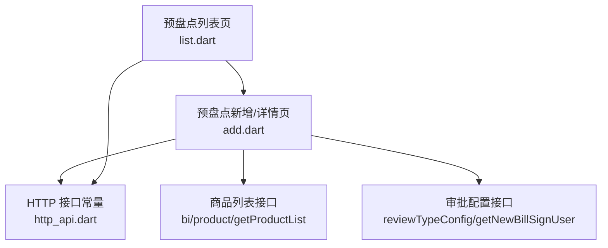
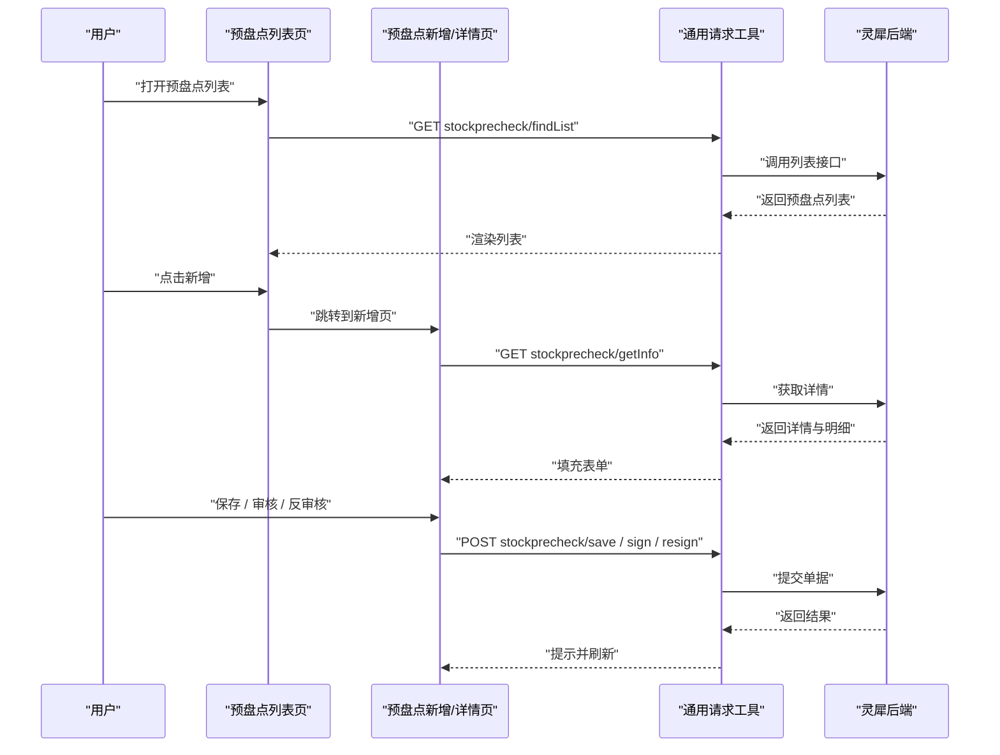
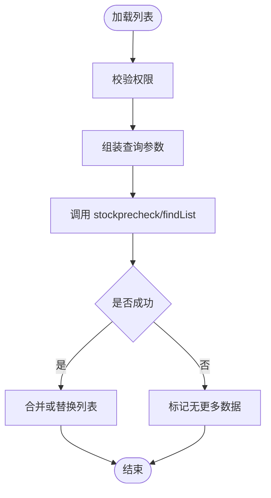
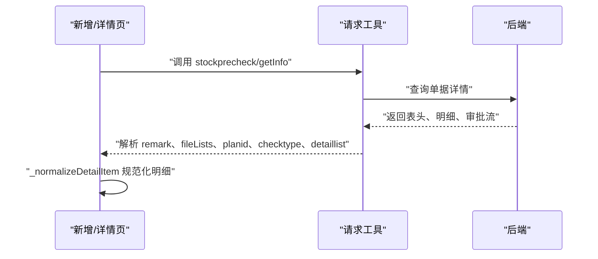
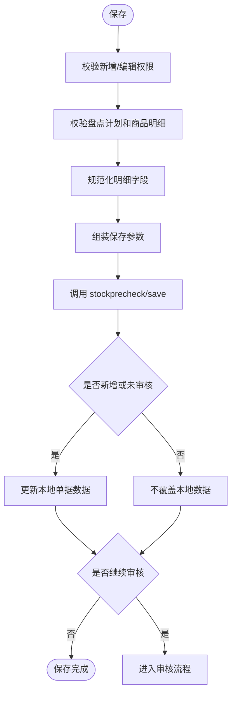
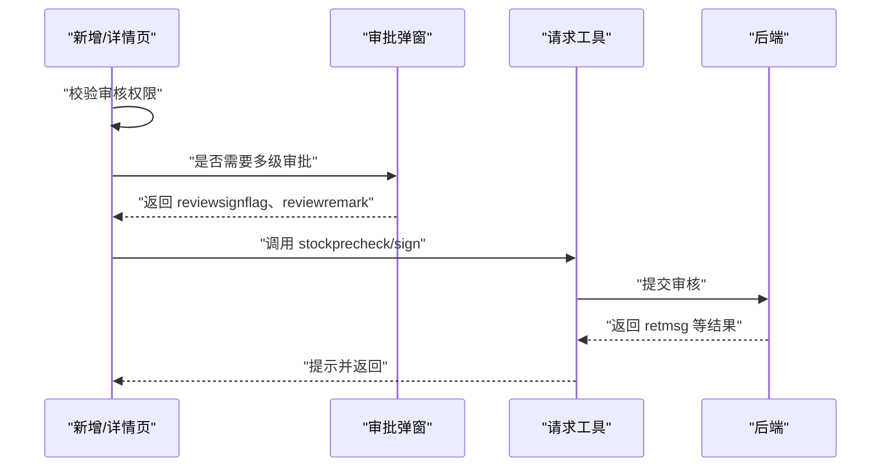
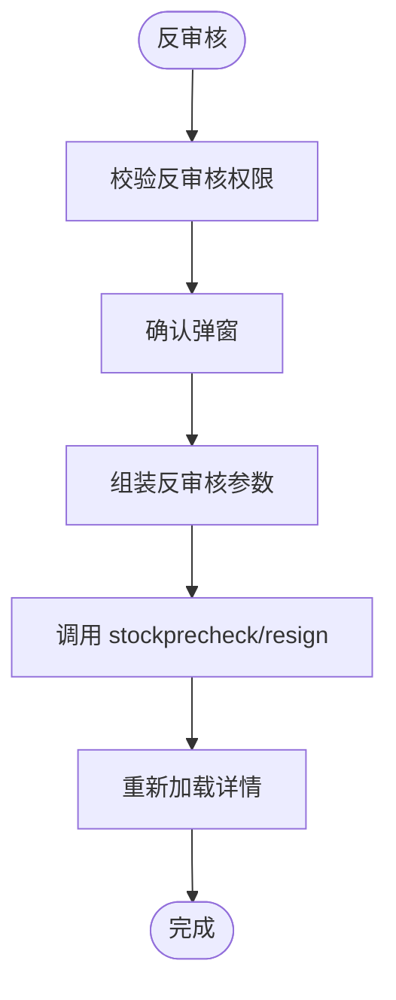
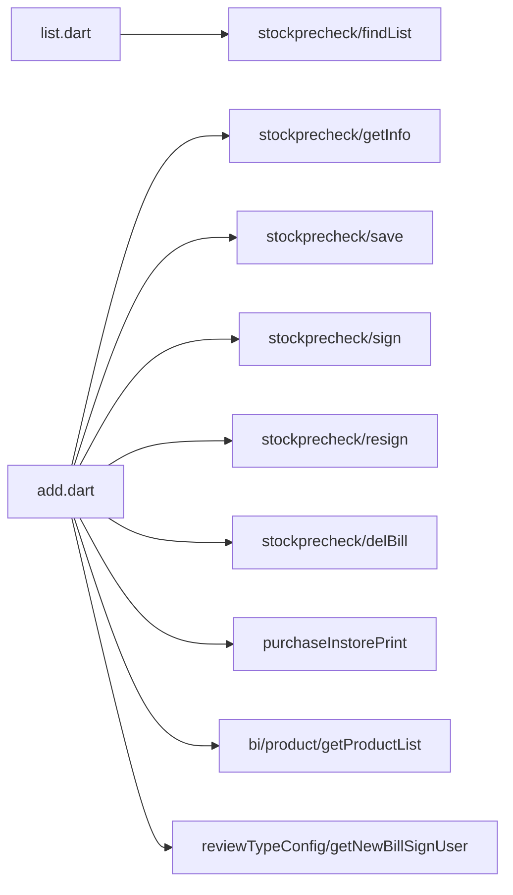

# 预盘点API

<cite>
**本文引用的文件**   
- [lib/net/http_api.dart](file://lib/net/http_api.dart)
- [lib/pages/business/inventory/precheck/list.dart](file://lib/pages/business/inventory/precheck/list.dart)
- [lib/pages/business/inventory/precheck/add.dart](file://lib/pages/business/inventory/precheck/add.dart)
</cite>

## 目录
1. [引言](#引言)
2. [项目结构与定位](#项目结构与定位)
3. [核心接口清单](#核心接口清单)
4. [架构与调用流程](#架构与调用流程)
5. [接口详细规范](#接口详细规范)
6. [业务概念与差异说明](#业务概念与差异说明)
7. [数据结构与状态管理](#数据结构与状态管理)
8. [完整操作流程示例](#完整操作流程示例)
9. [依赖关系分析](#依赖关系分析)
10. [性能与可用性特征](#性能与可用性特征)
11. [常见问题与排查](#常见问题与排查)
12. [结论](#结论)

## 引言
本文面向灵犀管店 Flutter 客户端中的“预盘点”能力，聚焦以下后端 API 在客户端中的实际调用方式、参数结构、返回数据使用方式及业务流程：
- stockprecheck/findList：预盘点列表查询
- stockprecheck/getInfo：预盘点详情查询
- stockprecheck/save：预盘点新增或保存
- stockprecheck/sign：预盘点审核
- stockprecheck/resign：预盘点反审核

文档同时说明预盘点与普通盘点的区别、预盘数据的生成逻辑、盘点差异的计算方式，以及预盘点与“盘点计划”“快速盘点”的关联关系。

## 项目结构与定位
预盘点功能位于库存模块下，主要由两个页面承担：
- 列表页：负责筛选、分页加载、跳转新增和查看详情。
- 新增/详情页：负责选择盘点计划、选择商品、录入预盘数量、计算差异、保存、审核、反审核、打印、删除等完整操作。

**图表来源**
- [lib/pages/business/inventory/precheck/list.dart:1-200](file://lib/pages/business/inventory/precheck/list.dart#L1-L200)
- [lib/pages/business/inventory/precheck/add.dart:1-200](file://lib/pages/business/inventory/precheck/add.dart#L1-L200)
- [lib/net/http_api.dart:395-400](file://lib/net/http_api.dart#L395-L400)

**章节来源**
- [lib/pages/business/inventory/precheck/list.dart:1-200](file://lib/pages/business/inventory/precheck/list.dart#L1-L200)
- [lib/pages/business/inventory/precheck/add.dart:1-200](file://lib/pages/business/inventory/precheck/add.dart#L1-L200)

## 核心接口清单
| 序号 | 接口名 | HTTP API 常量 | 主要用途 | 前端权限控制标识 |
|---:|---|---|---|---|
| 1 | stockprecheck/findList | `HttpApi.stockprecheckFindList` | 查询预盘点单列表 | 列表页入口权限校验 |
| 2 | stockprecheck/getInfo | `HttpApi.stockprecheckGetInfo` | 查询预盘点单详情 | 进入编辑态时加载 |
| 3 | stockprecheck/save | `HttpApi.stockprecheckSave` | 新增或保存预盘点单 | 新增权限、编辑权限 |
| 4 | stockprecheck/sign | `HttpApi.stockprecheckSign` | 提交审核 | 审核权限 |
| 5 | stockprecheck/resign | `HttpApi.stockprecheckResign` | 反审核已审核单据 | 反审核权限 |
| 6 | stockprecheck/delBill | `HttpApi.stockprecheckDelBill` | 删除预盘点单（辅助） | 删除权限 |
| 7 | 打印 | `HttpApi.purchaseInstorePrint` | 调用统一打印接口 | 无独立权限 |

上述常量定义集中在网络接口常量类中；列表页通过字符串路径直接请求 findList；新增/详情页通过常量调用 getInfo、save、sign、resign、delBill 和打印接口。

**章节来源**
- [lib/net/http_api.dart:395-400](file://lib/net/http_api.dart#L395-L400)
- [lib/pages/business/inventory/precheck/list.dart:100-180](file://lib/pages/business/inventory/precheck/list.dart#L100-L180)
- [lib/pages/business/inventory/precheck/add.dart:260-520](file://lib/pages/business/inventory/precheck/add.dart#L260-L520)

## 架构与调用流程
预盘点在前端采用“页面 + 网络常量 + 通用请求工具”的结构：
- 列表页负责条件筛选、分页、状态切换、跳转新增。
- 新增/详情页负责表单建模、扫码选品、批量处理、保存、审核、反审核、打印、删除。
- 所有服务端接口路径集中维护在 `HttpApi`，避免硬编码散落。

**图表来源**
- [lib/pages/business/inventory/precheck/list.dart:100-180](file://lib/pages/business/inventory/precheck/list.dart#L100-L180)
- [lib/pages/business/inventory/precheck/add.dart:240-520](file://lib/pages/business/inventory/precheck/add.dart#L240-L520)

**章节来源**
- [lib/pages/business/inventory/precheck/list.dart:100-180](file://lib/pages/business/inventory/precheck/list.dart#L100-L180)
- [lib/pages/business/inventory/precheck/add.dart:240-520](file://lib/pages/business/inventory/precheck/add.dart#L240-L520)

## 接口详细规范

### stockprecheck/findList：预盘点列表
- 作用：按时间范围、单据号、审核状态、机构、创建人、检查类型等条件分页查询预盘点单。
- 调用位置：列表页 `_loadData` 方法中直接拼接路径 `/stockprecheck/findList` 发起请求。
- 主要入参：
  - `is_page`：固定为 `1`，表示启用分页。
  - `page`：当前页码。
  - `billno`：单据号模糊搜索。
  - `datetype`：日期类型，代码中使用 `1`。
  - `starttime` / `endtime`：默认最近 30 天的起止时间。
  - `signflag`：根据 Tab 状态映射：
    - 待审核：`0`
    - 已审核：`1`
    - 已驳回：`2`
    - 全部：空值
  - `sids`：可选机构 ID 列表。
  - `createid`：可选创建人 ID。
  - `checktype`：可选检查类型。
  - `field` / `type`：排序字段和方向，代码中固定为 `createtime` 降序。
- 主要出参：
  - `data.list`：预盘点单列表数组。
- 错误处理：
  - 请求失败时将 `_hasMore` 置为 false，停止加载更多。
  - 列表页首屏会校验权限标识，无权限时直接提示并跳过加载。

**图表来源**
- [lib/pages/business/inventory/precheck/list.dart:60-160](file://lib/pages/business/inventory/precheck/list.dart#L60-L160)

**章节来源**
- [lib/pages/business/inventory/precheck/list.dart:60-160](file://lib/pages/business/inventory/precheck/list.dart#L60-L160)

### stockprecheck/getInfo：预盘点详情
- 作用：加载一张预盘点单的表头信息、附件、审批流配置、检查类型选项和商品明细。
- 调用位置：新增/详情页进入编辑模式时调用 `HttpApi.stockprecheckGetInfo`。
- 主要入参：
  - 来自路由传入的 `billData`，包含 `billid` 等业务键。
- 主要出参与前端使用：
  - `remark`：备注。
  - `fileLists`：附件列表。
  - `planid` / `planname`：盘点计划编号与名称。
  - `bsid` / `storename`：机构编号与名称。
  - `counterid` / `countername`：仓库编号与名称。
  - `checktype`：检查类型，对应全场盘点、盘点分类、盘点供应商、盘点品牌。
  - `stockPlanItemtypeResp`：盘点分类树。
  - `detaillist`：商品明细。
  - `reviewFlowUsers` / `reviewBillFlows`：多级审批人员与单据审批流。
- 数据规范化：
  - 每个明细项会执行 `_normalizeDetailItem`，确保预盘数量、现库存、零售价、成本价、盈亏数量、零售金额等字段有合理默认值和计算值。

**图表来源**
- [lib/pages/business/inventory/precheck/add.dart:140-220](file://lib/pages/business/inventory/precheck/add.dart#L140-L220)

**章节来源**
- [lib/pages/business/inventory/precheck/add.dart:140-220](file://lib/pages/business/inventory/precheck/add.dart#L140-L220)

### stockprecheck/save：预盘点保存
- 作用：新增预盘点单或更新已有预盘点单。
- 调用位置：新增/详情页 `_save` 方法。
- 前置校验：
  - 新增需要新增权限；编辑需要编辑权限。
  - 必须选择盘点计划。
  - 必须至少有一条商品明细。
- 主要入参：
  - `planid` / `planname`：盘点计划。
  - `bsid` / `storename`：机构。
  - `counterid` / `countername`：仓库。
  - `checktype`：检查类型。
  - `signflag`：保存时固定传 `0`，表示未审核。
  - `remark`：备注。
  - `fileLists`：附件。
  - `stypename`：选中分类名称拼接。
  - `detaillist`：商品明细。
  - `billid`：编辑模式下携带。
- 主要出参：
  - `data`：服务端返回的完整单据数据；新增后用于回填 `billid` 等字段。
- 行为：
  - 保存成功后刷新表单快照，避免重复提示未保存修改。
  - 若保存后继续审核，则转入 `_doSignAfterSave`。

**图表来源**
- [lib/pages/business/inventory/precheck/add.dart:260-420](file://lib/pages/business/inventory/precheck/add.dart#L260-L420)

**章节来源**
- [lib/pages/business/inventory/precheck/add.dart:260-420](file://lib/pages/business/inventory/precheck/add.dart#L260-L420)

### stockprecheck/sign：预盘点审核
- 作用：提交预盘点单进行审核。
- 调用位置：`_sign` 和 `_doSign`。
- 前置校验：
  - 具备审核权限。
  - 存在可审核的单据数据。
- 多级审批支持：
  - 如果存在 `reviewFlowUsers`，先弹出审批对话框，用户可选择通过、驳回或撤回。
  - 回调中将 `reviewsignflag` 和 `reviewremark` 写入单据后再调用审核接口。
  - 当 `reviewsignflag` 为 `2` 时表示撤回；为 `0` 时表示驳回；其他情况视为通过。
- 主要入参：
  - 继承当前表单数据。
  - 明确传入 `planid`、`planname`、`bsid`、`storename`、`counterid`、`countername`、`checktype`、`signflag=1`、`remark`、`fileLists`、`stypename`、`detaillist`。
  - 多级审批时可能携带 `reviewsignflag`、`reviewremark`。
- 主要出参：
  - 成功提示文案优先取服务器返回的 `retmsg`，否则按审批状态推断提示。
- 行为：
  - 审核成功后返回上一页。

**图表来源**
- [lib/pages/business/inventory/precheck/add.dart:420-520](file://lib/pages/business/inventory/precheck/add.dart#L420-L520)

**章节来源**
- [lib/pages/business/inventory/precheck/add.dart:420-520](file://lib/pages/business/inventory/precheck/add.dart#L420-L520)

### stockprecheck/resign：预盘点反审核
- 作用：将已审核的预盘点单恢复到可编辑状态。
- 调用位置：`_resign`。
- 前置校验：
  - 具备反审核权限。
  - 确认弹窗。
- 主要入参：
  - 继承当前表单数据。
  - 明确传入计划、机构、仓库、检查类型、备注、附件、分类名称、明细。
  - `signflag` 保持原单据状态，由服务端决定是否允许反审核。
- 主要出参：
  - 成功后提示“反审核成功”，然后重新加载详情。

**图表来源**
- [lib/pages/business/inventory/precheck/add.dart:520-620](file://lib/pages/business/inventory/precheck/add.dart#L520-L620)

**章节来源**
- [lib/pages/business/inventory/precheck/add.dart:520-620](file://lib/pages/business/inventory/precheck/add.dart#L520-L620)

## 业务概念与差异说明

### 预盘点与普通盘点
从前端实现看，预盘点和普通盘点共享部分基础能力：
- 都基于“盘点计划”生成或选择商品。
- 都支持按全场、分类、供应商、品牌等方式组织盘点范围。
- 都支持扫描条码、选择批次、录入数量、计算差异。
- 都支持保存、审核、反审核、打印、删除。

差异主要体现在：
- 预盘点更强调“计划驱动”：新增时必须选择盘点计划，计划决定机构、仓库、检查类型和可选分类。
- 预盘点在扫码和商品选择时使用 `billtypeflag='ypd'`，表示预盘点场景的商品查询策略。
- 普通盘点通常对应“快速盘点”等其他入口；快速盘点也复用同一套商品选择和扫码逻辑，但业务上下文不同。

### 预盘点与盘点计划的关联
- 新增预盘点单前必须先选择盘点计划。
- 选择盘点计划后，前端会回填：
  - 机构编号与名称。
  - 仓库编号与名称。
  - 检查类型。
  - 盘点分类树。
- 没有盘点计划时，不能选择商品、不能扫码、不能保存。

### 预盘点与快速盘点的关联
- 快速盘点和预盘点共用商品选择组件和扫码逻辑。
- 快速盘点在新增页也会读取当前门店和仓库等上下文。
- 预盘点在扫码时显式传入 `billtypeflag='ypd'`，便于后端区分预盘点查询语义。
- 两者最终都可能转化为盘点明细，但预盘点更偏向“计划+预盘数量+差异分析”的流程。

**章节来源**
- [lib/pages/business/inventory/precheck/add.dart:100-220](file://lib/pages/business/inventory/precheck/add.dart#L100-L220)
- [lib/pages/business/inventory/precheck/add.dart:800-1000](file://lib/pages/business/inventory/precheck/add.dart#L800-L1000)
- [lib/pages/business/inventory/precheck/add.dart:1600-1700](file://lib/pages/business/inventory/precheck/add.dart#L1600-L1700)

## 数据结构与状态管理

### 表头关键数据
| 字段 | 含义 | 数据来源 |
|---|---|---|
| `billid` | 预盘点单编号 | 详情接口返回 |
| `billno` | 单据号 | 详情接口返回 |
| `planid` | 盘点计划编号 | 选择计划或详情返回 |
| `planname` | 盘点计划名称 | 选择计划或详情返回 |
| `bsid` | 机构编号 | 登录上下文、计划、详情 |
| `storename` | 机构名称 | 计划、详情 |
| `counterid` | 仓库编号 | 计划、详情 |
| `countername` | 仓库名称 | 计划、详情 |
| `checktype` | 检查类型 | 计划、详情 |
| `remark` | 备注 | 用户输入 |
| `fileLists` | 附件列表 | 详情返回或用户选择 |
| `signflag` | 审核状态 | 详情返回，保存传 `0`，审核传 `1` |
| `reviewsignflag` | 多级审批状态 | 审批弹窗和服务端返回 |
| `reviewremark` | 审批备注 | 审批弹窗 |

### 明细关键数据
| 字段 | 含义 | 计算规则 |
|---|---|---|
| `prodid` / `productid` | 商品编号 | 扫码或选品返回 |
| `barcode` / `selfbarcode` | 条码 | 扫码匹配 |
| `productname` / `name` | 商品名称 | 商品列表返回 |
| `unit` | 单位 | 商品列表返回 |
| `size` | 规格 | 商品列表返回 |
| `saleprice` / `sellprice` | 零售价 | 商品列表返回，兼容两种字段名 |
| `costprice` | 成本价 | 商品列表返回 |
| `stockqty` | 现库存 | 商品列表返回 |
| `precheckqty` | 预盘数量 | 扫码累加、手动输入、多选批次 |
| `batchno` | 批号 | 批次数据 |
| `birthdate` | 生产日期 | 批次数据 |
| `validdate` | 有效期 | 批次数据 |
| `remark` | 行备注 | 用户输入 |
| `morebatchflag` | 是否多批次 | 商品列表返回 |
| `validflag` | 强制多批次标志 | 商品列表返回 |
| `qty` | 盈亏数量 | 预盘数量减现库存 |
| `sellamt` | 零售金额 | 预盘数量乘零售价 |

### 状态管理机制
- 列表状态：
  - `_statusIndex`：Tab 状态，映射到 `signflag`。
  - `_page`、`_hasMore`、`_loading`：分页与加载状态。
  - `_list`：列表缓存。
- 新增/详情状态：
  - `_billData`：服务端返回的完整单据数据。
  - `_detailList`：商品明细。
  - `_submitAction`：提交动作枚举，防止重复提交。
  - `_formSnapshot`：表单快照，用于判断是否有未保存修改。
  - `_isSigned`：是否已审核。
  - `_isEdit`：是否为编辑模式。
  - `_selectedIndices`：批量删除选中行。
  - `_scanSettings`：扫码设置，控制红外输入框、连续扫码、扫码后行为。

**章节来源**
- [lib/pages/business/inventory/precheck/add.dart:20-220](file://lib/pages/business/inventory/precheck/add.dart#L20-L220)
- [lib/pages/business/inventory/precheck/add.dart:220-420](file://lib/pages/business/inventory/precheck/add.dart#L220-L420)
- [lib/pages/business/inventory/precheck/add.dart:1600-1700](file://lib/pages/business/inventory/precheck/add.dart#L1600-L1700)

## 完整操作流程示例

### 数据准备
1. 创建或选择一个盘点计划。
2. 系统自动带出机构、仓库、检查类型和可选分类。
3. 如果需要，选择具体盘点分类。
4. 准备商品数据：
   - 可通过扫码枪扫描条码。
   - 可通过摄像头扫描条码。
   - 可手动选择商品。
   - 对多批次商品，可选择多个批次，每个批次生成一行明细。

### 预盘数量录入
- 默认扫码模式：扫码一次增加一个数量。
- 重量码：按重量换算数量。
- 金额码：按金额除以单价换算数量。
- 连续扫码：开启后焦点自动回到扫描框，适合 PDA 或扫码枪。
- 手动输入模式：扫码后弹出商品详情抽屉，确认预盘数量、批次、备注等。

### 差异分析
- 盈亏数量：`qty = precheckqty - stockqty`。
- 零售金额：`sellamt = precheckqty * saleprice`。
- 负差异表示少货，正差异表示多货。
- 明细中的 `stockqty` 来自商品查询接口，代表系统现库存。

### 保存与审核
1. 保存：
   - 校验权限、盘点计划、商品明细。
   - 规范化明细字段。
   - 调用 `stockprecheck/save`。
2. 审核：
   - 校验审核权限。
   - 若有审批流，弹出审批对话框。
   - 调用 `stockprecheck/sign`。
3. 反审核：
   - 校验反审核权限。
   - 确认后调用 `stockprecheck/resign`。
   - 成功后重新加载详情。

```mermaid
sequenceDiagram
    participant Operator as "操作员"
    participant Precheck as "预盘点流程"
    participant Plan as "盘点计划"
    participant Product as "商品数据"
    participant Server as "后端服务"

    Operator->>Precheck: "选择盘点计划"
    Precheck->>Plan: "获取机构、仓库、检查类型"
    Operator->>Precheck: "扫码或选择商品"
    Precheck->>Product: "查询商品和批次"
    Product-->>Precheck: "返回现库存、价格、批次"
    Operator->>Precheck: "录入预盘数量"
    Precheck->>Precheck: "计算盈亏数量和零售金额"
    Operator->>Precheck: "保存"
    Precheck->>Server: "stockprecheck/save"
    Operator->>Precheck: "审核"
    Precheck->>Server: "stockprecheck/sign"
    Operator->>Precheck: "必要时反审核"
    Precheck->>Server: "stockprecheck/resign"
```

**图表来源**
- [lib/pages/business/inventory/precheck/add.dart:260-520](file://lib/pages/business/inventory/precheck/add.dart#L260-L520)
- [lib/pages/business/inventory/precheck/add.dart:1600-1700](file://lib/pages/business/inventory/precheck/add.dart#L1600-L1700)

**章节来源**
- [lib/pages/business/inventory/precheck/add.dart:260-520](file://lib/pages/business/inventory/precheck/add.dart#L260-L520)
- [lib/pages/business/inventory/precheck/add.dart:1600-1700](file://lib/pages/business/inventory/precheck/add.dart#L1600-L1700)

## 依赖关系分析

**图表来源**
- [lib/pages/business/inventory/precheck/list.dart:100-180](file://lib/pages/business/inventory/precheck/list.dart#L100-L180)
- [lib/pages/business/inventory/precheck/add.dart:240-520](file://lib/pages/business/inventory/precheck/add.dart#L240-L520)
- [lib/net/http_api.dart:395-400](file://lib/net/http_api.dart#L395-L400)

**章节来源**
- [lib/pages/business/inventory/precheck/list.dart:100-180](file://lib/pages/business/inventory/precheck/list.dart#L100-L180)
- [lib/pages/business/inventory/precheck/add.dart:240-520](file://lib/pages/business/inventory/precheck/add.dart#L240-L520)
- [lib/net/http_api.dart:395-400](file://lib/net/http_api.dart#L395-L400)

## 性能与可用性特征
- 列表分页：
  - 滚动到底部自动加载下一页。
  - 防重复加载：通过 `_loading` 控制。
  - 搜索防抖：输入变化后延迟 500ms 再触发查询。
- 扫码体验：
  - 扫码字符注入极快，使用 150ms 防抖避免漏掉末尾字符。
  - 支持红外扫描框和摄像头扫码。
  - 连续扫码模式下自动恢复焦点。
- 表单稳定性：
  - 使用表单快照检测未保存修改，避免误退出丢失数据。
  - 已审核单据限制编辑，减少误改风险。
- 权限控制：
  - 列表、新增、编辑、审核、删除、反审核均有关联权限标识。
  - 无权限时直接提示，不发起敏感操作。

[本节为通用可用性建议，不直接分析具体代码片段]

## 常见问题与排查

### 扫码找不到商品
- 可能原因：
  - 未选择盘点计划。
  - 条码与商品条码不一致。
  - 商品不在当前机构或仓库范围内。
  - 秤码解析异常。
- 排查建议：
  - 确认已选择盘点计划。
  - 检查扫码是否命中重量码或金额码。
  - 使用手动选品替代扫码验证商品是否存在。
  - 查看调试日志中的扫码参数和返回商品列表长度。

**章节来源**
- [lib/pages/business/inventory/precheck/add.dart:1600-1700](file://lib/pages/business/inventory/precheck/add.dart#L1600-L1700)

### 保存时报缺少必填项
- 常见缺失：
  - 未选择盘点计划。
  - 商品明细为空。
- 解决方式：
  - 先选择盘点计划。
  - 通过扫码或选品添加至少一条明细。

**章节来源**
- [lib/pages/business/inventory/precheck/add.dart:260-320](file://lib/pages/business/inventory/precheck/add.dart#L260-L320)

### 审核提示不属于审批节点
- 现象：
  - 多级审批配置下，当前用户不是审批节点人员。
- 解决方式：
  - 确认当前登录用户是否在 `reviewFlowUsers` 中。
  - 管理员账号拥有特殊判断逻辑。
  - 联系后台调整审批配置。

**章节来源**
- [lib/pages/business/inventory/precheck/add.dart:620-700](file://lib/pages/business/inventory/precheck/add.dart#L620-L700)

### 返回列表不刷新
- 可能原因：
  - 分页已加载完。
  - 网络请求失败。
- 排查建议：
  - 下拉刷新重置页码。
  - 检查 `signflag` 是否与当前 Tab 一致。
  - 检查权限是否被拦截。

**章节来源**
- [lib/pages/business/inventory/precheck/list.dart:60-160](file://lib/pages/business/inventory/precheck/list.dart#L60-L160)

## 结论
预盘点是灵犀管店库存盘点体系中的重要环节，它以“盘点计划”为核心，结合商品选择、扫码录入、差异计算、保存审核和反审核，形成完整的预盘闭环。客户端通过统一的 HTTP 接口常量管理接口路径，并在列表中支持分页、状态筛选和多维过滤；在新增/详情页中支持扫码、多批次、批量操作、未保存修改保护、多级审批和打印导出。理解这些接口和业务逻辑，有助于正确集成、扩展和优化灵犀管店的预盘点能力。