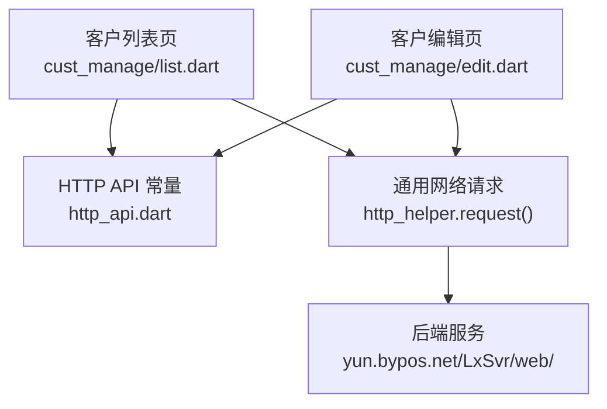
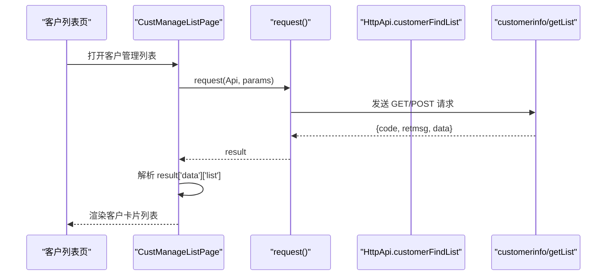
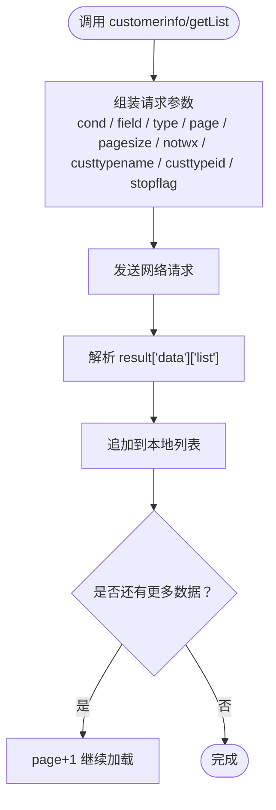
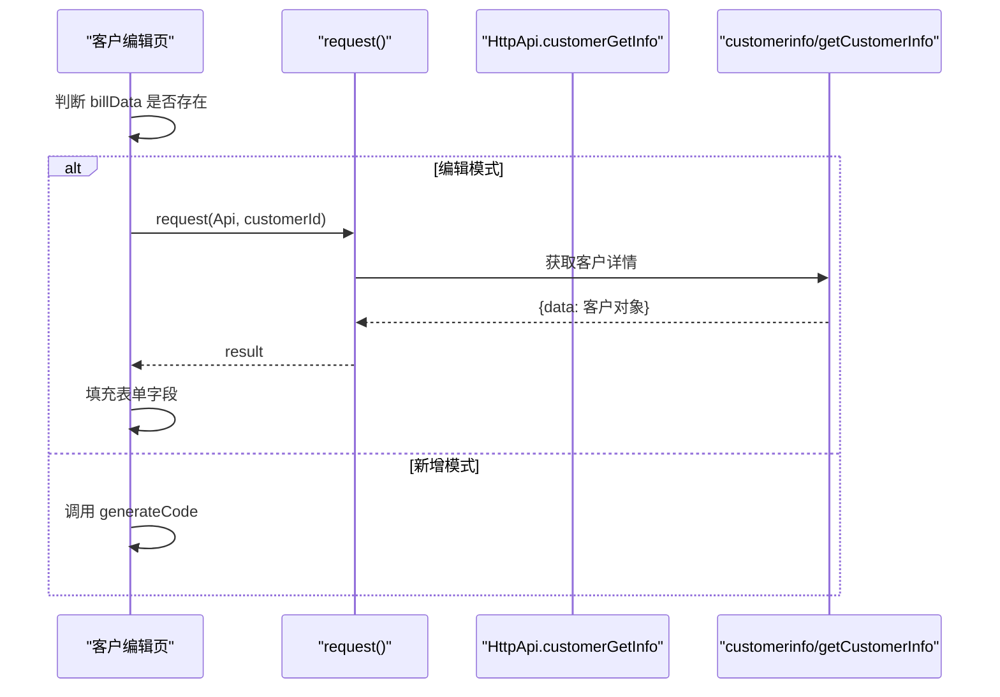
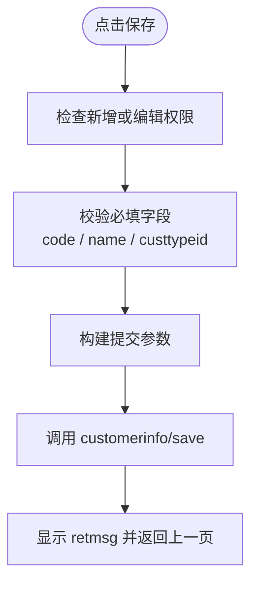
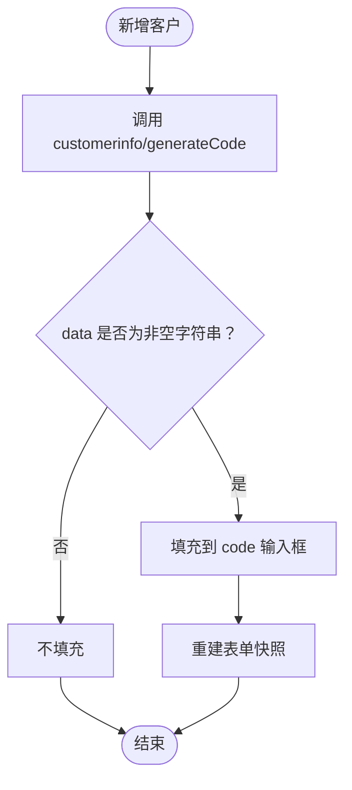
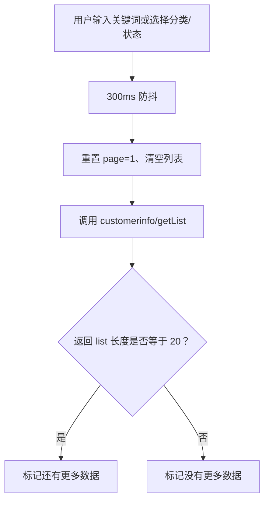
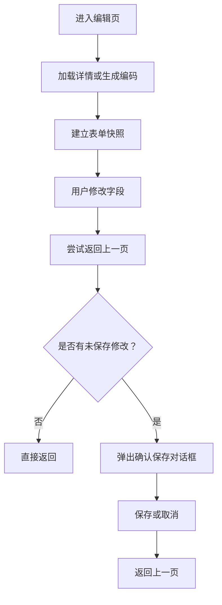
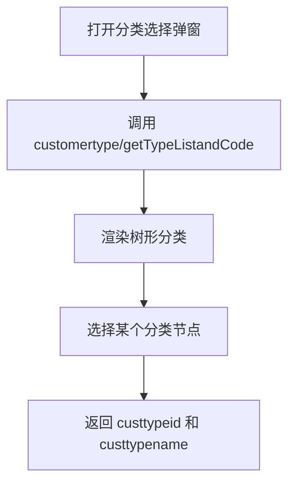
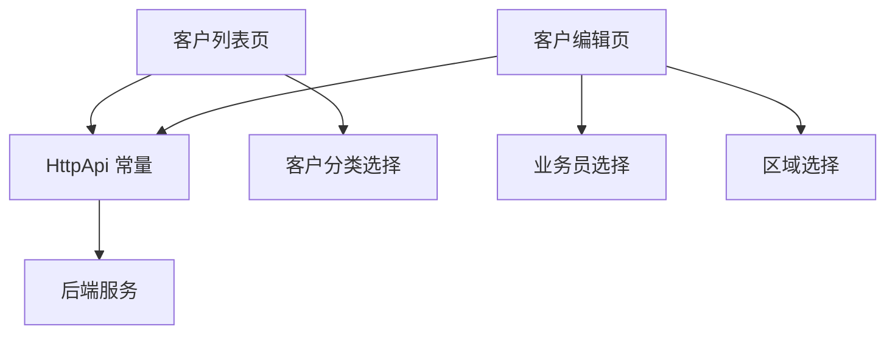

# 客户管理API

<cite>
**本文引用的文件**   
- [lib/net/http_api.dart](file://lib/net/http_api.dart)
- [lib/pages/business/wholesale/cust_manage/list.dart](file://lib/pages/business/wholesale/cust_manage/list.dart)
- [lib/pages/business/wholesale/cust_manage/edit.dart](file://lib/pages/business/wholesale/cust_manage/edit.dart)
</cite>

## 目录
1. [简介](#简介)
2. [项目结构定位](#项目结构定位)
3. [核心接口总览](#核心接口总览)
4. [架构与调用流程](#架构与调用流程)
5. [详细接口规范](#详细接口规范)
6. [客户数据模型与字段说明](#客户数据模型与字段说明)
7. [搜索、分页与排序规则](#搜索分页与排序规则)
8. [CRUD 操作示例](#crud-操作示例)
9. [数据验证与错误处理](#数据验证与错误处理)
10. [客户编码自动生成策略](#客户编码自动生成策略)
11. [客户分类管理](#客户分类管理)
12. [客户状态控制逻辑](#客户状态控制逻辑)
13. [依赖关系分析](#依赖关系分析)
14. [性能与可用性建议](#性能与可用性建议)
15. [故障排查指南](#故障排查指南)
16. [结论](#结论)

## 简介
本文档面向灵犀管店 Flutter 项目的批发业务模块，围绕“客户信息管理”能力，整理并说明以下后端接口的客户端使用方式：
- `customerinfo/getList`：客户列表查询
- `customerinfo/getCustomerInfo`：客户详情获取
- `customerinfo/save`：客户信息保存（新增或编辑）
- `customerinfo/generateCode`：生成客户编码

文档从前端实现出发，结合页面中的请求参数、返回数据结构、表单校验和交互逻辑，给出可操作的接口契约说明。该文档不虚构服务端响应字段，所有字段均以当前 Flutter 代码实际读取和提交的值为准。

## 项目结构定位
客户管理功能位于批发业务模块中，主要由两个页面组成：
- 客户列表页：负责搜索、筛选、分页加载、进入编辑页。
- 客户编辑页：负责新增、编辑客户，包含基本信息、资产信息、更多信息三个标签页。

**图表来源**
- [lib/pages/business/wholesale/cust_manage/list.dart:1-120](file://lib/pages/business/wholesale/cust_manage/list.dart#L1-L120)
- [lib/pages/business/wholesale/cust_manage/edit.dart:1-120](file://lib/pages/business/wholesale/cust_manage/edit.dart#L1-L120)
- [lib/net/http_api.dart:1-30](file://lib/net/http_api.dart#L1-L30)

**章节来源**
- [lib/pages/business/wholesale/cust_manage/list.dart:1-120](file://lib/pages/business/wholesale/cust_manage/list.dart#L1-L120)
- [lib/pages/business/wholesale/cust_manage/edit.dart:1-120](file://lib/pages/business/wholesale/cust_manage/edit.dart#L1-L120)
- [lib/net/http_api.dart:1-30](file://lib/net/http_api.dart#L1-L30)

## 核心接口总览
| 接口 | HTTP API 常量名 | 后端路径 | 主要用途 | 关键输入 | 关键输出 |
|---|---|---|---|---|---|
| 客户列表查询 | `HttpApi.customerFindList` | `customerinfo/getList` | 按关键词、分类、状态分页查询客户 | `cond`、`field`、`type`、`page`、`pagesize`、`notwx`、`custtypename`、`custtypeid`、`stopflag` | `data.list` 客户数组 |
| 客户详情获取 | `HttpApi.customerGetInfo` | `customerinfo/getCustomerInfo` | 根据客户ID获取完整信息 | 客户ID | `data` 客户对象 |
| 客户信息保存 | `HttpApi.customerSave` | `customerinfo/save` | 新增或更新客户信息 | 客户对象（含ID用于编辑） | `retmsg` 等统一结果字段 |
| 生成客户编码 | `HttpApi.customerGenerateCode` | `customerinfo/generateCode` | 新增时自动生成客户编码 | 空对象 | `data` 字符串编码 |

**章节来源**
- [lib/net/http_api.dart:453-456](file://lib/net/http_api.dart#L453-L456)

## 架构与调用流程
整体调用链为：页面发起请求 → 使用 `request()` 发送 HTTP 请求 → 解析 `result['data']` → 更新UI。

**图表来源**
- [lib/pages/business/wholesale/cust_manage/list.dart:50-110](file://lib/pages/business/wholesale/cust_manage/list.dart#L50-L110)
- [lib/net/http_api.dart:453-456](file://lib/net/http_api.dart#L453-L456)

**章节来源**
- [lib/pages/business/wholesale/cust_manage/list.dart:50-110](file://lib/pages/business/wholesale/cust_manage/list.dart#L50-L110)

## 详细接口规范

### 客户列表查询：customerinfo/getList
- **作用**：获取客户列表，支持关键词搜索、客户分类筛选、启用/停用状态筛选、分页加载。
- **入口常量**：`HttpApi.customerFindList`
- **请求参数**
  - `cond`：搜索关键词；为空时传空字符串。
  - `field`：排序字段，当前固定为 `createtime`。
  - `type`：排序方向，当前固定为 `desc`。
  - `page`：页码，从 1 开始。
  - `pagesize`：每页数量，当前固定为 20。
  - `notwx`：固定传 1。
  - `custtypename`：客户分类名称，用于显示筛选结果。
  - `custtypeid`：可选，客户分类ID。
  - `stopflag`：状态筛选，空表示全部，`0` 表示启用，`1` 表示停用。
- **返回结构**
  - `result['data']` 是对象。
  - `result['data']['list']` 是客户数组。
  - 列表项至少包含 `name`、`code`、`linkman`、`mobile`、`custtypename`、`address`、`stopflag` 等字段。
- **分页行为**
  - 首次加载 `page=1`。
  - 滚动到底部自动 `page++` 加载下一页。
  - 当返回的 `list` 长度等于 `pagesize`（即 20）时认为还有更多数据。
- **权限控制**
  - 查看客户列表需要权限标识 `012101`。

**图表来源**
- [lib/pages/business/wholesale/cust_manage/list.dart:60-110](file://lib/pages/business/wholesale/cust_manage/list.dart#L60-L110)
- [lib/pages/business/wholesale/cust_manage/list.dart:300-360](file://lib/pages/business/wholesale/cust_manage/list.dart#L300-L360)

**章节来源**
- [lib/pages/business/wholesale/cust_manage/list.dart:50-110](file://lib/pages/business/wholesale/cust_manage/list.dart#L50-L110)
- [lib/pages/business/wholesale/cust_manage/list.dart:300-360](file://lib/pages/business/wholesale/cust_manage/list.dart#L300-L360)

### 客户详情获取：customerinfo/getCustomerInfo
- **作用**：根据客户ID获取客户详细信息，用于编辑页回填表单。
- **入口常量**：`HttpApi.customerGetInfo`
- **请求参数**
  - 直接传入客户ID字符串。
- **返回结构**
  - `result['data']` 是客户对象。
  - 编辑页会读取如下字段：
    - 基本信息：`code`、`name`、`custtypeid`、`custtypename`、`custareaid`、`custareaname`、`linkman`、`mobile`、`fax`、`salesid`、`salesname`、`address`、`pricetype`、`discount`、`wxminpayrate`、`stopflag`、`remark`。
    - 资产信息：`invoicetitle`、`taxid`、`phone`、`linkaddress`、`bank`、`bankaccount`、`initamt`、`advance`、`amountowed`、`debtamt`。
    - 更多信息：`wxcustorderflag`、`wxcustorderstatus`、`createname`、`createtime`、`opername`、`updatetime`。
- **编辑模式判断**
  - 若 `billData` 存在则视为编辑模式，先调用详情接口再填充表单。
  - 若 `billData` 不存在则视为新增模式，调用 `generateCode` 生成客户编码。

**图表来源**
- [lib/pages/business/wholesale/cust_manage/edit.dart:60-120](file://lib/pages/business/wholesale/cust_manage/edit.dart#L60-L120)
- [lib/pages/business/wholesale/cust_manage/edit.dart:120-200](file://lib/pages/business/wholesale/cust_manage/edit.dart#L120-L200)
- [lib/net/http_api.dart:453-456](file://lib/net/http_api.dart#L453-L456)

**章节来源**
- [lib/pages/business/wholesale/cust_manage/edit.dart:60-200](file://lib/pages/business/wholesale/cust_manage/edit.dart#L60-L200)
- [lib/net/http_api.dart:453-456](file://lib/net/http_api.dart#L453-L456)

### 客户信息保存：customerinfo/save
- **作用**：新增或更新客户信息。
- **入口常量**：`HttpApi.customerSave`
- **请求参数构建规则**
  - 新增模式：以空对象为基础，填入必填字段和部分可选字段。
  - 编辑模式：以详情对象为基础，覆盖用户修改的字段。
  - 必填字段包括：
    - `code`：客户编码。
    - `name`：客户名称。
    - `custtypeid`：客户分类ID。
    - `custtypename`：客户分类名称。
  - 其他字段按非空才写入：
    - `salesid`、`salesname`
    - `linkman`、`mobile`、`fax`、`address`
    - `pricetype`、`discount`、`wxminpayrate`
    - `stopflag`：布尔转字符串，`true` 为 `'0'`，`false` 为 `'1'`。
    - `remark`
    - `custareaid`、`custareaname`
    - `invoicetitle`、`taxid`、`phone`、`linkaddress`、`bank`、`bankaccount`
    - `initamt`、`amountowed`
    - `wxcustorderflag`：布尔转字符串，`true` 为 `'1'`，`false` 为 `'0'`。
  - 编辑模式额外带上 `id`。
- **返回结构**
  - 使用 `result['retmsg']` 作为提示消息。
- **权限控制**
  - 新增需要权限标识 `012102`。
  - 编辑需要权限标识 `012104`。

**图表来源**
- [lib/pages/business/wholesale/cust_manage/edit.dart:230-360](file://lib/pages/business/wholesale/cust_manage/edit.dart#L230-L360)

**章节来源**
- [lib/pages/business/wholesale/cust_manage/edit.dart:230-360](file://lib/pages/business/wholesale/cust_manage/edit.dart#L230-L360)

### 生成客户编码：customerinfo/generateCode
- **作用**：新增客户时自动生成客户编码。
- **入口常量**：`HttpApi.customerGenerateCode`
- **请求参数**：空对象。
- **返回结构**
  - `result['data']` 为字符串编码。
  - 若返回值非空，则填充到客户编码输入框。
- **防误改机制**
  - 自动生成编码后重建表单快照，避免把自动填充视为未保存修改。

**图表来源**
- [lib/pages/business/wholesale/cust_manage/edit.dart:100-120](file://lib/pages/business/wholesale/cust_manage/edit.dart#L100-L120)
- [lib/pages/business/wholesale/cust_manage/edit.dart:200-230](file://lib/pages/business/wholesale/cust_manage/edit.dart#L200-L230)

**章节来源**
- [lib/pages/business/wholesale/cust_manage/edit.dart:100-120](file://lib/pages/business/wholesale/cust_manage/edit.dart#L100-L120)
- [lib/pages/business/wholesale/cust_manage/edit.dart:200-230](file://lib/pages/business/wholesale/cust_manage/edit.dart#L200-L230)

## 客户数据模型与字段说明
以下为当前 Flutter 实现中实际使用的客户数据字段，按业务含义分组。

| 字段 | 类型 | 是否必填 | 说明 | 使用位置 |
|---|---|---|---|---|
| `id` | 字符串 | 编辑模式必填 | 客户ID，仅编辑时提交 | 保存参数 |
| `code` | 字符串 | 必填 | 客户编码 | 列表展示、详情、保存 |
| `name` | 字符串 | 必填 | 客户名称 | 列表展示、详情、保存 |
| `custtypeid` | 字符串 | 必填 | 客户分类ID | 详情、保存 |
| `custtypename` | 字符串 | 必填 | 客户分类名称 | 列表展示、详情、保存 |
| `custareaid` | 字符串 | 可选 | 客户区域ID | 详情、保存 |
| `custareaname` | 字符串 | 可选 | 客户区域名称 | 详情、保存 |
| `linkman` | 字符串 | 可选 | 联系人 | 列表展示、详情、保存 |
| `mobile` | 字符串 | 可选 | 手机号码 | 列表展示、详情、保存 |
| `fax` | 字符串 | 可选 | 传真号码 | 详情、保存 |
| `salesid` | 字符串 | 可选 | 业务员ID | 详情、保存 |
| `salesname` | 字符串 | 可选 | 业务员名称 | 详情、保存 |
| `address` | 字符串 | 可选 | 地址 | 列表展示、详情、保存 |
| `pricetype` | 字符串 | 默认 `'1'` | 价格等级，对应批发价1~批发价10 | 详情、保存 |
| `discount` | 数值 | 默认 100 | 批发折扣 | 详情、保存 |
| `wxminpayrate` | 数值 | 默认 0 | 线上最低付款比例 | 详情、保存 |
| `stopflag` | 字符串 | 必填 | 状态：`'0'` 启用，`'1'` 停用 | 列表展示、详情、保存 |
| `remark` | 字符串 | 可选 | 备注 | 详情、保存 |
| `invoicetitle` | 字符串 | 可选 | 发票抬头名称 | 详情、保存 |
| `taxid` | 字符串 | 可选 | 纳税人识别号 | 详情、保存 |
| `phone` | 字符串 | 可选 | 公司电话 | 详情、保存 |
| `linkaddress` | 字符串 | 可选 | 公司地址 | 详情、保存 |
| `bank` | 字符串 | 可选 | 开户行 | 详情、保存 |
| `bankaccount` | 字符串 | 可选 | 银行账户 | 详情、保存 |
| `initamt` | 数值 | 默认 0 | 期初金额 | 详情、保存 |
| `advance` | 数值 | 只读展示 | 预付款金额 | 详情 |
| `amountowed` | 数值 | 默认 0 | 信誉额度 | 详情、保存 |
| `debtamt` | 数值 | 只读展示 | 欠款金额 | 详情 |
| `wxcustorderflag` | 字符串 | 可选 | 订货助手开关：`'1'` 允许，`'0'` 不允许 | 详情、保存 |
| `wxcustorderstatus` | 数值或字符串 | 只读展示 | 绑定状态：0 未绑定，非 0 已绑定 | 详情 |
| `createname` | 字符串 | 只读展示 | 创建人 | 详情 |
| `createtime` | 字符串 | 只读展示 | 创建时间 | 详情 |
| `opername` | 字符串 | 只读展示 | 最后修改人 | 详情 |
| `updatetime` | 字符串 | 只读展示 | 最后修改时间 | 详情 |

**章节来源**
- [lib/pages/business/wholesale/cust_manage/edit.dart:120-200](file://lib/pages/business/wholesale/cust_manage/edit.dart#L120-L200)
- [lib/pages/business/wholesale/cust_manage/edit.dart:230-360](file://lib/pages/business/wholesale/cust_manage/edit.dart#L230-L360)
- [lib/pages/business/wholesale/cust_manage/list.dart:360-518](file://lib/pages/business/wholesale/cust_manage/list.dart#L360-L518)

## 搜索、分页与排序规则
- **搜索条件**
  - 关键词通过 `cond` 传递，用于模糊匹配客户编码、客户名称、手机号。
  - 搜索框有 300ms 防抖，避免频繁请求。
- **分类筛选**
  - 通过 `custtypeid` 精确匹配分类ID。
  - `custtypename` 用于显示当前选中分类名称。
- **状态筛选**
  - `stopflag` 为空表示全部。
  - `stopflag = '0'` 表示启用。
  - `stopflag = '1'` 表示停用。
- **分页参数**
  - `page`：从 1 开始递增。
  - `pagesize`：固定 20。
  - 当返回列表长度为 20 时继续加载下一页。
- **排序规则**
  - 固定按 `createtime` 字段排序。
  - 固定为降序 `desc`。

**图表来源**
- [lib/pages/business/wholesale/cust_manage/list.dart:60-110](file://lib/pages/business/wholesale/cust_manage/list.dart#L60-L110)
- [lib/pages/business/wholesale/cust_manage/list.dart:130-170](file://lib/pages/business/wholesale/cust_manage/list.dart#L130-L170)

**章节来源**
- [lib/pages/business/wholesale/cust_manage/list.dart:60-170](file://lib/pages/business/wholesale/cust_manage/list.dart#L60-L170)

## CRUD 操作示例

### 新增客户
1. 进入客户管理列表页。
2. 点击新增按钮。
3. 系统调用 `customerinfo/generateCode` 生成客户编码。
4. 填写必填字段：客户编码、客户名称、客户分类。
5. 可选填写联系人、手机号、传真、地址、业务员、价格等级、折扣、线上最低付款比例、备注、区域、发票信息、银行信息等。
6. 点击保存，调用 `customerinfo/save`。
7. 成功后返回上一页并刷新列表。

**章节来源**
- [lib/pages/business/wholesale/cust_manage/list.dart:200-260](file://lib/pages/business/wholesale/cust_manage/list.dart#L200-L260)
- [lib/pages/business/wholesale/cust_manage/edit.dart:100-120](file://lib/pages/business/wholesale/cust_manage/edit.dart#L100-L120)
- [lib/pages/business/wholesale/cust_manage/edit.dart:230-360](file://lib/pages/business/wholesale/cust_manage/edit.dart#L230-L360)

### 查询客户列表
1. 打开客户管理列表页。
2. 在搜索框输入关键词，或在分类下拉中选择分类，或在状态栏选择全部、启用、停用。
3. 调用 `customerinfo/getList` 获取第一页数据。
4. 下拉刷新时重置到第 1 页。
5. 滚动到底部时加载更多。

**章节来源**
- [lib/pages/business/wholesale/cust_manage/list.dart:50-110](file://lib/pages/business/wholesale/cust_manage/list.dart#L50-L110)
- [lib/pages/business/wholesale/cust_manage/list.dart:300-360](file://lib/pages/business/wholesale/cust_manage/list.dart#L300-L360)

### 查询客户详情
1. 在列表中点击某个客户卡片。
2. 进入编辑页并传入该客户数据。
3. 调用 `customerinfo/getCustomerInfo` 获取详情。
4. 将详情字段回填到基本信息、资产信息、更多信息三个标签页。

**章节来源**
- [lib/pages/business/wholesale/cust_manage/list.dart:320-360](file://lib/pages/business/wholesale/cust_manage/list.dart#L320-L360)
- [lib/pages/business/wholesale/cust_manage/edit.dart:120-200](file://lib/pages/business/wholesale/cust_manage/edit.dart#L120-L200)

### 编辑客户
1. 进入编辑页后，已有 `billData`，视为编辑模式。
2. 校验必填字段：客户编码、客户名称、客户分类。
3. 构建提交参数，保留详情基础数据并覆盖修改字段。
4. 调用 `customerinfo/save`，携带 `id`。
5. 成功后返回上一页。

**章节来源**
- [lib/pages/business/wholesale/cust_manage/edit.dart:230-360](file://lib/pages/business/wholesale/cust_manage/edit.dart#L230-L360)

## 数据验证与错误处理
- **前端必填校验**
  - 客户编码不能为空。
  - 客户名称不能为空。
  - 客户分类必须选择。
- **前端权限校验**
  - 查看列表：权限 `012101`。
  - 新增客户：权限 `012102`。
  - 编辑客户：权限 `012104`。
- **未保存修改检测**
  - 编辑页维护表单快照，离开页面时若检测到修改，弹出确认对话框。
  - 用户可选择保存、放弃保存或直接退出。
- **网络异常处理**
  - 列表加载失败时停止“还有更多数据”标志，防止无限加载。
  - 详情加载完成后重建表单快照，避免误判为未保存修改。
- **保存结果提示**
  - 使用 `retmsg` 作为保存成功或失败的提示信息。

**图表来源**
- [lib/pages/business/wholesale/cust_manage/edit.dart:200-260](file://lib/pages/business/wholesale/cust_manage/edit.dart#L200-L260)
- [lib/pages/business/wholesale/cust_manage/edit.dart:260-360](file://lib/pages/business/wholesale/cust_manage/edit.dart#L260-L360)

**章节来源**
- [lib/pages/business/wholesale/cust_manage/list.dart:30-50](file://lib/pages/business/wholesale/cust_manage/list.dart#L30-L50)
- [lib/pages/business/wholesale/cust_manage/edit.dart:200-360](file://lib/pages/business/wholesale/cust_manage/edit.dart#L200-L360)

## 客户编码自动生成策略
- 新增客户时，优先调用 `customerinfo/generateCode`。
- 若返回 `data` 为非空字符串，则自动填入客户编码。
- 自动填充后重建表单快照，避免将自动编码误判为用户修改。
- 如果返回为空，仍允许用户手动填写客户编码。
- 保存时必须保证 `code` 不为空。

**章节来源**
- [lib/pages/business/wholesale/cust_manage/edit.dart:100-120](file://lib/pages/business/wholesale/cust_manage/edit.dart#L100-L120)
- [lib/pages/business/wholesale/cust_manage/edit.dart:200-230](file://lib/pages/business/wholesale/cust_manage/edit.dart#L200-L230)
- [lib/pages/business/wholesale/cust_manage/edit.dart:260-280](file://lib/pages/business/wholesale/cust_manage/edit.dart#L260-L280)

## 客户分类管理
- 客户分类通过 `customertype/getTypeListandCode` 接口加载。
- 分类数据为树形结构，字段包括 `typeid`、`name`、`code`、`children`。
- 选择分类后返回 `custtypeid` 和 `custtypename`。
- 列表筛选支持按分类ID过滤，同时显示分类名称。

**图表来源**
- [lib/pages/business/wholesale/cust_manage/edit.dart:900-1091](file://lib/pages/business/wholesale/cust_manage/edit.dart#L900-L1091)

**章节来源**
- [lib/pages/business/wholesale/cust_manage/edit.dart:900-1091](file://lib/pages/business/wholesale/cust_manage/edit.dart#L900-L1091)

## 客户状态控制逻辑
- `stopflag` 表示客户启用状态。
- 前端状态变量 `_stopflag` 为布尔值：
  - `true` 表示启用。
  - `false` 表示停用。
- 提交时转换为字符串：
  - `true` 转为 `'0'`。
  - `false` 转为 `'1'`。
- 列表页提供“全部”“启用”“停用”三种状态标签。
- 列表卡片对 `stopflag = '1'` 的客户显示“停用”标签。

**章节来源**
- [lib/pages/business/wholesale/cust_manage/edit.dart:280-320](file://lib/pages/business/wholesale/cust_manage/edit.dart#L280-L320)
- [lib/pages/business/wholesale/cust_manage/list.dart:260-340](file://lib/pages/business/wholesale/cust_manage/list.dart#L260-L340)
- [lib/pages/business/wholesale/cust_manage/list.dart:420-518](file://lib/pages/business/wholesale/cust_manage/list.dart#L420-L518)

## 依赖关系分析
- 客户管理相关页面依赖 `HttpApi` 中的接口常量。
- 列表页和编辑页都通过 `request()` 发起网络请求。
- 列表页依赖客户分类选择组件。
- 编辑页依赖业务员选择页面、客户分类底部弹窗、区域选择弹窗。

**图表来源**
- [lib/net/http_api.dart:453-456](file://lib/net/http_api.dart#L453-L456)
- [lib/pages/business/wholesale/cust_manage/list.dart:1-30](file://lib/pages/business/wholesale/cust_manage/list.dart#L1-L30)
- [lib/pages/business/wholesale/cust_manage/edit.dart:1-30](file://lib/pages/business/wholesale/cust_manage/edit.dart#L1-L30)

**章节来源**
- [lib/net/http_api.dart:453-456](file://lib/net/http_api.dart#L453-L456)
- [lib/pages/business/wholesale/cust_manage/list.dart:1-30](file://lib/pages/business/wholesale/cust_manage/list.dart#L1-L30)
- [lib/pages/business/wholesale/cust_manage/edit.dart:1-30](file://lib/pages/business/wholesale/cust_manage/edit.dart#L1-L30)

## 性能与可用性建议
- 列表搜索已实现 300ms 防抖，可避免频繁请求。
- 列表使用滚动监听实现分页加载，适合移动端体验。
- 列表卡片使用 `cacheExtent` 提升滚动性能。
- 建议后续对分类选择和业务员选择也增加本地缓存，减少重复请求。
- 建议在保存前对数值字段做更严格的前端校验，例如折扣、线上最低付款比例、期初金额、信誉额度等。

## 故障排查指南
- **无法查看客户列表**
  - 检查当前用户是否具有权限 `012101`。
- **无法新增客户**
  - 检查当前用户是否具有权限 `012102`。
  - 检查是否调用了 `customerinfo/generateCode` 并正确填充编码。
- **无法编辑客户**
  - 检查当前用户是否具有权限 `012104`。
  - 检查是否成功调用 `customerinfo/getCustomerInfo` 并回填详情。
- **保存失败**
  - 检查必填字段：客户编码、客户名称、客户分类。
  - 检查 `stopflag`、`wxcustorderflag` 是否正确转换为字符串。
  - 检查 `retmsg` 返回内容。
- **列表不刷新**
  - 检查新增或编辑成功后是否调用刷新逻辑。
  - 检查分页状态 `_hasMore` 是否被异常置为 false。

**章节来源**
- [lib/pages/business/wholesale/cust_manage/list.dart:30-50](file://lib/pages/business/wholesale/cust_manage/list.dart#L30-L50)
- [lib/pages/business/wholesale/cust_manage/edit.dart:230-360](file://lib/pages/business/wholesale/cust_manage/edit.dart#L230-L360)

## 结论
本文件基于灵犀管店 Flutter 项目中批发业务客户管理相关页面，梳理出四个核心接口：客户列表查询、客户详情获取、客户信息保存、生成客户编码。文档明确了各接口的请求参数、返回结构、字段含义、权限控制、分页排序规则、数据验证和错误处理方式。对于客户信用额度、价格等级、结算方式、联系人等信息，文档以当前代码实际读写字段为依据进行说明，便于前后端协同开发和测试对接。