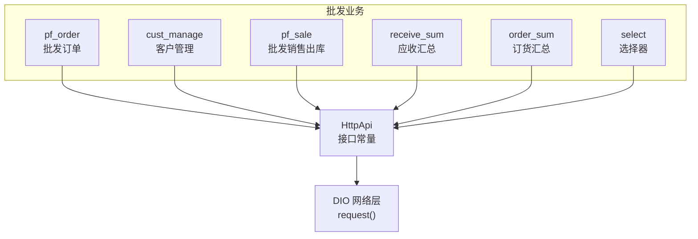
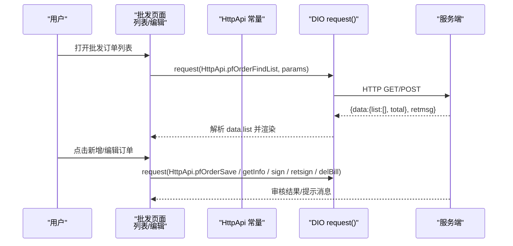
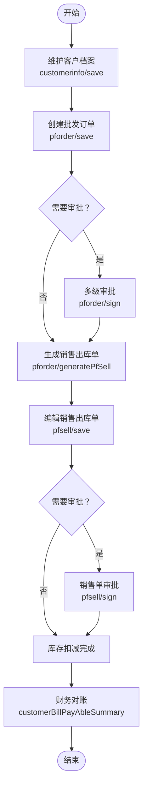
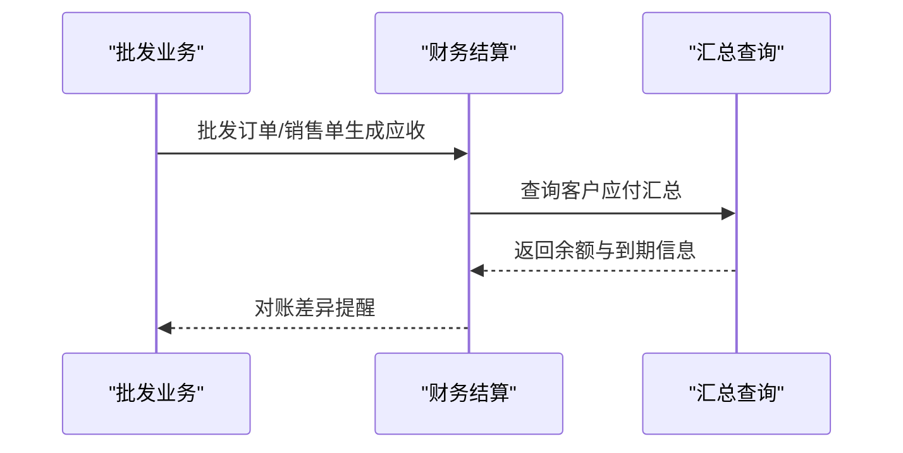
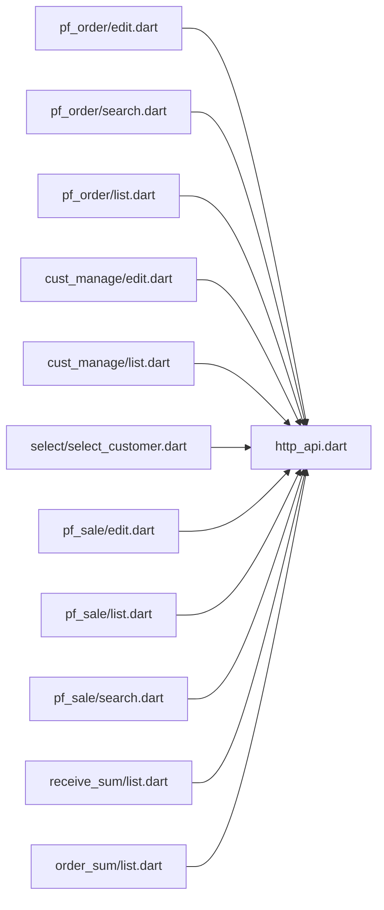

# 批发业务API

<cite>
**本文引用的文件**   
- [http_api.dart](file://lib/net/http_api.dart)
- [search.dart（批发订单搜索）](file://lib/pages/business/wholesale/pf_order/search.dart)
- [list.dart（批发订单列表）](file://lib/pages/business/wholesale/pf_order/list.dart)
- [edit.dart（批发订单编辑）](file://lib/pages/business/wholesale/pf_order/edit.dart)
- [edit_temp.dart（批发订单草稿编辑）](file://lib/pages/business/wholesale/pf_order/edit_temp.dart)
- [list.dart（客户管理列表）](file://lib/pages/business/wholesale/cust_manage/list.dart)
- [edit.dart（客户管理编辑）](file://lib/pages/business/wholesale/cust_manage/edit.dart)
- [select_customer.dart（选择客户）](file://lib/pages/business/wholesale/select/select_customer.dart)
- [list.dart（批发销售列表）](file://lib/pages/business/wholesale/pf_sale/list.dart)
- [search.dart（批发销售搜索）](file://lib/pages/business/wholesale/pf_sale/search.dart)
- [edit.dart（批发销售编辑）](file://lib/pages/business/wholesale/pf_sale/edit.dart)
- [list.dart（应收款汇总）](file://lib/pages/business/wholesale/receive_sum/list.dart)
- [list.dart（订货汇总）](file://lib/pages/business/wholesale/order_sum/list.dart)
</cite>

## 目录
1. [引言](#引言)
2. [项目结构](#项目结构)
3. [核心组件](#核心组件)
4. [架构总览](#架构总览)
5. [详细接口定义](#详细接口定义)
6. [批发业务流程与审批机制](#批发业务流程与审批机制)
7. [定价策略与客户信用](#定价策略与客户信用)
8. [结算对账机制](#结算对账机制)
9. [依赖关系分析](#依赖关系分析)
10. [性能与一致性建议](#性能与一致性建议)
11. [扩展与集成指南](#扩展与集成指南)
12. [故障排查](#故障排查)
13. [结论](#结论)

## 引言
本文件面向灵犀管店 Flutter 客户端中的“批发业务”模块，聚焦以下目标：
- 完整记录批发订单、客户管理、批发销售出库等关键接口的调用约定。
- 梳理批发业务的定价策略、客户信用管理与订单审批流程。
- 说明与财务结算、应收应付对账的对接点。
- 给出端到端工作流示例、数据一致性与性能优化建议，以及二次开发扩展指导。

该文档严格基于仓库中批发相关页面与接口常量进行归纳，不臆造后端字段；若需精确字段名，请以服务端返回结构与当前前端取值逻辑为准。

## 项目结构
批发业务在 Flutter 客户端中以“按功能域组织”的方式存在，主要位于 `lib/pages/business/wholesale` 下：
- `pf_order`：批发订单（订货单）列表、搜索、编辑、草稿编辑。
- `cust_manage`：客户管理列表与编辑。
- `pf_sale`：批发销售出库（销售单）列表、搜索、编辑。
- `receive_sum` / `order_sum`：批发相关的应收与订货汇总。
- `select`：批发场景下的通用选择器，如选择客户。
- `router.dart`：批发模块路由入口。

所有网络接口统一由 `lib/net/http_api.dart` 暴露静态常量，页面通过 `request(...)` 调用 `HttpApi.*` 常量发起请求。

图表来源
- [http_api.dart:520-595](file://lib/net/http_api.dart#L520-L595)

章节来源
- [http_api.dart:520-595](file://lib/net/http_api.dart#L520-L595)

## 核心组件
本节从“接口常量 + 页面调用”的角度，定位批发业务的核心能力边界：
- 客户管理：`customerinfo/getList`、`customerinfo/getCustomerInfo`、`customerinfo/save`、`customerinfo/generateCode`。
- 批发订单：`pforder/findList`、`pforder/getInfo`、`pforder/save`、`pforder/sign`、`pforder/retsign`、`pforder/delBill`、`pforder/generatePfSell`。
- 批发销售出库：`pfsell/findList`、`pfsell/getInfo`、`pfsell/save`、`pfsell/sign`、`pfsell/retsign`、`pfsell/delBill`。
- 汇总与对账：`pfselectorder/findPfOrderStoreTotal`、`pfselectorder/findPfOrderTotal`、`finance/customerbill/getCustomerPayAbleSummary`。
- 审批配置：`reviewTypeConfig/getNewBillSignUser`、`reviewTypeConfig/getReviewBillTypeList`、`reviewTypeConfig/getReviewBillStatusFlowResp`。

这些接口是后续所有工作流的基础。

章节来源
- [http_api.dart:520-595](file://lib/net/http_api.dart#L520-L595)

## 架构总览
批发业务在客户端遵循“页面 → HttpApi 常量 → DIO 请求 → 服务端”的单向链路；同时结合本地筛选、分页、表单快照与权限控制。

图表来源
- [http_api.dart:520-595](file://lib/net/http_api.dart#L520-L595)
- [search.dart（批发订单搜索）:102-130](file://lib/pages/business/wholesale/pf_order/search.dart#L102-L130)
- [edit.dart（批发订单编辑）:550-786](file://lib/pages/business/wholesale/pf_order/edit.dart#L550-L786)

## 详细接口定义

### 批发订单接口族

| 接口常量 | 实际路径 | 用途 | 典型入参要点 | 返回结构要点 |
|---|---|---|---|---|
| `pfOrderFindList` | `pforder/findList` | 批发订单列表查询 | 分页参数 `page`、`is_page`、`pagesize`；时间范围 `starttime`/`endtime`；单号模糊 `billno`；排序字段 `field`、`type`；可选扩展筛选参数 | `data.list` 为订单数组，支持滚动分页 |
| `pfOrderGetInfo` | `pforder/getInfo` | 获取批发订单详情 | 单据标识（通常为订单ID） | 订单头信息、行明细、状态、审批信息等 |
| `pfOrderSave` | `pforder/save` | 新增或修改批发订单 | 订单头字段、行明细、参考单据、仓库/机构/客户等上下文 | 保存成功返回新单号或提示 |
| `pfOrderSign` | `pforder/sign` | 提交批发订单审核 | 携带完整单据及 `signflag=1`；可能包含审批备注 | 审核成功或进入多级审批 |
| `pfOrderRetsign` | `pforder/retsign` | 反审核 | 完整单据对象 | 反审成功，可继续编辑 |
| `pfOrderDelBill` | `pforder/delBill` | 删除单据 | 完整单据对象 | 删除成功 |
| `pfOrderGeneratePfSell` | `pforder/generatePfSell` | 根据批发订单生成销售出库单 | 被生成的订单对象 | 返回生成的销售单数据 |

#### 批发订单列表查询
- 调用位置：列表页与搜索页均使用 `HttpApi.pfOrderFindList`。
- 分页行为：默认 `pagesize=20`，`is_page=1`，通过滚动触底加载下一页。
- 搜索过滤：支持按单号、起止日期、发货标记等条件组合查询。
- 响应处理：从 `result['data']['list']` 取列表，并依据返回列表长度判断是否还有更多数据。

章节来源
- [http_api.dart:520-545](file://lib/net/http_api.dart#L520-L545)
- [search.dart（批发订单搜索）:102-130](file://lib/pages/business/wholesale/pf_order/search.dart#L102-L130)
- [list.dart（批发订单列表）:124-124](file://lib/pages/business/wholesale/pf_order/list.dart#L124-L124)

#### 批发订单编辑与操作
- 详情加载：调用 `pforder/getInfo`，填充表单后建立未保存修改基线。
- 保存：调用 `pforder/save`，传入组装后的表单参数。
- 审核：调用 `pforder/sign`，设置 `signflag=1`。
- 反审：调用 `pforder/retsign`。
- 删除：调用 `pforder/delBill`。
- 生成销售单：调用 `pforder/generatePfSell`，将订单转换为销售出库单。

章节来源
- [edit.dart（批发订单编辑）:358-786](file://lib/pages/business/wholesale/pf_order/edit.dart#L358-L786)
- [edit_temp.dart（批发订单草稿编辑）:215-486](file://lib/pages/business/wholesale/pf_order/edit_temp.dart#L215-L486)

### 客户管理接口族

| 接口常量 | 实际路径 | 用途 | 典型入参要点 | 返回结构要点 |
|---|---|---|---|---|
| `customerFindList` | `customerinfo/getList` | 客户列表查询 | 分页与筛选条件 | `data.list` 为客户列表 |
| `customerGetInfo` | `customerinfo/getCustomerInfo` | 获取客户详情 | 客户ID | 客户基本信息、资产信息、更多信息等 |
| `customerSave` | `customerinfo/save` | 新增或编辑客户 | 客户主数据、折扣、价格类型、启用状态、银行与税务信息、微信下单标志等 | 保存成功提示 |
| `customerGenerateCode` | `customerinfo/generateCode` | 自动生成客户编码 | 无或空对象 | 返回字符串编码 |

#### 客户详情与保存
- 新增模式：先调用 `customerGenerateCode` 获取默认编码，再填写基础信息与资产信息。
- 编辑模式：调用 `customerGetInfo` 回填表单；保存时带上 `id`。
- 关键字段包括：
  - 基本信息：编码、名称、联系人、电话、地址、业务员、价格类型、折扣、最低微信支付比例、停用标志、备注。
  - 资产信息：发票抬头、税号、银行账号、期初金额、预收金额、欠款金额、债务金额。
  - 更多信息：微信下单开关、创建人/时间、修改人/时间。

章节来源
- [http_api.dart:520-530](file://lib/net/http_api.dart#L520-L530)
- [list.dart（客户管理列表）:77-77](file://lib/pages/business/wholesale/cust_manage/list.dart#L77-L77)
- [edit.dart（客户管理编辑）:119-133](file://lib/pages/business/wholesale/cust_manage/edit.dart#L119-L133)
- [edit.dart（客户管理编辑）:341-341](file://lib/pages/business/wholesale/cust_manage/edit.dart#L341-L341)

### 批发销售出库接口族

| 接口常量 | 实际路径 | 用途 | 典型入参要点 | 返回结构要点 |
|---|---|---|---|---|
| `pfSellFindList` | `pfsell/findList` | 批发销售出库列表查询 | 分页、筛选条件（客户、仓库、起止时间、单号等） | `data.list` 为销售单列表 |
| `pfSellGetInfo` | `pfsell/getInfo` | 获取销售单详情 | 销售单ID | 销售单头、行明细、税额、毛利、审批信息等 |
| `pfSellSave` | `pfsell/save` | 新增或修改销售出库单 | 客户、仓库、商品行、数量、含税税率、售价、成本价、赠品数量等 | 保存成功并返回单号 |
| `pfSellSign` | `pfsell/sign` | 提交销售出库单审核 | 完整单据对象，`signflag=1`，可能含审批备注 | 审核成功或进入多级审批 |
| `pfSellRetsign` | `pfsell/retsign` | 反审核销售单 | 完整单据对象 | 反审成功 |
| `pfSellDelBill` | `pfsell/delBill` | 删除销售单 | 完整单据对象 | 删除成功 |

#### 销售出库编辑与审核
- 编辑页面支持：
  - 选择机构、仓库、客户、业务员、送货员。
  - 选择参考单据：批发订单或采购入库单，自动带出商品明细。
  - 扫码与批量输入商品行，计算金额、税额、毛利、售价、成本价、包装换算。
  - 支持打印、反审、撤回、删除。
- 多级审批：
  - 新建时根据机构查询是否需要审批签字。
  - 保存后可进入审批弹窗，通过后调用 `pfsell/sign`。
  - 支持查看审批日志，管理员或指定节点人员可撤回/反审。

章节来源
- [http_api.dart:545-560](file://lib/net/http_api.dart#L545-L560)
- [list.dart（批发销售列表）:119-119](file://lib/pages/business/wholesale/pf_sale/list.dart#L119-L119)
- [search.dart（批发销售搜索）:94-94](file://lib/pages/business/wholesale/pf_sale/search.dart#L94-L94)
- [edit.dart（批发销售编辑）:361-1020](file://lib/pages/business/wholesale/pf_sale/edit.dart#L361-L1020)

### 汇总与对账接口

| 接口常量 | 实际路径 | 用途 | 典型入参要点 | 返回结构要点 |
|---|---|---|---|---|
| `pfSelectOrderStoreTotal` | `pfselectorder/findPfOrderStoreTotal` | 按机构维度统计订货汇总 | 通常按时间、机构等筛选 | 各机构订货金额汇总 |
| `pfSelectOrderTotal` | `pfselectorder/findPfOrderTotal` | 全量订货汇总 | 时间等筛选条件 | 总订货金额 |
| `customerBillPayAbleSummary` | `finance/customerbill/getCustomerPayAbleSummary` | 客户应付/应收汇总 | 客户或时间维度 | 客户应付余额、到期金额等 |

章节来源
- [http_api.dart:560-570](file://lib/net/http_api.dart#L560-L570)
- [list.dart（订货汇总）:1-1](file://lib/pages/business/wholesale/order_sum/list.dart#L1-L1)
- [list.dart（应收款汇总）:83-83](file://lib/pages/business/wholesale/receive_sum/list.dart#L83-L83)

## 批发业务流程与审批机制

### 端到端工作流

图表来源
- [http_api.dart:520-570](file://lib/net/http_api.dart#L520-L570)
- [edit.dart（批发订单编辑）:754-786](file://lib/pages/business/wholesale/pf_order/edit.dart#L754-L786)
- [edit.dart（批发销售编辑）:941-1020](file://lib/pages/business/wholesale/pf_sale/edit.dart#L941-L1020)

### 审批流程关键点
- 新建单据时，系统会根据机构与单据类型查询是否需要审批签字。
- 审批弹窗支持通过/驳回并填写备注。
- 撤回逻辑：将 `reviewsignflag` 设为特定值后走保存流程，使单据回到待处理态。
- 反审核：已审核单据可反审，恢复可编辑状态。
- 权限校验：部分操作受角色权限控制，例如批发销售的反审核权限。

章节来源
- [edit.dart（批发销售编辑）:723-1020](file://lib/pages/business/wholesale/pf_sale/edit.dart#L723-L1020)

## 定价策略与客户信用

### 定价策略
- 客户级别价格：
  - 客户档案中包含价格类型、折扣、最低微信支付比例等字段，影响订单与销售的初始定价。
  - 销售单明细中存在参考价、折率、售价、成本价、含税税率、毛利率等计算字段，体现多层定价逻辑。
- 商品级价格：
  - 商品基础价格、门店调价、促销计划会影响最终成交价。
- 包装换算：
  - 销售单明细支持包装单位换算，影响数量、金额与税额计算。

### 客户信用管理
- 客户资产信息包含期初金额、预收金额、欠款金额、债务金额，用于评估客户信用与应收风险。
- 应收汇总接口提供客户应付/应收余额，便于财务核对。
- 客户停用标志可用于限制异常客户继续下单。

章节来源
- [edit.dart（客户管理编辑）:119-133](file://lib/pages/business/wholesale/cust_manage/edit.dart#L119-L133)
- [edit.dart（客户管理编辑）:300-341](file://lib/pages/business/wholesale/cust_manage/edit.dart#L300-L341)
- [edit.dart（批发销售编辑）:1-200](file://lib/pages/business/wholesale/pf_sale/edit.dart#L1-L200)
- [list.dart（应收款汇总）:83-83](file://lib/pages/business/wholesale/receive_sum/list.dart#L83-L83)

## 结算对账机制
批发业务对账主要围绕客户应收/应付展开：
- 批发订单与销售出库单作为业务凭证，驱动应收发生。
- 财务模块提供客户结算单、供应商结算单、门店结算单三类结算对象。
- 客户应付汇总接口可用于核对客户维度应收余额。
- 客户结算单具备新增、修改、审核、作废、删除等操作，支持导出账单。

图表来源
- [http_api.dart:560-595](file://lib/net/http_api.dart#L560-L595)
- [list.dart（应收款汇总）:83-83](file://lib/pages/business/wholesale/receive_sum/list.dart#L83-L83)

章节来源
- [http_api.dart:560-595](file://lib/net/http_api.dart#L560-L595)

## 依赖关系分析

图表来源
- [http_api.dart:520-595](file://lib/net/http_api.dart#L520-L595)
- [edit.dart（批发订单编辑）:550-786](file://lib/pages/business/wholesale/pf_order/edit.dart#L550-L786)
- [search.dart（批发订单搜索）:102-130](file://lib/pages/business/wholesale/pf_order/search.dart#L102-L130)
- [list.dart（批发订单列表）:124-124](file://lib/pages/business/wholesale/pf_order/list.dart#L124-L124)
- [edit.dart（客户管理编辑）:119-341](file://lib/pages/business/wholesale/cust_manage/edit.dart#L119-L341)
- [list.dart（客户管理列表）:77-77](file://lib/pages/business/wholesale/cust_manage/list.dart#L77-L77)
- [select_customer.dart（选择客户）:12-12](file://lib/pages/business/wholesale/select/select_customer.dart#L12-L12)
- [edit.dart（批发销售编辑）:361-1020](file://lib/pages/business/wholesale/pf_sale/edit.dart#L361-L1020)
- [list.dart（批发销售列表）:119-119](file://lib/pages/business/wholesale/pf_sale/list.dart#L119-L119)
- [search.dart（批发销售搜索）:94-94](file://lib/pages/business/wholesale/pf_sale/search.dart#L94-L94)
- [list.dart（应收款汇总）:83-83](file://lib/pages/business/wholesale/receive_sum/list.dart#L83-L83)

章节来源
- [http_api.dart:520-595](file://lib/net/http_api.dart#L520-L595)

## 性能与一致性建议
- 分页与防抖：
  - 列表采用分页加载，避免一次性拉取大量数据。
  - 搜索框使用防抖触发，减少频繁请求。
- 并发与幂等：
  - 审核、反审、删除等写操作应确保幂等，防止重复提交导致状态异常。
- 表单快照：
  - 客户编辑页面通过快照比对未保存修改，降低误退造成的数据丢失。
- 权限控制：
  - 敏感操作（反审、撤回）增加权限检查，避免越权操作。
- 计算精度：
  - 金额、税额、毛利率等采用统一精度函数，保证前后端数值一致性。
- 缓存与离线：
  - 对只读基础数据（分类、品牌、仓库）可考虑本地缓存；对订单与财务数据保持强一致。

[本节为通用建议，不直接分析具体代码片段]

## 扩展与集成指南

### 新增批发业务接口
- 在 `HttpApi` 中新增常量，命名遵循现有风格，如 `xxxFindList`、`xxxGetInfo`、`xxxSave`、`xxxSign`。
- 在对应页面中引入 `HttpApi` 常量，并通过 `request()` 发起请求。
- 对返回结构进行健壮性处理：判空、类型转换、错误提示。

### 接入多级审批
- 使用 `reviewTypeConfig/getNewBillSignUser` 判断是否需要审批。
- 使用 `reviewTypeConfig/getReviewBillTypeList` 与 `getReviewBillStatusFlowResp` 获取审批类型与状态流。
- 在保存成功后，根据返回的审批人员列表决定是否弹出审批弹窗。

### 集成财务对账
- 调用 `finance/customerset/*` 系列接口进行客户结算单管理。
- 调用 `finance/customerbill/getCustomerPayAbleSummary` 进行应收汇总核对。
- 将批发业务单据与财务结算单关联，形成闭环对账。

章节来源
- [http_api.dart:520-595](file://lib/net/http_api.dart#L520-L595)

## 故障排查
- 列表为空：
  - 检查分页参数、时间范围、筛选条件是否正确。
  - 确认网络请求是否被拦截或超时。
- 审核失败：
  - 检查用户是否属于当前审批节点。
  - 检查权限配置与角色映射。
- 金额不一致：
  - 检查折率、含税税率、包装换算、赠品数量等计算逻辑。
  - 核对前后端金额精度函数。
- 客户无法下单：
  - 检查客户停用标志、微信下单开关、最低支付比例。
  - 核对客户信用余额与应收上限。

章节来源
- [edit.dart（批发销售编辑）:723-1020](file://lib/pages/business/wholesale/pf_sale/edit.dart#L723-L1020)
- [edit.dart（客户管理编辑）:300-341](file://lib/pages/business/wholesale/cust_manage/edit.dart#L300-L341)

## 结论
本批发业务API文档以仓库中批发相关页面与接口常量为依据，系统梳理了客户管理、批发订单、销售出库、汇总对账与多级审批的关键路径。在实际开发与集成过程中，建议：
- 严格遵循 `HttpApi` 接口命名规范与页面调用方式。
- 在金额计算、审批流程、权限控制上保持一致性与健壮性。
- 将批发业务与财务结算打通，实现端到端的业务闭环。

[本节为总结性内容，不直接分析具体代码片段]