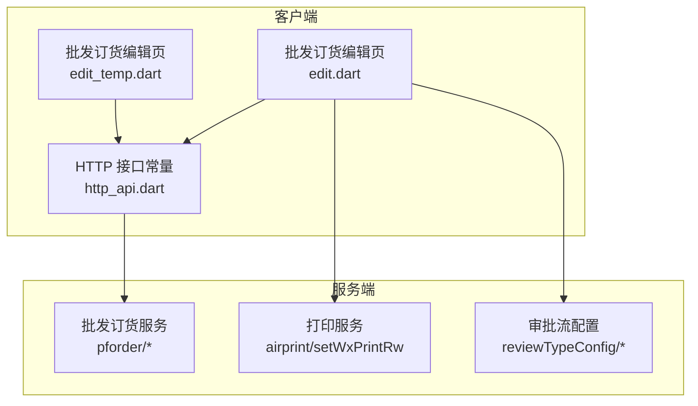
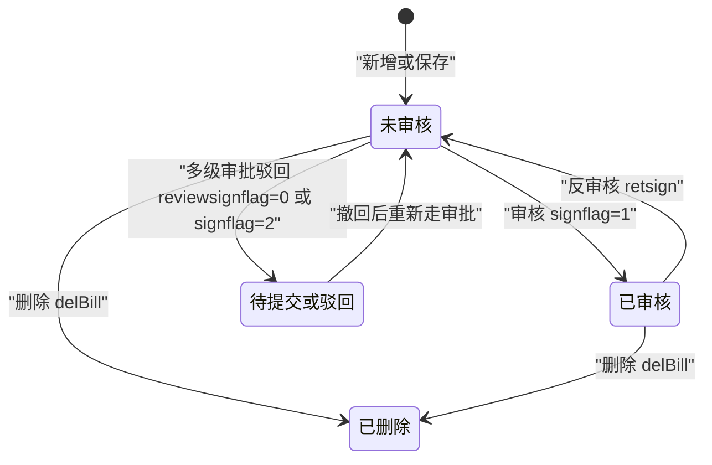
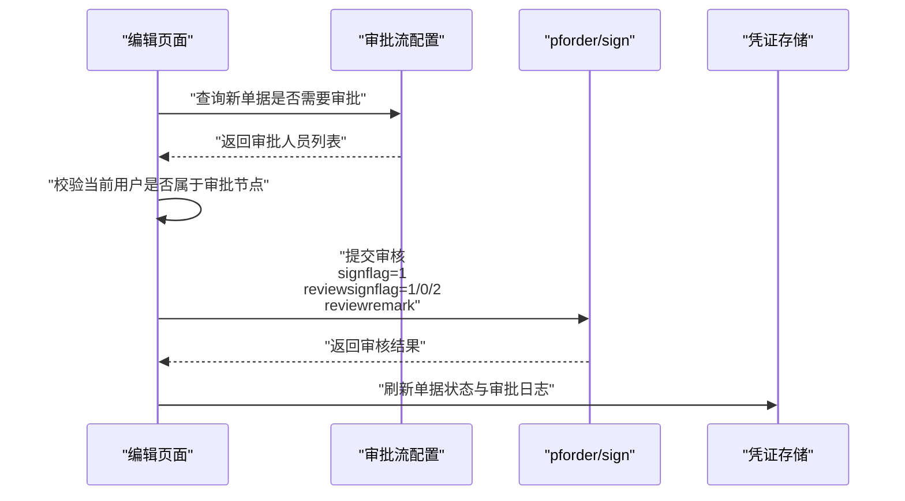
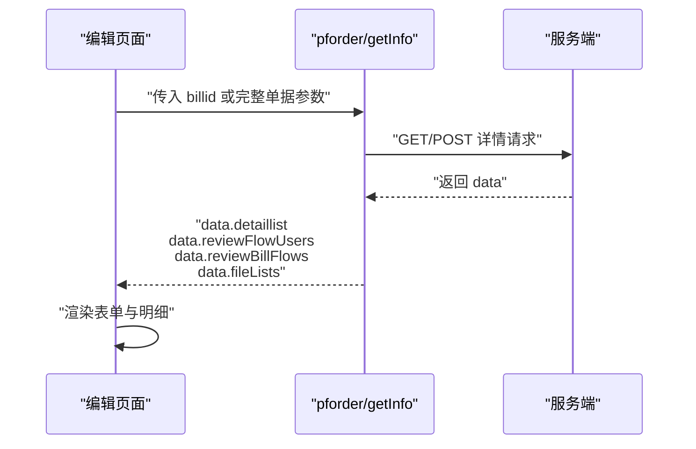
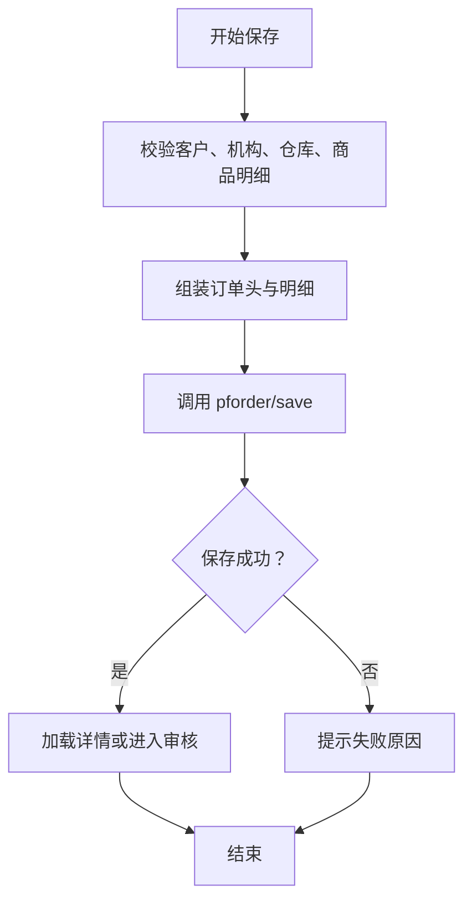
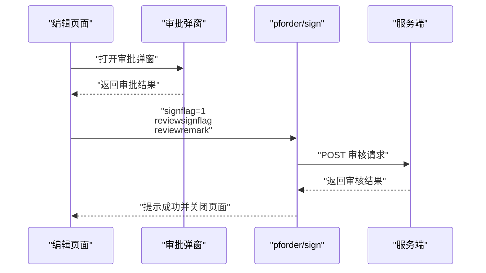
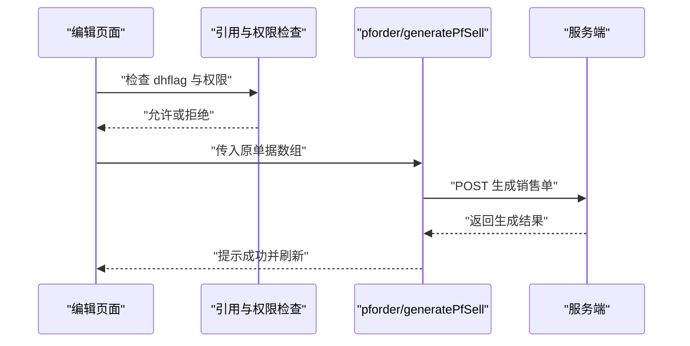
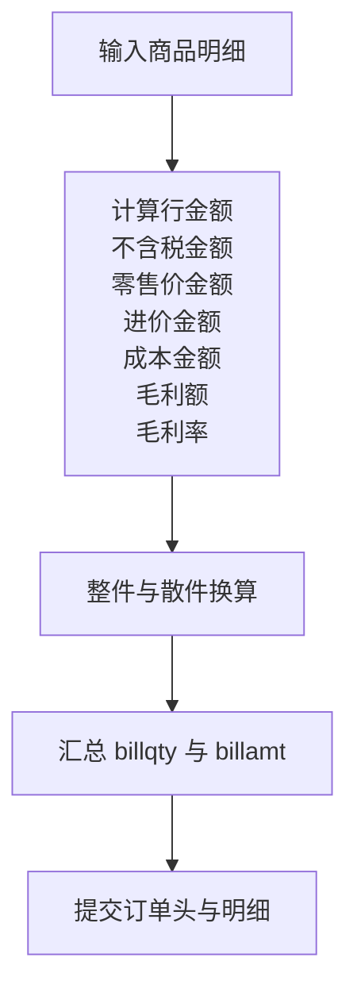
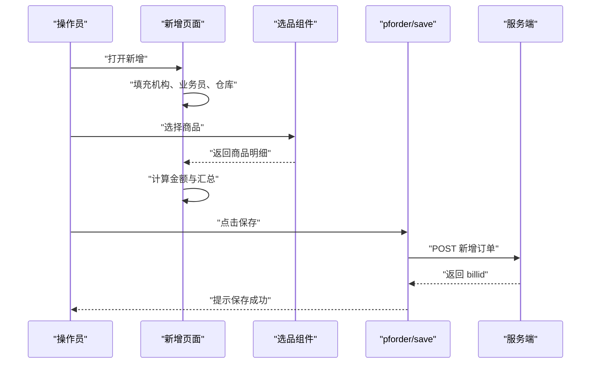
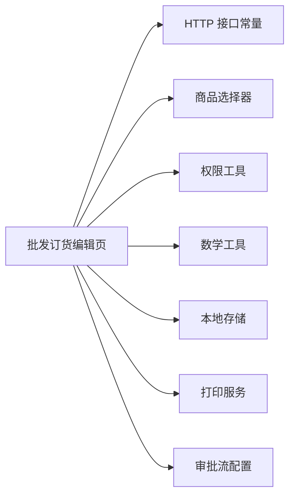

# 批发订单API

<cite>
**本文引用的文件**   
- [lib/net/http_api.dart](file://lib/net/http_api.dart)
- [lib/pages/business/wholesale/pf_order/edit.dart](file://lib/pages/business/wholesale/pf_order/edit.dart)
- [lib/pages/business/wholesale/pf_order/edit_temp.dart](file://lib/pages/business/wholesale/pf_order/edit_temp.dart)
</cite>

## 目录
1. [引言](#引言)
2. [项目结构定位](#项目结构定位)
3. [核心接口总览](#核心接口总览)
4. [批发订单状态与审批流程](#批发订单状态与审批流程)
5. [订单数据模型与商品明细](#订单数据模型与商品明细)
6. [接口规范](#接口规范)
7. [价格计算与金额汇总逻辑](#价格计算与金额汇总逻辑)
8. [订单模板、草稿与搜索条件](#订单模板草稿与搜索条件)
9. [完整业务流程示例](#完整业务流程示例)
10. [库存、财务与数据一致性](#库存财务与数据一致性)
11. [依赖关系分析](#依赖关系分析)
12. [性能与异常处理建议](#性能与异常处理建议)
13. [故障排查指南](#故障排查指南)
14. [结论](#结论)

## 引言
本文面向灵犀管店 Flutter 客户端中的“批发订货”业务，围绕 `pforder` 系列接口编写 API 文档。重点覆盖：

- 批发订货单列表查询、详情获取、新增修改、审核、反审核、删除；
- 从批发订货单生成销售单的扩展能力；
- 订单状态流转、多级审批流程、商品明细处理与价格计算；
- 订单模板、草稿管理与批量操作；
- 与库存、财务的数据一致性约束；
- 常见错误场景和排错建议。

本文同时结合前端实现文件，说明接口在客户端的调用方式、参数构造、权限控制与交互行为，帮助后端接口设计、联调测试及后续扩展保持一致性。

## 项目结构定位
批发订货功能主要位于以下代码路径：

| 层级 | 路径 | 职责 |
|---|---|---|
| 接口常量定义 | `lib/net/http_api.dart` | 集中声明所有网络接口名称，包括 `pforder/findList`、`pforder/getInfo`、`pforder/save`、`pforder/sign`、`pforder/retsign`、`pforder/delBill`、`pforder/generatePfSell` |
| 批发订货编辑页（完整版） | `lib/pages/business/wholesale/pf_order/edit.dart` | 新增、编辑、审核、反审核、删除、打印、生成销售单、多级审批、扫码选品、未保存拦截等主流程 |
| 批发订货编辑页（简化版） | `lib/pages/business/wholesale/pf_order/edit_temp.dart` | 包含较基础的保存、审核、反审、删除、打印逻辑，可作为对照参考 |

**图表来源**
- [lib/pages/business/wholesale/pf_order/edit.dart:1-120](file://lib/pages/business/wholesale/pf_order/edit.dart#L1-L120)
- [lib/pages/business/wholesale/pf_order/edit_temp.dart:1-60](file://lib/pages/business/wholesale/pf_order/edit_temp.dart#L1-L60)
- [lib/net/http_api.dart:459-472](file://lib/net/http_api.dart#L459-L472)

**章节来源**
- [lib/pages/business/wholesale/pf_order/edit.dart:1-120](file://lib/pages/business/wholesale/pf_order/edit.dart#L1-L120)
- [lib/pages/business/wholesale/pf_order/edit_temp.dart:1-60](file://lib/pages/business/wholesale/pf_order/edit_temp.dart#L1-L60)
- [lib/net/http_api.dart:459-472](file://lib/net/http_api.dart#L459-L472)

## 核心接口总览
批发订货相关接口以 `pforder` 为前缀，统一通过 `HttpApi` 常量暴露。

| 接口名称 | HTTP 路径 | 请求方法 | 主要用途 | 权限或前置条件 |
|---|---|---|---|---|
| 订单列表查询 | `pforder/findList` | 通常为 GET 或 POST | 查询批发订货单分页列表 | 具备批发订货查看权限 |
| 订单详情获取 | `pforder/getInfo` | 通常为 GET 或 POST | 根据单据编号加载详情、审批流信息、附件、商品明细 | 可查当前单据 |
| 订单新增或修改 | `pforder/save` | 通常为 POST | 新建批发订货单或更新已保存单据 | 具备新增或编辑权限 |
| 订单审核 | `pforder/sign` | 通常为 POST | 提交审核，支持多级审批 | 具备审核权限或属于审批节点 |
| 订单反审核 | `pforder/retsign` | 通常为 POST | 将已审核单据回退到可编辑态 | 具备反审核权限 |
| 订单删除 | `pforder/delBill` | 通常为 POST | 删除批发订货单 | 具备删除权限 |
| 生成销售单 | `pforder/generatePfSell` | 通常为 POST | 由批发订货单生成下游销售单 | 具备生成销售单权限且未被引用或终止 |

上述接口的常量定义集中在 `lib/net/http_api.dart`，客户端页面通过 `request(HttpApi.pfOrderXxx, params)` 发起调用。

**章节来源**
- [lib/net/http_api.dart:459-465](file://lib/net/http_api.dart#L459-L465)
- [lib/pages/business/wholesale/pf_order/edit.dart:661-791](file://lib/pages/business/wholesale/pf_order/edit.dart#L661-L791)

## 批发订单状态与审批流程
客户端中，批发订货单使用 `signflag` 表示审核状态，并配合 `reviewsignflag` 表达多级审批结果。

| 字段 | 含义 | 典型值 | 业务语义 |
|---|---|---:|---|
| `signflag` | 单据审核状态 | `0` | 未审核，可编辑、可保存 |
| `signflag` | 单据审核状态 | `1` | 已审核，通常不可再直接编辑 |
| `signflag` | 单据审核状态 | `2` | 待提交或驳回；客户端在部分分支将其视为“撤回待处理” |
| `reviewsignflag` | 多级审批结果 | `0` | 驳回 |
| `reviewsignflag` | 多级审批结果 | `1` | 通过 |
| `reviewsignflag` | 多级审批结果 | `2` | 撤回待处理 |
| `dhflag` | 引用标记 | `3` | 已被下游单据引用，不能再生成销售单 |
| `dhflag` | 引用标记 | `4` | 已被终止，不能再生成销售单 |

### 状态流转图

### 多级审批要点
- 新增时会根据机构查询是否需要审批签字；若配置了审批人，则弹出审批弹窗。
- 审核时会携带 `reviewsignflag` 和 `reviewremark`。
- 若 `reviewsignflag=2`，表示撤回待处理；客户端会将其视为需要重新处理的特殊分支。
- 管理员用户拥有更宽松的审批判断逻辑。

**图表来源**
- [lib/pages/business/wholesale/pf_order/edit.dart:791-980](file://lib/pages/business/wholesale/pf_order/edit.dart#L791-L980)

**章节来源**
- [lib/pages/business/wholesale/pf_order/edit.dart:201-240](file://lib/pages/business/wholesale/pf_order/edit.dart#L201-L240)
- [lib/pages/business/wholesale/pf_order/edit.dart:600-980](file://lib/pages/business/wholesale/pf_order/edit.dart#L600-L980)

## 订单数据模型与商品明细
### 订单头常用字段
| 字段 | 类型 | 必填说明 | 说明 |
|---|---|---|---|
| `billid` | 字符串 | 新增时为空，服务端返回 | 单据编号 |
| `billtype` | 数字 | 新增时需设置 | 单据类型，客户端新增时设为 `0` |
| `billdate` | 字符串 | 新增时需设置 | 单据日期，格式为 `YYYY-MM-DD` |
| `custid` | 字符串 | 新增或审核时需选择 | 客户编号 |
| `custname` | 字符串 | 提交时带出 | 客户名称 |
| `bsid` / `storeid` | 字符串或数字 | 新增或审核时需选择 | 机构编号 |
| `storename` | 字符串 | 提交时带出 | 机构名称 |
| `storetype` | 字符串或数字 | 可选 | 机构类型 |
| `counterid` / `countername` | 字符串 | 新增或审核时需选择仓库 | 仓库编号与名称 |
| `salesid` / `salesname` | 字符串 | 可选 | 业务员编号与名称 |
| `remark` | 字符串 | 可选 | 备注 |
| `fileLists` | 数组 | 可选 | 附件列表 |
| `signflag` | 数字 | 服务端维护 | 审核状态 |
| `reviewsignflag` | 数字 | 多级审批时使用 | 审批结果 |
| `reviewremark` | 字符串 | 多级审批时使用 | 审批备注 |
| `dhflag` | 字符串 | 服务端维护 | 引用标记 |
| `billqty` | 数字 | 服务端或前端汇总 | 合计数量 |
| `billamt` | 数字 | 服务端或前端汇总 | 合计金额 |

### 商品明细行常用字段
| 字段 | 类型 | 说明 |
|---|---|---|
| `prodid` / `productid` | 字符串 | 商品编号 |
| `productname` / `prodname` / `name` | 字符串 | 商品名称 |
| `qty` | 数字 | 主数量 |
| `jsqty` | 数字 | 整件数量 |
| `zjsqty` | 数字 | 整件数 |
| `ssqty` | 数字 | 散件数 |
| `presentqty` | 数字 | 赠品数量 |
| `price` | 数字 | 单价 |
| `sellprice` | 数字 | 零售价 |
| `retailprice` | 数字 | 零售价格字段 |
| `inprice` | 数字 | 进价 |
| `costprice` | 数字 | 成本价 |
| `outtaxrate` | 数字 | 销项税率 |
| `intaxrate` | 数字 | 进项税率 |
| `amt` | 数字 | 行金额 |
| `notaxamt` | 数字 | 不含税金额 |
| `sellamt` | 数字 | 按零售价计算的金额 |
| `inpriceamt` | 数字 | 按进价计算的金额 |
| `camt` | 数字 | 毛利相关金额 |
| `grossrateamt` | 数字 | 毛利额 |
| `grossrate` | 数字 | 毛利率 |
| `batchno` | 字符串 | 批次号，提交时默认清空 |

客户端构建提交明细时，会显式写入商品名称、数量、单价、赠品数量、零售价、零售价格、批次号、商品编号，并将原行数据作为基线合并。

**章节来源**
- [lib/pages/business/wholesale/pf_order/edit.dart:592-638](file://lib/pages/business/wholesale/pf_order/edit.dart#L592-L638)

## 接口规范

### pforder/findList：订单列表查询
- **目的**：查询批发订货单列表，支持分页和筛选。
- **路径**：`pforder/findList`
- **典型请求参数**
  - `cond`：通用搜索条件，如关键词、单号、客户、时间范围等。
  - `is_page`：是否分页。
  - `page`：当前页码。
- **典型响应结构**
  - `data.list`：订单列表数组。
  - `data.total`：总数。
  - `data.page`：当前页。
- **注意事项**
  - 该接口是列表页的核心入口，前端通常结合搜索组件、状态筛选和分页组件使用。
  - 由于仓库中未列出具体列表页实现，本文不强制限定搜索条件的字段枚举，但应遵循后端已有筛选维度。

**章节来源**
- [lib/net/http_api.dart:459](file://lib/net/http_api.dart#L459)

### pforder/getInfo：订单详情获取
- **目的**：根据单据编号获取批发订货单详情。
- **路径**：`pforder/getInfo`
- **典型请求参数**
  - `billid`：单据编号。
  - 或直接传入完整单据对象，由后端解析关键字段。
- **典型响应结构**
  - `data`：订单详情对象，包含头字段、`detaillist`、`fileLists`、`reviewFlowUsers`、`reviewBillFlows` 等。
- **前端行为**
  - 加载成功后填充客户、机构、仓库、业务员、备注、附件和商品明细。
  - 同时加载多级审批人员与审批日志数据。

**图表来源**
- [lib/pages/business/wholesale/pf_order/edit.dart:240-320](file://lib/pages/business/wholesale/pf_order/edit.dart#L240-L320)

**章节来源**
- [lib/net/http_api.dart:460](file://lib/net/http_api.dart#L460)
- [lib/pages/business/wholesale/pf_order/edit.dart:240-320](file://lib/pages/business/wholesale/pf_order/edit.dart#L240-L320)

### pforder/save：订单新增或修改
- **目的**：新建批发订货单或更新已保存单据。
- **路径**：`pforder/save`
- **请求方式**：POST
- **新增模式关键参数**
  - `billtype=0`
  - `billdate`：当前日期。
  - `signflag=0`
  - `freeamt=0`
  - `fileLists=[]`
  - `custid`、`custname`
  - `bsid`、`storename`、`storetype`
  - `counterid`、`countername`
  - `salesid`、`salesname`
  - `remark`
  - `detaillist`：商品明细数组。
  - `billqty`：合计数量。
  - `billamt`：合计金额。
- **修改模式关键参数**
  - 保留原始 `billid` 等已有字段。
  - 仅更新用户修改过的内容。
- **响应数据**
  - `data.billid`：新增成功时返回新单据编号。
  - `data.reviewFlowUsers`、`data.reviewBillFlows`：用于后续审批展示。

**图表来源**
- [lib/pages/business/wholesale/pf_order/edit.dart:509-638](file://lib/pages/business/wholesale/pf_order/edit.dart#L509-L638)

**章节来源**
- [lib/net/http_api.dart:461](file://lib/net/http_api.dart#L461)
- [lib/pages/business/wholesale/pf_order/edit.dart:509-638](file://lib/pages/business/wholesale/pf_order/edit.dart#L509-L638)

### pforder/sign：订单审核
- **目的**：提交审核，将未审核单据变为已审核。
- **路径**：`pforder/sign`
- **请求方式**：POST
- **关键参数**
  - 原单据数据。
  - `signflag=1`
  - `reviewsignflag`：多级审批结果。
  - `reviewremark`：审批备注。
- **权限控制**
  - 普通审核需要权限标识。
  - 若配置了多级审批，则先弹审批弹窗，再执行审核。
- **响应处理**
  - 审核成功后通常返回上一页并刷新状态。

**图表来源**
- [lib/pages/business/wholesale/pf_order/edit.dart:600-980](file://lib/pages/business/wholesale/pf_order/edit.dart#L600-L980)

**章节来源**
- [lib/net/http_api.dart:462](file://lib/net/http_api.dart#L462)
- [lib/pages/business/wholesale/pf_order/edit.dart:600-980](file://lib/pages/business/wholesale/pf_order/edit.dart#L600-L980)

### pforder/retsign：订单反审核
- **目的**：将已审核单据回退到未审核状态。
- **路径**：`pforder/retsign`
- **请求方式**：POST
- **关键参数**
  - 原单据数据，至少包含 `billid`。
- **前端行为**
  - 二次确认。
  - 调用成功后刷新详情。

**章节来源**
- [lib/net/http_api.dart:463](file://lib/net/http_api.dart#L463)
- [lib/pages/business/wholesale/pf_order/edit.dart:661-688](file://lib/pages/business/wholesale/pf_order/edit.dart#L661-L688)

### pforder/delBill：订单删除
- **目的**：删除批发订货单。
- **路径**：`pforder/delBill`
- **请求方式**：POST
- **关键参数**
  - 原单据数据，至少包含 `billid`。
- **前端行为**
  - 二次确认。
  - 删除成功后返回上一页。

**章节来源**
- [lib/net/http_api.dart:464](file://lib/net/http_api.dart#L464)
- [lib/pages/business/wholesale/pf_order/edit.dart:701-712](file://lib/pages/business/wholesale/pf_order/edit.dart#L701-L712)

### pforder/generatePfSell：生成销售单
- **目的**：根据批发订货单生成下游销售单。
- **路径**：`pforder/generatePfSell`
- **请求方式**：POST
- **关键参数**
  - 以数组形式传入原单据对象。
- **前置校验**
  - 检查 `dhflag`：值为 `3` 表示已被引用，值为 `4` 表示已被终止，均不允许生成。
  - 检查生成销售单权限。
- **响应处理**
  - 成功后提示并刷新单据详情。

**图表来源**
- [lib/pages/business/wholesale/pf_order/edit.dart:753-791](file://lib/pages/business/wholesale/pf_order/edit.dart#L753-L791)

**章节来源**
- [lib/net/http_api.dart:465](file://lib/net/http_api.dart#L465)
- [lib/pages/business/wholesale/pf_order/edit.dart:753-791](file://lib/pages/business/wholesale/pf_order/edit.dart#L753-L791)

## 价格计算与金额汇总逻辑
客户端对商品明细行进行本地价格计算，并在保存时汇总 `billqty` 和 `billamt`。

### 行级计算规则
- 行金额 `amt` 由数量乘以单价得出。
- 不含税金额 `notaxamt` 由含税金额除以 `1 + outtaxrate` 得出。
- 零售价金额 `sellamt` 由零售价乘以数量加赠品数量得出。
- 进价金额 `inpriceamt` 由进价乘以数量加赠品数量得出。
- 成本金额 `costpriceamt` 由成本价乘以数量加赠品数量得出。
- 毛利额 `grossrateamt` 由行金额减去成本金额得出。
- 毛利相关金额 `camt` 由行金额减去进价金额得出。
- 毛利率 `grossrate` 由单价与成本价差额除以单价得出，单价为 0 时毛利率为 0。

### 整件与散件换算
- `packagenum` 大于 0 时，按整件换算。
- `jsqty` 表示整件数量。
- `zjsqty` 表示整件数的整数部分。
- `ssqty` 表示散件数。
- 修改任意一个数量字段时，其他数量字段会联动重算。

### 订单汇总
- 遍历明细行，累加 `qty` 得到 `billqty`。
- 累加 `amt` 得到 `billamt`，并使用四舍五入工具函数处理精度。

**图表来源**
- [lib/pages/business/wholesale/pf_order/edit.dart:1-120](file://lib/pages/business/wholesale/pf_order/edit.dart#L1-L120)
- [lib/pages/business/wholesale/pf_order/edit.dart:592-638](file://lib/pages/business/wholesale/pf_order/edit.dart#L592-L638)

**章节来源**
- [lib/pages/business/wholesale/pf_order/edit.dart:1-120](file://lib/pages/business/wholesale/pf_order/edit.dart#L1-L120)
- [lib/pages/business/wholesale/pf_order/edit.dart:592-638](file://lib/pages/business/wholesale/pf_order/edit.dart#L592-L638)

## 订单模板、草稿与搜索条件
### 订单模板
批发订货编辑页依赖外部选择器组件加载商品数据，并通过 `mergData` 传递门店、客户、价格策略、仓库等上下文。模板能力主要体现在：

- 通过 `SelectProductPage` 的 `mergData` 传入机构、客户、仓库、价格标志、业务标志、商品状态、批次标志等；
- 通过 `selectList` 预加载已有商品明细；
- 通过 `multiple=true` 支持多选商品；
- 通过 `initialKeyword` 支持搜索关键词回填。

这使“模板”在实际使用中表现为：固定机构、固定客户、固定仓库、固定价格策略下的快速选品流程。

### 草稿管理
客户端没有独立的“草稿表”概念，而是通过以下方式实现草稿能力：

- 新增模式下，表单存在未保存变更时，返回上一页会触发未保存拦截；
- `_formSnapshot` 记录表单快照，比较当前值与初始值判断脏数据；
- 如果用户选择保存，则先调用 `pforder/save`，保存成功后再返回；
- 如果用户选择不保存，则直接返回上一页丢弃改动。

### 搜索条件
列表接口 `pforder/findList` 的典型搜索条件包括：

| 条件类别 | 可能字段 | 说明 |
|---|---|---|
| 关键词 | `cond` | 可用于单号、客户名、商品名等模糊搜索 |
| 时间范围 | `cond` 或专用日期字段 | 单据日期、创建时间等 |
| 客户 | `custid`、`custname` | 按客户筛选 |
| 机构 | `bsid`、`storeid` | 按门店筛选 |
| 仓库 | `counterid` | 按仓库筛选 |
| 审核状态 | `signflag` | 未审核、已审核、待提交或驳回 |
| 引用状态 | `dhflag` | 未被引用、已被引用、已终止 |

注意：具体搜索字段应以服务端实际实现为准；客户端列表页通常会拼接 `cond` 并分页查询。

**章节来源**
- [lib/pages/business/wholesale/pf_order/edit.dart:980-1060](file://lib/pages/business/wholesale/pf_order/edit.dart#L980-L1060)

## 完整业务流程示例

### 订单创建流程
1. 进入批发订货新增页面。
2. 自动带入当前登录机构、业务员、默认仓库。
3. 选择客户、机构、仓库。
4. 通过扫码或选品组件添加商品明细。
5. 填写数量、单价、赠品数量、备注。
6. 系统计算行金额、合计数量和合计金额。
7. 点击保存，调用 `pforder/save`。
8. 保存成功后跳转到详情或继续编辑。

**图表来源**
- [lib/pages/business/wholesale/pf_order/edit.dart:240-320](file://lib/pages/business/wholesale/pf_order/edit.dart#L240-L320)
- [lib/pages/business/wholesale/pf_order/edit.dart:509-638](file://lib/pages/business/wholesale/pf_order/edit.dart#L509-L638)

### 订单审核流程
1. 打开已保存但未审核的批发订货单。
2. 若无多级审批，直接确认审核。
3. 若有审批流，弹出审批弹窗，选择通过、驳回或撤回。
4. 调用 `pforder/sign`，携带 `signflag=1` 和审批结果。
5. 审核成功后返回上一页。

### 订单作废流程
1. 打开已审核订单。
2. 点击反审核，二次确认。
3. 调用 `pforder/retsign`。
4. 反审核成功后刷新详情，单据回到可编辑状态。
5. 如需彻底删除，再调用 `pforder/delBill`。

**章节来源**
- [lib/pages/business/wholesale/pf_order/edit.dart:600-791](file://lib/pages/business/wholesale/pf_order/edit.dart#L600-L791)

## 库存、财务与数据一致性
### 库存一致性
- 批发订货单本身主要用于订货与报价，真正扣减或增加库存通常发生在下游单据，例如销售出库、配送发货、收货入库等。
- 客户端在生成销售单前检查 `dhflag`，防止已被引用或终止的单据再次生成下游单据。
- 建议在服务端保证：
  - 生成销售单时对库存可用量进行校验；
  - 库存变动与单据审核、过账事务绑定；
  - 同一单据不能重复生成下游单据。

### 财务一致性
- 行级字段包含进价、成本价、零售价、销项税率、进项税率等，用于毛利分析和税务计算。
- 前端计算 `notaxamt`、`sellamt`、`inpriceamt`、`grossrateamt`、`grossrate` 等，便于业务分析。
- 服务端应在以下环节保证财务数据一致：
  - 价格变更时重新计算历史单据的可分析字段；
  - 退货、折让、折扣时同步调整毛利和税额；
  - 财务结账时以审核后的单据为基准。

### 数据一致性保障机制
| 层面 | 机制 | 说明 |
|---|---|---|
| 前端 | 未保存拦截 | 避免误退出导致草稿丢失 |
| 前端 | 权限校验 | 审核、反审核、生成销售单需权限 |
| 前端 | 引用标记检查 | 阻止被引用或终止的单据生成销售单 |
| 服务端 | 唯一单据编号 | 防止重复单据 |
| 服务端 | 状态机校验 | 只允许合法状态转换 |
| 服务端 | 事务一致性 | 单据保存、审核、库存、财务联动 |
| 服务端 | 并发控制 | 同一单据同时编辑时采用乐观锁或版本号 |

**章节来源**
- [lib/pages/business/wholesale/pf_order/edit.dart:753-791](file://lib/pages/business/wholesale/pf_order/edit.dart#L753-L791)

## 依赖关系分析
批发订货模块依赖三类外部能力：

1. **HTTP 接口层**
   - `HttpApi` 提供 `pforder/findList`、`getInfo`、`save`、`sign`、`retsign`、`delBill`、`generatePfSell`。
2. **基础数据选择器**
   - 商品选择器、客户选择器、业务员选择器、仓库选择器、机构选择器。
3. **系统与辅助服务**
   - 打印服务 `airprint/setWxPrintRw`；
   - 审批流配置服务 `reviewTypeConfig/getNewBillSignUser`、`reviewTypeConfig/getReviewBillTypeList`；
   - 权限工具 `PermissionUtils`；
   - 数学工具 `MathUtils`；
   - 本地存储 `SpUtil`。

**图表来源**
- [lib/pages/business/wholesale/pf_order/edit.dart:1-120](file://lib/pages/business/wholesale/pf_order/edit.dart#L1-L120)
- [lib/net/http_api.dart:459-472](file://lib/net/http_api.dart#L459-L472)

**章节来源**
- [lib/pages/business/wholesale/pf_order/edit.dart:1-120](file://lib/pages/business/wholesale/pf_order/edit.dart#L1-L120)
- [lib/net/http_api.dart:459-472](file://lib/net/http_api.dart#L459-L472)

## 性能与异常处理建议
- **列表分页**：`pforder/findList` 必须支持分页，避免一次性拉取全量订单。
- **详情懒加载**：商品明细较多时可考虑分批加载或虚拟滚动。
- **价格计算缓存**：同商品多次选择时，可缓存参考价、进价、成本价。
- **防抖扫码**：客户端已实现扫码输入防抖，减少重复查询。
- **幂等性**：`pforder/save`、`pforder/sign`、`pforder/retsign`、`pforder/delBill` 应具备幂等性，防止重复提交。
- **超时与重试**：网络异常时应提示用户并重试关键写操作。
- **审计日志**：审核、反审核、删除、生成销售单应记录操作人、时间、IP 和原因。

[本节为通用性能与异常建议，不直接分析具体文件]

## 故障排查指南
| 现象 | 可能原因 | 排查步骤 | 处理建议 |
|---|---|---|---|
| 保存成功但无单号 | 服务端未返回 `billid` 或字段名不一致 | 检查 `pforder/save` 响应结构 | 确保新增返回 `data.billid` |
| 审核失败 | 权限不足或审批流不匹配 | 检查权限标识和审批人员列表 | 补全权限或调整审批流 |
| 反审核无效 | 单据状态不是已审核 | 检查 `signflag` | 只在已审核状态下允许反审核 |
| 无法生成销售单 | `dhflag=3` 或 `dhflag=4` | 检查引用标记 | 先解除引用或恢复单据状态 |
| 金额计算偏差 | 浮点精度问题 | 检查四舍五入和累加顺序 | 使用服务端统一金额计算 |
| 扫码找不到商品 | 条码参数或仓库、机构不正确 | 检查选品参数 `mergData` | 确保传入正确 `bsid`、`counterid`、`custid` |
| 返回列表为空 | 搜索条件或分页参数错误 | 检查 `cond`、`page`、`is_page` | 修正查询条件 |

**章节来源**
- [lib/pages/business/wholesale/pf_order/edit.dart:509-791](file://lib/pages/business/wholesale/pf_order/edit.dart#L509-L791)

## 结论
本文件基于灵犀管店 Flutter 客户端中的批发订货实现，梳理了 `pforder/findList`、`pforder/getInfo`、`pforder/save`、`pforder/sign`、`pforder/retsign`、`pforder/delBill`、`pforder/generatePfSell` 等核心接口的调用方式、参数结构和业务语义，并结合前端实现说明了订单状态流转、多级审批、商品明细计算、模板与草稿行为以及生成销售单的前置约束。

对于后续开发，建议：

1. 保持服务端接口命名与客户端 `HttpApi` 常量一致；
2. 明确订单状态机与审批流状态机的边界；
3. 统一价格、税率、毛利、金额的计算口径；
4. 强化库存、财务与单据的事务一致性；
5. 完善列表搜索、批量操作、模板与草稿的服务端能力。

[本节为总结性内容，不直接分析具体文件]