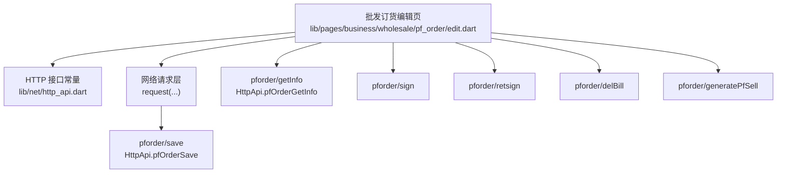
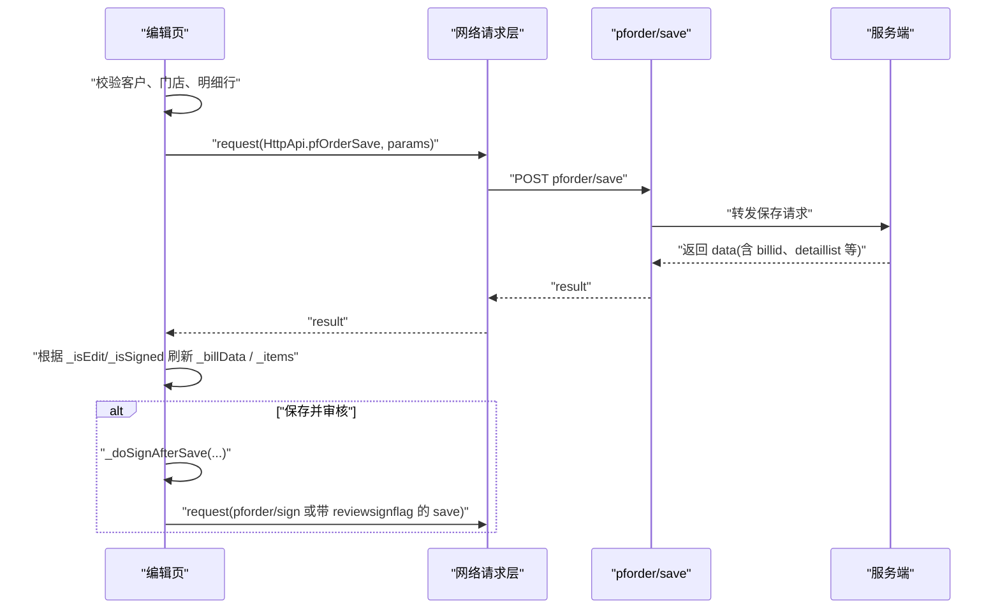
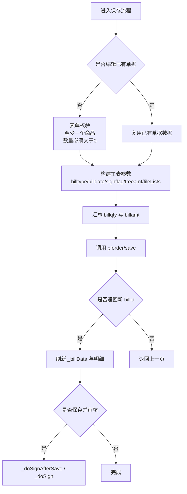
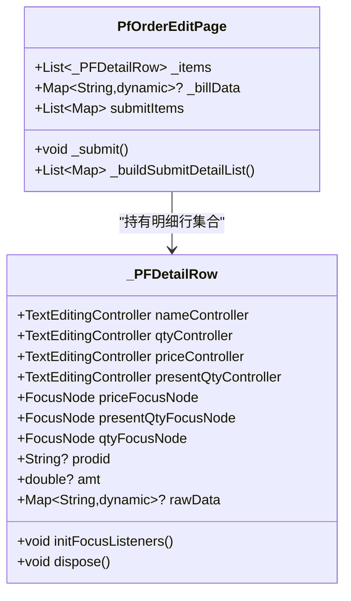
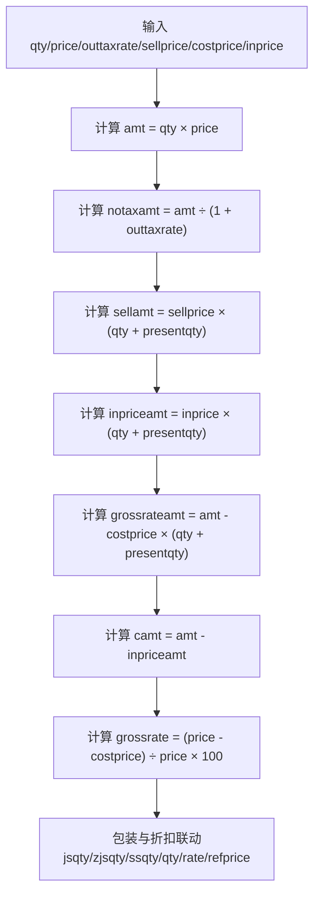
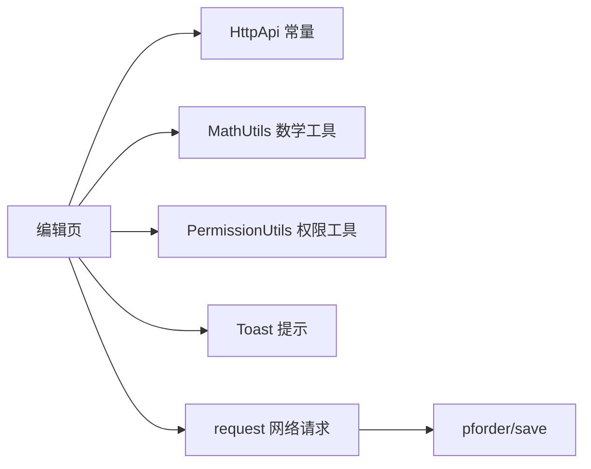

# 订单保存更新接口

<cite>
**本文引用的文件**   
- [lib/net/http_api.dart](file://lib/net/http_api.dart)
- [lib/pages/business/wholesale/pf_order/edit.dart](file://lib/pages/business/wholesale/pf_order/edit.dart)
</cite>

## 目录
1. [简介](#简介)
2. [项目结构与入口](#项目结构与入口)
3. [核心组件](#核心组件)
4. [架构总览](#架构总览)
5. [接口定义与请求参数](#接口定义与请求参数)
6. [新增与修改的业务差异](#新增与修改的业务差异)
7. [商品明细行数据结构与增删改](#商品明细行数据结构与增删改)
8. [价格计算规则](#价格计算规则)
9. [表单验证与提交前预处理](#表单验证与提交前预处理)
10. [草稿保存机制](#草稿保存机制)
11. [调用示例](#调用示例)
12. [错误处理方案](#错误处理方案)
13. [依赖关系分析](#依赖关系分析)
14. [性能与扩展建议](#性能与扩展建议)
15. [常见问题排查](#常见问题排查)
16. [结论](#结论)

## 简介
本文面向灵犀管店批发订货模块的“订单保存更新”能力，聚焦前端调用后端 `pforder/save` 接口的完整链路：从页面数据模型、明细行交互、金额与税额计算、校验逻辑，到最终提交参数结构、新增与修改的差异、草稿保存策略、错误处理与后续审核流程。文档以仓库中的 HTTP API 常量定义和批发订货编辑页实现为依据，帮助开发者准确理解并集成该接口。

## 项目结构与入口
- 批发订货相关的前端业务入口位于 `lib/pages/business/wholesale/pf_order/edit.dart`，负责订单新增、修改、草稿保存、提交、审核、反审、删除、打印、生成批发销售单等动作。
- 所有后端接口路径集中声明在 `lib/net/http_api.dart`，其中批发订货相关接口包括列表、详情、保存、审核、反审、删除、生成销售单等。

**图表来源**  
- [lib/pages/business/wholesale/pf_order/edit.dart:480-620](file://lib/pages/business/wholesale/pf_order/edit.dart#L480-L620)  
- [lib/net/http_api.dart:459-465](file://lib/net/http_api.dart#L459-L465)

**章节来源**  
- [lib/net/http_api.dart:459-465](file://lib/net/http_api.dart#L459-L465)  
- [lib/pages/business/wholesale/pf_order/edit.dart:1-200](file://lib/pages/business/wholesale/pf_order/edit.dart#L1-L200)

## 核心组件
- **批发订货编辑页状态类**：管理客户、门店、仓库、业务员、备注、附件、审批流、明细行集合等状态，并提供新增、修改、提交、审核、反审、删除、打印、生成销售单等方法。
- **明细行模型 `_PFDetailRow`**：封装每行商品的名称、数量、单价、赠品数量、已算金额、原始返回数据等，并维护输入控件焦点行为。
- **金额与折扣计算函数**：包含 `_amtJudge`、`_writeData`、`_defValSet`，用于根据数量、单价、税率、成本价、包装数等字段联动计算含税金额、不含税金额、销售额、进价金额、毛利额、毛利率等。
- **HTTP 接口常量**：通过 `HttpApi.pfOrderSave` 等常量统一维护后端接口路径。

**章节来源**  
- [lib/pages/business/wholesale/pf_order/edit.dart:208-210](file://lib/pages/business/wholesale/pf_order/edit.dart#L208-L210)  
- [lib/pages/business/wholesale/pf_order/edit.dart:2644-2710](file://lib/pages/business/wholesale/pf_order/edit.dart#L2644-L2710)  
- [lib/pages/business/wholesale/pf_order/edit.dart:25-137](file://lib/pages/business/wholesale/pf_order/edit.dart#L25-L137)  
- [lib/net/http_api.dart:459-465](file://lib/net/http_api.dart#L459-L465)

## 架构总览
批发订货保存更新的调用链路由编辑页发起，经网络请求层调用 `pforder/save`，服务端返回单据数据后，编辑页刷新本地单据、明细行和审批流信息；若选择“保存并审核”，则继续进入审核或撤回流程。

**图表来源**  
- [lib/pages/business/wholesale/pf_order/edit.dart:480-620](file://lib/pages/business/wholesale/pf_order/edit.dart#L480-L620)  
- [lib/pages/business/wholesale/pf_order/edit.dart:620-900](file://lib/pages/business/wholesale/pf_order/edit.dart#L620-L900)  
- [lib/net/http_api.dart:459-465](file://lib/net/http_api.dart#L459-L465)

## 接口定义与请求参数
### 接口基本信息
- **接口路径**：`pforder/save`
- **调用方**：批发订货编辑页
- **主要用途**：新增或修改批发订货单；支持保存、保存并审核、撤回（通过特定字段组合）等多种业务场景。

### 主表参数
| 字段名 | 类型 | 是否必填 | 说明 |
|---|---|---|---|
| `billtype` | 数值 | 新增时固定为 `0` | 单据类型，新增时由前端设定 |
| `billdate` | 字符串 | 新增时提供 | 单据日期，新增时默认取当天 |
| `signflag` | 字符串或数值 | 新增时为 `0` | 审核标志，新增时默认为未审核 |
| `freeamt` | 数值 | 新增时提供 | 免费金额，新增时默认 `0` |
| `fileLists` | 数组 | 可选 | 附件列表 |
| `remark` | 字符串 | 可选 | 备注 |
| `custname` | 字符串 | 新增/修改时建议提供 | 客户名称 |
| `custid` | 字符串 | 新增/修改时建议提供 | 客户编号 |
| `bsid` | 字符串 | 新增/修改时建议提供 | 机构编号 |
| `storename` | 字符串 | 可选 | 机构名称 |
| `storetype` | 数值 | 可选 | 机构类型 |
| `counterid` | 字符串 | 可选 | 仓库编号 |
| `countername` | 字符串 | 可选 | 仓库名称 |
| `salesid` | 字符串 | 可选 | 业务员编号 |
| `salesname` | 字符串 | 可选 | 业务员名称 |
| `billqty` | 数值 | 自动计算 | 明细行数量合计 |
| `billamt` | 数值 | 自动计算 | 明细行含税金额合计 |
| `detaillist` | 数组 | 必填 | 商品明细行列表 |

### 明细行参数
| 字段名 | 类型 | 说明 |
|---|---|---|
| `prodid` | 字符串 | 商品编号 |
| `productname` | 字符串 | 商品名称 |
| `prodname` | 字符串 | 商品名称，兼容字段 |
| `qty` | 数值 | 数量 |
| `price` | 数值 | 含税单价 |
| `amt` | 数值 | 含税金额 |
| `jsqty` | 数值 | 结算数量 |
| `presentqty` | 数值 | 赠品数量 |
| `sellprice` | 数值 | 零售价，存在时提交 |
| `retailprice` | 数值 | 零售价，存在时提交 |
| `batchno` | 字符串 | 批次号，提交时为空串 |
| 其他原返回字段 | 动态字段 | 保留原始返回数据中存在的字段 |

**章节来源**  
- [lib/net/http_api.dart:459-465](file://lib/net/http_api.dart#L459-L465)  
- [lib/pages/business/wholesale/pf_order/edit.dart:500-620](file://lib/pages/business/wholesale/pf_order/edit.dart#L500-L620)  
- [lib/pages/business/wholesale/pf_order/edit.dart:596-620](file://lib/pages/business/wholesale/pf_order/edit.dart#L596-L620)

## 新增与修改的业务差异
- **新增模式**：
  - 使用表单校验，要求至少选择一个有效商品明细行。
  - 每个明细行的数量必须大于 `0`。
  - 主表参数由前端构造，包含 `billtype=0`、`billdate=当天`、`signflag=0`、`freeamt=0`、空 `fileLists`。
  - 提交成功后，若返回新单号，则刷新 `_billData` 并可能进入审核流程；否则直接返回上一页。
- **修改模式**：
  - 复用已有 `_billData`，不再强制校验数量为 `0`。
  - 明细行直接提交当前内存中的 `_items`。
  - 提交成功后刷新详情数据；若处于审核态，可继续执行后续审核或撤回操作。

**图表来源**  
- [lib/pages/business/wholesale/pf_order/edit.dart:480-620](file://lib/pages/business/wholesale/pf_order/edit.dart#L480-L620)

**章节来源**  
- [lib/pages/business/wholesale/pf_order/edit.dart:480-620](file://lib/pages/business/wholesale/pf_order/edit.dart#L480-L620)

## 商品明细行数据结构与增删改
### 明细行数据模型
明细行由 `_PFDetailRow` 表示，包含以下关键成员：
- 文本输入控件：`nameController`、`qtyController`、`priceController`、`presentQtyController`。
- 焦点节点：`priceFocusNode`、`presentQtyNode`、`qtyFocusNode`，用于输入框选中与焦点恢复。
- 业务字段：`prodid`、`amt`、`rawData`。
- 初始化方法：`initFocusListeners`，让数量、单价、赠品数量在获得焦点时全选文本，提升扫码与连续编辑体验。

### 新增明细行
- 用户通过选品、扫码等方式添加商品。
- 前端会为新增行设置默认值：数量为 `1`，赠品数量为 `0`，并根据客户折扣价、客户价、商品基础价等确定初始单价。
- 新增行会写入 `_items`，并在失焦或确认时触发 `_writeData` 与 `_amtJudge` 重新计算金额。

### 修改明细行
- 编辑已有单据时，详情页加载结果会映射为 `_PFDetailRow`，保留 `rawData` 以便后续提交时透传必要字段。
- 用户修改数量、单价、赠品数量后，联动字段会被刷新，包括结算数量、整包数量、零头数量、折扣率、不含税金额、销售额、进价金额、毛利额、毛利率等。

### 删除明细行
- 编辑页支持批量选择模式，通过 `_selectedIndices` 管理选中行索引。
- 提交时仅提交未删除的行；若全部删除，则会提示“请选择商品”。

**图表来源**  
- [lib/pages/business/wholesale/pf_order/edit.dart:208-210](file://lib/pages/business/wholesale/pf_order/edit.dart#L208-L210)  
- [lib/pages/business/wholesale/pf_order/edit.dart:2644-2710](file://lib/pages/business/wholesale/pf_order/edit.dart#L2644-L2710)

**章节来源**  
- [lib/pages/business/wholesale/pf_order/edit.dart:208-210](file://lib/pages/business/wholesale/pf_order/edit.dart#L208-L210)  
- [lib/pages/business/wholesale/pf_order/edit.dart:2644-2710](file://lib/pages/business/wholesale/pf_order/edit.dart#L2644-L2710)

## 价格计算规则
### 基本字段
- `qty`：数量。
- `price`：含税单价。
- `outtaxrate`：销项税率。
- `sellprice`：零售价。
- `presentqty`：赠品数量。
- `costprice`：成本价。
- `inprice`：进价。
- `packagenum`：包装数。
- `jsqty`：结算数量。
- `zjsqty`：整包数量。
- `ssqty`：零头数量。
- `rate`：折扣率。
- `refprice`：参考价。
- `ckjamt`：参考金额。
- `amt`：含税金额。
- `notaxamt`：不含税金额。
- `sellamt`：零售金额。
- `inpriceamt`：进价金额。
- `grossrateamt`：毛利额。
- `camt`：差价金额。
- `grossrate`：毛利率。

### 计算规则
- 含税金额：`amt = qty × price`，当 `qty` 为 `0` 时使用兜底计算，避免除零。
- 不含税金额：`notaxamt = amt ÷ (1 + outtaxrate)`。
- 零售金额：`sellamt = sellprice × (qty + presentqty)`。
- 进价金额：`inpriceamt = inprice × (qty + presentqty)`。
- 毛利额：`grossrateamt = amt - costprice × (qty + presentqty)`。
- 差价金额：`camt = amt - inpriceamt`。
- 毛利率：`grossrate = (price - costprice) ÷ price × 100`，当 `price` 为 `0` 时毛利率为 `0`。
- 折扣率与单价联动：
  - 修改 `rate` 时，`price = refprice × rate ÷ 100`。
  - 修改 `refprice` 时，`price = refprice × rate ÷ 100`，同时更新 `ckjamt = refprice × qty`。
  - 修改 `price` 时，`rate = refprice > 0 ? price ÷ refprice × 100 : 0`。
- 按金额反推单价：
  - 修改 `amt` 时，`price = amt ÷ qty`，再同步更新 `rate` 与 `notaxamt`。
- 包装数量联动：
  - `jsqty`、`zjsqty`、`ssqty`、`qty` 之间根据 `packagenum` 进行换算，保证整包与零头数量一致。

**图表来源**  
- [lib/pages/business/wholesale/pf_order/edit.dart:25-137](file://lib/pages/business/wholesale/pf_order/edit.dart#L25-L137)

**章节来源**  
- [lib/pages/business/wholesale/pf_order/edit.dart:25-137](file://lib/pages/business/wholesale/pf_order/edit.dart#L25-L137)

## 表单验证与提交前预处理
### 新增时的强校验
- 必须至少选择一个有效商品明细行。
- 新增模式下，每个明细行的数量必须大于 `0`。
- 客户、门店、仓库、业务员等信息会在提交前拼接到主表参数中。

### 提交前数据处理
- 明细行提交前通过 `_buildSubmitDetailList` 转换：
  - 将 UI 控制器中的名称、数量、单价、赠品数量写入提交对象。
  - 保留原始返回数据中的关键字段，如 `sellprice`、`retailprice`。
  - 对 `batchno` 显式设置为空串。
  - 对 `prodid` 确保有值。
- 主表合计：
  - `billqty`：所有明细行 `qty` 之和。
  - `billamt`：所有明细行 `amt` 之和，并使用四舍五入处理。

### 返回拦截与未保存变更检测
- 编辑页会构建表单快照 `_buildSnapshot`，比较当前状态与基准快照，判断是否存在未保存修改。
- 当单据处于新增或未审核状态时，离开页面会弹出确认弹窗，可选择先保存再离开。

**章节来源**  
- [lib/pages/business/wholesale/pf_order/edit.dart:480-620](file://lib/pages/business/wholesale/pf_order/edit.dart#L480-L620)  
- [lib/pages/business/wholesale/pf_order/edit.dart:350-470](file://lib/pages/business/wholesale/pf_order/edit.dart#L350-L470)

## 草稿保存机制
- 本模块没有独立的“草稿”接口；“草稿”语义由保存后保留未审核状态实现。
- 新增时，前端构造 `signflag=0`，表示未审核；保存成功后返回的单据仍保持未审核状态，可作为草稿继续编辑。
- 编辑已有单据时，若单据已审核，则进入只读或审核流程；若未审核，则可直接修改并再次保存。
- 未保存变更检测允许用户在离开编辑页前选择保存，从而把临时编辑内容落库，形成持久化草稿。

**章节来源**  
- [lib/pages/business/wholesale/pf_order/edit.dart:350-470](file://lib/pages/business/wholesale/pf_order/edit.dart#L350-L470)  
- [lib/pages/business/wholesale/pf_order/edit.dart:480-620](file://lib/pages/business/wholesale/pf_order/edit.dart#L480-L620)

## 调用示例
### 新增订单调用
1. 用户选择客户、门店、仓库、业务员。
2. 添加商品明细行，填写数量和单价。
3. 点击保存，前端校验通过后构造主表参数与明细行列表。
4. 调用 `pforder/save`，传入 `billtype=0`、`billdate=当天`、`signflag=0`、`freeamt=0`、`fileLists=[]`、`detaillist` 等。
5. 服务端返回包含 `billid` 的数据后，前端刷新 `_billData`，并可继续执行保存并审核。

### 修改订单调用
1. 打开已有订单，前端调用 `pforder/getInfo` 加载详情。
2. 用户修改主表字段或明细行。
3. 点击保存，前端复用 `_billData`，替换 `detaillist`、`remark`、`custid`、`bsid`、`counterid`、`salesid` 等字段。
4. 调用 `pforder/save`，服务端返回最新数据后刷新界面。

### 保存并审核
- 若用户选择保存并审核，且存在多级审批配置，则进入审批弹窗；若无配置，则直接调用审核接口。
- 若处于撤回待处理状态，前端会将 `reviewsignflag=2`、`signflag=1` 传给 `pforder/save` 实现撤回。

**章节来源**  
- [lib/pages/business/wholesale/pf_order/edit.dart:480-620](file://lib/pages/business/wholesale/pf_order/edit.dart#L480-L620)  
- [lib/pages/business/wholesale/pf_order/edit.dart:620-900](file://lib/pages/business/wholesale/pf_order/edit.dart#L620-L900)

## 错误处理方案
- **权限不足**：
  - 审核需要权限码 `012205`，无权限时提示“你无权审核批发订货，请在后台修改权限”。
  - 生成批发销售单需要权限码 `012209`，无权限时提示“你无权生成批发单，请在后台修改权限”。
  - 反审核需要权限码 `012206`，无权限时提示“你无权反审核批发订货，请在后台修改权限”。
- **业务校验失败**：
  - 未选择客户时提示“请选择客户”。
  - 未选择商品时提示“请选择商品”。
  - 新增时数量为 `0` 时提示“请填写数量”。
  - 已被引用或终止的单据不能生成批发销售单。
- **网络与服务端错误**：
  - 保存成功后显示服务端返回的 `retmsg`；若未开启立即审核，则仅提示保存成功。
  - 保存失败时不跳转，保留当前页面供用户修正。
- **重复返回防护**：
  - 保存完成后若来自“返回拦截中选择保存”，会通过路由状态判断防止重复返回上一页。

**章节来源**  
- [lib/pages/business/wholesale/pf_order/edit.dart:620-900](file://lib/pages/business/wholesale/pf_order/edit.dart#L620-L900)  
- [lib/pages/business/wholesale/pf_order/edit.dart:480-620](file://lib/pages/business/wholesale/pf_order/edit.dart#L480-L620)

## 依赖关系分析
- 编辑页依赖 `HttpApi` 常量获取接口路径。
- 编辑页依赖 `MathUtils` 进行高精度加减乘除、四舍五入、格式化小数位。
- 编辑页依赖权限工具检查审核、反审核、生成销售单等操作权限。
- 编辑页依赖 Toast 工具提示用户。
- 编辑页依赖网络请求层发送 JSON 数据。

**图表来源**  
- [lib/pages/business/wholesale/pf_order/edit.dart:480-620](file://lib/pages/business/wholesale/pf_order/edit.dart#L480-L620)  
- [lib/net/http_api.dart:459-465](file://lib/net/http_api.dart#L459-L465)

**章节来源**  
- [lib/pages/business/wholesale/pf_order/edit.dart:480-620](file://lib/pages/business/wholesale/pf_order/edit.dart#L480-L620)  
- [lib/net/http_api.dart:459-465](file://lib/net/http_api.dart#L459-L465)

## 性能与扩展建议
- **金额计算精度**：当前使用格式化小数位和四舍五入，建议在服务端也采用相同精度规则，避免前后端金额不一致。
- **明细行批量操作**：当前批量选择逻辑存在于编辑页状态中，可在未来增加批量复制、批量调价、批量改赠品等功能。
- **缓存与预加载**：对于频繁切换的客户、门店、仓库、业务员，可增加本地缓存以减少重复查询。
- **草稿增量保存**：当前保存会提交完整明细行，未来可考虑增量差异保存以降低网络负载。

## 常见问题排查
- **保存后未返回新单号**：检查服务端是否返回 `data.billid`；前端在未返回新单号时会直接返回上一页。
- **保存后金额异常**：检查 `outtaxrate`、`packagenum`、`costprice`、`inprice` 是否为空或异常值；确认 `_writeData` 与 `_amtJudge` 是否被正确调用。
- **审核失败**：确认当前用户具有审核权限，且多级审批配置中的审核人包含当前用户。
- **生成销售单失败**：检查 `dhflag` 是否为 `3` 或 `4`，前者表示已被引用，后者表示已被终止。

**章节来源**  
- [lib/pages/business/wholesale/pf_order/edit.dart:480-620](file://lib/pages/business/wholesale/pf_order/edit.dart#L480-L620)  
- [lib/pages/business/wholesale/pf_order/edit.dart:620-900](file://lib/pages/business/wholesale/pf_order/edit.dart#L620-L900)

## 结论
`pforder/save` 是灵犀管店批发订货模块的核心保存接口，前端通过编辑页组装主表与明细行数据，执行严格的表单校验与金额计算，再调用该接口完成新增或修改。新增与修改的主要差异在于参数构造、数量校验和单据状态；商品明细行通过 `_PFDetailRow` 管理输入与计算；价格体系围绕含税价、不含税价、折扣率、毛利率展开；草稿保存通过未审核单据实现。配合审核、反审、删除、打印、生成销售单等流程，该接口构成了批发订货业务的关键闭环。