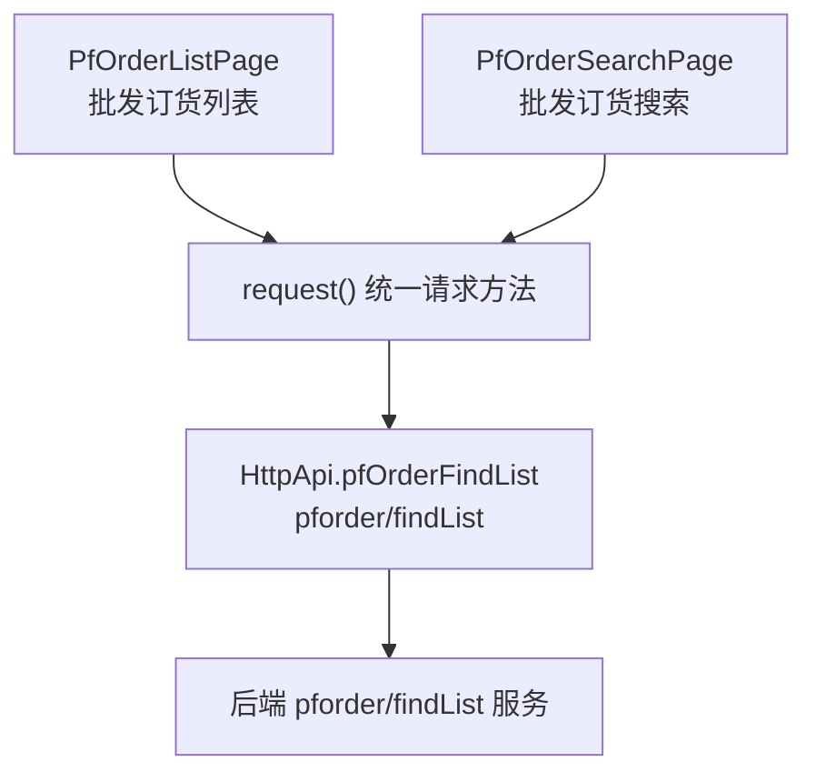
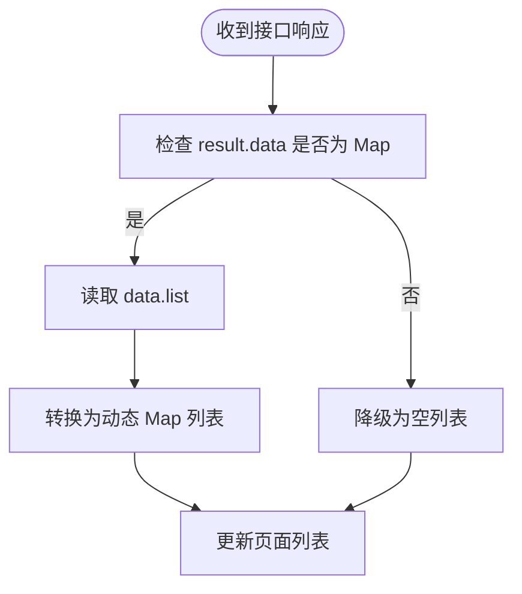
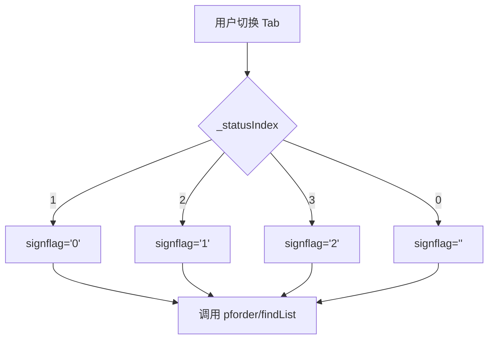
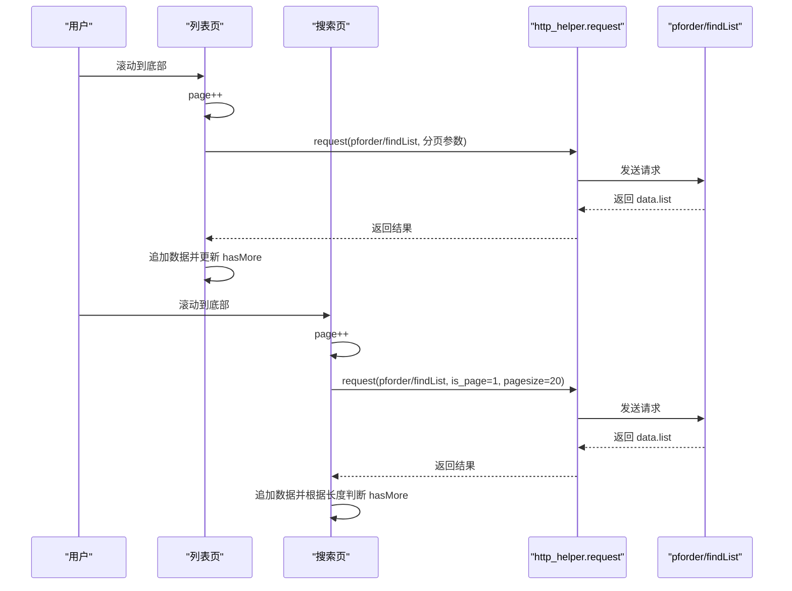
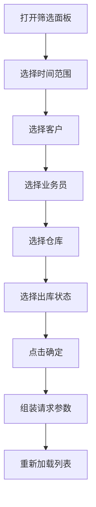
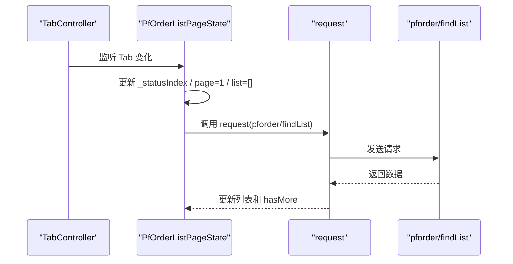
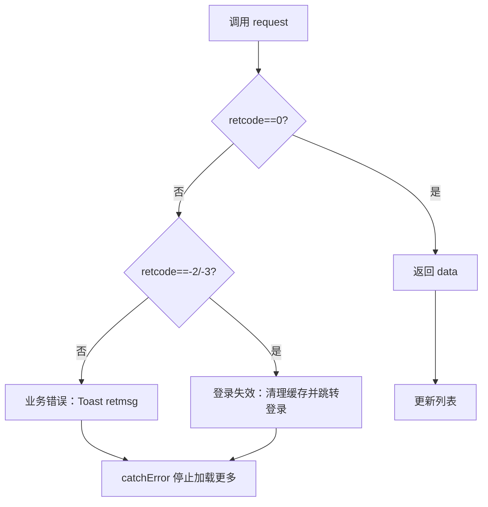

# 订单列表查询接口

<cite>
**本文引用的文件**   
- [list.dart](file://lib/pages/business/wholesale/pf_order/list.dart)
- [search.dart](file://lib/pages/business/wholesale/pf_order/search.dart)
- [http_api.dart](file://lib/net/http_api.dart)
- [http_helper.dart](file://lib/net/http_helper.dart)
</cite>

## 目录
1. [简介](#简介)
2. [项目结构与定位](#项目结构与定位)
3. [接口定义与请求参数](#接口定义与请求参数)
4. [响应数据结构](#响应数据结构)
5. [订单状态筛选逻辑](#订单状态筛选逻辑)
6. [分页加载机制](#分页加载机制)
7. [搜索与过滤功能](#搜索与过滤功能)
8. [前端集成：TabController 与数据刷新](#前端集成tabcontroller-与数据刷新)
9. [错误处理策略](#错误处理策略)
10. [性能优化建议](#性能优化建议)
11. [常见问题排查](#常见问题排查)
12. [结论](#结论)

## 简介
本文面向灵犀管店批发订货模块的“订单列表查询”能力，重点说明 `pforder/findList` 接口在应用中的调用方式、请求参数、响应结构、订单状态筛选、分页加载、搜索过滤，以及与前端 TabController 的集成和刷新机制。文档同时给出错误处理策略和性能优化建议，帮助前后端开发者统一理解该接口的行为边界。

## 项目结构与定位
批发订货订单列表功能位于 Flutter 客户端的批发业务模块中，核心文件如下：
- 列表页：`lib/pages/business/wholesale/pf_order/list.dart`
- 搜索页：`lib/pages/business/wholesale/pf_order/search.dart`
- 接口常量：`lib/net/http_api.dart`
- 网络请求封装：`lib/net/http_helper.dart`

**图表来源**
- [list.dart:1-120](file://lib/pages/business/wholesale/pf_order/list.dart#L1-L120)
- [search.dart:1-120](file://lib/pages/business/wholesale/pf_order/search.dart#L1-L120)
- [http_api.dart:459-465](file://lib/net/http_api.dart#L459-L465)
- [http_helper.dart:1-120](file://lib/net/http_helper.dart#L1-L120)

**章节来源**
- [list.dart:1-120](file://lib/pages/business/wholesale/pf_order/list.dart#L1-L120)
- [search.dart:1-120](file://lib/pages/business/wholesale/pf_order/search.dart#L1-L120)
- [http_api.dart:459-465](file://lib/net/http_api.dart#L459-L465)
- [http_helper.dart:1-120](file://lib/net/http_helper.dart#L1-L120)

## 接口定义与请求参数
### 接口地址
- 接口名：`pforder/findList`
- 客户端常量：`HttpApi.pfOrderFindList`
- 基础域名由 `HttpApi.baseUrlYlx` 决定，默认指向云端环境。

### 请求封装
客户端通过 `request(url, params)` 发起 POST 请求。通用外层字段包括 `sid`、`spid`、`client`、`token`、`sign`、`requestId`，业务参数位于 `params` 内。

### 列表页主要请求参数
| 参数 | 类型 | 必填 | 默认值或行为 | 说明 |
|---|---|---:|---|---|
| `field` | 字符串 | 否 | `createtime` | 排序字段；列表页固定为制单时间字段 |
| `type` | 字符串 | 否 | `desc` | 排序方向；列表页固定为降序 |
| `page` | 整数 | 是 | 从 1 开始递增 | 当前页码 |
| `billno` | 字符串 | 否 | 空串 | 按单据号模糊搜索 |
| `datetype` | 字符串 | 否 | `1` | 日期类型标识（列表页固定） |
| `signflag` | 字符串 | 否 | 空串 | 订单审核状态筛选，见下文“订单状态筛选逻辑” |
| `sids` | 数组 | 否 | 空数组 | 门店编号集合；列表页支持选择门店后传单个门店 ID |
| `starttime` | 字符串 | 否 | 默认近 30 天起始日 | 起止时间的开始时间，格式为 `YYYY-MM-DD HH:mm:ss` |
| `endtime` | 字符串 | 否 | 默认近 30 天结束日 | 起止时间的结束时间，格式为 `YYYY-MM-DD HH:mm:ss` |
| `custid` | 字符串 | 否 | 不传 | 客户编号；筛选面板可选 |
| `salesid` | 字符串 | 否 | 不传 | 业务员编号；筛选面板可选 |
| `counterid` | 字符串 | 否 | 不传 | 仓库编号；筛选面板可选 |
| `dhflag` | 字符串 | 否 | 不传 | 出库状态筛选；筛选面板可选 |

### 搜索页主要请求参数
搜索页也调用 `pforder/findList`，但参数组合略有不同：
| 参数 | 类型 | 必填 | 默认值或行为 | 说明 |
|---|---|---:|---|---|
| `field` | 字符串 | 否 | `createtime` | 排序字段 |
| `type` | 字符串 | 否 | `desc` | 排序方向 |
| `page` | 整数 | 是 | 从 1 开始递增 | 当前页码 |
| `is_page` | 整数 | 否 | `1` | 搜索页显式启用分页开关 |
| `pagesize` | 整数 | 否 | `20` | 搜索页每页条数 |
| `billno` | 字符串 | 否 | 输入框内容 | 按单据号搜索 |
| `starttime` | 字符串 | 否 | 可选 | 开始时间 |
| `endtime` | 字符串 | 否 | 可选 | 结束时间 |
| `dhflag` | 字符串 | 否 | 可选 | 出库状态筛选 |
| 合并参数 | Map | 否 | 可能为空 | 搜索页支持传入外部合并参数 `_mergData` |

**章节来源**
- [list.dart:80-160](file://lib/pages/business/wholesale/pf_order/list.dart#L80-L160)
- [search.dart:60-120](file://lib/pages/business/wholesale/pf_order/search.dart#L60-L120)
- [http_api.dart:459-465](file://lib/net/http_api.dart#L459-L465)
- [http_helper.dart:60-140](file://lib/net/http_helper.dart#L60-L140)

## 响应数据结构
客户端对 `pforder/findList` 的响应采用统一的 Map 解析方式：
- 外层返回完整接口响应对象，包含 `retcode`、`retmsg`、`data` 等。
- 业务数据位于 `result['data']`。
- 列表数据位于 `data['list']`，类型为列表。
- 若 `data` 不是 Map，客户端会降级为空列表。

**图表来源**
- [list.dart:120-160](file://lib/pages/business/wholesale/pf_order/list.dart#L120-L160)
- [search.dart:90-140](file://lib/pages/business/wholesale/pf_order/search.dart#L90-L140)
- [http_helper.dart:100-180](file://lib/net/http_helper.dart#L100-L180)

### 列表项常用字段
根据 UI 展示和交互逻辑，列表项通常包含以下字段（具体以服务端返回为准）：
| 字段 | 类型 | 用途 |
|---|---|---|
| `billid` | 字符串 | 订单编号，用于进入编辑详情页 |
| `billno` | 字符串 | 显示单据号 |
| `custname` | 字符串 | 客户名称 |
| `storename` | 字符串 | 订货门店名称 |
| `billamt` | 数值 | 单据金额，前端格式化保留小数位 |
| `createtime` | 字符串 | 制单时间 |
| `signflag` | 字符串 | 审核状态；`1` 表示已审核，其他表示待审核 |
| `dhflag` | 字符串 | 出库状态编码 |
| `dhflagname` | 字符串 | 出库状态名称，如未发货、部分发货、已发货等 |

**章节来源**
- [list.dart:120-160](file://lib/pages/business/wholesale/pf_order/list.dart#L120-L160)
- [search.dart:500-700](file://lib/pages/business/wholesale/pf_order/search.dart#L500-L700)
- [http_helper.dart:100-180](file://lib/net/http_helper.dart#L100-L180)

## 订单状态筛选逻辑
列表页使用顶部 Tab 控制订单审核状态筛选，Tab 索引含义如下：
- 索引 0：全部
- 索引 1：待审核
- 索引 2：已审核
- 索引 3：已驳回

内部将 `_statusIndex` 映射为 `signflag`：
- 待审核：`signflag = '0'`
- 已审核：`signflag = '1'`
- 已驳回：`signflag = '2'`
- 全部：`signflag = ''`（不传状态）

这意味着后端需要识别 `signflag` 的三种状态值，并对空值做“不过滤审核状态”的处理。

**图表来源**
- [list.dart:30-120](file://lib/pages/business/wholesale/pf_order/list.dart#L30-L120)

**章节来源**
- [list.dart:30-120](file://lib/pages/business/wholesale/pf_order/list.dart#L30-L120)

## 分页加载机制
列表页和搜索页都实现滚动到底部自动加载下一页：
- 监听 `ScrollController`。
- 当滚动位置接近底部阈值时，且当前不在加载中且还有更多数据，则页码加 1 并再次调用 `_loadData()`。
- 首次加载重置列表；后续加载追加新数据。
- 如果返回数据为空，则认为没有更多数据。

列表页与搜索页的分页细节差异：
- 列表页：依赖返回数据是否为空判断是否还有更多数据。
- 搜索页：额外传入 `is_page=1` 和 `pagesize=20`，并通过返回数据长度是否达到 20 判断是否还有更多数据。

**图表来源**
- [list.dart:60-120](file://lib/pages/business/wholesale/pf_order/list.dart#L60-L120)
- [search.dart:60-140](file://lib/pages/business/wholesale/pf_order/search.dart#L60-L140)
- [http_helper.dart:100-220](file://lib/net/http_helper.dart#L100-L220)

**章节来源**
- [list.dart:60-120](file://lib/pages/business/wholesale/pf_order/list.dart#L60-L120)
- [search.dart:60-140](file://lib/pages/business/wholesale/pf_order/search.dart#L60-L140)

## 搜索与过滤功能
### 搜索栏
- 输入单号后触发搜索。
- 列表页使用防抖定时器延迟执行搜索，避免频繁请求。
- 搜索页同样支持实时输入触发搜索，并在筛选面板确认后刷新。

### 筛选面板
列表页提供完整的筛选面板，包括：
- 快速时间标签：昨天、今天、本周、本月、自定义。
- 时间范围：开始日期和结束日期。
- 客户：可跳转客户选择页。
- 业务员：可跳转业务员选择页。
- 仓库：可选仓库编号。
- 出库状态：待处理、未发货、部分发货、已发货、已终止。

筛选条件最终会被写入请求参数：
- `custid`
- `salesid`
- `counterid`
- `dhflag`
- `starttime`
- `endtime`

搜索页的筛选面板更简洁，主要包含时间范围和出库状态，并可透传外部合并参数。

**图表来源**
- [list.dart:200-450](file://lib/pages/business/wholesale/pf_order/list.dart#L200-L450)
- [search.dart:200-500](file://lib/pages/business/wholesale/pf_order/search.dart#L200-L500)

**章节来源**
- [list.dart:200-450](file://lib/pages/business/wholesale/pf_order/list.dart#L200-L450)
- [search.dart:200-500](file://lib/pages/business/wholesale/pf_order/search.dart#L200-L500)

## 前端集成：TabController 与数据刷新
列表页使用 `TabController` 管理四个 Tab：
- 初始化时根据全局导航状态设置初始 Tab。
- 监听 Tab 变化，非过渡期间更新 `_statusIndex`、重置分页、清空列表并重新加载数据。
- 每次切换 Tab 都会触发新的 `pforder/findList` 请求。

数据刷新机制包括：
- 下拉刷新：重置 `_page=1`、`_hasMore=true`，然后重新加载。
- 滚动加载更多：接近底部时 `_page++` 并加载下一页。
- 筛选变更：重置分页并重新加载。
- 搜索输入：防抖后重置分页并重新加载。

**图表来源**
- [list.dart:30-120](file://lib/pages/business/wholesale/pf_order/list.dart#L30-L120)

**章节来源**
- [list.dart:30-120](file://lib/pages/business/wholesale/pf_order/list.dart#L30-L120)

## 错误处理策略
网络层 `request` 方法负责统一错误处理：
- 成功：`retcode == 0` 时返回完整响应。
- 登录失效：`retcode == -2` 或 `-3` 时清除缓存并跳转登录页。
- 业务失败：弹出 `retmsg` 提示，抛出异常。
- 网络异常：根据 DioException 类型提取友好提示，如超时、连接错误、无网络等。

列表页和搜索页在 `_loadData` 中使用 `.catchError` 将 `_hasMore` 置为 false，避免继续触发无限加载；`whenComplete` 确保 loading 状态关闭。

**图表来源**
- [http_helper.dart:100-220](file://lib/net/http_helper.dart#L100-L220)
- [list.dart:120-180](file://lib/pages/business/wholesale/pf_order/list.dart#L120-L180)
- [search.dart:90-150](file://lib/pages/business/wholesale/pf_order/search.dart#L90-L150)

**章节来源**
- [http_helper.dart:100-220](file://lib/net/http_helper.dart#L100-L220)
- [list.dart:120-180](file://lib/pages/business/wholesale/pf_order/list.dart#L120-L180)
- [search.dart:90-150](file://lib/pages/business/wholesale/pf_order/search.dart#L90-L150)

## 性能优化建议
- 合理设置分页大小：搜索页使用 `pagesize=20`，列表页依赖后端默认分页；建议在列表场景保持较小单页数据量，避免首屏渲染压力。
- 避免重复请求：列表页已有 `_loading` 守卫，防止并发多次加载；搜索页同样有相同保护。
- 防抖搜索：列表页使用 500ms 防抖，搜索页使用 350ms 防抖，可减少无效请求。
- 条件传参：仅传递非空筛选参数，减少后端过滤成本。
- 时间范围限制：列表页默认最近 30 天，避免一次性拉取过大时间范围的数据。
- 滚动加载阈值：当前阈值为距底部 60 像素，可根据实际体验调整。
- 图片与复杂组件：列表项避免过多复杂子组件，必要时使用 `RepaintBoundary` 减少重绘。

[本节为通用性能指导，不直接分析具体代码行]

## 常见问题排查
| 现象 | 可能原因 | 排查建议 |
|---|---|---|
| 切换 Tab 后列表不刷新 | Tab 监听未触发或 `_loadData` 被阻塞 | 检查 `_tabController.addListener` 与 `_loading` 状态 |
| 下拉刷新无效 | `_onRefresh` 未重置 `_page` 或 `_hasMore` | 确认 `_page=1`、`_hasMore=true` |
| 滚动加载停止 | 返回数据为空或 `_hasMore=false` | 检查后端返回 `data.list` 是否为空 |
| 筛选条件不生效 | 筛选参数未正确拼接到请求 | 检查 `custid`、`salesid`、`counterid`、`dhflag`、时间字段 |
| 登录过期后仍停留在列表页 | 登录失效处理未执行或导航栈异常 | 检查 `retcode=-2/-3` 分支及 `_handleLoginExpired` |
| 搜索页与列表页分页行为不一致 | 搜索页传了 `is_page` 和 `pagesize` | 确认两个页面的分页参数配置 |

**章节来源**
- [list.dart:60-180](file://lib/pages/business/wholesale/pf_order/list.dart#L60-L180)
- [search.dart:60-150](file://lib/pages/business/wholesale/pf_order/search.dart#L60-L150)
- [http_helper.dart:100-220](file://lib/net/http_helper.dart#L100-L220)

## 结论
`pforder/findList` 是灵犀管店批发订货模块的核心列表查询接口。前端通过列表页和搜索页分别封装不同的请求参数组合，实现 Tab 状态筛选、滚动分页、搜索过滤、门店和客户等业务维度筛选。后端应正确识别 `signflag`、`dhflag`、时间范围、门店集合等参数，并返回稳定的 `data.list` 结构。客户端在网络层统一处理登录失效、业务错误和网络异常，保证用户体验稳定。建议在扩展新功能时保持分页语义一致、参数命名清晰，并遵循现有错误处理和日志记录规范。

[本节为总结性内容，不直接分析具体代码行]