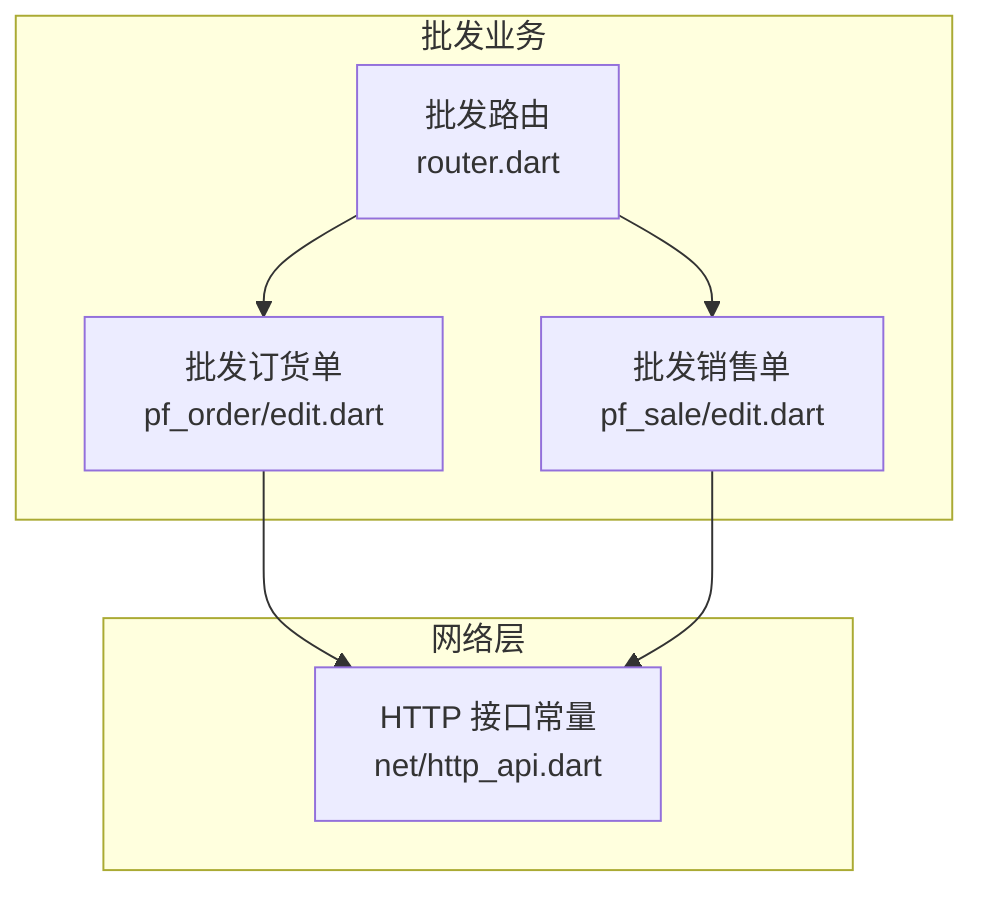
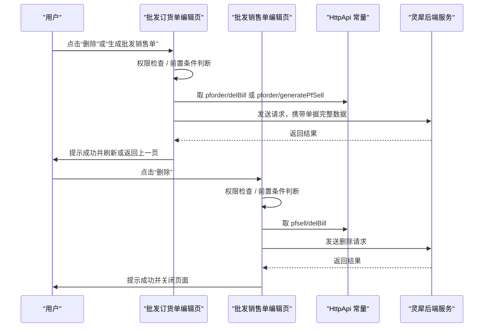
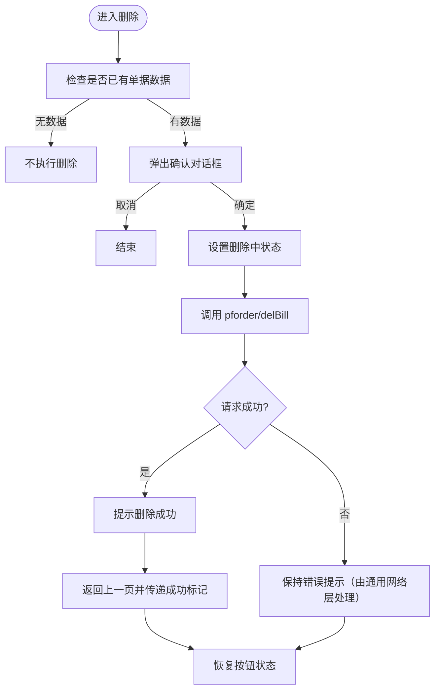
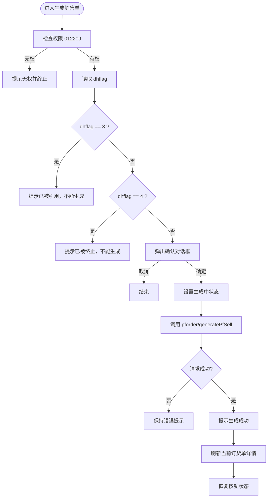
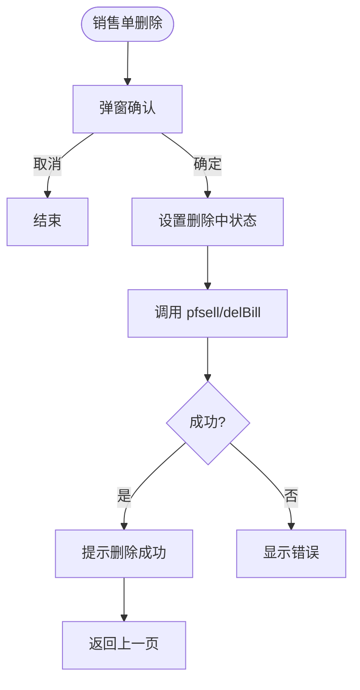
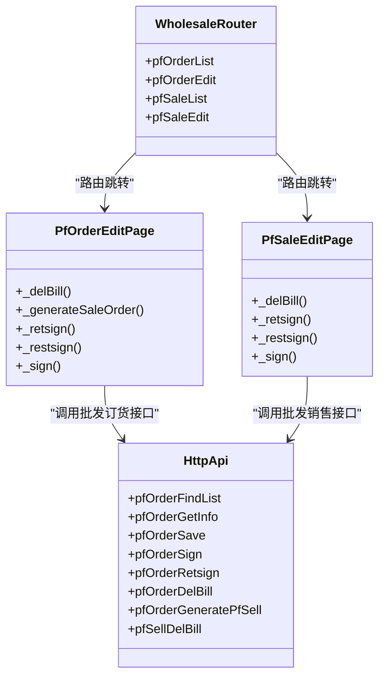

# 订单删除生成销售单接口

<cite>
**本文引用的文件**   
- [http_api.dart](file://lib/net/http_api.dart)
- [pf_order/edit.dart](file://lib/pages/business/wholesale/pf_order/edit.dart)
- [pf_sale/edit.dart](file://lib/pages/business/wholesale/pf_sale/edit.dart)
- [router.dart](file://lib/pages/business/wholesale/router.dart)
</cite>

## 目录
1. [引言](#引言)
2. [项目结构](#项目结构)
3. [核心组件](#核心组件)
4. [架构总览](#架构总览)
5. [详细接口分析](#详细接口分析)
6. [依赖关系分析](#依赖关系分析)
7. [性能与一致性考虑](#性能与一致性考虑)
8. [故障排查指南](#故障排查指南)
9. [结论](#结论)

## 引言
本文面向灵犀管店批发订货模块，聚焦两个关键业务接口：
- 删除订单接口 pforder/delBill
- 由批发订货单生成批发销售单接口 pforder/generatePfSell

文档基于前端 Flutter 工程中的 HTTP 接口常量定义、批发订货单编辑页、批发销售单编辑页和路由表进行分析。需要特别强调：本仓库是移动端客户端实现，真正的“库存扣减”“财务凭证生成”“数据同步”等后端逻辑不在本仓库中体现；本文会明确区分“前端已实现行为”和“由后端服务承担的职责”，避免将服务端能力误归到客户端代码。

## 项目结构
批发订货相关功能集中在 wholesale 业务域下：
- 批发订货单列表与编辑：wholesale/pf_order
- 批发销售单列表与编辑：wholesale/pf_sale
- 批发子模块路由：wholesale/router.dart
- 全局 HTTP 接口常量：net/http_api.dart

**图示来源**
- [router.dart:10-31](file://lib/pages/business/wholesale/router.dart#L10-L31)
- [http_api.dart:459-465](file://lib/net/http_api.dart#L459-L465)

**章节来源**
- [router.dart:10-31](file://lib/pages/business/wholesale/router.dart#L10-L31)
- [http_api.dart:459-465](file://lib/net/http_api.dart#L459-L465)

## 核心组件
本节聚焦与目标接口直接相关的组件：

| 组件 | 职责 | 关键行为 |
|---|---|---|
| `HttpApi` | 集中声明后端接口路径 | 提供 `pfOrderDelBill`、`pfOrderGeneratePfSell`、`pfSellDelBill` 等常量 |
| 批发订货单编辑页 | 新增/编辑/审核/反审/撤回/打印/删除/生成销售单 | 调用 pforder 系列接口，控制审批状态与权限校验 |
| 批发销售单编辑页 | 新增/编辑/审核/反审/撤回/打印/删除 | 调用 pfsell 系列接口，控制审批状态与权限校验 |
| 批发路由 | 维护批发子模块页面路由 | 暴露 `/wholesale/pf_order/*`、`/wholesale/pf_sale/*` 入口 |

**章节来源**
- [http_api.dart:459-465](file://lib/net/http_api.dart#L459-L465)
- [pf_order/edit.dart:31-31](file://lib/pages/business/wholesale/pf_order/edit.dart#L31-L31)
- [pf_sale/edit.dart:35-35](file://lib/pages/business/wholesale/pf_sale/edit.dart#L35-L35)
- [router.dart:10-31](file://lib/pages/business/wholesale/router.dart#L10-L31)

## 架构总览
从客户端视角看，两个接口的调用链路如下：

**图示来源**
- [pf_order/edit.dart:686-759](file://lib/pages/business/wholesale/pf_order/edit.dart#L686-L759)
- [pf_sale/edit.dart:732-753](file://lib/pages/business/wholesale/pf_sale/edit.dart#L732-L753)
- [http_api.dart:459-465](file://lib/net/http_api.dart#L459-L465)

## 详细接口分析

### 删除订单接口 pforder/delBill

#### 接口定位
- 接口路径常量：`pfOrderDelBill = 'pforder/delBill'`
- 调用方：批发订货单编辑页的 `_delBill`
- 入参：当前订货单的完整数据对象 `_billData`

#### 前端处理流程

**图示来源**
- [pf_order/edit.dart:686-707](file://lib/pages/business/wholesale/pf_order/edit.dart#L686-L707)

#### 前置条件
- 前端只做了最基础的“存在单据数据”检查，没有额外业务规则拦截。
- 真正的“能否删除”的前置条件，例如：
  - 单据是否已审核
  - 是否已被下游单据引用
  - 是否有未完成的审批流
  这些应由后端在服务端校验后返回统一错误信息，再由前端提示。

#### 关联数据处理
- 前端在删除成功后直接提示成功并返回上一页，不会主动清理本地缓存或通知其他页面。
- 若列表页采用实时拉取，返回列表后会重新加载最新数据；若使用本地缓存，则可能需要显式刷新或回退重建。

#### 数据恢复机制
- 前端没有实现“删除前快照 + 自动撤销恢复”的能力。
- 若需支持撤销删除，应优先由后端提供“反删除/恢复接口”，或在数据库层面保留软删除字段；前端仅做操作入口和提示。

#### 调用示例说明
- 触发入口：批发订货单编辑页底部操作栏中的“删除”按钮。
- 请求体：整个 `_billData` 对象，包含单据头、明细、审批状态、时间戳等字段。
- 响应处理：成功后弹出“删除成功”，然后关闭当前编辑页。

**章节来源**
- [http_api.dart:464](file://lib/net/http_api.dart#L464)
- [pf_order/edit.dart:686-707](file://lib/pages/business/wholesale/pf_order/edit.dart#L686-L707)

### 生成销售单接口 pforder/generatePfSell

#### 接口定位
- 接口路径常量：`pfOrderGeneratePfSell = 'pforder/generatePfSell'`
- 调用方：批发订货单编辑页的 `_generateSaleOrder`
- 入参：以数组形式传入当前订货单数据 `[_billData]`

#### 前端业务规则

**图示来源**
- [pf_order/edit.dart:725-759](file://lib/pages/business/wholesale/pf_order/edit.dart#L725-L759)

#### 关键业务语义
| 字段或动作 | 含义 | 前端行为 |
|---|---|---|
| 权限码 `012209` | 生成批发销售单的权限 | 无权限时直接拒绝 |
| `dhflag` | 订货单被下游引用或终止的状态标识 | `3` 表示已被引用，`4` 表示已被终止，均禁止生成 |
| 确认弹窗 | 防止误操作 | 用户必须点击“确定”才发起请求 |
| 成功后刷新 | 更新界面状态 | 调用 `_loadDetail()` 重新拉取单据详情 |

#### 转换规则、库存扣减、财务凭证和数据同步
- 前端仅负责：
  - 权限校验
  - `dhflag` 前置检查
  - 用户二次确认
  - 调用 `pforder/generatePfSell`
  - 成功后刷新当前订货单详情
- 以下内容由后端服务实现，前端不体现：
  - 将订货单转换为销售单的数据映射规则
  - 根据销售单明细扣减库存
  - 生成财务凭证或会计分录
  - 同步客户应收、库存台账、统计报表等
- 如果后端失败，前端会通过通用网络层返回错误，由上层 UI 展示；当前代码中没有针对该接口的特殊重试或补偿逻辑。

#### 调用示例说明
- 触发入口：批发订货单编辑页顶部或工具栏中的“生成批发销售单”按钮。
- 请求体：`[_billData]`，即把当前订货单数据作为数组元素发送给后端。
- 响应处理：成功后提示“生成成功”，并刷新当前订货单详情。

**章节来源**
- [http_api.dart:465](file://lib/net/http_api.dart#L465)
- [pf_order/edit.dart:725-759](file://lib/pages/business/wholesale/pf_order/edit.dart#L725-L759)

### 批发销售单删除接口 pfsell/delBill

虽然题目重点在 pforder/delBill 和 pforder/generatePfSell，但仓库中也实现了批发销售单的删除逻辑，便于理解整体删除行为：

- 接口路径常量：`pfSellDelBill = 'pfsell/delBill'`
- 调用方：批发销售单编辑页的 `_delBill`
- 行为模式：与订货单删除类似，先弹窗确认，再调用删除接口，成功后提示并返回上一页。

**图示来源**
- [pf_sale/edit.dart:732-753](file://lib/pages/business/wholesale/pf_sale/edit.dart#L732-L753)
- [http_api.dart:473](file://lib/net/http_api.dart#L473)

**章节来源**
- [pf_sale/edit.dart:732-753](file://lib/pages/business/wholesale/pf_sale/edit.dart#L732-L753)
- [http_api.dart:473](file://lib/net/http_api.dart#L473)

## 依赖关系分析

**图示来源**
- [http_api.dart:459-473](file://lib/net/http_api.dart#L459-L473)
- [pf_order/edit.dart:31-31](file://lib/pages/business/wholesale/pf_order/edit.dart#L31-L31)
- [pf_sale/edit.dart:35-35](file://lib/pages/business/wholesale/pf_sale/edit.dart#L35-L35)
- [router.dart:10-31](file://lib/pages/business/wholesale/router.dart#L10-L31)

**章节来源**
- [http_api.dart:459-473](file://lib/net/http_api.dart#L459-L473)
- [router.dart:10-31](file://lib/pages/business/wholesale/router.dart#L10-L31)

## 性能与一致性考虑
- 并发删除：
  - 前端通过 `_submitAction.delete` 控制按钮 loading 状态，避免重复提交，但未对服务器幂等性做强制保证。
  - 建议后端对删除接口实现幂等：多次删除同一单据返回一致结果。
- 生成销售单：
  - 前端在成功后立即刷新单据详情，可能触发一次新的详情查询。
  - 如果详情接口较重，可考虑在成功回调中局部更新 `dhflag` 等关键字段，减少不必要的全量刷新。
- 网络异常：
  - 当前删除和生成逻辑主要依赖通用网络层返回结果；如需更强健壮性，可增加重试策略、超时控制和离线队列。
- 数据一致性：
  - 删除和销售单生成属于跨实体变更，强烈建议由后端事务保证：若库存扣减失败，不得只生成销售单；若财务凭证失败，应有回滚或补偿方案。

[本节为通用性能建议，不直接分析具体代码行]

## 故障排查指南

| 现象 | 可能原因 | 排查建议 |
|---|---|---|
| 点击删除无反应 | 单据数据为空，或权限/页面状态异常 | 检查是否已进入详情页，确认 `_billData` 是否存在 |
| 删除成功但列表未变化 | 列表页未重新拉取数据 | 检查列表页是否在返回后刷新；必要时手动刷新或导航重建 |
| 生成销售单提示无权 | 当前用户缺少权限码 `012209` | 在后端权限配置中为该角色或用户分配对应权限 |
| 生成销售单提示“已被引用” | 订货单 `dhflag` 为 `3` | 查看下游销售单或其他引用单据，确认是否允许继续生成 |
| 生成销售单提示“已被终止” | 订货单 `dhflag` 为 `4` | 检查订货单终止记录，评估是否需要走特殊业务流程 |
| 生成成功但界面未刷新 | 刷新逻辑未被执行或详情接口异常 | 检查 `_loadDetail()` 是否正常调用及返回数据格式 |
| 删除或生成后出现重复提交 | 按钮状态未及时恢复 | 检查 `whenComplete` 分支是否正确重置 `_submitAction` |

**章节来源**
- [pf_order/edit.dart:686-759](file://lib/pages/business/wholesale/pf_order/edit.dart#L686-L759)
- [pf_sale/edit.dart:732-753](file://lib/pages/business/wholesale/pf_sale/edit.dart#L732-L753)

## 结论
- 在本仓库中，`pforder/delBill` 和 `pforder/generatePfSell` 主要由批发订货单编辑页调用，并通过 `HttpApi` 常量映射到后端接口。
- 删除接口的核心前端逻辑是：确认 → 调用接口 → 提示成功 → 返回上一页。
- 生成销售单接口的核心前端逻辑是：权限检查 → 引用状态检查 → 确认 → 调用接口 → 提示成功 → 刷新详情。
- 真正的库存扣减、财务凭证生成、数据同步等属于后端服务职责，不应在前端假设其实现细节。
- 若希望增强系统可靠性，建议在后端补充强一致性保障、幂等处理和审计日志，并在前端增加更清晰的用户提示、重试策略和数据刷新机制。