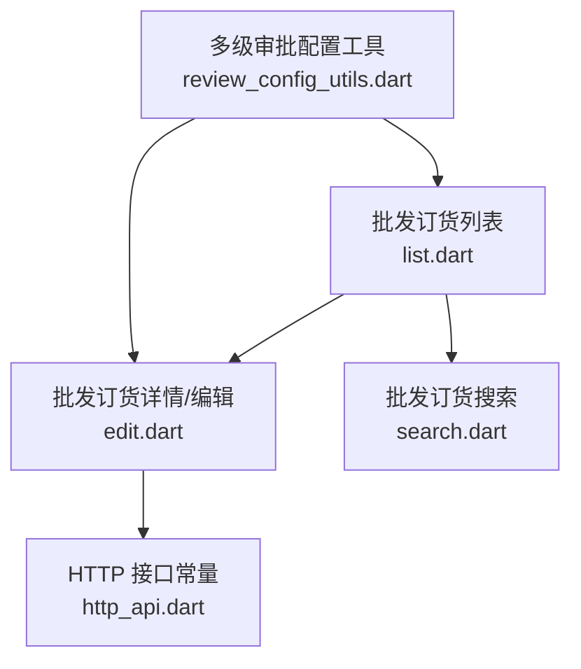
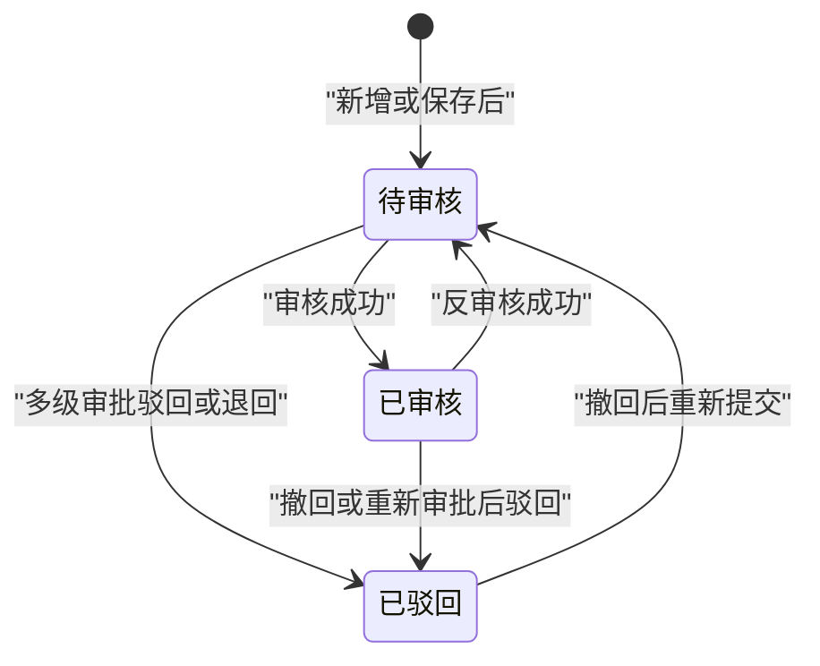
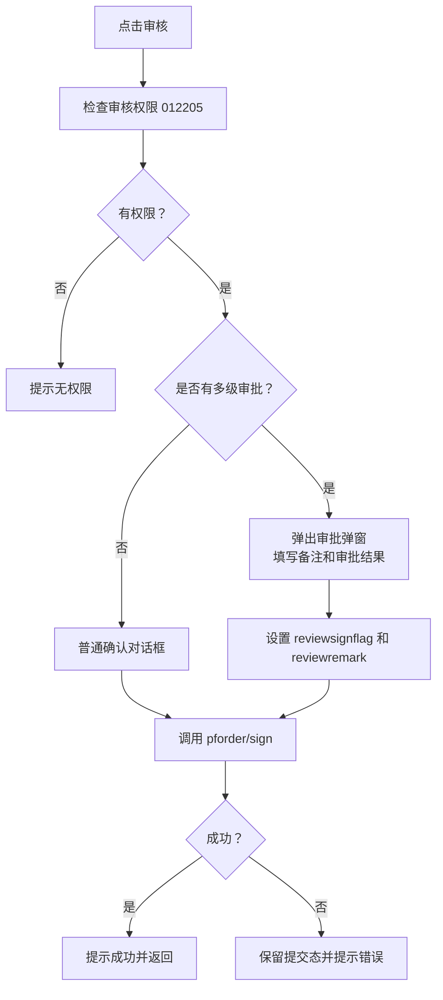
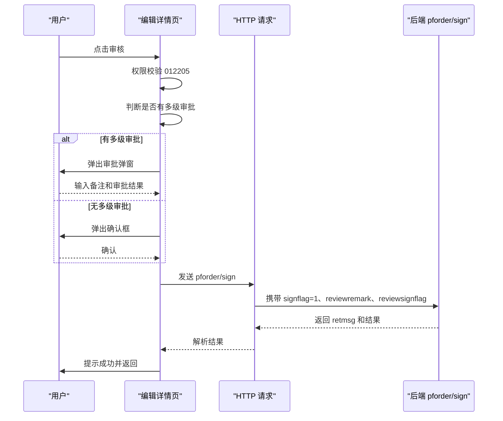
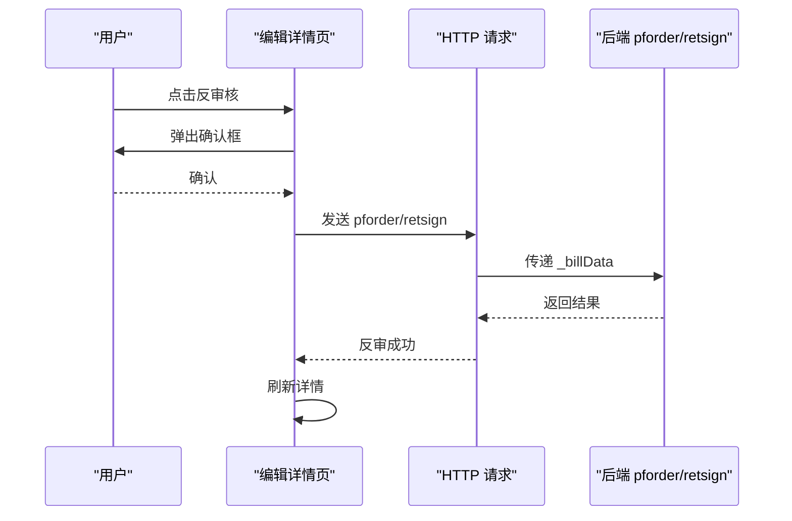
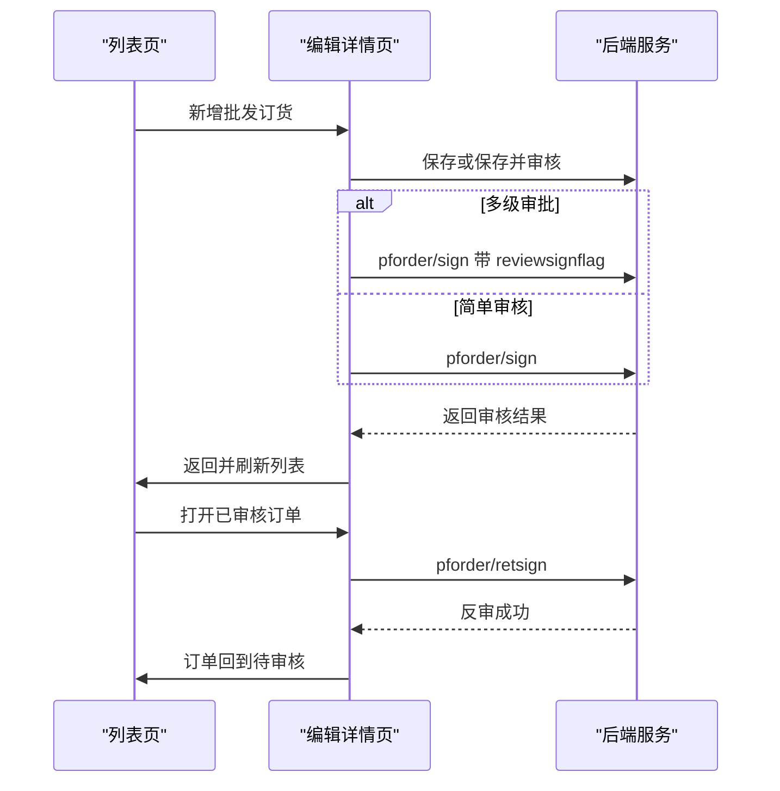

# 订单审核反审核接口

<cite>
**本文引用的文件**   
- [http_api.dart](file://lib/net/http_api.dart)
- [list.dart](file://lib/pages/business/wholesale/pf_order/list.dart)
- [edit.dart](file://lib/pages/business/wholesale/pf_order/edit.dart)
- [search.dart](file://lib/pages/business/wholesale/pf_order/search.dart)
- [review_config_utils.dart](file://lib/util/review_config_utils.dart)
</cite>

## 目录
1. [引言](#引言)
2. [项目结构与范围](#项目结构与范围)
3. [核心接口定义](#核心接口定义)
4. [订单状态流转机制](#订单状态流转机制)
5. [权限控制与多级审批](#权限控制与多级审批)
6. [pforder/sign 审核接口规范](#pfordersign-审核接口规范)
7. [pforder/retsign 反审核接口规范](#pforderretsign-反审核接口规范)
8. [校验规则与业务约束](#校验规则与业务约束)
9. [数据一致性保证](#数据一致性保证)
10. [完整工作流示例](#完整工作流示例)
11. [异常处理方案](#异常处理方案)
12. [性能与可维护性建议](#性能与可维护性建议)
13. [结论](#结论)

## 引言
本文面向灵犀管店批发订货模块，聚焦“订单审核”和“订单反审核”两个关键能力，围绕 `pforder/sign` 与 `pforder/retsign` 接口展开。文档从前端调用方视角说明参数来源、调用时机、状态变化、权限边界和多级审批交互，同时补充列表页与详情页中的状态展示逻辑，帮助后端开发、联调人员和实施人员统一理解该功能的实现约定。

本仓库是一个 Flutter 客户端工程，审核与反审核的服务器端校验规则不在当前代码范围内；因此本文对“业务约束”的描述以客户端可见行为为准，并明确标注哪些逻辑由前端驱动、哪些应由服务端保障。

## 项目结构与范围
批发订货相关代码集中在以下位置：
- 接口常量集中定义在 HTTP API 层。
- 列表页负责按审核状态筛选、分页加载。
- 编辑详情页承担新增、保存、审核、反审核、删除、生成销售单、打印等主操作。
- 搜索页提供选择单据时的基础列表展示。
- 审批配置工具提供多级审批是否显示“已驳回”标签的全局配置。

**图表来源**
- [list.dart:121-145](file://lib/pages/business/wholesale/pf_order/list.dart#L121-L145)
- [edit.dart:620-940](file://lib/pages/business/wholesale/pf_order/edit.dart#L620-L940)
- [http_api.dart:458-464](file://lib/net/http_api.dart#L458-L464)
- [review_config_utils.dart:1-141](file://lib/util/review_config_utils.dart#L1-L141)

**章节来源**
- [http_api.dart:458-464](file://lib/net/http_api.dart#L458-L464)
- [list.dart:32-145](file://lib/pages/business/wholesale/pf_order/list.dart#L32-L145)
- [edit.dart:139-206](file://lib/pages/business/wholesale/pf_order/edit.dart#L139-L206)
- [review_config_utils.dart:1-141](file://lib/util/review_config_utils.dart#L1-L141)

## 核心接口定义
批发订货模块对外暴露的接口常量如下：

| 接口常量名 | 后端路径 | 用途 |
|---|---|---|
| `pfOrderFindList` | `pforder/findList` | 查询批发订货列表 |
| `pfOrderGetInfo` | `pforder/getInfo` | 获取批发订货详情 |
| `pfOrderSave` | `pforder/save` | 新增或保存批发订货 |
| `pfOrderSign` | `pforder/sign` | 审核批发订货 |
| `pfOrderRetsign` | `pforder/retsign` | 反审核批发订货 |
| `pfOrderDelBill` | `pforder/delBill` | 删除批发订货 |
| `pfOrderGeneratePfSell` | `pforder/generatePfSell` | 根据批发订货生成批发销售单 |

上述常量位于 HTTP API 层，所有页面通过统一的网络请求封装发起调用。

**章节来源**
- [http_api.dart:458-464](file://lib/net/http_api.dart#L458-L464)

## 订单状态流转机制
批发订货订单使用字段 `signflag` 表示审核状态，结合 `reviewsignflag` 表示多级审批节点状态。

### signflag 含义
- `0`：待审核。
- `1`：已审核。
- `2`：已驳回。  
  在批发模块中，`signflag == 2` 还同时用于表达“待提交”，进入撤回分支。

### reviewsignflag 含义
- `0`：驳回到上一节点。
- `1`：同意并通过。
- `2`：撤回后处于待处理态。

### 列表页状态映射
列表页将 `signflag` 映射为三个 Tab：
- 全部：不传或空值。
- 待审核：`signflag = '0'`。
- 已审核：`signflag = '1'`。
- 已驳回：`signflag = '2'`。

**图表来源**
- [list.dart:121-145](file://lib/pages/business/wholesale/pf_order/list.dart#L121-L145)
- [edit.dart:822-826](file://lib/pages/business/wholesale/pf_order/edit.dart#L822-L826)
- [edit.dart:921-935](file://lib/pages/business/wholesale/pf_order/edit.dart#L921-L935)

**章节来源**
- [list.dart:36-40](file://lib/pages/business/wholesale/pf_order/list.dart#L36-L40)
- [list.dart:121-145](file://lib/pages/business/wholesale/pf_order/list.dart#L121-L145)
- [list.dart:959-968](file://lib/pages/business/wholesale/pf_order/list.dart#L959-L968)
- [edit.dart:204-206](file://lib/pages/business/wholesale/pf_order/edit.dart#L204-L206)
- [edit.dart:822-826](file://lib/pages/business/wholesale/pf_order/edit.dart#L822-L826)

## 权限控制与多级审批
### 权限码
| 动作 | 权限码 | 说明 |
|---|---:|---|
| 查看批发订货 | `012201` | 列表页入口权限 |
| 新增批发订货 | `012203` | 新增按钮权限 |
| 编辑批发订货 | `012204` | 修改入口权限 |
| 审核批发订货 | `012205` | 审核按钮权限 |
| 反审核批发订货 | `012206` | 撤回审批权限 |
| 生成批发销售单 | `012209` | 生成下游销售单权限 |
| 删除批发订货 | 未显式声明独立权限码 | 删除流程有确认弹窗，但主要受业务状态限制 |

### 多级审批判断
- 新增时会根据机构 ID 查询是否需要审批签字。
- 审核前会读取 `reviewFlowUsers` 和 `reviewBillFlows`：
  - `_bolHandleT`：当前用户是否属于当前审批节点。
  - `_bolHandleTT`：是否为第一审批人或管理员。
  - `_bolHandleTTT`：是否有反审核权限。
- 若存在多级审批配置，则弹出审批弹窗，携带 `reviewsignflag` 和 `reviewremark`。

**图表来源**
- [edit.dart:620-660](file://lib/pages/business/wholesale/pf_order/edit.dart#L620-L660)
- [edit.dart:812-837](file://lib/pages/business/wholesale/pf_order/edit.dart#L812-L837)
- [edit.dart:921-940](file://lib/pages/business/wholesale/pf_order/edit.dart#L921-L940)

**章节来源**
- [list.dart:86-92](file://lib/pages/business/wholesale/pf_order/list.dart#L86-L92)
- [edit.dart:620-660](file://lib/pages/business/wholesale/pf_order/edit.dart#L620-L660)
- [edit.dart:763-791](file://lib/pages/business/wholesale/pf_order/edit.dart#L763-L791)
- [edit.dart:812-837](file://lib/pages/business/wholesale/pf_order/edit.dart#L812-L837)
- [edit.dart:863-940](file://lib/pages/business/wholesale/pf_order/edit.dart#L863-L940)

## pforder/sign 审核接口规范

### 调用入口
- 列表页不直接触发审核。
- 编辑详情页提供“审核”按钮，并在新增保存成功后也可能触发审核流程。
- 当存在多级审批配置时，先弹出审批弹窗；否则弹出简单确认框。

### 请求参数
| 字段 | 类型 | 必填 | 说明 |
|---|---|---:|---|
| 单据完整数据 | Map | 是 | 包含单据主表及明细，例如客户、仓库、商品行、金额等 |
| `signflag` | 数值 | 是 | 固定传入 `1`，表示审核通过 |
| `reviewremark` | 字符串 | 是 | 审核备注；为空时传空字符串 |
| `reviewsignflag` | 数值 | 条件必填 | 多级审批时携带；默认转为 `1`，除非原值为 `2`（撤回）或 `0`（驳回） |

其中“单据完整数据”来源于当前编辑页面的 `_billData`，包括：
- 机构、门店、仓库、客户、业务员等主信息。
- 商品明细、数量、价格、税额、包装单位换算等。
- 审核相关字段：`signflag`、`reviewsignflag`、`reviewremark`。

### 返回值处理
- 成功：提示后端返回消息，关闭详情页并返回上一页。
- 失败：保持提交态，允许用户重试或修改。

### 审核按钮可见性
- 新增或待审核单据：可点击“审核”。
- 已审核单据：显示“反审核”“打印”“生成批发单”等后续操作。
- 待提交且处于撤回态：走撤回分支，不调用普通审核。

**图表来源**
- [edit.dart:620-660](file://lib/pages/business/wholesale/pf_order/edit.dart#L620-L660)
- [edit.dart:921-940](file://lib/pages/business/wholesale/pf_order/edit.dart#L921-L940)
- [http_api.dart:458-464](file://lib/net/http_api.dart#L458-L464)

**章节来源**
- [edit.dart:620-660](file://lib/pages/business/wholesale/pf_order/edit.dart#L620-L660)
- [edit.dart:921-940](file://lib/pages/business/wholesale/pf_order/edit.dart#L921-L940)
- [http_api.dart:458-464](file://lib/net/http_api.dart#L458-L464)

## pforder/retsign 反审核接口规范

### 调用入口
编辑详情页提供“反审核”按钮，用于将已审核单据恢复到待审核状态。

### 请求参数
| 字段 | 类型 | 必填 | 说明 |
|---|---|---:|---|
| 单据完整数据 | Map | 是 | 同审核接口，复用 `_billData` |
| `signflag` | 数值 | 否 | 反审核通常由服务端根据单据当前状态更新 |
| `reviewsignflag` | 数值 | 否 | 反审核一般不需要主动设置，具体以服务端语义为准 |

### 返回值处理
- 成功：提示“反审成功”，重新加载单据详情。
- 失败：恢复提交态，不跳转。

### 与“撤回审批”的区别
代码中存在两种容易混淆的操作：
1. 普通反审核：调用 `pforder/retsign`，主要用于“已审核 → 待审核”。
2. 撤回审批：内部使用 `pforder/save`，并将 `reviewsignflag` 设为 `2`、`signflag` 设为 `1`，用于多级审批场景下的撤回。

**图表来源**
- [edit.dart:660-686](file://lib/pages/business/wholesale/pf_order/edit.dart#L660-L686)
- [http_api.dart:458-464](file://lib/net/http_api.dart#L458-L464)

**章节来源**
- [edit.dart:660-686](file://lib/pages/business/wholesale/pf_order/edit.dart#L660-L686)
- [edit.dart:763-791](file://lib/pages/business/wholesale/pf_order/edit.dart#L763-L791)
- [http_api.dart:458-464](file://lib/net/http_api.dart#L458-L464)

## 校验规则与业务约束

### 前端校验
| 校验项 | 规则 | 表现 |
|---|---|---|
| 审核权限 | 必须拥有 `012205` | 无权限时提示“你无权审核批发订货” |
| 反审核权限 | 撤回审批需拥有 `012206` | 无权限时提示“你无权反审核批发订货” |
| 生成销售单权限 | 必须拥有 `012209` | 无权限时提示“你无权生成批发单” |
| 发货状态 | `dhflag == '3'` 表示已被引用 | 禁止生成批发销售单 |
| 终止状态 | `dhflag == '4'` 表示已被终止 | 禁止生成批发销售单 |
| 已审核编辑限制 | 已审核单据为只读 | 不允许修改单据内容 |
| 多级审批节点 | 当前用户不在审批节点 | 提示“您不属于当前审批节点的审核人” |
| 保存保护 | 仅对新增或待审核单据启用保存拦截 | 已审核或待提交单据跳过保存保护 |

### 业务约束说明
- 列表页通过 `signflag` 过滤不同状态订单。
- 搜索页将 `signflag == '1'` 显示为“已审核”，其他情况显示为“待审核”。
- 列表页状态颜色：
  - 已审核：绿色。
  - 已驳回：橙色。
  - 待审核：红色。
- 详情页顶部状态文本与颜色同样依据 `signflag`。

**章节来源**
- [edit.dart:620-628](file://lib/pages/business/wholesale/pf_order/edit.dart#L620-L628)
- [edit.dart:763-774](file://lib/pages/business/wholesale/pf_order/edit.dart#L763-L774)
- [edit.dart:734-746](file://lib/pages/business/wholesale/pf_order/edit.dart#L734-L746)
- [edit.dart:863-875](file://lib/pages/business/wholesale/pf_order/edit.dart#L863-L875)
- [edit.dart:439-441](file://lib/pages/business/wholesale/pf_order/edit.dart#L439-L441)
- [list.dart:959-968](file://lib/pages/business/wholesale/pf_order/list.dart#L959-L968)
- [search.dart:495-501](file://lib/pages/business/wholesale/pf_order/search.dart#L495-L501)
- [search.dart:772-776](file://lib/pages/business/wholesale/pf_order/search.dart#L772-L776)

## 数据一致性保证
### 前端层面
- 审核操作使用统一的 `_submitAction` 标记提交态，避免重复点击。
- 反审核成功后立即调用详情加载方法刷新界面。
- 生成销售单前校验 `dhflag`，防止对已引用或已终止单据继续生成。
- 多级审批通过 `reviewFlowUsers` 和 `reviewBillFlows` 控制按钮可见性和操作权限。

### 应依赖后端保证的一致性
- 订单状态变更原子性：审核、反审核、撤回不应出现部分成功。
- 并发控制：同一订单不被多人同时审核或反审核。
- 引用关系更新：生成销售单后正确更新 `dhflag`。
- 审批日志持久化：多级审批记录完整可追溯。
- 状态合法性：服务端拒绝非法状态迁移，例如从“已驳回”直接审核为“已审核”。

当前前端代码未实现本地事务补偿或幂等重试逻辑，因此接口幂等性和最终一致性主要由后端保障。

**章节来源**
- [edit.dart:921-940](file://lib/pages/business/wholesale/pf_order/edit.dart#L921-L940)
- [edit.dart:660-686](file://lib/pages/business/wholesale/pf_order/edit.dart#L660-L686)
- [edit.dart:734-746](file://lib/pages/business/wholesale/pf_order/edit.dart#L734-L746)
- [edit.dart:863-875](file://lib/pages/business/wholesale/pf_order/edit.dart#L863-L875)

## 完整工作流示例

### 示例一：新增并审核
1. 用户进入批发订货列表，点击新增。
2. 填写机构、仓库、客户、商品明细等信息。
3. 点击“保存”或“保存并审核”。
4. 若配置多级审批，系统弹出审批弹窗；否则弹出确认框。
5. 前端调用 `pforder/sign`，携带 `signflag=1`、`reviewremark`、`reviewsignflag`。
6. 成功后返回列表，订单状态变为“已审核”。

### 示例二：已审核订单反审核
1. 用户在列表中进入“已审核”订单。
2. 点击“反审核”。
3. 确认弹窗后调用 `pforder/retsign`。
4. 成功后订单状态回到“待审核”。

### 示例三：多级审批驳回与撤回
1. 审批人打开待审批订单。
2. 选择驳回并填写备注，前端设置 `reviewsignflag=0`。
3. 调用 `pforder/sign`，订单进入“已驳回”或“待提交”分支。
4. 若需要重新处理，执行撤回逻辑，调用 `pforder/save`，设置 `reviewsignflag=2`。
5. 撤回后再次提交审核，重新进入审批流程。

**图表来源**
- [list.dart:121-145](file://lib/pages/business/wholesale/pf_order/list.dart#L121-L145)
- [edit.dart:620-660](file://lib/pages/business/wholesale/pf_order/edit.dart#L620-L660)
- [edit.dart:660-686](file://lib/pages/business/wholesale/pf_order/edit.dart#L660-L686)
- [edit.dart:921-940](file://lib/pages/business/wholesale/pf_order/edit.dart#L921-L940)

**章节来源**
- [list.dart:121-145](file://lib/pages/business/wholesale/pf_order/list.dart#L121-L145)
- [edit.dart:620-660](file://lib/pages/business/wholesale/pf_order/edit.dart#L620-L660)
- [edit.dart:660-686](file://lib/pages/business/wholesale/pf_order/edit.dart#L660-L686)
- [edit.dart:921-940](file://lib/pages/business/wholesale/pf_order/edit.dart#L921-L940)

## 异常处理方案

| 异常场景 | 前端行为 | 建议处理方式 |
|---|---|---|
| 无审核权限 | 提示无权限，不调用接口 | 后台分配 `012205` |
| 无反审核权限 | 提示无权限，不调用撤回接口 | 后台分配 `012206` |
| 无生成销售单权限 | 提示无权限 | 后台分配 `012209` |
| 订单已被引用或终止 | 阻止生成销售单 | 联系上游释放引用或恢复单据 |
| 不在审批节点 | 提示不属于审核人 | 调整审批流或更换操作人 |
| 网络请求失败 | 保留提交态，不自动重试 | 提示用户检查网络并重试 |
| 后端返回失败消息 | 使用 `retmsg` 作为提示文案 | 后端返回明确业务错误信息 |
| 多端并发审核 | 前端未做乐观锁 | 后端实现状态机校验与并发保护 |

### 列表页加载异常
- 列表加载失败时将 `hasMore` 置为 false，停止继续分页。
- 加载完成后始终恢复 `_loading` 状态，避免无限 loading。

### 详情页操作异常
- 审核、反审核、删除等操作均使用 `try/catch` 风格的错误分支。
- 成功后才刷新详情或返回上一页。
- 失败时保留 `_submitAction`，避免 UI 误判为空闲。

**章节来源**
- [edit.dart:620-628](file://lib/pages/business/wholesale/pf_order/edit.dart#L620-L628)
- [edit.dart:660-686](file://lib/pages/business/wholesale/pf_order/edit.dart#L660-L686)
- [edit.dart:734-746](file://lib/pages/business/wholesale/pf_order/edit.dart#L734-L746)
- [edit.dart:763-791](file://lib/pages/business/wholesale/pf_order/edit.dart#L763-L791)
- [list.dart:121-145](file://lib/pages/business/wholesale/pf_order/list.dart#L121-L145)

## 性能与可维护性建议
- 审核和反审核接口应保持幂等，避免因重复提交产生多个状态变更记录。
- 建议在 `pforder/sign` 和 `pforder/retsign` 返回结构中包含明确的订单最新状态，以便前端无需二次拉取详情。
- 多级审批配置建议使用缓存并支持强制刷新，当前 `ReviewConfigUtils` 已实现 10 秒节流和本地缓存兜底。
- 列表分页参数应保持稳定，避免频繁切换 Tab 造成大量重复请求。
- 建议在后端增加操作审计字段：操作人、操作时间、IP、设备信息等，便于合规排查。

**章节来源**
- [review_config_utils.dart:1-141](file://lib/util/review_config_utils.dart#L1-L141)
- [list.dart:121-145](file://lib/pages/business/wholesale/pf_order/list.dart#L121-L145)

## 结论
灵犀管店批发订货模块的审核与反审核能力由前端编辑详情页主导，后端通过 `pforder/sign` 和 `pforder/retsign` 完成状态变更。前端负责权限校验、状态展示、多级审批交互和数据提交，而状态合法性、并发控制和引用关系一致性应由后端严格保障。

实际集成时应重点关注：
- 审核与反审核的状态机是否与后端一致。
- 多级审批节点和用户是否匹配。
- 撤回逻辑与普通反审核逻辑是否区分清楚。
- 审核备注、审批结果、审批日志是否完整记录。
- 生成销售单等下游操作是否在正确的状态下触发。