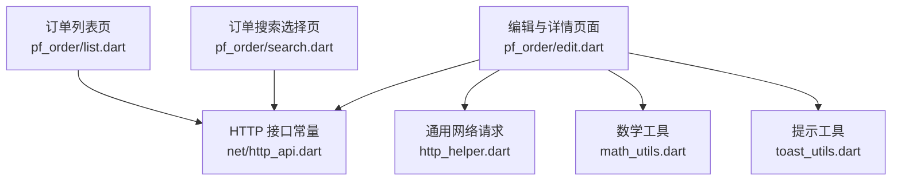
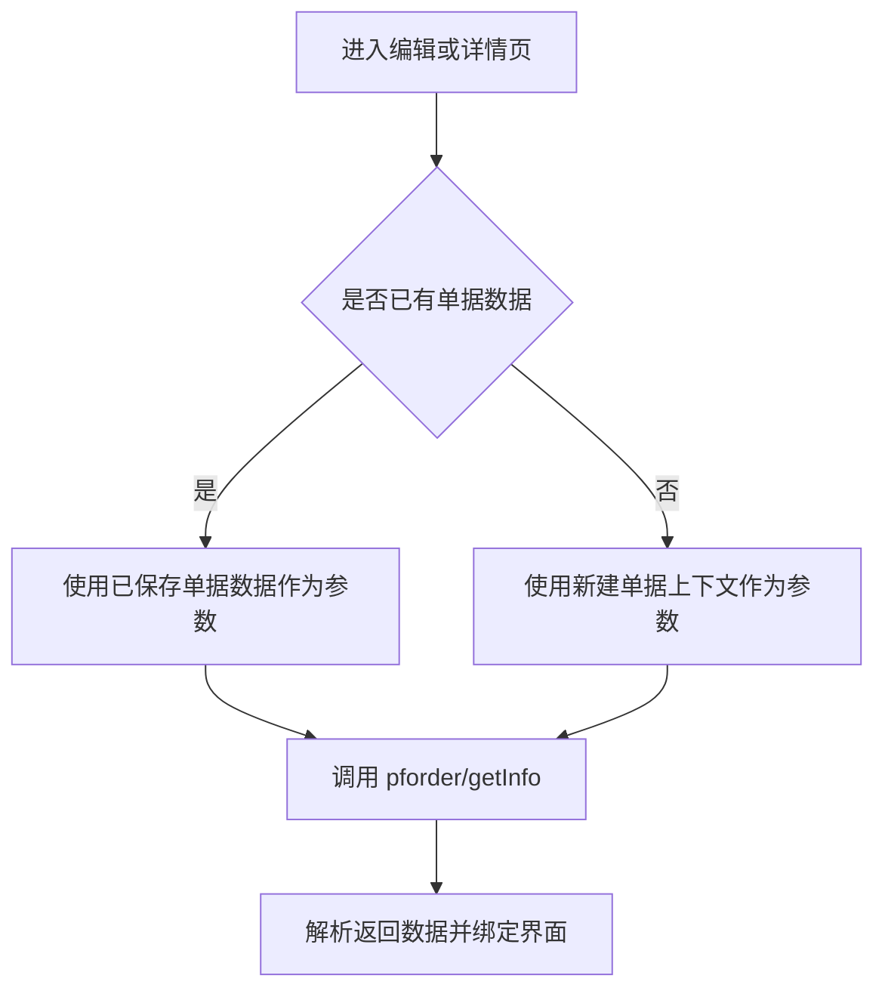
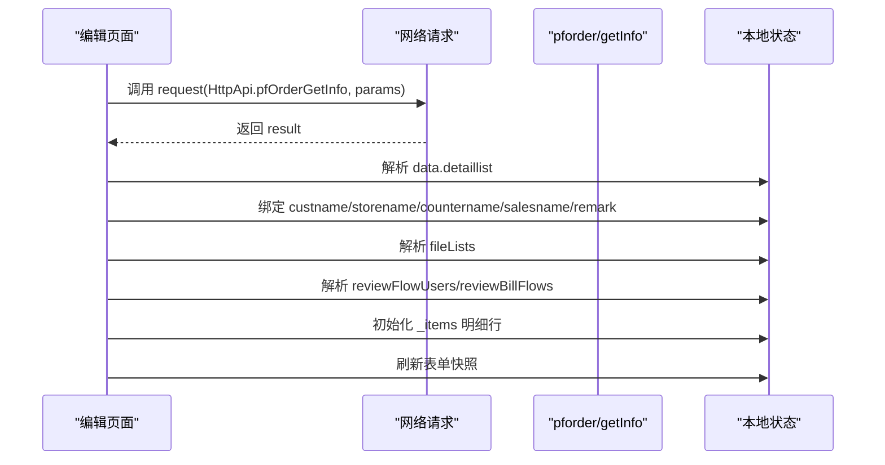
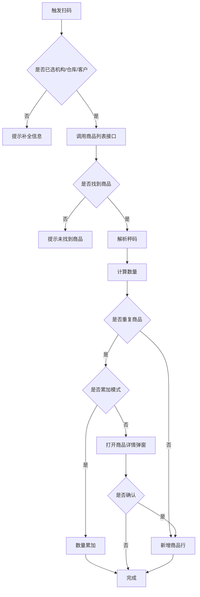
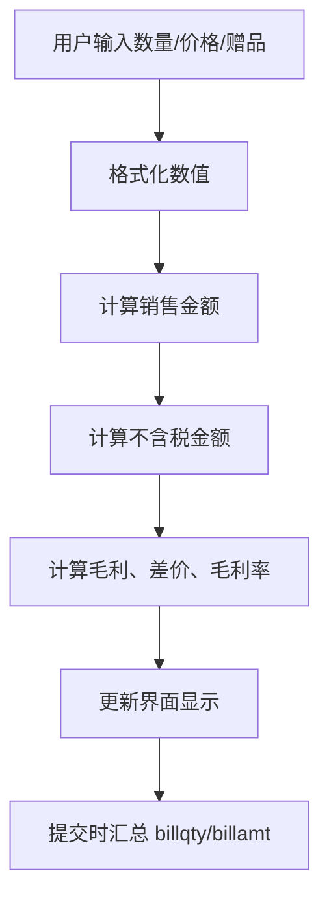
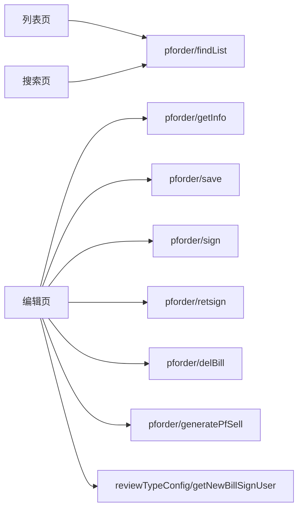

# 订单详情获取接口

<cite>
**本文引用的文件**   
- [http_api.dart](file://lib/net/http_api.dart)
- [edit.dart](file://lib/pages/business/wholesale/pf_order/edit.dart)
- [list.dart](file://lib/pages/business/wholesale/pf_order/list.dart)
- [search.dart](file://lib/pages/business/wholesale/pf_order/search.dart)
</cite>

## 目录
1. [简介](#简介)
2. [项目结构与定位](#项目结构与定位)
3. [接口总览](#接口总览)
4. [请求参数规范](#请求参数规范)
5. [返回数据结构说明](#返回数据结构说明)
6. [订单主表字段映射](#订单主表字段映射)
7. [商品明细字段与金额计算](#商品明细字段与金额计算)
8. [附件信息与审批流程数据](#附件信息与审批流程数据)
9. [订单编辑页面数据绑定逻辑](#订单编辑页面数据绑定逻辑)
10. [商品扫码添加流程](#商品扫码添加流程)
11. [金额自动计算公式](#金额自动计算公式)
12. [依赖关系分析](#依赖关系分析)
13. [常见问题排查](#常见问题排查)
14. [结论](#结论)

## 简介
本文面向灵犀管店批发订货模块中的“订单详情获取”能力，围绕 `pforder/getInfo` 接口展开，从前端调用方视角说明：
- 该接口在系统中的位置；
- 前端如何构造请求参数；
- 后端应返回的订单主表、商品明细、附件和审批流程数据格式；
- 编辑页面如何把接口数据绑定到客户、门店、业务员、仓库、备注和商品行；
- 商品扫码添加时的查询、匹配、重复合并与默认值填充逻辑；
- 数量、价格、赠品、税额、含税金额、不含税金额等字段的计算规则。

需要特别说明的是：当前代码仓库中只定义了 `pforder/getInfo` 接口的入口常量，以及前端如何调用它并消费返回数据；具体的数据库表和后端字段命名以服务端实现为准，本文对返回字段按前端实际读取方式整理为可落地的契约建议。

## 项目结构与定位
批发订货模块位于 Flutter 项目的业务页面目录下，核心文件包括：
- HTTP 接口常量定义：`lib/net/http_api.dart`
- 批发订货单编辑与详情展示：`lib/pages/business/wholesale/pf_order/edit.dart`
- 批发订货单列表页：`lib/pages/business/wholesale/pf_order/list.dart`
- 批发订货单搜索选择页：`lib/pages/business/wholesale/pf_order/search.dart`



**图表来源**
- [edit.dart:1-200](file://lib/pages/business/wholesale/pf_order/edit.dart#L1-L200)
- [list.dart:1-120](file://lib/pages/business/wholesale/pf_order/list.dart#L1-L120)
- [search.dart:1-120](file://lib/pages/business/wholesale/pf_order/search.dart#L1-L120)
- [http_api.dart:459-465](file://lib/net/http_api.dart#L459-L465)

**章节来源**
- [http_api.dart:459-465](file://lib/net/http_api.dart#L459-L465)
- [edit.dart:1-200](file://lib/pages/business/wholesale/pf_order/edit.dart#L1-L200)
- [list.dart:1-120](file://lib/pages/business/wholesale/pf_order/list.dart#L1-L120)
- [search.dart:1-120](file://lib/pages/business/wholesale/pf_order/search.dart#L1-L120)

## 接口总览
| 项目 | 说明 |
|---|---|
| 接口名称 | `pforder/getInfo` |
| 前端常量名 | `HttpApi.pfOrderGetInfo` |
| 主要用途 | 根据单据信息加载批发订货单的完整详情，包括主表基础信息、商品明细、附件、审批流相关数据 |
| 调用方 | 批发订货单编辑页面 `PfOrderEditPage` |
| 关联接口 | `pforder/findList`、`pforder/save`、`pforder/sign`、`pforder/retsign`、`pforder/delBill`、`pforder/generatePfSell` |

接口路径定义在统一 API 常量类中，由 `request` 工具发起网络请求。

**章节来源**
- [http_api.dart:459-465](file://lib/net/http_api.dart#L459-L465)
- [edit.dart:353-420](file://lib/pages/business/wholesale/pf_order/edit.dart#L353-L420)

## 请求参数规范
前端通过 `_loadDetail` 方法调用 `pforder/getInfo`。其入参来自两个来源：

1. **新增模式**：由路由传入的 `widget.billData`，通常包含新建单据的基础上下文，例如机构、仓库、客户、单据类型、日期等。
2. **编辑模式**：直接复用已保存的单据数据，作为详情查询条件。

### 关键请求字段
| 字段 | 是否必填 | 类型 | 说明 |
|---|---:|---|---|
| 单据标识字段 | 视调用场景而定 | 字符串或数字 | 用于定位具体单据，常见形式可能是 `billid`、`billno` 或其他唯一键；前端未显式打印该字段，而是整体透传 `billData` |
| 机构编号 | 视服务端要求而定 | 字符串或数字 | 前端使用 `bsid` 或兼容字段 `storeid` |
| 仓库编号 | 视服务端要求而定 | 字符串 | 对应 `counterid` |
| 客户编号 | 视服务端要求而定 | 字符串 | 对应 `custid` |
| 单据类型 | 视服务端要求而定 | 数字 | 批发订货单通常为 `0` |
| 单据日期 | 视服务端要求而定 | 字符串 | 新增时由前端生成当前日期 |
| 审核状态 | 视服务端要求而定 | 字符串或数字 | 如 `signflag`、`reviewsignflag` |
| 其他上下文 | 视服务端要求而定 | 任意 | 前端整体透传原始 `billData` |

### 参数构造行为
- 编辑模式下，`_loadDetail` 直接使用 `widget.billData` 作为请求参数。
- 新增模式下，`widget.billData` 本身就是新建单据上下文，也会被原样传给 `pforder/getInfo`。
- 提交成功后，前端会把服务端返回的保存结果再次传给 `_loadDetail`，用于刷新本地缓存和界面。



**图表来源**
- [edit.dart:353-420](file://lib/pages/business/wholesale/pf_order/edit.dart#L353-L420)

**章节来源**
- [edit.dart:353-420](file://lib/pages/business/wholesale/pf_order/edit.dart#L353-L420)

## 返回数据结构说明
`pforder/getInfo` 返回的数据结构由前端 `data` 字段承载，核心包含：
- 订单主表基本信息；
- 商品明细列表 `detaillist`；
- 附件列表 `fileLists`；
- 审批流程用户列表 `reviewFlowUsers`；
- 审批单据流程列表 `reviewBillFlows`。

### 顶层返回对象示例（建议）
```json
{
  "retcode": 0,
  "retmsg": "成功",
  "data": {
    "billid": "BILL001",
    "billno": "PF2026102700001",
    "billtype": 0,
    "billdate": "2026-10-27",
    "custid": "CUST001",
    "custname": "某某客户",
    "bsid": "STORE001",
    "storeid": "STORE001",
    "storename": "某某门店",
    "storetype": 1,
    "counterid": "WH001",
    "countername": "主仓库",
    "salesid": "SALE001",
    "salesname": "张三",
    "remark": "订单备注",
    "signflag": "0",
    "reviewsignflag": "",
    "reviewremark": "",
    "billqty": 10,
    "billamt": 1200.00,
    "detaillist": [],
    "fileLists": [],
    "reviewFlowUsers": [],
    "reviewBillFlows": []
  }
}
```

上述 JSON 仅体现前端实际读取的关键字段，具体服务端字段名应以服务端文档为准；前端对部分字段做了兼容处理。

**章节来源**
- [edit.dart:353-420](file://lib/pages/business/wholesale/pf_order/edit.dart#L353-L420)

## 订单主表字段映射
前端在加载详情后，将 `data` 中的主表字段分别绑定到控制器和内部状态。

### 主表字段对照表
| 前端字段 | 可能来源字段 | 类型 | 说明 |
|---|---|---|---|
| 客户编号 | `custid` | 字符串 | 订单归属客户 |
| 客户名称 | `custname` | 字符串 | 显示用 |
| 机构编号 | `bsid` 或 `storeid` | 字符串或数字 | 前端优先读 `bsid`，再回退到 `storeid` |
| 机构名称 | `storename` | 字符串 | 显示用 |
| 机构类型 | `storetype` | 数字 | 用于后续权限、审批等逻辑 |
| 仓库编号 | `counterid` | 字符串 | 发货仓库 |
| 仓库名称 | `countername` | 字符串 | 显示用 |
| 业务员编号 | `salesid` | 字符串 | 负责该订单的业务员 |
| 业务员名称 | `salesname` | 字符串 | 显示用 |
| 备注 | `remark` | 字符串 | 订单备注 |
| 审核状态 | `signflag` | 字符串或数字 | `0` 表示待审核，`1` 表示已审核，`2` 表示驳回或待提交 |
| 多级审核状态 | `reviewsignflag` | 字符串 | `2` 时表示撤回待处理 |
| 多级审核备注 | `reviewremark` | 字符串 | 审批意见 |
| 合计数量 | `billqty` | 数字 | 所有商品行数量之和 |
| 合计金额 | `billamt` | 数字 | 所有商品行金额之和 |
| 商品明细 | `detaillist` | 数组 | 见下一节 |
| 附件列表 | `fileLists` | 数组 | 见附件说明 |
| 审批用户列表 | `reviewFlowUsers` | 数组 | 见审批流程说明 |
| 审批单据流程 | `reviewBillFlows` | 数组 | 见审批流程说明 |

### 关键字段解析逻辑
- 机构编号同时兼容 `bsid` 和 `storeid`，提高前后端字段演进兼容性。
- 审核状态 `signflag` 和 `reviewsignflag` 共同决定按钮可见性、是否允许保存、是否允许审核、是否允许撤回。
- `detaillist` 中的商品行会逐条转换为界面编辑行。

**章节来源**
- [edit.dart:353-420](file://lib/pages/business/wholesale/pf_order/edit.dart#L353-L420)
- [edit.dart:820-910](file://lib/pages/business/wholesale/pf_order/edit.dart#L820-L910)

## 商品明细字段与金额计算
### 明细行基本字段
| 字段 | 类型 | 说明 |
|---|---|---|
| `prodid` 或 `productid` | 字符串 | 商品编号 |
| `productname` 或 `name` | 字符串 | 商品名称 |
| `qty` | 数字 | 销售数量 |
| `price` | 数字 | 销售单价 |
| `presentqty` | 数字 | 赠品数量 |
| `amt` | 数字 | 销售金额 |
| `jsqty` | 数字 | 结算数量，通常等于 `qty + presentqty` |
| `inprice` | 数字 | 进价 |
| `costprice` | 数字 | 成本价 |
| `sellprice` | 数字 | 零售价 |
| `retailprice` | 数字 | 零售参考价 |
| `outtaxrate` | 数字 | 销项税率 |
| `intaxrate` | 数字 | 进项税率 |
| `notaxamt` | 数字 | 不含税金额 |
| `batchno` | 字符串 | 批次号 |
| `stockqty` | 数字 | 库存数量 |
| `packagenum` | 数字 | 包装换算数量 |
| `refprice` | 数字 | 参考价格 |
| `rate` | 数字 | 折扣率 |
| `custdiscountprice` | 数字 | 客户折后价 |
| `custprice` | 数字 | 客户价 |
| `pfprice1` / `pfprice2` / `pfprice3` | 数字 | 批发价等级 |
| `mprice1` / `mprice2` / `mprice3` | 数字 | 会员价等级 |
| `psprice` | 数字 | 配送价 |
| `unit` / `unitonlyid` | 字符串 | 单位 |
| `size` / `sizeonlyid` | 字符串 | 规格 |
| `barcode` | 字符串 | 条码 |
| `supid` | 字符串 | 供应商编号 |
| `itemtype` | 字符串 | 商品类型 |
| `packageflag` | 字符串 | 包装标志 |
| `specflag` | 字符串 | 规格标志 |
| `itemstatus` | 字符串 | 商品状态 |

### 前端映射规则
- 商品编号优先取 `prodid`，否则回退到 `productid`。
- 商品名称优先取 `productname`，否则回退到 `name`。
- 数量、价格、赠品数量都提供空值回退，避免界面出现空值。
- 每个明细行保留原始数据 `rawData`，用于后续提交和重新计算。

**章节来源**
- [edit.dart:386-420](file://lib/pages/business/wholesale/pf_order/edit.dart#L386-L420)
- [edit.dart:598-618](file://lib/pages/business/wholesale/pf_order/edit.dart#L598-L618)

## 附件信息与审批流程数据
### 附件信息
- 附件来源于 `fileLists`。
- 前端将其过滤为 `Map` 类型并转为本地列表。
- 保存时会将 `fileLists` 随提交数据一起发送。
- 附件管理弹窗会接收当前附件列表，并在操作完成后更新本地状态。

| 字段 | 类型 | 说明 |
|---|---|---|
| `fileLists` | 数组 | 附件记录集合，每条记录为对象 |
| 单条附件 | 对象 | 包含附件标识、文件名、地址等字段，具体由服务端定义 |

### 审批流程数据
- `reviewFlowUsers`：当前审批节点的用户列表。
- `reviewBillFlows`：审批单据流转信息。
- 新增订单时，前端会根据机构编号调用 `reviewTypeConfigGetNewBillSignUser`，判断当前用户是否需要参与新单据签字。
- 保存并审核后，如果存在审批用户且当前用户不在其中，前端会提示不属于当前审批节点。
- 审批通过后，前端设置 `reviewsignflag` 和 `reviewremark`，再调用审核接口。

| 字段 | 类型 | 说明 |
|---|---|---|
| `reviewFlowUsers` | 数组 | 审批用户节点列表 |
| `reviewBillFlows` | 数组 | 审批单据流程列表 |
| `reviewsignflag` | 字符串 | 多级审核状态 |
| `reviewremark` | 字符串 | 审批备注 |

**章节来源**
- [edit.dart:360-371](file://lib/pages/business/wholesale/pf_order/edit.dart#L360-L371)
- [edit.dart:820-910](file://lib/pages/business/wholesale/pf_order/edit.dart#L820-L910)
- [edit.dart:1972-1999](file://lib/pages/business/wholesale/pf_order/edit.dart#L1972-L1999)

## 订单编辑页面数据绑定逻辑
订单编辑页面在加载详情后执行以下绑定：

1. 保存完整 `data` 到 `_billData`。
2. 解析 `reviewFlowUsers` 和 `reviewBillFlows`。
3. 将客户名称、门店名称、仓库名称、业务员名称、备注写入对应输入框。
4. 解析附件列表并渲染附件入口。
5. 解析客户编号、机构编号、仓库编号、业务员编号等内部 ID。
6. 遍历 `detaillist`，为每行创建编辑行对象 `_PFDetailRow`。
7. 初始化金额和税务相关字段。
8. 刷新未保存修改检测快照。



**图表来源**
- [edit.dart:353-420](file://lib/pages/business/wholesale/pf_order/edit.dart#L353-L420)

**章节来源**
- [edit.dart:353-420](file://lib/pages/business/wholesale/pf_order/edit.dart#L353-L420)

## 商品扫码添加流程
商品扫码功能支持两种输入方式：
- 移动端扫描页面扫码；
- PDA 红外扫描输入框连续扫码。

### 扫码前置校验
扫码前必须完成：
- 选择机构；
- 选择仓库；
- 选择客户。

### 扫码查询参数
扫码时调用商品列表接口，查询参数包括：
| 字段 | 说明 |
|---|---|
| `scancode` | 条码或秤码解析后的商品码 |
| `is_page` | 分页开关 |
| `page` | 页码 |
| `pagesize` | 每页数量 |
| `storeid` | 机构编号 |
| `counterid` | 仓库编号 |
| `custid` | 客户编号 |
| `pfpriceflag` | 批发价格标志 |
| `needbatchflag` | 是否需要批次 |
| `bzshowflag` | 备注显示标志 |
| `itemstatusin` | 商品状态范围 |

### 扫码结果处理
1. 解析秤码：重量码、金额码和普通条码走不同逻辑。
2. 普通码：默认数量为商品返回数量加一。
3. 重量码：直接使用解析出的重量数量。
4. 金额码：用金额除以单价反算数量。
5. 查重：按条码、商品编号、规格、单位、供应商、批次号判断是否已存在。
6. 累加模式：相同商品直接增加数量。
7. 弹窗模式：重复商品打开详情弹窗；新商品弹出商品详情弹窗确认后再加入。



**图表来源**
- [edit.dart:1046-1350](file://lib/pages/business/wholesale/pf_order/edit.dart#L1046-L1350)

**章节来源**
- [edit.dart:1010-1350](file://lib/pages/business/wholesale/pf_order/edit.dart#L1010-L1350)

## 金额自动计算公式
编辑页面维护了一套金额和数量联动机制，核心函数包括：
- `_defValSet`：初始化默认值；
- `_writeData`：字段变更时重新计算；
- `_amtJudge`：金额、毛利、不含税金额等综合判断；
- `_buildSubmitDetailList`：构建提交用的明细列表。

### 主要计算公式
| 公式 | 说明 |
|---|---|
| `amt = qty × price` | 销售金额 |
| `notaxamt = amt ÷ (1 + outtaxrate)` | 不含税金额 |
| `sellamt = sellprice × (qty + presentqty)` | 零售金额 |
| `inpriceamt = inprice × (qty + presentqty)` | 进价金额 |
| `costpriceamt = costprice × (qty + presentqty)` | 成本金额 |
| `grossrateamt = amt - costpriceamt` | 毛利额 |
| `camt = amt - inpriceamt` | 差价金额 |
| `grossrate = price == 0 ? 0 : (price - costprice) ÷ price × 100` | 毛利率百分比 |
| `jsqty = qty + presentqty` | 结算数量 |
| `zjsqty = floor(qty ÷ packagenum)` | 整包装数量 |
| `ssqty = qty - zjsqty × packagenum` | 散件数量 |
| `price = amt ÷ qty` | 反算单价 |
| `rate = refprice > 0 ? price ÷ refprice × 100` | 折扣率 |

### 包装换算逻辑
当 `packagenum > 0` 时：
- 总数量拆分为整包装数量和散件数量；
- 整包装数量向下取整；
- 散件数量为余数；
- 反向计算时，总数量等于整包装数量乘以包装数再加散件数量。

### 提交金额汇总
提交时会遍历明细行：
- 累计 `billqty`；
- 累计 `billamt`；
- 最终将 `detaillist`、`fileLists`、主表字段一起发送给 `pforder/save`。



**图表来源**
- [edit.dart:20-120](file://lib/pages/business/wholesale/pf_order/edit.dart#L20-L120)
- [edit.dart:598-618](file://lib/pages/business/wholesale/pf_order/edit.dart#L598-L618)

**章节来源**
- [edit.dart:20-120](file://lib/pages/business/wholesale/pf_order/edit.dart#L20-L120)
- [edit.dart:598-618](file://lib/pages/business/wholesale/pf_order/edit.dart#L598-L618)

## 依赖关系分析
### 接口常量依赖
批发订货模块依赖 `HttpApi` 中定义的多个接口常量：
- `pfOrderFindList`：批发订货单列表；
- `pfOrderGetInfo`：批发订货单详情；
- `pfOrderSave`：保存批发订货单；
- `pfOrderSign`：审核；
- `pfOrderRetsign`：反审核；
- `pfOrderDelBill`：删除；
- `pfOrderGeneratePfSell`：生成销售单。

### 页面依赖
- 列表页和搜索页依赖 `pfOrderFindList`；
- 编辑页依赖 `pfOrderGetInfo`、`pfOrderSave`、`pfOrderSign`、`pfOrderRetsign`、`pfOrderDelBill`、`pfOrderGeneratePfSell`；
- 编辑页还依赖审批配置接口 `reviewTypeConfigGetNewBillSignUser`。



**图表来源**
- [http_api.dart:459-465](file://lib/net/http_api.dart#L459-L465)
- [list.dart:80-120](file://lib/pages/business/wholesale/pf_order/list.dart#L80-L120)
- [search.dart:110-170](file://lib/pages/business/wholesale/pf_order/search.dart#L110-L170)
- [edit.dart:820-870](file://lib/pages/business/wholesale/pf_order/edit.dart#L820-L870)

**章节来源**
- [http_api.dart:459-465](file://lib/net/http_api.dart#L459-L465)
- [list.dart:80-120](file://lib/pages/business/wholesale/pf_order/list.dart#L80-L120)
- [search.dart:110-170](file://lib/pages/business/wholesale/pf_order/search.dart#L110-L170)
- [edit.dart:820-870](file://lib/pages/business/wholesale/pf_order/edit.dart#L820-L870)

## 常见问题排查
| 问题 | 可能原因 | 排查建议 |
|---|---|---|
| 打开订单详情为空 | 传入单据标识不正确 | 检查 `billData` 中是否包含有效的单据编号或编号字段 |
| 客户、门店、仓库、业务员为空 | 后端未返回对应字段 | 检查 `pforder/getInfo` 返回的主表字段 |
| 商品明细不显示 | `detaillist` 为空或不是数组 | 检查后端返回结构是否与前端预期一致 |
| 扫码提示未找到商品 | 条码错误、商品不存在、机构/仓库/客户未选择 | 先补全机构、仓库、客户，再核对条码 |
| 扫码重复商品直接累加 | 当前扫码模式为累加模式 | 如需弹窗确认，切换扫码数量模式 |
| 金额计算异常 | 单价、数量、税率、包装数异常 | 检查 `price`、`qty`、`outtaxrate`、`packagenum` |
| 审批提示不属于当前审核人 | 当前用户不在 `reviewFlowUsers` | 检查审批配置和用户登录身份 |
| 保存后详情未刷新 | 保存返回值结构变化 | 检查 `pforder/save` 返回的 `data` 结构 |

**章节来源**
- [edit.dart:353-420](file://lib/pages/business/wholesale/pf_order/edit.dart#L353-L420)
- [edit.dart:501-574](file://lib/pages/business/wholesale/pf_order/edit.dart#L501-L574)
- [edit.dart:820-910](file://lib/pages/business/wholesale/pf_order/edit.dart#L820-L910)
- [edit.dart:1046-1350](file://lib/pages/business/wholesale/pf_order/edit.dart#L1046-L1350)

## 结论
`pforder/getInfo` 是灵犀管店批发订货模块的核心详情接口。从前端角度看，它承担以下职责：
- 返回订单主表基础信息；
- 返回商品明细数组；
- 返回附件列表；
- 返回审批流程和审批用户信息；
- 作为编辑页面数据绑定的唯一数据来源；
- 作为保存、审核、撤回等操作的数据基线。

在实际对接时，建议后端明确以下契约：
1. 返回对象根结构中包含 `retcode`、`retmsg`、`data`。
2. `data` 中包含订单主表字段、`detaillist`、`fileLists`、`reviewFlowUsers`、`reviewBillFlows`。
3. 商品明细至少包含商品编号、商品名称、数量、单价、赠品数量、销售金额、税率等字段。
4. 附件和审批数据保持数组结构，便于前端扩展展示。
5. 若字段名发生演进，应像前端兼容 `bsid` 与 `storeid` 一样，保持向后兼容。