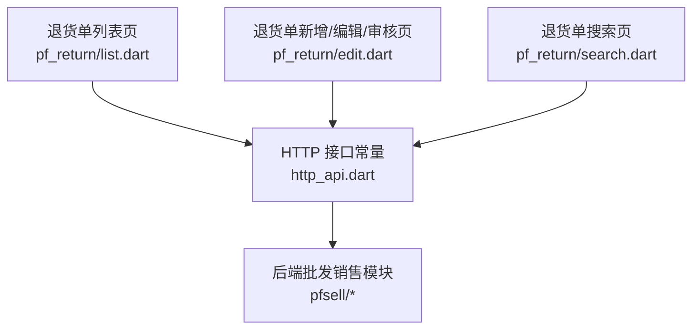
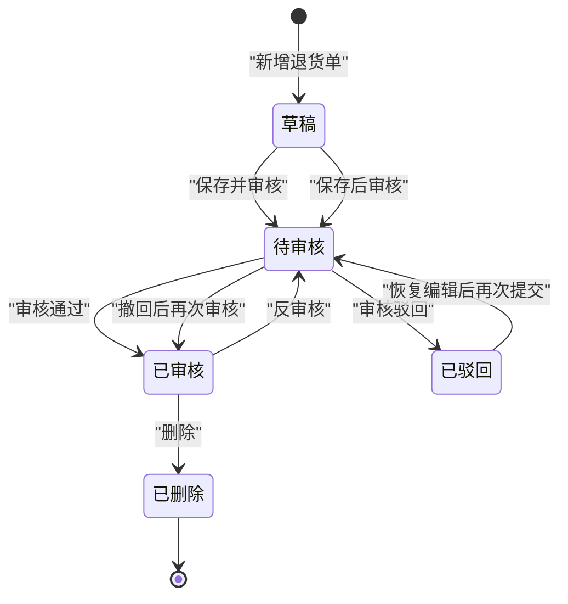
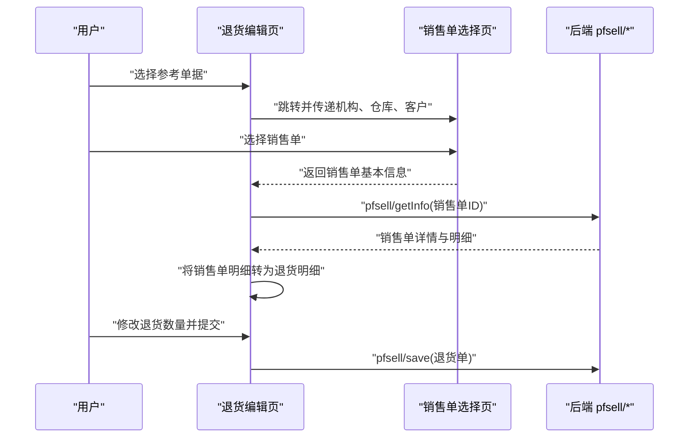
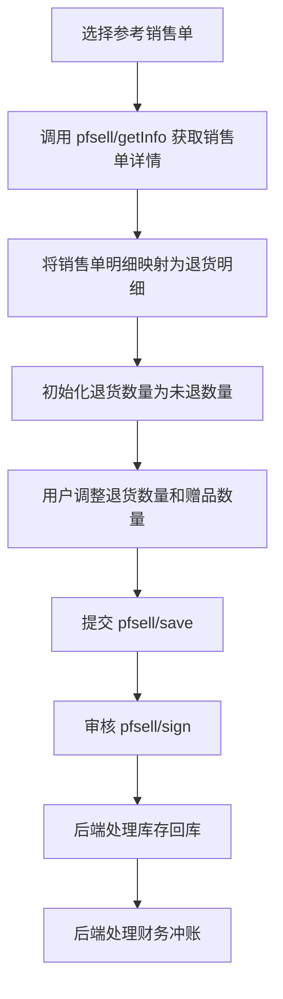

# 批发退货API

<cite>
**本文引用的文件**   
- [lib/net/http_api.dart](file://lib/net/http_api.dart)
- [lib/pages/business/wholesale/pf_return/list.dart](file://lib/pages/business/wholesale/pf_return/list.dart)
- [lib/pages/business/wholesale/pf_return/edit.dart](file://lib/pages/business/wholesale/pf_return/edit.dart)
- [lib/pages/business/wholesale/pf_return/search.dart](file://lib/pages/business/wholesale/pf_return/search.dart)
</cite>

## 目录
1. [简介](#简介)
2. [项目结构与范围](#项目结构与范围)
3. [核心接口总览](#核心接口总览)
4. [业务模型与字段说明](#业务模型与字段说明)
5. [详细接口规范](#详细接口规范)
6. [业务流程与状态机](#业务流程与状态机)
7. [关联关系：销售单、退货单与库存财务](#关联关系销售单退货单与库存财务)
8. [部分退货与冲销机制](#部分退货与冲销机制)
9. [审批流与权限控制](#审批流与权限控制)
10. [错误处理与常见问题](#错误处理与常见问题)
11. [性能与实现建议](#性能与实现建议)
12. [附录：参考页面调用位置](#附录参考页面调用位置)

## 简介
本文件面向后端开发者与集成方，基于灵犀管店 Flutter 前端代码对“批发退货”业务能力进行逆向整理，形成一份以实际代码为依据的 API 文档。当前仓库是移动端实现，批发退货的核心业务接口由后端服务提供；前端通过统一的 HTTP 层调用批发销售模块接口完成退货单的列表查询、详情获取、新增修改、审核、反审核、删除和打印等操作。

需要特别说明的是：
- 该项目的批发退货复用“批发销售”模块接口前缀 `pfsell/*`，而不是独立命名空间。
- 退货单在请求中通过 `billtype=2` 标识为批发退货类型。
- 退货单与销售单存在明确的“参考单据”关联关系，支持从销售单选择并自动带入商品明细，用于实现部分退货。
- 前端负责退货申请、选品、数量计算、金额汇总、审核交互等；具体的库存回库、财务冲账、结算状态变更等逻辑由后端在处理保存、审核、反审核时执行。

## 项目结构与范围
批发退货相关的前端实现集中在以下位置：
- 网络接口常量定义：`lib/net/http_api.dart`
- 退货单列表页：`lib/pages/business/wholesale/pf_return/list.dart`
- 退货单新增/编辑/审核页：`lib/pages/business/wholesale/pf_return/edit.dart`
- 退货单快速搜索页：`lib/pages/business/wholesale/pf_return/search.dart`

**图示来源**
- [lib/pages/business/wholesale/pf_return/list.dart:100-140](file://lib/pages/business/wholesale/pf_return/list.dart#L100-L140)
- [lib/pages/business/wholesale/pf_return/edit.dart:560-580](file://lib/pages/business/wholesale/pf_return/edit.dart#L560-L580)
- [lib/pages/business/wholesale/pf_return/search.dart:80-110](file://lib/pages/business/wholesale/pf_return/search.dart#L80-L110)
- [lib/net/http_api.dart:467-473](file://lib/net/http_api.dart#L467-L473)

**章节来源**
- [lib/net/http_api.dart:467-473](file://lib/net/http_api.dart#L467-L473)
- [lib/pages/business/wholesale/pf_return/list.dart:1-140](file://lib/pages/business/wholesale/pf_return/list.dart#L1-L140)
- [lib/pages/business/wholesale/pf_return/edit.dart:1-200](file://lib/pages/business/wholesale/pf_return/edit.dart#L1-L200)
- [lib/pages/business/wholesale/pf_return/search.dart:1-110](file://lib/pages/business/wholesale/pf_return/search.dart#L1-L110)

## 核心接口总览
批发退货功能复用批发销售模块的以下接口：

| 接口名称 | 路径 | 主要用途 | 前端使用场景 |
|---|---|---|---|
| 批发销售列表 | `pfsell/findList` | 查询批发订单类单据，包括批发销售单和批发退货单 | 退货单列表、退货单搜索 |
| 批发销售详情 | `pfsell/getInfo` | 获取批发销售单或退货单详情 | 退货单详情加载、从销售单带入退货明细 |
| 批发销售保存 | `pfsell/save` | 新增或更新批发销售单、退货单 | 退货单新增、修改、保存后继续审核 |
| 批发销售审核 | `pfsell/sign` | 审核批发销售单、退货单 | 退货单提交审核、批量审核 |
| 批发销售反审核 | `pfsell/retsign` | 反审核已审核的批发销售单、退货单 | 退货单反审、撤回 |
| 批发销售删除 | `pfsell/delBill` | 删除批发销售单、退货单 | 退货单整单删除 |

上述接口统一由 `HttpApi` 常量管理，并由前端 `request` 工具发起。后端应根据 `billtype` 区分批发销售与批发退货：退货单固定使用 `billtype=2`。

**章节来源**
- [lib/net/http_api.dart:467-473](file://lib/net/http_api.dart#L467-L473)
- [lib/pages/business/wholesale/pf_return/list.dart:110-140](file://lib/pages/business/wholesale/pf_return/list.dart#L110-L140)
- [lib/pages/business/wholesale/pf_return/edit.dart:560-580](file://lib/pages/business/wholesale/pf_return/edit.dart#L560-L580)

## 业务模型与字段说明
### 退货单主表字段
退货单作为批发销售模块的一种单据类型，主表字段由前端在保存时构造，并与详情返回数据对齐。常见字段如下：

| 字段 | 类型 | 是否必填 | 说明 |
|---|---|---:|---|
| `billid` | 字符串 | 否 | 单据 ID；新增成功后后端返回 |
| `billno` | 字符串 | 否 | 退货单号 |
| `billtype` | 数字 | 是 | 单据类型；退货单固定为 `2` |
| `billdate` | 字符串 | 新增时是 | 单据日期，格式通常为 `yyyy-MM-dd` |
| `signflag` | 字符串 | 否 | 审核状态；`0` 待审核，`1` 已审核，`2` 待提交或已提交（具体含义依赖后端） |
| `custid` | 字符串 | 新增/编辑时是 | 客户 ID |
| `custname` | 字符串 | 否 | 客户名称 |
| `bsid` / `storeid` | 字符串或数字 | 新增/编辑时是 | 机构 ID |
| `storename` | 字符串 | 否 | 机构名称 |
| `storetype` | 数字 | 否 | 机构类型 |
| `counterid` | 字符串 | 新增/编辑时是 | 仓库 ID |
| `countername` | 字符串 | 否 | 仓库名称 |
| `salesid` | 字符串 | 否 | 业务员 ID |
| `salesname` | 字符串 | 否 | 业务员名称 |
| `sendercode` | 字符串 | 否 | 发货人编码 |
| `sendername` | 字符串 | 否 | 发货人名称 |
| `refbillid` | 字符串 | 否 | 参考单据 ID；关联销售单时使用 |
| `refbillno` | 字符串 | 否 | 参考单据编号 |
| `refbilltype` | 数字 | 否 | 参考单据类型；退货单引用销售单时为 `1` |
| `remark` | 字符串 | 否 | 备注 |
| `billqty` | 数字 | 否 | 退货数量合计 |
| `billamt` | 数字 | 否 | 退货金额合计 |
| `detaillist` | 数组 | 新增/编辑时是 | 退货明细行 |
| `fileLists` | 数组 | 否 | 附件列表 |
| `reviewFlowUsers` | 数组 | 否 | 多级审批节点人员 |
| `reviewBillFlows` | 数组 | 否 | 审批流水 |
| `reviewsignflag` | 数字 | 否 | 审批结果标志位 |
| `reviewremark` | 字符串 | 否 | 审批意见 |

注意：
- 前端在新增退货单时主动设置 `billtype=2`、`signflag=0`、`freeamt=0`、`fileLists=[]`。
- 参考单据类型 `refbilltype=1` 表示参考单据为销售单。
- 审核参数中包含 `signflag=1`，并可能携带 `reviewsignflag` 与 `reviewremark`。

### 退货明细行字段
退货明细行来自销售单或商品选择器，包含商品、批次、价格、数量、赠品等信息：

| 字段 | 类型 | 说明 |
|---|---|---|
| `prodid` | 字符串 | 商品 ID |
| `productname` / `name` / `prodname` | 字符串 | 商品名称 |
| `unit` | 字符串 | 单位 |
| `size` | 字符串 | 规格 |
| `batchno` | 字符串 | 批次号 |
| `birthdate` | 字符串 | 生产日期 |
| `validdate` | 字符串 | 有效期 |
| `remark` | 字符串 | 行备注 |
| `qty` | 数字 | 退货数量 |
| `presentqty` | 数字 | 赠品退货数量 |
| `jsqty` | 数字 | 结算数量，通常为 `qty + presentqty` |
| `price` | 数字 | 退货单价 |
| `sellprice` / `retailprice` | 数字 | 零售价 |
| `costprice` | 数字 | 成本价 |
| `refprice` | 数字 | 参考价格 |
| `amt` | 数字 | 行金额 |
| `notaxamt` | 数字 | 不含税金额 |
| `inpriceamt` | 数字 | 进价金额 |
| `grossrateamt` | 数字 | 毛利金额 |
| `camt` | 数字 | 差额金额 |
| `grossrate` | 数字 | 毛利率 |
| `orderedqty` | 数字 | 订购数量，参考销售单时由前端填充 |
| `returnqty` | 数字 | 本次退货数量 |
| `incompleteQty` | 数字 | 未完成数量 |
| `notreturnedqty` | 数字 | 未退数量 |
| `notpresentreturnedqty` | 数字 | 未退赠品数量 |

**章节来源**
- [lib/pages/business/wholesale/pf_return/edit.dart:560-600](file://lib/pages/business/wholesale/pf_return/edit.dart#L560-L600)
- [lib/pages/business/wholesale/pf_return/edit.dart:997-1050](file://lib/pages/business/wholesale/pf_return/edit.dart#L997-L1050)
- [lib/pages/business/wholesale/pf_return/edit.dart:2855-2920](file://lib/pages/business/wholesale/pf_return/edit.dart#L2855-L2920)

## 详细接口规范

### 1. 退货单列表查询

#### 接口信息
- **路径**：`pfsell/findList`
- **方法**：GET 或 POST（由前端 HTTP 封装决定）
- **用途**：查询批发退货单列表，支持分页、时间范围、单据号、审核状态、门店、客户、业务员、结算状态等筛选。

#### 请求参数
| 参数 | 类型 | 必填 | 默认值 | 说明 |
|---|---|---:|---|---|
| `field` | 字符串 | 否 | `createtime` | 排序字段 |
| `type` | 字符串 | 否 | `desc` | 排序方向 |
| `page` | 数字 | 否 | `1` | 页码 |
| `billno` | 字符串 | 否 | 空 | 单据号模糊匹配 |
| `datetype` | 数字 | 否 | `1` | 日期类型 |
| `signflag` | 字符串 | 否 | 空 | 审核状态；`0` 待审核，`1` 已审核，`2` 已驳回或待提交 |
| `billtype` | 数字 | 是 | — | 单据类型；退货单列表传 `2` |
| `notwx` | 数字 | 否 | `1` | 过滤微信相关单据 |
| `sids` | 数字数组 | 否 | 空 | 门店 ID 列表 |
| `starttime` | 字符串 | 否 | 空 | 开始时间 |
| `endtime` | 字符串 | 否 | 空 | 结束时间 |
| `custid` | 字符串 | 否 | 空 | 客户 ID |
| `salesid` | 字符串 | 否 | 空 | 业务员 ID |
| `counterid` | 字符串 | 否 | 空 | 仓库 ID |
| `paystatus` | 字符串 | 否 | 空 | 结算状态；`0` 待结算，`1` 部分结算，`2` 已结算 |

#### 响应结构
响应体通常包含 `data.list`，其中每项为一个退货单记录，包含主表字段及摘要字段；详情页仍需调用 `pfsell/getInfo`。

#### 前端行为
- 列表页根据 Tab 切换设置不同 `signflag`。
- 支持按时间范围、客户、业务员、仓库、结算状态筛选。
- 下拉加载更多，失败时将 `_hasMore` 置为 false。

**章节来源**
- [lib/pages/business/wholesale/pf_return/list.dart:100-140](file://lib/pages/business/wholesale/pf_return/list.dart#L100-L140)
- [lib/pages/business/wholesale/pf_return/list.dart:201-519](file://lib/pages/business/wholesale/pf_return/list.dart#L201-L519)

### 2. 退货单详情获取

#### 接口信息
- **路径**：`pfsell/getInfo`
- **用途**：获取退货单详情，同时返回主表、明细、参考单据映射、附件、审批流程信息等。

#### 请求参数
| 参数 | 类型 | 说明 |
|---|---|---|
| `billid` | 字符串 | 单据 ID |
| 其他可选参数 | 见调用方 | 例如直接传入整个路由参数对象 |

#### 响应关键字段
| 字段 | 类型 | 说明 |
|---|---|---|
| `data` | 对象 | 退货单详情 |
| `data.billid` | 字符串 | 单据 ID |
| `data.custid` / `custname` | 字符串 | 客户信息 |
| `data.bsid` / `storeid` / `storename` / `storetype` | 字符串或数字 | 机构信息 |
| `data.counterid` / `countername` | 字符串 | 仓库信息 |
| `data.salesid` / `salesname` | 字符串 | 业务员信息 |
| `data.sendercode` / `sendername` | 字符串 | 发货人信息 |
| `data.refbillid` / `refbillno` | 字符串 | 参考单据编号 |
| `data.refMap` | 对象 | 参考单据映射 |
| `data.detaillist` | 数组 | 退货明细 |
| `data.fileLists` | 数组 | 附件 |
| `data.reviewFlowUsers` | 数组 | 审批人员 |
| `data.reviewBillFlows` | 数组 | 审批流水 |
| `data.signflag` | 字符串 | 审核状态 |

#### 前端行为
- 编辑页根据 `billData` 是否为空判断新增或编辑。
- 编辑页解析 `reviewFlowUsers` 与 `reviewBillFlows` 控制多级审批弹窗。
- 编辑页将 `detaillist` 转为内部 `_PFReturnDetailRow` 列表。

**章节来源**
- [lib/pages/business/wholesale/pf_return/edit.dart:300-450](file://lib/pages/business/wholesale/pf_return/edit.dart#L300-L450)

### 3. 退货单新增与修改

#### 接口信息
- **路径**：`pfsell/save`
- **用途**：新增退货单或更新现有退货单。

#### 新增请求参数
| 参数 | 类型 | 必填 | 说明 |
|---|---|---:|---|
| `billtype` | 数字 | 是 | `2` |
| `billdate` | 字符串 | 是 | 单据日期 |
| `signflag` | 数字 | 是 | `0` |
| `freeamt` | 数字 | 是 | `0` |
| `fileLists` | 数组 | 是 | `[]` |
| `custid` | 字符串 | 是 | 客户 ID |
| `custname` | 字符串 | 是 | 客户名称 |
| `bsid` | 字符串 | 是 | 机构 ID |
| `storename` | 字符串 | 是 | 机构名称 |
| `storetype` | 数字 | 是 | 机构类型 |
| `counterid` | 字符串 | 是 | 仓库 ID |
| `countername` | 字符串 | 是 | 仓库名称 |
| `salesid` | 字符串 | 是 | 业务员 ID |
| `salesname` | 字符串 | 是 | 业务员名称 |
| `sendercode` | 字符串 | 是 | 发货人编码 |
| `sendername` | 字符串 | 是 | 发货人名称 |
| `refbillid` | 字符串 | 否 | 参考单据 ID |
| `refbillno` | 字符串 | 否 | 参考单据编号 |
| `refbilltype` | 数字 | 是 | `1` |
| `remark` | 字符串 | 是 | 备注 |
| `billqty` | 数字 | 是 | 退货数量合计 |
| `billamt` | 数字 | 是 | 退货金额合计 |
| `detaillist` | 数组 | 是 | 退货明细 |

#### 修改请求参数
修改时前端会先复制已有 `_billData`，再覆盖用户修改后的字段；其余字段保持原值。

#### 响应结构
- `data` 为保存后的单据数据。
- 新增成功时 `data.billid` 不为空。
- 若保存后继续审核，前端会重新加载详情并进入审核流程。

#### 校验规则
- 必须选择客户、机构、仓库。
- 新增时必须至少有一行有效商品。
- 新增时每行退货数量必须大于 0。
- 明细行金额由前端计算后提交。

**章节来源**
- [lib/pages/business/wholesale/pf_return/edit.dart:560-640](file://lib/pages/business/wholesale/pf_return/edit.dart#L560-L640)
- [lib/pages/business/wholesale/pf_return/edit.dart:640-700](file://lib/pages/business/wholesale/pf_return/edit.dart#L640-L700)

### 4. 退货单审核

#### 接口信息
- **路径**：`pfsell/sign`
- **用途**：提交退货单审核。

#### 请求参数
| 参数 | 类型 | 必填 | 说明 |
|---|---|---:|---|
| 所有主表字段 | 见退货单主表 | 是 | 完整单据数据 |
| `signflag` | 字符串 | 是 | `1` |
| `reviewsignflag` | 数字 | 否 | 审批结果标志位；非 `2` 且非 `0` 时通常设为 `1` |
| `reviewremark` | 字符串 | 否 | 审批意见 |

#### 前端行为
- 无多级审批配置时弹出简单确认框。
- 有审批节点时弹出审批弹窗，允许填写审批意见和审批结果。
- 审核成功后提示并返回列表或关闭页面。

**章节来源**
- [lib/pages/business/wholesale/pf_return/edit.dart:850-990](file://lib/pages/business/wholesale/pf_return/edit.dart#L850-L990)

### 5. 退货单反审核

#### 接口信息
- **路径**：`pfsell/retsign`
- **用途**：反审核已审核的退货单。

#### 请求参数
- 使用完整 `_billData`，即当前单据主表数据。

#### 前端行为
- 弹出确认对话框。
- 成功后提示“反审成功”并重新加载详情。

**章节来源**
- [lib/pages/business/wholesale/pf_return/edit.dart:689-714](file://lib/pages/business/wholesale/pf_return/edit.dart#L689-L714)

### 6. 退货单删除

#### 接口信息
- **路径**：`pfsell/delBill`
- **用途**：删除整张退货单。

#### 请求参数
- 使用完整 `_billData`。

#### 前端行为
- 弹出确认对话框。
- 删除成功后提示并关闭页面。

**章节来源**
- [lib/pages/business/wholesale/pf_return/edit.dart:714-739](file://lib/pages/business/wholesale/pf_return/edit.dart#L714-L739)

### 7. 退货单打印

#### 接口信息
- **路径**：`airprint/setWxPrintRw`
- **用途**：触发退货单打印。

#### 请求参数
- 前端直接调用通用打印接口，并传入退货单数据。

#### 前端行为
- 打印成功后提示“打印成功”。

**章节来源**
- [lib/pages/business/wholesale/pf_return/edit.dart:739-757](file://lib/pages/business/wholesale/pf_return/edit.dart#L739-L757)

### 8. 退货单搜索

#### 接口信息
- **路径**：`pfsell/findList`
- **用途**：用于退货单快速搜索，也用于从销售单中选择参考单据时的通用列表能力。

#### 请求参数
| 参数 | 类型 | 说明 |
|---|---|---|
| `field` | 字符串 | 排序字段 |
| `type` | 字符串 | 排序方向 |
| `page` | 数字 | 页码 |
| `billtype` | 数字 | 单据类型；退货搜索传 `2` |
| `billno` | 字符串 | 单据号 |
| `starttime` | 字符串 | 开始时间 |
| `endtime` | 字符串 | 结束时间 |
| `dhflag` | 字符串 | 配送标记（用于其他业务场景） |

**章节来源**
- [lib/pages/business/wholesale/pf_return/search.dart:80-110](file://lib/pages/business/wholesale/pf_return/search.dart#L80-L110)

## 业务流程与状态机

**图示来源**
- [lib/pages/business/wholesale/pf_return/edit.dart:560-640](file://lib/pages/business/wholesale/pf_return/edit.dart#L560-L640)
- [lib/pages/business/wholesale/pf_return/edit.dart:689-714](file://lib/pages/business/wholesale/pf_return/edit.dart#L689-L714)
- [lib/pages/business/wholesale/pf_return/edit.dart:714-739](file://lib/pages/business/wholesale/pf_return/edit.dart#L714-L739)
- [lib/pages/business/wholesale/pf_return/edit.dart:850-990](file://lib/pages/business/wholesale/pf_return/edit.dart#L850-L990)

### 退货业务流程示例
1. **创建退货申请**
   - 打开退货单新增页面。
   - 选择机构、仓库、客户、业务员。
   - 从销售单选择参考单据，或直接添加商品。
   - 填写退货数量、赠品数量、单价、备注。
   - 点击“保存”。

2. **审核退货单**
   - 如果配置了多级审批，系统弹出审批弹窗。
   - 填写审批意见并提交。
   - 后端处理后单据状态变为已审核。

3. **入库与财务冲账**
   - 前端不直接操作库存或财务。
   - 后端在保存、审核、反审核时处理库存回库、应收应付调整、结算状态变更。
   - 前端只负责展示状态、控制按钮可见性。

4. **反审核或删除**
   - 已审核退货单可反审核，回到待审核状态。
   - 未审核或允许删除的状态下可删除整张退货单。

**章节来源**
- [lib/pages/business/wholesale/pf_return/edit.dart:560-757](file://lib/pages/business/wholesale/pf_return/edit.dart#L560-L757)
- [lib/pages/business/wholesale/pf_return/edit.dart:850-990](file://lib/pages/business/wholesale/pf_return/edit.dart#L850-L990)

## 关联关系：销售单、退货单与库存财务

### 销售单与退货单的关联
- 退货单通过 `refbillid`、`refbillno`、`refbilltype=1` 关联销售单。
- 选择参考销售单后，前端会再次调用 `pfsell/getInfo` 获取销售单详情，并将销售单明细转换为退货明细。
- 销售单中的未退数量、未退赠品数量会被用作退货数量的初始值。

**图示来源**
- [lib/pages/business/wholesale/pf_return/edit.dart:993-1050](file://lib/pages/business/wholesale/pf_return/edit.dart#L993-L1050)
- [lib/pages/business/wholesale/pf_return/edit.dart:1000-1050](file://lib/pages/business/wholesale/pf_return/edit.dart#L1000-L1050)

### 库存回库与财务冲账
- 前端没有直接调用库存入库或财务冲账接口。
- 退货单的业务影响应理解为：
  - 退货单审核通过后，后端应增加对应仓库中商品的库存。
  - 退货单应冲减销售单对应的应收、收入或结算状态。
  - 退货单反审核后，后端应撤销上述库存与财务变动。
- 前端通过 `signflag`、`paystatus` 等字段展示状态，但不对业务结果做本地推断。

**章节来源**
- [lib/pages/business/wholesale/pf_return/list.dart:100-140](file://lib/pages/business/wholesale/pf_return/list.dart#L100-L140)
- [lib/pages/business/wholesale/pf_return/edit.dart:689-714](file://lib/pages/business/wholesale/pf_return/edit.dart#L689-L714)

## 部分退货与冲销机制

### 部分退货
- 退货单支持从销售单中选择部分商品或部分数量进行退货。
- 前端从销售单详情中读取 `notreturnedqty`、`notpresentreturnedqty`，并将其设置为退货数量初始值。
- 用户可以减少退货数量，但不能超过销售单中未退数量。
- 销售单中的 `orderedqty`、`returnqty` 等字段被用于辅助显示和调整。

**图示来源**
- [lib/pages/business/wholesale/pf_return/edit.dart:997-1050](file://lib/pages/business/wholesale/pf_return/edit.dart#L997-L1050)

### 冲销机制
- 冲销主要通过“反审核”和“删除”体现：
  - 反审核：将已审核退货单恢复到可编辑状态，后端应撤销库存和财务变动。
  - 删除：删除整张退货单，后端应清理相关单据和业务影响。
- 前端在反审核和删除前均要求二次确认。

**章节来源**
- [lib/pages/business/wholesale/pf_return/edit.dart:689-739](file://lib/pages/business/wholesale/pf_return/edit.dart#L689-L739)

## 审批流与权限控制

### 多级审批
- 退货单详情返回 `reviewFlowUsers` 和 `reviewBillFlows`。
- 当存在审批人员时，前端弹出审批弹窗，允许填写审批意见和审批结果。
- 审批结果通过 `reviewsignflag` 和 `reviewremark` 传递到后端。

### 权限控制
前端使用权限码控制按钮可见性与操作入口：

| 权限码 | 说明 |
|---|---|
| `012401` | 查看批发退货列表 |
| `012402` | 新增批发退货 |
| `012403` | 编辑批发退货 |
| `012404` | 删除批发退货 |
| `012405` | 审核批发退货 |
| `012406` | 反审核批发退货 |
| `012407` | 打印批发退货 |

**章节来源**
- [lib/pages/business/wholesale/pf_return/list.dart:60-80](file://lib/pages/business/wholesale/pf_return/list.dart#L60-L80)
- [lib/pages/business/wholesale/pf_return/edit.dart:689-757](file://lib/pages/business/wholesale/pf_return/edit.dart#L689-L757)
- [lib/pages/business/wholesale/pf_return/edit.dart:2540-2680](file://lib/pages/business/wholesale/pf_return/edit.dart#L2540-L2680)

## 错误处理与常见问题

### 常见前端校验错误
- 未选择客户：提示“请选择客户”。
- 未选择机构：提示“请先选择机构”。
- 未选择仓库：提示“请先选择仓库”。
- 未选择商品：提示“请选择商品”。
- 新增时退货数量为 0：提示“请填写数量”。
- 无权操作：提示“你无权新增/编辑/审核/反审核/删除批发退货”。

### 网络与列表加载异常
- 列表加载失败时，前端会将 `_hasMore` 置为 false，避免无限重试。
- 下拉加载更多时，如果返回空列表，也会停止加载更多。

### 审批与状态异常
- 审批弹窗中如果用户不属于当前审批节点，前端会提示“您不属于当前审批节点的审核人”。
- 审核成功后前端直接提示并关闭页面；反审核成功后重新加载详情。

**章节来源**
- [lib/pages/business/wholesale/pf_return/list.dart:110-140](file://lib/pages/business/wholesale/pf_return/list.dart#L110-L140)
- [lib/pages/business/wholesale/pf_return/edit.dart:600-640](file://lib/pages/business/wholesale/pf_return/edit.dart#L600-L640)
- [lib/pages/business/wholesale/pf_return/edit.dart:850-870](file://lib/pages/business/wholesale/pf_return/edit.dart#L850-L870)

## 性能与实现建议

### 列表查询
- 建议使用分页查询，避免一次性加载大量退货单。
- 时间范围、客户、业务员、仓库、结算状态应在后端做索引优化。
- 前端已实现防抖搜索和滚动加载更多，后端应避免重复全量查询。

### 详情与明细
- 退货单详情包含明细数组，应避免在列表中重复加载明细。
- 选择参考销售单时会再次调用详情接口，后端应保证该接口轻量高效。

### 金额计算
- 前端已对数量、单价、金额、税率、毛利率等进行格式化计算。
- 后端应在保存时重新计算关键金额字段，不应完全信任前端计算的 `billamt`、`billqty`。

### 并发与幂等
- 审核、反审核、删除应为幂等操作。
- 同一退货单在短时间内多次提交审核时，后端应防止重复处理。

[本节为通用性能建议，不直接分析具体文件]

## 附录：参考页面调用位置

| 页面 | 文件 | 主要职责 |
|---|---|---|
| 批发退货列表 | `lib/pages/business/wholesale/pf_return/list.dart` | 退货单列表、筛选、分页、Tab 状态 |
| 批发退货新增/编辑/审核 | `lib/pages/business/wholesale/pf_return/edit.dart` | 退货单表单、明细、参考单据、审核、反审核、删除、打印 |
| 批发退货搜索 | `lib/pages/business/wholesale/pf_return/search.dart` | 退货单快速搜索 |
| 批发销售搜索 | `lib/pages/business/wholesale/pf_sale/search.dart` | 作为退货单选择参考销售单的入口 |
| 批发销售详情 | `lib/pages/business/wholesale/pf_sale/edit.dart` | 销售单详情，用于退货单带入明细 |

**章节来源**
- [lib/pages/business/wholesale/pf_return/list.dart:1-140](file://lib/pages/business/wholesale/pf_return/list.dart#L1-L140)
- [lib/pages/business/wholesale/pf_return/edit.dart:1-200](file://lib/pages/business/wholesale/pf_return/edit.dart#L1-L200)
- [lib/pages/business/wholesale/pf_return/search.dart:1-110](file://lib/pages/business/wholesale/pf_return/search.dart#L1-L110)