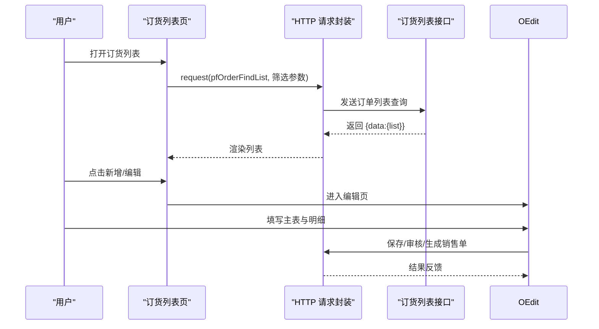
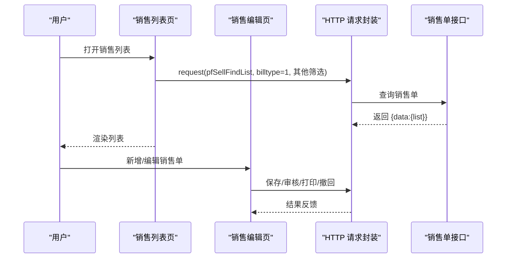
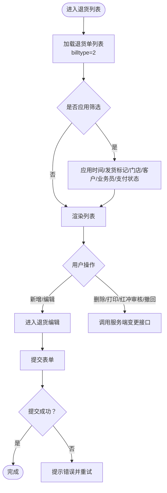
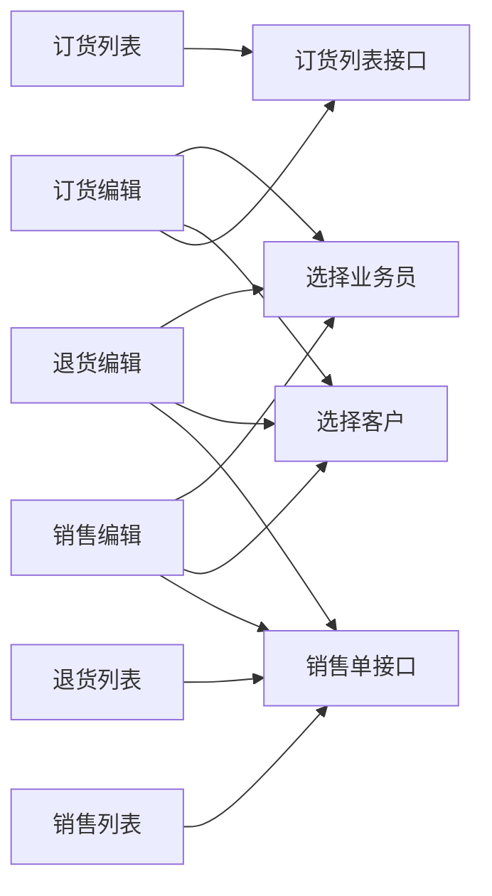
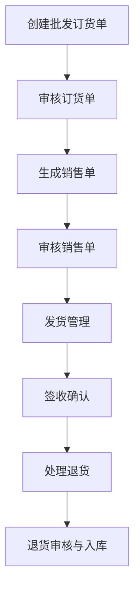

# 批发销售API

<cite>
**本文引用的文件**   
- [router.dart](file://lib/pages/business/wholesale/router.dart)
- [pf_order/list.dart](file://lib/pages/business/wholesale/pf_order/list.dart)
- [pf_order/edit.dart](file://lib/pages/business/wholesale/pf_order/edit.dart)
- [pf_order/search.dart](file://lib/pages/business/wholesale/pf_order/search.dart)
- [pf_sale/list.dart](file://lib/pages/business/wholesale/pf_sale/list.dart)
- [pf_sale/edit.dart](file://lib/pages/business/wholesale/pf_sale/edit.dart)
- [pf_sale/search.dart](file://lib/pages/business/wholesale/pf_sale/search.dart)
- [pf_return/list.dart](file://lib/pages/business/wholesale/pf_return/list.dart)
- [pf_return/edit.dart](file://lib/pages/business/wholesale/pf_return/edit.dart)
- [pf_return/search.dart](file://lib/pages/business/wholesale/pf_return/search.dart)
- [order_sum/list.dart](file://lib/pages/business/wholesale/order_sum/list.dart)
- [receive_sum/list.dart](file://lib/pages/business/wholesale/receive_sum/list.dart)
- [cust_manage/list.dart](file://lib/pages/business/wholesale/cust_manage/list.dart)
- [cust_manage/edit.dart](file://lib/pages/business/wholesale/cust_manage/edit.dart)
- [select_customer.dart](file://lib/pages/business/wholesale/select/select_customer.dart)
- [select_salesperson.dart](file://lib/pages/business/wholesale/select/select_salesperson.dart)
</cite>

## 目录
1. [引言](#引言)
2. [项目结构](#项目结构)
3. [核心组件](#核心组件)
4. [架构总览](#架构总览)
5. [详细组件分析](#详细组件分析)
6. [依赖分析](#依赖分析)
7. [性能考虑](#性能考虑)
8. [故障排查指南](#故障排查指南)
9. [结论](#结论)
10. [附录：完整操作流程与集成方案](#附录完整操作流程与集成方案)

## 引言
本文件面向灵犀管店 Flutter 客户端中的“批发销售”模块，基于仓库中批发业务相关页面代码，梳理并文档化批发销售出库业务流程的接口规范与前端交互逻辑。重点覆盖：
- 批发订货单、批发销售单、批发退货单的列表查询、详情编辑、审核等能力。
- 从订单到出库的业务链路：订货单 → 销售单（发货）→ 退货处理。
- 库存扣减逻辑、出库仓库选择、配送方式与物流跟踪的前端参与点。
- 订货汇总与应收款汇总报表的数据来源。
- 客户管理与业务员选择的基础数据支撑。

注意：本文以客户端调用行为为依据，对后端 API 的名称、参数、返回结构的描述均来源于前端发起的请求对象；实际字段语义由服务端定义，客户端侧不实现库存扣减或财务记账的核心计算。

## 项目结构
批发销售模块位于 `lib/pages/business/wholesale` 下，采用按业务子域划分的目录组织方式：
- 路由与入口：`router.dart` 集中注册批发模块所有页面路由。
- 批发订货：`pf_order/`，含列表、编辑、搜索页。
- 批发销售：`pf_sale/`，含列表、编辑、搜索页。
- 批发退货：`pf_return/`，含列表、编辑、搜索页。
- 汇总报表：`order_sum/`、`receive_sum/`。
- 基础数据：`cust_manage/`、`select/select_customer.dart`、`select/select_salesperson.dart`。

```mermaid
graph TB
  Router["批发路由<br/>router.dart"] --> OrderList["批发订货列表<br/>pf_order/list.dart"]
  Router --> OrderEdit["批发订货编辑<br/>pf_order/edit.dart"]
  Router --> OrderSearch["批发订货搜索<br/>pf_order/search.dart"]
  Router --> SaleList["批发销售列表<br/>pf_sale/list.dart"]
  Router --> SaleEdit["批发销售编辑<br/>pf_sale/edit.dart"]
  Router --> SaleSearch["批发销售搜索<br/>pf_sale/search.dart"]
  Router --> ReturnList["批发退货列表<br/>pf_return/list.dart"]
  Router --> ReturnEdit["批发退货编辑<br/>pf_return/edit.dart"]
  Router --> ReturnSearch["批发退货搜索<br/>pf_return/search.dart"]
  Router --> OrderSum["订货汇总<br/>order_sum/list.dart"]
  Router --> ReceiveSum["应收款汇总<br/>receive_sum/list.dart"]
  Router --> CustList["客户管理列表<br/>cust_manage/list.dart"]
  Router --> CustEdit["客户管理编辑<br/>cust_manage/edit.dart"]
  Router --> SelCust["选择客户<br/>select_customer.dart"]
  Router --> SelSales["选择业务员<br/>select_salesperson.dart"]
```



图表来源
- [router.dart:1-54](file://lib/pages/business/wholesale/router.dart#L1-L54)

章节来源
- [router.dart:1-54](file://lib/pages/business/wholesale/router.dart#L1-L54)

## 核心组件
本节从业务角度总结批发销售相关的核心页面与职责：

| 组件 | 路径 | 职责 | 关键外部依赖 |
|---|---|---|---|
| 批发订货列表 | [pf_order/list.dart](file://lib/pages/business/wholesale/pf_order/list.dart) | 展示订货单分页列表，支持状态筛选、门店筛选、日期范围、单号模糊搜索、下拉加载更多 | HTTP 请求、权限校验、门店选择组件 |
| 批发订货编辑 | [pf_order/edit.dart](file://lib/pages/business/wholesale/pf_order/edit.dart) | 新增/编辑订货单，维护明细行金额、数量、税率、包装换算，支持扫码、附件、多级审批、打印、删除、撤回、生成销售单 | 商品选择、仓库选择、客户选择、业务员选择、HTTP、工具类 |
| 批发订货搜索 | [pf_order/search.dart](file://lib/pages/business/wholesale/pf_order/search.dart) | 可嵌入到其他页面的单据选择器，支持时间、发货标记等条件筛选 | HTTP、编辑页回调 |
| 批发销售列表 | [pf_sale/list.dart](file://lib/pages/business/wholesale/pf_sale/list.dart) | 展示销售单分页列表，支持状态、门店、客户、业务员、收款状态、日期范围筛选 | HTTP、权限校验 |
| 批发销售编辑 | [pf_sale/edit.dart](file://lib/pages/business/wholesale/pf_sale/edit.dart) | 新增/编辑销售单，支持参考订货单/入库单、仓库与发货人、扫码、附件、审批、打印、删除、撤回 | 商品选择、批次选择、仓库选择、HTTP |
| 批发销售搜索 | [pf_sale/search.dart](file://lib/pages/business/wholesale/pf_sale/search.dart) | 销售单选择器，支持时间、发货标记筛选 | HTTP、编辑页回调 |
| 批发退货列表 | [pf_return/list.dart](file://lib/pages/business/wholesale/pf_return/list.dart) | 展示退货单分页列表，支持与销售的相同筛选维度 | HTTP、权限校验 |
| 批发退货编辑 | [pf_return/edit.dart](file://lib/pages/business/wholesale/pf_return/edit.dart) | 新增/编辑退货单，支持参考销售单、仓库、发货人、扫码、附件、审批、打印、删除、撤回 | 商品选择、批次选择、仓库选择、HTTP |
| 订货汇总 | [order_sum/list.dart](file://lib/pages/business/wholesale/order_sum/list.dart) | 统计订货数据，支持按客户分类、商品类型等维度汇总 | HTTP |
| 应收款汇总 | [receive_sum/list.dart](file://lib/pages/business/wholesale/receive_sum/list.dart) | 统计客户应收款，支持客户、业务员、分类、停售状态等筛选 | HTTP |
| 客户管理 | [cust_manage/list.dart](file://lib/pages/business/wholesale/cust_manage/list.dart)、[cust_manage/edit.dart](file://lib/pages/business/wholesale/cust_manage/edit.dart) | 客户增删改查、分类、停售标记、财务信息、微信订单绑定状态 | HTTP、权限校验 |
| 选择客户 | [select_customer.dart](file://lib/pages/business/wholesale/select/select_customer.dart) | 通用客户选择弹窗/抽屉 | HTTP、通用选择组件 |
| 选择业务员 | [select_salesperson.dart](file://lib/pages/business/wholesale/select/select_salesperson.dart) | 通用业务员选择弹窗/抽屉 | HTTP、通用选择组件 |

章节来源
- [pf_order/list.dart:1-200](file://lib/pages/business/wholesale/pf_order/list.dart#L1-L200)
- [pf_order/edit.dart:1-200](file://lib/pages/business/wholesale/pf_order/edit.dart#L1-L200)
- [pf_order/search.dart:1-200](file://lib/pages/business/wholesale/pf_order/search.dart#L1-L200)
- [pf_sale/list.dart:1-200](file://lib/pages/business/wholesale/pf_sale/list.dart#L1-L200)
- [pf_sale/edit.dart:1-200](file://lib/pages/business/wholesale/pf_sale/edit.dart#L1-L200)
- [pf_sale/search.dart:1-200](file://lib/pages/business/wholesale/pf_sale/search.dart#L1-L200)
- [pf_return/list.dart:1-200](file://lib/pages/business/wholesale/pf_return/list.dart#L1-L200)
- [pf_return/edit.dart:1-200](file://lib/pages/business/wholesale/pf_return/edit.dart#L1-L200)
- [pf_return/search.dart:1-200](file://lib/pages/business/wholesale/pf_return/search.dart#L1-L200)
- [order_sum/list.dart:1-200](file://lib/pages/business/wholesale/order_sum/list.dart#L1-L200)
- [receive_sum/list.dart:1-200](file://lib/pages/business/wholesale/receive_sum/list.dart#L1-L200)
- [cust_manage/list.dart:1-200](file://lib/pages/business/wholesale/cust_manage/list.dart#L1-L200)
- [cust_manage/edit.dart:1-200](file://lib/pages/business/wholesale/cust_manage/edit.dart#L1-L200)
- [select_customer.dart:1-72](file://lib/pages/business/wholesale/select/select_customer.dart#L1-L72)
- [select_salesperson.dart:1-69](file://lib/pages/business/wholesale/select/select_salesperson.dart#L1-L69)

## 架构总览
批发销售在客户端采用“页面 + HTTP 抽象层”的结构：
- 页面负责 UI、表单、筛选、分页、权限校验、本地计算（如单价、税额、毛利等）。
- HTTP 抽象通过统一方法发起网络请求，使用统一的 API 常量命名空间。
- 选择器组件提供跨页面复用的基础数据选择能力。
- 路由集中注册，保证导航一致性。

```mermaid
graph TB
  subgraph "页面层"
    OList["订货列表"]
    OEdit["订货编辑"]
    SList["销售列表"]
    SEdit["销售编辑"]
    RList["退货列表"]
    RE dit["退货编辑"]
  end

  subgraph "公共选择器"
    CSelect["选择客户"]
    SSelect["选择业务员"]
  end

  subgraph "网络层"
    Api["HTTP API 常量"]
    Http["HTTP 请求封装"]
  end

  OList --> Http
  OEdit --> Http
  SList --> Http
  SEdit --> Http
  RList --> Http
  RE dit --> Http

  OEdit --> CSelect
  OEdit --> SSelect
  SEdit --> CSelect
  SEdit --> SSelect
  RE dit --> CSelect
  RE dit --> SSelect

  Http --> Api
```

图表来源
- [pf_order/list.dart:1-200](file://lib/pages/business/wholesale/pf_order/list.dart#L1-L200)
- [pf_sale/list.dart:1-200](file://lib/pages/business/wholesale/pf_sale/list.dart#L1-L200)
- [pf_return/list.dart:1-200](file://lib/pages/business/wholesale/pf_return/list.dart#L1-L200)
- [select_customer.dart:1-72](file://lib/pages/business/wholesale/select/select_customer.dart#L1-L72)
- [select_salesperson.dart:1-69](file://lib/pages/business/wholesale/select/select_salesperson.dart#L1-L69)

## 详细组件分析

### 批发订货单接口与流程
- 列表查询
  - 列表页发起请求，携带分页、排序、单号、日期范围、门店、客户、业务员、柜台、发货标记等筛选条件，并按状态标签映射 signflag。
  - 典型请求体包含：field、type、page、billno、datetype、signflag、sids、starttime、endtime、可选 custid/salesid/counterid/dhflag。
- 编辑新增/修改
  - 维护主表字段：客户、门店、柜台、业务员、备注、仓库等。
  - 明细行维护：数量、包装换算、赠送数量、单价、售价、进价、成本价、内外税率、含税金额、不含税金额、毛利等。
  - 操作动作包括：保存、审核、删除、打印、红冲审核、撤回、生成销售单。
- 搜索选择
  - 作为选择器时，传入 isSelect、emitFnName、mergData，支持时间、dhflag 等过滤，并回传选中单据给调用方。



图表来源
- [pf_order/list.dart:1-200](file://lib/pages/business/wholesale/pf_order/list.dart#L1-L200)
- [pf_order/edit.dart:1-200](file://lib/pages/business/wholesale/pf_order/edit.dart#L1-L200)
- [pf_order/search.dart:1-200](file://lib/pages/business/wholesale/pf_order/search.dart#L1-L200)

章节来源
- [pf_order/list.dart:1-200](file://lib/pages/business/wholesale/pf_order/list.dart#L1-L200)
- [pf_order/edit.dart:1-200](file://lib/pages/business/wholesale/pf_order/edit.dart#L1-L200)
- [pf_order/search.dart:1-200](file://lib/pages/business/wholesale/pf_order/search.dart#L1-L200)

### 批发销售单接口与流程
- 列表查询
  - 销售列表使用与销售退货共用的销售单查询接口，通过 billtype=1 区分销售单，notwx=1 排除微信渠道，并支持支付状态筛选。
  - 请求体包含：field、type、page、billno、datetype、signflag、billtype、notwx、sids、starttime、endtime、可选 custid/salesid/counterid/paystatus。
- 编辑新增/修改
  - 支持参考单据为订货单或入库单，仓库、发货人、客户、业务员、备注等主表字段。
  - 明细行金额计算与订货类似，但增加 sellamt、grossamt 等销售维度指标。
  - 操作动作包括：保存、审核、删除、打印、红冲审核、撤回。
- 搜索选择
  - 销售单选择器默认 billtype=1，支持时间、dhflag 等筛选。



图表来源
- [pf_sale/list.dart:1-200](file://lib/pages/business/wholesale/pf_sale/list.dart#L1-L200)
- [pf_sale/edit.dart:1-200](file://lib/pages/business/wholesale/pf_sale/edit.dart#L1-L200)
- [pf_sale/search.dart:1-200](file://lib/pages/business/wholesale/pf_sale/search.dart#L1-L200)

章节来源
- [pf_sale/list.dart:1-200](file://lib/pages/business/wholesale/pf_sale/list.dart#L1-L200)
- [pf_sale/edit.dart:1-200](file://lib/pages/business/wholesale/pf_sale/edit.dart#L1-L200)
- [pf_sale/search.dart:1-200](file://lib/pages/business/wholesale/pf_sale/search.dart#L1-L200)

### 批发退货单接口与流程
- 列表查询
  - 退货列表同样调用销售单查询接口，通过 billtype=2 表示退货单，notwx=1，支持支付状态筛选。
  - 请求体包含：field、type、page、billno、datetype、signflag、billtype、notwx、sids、starttime、endtime、可选 custid/salesid/counterid/paystatus。
- 编辑新增/修改
  - 支持参考销售单，仓库、发货人、客户、业务员、备注等主表字段。
  - 明细行金额计算逻辑与订货、销售保持一致风格。
  - 操作动作包括：保存、审核、删除、打印、红冲审核、撤回。
- 搜索选择
  - 退货单选择器默认 billtype=2，支持时间、dhflag 等筛选。



图表来源
- [pf_return/list.dart:1-200](file://lib/pages/business/wholesale/pf_return/list.dart#L1-L200)
- [pf_return/edit.dart:1-200](file://lib/pages/business/wholesale/pf_return/edit.dart#L1-L200)
- [pf_return/search.dart:1-200](file://lib/pages/business/wholesale/pf_return/search.dart#L1-L200)

章节来源
- [pf_return/list.dart:1-200](file://lib/pages/business/wholesale/pf_return/list.dart#L1-L200)
- [pf_return/edit.dart:1-200](file://lib/pages/business/wholesale/pf_return/edit.dart#L1-L200)
- [pf_return/search.dart:1-200](file://lib/pages/business/wholesale/pf_return/search.dart#L1-L200)

### 订货汇总与应收款汇总
- 订货汇总
  - 支持两个 Tab：按客户维度的订货汇总与按商品类型维度的订货汇总。
  - 请求体包含：page、pagesize、starttime、endtime、field、type、sids，以及不同 Tab 的客户分类、名称、编码或商品分类、名称等筛选。
- 应收款汇总
  - 统计客户应收款项，支持门店、客户分类、客户名称、业务员、停售状态等筛选。
  - 请求体包含：page、pagesize、starttime、endtime、sids、custid、custname、salesid、salesname、custtypeid、custtypename、custstopflag。

章节来源
- [order_sum/list.dart:1-200](file://lib/pages/business/wholesale/order_sum/list.dart#L1-L200)
- [receive_sum/list.dart:1-200](file://lib/pages/business/wholesale/receive_sum/list.dart#L1-L200)

### 客户管理与业务员选择
- 客户管理
  - 列表：支持按客户名称/编码/手机号模糊搜索、客户分类、停售状态筛选，分页加载。
  - 编辑：新增自动生成编码；编辑时拉取详情，维护基本信息、资产信息、更多信息，支持未保存修改检测。
- 选择客户
  - 通用选择器，内部调用客户列表接口，将 id/name/code 映射为统一返回结构。
- 选择业务员
  - 通用选择器，调用系统用户列表接口，返回业务员编码、名称显示名。

章节来源
- [cust_manage/list.dart:1-200](file://lib/pages/business/wholesale/cust_manage/list.dart#L1-L200)
- [cust_manage/edit.dart:1-200](file://lib/pages/business/wholesale/cust_manage/edit.dart#L1-L200)
- [select_customer.dart:1-72](file://lib/pages/business/wholesale/select/select_customer.dart#L1-L72)
- [select_salesperson.dart:1-69](file://lib/pages/business/wholesale/select/select_salesperson.dart#L1-L69)

## 依赖分析
- 页面与接口
  - 订货列表与搜索共用订货列表接口。
  - 销售列表、销售搜索、退货列表、退货搜索共用销售单查询接口，通过 billtype 区分销售与退货。
  - 订货编辑、销售编辑、退货编辑均复用相同的明细金额计算模式与工具方法。
- 页面与选择器
  - 订货、销售、退货编辑均支持选择客户和业务员。
  - 选择器内部依赖统一的通用选择组件和 HTTP 请求封装。
- 路由与页面
  - 批发模块路由集中注册，避免分散配置导致导航不一致。



图表来源
- [pf_order/list.dart:1-200](file://lib/pages/business/wholesale/pf_order/list.dart#L1-L200)
- [pf_sale/list.dart:1-200](file://lib/pages/business/wholesale/pf_sale/list.dart#L1-L200)
- [pf_return/list.dart:1-200](file://lib/pages/business/wholesale/pf_return/list.dart#L1-L200)
- [select_customer.dart:1-72](file://lib/pages/business/wholesale/select/select_customer.dart#L1-L72)
- [select_salesperson.dart:1-69](file://lib/pages/business/wholesale/select/select_salesperson.dart#L1-L69)

章节来源
- [pf_order/list.dart:1-200](file://lib/pages/business/wholesale/pf_order/list.dart#L1-L200)
- [pf_sale/list.dart:1-200](file://lib/pages/business/wholesale/pf_sale/list.dart#L1-L200)
- [pf_return/list.dart:1-200](file://lib/pages/business/wholesale/pf_return/list.dart#L1-L200)
- [select_customer.dart:1-72](file://lib/pages/business/wholesale/select/select_customer.dart#L1-L72)
- [select_salesperson.dart:1-69](file://lib/pages/business/wholesale/select/select_salesperson.dart#L1-L69)

## 性能考虑
- 分页与防抖
  - 列表普遍采用分页加载与滚动到底自动加载下一页。
  - 搜索输入使用定时器防抖，减少频繁请求。
- 状态切换重置
  - 切换状态标签或筛选条件时重置页码、清空列表、重新加载数据，避免脏数据。
- 权限前置检查
  - 进入页面先进行权限校验，无权限直接提示，避免无效请求。
- 金额计算本地优化
  - 明细行的单价、税额、毛利等在本地计算后提交，降低服务端压力，同时保证金额精度一致。

[本节为通用指导，无需特定文件引用]

## 故障排查指南
- 列表无法加载
  - 检查权限标识是否允许访问对应模块。
  - 确认时间范围、门店、客户、业务员等筛选参数是否正确。
  - 查看请求体是否包含必要字段（如 field、type、page、billno、datetype、signflag、starttime、endtime）。
- 编辑提交失败
  - 核对必填字段：客户、仓库、业务员、明细行数量与价格。
  - 检查金额计算逻辑是否出现除零、负数、精度异常。
  - 若涉及审核、红冲审核、撤回等操作，确认单据当前状态是否允许该操作。
- 选择器无数据
  - 确认选择器使用的接口是否可用，搜索关键字是否为空或非法。
  - 检查返回数据结构是否与 mapResult 映射一致。
- 汇总报表为空
  - 检查时间范围是否合理，筛选条件是否过严。
  - 确认数据来源单据是否存在且已审核生效。

章节来源
- [pf_order/list.dart:1-200](file://lib/pages/business/wholesale/pf_order/list.dart#L1-L200)
- [pf_sale/list.dart:1-200](file://lib/pages/business/wholesale/pf_sale/list.dart#L1-L200)
- [pf_return/list.dart:1-200](file://lib/pages/business/wholesale/pf_return/list.dart#L1-L200)
- [order_sum/list.dart:1-200](file://lib/pages/business/wholesale/order_sum/list.dart#L1-L200)
- [receive_sum/list.dart:1-200](file://lib/pages/business/wholesale/receive_sum/list.dart#L1-L200)

## 结论
本仓库的批发销售模块以 Flutter 页面为核心，围绕订货、销售、退货三大单据构建完整的批发出库业务闭环。前端负责：
- 单据数据的录入、编辑、筛选、分页展示。
- 明细行金额、税率、包装换算等本地计算。
- 审核、红冲审核、撤回、打印、生成销售单等业务动作。
- 客户、业务员等基础数据的选择与管理。
库存扣减、财务记账等核心计算与服务端事务由后端承担；客户端通过标准接口与这些系统对接。

[本节为总结性内容，无需特定文件引用]

## 附录：完整操作流程与集成方案

### 批发销售出库业务流程
1. 创建批发订货单
   - 在订货编辑页选择客户、门店、柜台、业务员、仓库。
   - 添加商品明细，设置数量、单价、税率、赠送数量、包装换算。
   - 保存并提交审核。
2. 审核订货单
   - 在订货列表中选择待审核单据进行审核。
   - 审核通过后，可生成销售单。
3. 创建批发销售单（发货）
   - 在销售编辑页参考订货单或入库单，确认仓库与发货人。
   - 维护明细行数量、价格、税率等信息。
   - 保存并提交审核。
4. 审核销售单并执行发货
   - 在销售列表中对已审核单据进行发货管理。
   - 发货完成后，可进行签收确认（由后端状态机控制，客户端根据状态展示）。
5. 处理批发退货
   - 在退货编辑页参考销售单，填写退货明细。
   - 保存并提交审核，审核后执行退货入库与库存调整。



图表来源
- [pf_order/edit.dart:1-200](file://lib/pages/business/wholesale/pf_order/edit.dart#L1-L200)
- [pf_sale/edit.dart:1-200](file://lib/pages/business/wholesale/pf_sale/edit.dart#L1-L200)
- [pf_return/edit.dart:1-200](file://lib/pages/business/wholesale/pf_return/edit.dart#L1-L200)

### 库存扣减逻辑说明
- 前端不直接实现库存扣减，而是在单据审核、发货、退货等关键节点触发后端接口。
- 出库仓库选择：在订货与销售编辑页支持仓库选择，仓库决定库存扣减来源库位。
- 库存调整方向：
  - 销售审核与发货：减少目标仓库库存。
  - 退货审核与入库：增加目标仓库库存。
- 包装换算：根据包装数量与散装数量关系，确保库存单位与订单单位一致。

章节来源
- [pf_order/edit.dart:1-200](file://lib/pages/business/wholesale/pf_order/edit.dart#L1-L200)
- [pf_sale/edit.dart:1-200](file://lib/pages/business/wholesale/pf_sale/edit.dart#L1-L200)
- [pf_return/edit.dart:1-200](file://lib/pages/business/wholesale/pf_return/edit.dart#L1-L200)

### 配送方式配置与物流跟踪
- 配送方式
  - 销售与退货编辑页支持发货人字段，用于记录配送责任人与联系方式。
  - 具体配送方式（快递、自提、专车等）由后端配置，客户端依据字段展示。
- 物流跟踪
  - 前端根据单据状态与物流字段展示物流信息；物流状态更新由后端推送或轮询。
  - 若需要扩展物流跟踪界面，可在销售详情页集成第三方物流查询接口。

章节来源
- [pf_sale/edit.dart:1-200](file://lib/pages/business/wholesale/pf_sale/edit.dart#L1-L200)
- [pf_return/edit.dart:1-200](file://lib/pages/business/wholesale/pf_return/edit.dart#L1-L200)

### 与库存系统与财务系统的集成方案
- 库存系统集成
  - 通过销售单审核与发货、退货单审核与入库等动作，驱动库存增减。
  - 前端需确保仓库、商品、数量、单位、包装换算等字段准确。
- 财务系统集成
  - 通过订货汇总与应收款汇总报表，向财务系统输出订单与应收数据。
  - 销售单金额、税额、毛利等字段为财务核算提供依据。
- 数据一致性保障
  - 单据状态机与后端事务保证库存与财务数据一致性。
  - 前端在关键操作前进行权限与状态校验，避免重复提交与非法操作。

章节来源
- [order_sum/list.dart:1-200](file://lib/pages/business/wholesale/order_sum/list.dart#L1-L200)
- [receive_sum/list.dart:1-200](file://lib/pages/business/wholesale/receive_sum/list.dart#L1-L200)
- [pf_sale/edit.dart:1-200](file://lib/pages/business/wholesale/pf_sale/edit.dart#L1-L200)
- [pf_return/edit.dart:1-200](file://lib/pages/business/wholesale/pf_return/edit.dart#L1-L200)