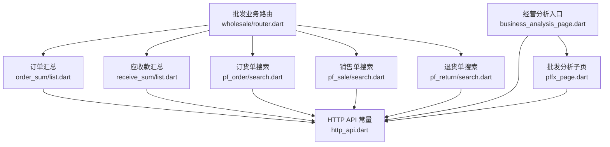
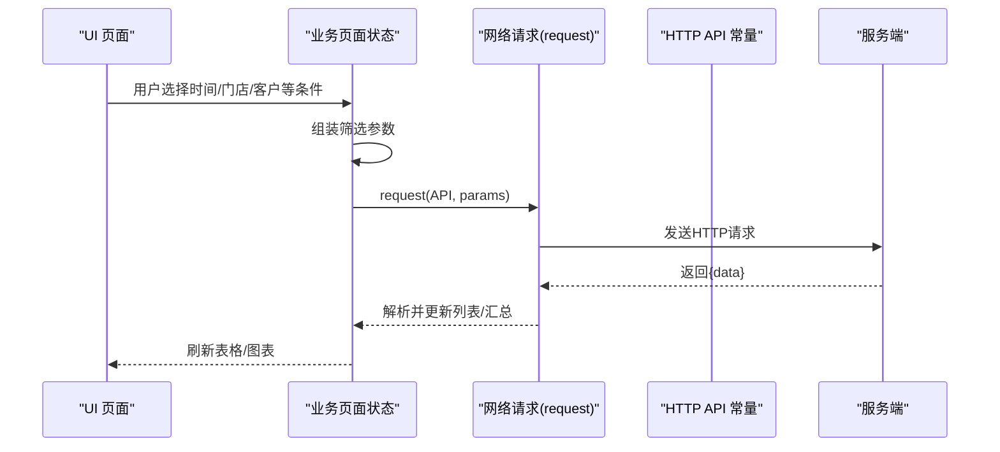
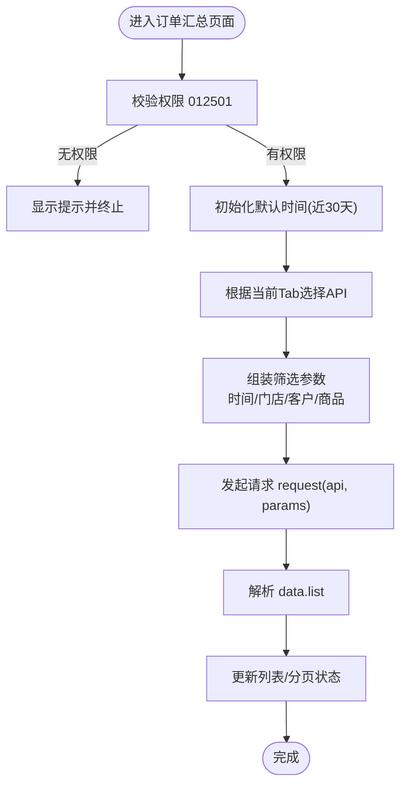
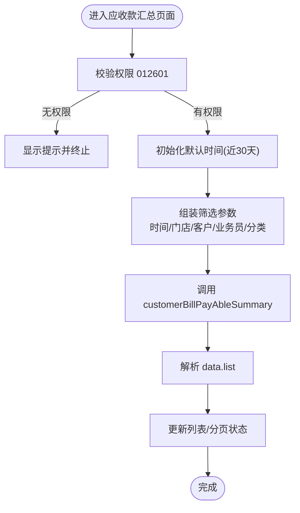
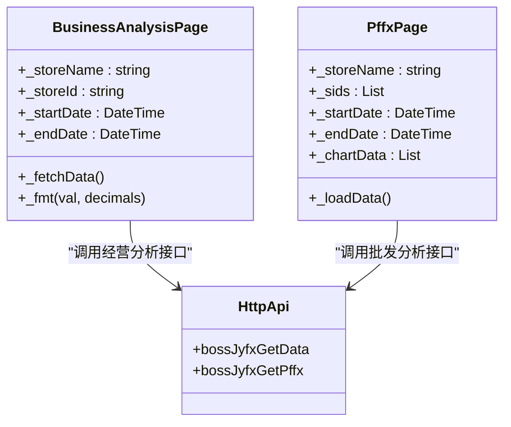
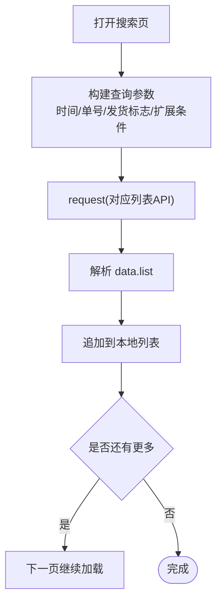
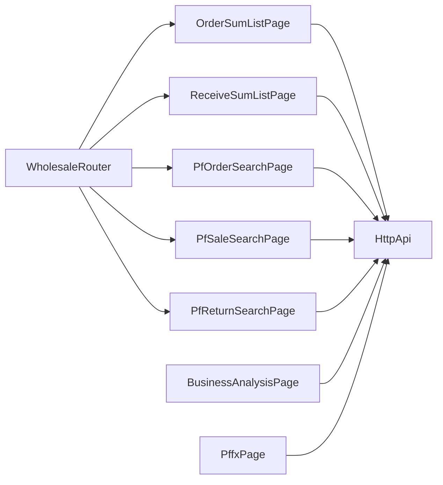

# 汇总统计API

<cite>
**本文引用的文件**   
- [lib/pages/business/wholesale/router.dart](file://lib/pages/business/wholesale/router.dart)
- [lib/net/http_api.dart](file://lib/net/http_api.dart)
- [lib/pages/business/wholesale/order_sum/list.dart](file://lib/pages/business/wholesale/order_sum/list.dart)
- [lib/pages/business/wholesale/receive_sum/list.dart](file://lib/pages/business/wholesale/receive_sum/list.dart)
- [lib/pages/data/businessReport/businessAnalysis/business_analysis_page.dart](file://lib/pages/data/businessReport/businessAnalysis/business_analysis_page.dart)
- [lib/pages/data/businessReport/businessAnalysis/subpage/pffx_page.dart](file://lib/pages/data/businessReport/businessAnalysis/subpage/pffx_page.dart)
- [lib/pages/business/wholesale/pf_sale/search.dart](file://lib/pages/business/wholesale/pf_sale/search.dart)
- [lib/pages/business/wholesale/pf_order/search.dart](file://lib/pages/business/wholesale/pf_order/search.dart)
- [lib/pages/business/wholesale/pf_return/search.dart](file://lib/pages/business/wholesale/pf_return/search.dart)
</cite>

## 目录
1. [引言](#引言)
2. [项目结构](#项目结构)
3. [核心组件](#核心组件)
4. [架构总览](#架构总览)
5. [详细组件分析](#详细组件分析)
6. [依赖关系分析](#依赖关系分析)
7. [性能与大数据处理](#性能与大数据处理)
8. [故障排查指南](#故障排查指南)
9. [结论](#结论)
10. [附录：接口规范与使用示例](#附录接口规范与使用示例)

## 引言
本文面向灵犀管店 Flutter 客户端，聚焦“批发业务汇总统计”能力，覆盖以下范围：
- 批发订单汇总统计
- 批发应收款汇总
- 批发销售、退货、订货单查询
- 经营分析与批发分析报表
- 统计维度、时间筛选、数据聚合与KPI指标说明
- 图表数据准备、趋势分析与对比分析方法
- 缓存策略、性能优化与大数据量处理建议

本仓库为移动端实现，服务端具体聚合算法未包含在代码中；本文对后端逻辑的描述以前端调用参数和返回字段为依据，避免臆测。

## 项目结构
与批发业务汇总统计直接相关的代码主要分布在三个区域：
- 批发业务路由与页面：`lib/pages/business/wholesale/**`
- 经营分析与报表页面：`lib/pages/data/businessReport/businessAnalysis/**`
- 网络接口常量定义：`lib/net/http_api.dart`

**图示来源**
- [lib/pages/business/wholesale/router.dart:1-54](file://lib/pages/business/wholesale/router.dart#L1-L54)
- [lib/pages/business/wholesale/order_sum/list.dart:1-200](file://lib/pages/business/wholesale/order_sum/list.dart#L1-L200)
- [lib/pages/business/wholesale/receive_sum/list.dart:1-200](file://lib/pages/business/wholesale/receive_sum/list.dart#L1-L200)
- [lib/pages/data/businessReport/businessAnalysis/business_analysis_page.dart:1-200](file://lib/pages/data/businessReport/businessAnalysis/business_analysis_page.dart#L1-L200)
- [lib/pages/data/businessReport/businessAnalysis/subpage/pffx_page.dart:1-200](file://lib/pages/data/businessReport/businessAnalysis/subpage/pffx_page.dart#L1-L200)
- [lib/net/http_api.dart:300-480](file://lib/net/http_api.dart#L300-L480)

**章节来源**
- [lib/pages/business/wholesale/router.dart:1-54](file://lib/pages/business/wholesale/router.dart#L1-L54)

## 核心组件
- 批发业务路由层：集中注册批发相关页面与路由地址，包括订单汇总、应收款汇总、销售/订货/退货搜索等。
- 订单汇总统计页面：提供按门店、客户、商品维度的批发订单汇总列表，支持分页、多Tab切换（如按门店汇总与按商品汇总）。
- 应收款汇总页面：提供按客户、业务员、客户类别等多维度的批发应收款汇总列表，支持分页与筛选。
- 经营分析入口与批发分析子页：提供KPI卡片与批发分析明细表，支持日/周/月/自定义时间范围及门店选择。
- HTTP API 常量：统一维护所有后端接口路径，包括批发订单汇总、批发分析、销售/订货/退货列表、应收款汇总等。

**章节来源**
- [lib/pages/business/wholesale/router.dart:1-54](file://lib/pages/business/wholesale/router.dart#L1-L54)
- [lib/net/http_api.dart:300-480](file://lib/net/http_api.dart#L300-L480)

## 架构总览
整体数据流遵循“页面 → 网络请求 → 服务端聚合 → 前端渲染”的模式。

**图示来源**
- [lib/pages/business/wholesale/order_sum/list.dart:1-200](file://lib/pages/business/wholesale/order_sum/list.dart#L1-L200)
- [lib/pages/business/wholesale/receive_sum/list.dart:1-200](file://lib/pages/business/wholesale/receive_sum/list.dart#L1-L200)
- [lib/pages/data/businessReport/businessAnalysis/business_analysis_page.dart:1-200](file://lib/pages/data/businessReport/businessAnalysis/business_analysis_page.dart#L1-L200)
- [lib/pages/data/businessReport/businessAnalysis/subpage/pffx_page.dart:1-200](file://lib/pages/data/businessReport/businessAnalysis/subpage/pffx_page.dart#L1-L200)
- [lib/net/http_api.dart:300-480](file://lib/net/http_api.dart#L300-L480)

## 详细组件分析

### 批发订单汇总统计
该功能由订单汇总页面实现，核心职责：
- 通过两个Tab分别调用“按门店汇总”和“按商品汇总”接口。
- 支持时间范围、门店多选、客户分类、客户编码/名称、商品名称、商品分类等筛选。
- 分页加载列表，默认每页20条。

关键行为：
- 首次进入时检查权限码“012501”，无权限则提示并在页面初始化阶段阻止后续加载。
- 默认时间为近30天，日期格式为“yyyy-MM-dd”。
- Tab切换会重置分页并重新拉取数据。

**图示来源**
- [lib/pages/business/wholesale/order_sum/list.dart:1-200](file://lib/pages/business/wholesale/order_sum/list.dart#L1-L200)

**章节来源**
- [lib/pages/business/wholesale/order_sum/list.dart:1-200](file://lib/pages/business/wholesale/order_sum/list.dart#L1-L200)
- [lib/net/http_api.dart:476-477](file://lib/net/http_api.dart#L476-L477)

### 批发应收款汇总
该功能由应收款汇总页面实现，核心职责：
- 调用应收款汇总接口，返回按客户的汇总数据，支持分页。
- 支持按门店、客户编码/名称、业务员、客户分类、客户停售标志等筛选。
- 默认时间为近30天，金额格式化保留三位小数。

关键行为：
- 首次进入时检查权限码“012601”，无权限则提示并阻止后续加载。
- 下拉刷新与上拉加载更多。

**图示来源**
- [lib/pages/business/wholesale/receive_sum/list.dart:1-200](file://lib/pages/business/wholesale/receive_sum/list.dart#L1-L200)

**章节来源**
- [lib/pages/business/wholesale/receive_sum/list.dart:1-200](file://lib/pages/business/wholesale/receive_sum/list.dart#L1-L200)
- [lib/net/http_api.dart:480](file://lib/net/http_api.dart#L480)

### 经营分析与批发分析
经营分析入口负责汇总展示多个业务域KPI卡片，其中包含“批发分析”卡片；批发分析子页用于查看批发业务的明细与趋势图。

- 经营分析入口：
  - 从本地存储读取当前门店信息。
  - 调用经营分析数据接口，传入门店、时间范围、时间类型。
  - 解析返回的KPI卡片数据，包含批发销售额、毛利额、毛利率等。
- 批发分析子页：
  - 调用批发分析接口，获取列表与汇总数据。
  - 将billdate按小时/周/月维度聚合成图表数据。
  - 支持选择不同指标（如销售额）作为图表值字段。

**图示来源**
- [lib/pages/data/businessReport/businessAnalysis/business_analysis_page.dart:1-200](file://lib/pages/data/businessReport/businessAnalysis/business_analysis_page.dart#L1-L200)
- [lib/pages/data/businessReport/businessAnalysis/subpage/pffx_page.dart:1-200](file://lib/pages/data/businessReport/businessAnalysis/subpage/pffx_page.dart#L1-L200)
- [lib/net/http_api.dart:303-306](file://lib/net/http_api.dart#L303-L306)

**章节来源**
- [lib/pages/data/businessReport/businessAnalysis/business_analysis_page.dart:1-200](file://lib/pages/data/businessReport/businessAnalysis/business_analysis_page.dart#L1-L200)
- [lib/pages/data/businessReport/businessAnalysis/subpage/pffx_page.dart:1-200](file://lib/pages/data/businessReport/businessAnalysis/subpage/pffx_page.dart#L1-L200)
- [lib/net/http_api.dart:303-306](file://lib/net/http_api.dart#L303-L306)

### 批发销售、订货、退货单查询
三类单据搜索页均基于统一的搜索模式：
- 分页加载，默认每页20条，滚动到底自动加载更多。
- 支持按创建时间倒序排序。
- 支持按单号模糊搜索、发货标志、以及可选扩展筛选参数。
- 销售单与退货单共用同一列表接口，通过不同单类型区分；订货单使用独立列表接口。

**图示来源**
- [lib/pages/business/wholesale/pf_sale/search.dart:1-200](file://lib/pages/business/wholesale/pf_sale/search.dart#L1-L200)
- [lib/pages/business/wholesale/pf_order/search.dart:1-200](file://lib/pages/business/wholesale/pf_order/search.dart#L1-L200)
- [lib/pages/business/wholesale/pf_return/search.dart:1-200](file://lib/pages/business/wholesale/pf_return/search.dart#L1-L200)

**章节来源**
- [lib/pages/business/wholesale/pf_sale/search.dart:1-200](file://lib/pages/business/wholesale/pf_sale/search.dart#L1-L200)
- [lib/pages/business/wholesale/pf_order/search.dart:1-200](file://lib/pages/business/wholesale/pf_order/search.dart#L1-L200)
- [lib/pages/business/wholesale/pf_return/search.dart:1-200](file://lib/pages/business/wholesale/pf_return/search.dart#L1-L200)
- [lib/net/http_api.dart:459-468](file://lib/net/http_api.dart#L459-L468)

## 依赖关系分析
- 页面层依赖路由注册：批发业务各页面通过 router.dart 集中注册路由，便于导航与传参。
- 页面层依赖网络层：所有数据拉取通过 http_helper.dart 的 request 方法，接口路径集中在 http_api.dart。
- 报表层依赖本地存储：经营分析与批发分析从本地SpUtil读取当前门店信息，影响默认筛选条件。

**图示来源**
- [lib/pages/business/wholesale/router.dart:1-54](file://lib/pages/business/wholesale/router.dart#L1-L54)
- [lib/net/http_api.dart:300-480](file://lib/net/http_api.dart#L300-L480)

**章节来源**
- [lib/pages/business/wholesale/router.dart:1-54](file://lib/pages/business/wholesale/router.dart#L1-L54)
- [lib/net/http_api.dart:300-480](file://lib/net/http_api.dart#L300-L480)

## 性能与大数据处理
- 分页加载：列表类页面统一采用 page/pagesize 分页，默认每页20条，避免一次性加载大量数据。
- 防抖搜索：搜索输入框使用定时器延迟触发查询，减少频繁请求。
- 重复请求防护：在加载中状态为true时，直接返回Future.value()，避免并发重复请求。
- 空数据处理：捕获异常后将 hasMore 置为false，防止无限重试。
- 图表数据预处理：批发分析子页对billdate进行小时/周/月聚合，降低前端渲染压力。

建议补充（未在代码中实现，供后续优化参考）：
- 结果缓存：对热点时间段的数据进行短时内存缓存或本地持久化，减少重复请求。
- 增量更新：服务端支持增量数据推送或变更时间戳过滤，前端按需拉取差异数据。
- 导出能力：可将已加载数据转换为CSV/Excel格式，支持离线查看与上报。

[本节为通用指导，不直接分析具体文件]

## 故障排查指南
- 权限不足：
  - 订单汇总需要权限码“012501”，若失败会提示“无权查看订货汇总”。
  - 应收款汇总需要权限码“012601”，若失败会提示“无权查看应收款汇总”。
- 数据为空：
  - 检查时间范围是否有效（starttime/endtime），确认门店与客户筛选条件是否过严。
  - 确认服务端返回的 data.list 是否为空数组。
- 分页异常：
  - 当服务端返回数据少于pagesize时，hasMore会被置为false，检查服务端分页逻辑。
- 图表数据异常：
  - 检查 billdate 字段是否包含时间与日期，确保小时/周/月聚合逻辑能正确解析。

**章节来源**
- [lib/pages/business/wholesale/order_sum/list.dart:1-200](file://lib/pages/business/wholesale/order_sum/list.dart#L1-L200)
- [lib/pages/business/wholesale/receive_sum/list.dart:1-200](file://lib/pages/business/wholesale/receive_sum/list.dart#L1-L200)

## 结论
本项目的批发业务汇总统计在Flutter端通过清晰的页面分层、统一的路由与API常量管理，实现了订单汇总、应收款汇总、销售/订货/退货单查询与经营分析/批发分析报表。数据交互遵循分页与筛选标准，图表数据在前端进行时间维度聚合。当前未实现服务端聚合细节与缓存导出能力，建议在后续迭代中增强缓存策略、增量更新与导出功能，以提升用户体验与系统可扩展性。

[本节为总结，不直接分析具体文件]

## 附录：接口规范与使用示例

### 批发订单汇总接口
- 接口路径常量：
  - 按门店汇总：`pfselectorder/findPfOrderStoreTotal`
  - 按商品汇总：`pfselectorder/findPfOrderTotal`
- 请求参数：
  - page：页码，默认1
  - pagesize：每页数量，默认20
  - starttime：开始时间，格式“yyyy-MM-dd 00:00:00”
  - endtime：结束时间，格式“yyyy-MM-dd 23:59:59”
  - field/type：排序字段与顺序，例如 barcode/asc
  - sids：门店ID列表（可选）
  - custtypeid/custtypename/custid/custname：客户分类与名称筛选（可选）
  - name/typeid/typename：商品名称与分类筛选（可选）
- 响应结构：
  - data.list：汇总行列表
- 使用示例：
  - 在订单汇总页面中，根据当前Tab选择对应API，组装上述参数后调用 request。

**章节来源**
- [lib/pages/business/wholesale/order_sum/list.dart:1-200](file://lib/pages/business/wholesale/order_sum/list.dart#L1-L200)
- [lib/net/http_api.dart:476-477](file://lib/net/http_api.dart#L476-L477)

### 批发应收款汇总接口
- 接口路径常量：
  - `finance/customerbill/getCustomerPayAbleSummary`
- 请求参数：
  - page：页码，默认1
  - pagesize：每页数量，默认20
  - starttime：开始时间，格式“yyyy-MM-dd 00:00:00”
  - endtime：结束时间，格式“yyyy-MM-dd 23:59:59”
  - sids：门店ID列表（可选）
  - custid/custname：客户编码与名称（可选）
  - salesid/salesname：业务员编码与名称（可选）
  - custtypeid/custtypename：客户分类编码与名称（可选）
  - custstopflag：客户停售标志（可选）
- 响应结构：
  - data.list：应收款汇总行列表
- 使用示例：
  - 在应收款汇总页面中，组装筛选参数后调用 request。

**章节来源**
- [lib/pages/business/wholesale/receive_sum/list.dart:1-200](file://lib/pages/business/wholesale/receive_sum/list.dart#L1-L200)
- [lib/net/http_api.dart:480](file://lib/net/http_api.dart#L480)

### 经营分析与批发分析接口
- 经营分析数据接口：
  - 接口路径常量：`boss_jyfx/getData`
  - 请求参数：
    - sids：门店ID列表（字符串形式）
    - sidsname：门店名称
    - starttime：开始时间
    - endtime：结束时间
    - selectdatetype：时间类型（今日/本周/本月/自定义）
  - 响应结构：
    - data：包含多个KPI卡片字段，其中包括批发销售额(pf_amt)、毛利额(pf_grossamt)、毛利率(pf_grossrate)等。
- 批发分析接口：
  - 接口路径常量：`boss_jyfx/getPffx`
  - 请求参数：
    - is_page：是否分页，示例传0
    - sids：门店ID列表（整数）
    - sidsname：门店名称
    - starttime：开始时间
    - endtime：结束时间
    - selectdatetype：时间类型
  - 响应结构：
    - data.list：明细行，包含billdate与指标字段
    - data.sumdata：汇总数据
- 使用示例：
  - 经营分析入口页组装门店与时间参数，调用 boss_jyfx/getData 获取KPI卡片。
  - 批发分析子页调用 boss_jyfx/getPffx，并根据 selectdatetype 与 billdate 生成图表数据。

**章节来源**
- [lib/pages/data/businessReport/businessAnalysis/business_analysis_page.dart:1-200](file://lib/pages/data/businessReport/businessAnalysis/business_analysis_page.dart#L1-L200)
- [lib/pages/data/businessReport/businessAnalysis/subpage/pffx_page.dart:1-200](file://lib/pages/data/businessReport/businessAnalysis/subpage/pffx_page.dart#L1-L200)
- [lib/net/http_api.dart:303-306](file://lib/net/http_api.dart#L303-L306)

### 批发销售、订货、退货单列表接口
- 批发销售列表接口：
  - 接口路径常量：`pfsell/findList`
  - 请求参数：
    - field/type：排序字段与顺序，例如 createtime/desc
    - page：页码
    - billtype：销售单类型，值为1
    - billno：单号模糊搜索
    - starttime/endtime：时间范围
    - dhflag：发货标志（可选）
    - mergData：扩展筛选参数（可选）
- 批发订货列表接口：
  - 接口路径常量：`pforder/findList`
  - 请求参数：
    - field/type：排序字段与顺序，例如 createtime/desc
    - page：页码
    - is_page：分页开关
    - pagesize：每页数量
    - billno：单号模糊搜索
    - starttime/endtime：时间范围
    - dhflag：发货标志（可选）
    - mergData：扩展筛选参数（可选）
- 批发退货列表接口：
  - 接口路径常量：复用 `pfsell/findList`
  - 请求参数：
    - field/type：排序字段与顺序，例如 createtime/desc
    - page：页码
    - billtype：退货单类型，值为2
    - billno：单号模糊搜索
    - starttime/endtime：时间范围
    - dhflag：发货标志（可选）
- 使用示例：
  - 在各自搜索页中组装上述参数，调用 request 并分页追加到本地列表。

**章节来源**
- [lib/pages/business/wholesale/pf_sale/search.dart:1-200](file://lib/pages/business/wholesale/pf_sale/search.dart#L1-L200)
- [lib/pages/business/wholesale/pf_order/search.dart:1-200](file://lib/pages/business/wholesale/pf_order/search.dart#L1-L200)
- [lib/pages/business/wholesale/pf_return/search.dart:1-200](file://lib/pages/business/wholesale/pf_return/search.dart#L1-L200)
- [lib/net/http_api.dart:459-468](file://lib/net/http_api.dart#L459-L468)