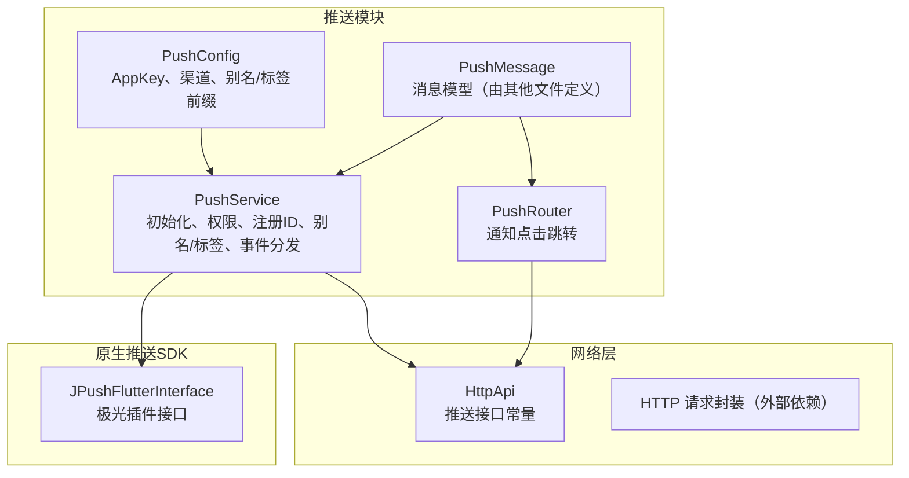
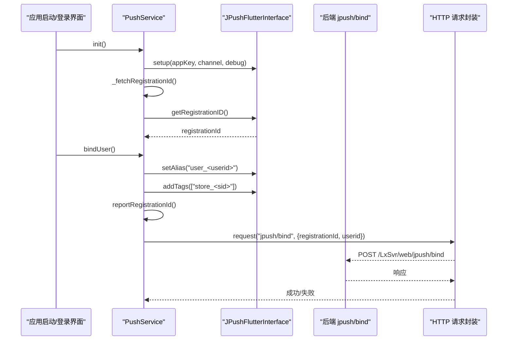
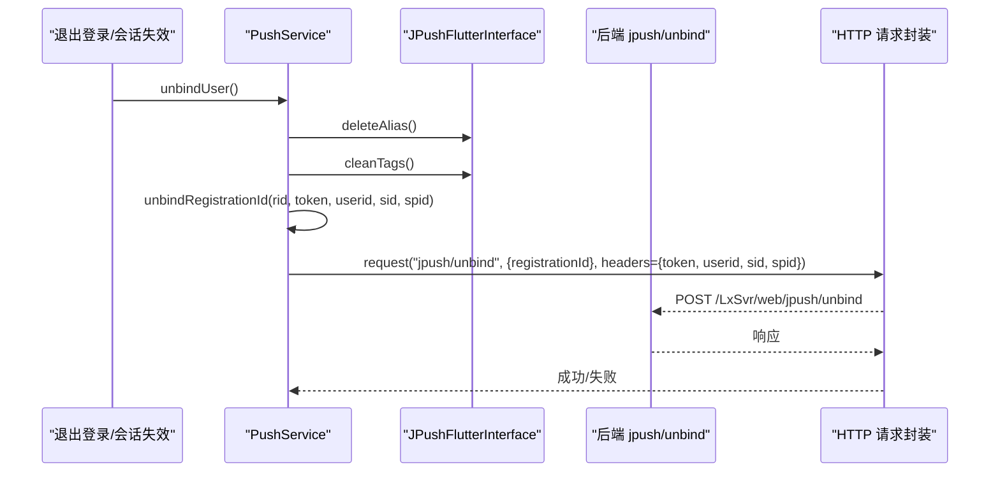
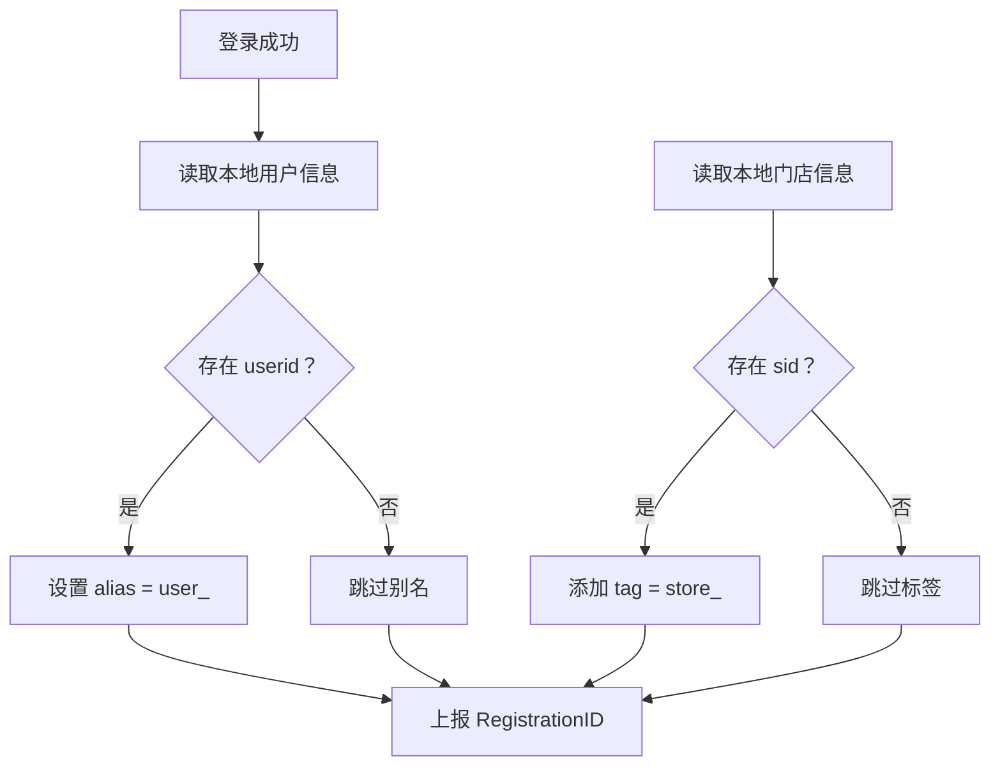
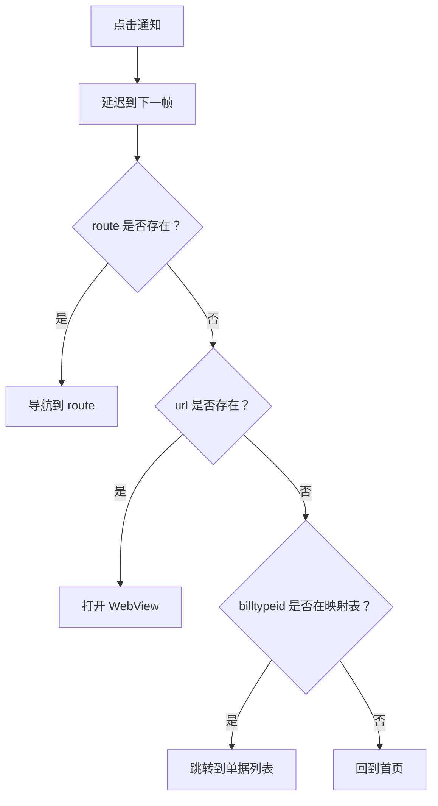
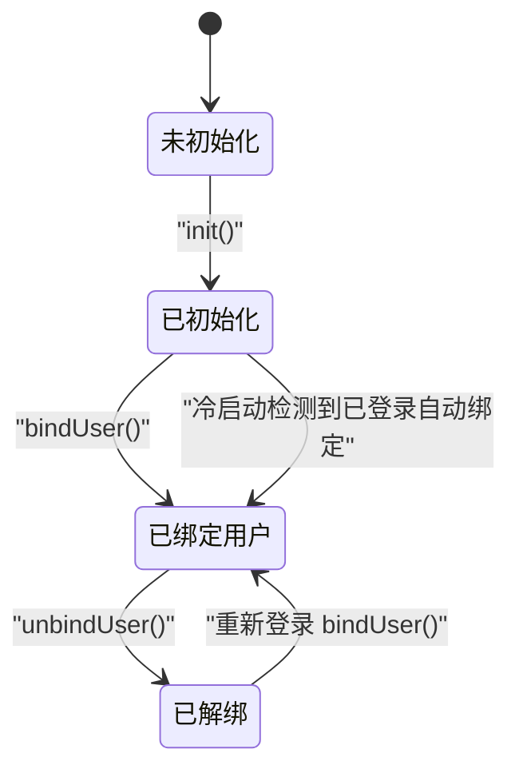

# 推送通知API

<cite>
**本文引用的文件**   
- [lib/push/push_config.dart](file://lib/push/push_config.dart)
- [lib/push/push_service.dart](file://lib/push/push_service.dart)
- [lib/push/push_router.dart](file://lib/push/push_router.dart)
- [lib/net/http_api.dart](file://lib/net/http_api.dart)
- [docs/push_guide.md](file://docs/push_guide.md)
</cite>

## 目录
1. [简介](#简介)
2. [项目结构与推送模块定位](#项目结构与推送模块定位)
3. [推送相关接口定义](#推送相关接口定义)
4. [设备绑定与解绑流程](#设备绑定与解绑流程)
5. [推送消息格式规范](#推送消息格式规范)
6. [目标用户筛选策略](#目标用户筛选策略)
7. [点击跳转与路由处理](#点击跳转与路由处理)
8. [集成示例与调用时机](#集成示例与调用时机)
9. [消息队列、失败重试与日志](#消息队列失败重试与日志)
10. [性能优化与用户体验](#性能优化与用户体验)
11. [问题排查指南](#问题排查指南)
12. [结论](#结论)

## 简介
本文件为灵犀管店 Flutter 项目的推送通知 API 文档，聚焦极光推送在客户端的接入方式、后端约定、设备绑定/解绑接口、消息接收与路由跳转规则。文档同时覆盖推送通道行为、优先级、目标用户筛选、失败重试、日志记录以及常见问题排查方法，帮助业务方正确对接 `jpush/bind` 与 `jpush/unbind` 等推送相关接口。

## 项目结构与推送模块定位
推送能力集中在 `lib/push` 目录下，采用配置、服务、模型与路由分离的结构：

该结构将“配置”“核心服务”“消息模型”“点击路由”“后端接口常量”解耦，便于扩展新的推送类型、路由映射和错误处理逻辑。

**图表来源**
- [lib/push/push_config.dart:1-26](file://lib/push/push_config.dart#L1-L26)
- [lib/push/push_service.dart:1-120](file://lib/push/push_service.dart#L1-L120)
- [lib/push/push_router.dart:1-50](file://lib/push/push_router.dart#L1-L50)
- [lib/net/http_api.dart:1-40](file://lib/net/http_api.dart#L1-L40)

**章节来源**
- [lib/push/push_config.dart:1-26](file://lib/push/push_config.dart#L1-L26)
- [lib/push/push_service.dart:1-120](file://lib/push/push_service.dart#L1-L120)
- [lib/push/push_router.dart:1-50](file://lib/push/push_router.dart#L1-L50)
- [docs/push_guide.md:1-40](file://docs/push_guide.md#L1-L40)

## 推送相关接口定义
当前项目中，推送相关后端接口以常量形式定义在 HTTP API 层；客户端在登录成功时上报 RegistrationID，退出登录时解绑设备标识。

| 接口 | 路径 | 用途 | 调用方 | 请求体关键字段 | 说明 |
|---|---|---|---|---|---|
| 推送设备绑定 | `jpush/bind` | 登录后上报设备 RegistrationID 到业务后台 | `PushService.reportRegistrationId` | `registrationId`、`userid` | 当前实现先检查路径是否为空；为空则跳过上报，但已预留完整入参 |
| 推送设备解绑 | `jpush/unbind` | 退出登录或会话失效时解绑 RegistrationID | `PushService.unbindUser` → `unbindRegistrationId` | `registrationId`；鉴权头包含 `token`、`userid`、`sid`、`spid` | 解绑会先清空本地别名与标签，再调用后端接口 |

### 接口约束与字段语义
- `registrationId`：极光返回的设备唯一标识，用于精准推送和设备追踪。
- `userid`：从本地用户信息中提取的用户编号，用于按用户维度关联推送设备。
- `token`：当前登录态凭证，用于服务端校验解绑操作合法性。
- `sid`：门店/商户编号，用于按门店维度管理设备和推送范围。
- `spid`：供应链/机构相关标识，用于更细粒度的业务上下文。

**章节来源**
- [lib/net/http_api.dart:20-35](file://lib/net/http_api.dart#L20-L35)
- [lib/push/push_service.dart:270-310](file://lib/push/push_service.dart#L270-L310)
- [lib/push/push_service.dart:400-450](file://lib/push/push_service.dart#L400-L450)

## 设备绑定与解绑流程
设备绑定与解绑是推送可触达性的关键入口。客户端侧通过 `PushService` 统一管理，避免业务代码直接耦合极光 SDK。

退出解绑流程如下：

**图表来源**
- [lib/push/push_service.dart:230-310](file://lib/push/push_service.dart#L230-L310)
- [lib/push/push_service.dart:350-450](file://lib/push/push_service.dart#L350-L450)
- [lib/net/http_api.dart:20-35](file://lib/net/http_api.dart#L20-L35)

**章节来源**
- [lib/push/push_service.dart:230-310](file://lib/push/push_service.dart#L230-L310)
- [lib/push/push_service.dart:350-450](file://lib/push/push_service.dart#L350-L450)

## 推送消息格式规范
推送消息在客户端被统一抽象为 `PushMessage`，并通过 `PushService` 的事件流分发给业务层。极光通知与自定义消息都会经过解析、通道识别、日志记录后进入对应回调。

### 消息分类
- **通知消息**：展示在系统通知栏，点击后触发 `onOpenNotification`，最终走 `PushRouter.handle`。
- **自定义消息**：App 内静默接收，不展示通知栏，通过 `messageStream` 通知业务刷新列表或更新状态。

### 附加字段约定
后端可在通知或自定义消息的 `extras` 中携带以下字段：

| 字段 | 类型 | 是否必填 | 含义 | 使用场景 |
|---|---|---:|---|---|
| `type` | 字符串 | 否 | 消息类型，如 `notice`、`bill`、`stock`、`approval` | 业务侧区分公告、单据、库存、审批等场景 |
| `route` | 字符串 | 否 | 目标页面路由，例如 `/purchase/cgorder/list` | 优先级最高，直接跳转到指定页面 |
| `url` | 字符串 | 否 | 网页地址 | 打开内置 WebView 查看公告或详情 |
| `billtypeid` | 字符串 | 否 | 单据类型编号 | 根据映射表跳转到对应单据列表页 |

点击跳转优先级为：`route` > `url` > `billtypeid` > 首页。

### 下发通道字段
客户端会根据事件中的 `extras.cn.jpush.android.TYPE_PLATFORM` 解析实际下发通道：

| 值 | 通道名称 | 行为特征 |
|---:|---|---|
| 0 | 极光通道 | 长连接实时推送 |
| 1 | 小米通道 | 厂商通道 |
| 2 | 华为通道 | 厂商通道 |
| 3 | 魅族通道 | 厂商通道 |
| 4 | OPPO通道 | 厂商通道 |
| 5 | vivo通道 | 厂商通道 |
| 6 | 华硕通道 | 厂商通道 |
| 7 | 荣耀通道 | 厂商通道 |
| 8 | FCM通道 | Firebase Cloud Messaging |
| iOS | APNs | iOS 系统推送通道 |

**章节来源**
- [lib/push/push_service.dart:1-120](file://lib/push/push_service.dart#L1-L120)
- [lib/push/push_service.dart:120-210](file://lib/push/push_service.dart#L120-L210)
- [docs/push_guide.md:80-120](file://docs/push_guide.md#L80-L120)

## 目标用户筛选策略
项目采用“别名 + 标签”的双维度筛选机制，既支持精准推送，也支持批量推送。

| 维度 | 命名规则 | 典型用法 | 前端绑定逻辑 |
|---|---|---|---|
| 别名 | `user_<userid>` | 给单个用户发推送 | `setAlias` |
| 标签 | `store_<sid>` | 给某门店全部用户发推送 | `addTags` |

**图表来源**
- [lib/push/push_config.dart:15-26](file://lib/push/push_config.dart#L15-L26)
- [lib/push/push_service.dart:350-400](file://lib/push/push_service.dart#L350-L400)

**章节来源**
- [lib/push/push_config.dart:15-26](file://lib/push/push_config.dart#L15-L26)
- [lib/push/push_service.dart:350-400](file://lib/push/push_service.dart#L350-L400)
- [docs/push_guide.md:80-100](file://docs/push_guide.md#L80-L100)

## 点击跳转与路由处理
通知点击后的跳转由 `PushRouter` 集中处理，避免业务代码重复实现路由判断逻辑。

### 跳转优先级
1. 如果 `route` 存在且非空，直接导航到对应路由。
2. 否则如果 `url` 存在且非空，打开内置 WebView。
3. 否则如果 `billtypeid` 存在于预设映射表，跳转到对应单据列表。
4. 否则回到首页。

### 路由映射
`billtypeid` 与路由的映射分为两类：

| 类型 | 映射位置 | 示例 |
|---|---|---|
| 已注册 Fluro 路由 | `billRouteMap` | `0502` → `/purchase/cgorder/list` |
| 未注册路由的页面 | `billPageMap` | `0712` → 直接构造 `EnquiryListPage` |

### 冷启动兼容
冷启动点击通知时，Navigator 可能尚未挂载。`PushRouter` 通过延迟下一帧和最多 10 次重试来缓解该问题。

**图表来源**
- [lib/push/push_router.dart:1-147](file://lib/push/push_router.dart#L1-L147)

**章节来源**
- [lib/push/push_router.dart:1-147](file://lib/push/push_router.dart#L1-L147)

## 集成示例与调用时机
推荐在项目中使用推送服务的标准时机如下：

| 阶段 | 调用 | 目的 |
|---|---|---|
| App 启动 | `PushService.instance.init()` | 初始化极光 SDK、注册事件处理器、获取 RegistrationID |
| 首次进入首页 | `PushService.instance.requestNotificationPermission()` | 申请通知权限 |
| 登录成功 | `PushService.instance.bindUser()` | 绑定别名、标签并上报 RegistrationID |
| 收到自定义消息 | 订阅 `messageStream` | 刷新列表、更新红点、执行静默业务 |
| 收到通知点击 | 订阅 `openStream` 或直接依赖 `PushRouter.handle` | 跳转业务页面 |
| 退出登录 / 会话失效 | `PushService.instance.unbindUser()` | 清空别名、标签并解绑设备 |
| 需要引导开启通知 | `PushService.instance.openNotificationSettings()` | 跳转到系统通知设置页 |

**图表来源**
- [lib/push/push_service.dart:60-120](file://lib/push/push_service.dart#L60-L120)
- [lib/push/push_service.dart:350-450](file://lib/push/push_service.dart#L350-L450)

**章节来源**
- [lib/push/push_service.dart:60-120](file://lib/push/push_service.dart#L60-L120)
- [lib/push/push_service.dart:350-450](file://lib/push/push_service.dart#L350-L450)
- [docs/push_guide.md:40-80](file://docs/push_guide.md#L40-L80)

## 消息队列、失败重试与日志
### 消息队列
项目没有独立的推送消息队列组件。推送消息的处理采用 Stream 广播模式：
- `messageStream`：自定义消息静默接收。
- `openStream`：通知点击事件。
- `_handlePushEvent`：统一解析、日志记录、业务回调。

这意味着推送消息是即时处理的，不适合高吞吐离线堆积场景；若未来需要离线队列，应在服务端保证幂等，并在客户端增加本地待处理任务存储。

### 失败重试
现有重试主要出现在 RegistrationID 获取阶段：
- 初始化时最多重试 5 次，每次间隔 3 秒。
- 通知点击跳转时最多重试 10 次，每次延迟 300 毫秒。
- 上报 RegistrationID 和解绑 RegistrationID 失败时会记录日志，但未实现指数退避重试。

建议后续补充：
- 网络失败时的指数退避重试。
- 失败任务持久化与恢复。
- 上报/解绑接口的重试上限与告警。

### 日志体系
推送日志分为三层：
1. 控制台调试日志：tag 为 `PUSH`，仅 Debug 环境输出。
2. 操作审计日志：通过 `FileLogWriter` 写入本地日志文件，可用于导出排查。
3. 极光 SDK 日志：`debug: !Constant.inProduction`，Debug 包会打印 SDK 内部日志。

每条推送事件都会记录：
- 动作类型：收到通知、点击通知、收到自定义消息、通知未展示。
- 下发通道：极光、厂商通道或 APNs。
- 消息摘要：标题、内容、消息 ID。
- 异常堆栈：解析失败或回调异常时记录。

**章节来源**
- [lib/push/push_service.dart:100-210](file://lib/push/push_service.dart#L100-L210)
- [lib/push/push_service.dart:230-270](file://lib/push/push_service.dart#L230-L270)
- [lib/push/push_service.dart:450-486](file://lib/push/push_service.dart#L450-L486)
- [docs/push_guide.md:100-138](file://docs/push_guide.md#L100-L138)

## 性能优化与用户体验
### 推送通道选择
- 前台或应用存活时优先走极光长连接通道，延迟低且不限量。
- 应用被杀或离线时走厂商通道，受厂商每日限额限制。
- iOS 统一走 APNs。

因此，服务端应优先使用实时性强的场景走极光通道，对离线可达性要求高的场景配合厂商通道配置。

### 权限与提示
- Android 13+ 需要通知权限，建议在合适时机申请，避免一启动就打扰用户。
- 用户拒绝权限后提供跳转系统设置的入口，提升召回率。
- 通知未展示时应记录原因，便于区分“权限关闭”“系统拦截”“通道不可用”。

### 路由性能
- 跳转优先使用已注册的 Fluro 路由，减少动态页面构造开销。
- 冷启动点击通知时延迟渲染，避免 Navigator 未就绪导致白屏。
- 对 WebView 跳转做 URL 校验和加载失败兜底。

### 资源与内存
- 避免在推送回调中执行重型同步计算。
- 自定义消息适合轻量刷新，复杂数据拉取应异步进行。
- 清理不再使用的 Stream 监听器，防止内存泄漏。

[本节为通用优化建议，不直接分析具体源码文件]

## 问题排查指南
### 常见问题
| 现象 | 可能原因 | 排查步骤 |
|---|---|---|
| 收不到推送 | AppKey 不一致、包名不一致、通知权限未开、极光后台未真正发送 | 核对 `appKey`、Android 包名、通知权限、极光推送记录 |
| 应用被杀后收不到 | 未配置厂商通道或配置错误 | 检查极光后台厂商通道配置 |
| 点击通知白屏 | 深链接或 Navigator 未就绪 | 确认已关闭 Flutter 深链接，检查 `MainActivity` 配置 |
| Release 包收不到 | 混淆规则缺失 | 检查 `proguard-rules.pro` 中极光 keep 规则 |
| 只收到通知但无自定义消息 | 自定义消息未订阅或解析失败 | 检查 `messageStream` 订阅逻辑与日志 |
| 跳转失败 | 路由不存在、Context 未就绪 | 检查 `billRouteMap`、`billPageMap` 和冷启动重试 |

### 必备排查信息
排查推送问题时，建议收集以下信息：
- RegistrationID
- 消息 ID
- AppKey
- 设备型号与系统版本
- SDK 日志与本地操作日志
- 下发通道（极光或厂商通道）

**章节来源**
- [docs/push_guide.md:100-138](file://docs/push_guide.md#L100-L138)
- [lib/push/push_service.dart:120-210](file://lib/push/push_service.dart#L120-L210)
- [lib/push/push_service.dart:230-270](file://lib/push/push_service.dart#L230-L270)

## 结论
灵犀管店的推送方案以 `PushConfig` 为配置中心、`PushService` 为核心控制器、`PushRouter` 为点击路由处理器，配合 `HttpApi` 中的 `jpush/bind` 与 `jpush/unbind` 接口完成设备绑定与解绑。其设计强调：
- 明确的后端字段约定；
- 清晰的别名与标签筛选策略；
- 统一的日志与通道识别；
- 冷启动与权限场景的兼容处理。

对于后续演进，建议在后端完善 `jpush/bind` 的实际返回契约，在客户端补充失败重试与离线任务机制，并持续优化通知体验与跳转可靠性。