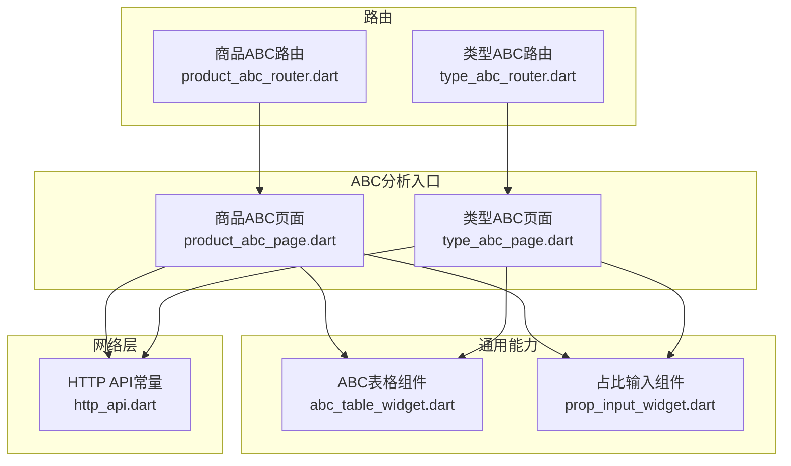
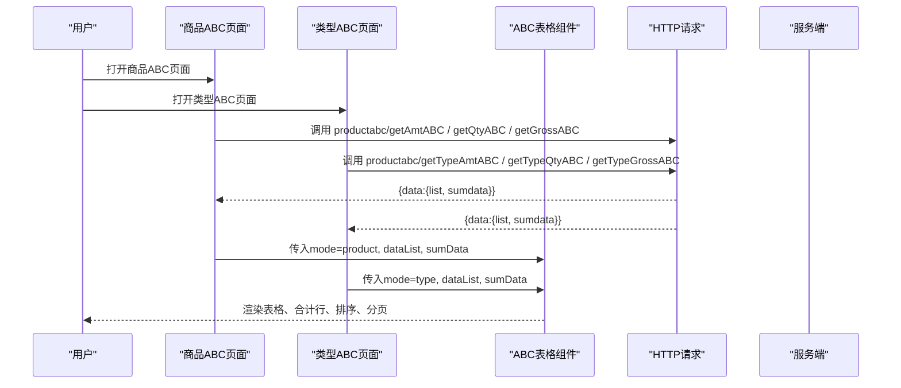
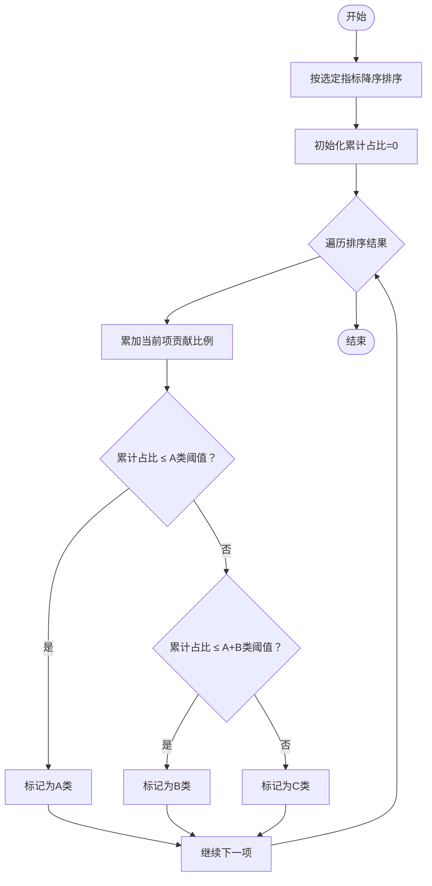
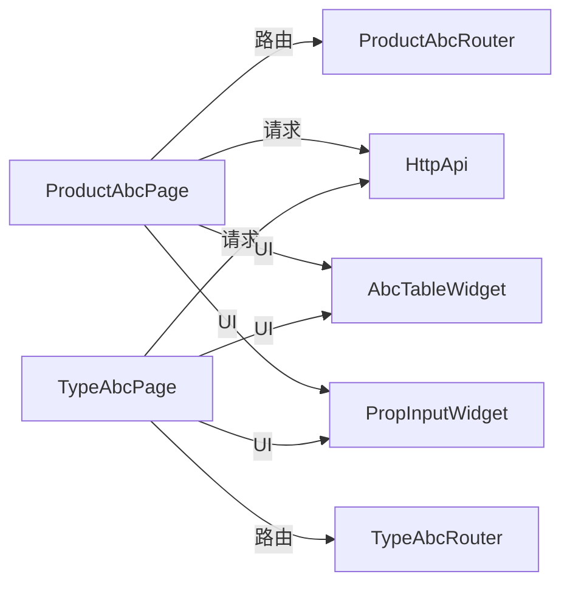

# ABC分析API

<cite>
**本文引用的文件**   
- [lib/pages/data/businessReport/productABC/product_abc_page.dart](file://lib/pages/data/businessReport/productABC/product_abc_page.dart)
- [lib/pages/data/businessReport/productABC/product_abc_router.dart](file://lib/pages/data/businessReport/productABC/product_abc_router.dart)
- [lib/pages/data/businessReport/typeABC/type_abc_page.dart](file://lib/pages/data/businessReport/typeABC/type_abc_page.dart)
- [lib/pages/data/businessReport/typeABC/type_abc_router.dart](file://lib/pages/data/businessReport/typeABC/type_abc_router.dart)
- [lib/pages/data/businessReport/abcAnalysis/abc_table_widget.dart](file://lib/pages/data/businessReport/abcAnalysis/abc_table_widget.dart)
- [lib/pages/data/businessReport/abcAnalysis/prop_input_widget.dart](file://lib/pages/data/businessReport/abcAnalysis/prop_input_widget.dart)
- [lib/net/http_api.dart](file://lib/net/http_api.dart)
</cite>

## 目录
1. [引言](#引言)
2. [项目结构](#项目结构)
3. [核心组件](#核心组件)
4. [架构总览](#架构总览)
5. [详细组件分析](#详细组件分析)
6. [接口与数据模型](#接口与数据模型)
7. [ABC分类算法与阈值配置](#abc分类算法与阈值配置)
8. [排序、筛选与多指标对比](#排序筛选与多指标对比)
9. [报表展示与导出规范](#报表展示与导出规范)
10. [依赖关系分析](#依赖关系分析)
11. [性能与扩展建议](#性能与扩展建议)
12. [故障排查指南](#故障排查指南)
13. [结论](#结论)

## 引言
本文档面向灵犀管店 Flutter 项目中的“商品ABC分析”和“类型ABC分析”功能，系统性梳理其前端页面、通用表格组件、分类占比输入组件以及后端接口契约。文档重点覆盖：
- 商品贡献度分析与品类贡献度分析
- 销售金额、销售数量、毛利额三类ABC分析
- 累计贡献度、销售占比等核心指标
- ABC分类阈值配置（A类高价值、B类中等价值、C类低价值）
- 多维度筛选、排序规则与多指标Tab对比
- 报表数据结构、图表展示要求和导出格式规范
- 自定义分类规则与批量分析实现指导

## 项目结构
ABC分析相关代码集中在业务报表目录下，按维度拆分为商品ABC与类型ABC两个入口页面，并通过一个通用的ABC表格组件复用展示逻辑；分类占比输入通过独立组件提供可编辑的百分比配置。

**图示来源**
- [lib/pages/data/businessReport/productABC/product_abc_page.dart:1-60](file://lib/pages/data/businessReport/productABC/product_abc_page.dart#L1-L60)
- [lib/pages/data/businessReport/typeABC/type_abc_page.dart:1-60](file://lib/pages/data/businessReport/typeABC/type_abc_page.dart#L1-L60)
- [lib/pages/data/businessReport/abcAnalysis/abc_table_widget.dart:1-60](file://lib/pages/data/businessReport/abcAnalysis/abc_table_widget.dart#L1-L60)
- [lib/pages/data/businessReport/abcAnalysis/prop_input_widget.dart:1-40](file://lib/pages/data/businessReport/abcAnalysis/prop_input_widget.dart#L1-L40)
- [lib/pages/data/businessReport/productABC/product_abc_router.dart:1-12](file://lib/pages/data/businessReport/productABC/product_abc_router.dart#L1-L12)
- [lib/pages/data/businessReport/typeABC/type_abc_router.dart:1-12](file://lib/pages/data/businessReport/typeABC/type_abc_router.dart#L1-L12)
- [lib/net/http_api.dart:323-330](file://lib/net/http_api.dart#L323-L330)

**章节来源**
- [lib/pages/data/businessReport/productABC/product_abc_page.dart:1-60](file://lib/pages/data/businessReport/productABC/product_abc_page.dart#L1-L60)
- [lib/pages/data/businessReport/typeABC/type_abc_page.dart:1-60](file://lib/pages/data/businessReport/typeABC/type_abc_page.dart#L1-L60)
- [lib/pages/data/businessReport/abcAnalysis/abc_table_widget.dart:1-60](file://lib/pages/data/businessReport/abcAnalysis/abc_table_widget.dart#L1-L60)
- [lib/pages/data/businessReport/abcAnalysis/prop_input_widget.dart:1-40](file://lib/pages/data/businessReport/abcAnalysis/prop_input_widget.dart#L1-L40)
- [lib/pages/data/businessReport/productABC/product_abc_router.dart:1-12](file://lib/pages/data/businessReport/productABC/product_abc_router.dart#L1-L12)
- [lib/pages/data/businessReport/typeABC/type_abc_router.dart:1-12](file://lib/pages/data/businessReport/typeABC/type_abc_router.dart#L1-L12)
- [lib/net/http_api.dart:323-330](file://lib/net/http_api.dart#L323-L330)

## 核心组件
- 商品ABC分析页面：负责门店、分类、供应商、时间范围、品牌、商品状态等筛选条件，维护ABC占比配置（aprop/bprop/cprop），并在三个Tab（销售金额ABC、销售数量ABC、毛利ABC）之间切换，调用不同后端接口。
- 类型ABC分析页面：在商品ABC基础上增加“分类级别”选择（一级至四级分类），其余筛选与交互模式基本一致。
- ABC表格组件：统一渲染行列、排序、分页、滚动同步、合计行、空态与加载态。字段包括序号、名称/条码或类别名称、销售数量、销售成本、销售金额、毛利额、毛利率、销售金额占比、累计占比、ABC类型，以及商品维度的单位与规格列。
- 占比输入组件：提供A/B/C三类占比的可编辑输入框，实时校验并通知父组件更新。

**章节来源**
- [lib/pages/data/businessReport/productABC/product_abc_page.dart:40-220](file://lib/pages/data/businessReport/productABC/product_abc_page.dart#L40-L220)
- [lib/pages/data/businessReport/typeABC/type_abc_page.dart:40-320](file://lib/pages/data/businessReport/typeABC/type_abc_page.dart#L40-L320)
- [lib/pages/data/businessReport/abcAnalysis/abc_table_widget.dart:1-200](file://lib/pages/data/businessReport/abcAnalysis/abc_table_widget.dart#L1-L200)
- [lib/pages/data/businessReport/abcAnalysis/prop_input_widget.dart:1-95](file://lib/pages/data/businessReport/abcAnalysis/prop_input_widget.dart#L1-L95)

## 架构总览
ABC分析采用“页面+通用表格+占比输入”的分层结构。页面负责业务参数装配与请求调度，表格组件负责展示与交互，占比输入组件负责阈值配置。所有ABC接口均通过统一的HTTP常量定义，便于维护与扩展。

**图示来源**
- [lib/pages/data/businessReport/productABC/product_abc_page.dart:180-240](file://lib/pages/data/businessReport/productABC/product_abc_page.dart#L180-L240)
- [lib/pages/data/businessReport/typeABC/type_abc_page.dart:260-340](file://lib/pages/data/businessReport/typeABC/type_abc_page.dart#L260-L340)
- [lib/pages/data/businessReport/abcAnalysis/abc_table_widget.dart:200-350](file://lib/pages/data/businessReport/abcAnalysis/abc_table_widget.dart#L200-L350)
- [lib/net/http_api.dart:323-330](file://lib/net/http_api.dart#L323-L330)

## 详细组件分析

### 商品ABC分析页面
职责：
- 管理门店、分类、供应商、品牌、商品状态、时间范围等筛选参数。
- 维护ABC占比默认值（A类70%、B类20%、C类10%），并进行总和等于100%的前端校验。
- 维护三Tab对应的默认排序字段：销售金额→rramt、销售数量→qty、毛利→grossamt，默认降序。
- 组装请求参数，包含分页、筛选条件与排序信息，并解析返回的列表与汇总数据。

关键行为：
- 切换Tab时重置排序为对应默认字段并重新加载数据。
- 加载失败时置hasMore=false以避免继续加载更多。
- 下拉刷新与上拉加载更多分别控制page自增与数据拼接。

**章节来源**
- [lib/pages/data/businessReport/productABC/product_abc_page.dart:40-240](file://lib/pages/data/businessReport/productABC/product_abc_page.dart#L40-L240)

### 类型ABC分析页面
职责：
- 在商品ABC的基础上增加“分类级别”选择（一级至四级分类）。
- 其他筛选、排序、分页与交互与商品ABC保持一致。
- 同样对A/B/C占比进行总和等于100%的前端校验。

关键差异：
- 额外将level参数加入请求体，以支持按分类层级聚合。
- Tab排序字段与商品ABC一致，保持三指标对比的一致性。

**章节来源**
- [lib/pages/data/businessReport/typeABC/type_abc_page.dart:40-340](file://lib/pages/data/businessReport/typeABC/type_abc_page.dart#L40-L340)

### ABC表格组件
职责：
- 根据mode区分商品与类型两种展示场景。
- 固定左侧两列（序号、名称/条码或类别名称），右侧为数值与文本列。
- 提供数值格式化（金额两位小数、数量一位小数、百分比带%）、单元格右对齐。
- 支持列头点击排序（asc/desc切换），当前活跃列显示箭头图标。
- 支持横向滚动同步到合计行，避免DataTable2嵌套导致的控制器失效问题。
- 合计行从sumData读取各列合计值，无值则显示占位符。
- 空态与加载态分离：首次加载使用居中卡片提示；已加载过再刷新也保留空态体验。

数据映射：
- 商品维度字段：name、barcode、unit、size、qty、costamt、rramt、grossamt、grossrate、prop、sumprop、abc。
- 类型维度字段：typename、qty、costamt、rramt、grossamt、grossrate、prop、sumprop、abc。

**章节来源**
- [lib/pages/data/businessReport/abcAnalysis/abc_table_widget.dart:1-475](file://lib/pages/data/businessReport/abcAnalysis/abc_table_widget.dart#L1-L475)

### 占比输入组件
职责：
- 管理单个百分比输入的本地TextEditingController，避免外部重建导致失焦。
- 仅在非手动编辑状态下同步外部值变化。
- 实时将字符串转为整数，并回调给父组件更新ABC占比。

使用场景：
- 商品ABC与类型ABC页面均使用该组件编辑aprop/bprop/cprop三个值。

**章节来源**
- [lib/pages/data/businessReport/abcAnalysis/prop_input_widget.dart:1-95](file://lib/pages/data/businessReport/abcAnalysis/prop_input_widget.dart#L1-L95)

## 接口与数据模型

### 后端接口清单
| 接口标识 | 路径 | 用途 | 说明 |
|---|---|---|---|
| 商品-销售金额ABC | `productabc/getAmtABC` | 获取商品ABC（销售金额维度） | 返回list与sumdata |
| 商品-销售数量ABC | `productabc/getQtyABC` | 获取商品ABC（销售数量维度） | 返回list与sumdata |
| 商品-毛利ABC | `productabc/getGrossABC` | 获取商品ABC（毛利额维度） | 返回list与sumdata |
| 类别-销售金额ABC | `productabc/getTypeAmtABC` | 获取品类ABC（销售金额维度） | 返回list与sumdata |
| 类别-销售数量ABC | `productabc/getTypeQtyABC` | 获取品类ABC（销售数量维度） | 返回list与sumdata |
| 类别-毛利ABC | `productabc/getTypeGrossABC` | 获取品类ABC（毛利额维度） | 返回list与sumdata |

以上接口由HTTP常量集中定义，页面通过request方法调用。

**章节来源**
- [lib/net/http_api.dart:323-330](file://lib/net/http_api.dart#L323-L330)

### 请求参数模型
| 参数名 | 类型 | 必填 | 说明 |
|---|---|---|---|
| is_page | int | 是 | 是否分页，固定为1 |
| page | int | 是 | 页码，从1开始 |
| pagesize | int | 是 | 每页条数，固定为20 |
| starttime | string | 是 | 起始时间，格式yyyy-MM-dd HH:mm:ss |
| endtime | string | 是 | 结束时间，格式yyyy-MM-dd HH:mm:ss |
| sids | list<int> | 是 | 门店ID列表 |
| typeid | list<string> | 否 | 分类ID列表，为空表示全部分类 |
| supid | string | 否 | 供应商ID |
| brandname | string | 否 | 品牌名称，多个用逗号分隔 |
| itemstatusin | list<string> | 否 | 商品状态列表，多个用逗号分隔 |
| aprop | int | 是 | A类占比阈值（%） |
| bprop | int | 是 | B类占比阈值（%） |
| cprop | int | 是 | C类占比阈值（%） |
| field | string | 是 | 排序字段，常见值为rramt、qty、grossamt |
| type | string | 是 | 排序方向，asc或desc |
| level | string | 类型ABC专用 | 分类级别，1~4或空表示全部级别 |

注意：
- 前端会在发起请求前校验aprop + bprop + cprop = 100，不满足则阻止请求并提示。
- 字段brandname在前端会将“|”替换为“,”后传给后端。

**章节来源**
- [lib/pages/data/businessReport/productABC/product_abc_page.dart:180-205](file://lib/pages/data/businessReport/productABC/product_abc_page.dart#L180-L205)
- [lib/pages/data/businessReport/typeABC/type_abc_page.dart:260-285](file://lib/pages/data/businessReport/typeABC/type_abc_page.dart#L260-L285)

### 响应数据模型
| 字段 | 类型 | 说明 |
|---|---|---|
| data.list | list<Map> | 明细列表 |
| data.sumdata | Map | 汇总数据，含各列合计值 |
| list[].name | string | 商品名称（商品维度） |
| list[].barcode | string | 商品条码（商品维度） |
| list[].typename | string | 类别名称（类型维度） |
| list[].unit | string | 单位（商品维度） |
| list[].size | string | 规格（商品维度） |
| list[].qty | number | 销售数量 |
| list[].costamt | number | 销售成本 |
| list[].rramt | number | 销售金额 |
| list[].grossamt | number | 毛利额 |
| list[].grossrate | number | 毛利率（百分比数值） |
| list[].prop | number | 销售金额占比（百分比数值） |
| list[].sumprop | number | 累计占比（百分比数值） |
| list[].abc | string | ABC类型，如“A”、“B”、“C” |
| sumdata.qty | number | 销售数量合计 |
| sumdata.costamt | number | 销售成本合计 |
| sumdata.rramt | number | 销售金额合计 |
| sumdata.grossamt | number | 毛利额合计 |
| sumdata.grossrate | number | 毛利率合计 |
| sumdata.prop | number | 销售金额占比合计 |
| sumdata.sumprop | number | 累计占比合计 |

**章节来源**
- [lib/pages/data/businessReport/productABC/product_abc_page.dart:220-260](file://lib/pages/data/businessReport/productABC/product_abc_page.dart#L220-L260)
- [lib/pages/data/businessReport/typeABC/type_abc_page.dart:300-340](file://lib/pages/data/businessReport/typeABC/type_abc_page.dart#L300-L340)
- [lib/pages/data/businessReport/abcAnalysis/abc_table_widget.dart:300-475](file://lib/pages/data/businessReport/abcAnalysis/abc_table_widget.dart#L300-L475)

## ABC分类算法与阈值配置
### 分类标准
- A类：高价值商品或品类，通常贡献主要销售额或毛利，是经营管理的重点对象。
- B类：中等价值商品或品类，具有稳定贡献，需持续优化库存与周转。
- C类：低价值商品或品类，数量可能较多但贡献较低，适合精简或淘汰策略。

### 累计贡献度计算规则
- 先按指定指标（销售金额、销售数量或毛利额）对条目进行降序排序。
- 依次累加每个条目的贡献比例，得到累计占比（sumprop）。
- 当累计占比达到aprop阈值时，标记为A类；超过aprop但未达aprop+bprop阈值的标记为B类；其余标记为C类。
- 前端要求aprop + bprop + cprop = 100%，否则拒绝请求。

**图示来源**
- [lib/pages/data/businessReport/productABC/product_abc_page.dart:40-60](file://lib/pages/data/businessReport/productABC/product_abc_page.dart#L40-L60)
- [lib/pages/data/businessReport/typeABC/type_abc_page.dart:40-60](file://lib/pages/data/businessReport/typeABC/type_abc_page.dart#L40-L60)
- [lib/pages/data/businessReport/abcAnalysis/abc_table_widget.dart:300-400](file://lib/pages/data/businessReport/abcAnalysis/abc_table_widget.dart#L300-L400)

### 默认阈值与自定义规则
- 默认阈值：A类70%、B类20%、C类10%。
- 可通过占比输入组件自定义阈值，前端会进行总和校验。
- 建议：
  - 对销售金额ABC常用70/20/10作为起点，结合企业实际调整。
  - 对毛利ABC可根据产品组合特性提高A类阈值，突出高毛利商品。
  - 对销售数量ABC可适当降低A类阈值，关注高频动销品。

**章节来源**
- [lib/pages/data/businessReport/productABC/product_abc_page.dart:40-60](file://lib/pages/data/businessReport/productABC/product_abc_page.dart#L40-L60)
- [lib/pages/data/businessReport/typeABC/type_abc_page.dart:40-60](file://lib/pages/data/businessReport/typeABC/type_abc_page.dart#L40-L60)
- [lib/pages/data/businessReport/abcAnalysis/prop_input_widget.dart:1-95](file://lib/pages/data/businessReport/abcAnalysis/prop_input_widget.dart#L1-L95)

## 排序、筛选与多指标对比
### 排序规则
- 默认排序：销售金额ABC→rramt降序；销售数量ABC→qty降序；毛利ABC→grossamt降序。
- 用户可在任意列点击表头切换升序/降序，field与type随用户操作变化并重新请求。
- 表格组件会对当前激活列显示排序图标，提升可读性。

### 筛选维度
- 商品ABC：门店、分类、供应商、品牌、商品状态、时间范围。
- 类型ABC：门店、分类、分类级别、品牌、商品状态、时间范围。
- 品牌名称与商品状态支持多选并以逗号分隔传输。
- 分类级别用于类型ABC中按层级聚合，支持一级至四级分类。

### 多指标对比
- 三个Tab分别对应销售金额ABC、销售数量ABC、毛利ABC，便于横向对比不同指标下的ABC分布。
- 切换Tab会重置排序为对应默认字段，确保一致的对比体验。

**章节来源**
- [lib/pages/data/businessReport/productABC/product_abc_page.dart:200-240](file://lib/pages/data/businessReport/productABC/product_abc_page.dart#L200-L240)
- [lib/pages/data/businessReport/typeABC/type_abc_page.dart:285-340](file://lib/pages/data/businessReport/typeABC/type_abc_page.dart#L285-L340)
- [lib/pages/data/businessReport/abcAnalysis/abc_table_widget.dart:120-200](file://lib/pages/data/businessReport/abcAnalysis/abc_table_widget.dart#L120-L200)

## 报表展示与导出规范
### 表格展示要求
- 冻结左侧两列（序号、名称/条码或类别名称），右侧数据列支持横向滚动。
- 数值列右对齐，金额两位小数、数量一位小数、百分比带%。
- 合计行位于表格底部，背景色与边框区分明显，横向滚动与主表同步。
- 空态显示“暂无数据”，加载态使用居中卡片提示而非全屏遮罩，避免页面泛白。
- 商品维度额外显示单位与规格列。

### 图表展示建议
虽然当前实现以表格为主，但可基于以下数据字段构建图表：
- 饼图：A/B/C三类占比（sumprop或prop聚合）。
- 柱状图：Top N商品的rramt或grossamt。
- 折线图：累计占比曲线，辅助判断A/B类边界。

### 导出格式规范
- 建议导出CSV，包含字段：序号、名称/条码、单位、规格、销售数量、销售成本、销售金额、毛利额、毛利率、销售金额占比、累计占比、ABC类型。
- 金额与数量保留与界面一致的精度。
- 若需要Excel，应包含合计行与分类统计摘要。

**章节来源**
- [lib/pages/data/businessReport/abcAnalysis/abc_table_widget.dart:1-475](file://lib/pages/data/businessReport/abcAnalysis/abc_table_widget.dart#L1-L475)

## 依赖关系分析
ABC分析模块依赖：
- Fluro路由：商品ABC与类型ABC分别注册路由根路径。
- HTTP封装：通过http_api.dart定义的接口常量发起请求。
- 选择器组件：门店、供应商、分类选择器用于装配筛选参数。
- 日期选择器：快速时间选择与自定义日期范围。
- sp_util：读取当前门店信息。

**图示来源**
- [lib/pages/data/businessReport/productABC/product_abc_router.dart:1-12](file://lib/pages/data/businessReport/productABC/product_abc_router.dart#L1-L12)
- [lib/pages/data/businessReport/typeABC/type_abc_router.dart:1-12](file://lib/pages/data/businessReport/typeABC/type_abc_router.dart#L1-L12)
- [lib/pages/data/businessReport/productABC/product_abc_page.dart:1-60](file://lib/pages/data/businessReport/productABC/product_abc_page.dart#L1-L60)
- [lib/pages/data/businessReport/typeABC/type_abc_page.dart:1-60](file://lib/pages/data/businessReport/typeABC/type_abc_page.dart#L1-L60)
- [lib/net/http_api.dart:323-330](file://lib/net/http_api.dart#L323-L330)

**章节来源**
- [lib/pages/data/businessReport/productABC/product_abc_router.dart:1-12](file://lib/pages/data/businessReport/productABC/product_abc_router.dart#L1-L12)
- [lib/pages/data/businessReport/typeABC/type_abc_router.dart:1-12](file://lib/pages/data/businessReport/typeABC/type_abc_router.dart#L1-L12)
- [lib/pages/data/businessReport/productABC/product_abc_page.dart:1-60](file://lib/pages/data/businessReport/productABC/product_abc_page.dart#L1-L60)
- [lib/pages/data/businessReport/typeABC/type_abc_page.dart:1-60](file://lib/pages/data/businessReport/typeABC/type_abc_page.dart#L1-L60)
- [lib/net/http_api.dart:323-330](file://lib/net/http_api.dart#L323-L330)

## 性能与扩展建议
- 分页与懒加载：当前pagesize固定为20，建议在大数据量场景下允许动态调整并缓存历史页数据。
- 排序策略：若后端支持服务端排序，可减少前端排序开销；否则在客户端排序时应限制参与排序的数据集大小。
- 图表渲染：如需引入图表，建议按需加载图表库，并对大数据量进行抽样或聚合后再渲染。
- 阈值配置持久化：可将用户自定义的aprop/bprop/cprop保存到本地存储，提升下次打开效率。
- 导出性能：大批量导出应在后台线程或Worker中进行，避免阻塞UI。

[本节为通用建议，无需具体文件引用]

## 故障排查指南
常见问题与处理：
- ABC占比之和不为100%：前端会阻止请求并提示错误。请检查占比输入组件是否正确联动。
- 数据为空：确认筛选条件是否过严；检查后端返回的list是否为空；核对时间段与门店选择。
- 排序异常：确认field与type是否被正确传递；检查表格组件对当前激活列的排序图标逻辑。
- 横向滚动错位：确保表格组件内部ScrollController与合计行同步逻辑未被外部干扰。
- 加载更多无效：检查hasMore与list长度判断逻辑；确认后端返回数据长度是否小于pagesize。

**章节来源**
- [lib/pages/data/businessReport/productABC/product_abc_page.dart:210-260](file://lib/pages/data/businessReport/productABC/product_abc_page.dart#L210-L260)
- [lib/pages/data/businessReport/typeABC/type_abc_page.dart:300-340](file://lib/pages/data/businessReport/typeABC/type_abc_page.dart#L300-L340)
- [lib/pages/data/businessReport/abcAnalysis/abc_table_widget.dart:200-475](file://lib/pages/data/businessReport/abcAnalysis/abc_table_widget.dart#L200-L475)

## 结论
灵犀管店的ABC分析模块通过清晰的前端分层与通用组件复用，实现了商品与品类两个维度的ABC分类分析，并提供了灵活的阈值配置与多指标对比能力。接口设计简洁明确，数据模型完整覆盖贡献度与占比指标。建议在后续版本中增强图表可视化、导出能力与阈值配置的本地持久化，以提升用户体验与分析深度。