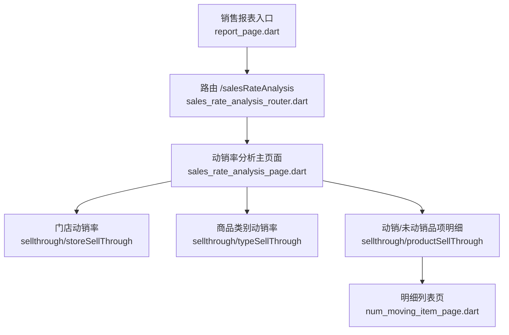
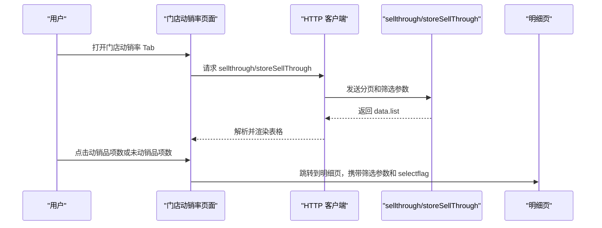
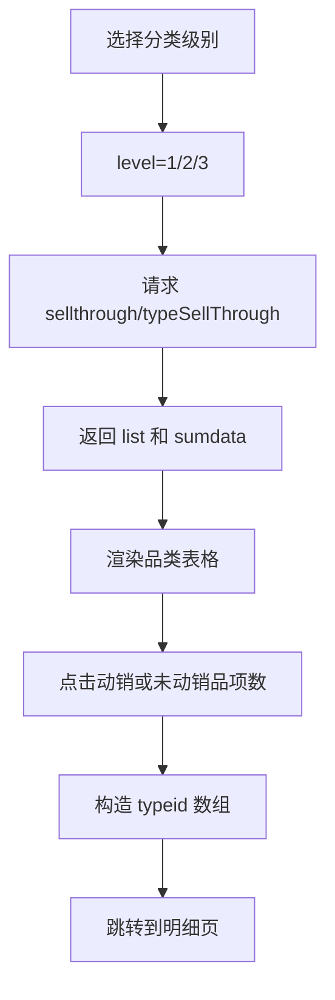
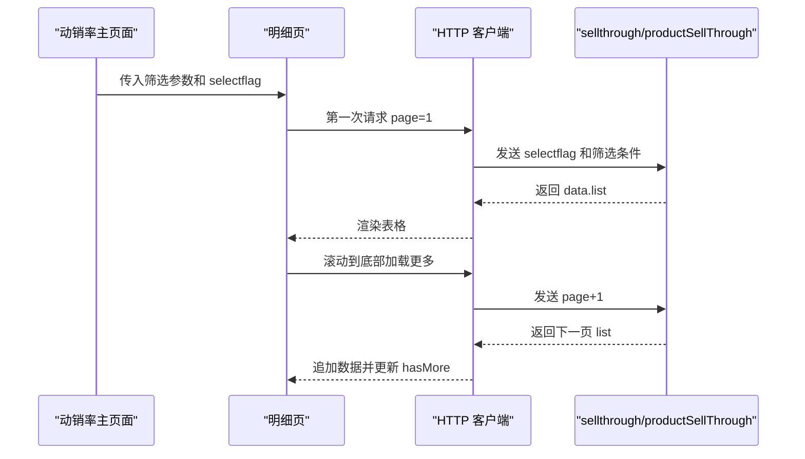
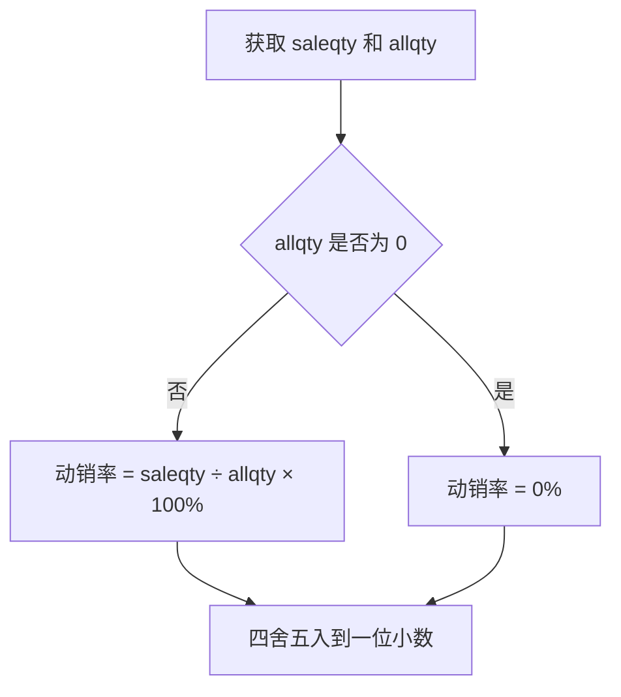
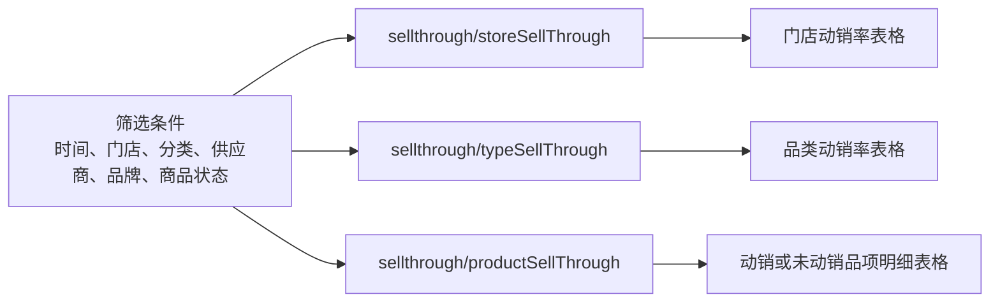

# 动销率分析API

<cite>
**本文引用的文件**   
- [http_api.dart](file://lib/net/http_api.dart)
- [sales_rate_analysis_page.dart](file://lib/pages/data/businessReport/salesRateAnalysis/sales_rate_analysis_page.dart)
- [num_moving_item_page.dart](file://lib/pages/data/businessReport/salesRateAnalysis/num_moving_item_page.dart)
- [sales_rate_analysis_router.dart](file://lib/pages/data/businessReport/salesRateAnalysis/sales_rate_analysis_router.dart)
</cite>

## 目录
1. [简介](#简介)
2. [项目结构与入口](#项目结构与入口)
3. [接口总览](#接口总览)
4. [公共参数与时间窗口](#公共参数与时间窗口)
5. [门店动销率接口规范](#门店动销率接口规范)
6. [商品类别动销率接口规范](#商品类别动销率接口规范)
7. [动销与未动销品项明细接口规范](#动销与未动销品项明细接口规范)
8. [计算公式与状态判断](#计算公式与状态判断)
9. [多层级数据结构](#多层级数据结构)
10. [可视化与大屏适配](#可视化与大屏适配)
11. [性能优化建议](#性能优化建议)
12. [常见问题排查](#常见问题排查)
13. [结论](#结论)

## 简介
本文件面向灵犀管店 Flutter 端的“动销率分析”功能，围绕以下三个后端接口进行完整说明：
- `sellthrough/storeSellThrough`：门店动销率。
- `sellthrough/typeSellThrough`：商品类别动销率。
- `sellthrough/productSellThrough`：动销/未动销品项明细。

文档重点包括：接口路径、请求参数、响应字段、动销率计算逻辑、商品活跃状态判断方式、时间窗口配置、统计粒度、多层级数据模型、前端展示要求、性能优化和大屏适配建议。

## 项目结构与入口
动销率分析功能位于业务报表模块中，主要涉及以下文件：
- 路由注册：`sales_rate_analysis_router.dart`，提供 `/salesRateAnalysis` 路由。
- 主分析页：`sales_rate_analysis_page.dart`，承载筛选条件、两个 Tab（门店动销率、商品类别动销率）以及跳转明细。
- 明细页：`num_moving_item_page.dart`，承接动销或未动销品项列表分页加载。
- API 常量：`http_api.dart`，集中定义动销率相关接口路径。

**图示来源**
- [sales_rate_analysis_router.dart:1-12](file://lib/pages/data/businessReport/salesRateAnalysis/sales_rate_analysis_router.dart#L1-L12)
- [sales_rate_analysis_page.dart:1-60](file://lib/pages/data/businessReport/salesRateAnalysis/sales_rate_analysis_page.dart#L1-L60)
- [num_moving_item_page.dart:1-40](file://lib/pages/data/businessReport/salesRateAnalysis/num_moving_item_page.dart#L1-L40)

**章节来源**
- [sales_rate_analysis_router.dart:1-12](file://lib/pages/data/businessReport/salesRateAnalysis/sales_rate_analysis_router.dart#L1-L12)
- [sales_rate_analysis_page.dart:1-60](file://lib/pages/data/businessReport/salesRateAnalysis/sales_rate_analysis_page.dart#L1-L60)
- [num_moving_item_page.dart:1-40](file://lib/pages/data/businessReport/salesRateAnalysis/num_moving_item_page.dart#L1-L40)

## 接口总览
| 接口别名 | 接口路径 | 用途 | 调用方 |
|---|---|---|---|
| `sellthroughStoreSellThrough` | `sellthrough/storeSellThrough` | 查询门店维度的动销率及明细 | 门店动销率 Tab |
| `sellthroughTypeSellThrough` | `sellthrough/typeSellThrough` | 查询商品类别维度的动销率及汇总 | 商品类别动销率 Tab |
| `sellthroughProductSellThrough` | `sellthrough/productSellThrough` | 查询动销或未动销的品项明细列表 | 明细页 |

**章节来源**
- [http_api.dart:296-300](file://lib/net/http_api.dart#L296-L300)
- [sales_rate_analysis_page.dart:237-283](file://lib/pages/data/businessReport/salesRateAnalysis/sales_rate_analysis_page.dart#L237-L283)
- [num_moving_item_page.dart:49-65](file://lib/pages/data/businessReport/salesRateAnalysis/num_moving_item_page.dart#L49-L65)

## 公共参数与时间窗口
### 公共参数
以下参数由主分析页统一组装后传入三类接口：
- `starttime`：开始时间，格式为日期加 `00:00:00`。
- `endtime`：结束时间，格式为日期加 `23:59:59`。
- `sids`：机构门店 ID 列表，默认取当前登录门店；支持选择全部机构。
- `typeid`：商品分类 ID 数组，可多选；为空时代表全部分类。
- `supid`：供应商 ID，可选。
- `brandname`：品牌名称，多个品牌以逗号分隔。
- `itemstatusin`：商品状态过滤，值为 `1=正常`、`2=新品`、`3=冻结`、`4=停购`、`5=停用`，多个值以逗号拼接。
- `level`：仅品类动销率有效，取值 `1=一级分类`、`2=二级分类`、`3=三级分类`。
- 门店与品类 Tab 通用分页参数：`is_page`、`page`、`pagesize`。
- 排序参数：`field=saleqty`，`type=desc`。

### 时间窗口配置
默认时间为最近 30 天，并提供快捷选项：
- 昨天
- 今日
- 本周
- 本月
- 自定义区间

时间切换后会重置分页并重新拉取数据。

**章节来源**
- [sales_rate_analysis_page.dart:200-218](file://lib/pages/data/businessReport/salesRateAnalysis/sales_rate_analysis_page.dart#L200-L218)
- [sales_rate_analysis_page.dart:219-283](file://lib/pages/data/businessReport/salesRateAnalysis/sales_rate_analysis_page.dart#L219-L283)
- [sales_rate_analysis_page.dart:568-650](file://lib/pages/data/businessReport/salesRateAnalysis/sales_rate_analysis_page.dart#L568-L650)
- [sales_rate_analysis_page.dart:650-760](file://lib/pages/data/businessReport/salesRateAnalysis/sales_rate_analysis_page.dart#L650-L760)

## 门店动销率接口规范
### 接口信息
- 接口路径：`sellthrough/storeSellThrough`
- 调用位置：门店动销率 Tab 的数据加载函数。
- 分页大小：默认 20。
- 排序：按动销品项数降序。

### 请求参数
| 参数名 | 类型 | 必填 | 说明 |
|---|---|---:|---|
| `is_page` | 整数 | 是 | 是否启用分页 |
| `page` | 整数 | 是 | 当前页码 |
| `pagesize` | 整数 | 是 | 每页条数，默认 20 |
| `field` | 字符串 | 是 | 排序字段，固定为 `saleqty` |
| `type` | 字符串 | 是 | 排序方向，固定为 `desc` |
| `starttime` | 字符串 | 是 | 开始时间 |
| `endtime` | 字符串 | 是 | 结束时间 |
| `sids` | 整数数组 | 是 | 门店 ID 列表 |
| `typeid` | 字符串数组 | 否 | 商品分类 ID 列表 |
| `supid` | 字符串 | 否 | 供应商 ID |
| `brandname` | 字符串 | 否 | 品牌名称，多值逗号分隔 |
| `itemstatusin` | 字符串 | 否 | 商品状态过滤，多值逗号分隔 |

### 响应结构
- 顶层返回包含 `data`。
- `data.list`：门店动销率明细数组。
- 每条记录至少包含：
  - `storename`：门店名称。
  - `allqty`：品项总数。
  - `saleqty`：动销品项数。
  - `nosaleqty`：未动销品项数。
- 前端会在本地汇总 `allqty`、`saleqty`、`nosaleqty` 作为合计行。

### 交互行为
- 点击“动销品项数”进入明细页，`selectflag=1`。
- 点击“未动销品项数”进入明细页，`selectflag=0`。
- 明细页会继承父页面的时间、门店、分类、供应商、品牌、商品状态等筛选条件。

**图示来源**
- [sales_rate_analysis_page.dart:237-270](file://lib/pages/data/businessReport/salesRateAnalysis/sales_rate_analysis_page.dart#L237-L270)
- [sales_rate_analysis_page.dart:310-375](file://lib/pages/data/businessReport/salesRateAnalysis/sales_rate_analysis_page.dart#L310-L375)
- [num_moving_item_page.dart:49-80](file://lib/pages/data/businessReport/salesRateAnalysis/num_moving_item_page.dart#L49-L80)

**章节来源**
- [sales_rate_analysis_page.dart:237-283](file://lib/pages/data/businessReport/salesRateAnalysis/sales_rate_analysis_page.dart#L237-L283)
- [sales_rate_analysis_page.dart:900-1010](file://lib/pages/data/businessReport/salesRateAnalysis/sales_rate_analysis_page.dart#L900-L1010)
- [sales_rate_analysis_page.dart:1010-1115](file://lib/pages/data/businessReport/salesRateAnalysis/sales_rate_analysis_page.dart#L1010-L1115)

## 商品类别动销率接口规范
### 接口信息
- 接口路径：`sellthrough/typeSellThrough`
- 调用位置：商品类别动销率 Tab 的数据加载函数。
- 分页大小：默认 20。
- 排序：按动销品项数降序。
- 额外返回：`data.sumdata`，用于品类维度合计。

### 请求参数
| 参数名 | 类型 | 必填 | 说明 |
|---|---|---:|---|
| `is_page` | 整数 | 是 | 是否启用分页 |
| `page` | 整数 | 是 | 当前页码 |
| `pagesize` | 整数 | 是 | 每页条数，默认 20 |
| `field` | 字符串 | 是 | 排序字段，固定为 `saleqty` |
| `type` | 字符串 | 是 | 排序方向，固定为 `desc` |
| `level` | 字符串 | 是 | 分类级别：`1`、`2`、`3` |
| `starttime` | 字符串 | 是 | 开始时间 |
| `endtime` | 字符串 | 是 | 结束时间 |
| `sids` | 整数数组 | 是 | 门店 ID 列表 |
| `typeid` | 字符串数组 | 否 | 商品分类 ID 列表 |
| `supid` | 字符串 | 否 | 供应商 ID |
| `brandname` | 字符串 | 否 | 品牌名称，多值逗号分隔 |
| `itemstatusin` | 字符串 | 否 | 商品状态过滤，多值逗号分隔 |

### 响应结构
- `data.list`：品类动销率明细数组。
- `data.sumdata`：品类维度汇总数据。
- 每条记录至少包含：
  - `typeid1`：一级分类名称。
  - `typeid2`：二级分类名称。
  - `typeid3`：三级分类名称。
  - `allqty`：品项总数。
  - `saleqty`：动销品项数。
  - `nosaleqty`：未动销品项数。

### 交互行为
- 分类级别可在底部弹窗中选择一级、二级或三级分类。
- 点击“动销品项数”或“未动销品项数”，同样跳转到明细页。
- 明细页会根据当前分类级别合并行中的分类字段，并转换为 `typeid` 数组传给后端。

**图示来源**
- [sales_rate_analysis_page.dart:279-305](file://lib/pages/data/businessReport/salesRateAnalysis/sales_rate_analysis_page.dart#L279-L305)
- [sales_rate_analysis_page.dart:540-600](file://lib/pages/data/businessReport/salesRateAnalysis/sales_rate_analysis_page.dart#L540-L600)
- [sales_rate_analysis_page.dart:310-375](file://lib/pages/data/businessReport/salesRateAnalysis/sales_rate_analysis_page.dart#L310-L375)

**章节来源**
- [sales_rate_analysis_page.dart:279-305](file://lib/pages/data/businessReport/salesRateAnalysis/sales_rate_analysis_page.dart#L279-L305)
- [sales_rate_analysis_page.dart:1115-1200](file://lib/pages/data/businessReport/salesRateAnalysis/sales_rate_analysis_page.dart#L1115-L1200)
- [sales_rate_analysis_page.dart:1200-1400](file://lib/pages/data/businessReport/salesRateAnalysis/sales_rate_analysis_page.dart#L1200-L1400)

## 动销与未动销品项明细接口规范
### 接口信息
- 接口路径：`sellthrough/productSellThrough`
- 调用位置：明细页 `NumMovingItemPage`。
- 分页大小：默认 20。
- 特殊参数：`selectflag=1` 表示动销品项，`selectflag=0` 表示未动销品项。

### 请求参数
| 参数名 | 类型 | 必填 | 说明 |
|---|---|---:|---|
| `selectflag` | 整数 | 是 | 1=动销品项，0=未动销品项 |
| `is_page` | 整数 | 是 | 是否启用分页 |
| `page` | 整数 | 是 | 当前页码 |
| `pagesize` | 整数 | 是 | 每页条数，默认 20 |
| `starttime` | 字符串 | 是 | 开始时间 |
| `endtime` | 字符串 | 是 | 结束时间 |
| `sids` | 整数数组 | 是 | 门店 ID 列表 |
| `typeid` | 字符串数组或空串 | 否 | 商品分类 ID，父页面会清理并包装为数组 |
| `supid` | 字符串 | 否 | 供应商 ID |
| `brandname` | 字符串 | 否 | 品牌名称，多值逗号分隔 |
| `itemstatusin` | 字符串 | 否 | 商品状态过滤，多值逗号分隔 |
| `level` | 字符串 | 否 | 品类动销率场景下传递的分类级别 |

### 响应结构
- 顶层返回包含 `data`。
- `data.list`：品项明细数组。
- 列表列包含排行序号、机构名称、商品名称或条码、数量等字段。具体字段以服务端实现为准，前端通过动态列渲染表格。

### 交互行为
- 首次加载 `_page=1`，清空旧列表。
- 下拉加载更多时追加新数据。
- 如果某次返回列表长度小于 `pagesize`，则认为没有更多数据。
- 刷新时重置页码并重新拉取第一页。

**图示来源**
- [num_moving_item_page.dart:49-120](file://lib/pages/data/businessReport/salesRateAnalysis/num_moving_item_page.dart#L49-L120)
- [num_moving_item_page.dart:120-200](file://lib/pages/data/businessReport/salesRateAnalysis/num_moving_item_page.dart#L120-L200)

**章节来源**
- [sales_rate_analysis_page.dart:310-375](file://lib/pages/data/businessReport/salesRateAnalysis/sales_rate_analysis_page.dart#L310-L375)
- [num_moving_item_page.dart:1-80](file://lib/pages/data/businessReport/salesRateAnalysis/num_moving_item_page.dart#L1-L80)
- [num_moving_item_page.dart:80-160](file://lib/pages/data/businessReport/salesRateAnalysis/num_moving_item_page.dart#L80-L160)

## 计算公式与状态判断
### 动销率计算公式
前端在门店和品类两档表格中均使用相同逻辑：
- 单行动销率 = `saleqty / allqty × 100%`。
- 若 `allqty` 为 0，则动销率为 0。
- 合计行动销率 = 合计动销品项数 ÷ 合计品项总数 × 100%。

该计算在前端完成，因此后端无需返回动销率百分比字段。

### 商品活跃状态判断
从现有前端代码看，“动销”和“未动销”的数量分别来自接口返回的 `saleqty` 和 `nosaleqty`。商品活跃状态的判定逻辑主要由后端根据时间窗口内的销售行为决定；Flutter 端只负责读取和展示这两个数值。

需要特别注意：
- “商品状态”筛选（正常、新品、冻结、停购、停用）影响的是参与统计的商品范围，不等同于“动销/未动销”的业务含义。
- 当前 Flutter 端没有显式阈值参数来控制“零动销”“滞销”“动销”的分类边界。如果需要引入更细粒度的商品动销等级，应在后端新增分类字段并在前端扩展展示逻辑。

**图示来源**
- [sales_rate_analysis_page.dart:960-1010](file://lib/pages/data/businessReport/salesRateAnalysis/sales_rate_analysis_page.dart#L960-L1010)
- [sales_rate_analysis_page.dart:1200-1280](file://lib/pages/data/businessReport/salesRateAnalysis/sales_rate_analysis_page.dart#L1200-L1280)

**章节来源**
- [sales_rate_analysis_page.dart:960-1010](file://lib/pages/data/businessReport/salesRateAnalysis/sales_rate_analysis_page.dart#L960-L1010)
- [sales_rate_analysis_page.dart:1200-1280](file://lib/pages/data/businessReport/salesRateAnalysis/sales_rate_analysis_page.dart#L1200-L1280)

## 多层级数据结构
### 门店级数据
| 字段 | 类型 | 含义 |
|---|---|---|
| `storename` | 字符串 | 门店名称 |
| `allqty` | 数值 | 该门店在时间窗口内的品项总数 |
| `saleqty` | 数值 | 该门店动销品项数 |
| `nosaleqty` | 数值 | 该门店未动销品项数 |

### 品类级数据
| 字段 | 类型 | 含义 |
|---|---|---|
| `typeid1` | 字符串 | 一级分类名称 |
| `typeid2` | 字符串 | 二级分类名称 |
| `typeid3` | 字符串 | 三级分类名称 |
| `allqty` | 数值 | 该分类组合下的品项总数 |
| `saleqty` | 数值 | 动销品项数 |
| `nosaleqty` | 数值 | 未动销品项数 |
| `sumdata` | 对象 | 品类维度汇总，含聚合后的 `allqty`、`saleqty`、`nosaleqty` 等字段 |

### 品项明细数据
| 字段 | 类型 | 含义 |
|---|---|---|
| 机构名称 | 字符串 | 所属门店 |
| 商品名称或条码 | 字符串 | 商品标识 |
| 数量 | 数值 | 动销或未动销数量，取决于 `selectflag` |
| 其他扩展字段 | 视后端实现 | 例如商品编码、分类、供应商、品牌等 |

### 数据流向图

**图示来源**
- [sales_rate_analysis_page.dart:200-283](file://lib/pages/data/businessReport/salesRateAnalysis/sales_rate_analysis_page.dart#L200-L283)
- [sales_rate_analysis_page.dart:900-1400](file://lib/pages/data/businessReport/salesRateAnalysis/sales_rate_analysis_page.dart#L900-L1400)
- [num_moving_item_page.dart:49-120](file://lib/pages/data/businessReport/salesRateAnalysis/num_moving_item_page.dart#L49-L120)

**章节来源**
- [sales_rate_analysis_page.dart:900-1400](file://lib/pages/data/businessReport/salesRateAnalysis/sales_rate_analysis_page.dart#L900-L1400)
- [num_moving_item_page.dart:49-120](file://lib/pages/data/businessReport/salesRateAnalysis/num_moving_item_page.dart#L49-L120)

## 可视化与大屏适配
### 当前展示形态
- 门店动销率使用横向可滚动表格，左侧固定序号和门店名称两列。
- 品类动销率根据分类级别动态增加分类列，左侧固定序号和分类列。
- 两张表都包含“动销品项数”“未动销品项数”“品项总数”“动销率”四个数值列。
- 表格底部有合计行，合计行与数据表水平滚动同步。
- 明细页也使用横向可滚动表格，固定左侧两列。

### 大屏展示建议
- 保持左侧固定列，右侧数据区域允许水平滚动，适合宽屏查看。
- 将动销率用进度条或色块辅助表达，高动销率使用强调色，低动销率使用警示色。
- 对合计行做视觉区分，如浅色背景加粗字体。
- 在大屏上可增加趋势折线图或柱状图，配合时间筛选显示动销率变化。
- 对于移动端小屏，应保留横向滚动能力，同时适当减少列宽、隐藏次要信息。

[本节为通用展示建议，不直接分析具体代码文件]

## 性能优化建议
### 前端优化
- 分页加载已实现，避免一次性拉取大量数据。
- 表格使用 `DataTable2` 并设置固定列，提升横向滚动体验。
- 滚动监听仅在接近底部时加载更多，减少无效请求。
- 刷新时使用居中加载卡片，避免全屏遮罩导致闪屏。

### 后端优化建议
- 针对长时间跨度和大门店范围查询，建议后端对时间索引、门店索引、分类索引进行优化。
- 如果门店数量很大，建议支持“最近常用门店”缓存或懒加载门店树。
- 对高频筛选组合（时间+门店+分类）考虑结果缓存。
- 对明细接口提供总量预估字段，便于前端提前显示“共 N 条”。

### 网络优化
- 在弱网环境下，优先保证首屏数据，再异步加载后续分页。
- 失败重试时避免重复叠加分页页码，应以服务端返回为准。
- 对品牌、供应商等基础数据使用独立缓存策略，减少重复请求。

[本节为通用性能建议，不直接分析具体代码文件]

## 常见问题排查
| 问题 | 可能原因 | 排查方法 |
|---|---|---|
| 动销率为 0% | `allqty` 为 0，或时间窗口内无动销 | 检查时间范围和门店筛选是否正确 |
| 动销率显示异常 | 前端解析数值失败 | 检查字段是否为空或非数字类型 |
| 明细页无数据 | 筛选条件过严或后端返回空列表 | 逐步放宽时间、分类、供应商、品牌、商品状态 |
| 加载更多失效 | 返回列表长度小于 `pagesize` 被当作无更多数据 | 检查后端分页逻辑和总条数 |
| 品类分类列错位 | `level` 传值与前端分支不一致 | 确认 level 为 `1`、`2`、`3` |
| 品牌名称传参错误 | 前端将品牌名称中的竖线替换为逗号 | 检查 `brandname` 拼接逻辑 |
| 门店动销率和品类动销率数据不一致 | 筛选条件不同或统计口径不同 | 对比 `sids`、`typeid`、`level`、时间窗口 |

**章节来源**
- [sales_rate_analysis_page.dart:237-305](file://lib/pages/data/businessReport/salesRateAnalysis/sales_rate_analysis_page.dart#L237-L305)
- [sales_rate_analysis_page.dart:310-375](file://lib/pages/data/businessReport/salesRateAnalysis/sales_rate_analysis_page.dart#L310-L375)
- [sales_rate_analysis_page.dart:540-760](file://lib/pages/data/businessReport/salesRateAnalysis/sales_rate_analysis_page.dart#L540-L760)
- [num_moving_item_page.dart:49-120](file://lib/pages/data/businessReport/salesRateAnalysis/num_moving_item_page.dart#L49-L120)

## 结论
灵犀管店 Flutter 端的动销率分析功能通过三个清晰分工的接口完成：门店维度、品类维度和品项明细维度。前端主要负责筛选参数组装、分页加载、动销率计算和表格展示；核心业务统计逻辑由后端完成。

如需进一步完善，建议在后端补充：
- 明确的商品活跃状态判断规则。
- 可选的商品动销等级字段（动销、滞销、零动销）。
- 明确的阈值配置，便于前后端对齐展示和预警逻辑。
- 对大数据量场景的聚合接口或预计算指标，支撑大屏和分析报表。