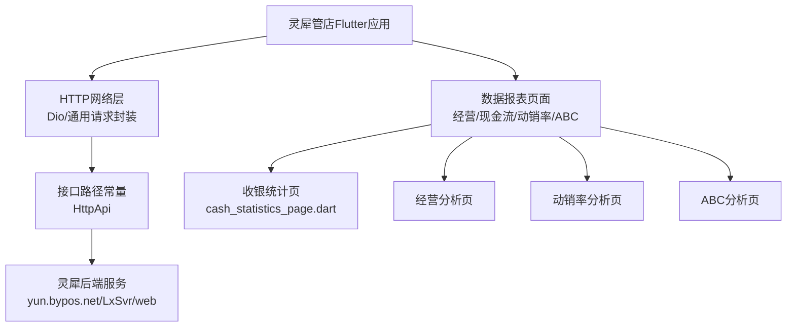
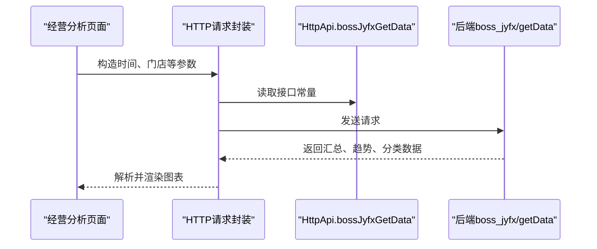
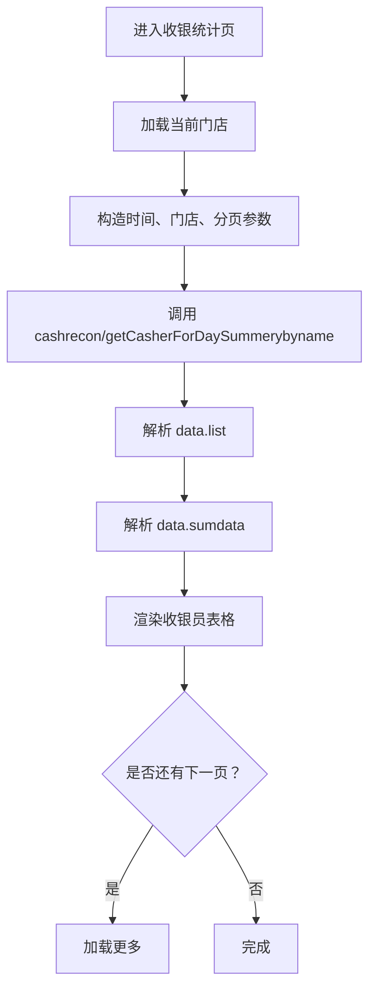
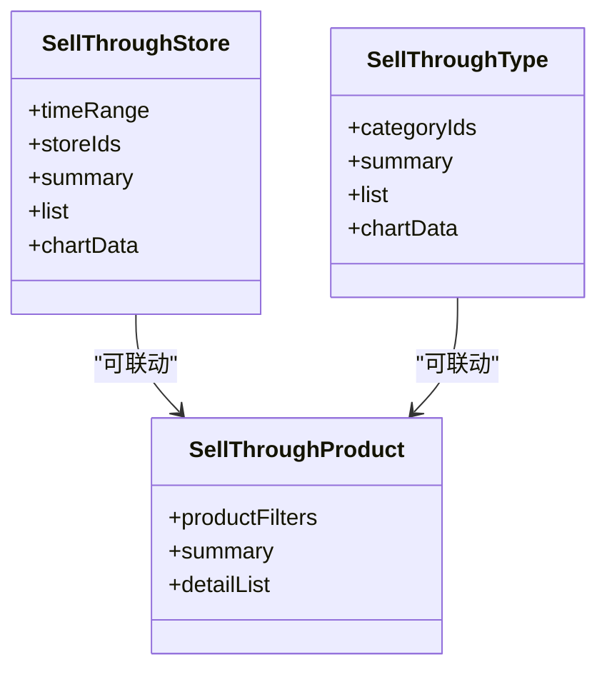
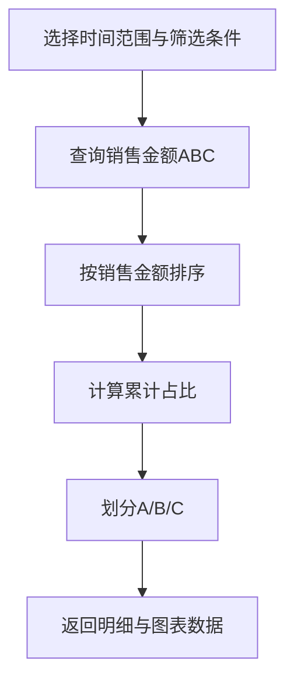
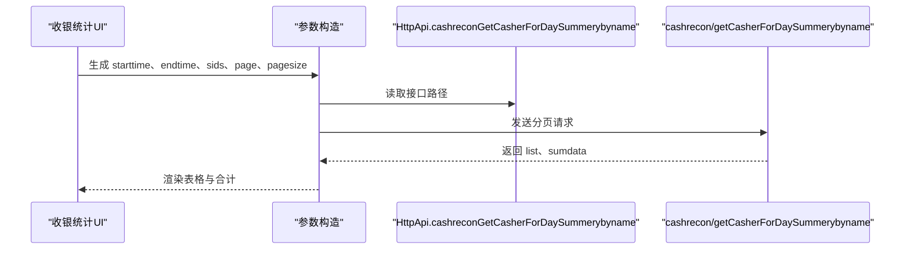
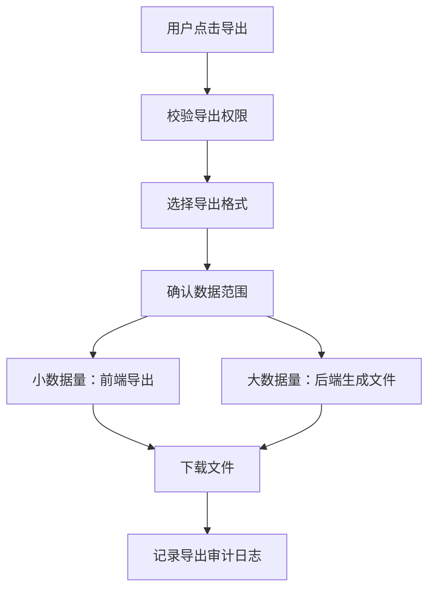

# 数据分析API

<cite>
**本文引用的文件**   
- [lib/net/http_api.dart](file://lib/net/http_api.dart)
- [lib/pages/data/businessReport/cashStatistics/cash_statistics_page.dart](file://lib/pages/data/businessReport/cashStatistics/cash_statistics_page.dart)
</cite>

## 目录
1. [引言](#引言)
2. [项目结构与数据报表模块](#项目结构与数据报表模块)
3. [核心数据分析接口总览](#核心数据分析接口总览)
4. [经营分析接口规范](#经营分析接口规范)
5. [现金流与收银员统计接口规范](#现金流与收银员统计接口规范)
6. [动销率分析接口规范](#动销率分析接口规范)
7. [ABC分析接口规范](#abc分析接口规范)
8. [调用示例与数据模型约定](#调用示例与数据模型约定)
9. [大数据量处理与性能优化](#大数据量处理与性能优化)
10. [报表定制开发与数据导出实现指导](#报表定制开发与数据导出实现指导)
11. [错误处理与实时性要求](#错误处理与实时性要求)
12. [结论](#结论)

## 引言
本文件为灵犀管店 Flutter 项目中的数据分析 API 文档，聚焦以下报表场景：
- 经营分析
- 现金流分析与收银员统计
- 动销率分析
- ABC 分析（商品、类别）

文档从仓库中实际代码出发，整理后端接口路径、请求参数、返回结构约定、图表数据格式、分页与聚合规则、实时性建议，以及大数据量处理和报表扩展指南。所有接口定义均以 `lib/net/http_api.dart` 中的常量为准；前端调用行为以具体页面实现为依据。

## 项目结构与数据报表模块
该 Flutter 项目的数据分析相关界面集中在业务报表目录下，主要包含：
- 经营分析
- 现金流分析
- 收银统计
- 动销率分析
- ABC 分析
- 库存异常与预警分析
- 会员分析

其中，经营分析、动销率分析、ABC 分析、收银统计等模块会直接调用后端数据分析类接口。基础网络层通过统一 HTTP 工具发起请求，而所有接口路径都集中在 `HttpApi` 类中维护，便于统一管理灵犀管店后端地址与接口命名。

**图示来源**  
- [lib/net/http_api.dart:1-595](file://lib/net/http_api.dart#L1-L595)

**章节来源**  
- [lib/net/http_api.dart:1-595](file://lib/net/http_api.dart#L1-L595)

## 核心数据分析接口总览
以下接口均定义在 `HttpApi` 中，是数据分析模块的核心入口。调用时通常由业务页面构造日期、门店、分页等参数，并通过网络层统一发送。

| 分类 | 接口常量名 | 后端路径 | 用途说明 |
|---|---|---|---|
| 经营分析 | `bossJyfxGetData` | `boss_jyfx/getData` | 经营分析数据汇总 |
| 经营分析 | `bossJyfxGetLsfx` | `boss_jyfx/getLsfx` | 零售分析 |
| 经营分析 | `bossJyfxGetKdfx` | `boss_jyfx/getKdfx` | 客单分析 |
| 经营分析 | `bossJyfxGetPffx` | `boss_jyfx/getPffx` | 批发分析 |
| 经营分析 | `bossJyfxGetHyfx` | `boss_jyfx/getHyfx` | 会员分析列表 |
| 经营分析 | `bossJyfxGetHyfxHead` | `boss_jyfx/getHyfxHead` | 会员分析头部VIP等级 |
| 经营分析 | `bossJyfxGetXsth` | `boss_jyfx/getXsth` | 销售退货 |
| 经营分析 | `bossJyfxGetCgfx` | `boss_jyfx/getCgfx` | 采购分析 |
| 经营分析 | `bossJyfxGetMdfx` | `boss_jyfx/getMdfx` | 门店分析 |
| 经营分析 | `bossJyfxGetYjfx` | `boss_jyfx/getYjfx` | 业绩分析 |
| 经营分析 | `bossJyfxGetSpfx` | `boss_jyfx/getSpfx` | 商品分析 |
| 经营分析 | `bossJyfxGetFlfx` | `boss_jyfx/getFlfx` | 类别分析 |
| 经营分析 | `bossJyfxGetPpfx` | `boss_jyfx/getPpfx` | 品牌分析 |
| 经营分析 | `bossJyfxGetHsfx` | `boss_jyfx/getHsfx` | 供应商分析 |
| 经营分析 | `bossJyfxGetSpfxInfo` | `boss_jyfx/getSpfxInfo` | 商品详情 |
| 收银统计 | `cashreconGetCasherForDaySummerybyname` | `cashrecon/getCasherForDaySummerybyname` | 收银员统计 |
| 收银统计 | `cashreconFindAccountPayTotal` | `cashrecon/findAccountPayTotal` | 币种统计 |
| 收银统计 | `cashreconFindSaleJkd` | `cashrecon/findSaleJkd` | 交班统计 |
| 收银统计 | `cashreconGetSaleJkdInfo` | `cashrecon/getSaleJkdInfo` | 交班详情 |
| 动销率分析 | `sellthroughStoreSellThrough` | `sellthrough/storeSellThrough` | 门店动销率 |
| 动销率分析 | `sellthroughTypeSellThrough` | `sellthrough/typeSellThrough` | 商品类别动销率 |
| 动销率分析 | `sellthroughProductSellThrough` | `sellthrough/productSellThrough` | 动销未动销品项明细 |
| ABC分析 | `productabcGetAmtABC` | `productabc/getAmtABC` | 商品销售金额ABC |
| ABC分析 | `productabcGetQtyABC` | `productabc/getQtyABC` | 商品销售数量ABC |
| ABC分析 | `productabcGetGrossABC` | `productabc/getGrossABC` | 商品毛利ABC |
| ABC分析 | `productabcGetTypeAmtABC` | `productabc/getTypeAmtABC` | 类别销售金额ABC |
| ABC分析 | `productabcGetTypeQtyABC` | `productabc/getTypeQtyABC` | 类别销售数量ABC |
| ABC分析 | `productabcGetTypeGrossABC` | `productabc/getTypeGrossABC` | 类别毛利ABC |

**章节来源**  
- [lib/net/http_api.dart:201-467](file://lib/net/http_api.dart#L201-L467)

## 经营分析接口规范
### boss_jyfx/getData
- **接口路径**：`boss_jyfx/getData`
- **方法类型**：通常为 GET 或 POST，取决于网络层封装；业务侧按现有模式传参。
- **典型请求维度**：
  - 时间范围：开始时间、结束时间
  - 门店维度：单店或多店
  - 组织维度：区域、部门（视后端实现而定）
- **返回结构约定**：
  - 外层标准响应体包含状态码、消息、数据区
  - 数据区一般包含汇总指标、趋势折线数据、分类饼图或柱状图数据
  - 常见字段包括：
    - `sumdata`：汇总指标
    - `list`：明细或趋势数组
    - `chartData`：图表专用结构化数据
- **计算规则说明**：
  - 汇总指标应基于所选时间范围、门店集合进行聚合
  - 趋势数据应按时间粒度（日、周、月）分组
  - 分类占比类数据应保留原始数值与百分比，便于前端渲染
- **实时性要求**：
  - 经营分析通常是“近实时+T+1”结合；当日数据可延迟几分钟到几小时不等
  - 前端展示时应标注数据更新时间，避免误认为绝对实时

**图示来源**  
- [lib/net/http_api.dart:201-467](file://lib/net/http_api.dart#L201-L467)

### 其他经营分析子接口
- `boss_jyfx/getLsfx`：零售分析，侧重零售销售额、订单数、客单价等
- `boss_jyfx/getKdfx`：客单分析，关注每笔订单金额分布、连带率等
- `boss_jyfx/getPffx`：批发分析，关注批发订单、客户、品类表现
- `boss_jyfx/getHyfx` / `getHyfxHead`：会员分析列表与头部VIP等级统计
- `boss_jyfx/getXsth`：销售退货分析
- `boss_jyfx/getCgfx`：采购分析
- `boss_jyfx/getMdfx`：门店分析
- `boss_jyfx/getYjfx`：业绩分析
- `boss_jyfx/getSpfx` / `getSpfxInfo`：商品分析与商品详情
- `boss_jyfx/getFlfx`：类别分析
- `boss_jyfx/getPpfx`：品牌分析
- `boss_jyfx/getHsfx`：供应商分析

这些接口共享统一的数据模型风格：汇总指标、趋势序列、分类明细、图表数据。开发自定义报表时，建议沿用相同字段命名和层级结构，以降低前端适配成本。

**章节来源**  
- [lib/net/http_api.dart:201-467](file://lib/net/http_api.dart#L201-L467)

## 现金流与收银员统计接口规范
### cashrecon/getCasherForDaySummerybyname
- **接口路径**：`cashrecon/getCasherForDaySummerybyname`
- **用途**：获取指定时间范围内各收银员的营业统计，常用于收银统计页面的第一页签。
- **典型请求参数**：
  - `is_page`：是否分页
  - `page`：当前页码
  - `pagesize`：每页条数
  - `starttime`：开始时间
  - `endtime`：结束时间
  - `sids`：门店ID数组
- **返回结构约定**：
  - `data.list`：收银员明细列表
  - `data.sumdata`：合计数据
  - 每个收银员记录通常包含姓名、收款金额、退款金额、交易笔数、支付方式分布等
- **分页行为**：
  - 当返回数据少于 `pagesize` 时，前端应判断无更多数据
  - 下一页加载需递增 `page` 并合并结果
- **实时性要求**：
  - 收银员统计通常依赖当日交易流水，数据延迟较短
  - 若后台采用离线计算，则应以结算周期为准，并在UI标注“结算中”或“已结算”

**图示来源**  
- [lib/pages/data/businessReport/cashStatistics/cash_statistics_page.dart:1-200](file://lib/pages/data/businessReport/cashStatistics/cash_statistics_page.dart#L1-L200)
- [lib/net/http_api.dart:201-467](file://lib/net/http_api.dart#L201-L467)

### 其他收银统计接口
- `cashrecon/findAccountPayTotal`：币种统计，用于支付渠道或币种维度汇总
- `cashrecon/findSaleJkd`：交班统计列表
- `cashrecon/getSaleJkdInfo`：交班详情

这些接口通常与收银员统计配合使用，形成完整的收银数据视图：收银员维度、币种维度、交班维度。

**章节来源**  
- [lib/pages/data/businessReport/cashStatistics/cash_statistics_page.dart:1-200](file://lib/pages/data/businessReport/cashStatistics/cash_statistics_page.dart#L1-L200)
- [lib/net/http_api.dart:201-467](file://lib/net/http_api.dart#L201-L467)

## 动销率分析接口规范
### sellthrough/storeSellThrough
- **接口路径**：`sellthrough/storeSellThrough`
- **用途**：查询门店维度的动销率数据，适合门店整体库存周转与销售覆盖评估。
- **典型请求维度**：
  - 时间范围
  - 门店集合
  - 可选商品类别、品牌、供应商筛选
- **返回结构约定**：
  - 汇总指标：动销率、有销售SKU数、库存SKU数
  - 明细列表：商品或门店级动销率明细
  - 图表数据：动销率分布、TopN 动销商品
- **计算规则建议**：
  - 动销率 = 有销售SKU数 / 库存SKU数
  - 可按商品维度、类别维度、门店维度分别计算
  - 对零库存或仅退货的商品应明确排除或单独标记

### sellthrough/typeSellThrough
- **接口路径**：`sellthrough/typeSellThrough`
- **用途**：商品类别维度的动销率分析。
- **输出重点**：
  - 各类别的动销率、销售金额、库存金额
  - 可用于识别滞销类别和热门类别

### sellthrough/productSellThrough
- **接口路径**：`sellthrough/productSellThrough`
- **用途**：动销或未动销品项明细。
- **输出重点**：
  - 商品编码、名称、规格、单位
  - 库存数量、销售数量、动销状态
  - 可联动商品详情、ABC 分析

**图示来源**  
- [lib/net/http_api.dart:201-467](file://lib/net/http_api.dart#L201-L467)

**章节来源**  
- [lib/net/http_api.dart:201-467](file://lib/net/http_api.dart#L201-L467)

## ABC分析接口规范
ABC 分析用于识别高价值商品或类别，帮助优化库存结构和促销策略。

### 商品ABC分析
- `productabc/getAmtABC`：商品销售金额ABC
- `productabc/getQtyABC`：商品销售数量ABC
- `productabc/getGrossABC`：商品毛利ABC

### 类别ABC分析
- `productabc/getTypeAmtABC`：类别销售金额ABC
- `productabc/getTypeQtyABC`：类别销售数量ABC
- `productabc/getTypeGrossABC`：类别毛利ABC

#### 返回结构约定
- `list`：商品或类别明细
- `sumdata`：汇总指标
- `chartData`：ABC分布图表数据
- 每条记录通常包含：
  - 编码、名称、分类、品牌、供应商
  - 销售金额、销售数量、毛利
  - ABC分类：A、B、C
  - 累计占比：用于A/B/C分界

#### 计算规则建议
- A类：累计占比前约70%
- B类：累计占比约20%
- C类：累计占比后约10%
- 阈值可根据业务配置调整，后端返回ABC分类及累计占比即可，前端负责可视化

**图示来源**  
- [lib/net/http_api.dart:201-467](file://lib/net/http_api.dart#L201-L467)

**章节来源**  
- [lib/net/http_api.dart:201-467](file://lib/net/http_api.dart#L201-L467)

## 调用示例与数据模型约定
### 通用请求流程
1. 页面初始化时确定默认时间范围、当前门店。
2. 用户修改筛选条件后，重新构造请求参数。
3. 通过 `HttpApi` 中对应常量发起请求。
4. 解析返回的 `data.list`、`data.sumdata`、`data.chartData`。
5. 将汇总指标用于卡片展示，将列表用于表格，将图表数据用于折线图、饼图、柱状图。

### 收银员统计调用示例
以收银员统计为例，调用步骤如下：
- 构造参数：
  - `is_page=1`
  - `page=1`
  - `pagesize=20`
  - `starttime`、`endtime`
  - `sids`
- 调用接口：`cashrecon/getCasherForDaySummerybyname`
- 解析响应：
  - 取 `data.list` 作为表格数据
  - 取 `data.sumdata` 作为合计行
- 翻页：
  - 如果返回数据少于 `pagesize`，停止翻页
  - 否则 `page++` 继续加载

**图示来源**  
- [lib/pages/data/businessReport/cashStatistics/cash_statistics_page.dart:1-200](file://lib/pages/data/businessReport/cashStatistics/cash_statistics_page.dart#L1-L200)
- [lib/net/http_api.dart:201-467](file://lib/net/http_api.dart#L201-L467)

### 数据模型约定
为保持多报表一致性，建议统一以下模型：
- 时间维度：`starttime`、`endtime`
- 门店维度：`sids`
- 分页维度：`is_page`、`page`、`pagesize`
- 返回结构：
  - `code`：业务状态码
  - `msg`：提示信息
  - `data`：业务数据
  - `data.summary` 或 `data.sumdata`：汇总指标
  - `data.list`：明细列表
  - `data.chartData`：图表数据

这种约定有利于复用图表组件和表格组件，减少重复适配。

**章节来源**  
- [lib/pages/data/businessReport/cashStatistics/cash_statistics_page.dart:1-200](file://lib/pages/data/businessReport/cashStatistics/cash_statistics_page.dart#L1-L200)
- [lib/net/http_api.dart:201-467](file://lib/net/http_api.dart#L201-L467)

## 大数据量处理与性能优化
### 前端优化
- 分页加载：对明细列表始终使用分页，避免一次性拉取大量数据。
- 虚拟滚动：长表格建议使用虚拟滚动组件，减少DOM节点数量。
- 防抖与节流：搜索、筛选输入使用防抖，避免频繁请求。
- 缓存策略：对静态维度数据如门店、分类、品牌做本地缓存。
- 图表降采样：趋势图超过一定点数时进行抽样或聚合，保证流畅渲染。
- 增量更新：对实时性要求高的报表，优先使用增量更新而非全量刷新。

### 后端优化建议
- 预聚合：对高频查询提供日级、月级汇总表。
- 索引优化：对时间、门店、商品编码、分类编码建立合适索引。
- 异步任务：对复杂ABC分析、动销率计算采用异步任务+结果缓存。
- 数据分区：按时间或门店对大表分区，提升查询效率。
- 限流与降级：对大数据量报表设置超时与降级策略，避免拖垮数据库。

### 移动端体验优化
- 首屏优先：先展示汇总指标和少量关键图表，再加载详细列表。
- 骨架屏：在数据加载期间显示骨架屏，提升感知速度。
- 错误重试：对网络失败提供重试机制，但限制重试次数。
- 离线提示：在网络不可用时给出明确提示，并允许查看缓存数据。

[本节为通用性能建议，不直接分析具体源码]

## 报表定制开发与数据导出实现指导
### 新增报表接口
1. 在 `HttpApi` 中新增接口常量，明确后端路径。
2. 定义统一的请求参数模型：时间、门店、筛选、分页。
3. 定义统一的返回结构：汇总、明细、图表数据。
4. 在业务页面中复用通用的表格、图表组件。
5. 增加权限控制：不同角色可见不同报表。

### 数据导出功能
- 导出格式：
  - Excel：适合财务、运营人员二次分析
  - CSV：适合批量导入系统
  - PDF：适合打印归档
- 导出内容：
  - 汇总指标
  - 明细列表
  - 图表截图或关键指标摘要
- 实现方式：
  - 前端导出：适用于小数据量，使用第三方库生成Excel或CSV
  - 后端导出：适用于大数据量，生成文件并提供下载链接
- 安全与合规：
  - 导出需校验用户权限
  - 敏感数据脱敏
  - 导出记录审计日志

[本节为概念性流程，不直接映射具体源码文件]

## 错误处理与实时性要求
### 错误处理
- 网络错误：连接超时、DNS解析失败、SSL证书错误
- 业务错误：登录失效、权限不足、参数校验失败
- 数据异常：空数据、字段缺失、类型不匹配
- 处理策略：
  - 统一错误提示
  - 区分可重试与不可重试错误
  - 记录错误日志并上报
  - 提供“重试”按钮

### 实时性要求
- 经营分析：近实时+T+1，适合日常经营复盘
- 收银员统计：接近实时，适合当日营业监控
- 动销率分析：偏T+1，适合库存健康度分析
- ABC分析：偏T+1或周期性计算，适合月度经营策略

建议在报表顶部显示“数据更新时间”“数据来源”“是否已结算”，帮助用户理解数据时效。

**章节来源**  
- [lib/pages/data/businessReport/cashStatistics/cash_statistics_page.dart:1-200](file://lib/pages/data/businessReport/cashStatistics/cash_statistics_page.dart#L1-L200)
- [lib/net/http_api.dart:1-595](file://lib/net/http_api.dart#L1-L595)

## 结论
灵犀管店的数据分析API以 `HttpApi` 为中心，集中管理经营分析、收银统计、动销率分析和ABC分析等核心接口。前端通过统一的时间、门店、分页参数与统一的返回结构约定，实现多报表的一致体验。对于大数据量场景，应优先考虑后端预聚合与前端分页、虚拟滚动、图表降采样等优化手段。新增报表时建议沿用现有接口命名风格和数据结构，确保可维护性和可扩展性。