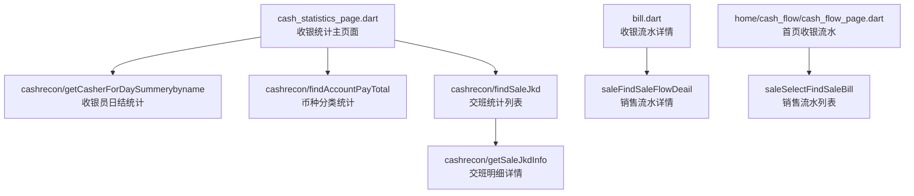
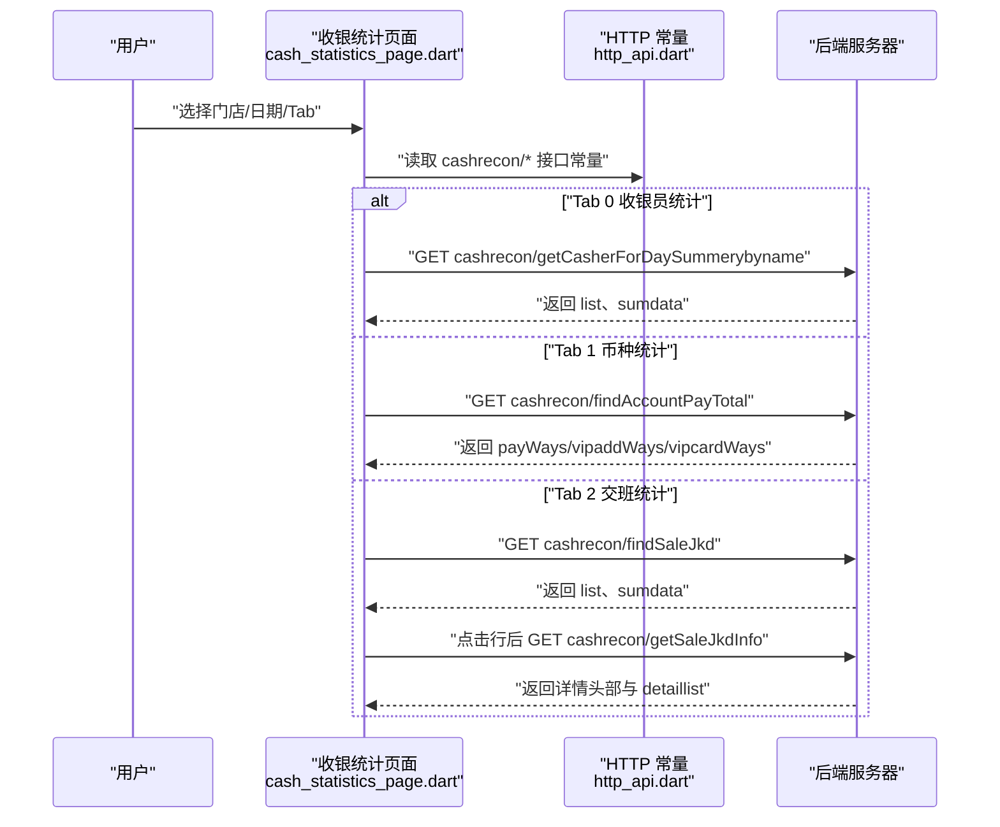
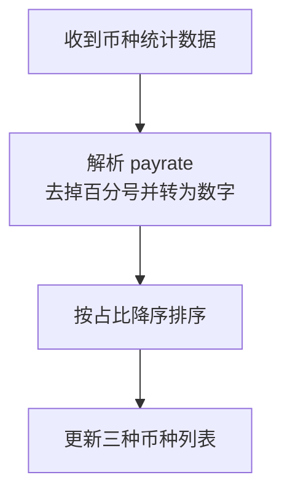
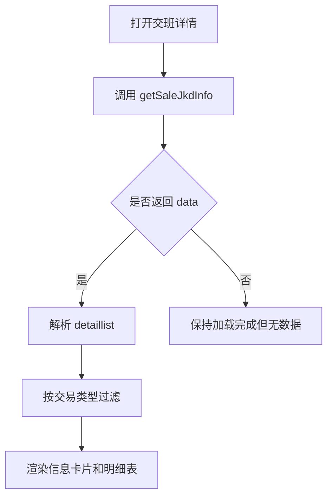
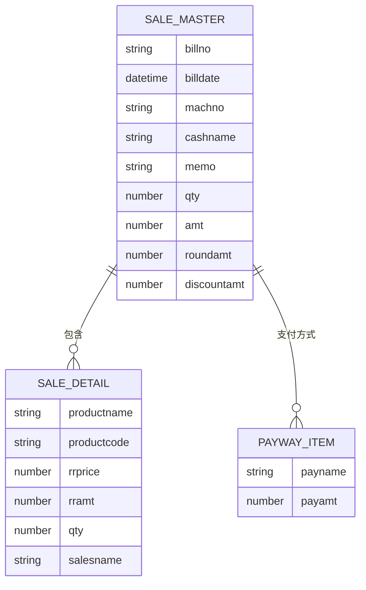
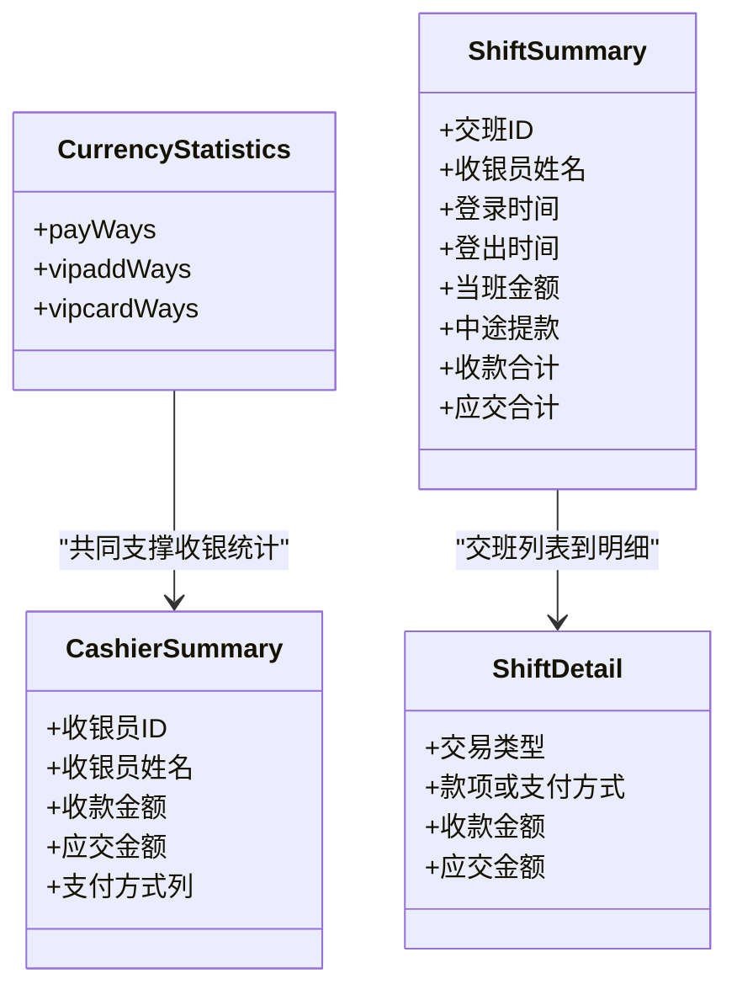
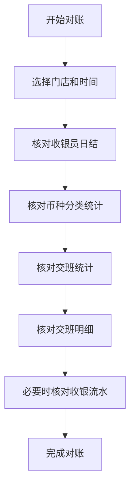
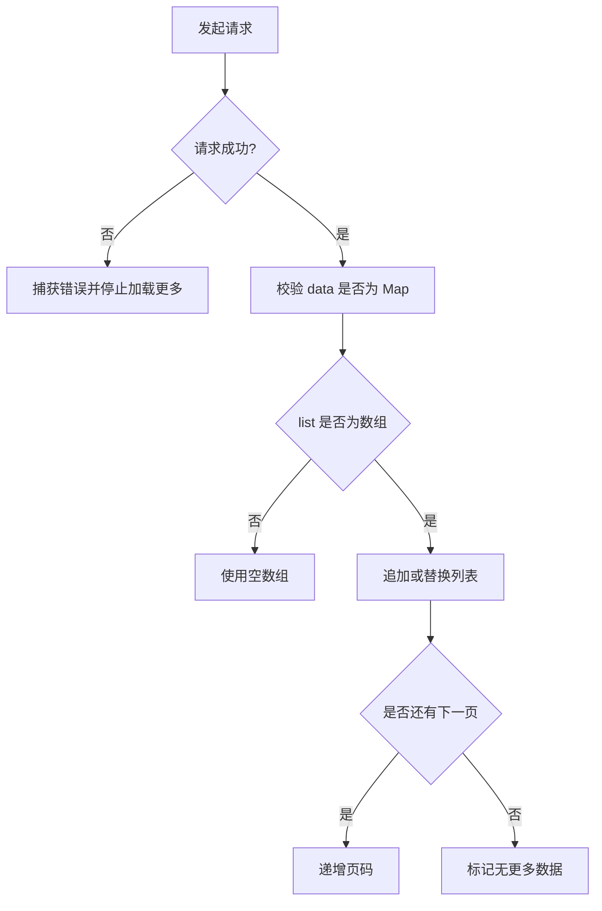

# 现金流分析API

<cite>
**本文引用的文件**   
- [lib/net/http_api.dart](file://lib/net/http_api.dart)
- [lib/pages/data/businessReport/cashStatistics/cash_statistics_page.dart](file://lib/pages/data/businessReport/cashStatistics/cash_statistics_page.dart)
- [lib/pages/data/businessReport/cashStatistics/jbtj_bill_page.dart](file://lib/pages/data/businessReport/cashStatistics/jbtj_bill_page.dart)
- [lib/pages/data/businessReport/cashFlow/bill.dart](file://lib/pages/data/businessReport/cashFlow/bill.dart)
- [lib/pages/home/cash_flow/cash_flow_page.dart](file://lib/pages/home/cash_flow/cash_flow_page.dart)
</cite>

## 目录
1. [简介](#简介)
2. [项目结构定位](#项目结构定位)
3. [核心接口总览](#核心接口总览)
4. [架构与调用流程](#架构与调用流程)
5. [收银员日结统计接口规范](#收银员日结统计接口规范)
6. [币种分类统计接口规范](#币种分类统计接口规范)
7. [交班统计接口规范](#交班统计接口规范)
8. [交班详情接口规范](#交班详情接口规范)
9. [收银流水与单据详情数据模型](#收银流水与单据详情数据模型)
10. [现金流分析数据模型与时间序列](#现金流分析数据模型与时间序列)
11. [收银对账业务流程与校验规则](#收银对账业务流程与校验规则)
12. [实际业务调用示例](#实际业务调用示例)
13. [异常处理方案](#异常处理方案)
14. [性能与扩展建议](#性能与扩展建议)
15. [结论](#结论)

## 简介
本文件为灵犀管店 Flutter 项目中“现金流分析”相关接口的详细技术文档，重点覆盖以下四个后端 API：
- cashrecon/getCasherForDaySummerybyname：收银员日结统计
- cashrecon/findAccountPayTotal：币种分类统计
- cashrecon/findSaleJkd：交班统计列表
- cashrecon/getSaleJkdInfo：交班明细详情

文档基于 Flutter 客户端实现反推接口契约，说明请求参数、响应结构、字段含义、排序与分页规则，并补充收银员统计、币种统计、交班流水的完整数据模型，以及收银对账的业务流程和常见异常处理方案。

## 项目结构定位
现金流分析功能主要由以下页面与常量组成：
- HTTP 常量集中定义在 `lib/net/http_api.dart`，统一暴露现金对账类接口名称。
- 收银统计主入口位于 `lib/pages/data/businessReport/cashStatistics/cash_statistics_page.dart`，包含三个 Tab：收银员统计、币种统计、交班统计。
- 交班详情页位于 `lib/pages/data/businessReport/cashStatistics/jbtj_bill_page.dart`，展示交班明细。
- 收银流水详情页位于 `lib/pages/data/businessReport/cashFlow/bill.dart`，展示销售单头、商品明细和支付方式。
- 首页收银流水入口位于 `lib/pages/home/cash_flow/cash_flow_page.dart`，用于查询销售流水汇总。



**图表来源**
- [lib/net/http_api.dart:281-285](file://lib/net/http_api.dart#L281-L285)
- [lib/pages/data/businessReport/cashStatistics/cash_statistics_page.dart:200-600](file://lib/pages/data/businessReport/cashStatistics/cash_statistics_page.dart#L200-L600)
- [lib/pages/data/businessReport/cashStatistics/jbtj_bill_page.dart:1-200](file://lib/pages/data/businessReport/cashStatistics/jbtj_bill_page.dart#L1-L200)
- [lib/pages/data/businessReport/cashFlow/bill.dart:1-200](file://lib/pages/data/businessReport/cashFlow/bill.dart#L1-L200)
- [lib/pages/home/cash_flow/cash_flow_page.dart:1-200](file://lib/pages/home/cash_flow/cash_flow_page.dart#L1-L200)

**章节来源**
- [lib/net/http_api.dart:281-285](file://lib/net/http_api.dart#L281-L285)
- [lib/pages/data/businessReport/cashStatistics/cash_statistics_page.dart:1-200](file://lib/pages/data/businessReport/cashStatistics/cash_statistics_page.dart#L1-L200)
- [lib/pages/data/businessReport/cashStatistics/jbtj_bill_page.dart:1-200](file://lib/pages/data/businessReport/cashStatistics/jbtj_bill_page.dart#L1-L200)
- [lib/pages/data/businessReport/cashFlow/bill.dart:1-200](file://lib/pages/data/businessReport/cashFlow/bill.dart#L1-L200)
- [lib/pages/home/cash_flow/cash_flow_page.dart:1-200](file://lib/pages/home/cash_flow/cash_flow_page.dart#L1-L200)

## 核心接口总览
| 序号 | 客户端常量名 | 后端路径 | 用途 | 主要使用页面 |
|---|---|---|---|---|
| 1 | `cashreconGetCasherForDaySummerybyname` | `cashrecon/getCasherForDaySummerybyname` | 按日期范围查询收银员日结统计 | 收银统计页 Tab 0 |
| 2 | `cashreconFindAccountPayTotal` | `cashrecon/findAccountPayTotal` | 按日期范围查询币种分类统计 | 收银统计页 Tab 1 |
| 3 | `cashreconFindSaleJkd` | `cashrecon/findSaleJkd` | 查询交班统计列表，支持分页 | 收银统计页 Tab 2 |
| 4 | `cashreconGetSaleJkdInfo` | `cashrecon/getSaleJkdInfo` | 查询某条交班的明细流水 | 交班详情页 |

上述路径由 `HttpApi` 常量统一管理，基础 URL 指向云端服务地址。客户端通过统一的 `request` 工具发起网络请求，并对 `data` 字段进行结构化解析。

**章节来源**
- [lib/net/http_api.dart:281-285](file://lib/net/http_api.dart#L281-L285)

## 架构与调用流程
收银统计页面的整体调用顺序如下：



**图表来源**
- [lib/pages/data/businessReport/cashStatistics/cash_statistics_page.dart:200-600](file://lib/pages/data/businessReport/cashStatistics/cash_statistics_page.dart#L200-L600)
- [lib/pages/data/businessReport/cashStatistics/jbtj_bill_page.dart:1-200](file://lib/pages/data/businessReport/cashStatistics/jbtj_bill_page.dart#L1-L200)
- [lib/net/http_api.dart:281-285](file://lib/net/http_api.dart#L281-L285)

## 收银员日结统计接口规范

### 接口信息
- 接口路径：`cashrecon/getCasherForDaySummerybyname`
- 客户端常量：`cashreconGetCasherForDaySummerybyname`
- 业务含义：根据门店、日期范围查询收银员日结统计，返回收银员列表及汇总数据。

### 请求参数
| 字段 | 类型 | 是否必填 | 默认值 | 说明 |
|---|---|---:|---|---|
| `is_page` | 数字 | 否 | 1 | 是否分页标记 |
| `page` | 数字 | 否 | 1 | 当前页码 |
| `pagesize` | 数字 | 否 | 20 | 每页数量 |
| `starttime` | 字符串 | 是 | 无 | 开始时间，格式为 `YYYY-MM-DD 00:00:00` |
| `endtime` | 字符串 | 是 | 无 | 结束时间，格式为 `YYYY-MM-DD 23:59:59` |
| `sids` | 数字数组 | 否 | 空 | 门店 ID 列表，为空表示全部门店 |

请求参数由收银统计页面的 `_baseParams()` 方法生成，并结合分页参数一起发送。

### 响应结构
```text
{
  data: {
    list: [
      {
        收银员ID,
        收银员姓名,
        收款金额,
        应交金额,
        当班时长或班次标识,
        其他收银员维度字段
      }
    ],
    sumdata: {
      sumdata: {
        汇总金额,
        汇总订单数,
        其他汇总指标
      },
      paylist: [
        {
          支付方式编码,
          支付方式名称,
          收款金额,
          占比或其他统计字段
        }
      ]
    }
  }
}
```

字段说明：
- `list`：收银员统计列表。客户端将其作为表格数据源，并按页追加。
- `sumdata.sumdata`：收银员维度的汇总数据，例如合计收款、合计应交等。
- `sumdata.paylist`：该时间段内各支付方式的聚合列，客户端将其渲染为支付方式列集合。

### 数据处理规则
- 首次加载时清空历史列表；后续翻页时追加新数据。
- 若 `sumdata` 存在且内部仍嵌套 `sumdata`，客户端会取最内层对象作为汇总数据。
- `paylist` 非空时才更新支付方式列，避免显示空白列。
- 如果返回数据少于 `pagesize`，则认为没有更多数据。

**章节来源**
- [lib/pages/data/businessReport/cashStatistics/cash_statistics_page.dart:200-260](file://lib/pages/data/businessReport/cashStatistics/cash_statistics_page.dart#L200-L260)

## 币种分类统计接口规范

### 接口信息
- 接口路径：`cashrecon/findAccountPayTotal`
- 客户端常量：`cashreconFindAccountPayTotal`
- 业务含义：按日期范围统计不同币种的收款情况，包括普通收款、会员充值、会员卡三类统计。

### 请求参数
| 字段 | 类型 | 是否必填 | 默认值 | 说明 |
|---|---|---:|---|---|
| `starttime` | 字符串 | 是 | 无 | 开始时间，格式为 `YYYY-MM-DD 00:00:00` |
| `endtime` | 字符串 | 是 | 无 | 结束时间，格式为 `YYYY-MM-DD 23:59:59` |
| `sids` | 数字数组 | 否 | 空 | 门店 ID 列表 |

该接口不需要分页参数，仅依赖时间范围和门店范围。

### 响应结构
```text
{
  data: {
    payWays: [
      {
        支付方式名称,
        收款金额,
        占比 payrate
      }
    ],
    vipaddWays: [
      {
        会员充值方式名称,
        充值金额,
        占比 payrate
      }
    ],
    vipcardWays: [
      {
        会员卡消费方式名称,
        消费金额,
        占比 payrate
      }
    ]
  }
}
```

字段说明：
- `payWays`：普通收款按支付方式分类统计。
- `vipaddWays`：会员充值按支付方式分类统计。
- `vipcardWays`：会员卡消费按支付方式分类统计。
- `payrate`：占比字段可能是数字或带 `%` 的字符串，客户端会去除 `%` 后再排序。

### 排序规则
客户端对三类列表都执行相同逻辑：
1. 将 `payrate` 转换为数值。
2. 按占比降序排列。
3. 若无法解析为数字，则视为 0。



**图表来源**
- [lib/pages/data/businessReport/cashStatistics/cash_statistics_page.dart:260-340](file://lib/pages/data/businessReport/cashStatistics/cash_statistics_page.dart#L260-L340)

**章节来源**
- [lib/pages/data/businessReport/cashStatistics/cash_statistics_page.dart:260-340](file://lib/pages/data/businessReport/cashStatistics/cash_statistics_page.dart#L260-L340)

## 交班统计接口规范

### 接口信息
- 接口路径：`cashrecon/findSaleJkd`
- 客户端常量：`cashreconFindSaleJkd`
- 业务含义：查询交班统计列表，支持分页、按创建时间倒序排序，并返回汇总数据。

### 请求参数
| 字段 | 类型 | 是否必填 | 默认值 | 说明 |
|---|---|---:|---|---|
| `is_page` | 数字 | 否 | 1 | 是否分页标记 |
| `page` | 数字 | 否 | 1 | 当前页码 |
| `pagesize` | 数字 | 否 | 20 | 每页数量 |
| `field` | 字符串 | 否 | `createtime` | 排序字段 |
| `type` | 字符串 | 否 | `desc` | 排序方向，`desc` 表示倒序 |
| `starttime` | 字符串 | 是 | 无 | 开始时间 |
| `endtime` | 字符串 | 是 | 无 | 结束时间 |
| `sids` | 数字数组 | 否 | 空 | 门店 ID 列表 |

### 响应结构
```text
{
  data: {
    list: [
      {
        交班ID,
        收银员ID,
        收银员姓名 opername,
        登录时间 logintime,
        登出时间 logouttime,
        当班金额 dutyamt,
        中途提款 halfdraw,
        收款合计 saleamt,
        应交合计 payableamt,
        其他交班汇总字段
      }
    ],
    sumdata: {
      汇总收款金额,
      汇总应交金额,
      汇总交班次数,
      其他汇总指标
    }
  }
}
```

关键字段说明：
- `opername`：收银员姓名。
- `logintime` / `logouttime`：当班时间和交班时间。
- `dutyamt`：当班金额。
- `halfdraw`：中途提款金额。
- `saleamt`：收款合计。
- `payableamt`：应交合计。
- `sumdata`：交班列表的汇总数据。

### 分页行为
- 首次加载清空历史列表。
- 后续翻页追加数据。
- 当返回列表长度达到 `pagesize` 时继续增加页码。
- 若返回数据不足一页，则认为已加载完所有数据。

**章节来源**
- [lib/pages/data/businessReport/cashStatistics/cash_statistics_page.dart:340-420](file://lib/pages/data/businessReport/cashStatistics/cash_statistics_page.dart#L340-L420)

## 交班详情接口规范

### 接口信息
- 接口路径：`cashrecon/getSaleJkdInfo`
- 客户端常量：`cashreconGetSaleJkdInfo`
- 业务含义：根据交班记录的行数据，查询该交班的明细流水。

### 请求参数
客户端直接透传选中交班行的全部字段，典型关键参数包括：
| 字段 | 类型 | 是否必填 | 说明 |
|---|---|---:|---|
| `id` 或交班主键 | 字符串或数字 | 是 | 交班记录唯一标识 |
| `sid` | 字符串或数字 | 是 | 门店标识 |
| `opername` | 字符串 | 否 | 收银员姓名 |
| `logintime` | 字符串 | 否 | 登录时间 |
| `logouttime` | 字符串 | 否 | 登出时间 |
| `dutyamt` | 数字 | 否 | 当班金额 |
| `halfdraw` | 数字 | 否 | 中途提款 |
| `saleamt` | 数字 | 否 | 收款合计 |
| `payableamt` | 数字 | 否 | 应交合计 |

### 响应结构
```text
{
  data: {
    opername,
    logintime,
    logouttime,
    dutyamt,
    halfdraw,
    saleamt,
    payableamt,
    detaillist: [
      {
        序号,
        itype,
        payway,
        saleamt,
        payableamt,
        其他交易明细字段
      }
    ]
  }
}
```

字段说明：
- `opername`：收银员。
- `logintime`：当班时间。
- `logouttime`：交班时间。
- `dutyamt`：当班金额。
- `halfdraw`：中途提款。
- `saleamt`：收款合计。
- `payableamt`：应交合计。
- `detaillist`：交班明细列表。

### 明细字段说明
| 字段 | 类型 | 说明 |
|---|---|---|
| `itype` | 数字 | 交易类型编码 |
| `payway` | 字符串 | 交易对应款项或支付方式 |
| `saleamt` | 数字 | 收款金额 |
| `payableamt` | 数字 | 应交金额 |

交易类型映射关系由前端维护，常见映射如下：
| 编码 | 含义 |
|---:|---|
| 1 | 消费 |
| 2 | 充值 |
| 3 | 发卡 |
| 4 | 退卡 |
| 5 | 买次卡 |
| 6 | 一卡通充值 |
| 7 | 会员挂账还款 |
| 8 | 积分兑换加价 |
| 9 | 会员续费 |
| 10 | 会员绑定 |
| 11 | 批量充值 |

### 交互行为
- 页面加载时调用接口获取详情和明细。
- 用户可选择交易类型筛选明细列表。
- 明细表格自动计算筛选后的收款合计和应交合计。



**图表来源**
- [lib/pages/data/businessReport/cashStatistics/jbtj_bill_page.dart:1-200](file://lib/pages/data/businessReport/cashStatistics/jbtj_bill_page.dart#L1-L200)
- [lib/pages/data/businessReport/cashStatistics/jbtj_bill_page.dart:200-391](file://lib/pages/data/businessReport/cashStatistics/jbtj_bill_page.dart#L200-L391)

**章节来源**
- [lib/pages/data/businessReport/cashStatistics/jbtj_bill_page.dart:1-200](file://lib/pages/data/businessReport/cashStatistics/jbtj_bill_page.dart#L1-L200)
- [lib/pages/data/businessReport/cashStatistics/jbtj_bill_page.dart:200-391](file://lib/pages/data/businessReport/cashStatistics/jbtj_bill_page.dart#L200-L391)

## 收银流水与单据详情数据模型

### 收银流水列表
收银流水列表由 `saleSelectFindSaleBill` 提供，主要用于首页或报表中的流水查询。客户端请求包含：
- `starttime` / `endtime`：日期范围。
- `sids`：门店范围。
- `billno`：单号。
- `billflag`：单据标志，如销售单、退货单、整单退货。
- `saletype`：销售类型，如 PC 端销售、微信商城、APP、自助收银等。
- `cashid` / `cashname`：收银员编号或姓名。
- `machno`：机号。
- `payid` / `payname`：支付方式编号或名称。

响应中包含：
- `list`：流水列表。
- `total`：总记录数。
- `sumdata.amt`：总金额。

### 收银流水详情
收银流水详情由 `saleFindSaleFlowDeail` 提供，返回：
- `saleMaster`：销售单头信息，包含单号、结算时间、会员信息、机号、收银员、备注、数量、金额、抹零金额、优惠金额等。
- `saleDetailList`：商品明细列表，包含商品名称、编码、单价、数量、营业员等。
- `salePaywayList`：支付方式列表，包含支付方式名称和金额。



**图表来源**
- [lib/pages/data/businessReport/cashFlow/bill.dart:1-200](file://lib/pages/data/businessReport/cashFlow/bill.dart#L1-L200)
- [lib/pages/data/businessReport/cashFlow/bill.dart:200-399](file://lib/pages/data/businessReport/cashFlow/bill.dart#L200-L399)

**章节来源**
- [lib/pages/home/cash_flow/cash_flow_page.dart:1-200](file://lib/pages/home/cash_flow/cash_flow_page.dart#L1-L200)
- [lib/pages/data/businessReport/cashFlow/bill.dart:1-200](file://lib/pages/data/businessReport/cashFlow/bill.dart#L1-L200)
- [lib/pages/data/businessReport/cashFlow/bill.dart:200-399](file://lib/pages/data/businessReport/cashFlow/bill.dart#L200-L399)

## 现金流分析数据模型与时间序列

### 数据模型总览
现金流分析涉及四类核心数据：
1. **收银员日结数据**：以收银员为维度，汇总收款、应交、支付方式列。
2. **币种分类数据**：分为普通收款、会员充值、会员卡消费三类。
3. **交班统计列表**：以交班记录为维度，汇总当班金额、收款合计、应交合计。
4. **交班明细流水**：以交易类型为维度，展示每笔交易的收款和应交金额。



**图表来源**
- [lib/pages/data/businessReport/cashStatistics/cash_statistics_page.dart:200-600](file://lib/pages/data/businessReport/cashStatistics/cash_statistics_page.dart#L200-L600)
- [lib/pages/data/businessReport/cashStatistics/jbtj_bill_page.dart:1-200](file://lib/pages/data/businessReport/cashStatistics/jbtj_bill_page.dart#L1-L200)

### 时间序列规则
- 所有现金流接口均使用 `starttime` 和 `endtime` 控制时间范围。
- 默认时间范围为当天。
- 快捷时间选项包括昨天、今日、本周、本月、自定义。
- 周和月模式下支持左右箭头切换。
- 自定义模式支持日期选择器和月份选择器。

### 报表导出格式建议
虽然仓库未提供导出代码，但从数据结构可推导推荐导出格式：
- 收银员日结导出：一行一个收银员，包含收款合计、应交合计、各支付方式金额。
- 币种统计导出：三张表或三组数据，分别导出普通收款、会员充值、会员卡消费。
- 交班统计导出：一行一个交班，包含收银员、当班时间、交班时间、当班金额、收款合计、应交合计。
- 交班明细导出：一行一笔交易，包含交易类型、款项、收款金额、应交金额。

[本节为概念性说明，不直接分析具体代码文件]

## 收银对账业务流程与校验规则

### 业务流程
1. **选择门店和时间范围**：确认对账的门店和日期区间。
2. **查看收银员日结**：核对每个收银员的收款合计与应交合计。
3. **查看币种统计**：核对各支付方式占比是否正常，是否存在异常高占比。
4. **查看交班统计**：核对交班次数、当班金额、收款合计、应交合计。
5. **查看交班明细**：逐笔核对交易类型、款项、收款金额、应交金额。
6. **对比收银流水**：如有差异，进入收银流水详情核对商品明细和支付方式。



**图表来源**
- [lib/pages/data/businessReport/cashStatistics/cash_statistics_page.dart:200-600](file://lib/pages/data/businessReport/cashStatistics/cash_statistics_page.dart#L200-L600)
- [lib/pages/data/businessReport/cashStatistics/jbtj_bill_page.dart:1-200](file://lib/pages/data/businessReport/cashStatistics/jbtj_bill_page.dart#L1-L200)
- [lib/pages/data/businessReport/cashFlow/bill.dart:1-200](file://lib/pages/data/businessReport/cashFlow/bill.dart#L1-L200)

### 数据校验规则
- 收款合计不应为负数。
- 应交合计应与应收款项一致。
- 当班金额应等于收款合计减去中途提款，再结合其他调整项。
- 支付方式金额之和应接近实收金额。
- 明细中收款金额与应交金额的合计应与交班汇总一致。
- 交易类型应为系统预定义的编码。

[本节为业务校验规则总结，不直接分析具体代码文件]

## 实际业务调用示例

### 示例一：查询收银员日结统计
- 场景：店长需要查看今天各收银员的收款和应交情况。
- 步骤：
  1. 在收银统计页面选择“今日”。
  2. 切换到“收银员统计”Tab。
  3. 客户端调用 `cashrecon/getCasherForDaySummerybyname`。
  4. 展示收银员列表和支付方式列。

### 示例二：查询币种分类统计
- 场景：财务需要分析当日现金、微信、支付宝、会员卡等渠道占比。
- 步骤：
  1. 选择日期范围。
  2. 切换到“币种统计”Tab。
  3. 客户端调用 `cashrecon/findAccountPayTotal`。
  4. 客户端按占比降序展示三类支付方式。

### 示例三：查询交班统计并查看详情
- 场景：运营人员发现某收银员当天交班金额异常，需要查看明细。
- 步骤：
  1. 切换到“交班统计”Tab。
  2. 找到目标交班记录。
  3. 点击进入“交班详情”。
  4. 客户端调用 `cashrecon/getSaleJkdInfo`。
  5. 查看明细并按交易类型筛选。

### 示例四：核对收银流水
- 场景：某笔交易金额与预期不符，需要查看商品明细和支付方式。
- 步骤：
  1. 在收银流水页面查询对应单号。
  2. 进入流水详情。
  3. 客户端调用 `saleFindSaleFlowDeail`。
  4. 核对商品明细、抹零、优惠、支付方式。

**章节来源**
- [lib/pages/data/businessReport/cashStatistics/cash_statistics_page.dart:200-600](file://lib/pages/data/businessReport/cashStatistics/cash_statistics_page.dart#L200-L600)
- [lib/pages/data/businessReport/cashStatistics/jbtj_bill_page.dart:1-200](file://lib/pages/data/businessReport/cashStatistics/jbtj_bill_page.dart#L1-L200)
- [lib/pages/data/businessReport/cashFlow/bill.dart:1-200](file://lib/pages/data/businessReport/cashFlow/bill.dart#L1-L200)

## 异常处理方案

### 网络异常
- 列表加载失败时，客户端会将 `hasMore` 设为 false，避免重复请求。
- 部分页面使用 `try/catch` 包裹请求，并在 `finally` 中关闭加载状态。

### 数据为空
- 若 `data` 不是预期的 Map，客户端回退为空 Map。
- 若 `list` 不存在或不是数组，客户端使用空数组。
- 若支付方式列为空，则不显示支付方式列。

### 数据类型不一致
- 金额字段可能为数字或字符串，客户端统一尝试解析为数字。
- 占比字段可能是带 `%` 的字符串，客户端先去除 `%` 再转换。
- 交易类型编码可能为字符串或数字，客户端兼容两种类型。

### 分页边界
- 若返回数据少于 `pagesize`，客户端认为没有更多数据。
- 多次刷新时重置页码和加载更多状态。



**图表来源**
- [lib/pages/data/businessReport/cashStatistics/cash_statistics_page.dart:200-420](file://lib/pages/data/businessReport/cashStatistics/cash_statistics_page.dart#L200-L420)
- [lib/pages/data/businessReport/cashStatistics/jbtj_bill_page.dart:1-200](file://lib/pages/data/businessReport/cashStatistics/jbtj_bill_page.dart#L1-L200)

**章节来源**
- [lib/pages/data/businessReport/cashStatistics/cash_statistics_page.dart:200-420](file://lib/pages/data/businessReport/cashStatistics/cash_statistics_page.dart#L200-L420)
- [lib/pages/data/businessReport/cashStatistics/jbtj_bill_page.dart:1-200](file://lib/pages/data/businessReport/cashStatistics/jbtj_bill_page.dart#L1-L200)

## 性能与扩展建议

### 性能特性
- 列表采用分页加载，默认每页 20 条。
- 币种统计不分页，适合小数据量快速返回。
- 交班统计按创建时间倒序，便于看到最新交班。
- 前端对金额和占比做安全解析，避免 UI 因脏数据崩溃。

### 优化建议
- 若收银员统计列表增长较快，可增加服务端索引。
- 币种统计可在服务端直接返回已排序数据，减少客户端排序开销。
- 交班明细可考虑分页或虚拟列表，避免一次性渲染大量明细。
- 报表导出建议在后端生成 Excel 或 CSV，避免前端大数据量导出卡顿。

[本节为通用优化建议，不直接分析具体代码文件]

## 结论
灵犀管店 Flutter 项目的现金流分析能力围绕四个核心接口展开：收银员日结统计、币种分类统计、交班统计列表、交班明细详情。客户端通过统一的 HTTP 常量管理接口路径，并以收银统计页面作为入口，串联起从汇总到明细的完整对账链路。通过对请求参数、响应结构、字段含义、排序分页规则、数据模型和业务校验规则的梳理，可以为前后端对接、报表导出、异常处理和性能优化提供明确依据。