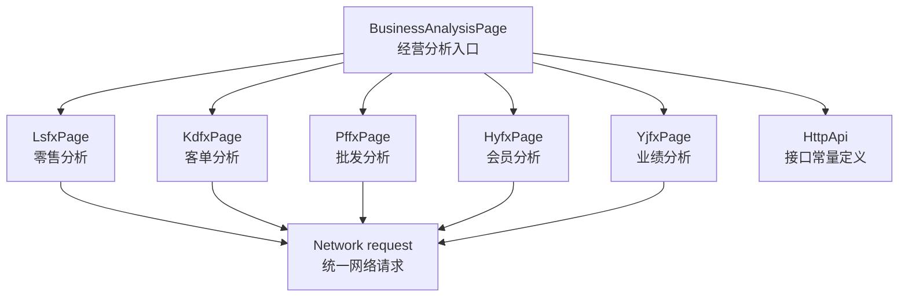
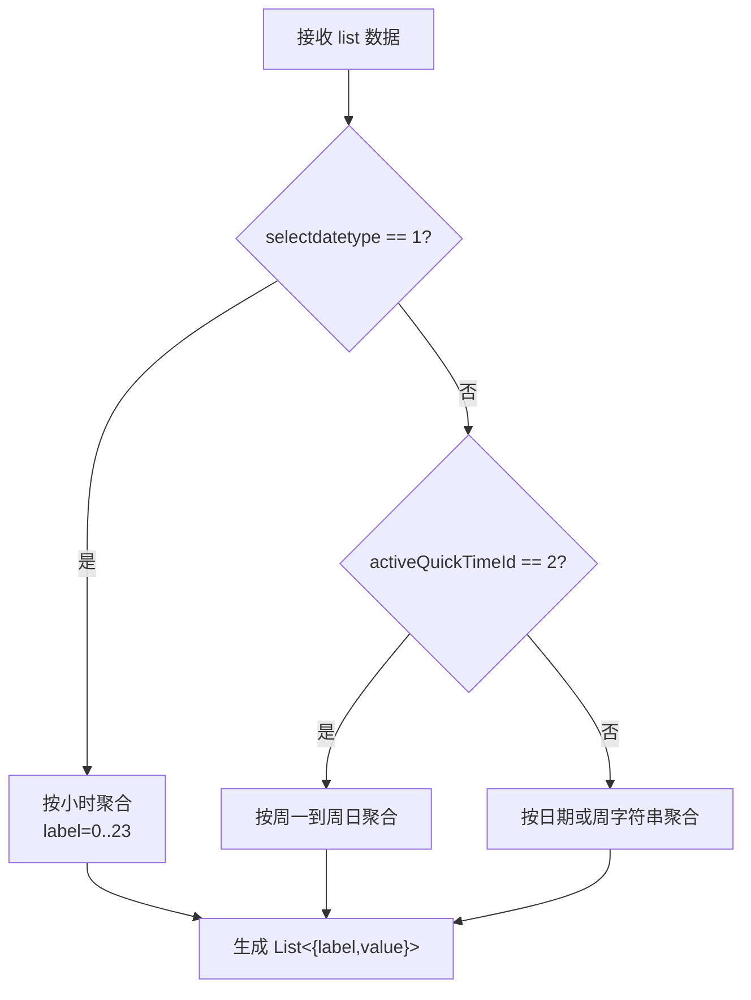
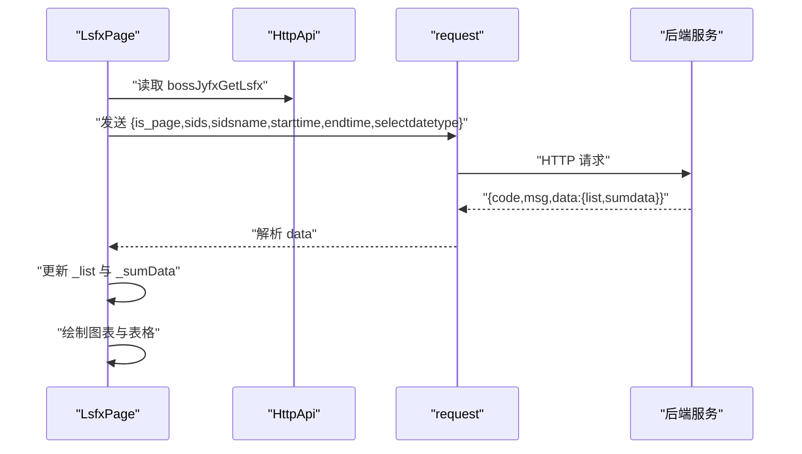
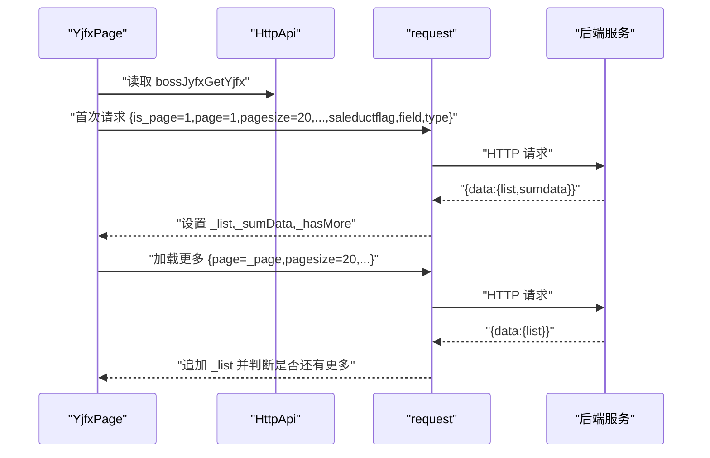
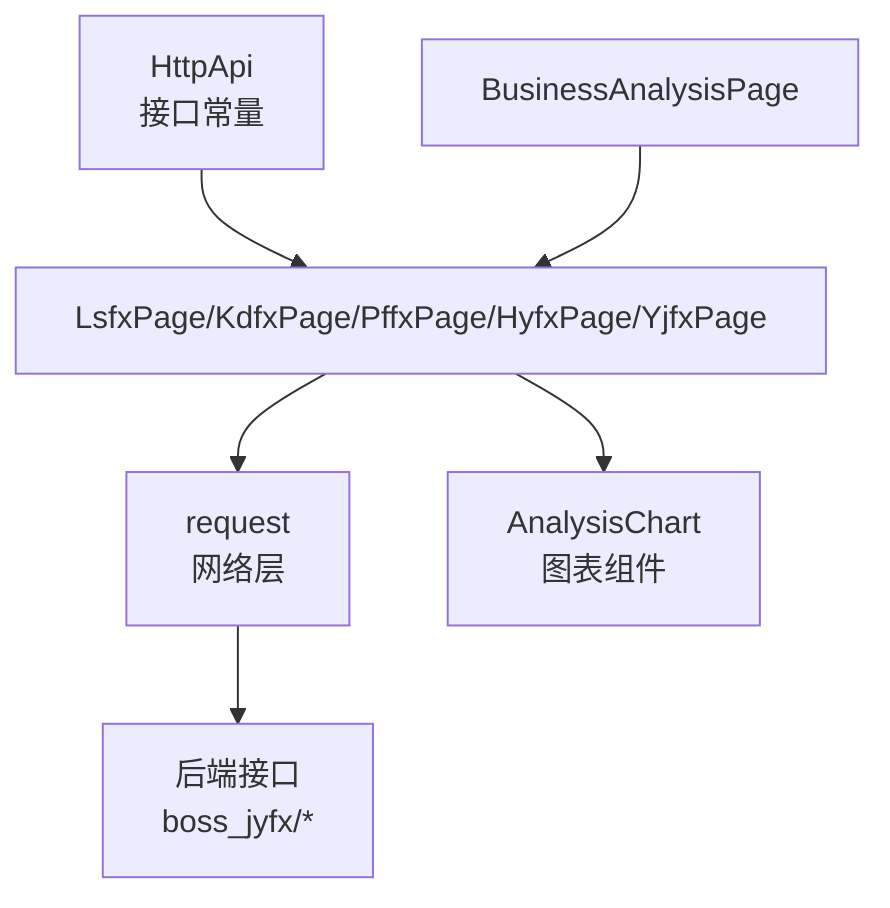

# 经营分析API

<cite>
**本文引用的文件 **
- [http_api.dart](file://lib/net/http_api.dart)
- [business_analysis_page.dart](file://lib/pages/data/businessReport/businessAnalysis/business_analysis_page.dart)
- [lsfx_page.dart](file://lib/pages/data/businessReport/businessAnalysis/subpage/lsfx_page.dart)
- [kdfx_page.dart](file://lib/pages/data/businessReport/businessAnalysis/subpage/kdfx_page.dart)
- [pffx_page.dart](file://lib/pages/data/businessReport/businessAnalysis/subpage/pffx_page.dart)
- [hyfx_page.dart](file://lib/pages/data/businessReport/businessAnalysis/subpage/hyfx_page.dart)
- [yjfx_page.dart](file://lib/pages/data/businessReport/businessAnalysis/subpage/yjfx_page.dart)
</cite>

## 目录
1. [引言](#引言)
2. [项目结构与入口](#项目结构与入口)
3. [接口总览](#接口总览)
4. [通用请求与响应约定](#通用请求与响应约定)
5. [经营分析数据汇总：boss_jyfx/getData](#经营分析数据汇总boss_jyfxgetdata)
6. [零售分析：boss_jyfx/getLsfx](#零售分析boss_jyfxgetlsfx)
7. [客单分析：boss_jyfx/getKdfx](#客单分析boss_jyfxgetkdfx)
8. [批发分析：boss_jyfx/getPffx](#批发分析boss_jyfxgetpffx)
9. [会员分析列表：boss_jyfx/getHyfx 与头部：boss_jyfx/getHyfxHead](#会员分析列表boss_jyfxgethyfx-与头部boss_jyfxgethyfxhead)
10. [业绩分析：boss_jyfx/getYjfx](#业绩分析boss_jyfxgetyjfx)
11. [图表数据格式说明](#图表数据格式说明)
12. [调用示例](#调用示例)
13. [分页与大数据量处理](#分页与大数据量处理)
14. [缓存策略建议](#缓存策略建议)
15. [错误处理方案](#错误处理方案)
16. [依赖关系与架构视图](#依赖关系与架构视图)
17. [性能注意事项](#性能注意事项)
18. [常见问题排查](#常见问题排查)
19. [结论](#结论)

## 引言
本文件面向灵犀管店 Flutter 客户端中的“经营分析”模块，梳理并文档化以下后端接口的完整调用规范：
- boss_jyfx/getData：经营分析数据汇总
- boss_jyfx/getLsfx：零售分析
- boss_jyfx/getKdfx：客单分析
- boss_jyfx/getPffx：批发分析
- boss_jyfx/getHyfx：会员分析列表
- boss_jyfx/getYjfx：业绩分析

这些接口在 Flutter 侧由统一的 HTTP API 常量管理，并由业务页面通过网络层发起请求、解析 data 字段、渲染卡片或表格、绘制折线/柱状图。

## 项目结构与入口
经营分析功能位于“数据报表 → 经营分析”路径下：
- 入口页：BusinessAnalysisPage，负责时间范围、门店选择、汇总卡片展示，并跳转到子分析页。
- 子分析页：零售分析、客单分析、批发分析、会员分析、业绩分析各自独立维护筛选条件、列表、汇总数据和图表。

**图表来源**
- [business_analysis_page.dart:1-200](file://lib/pages/data/businessReport/businessAnalysis/business_analysis_page.dart#L1-L200)
- [http_api.dart:201-467](file://lib/net/http_api.dart#L201-L467)

**章节来源**
- [business_analysis_page.dart:1-200](file://lib/pages/data/businessReport/businessAnalysis/business_analysis_page.dart#L1-L200)
- [http_api.dart:201-467](file://lib/net/http_api.dart#L201-L467)

## 接口总览
| 接口 | 路由常量 | 用途 | 典型返回结构 |
|---|---|---|---|
| boss_jyfx/getData | HttpApi.bossJyfxGetData | 经营分析汇总卡片 | data 为 Map，包含零售、客单、会员、商品、退货、采购、批发、门店、业绩等指标键 |
| boss_jyfx/getLsfx | HttpApi.bossJyfxGetLsfx | 零售分析明细与趋势 | data.list、data.sumdata |
| boss_jyfx/getKdfx | HttpApi.bossJyfxGetKdfx | 客单分析明细与趋势 | data.list、data.sumdata |
| boss_jyfx/getPffx | HttpApi.bossJyfxGetPffx | 批发分析明细与趋势 | data.list、data.sumdata |
| boss_jyfx/getHyfx | HttpApi.bossJyfxGetHyfx | 会员分析列表 | data.list、data.sumdata |
| boss_jyfx/getHyfxHead | HttpApi.bossJyfxGetHyfxHead | 会员分析头部（VIP等级） | data 包含 vipcount、nowmoney、capitalmoney、givemoney、nowpoint、bossHyfxTypeLists 等 |
| boss_jyfx/getYjfx | HttpApi.bossJyfxGetYjfx | 业绩分析列表 | data.list、data.sumdata |

**章节来源**
- [http_api.dart:201-467](file://lib/net/http_api.dart#L201-L467)

## 通用请求与响应约定
- 基础 URL：来自 HttpApi.baseUrlYlx，当前值为云端地址。
- 请求方式：Flutter 侧使用统一 request 方法；所有经营分析接口均传递 store、时间范围和 selectdatetype。
- 通用参数：
  - sids：门店 ID 数组，例如 ["123"] 或 []。
  - sidsname：门店名称，用于展示。
  - starttime：开始时间，格式为 "yyyy-MM-dd 00:00:00"。
  - endtime：结束时间，格式为 "yyyy-MM-dd 23:59:59"。
  - selectdatetype：快速时间类型映射：
    - 0：昨天
    - 1：今日
    - 2：本周
    - 3：本月
    - 4：自定义
- 分页参数（部分接口）：
  - is_page：是否分页，1 表示分页，0 表示不分页。
  - page：页码，从 1 开始。
  - pagesize：每页数量，常见为 20。

**章节来源**
- [business_analysis_page.dart:1-200](file://lib/pages/data/businessReport/businessAnalysis/business_analysis_page.dart#L1-L200)
- [lsfx_page.dart:1-200](file://lib/pages/data/businessReport/businessAnalysis/subpage/lsfx_page.dart#L1-L200)
- [kdfx_page.dart:1-200](file://lib/pages/data/businessReport/businessAnalysis/subpage/kdfx_page.dart#L1-L200)
- [pffx_page.dart:1-200](file://lib/pages/data/businessReport/businessAnalysis/subpage/pffx_page.dart#L1-L200)
- [hyfx_page.dart:1-200](file://lib/pages/data/businessReport/businessAnalysis/subpage/hyfx_page.dart#L1-L200)
- [yjfx_page.dart:1-200](file://lib/pages/data/businessReport/businessAnalysis/subpage/yjfx_page.dart#L1-L200)

## 经营分析数据汇总：boss_jyfx/getData
该接口用于首页经营分析卡片的数据汇总。

### 请求参数
| 字段 | 类型 | 必填 | 说明 |
|---|---|---|---|
| sids | string[] | 否 | 门店 ID 列表；为空表示全部机构 |
| sidsname | string | 否 | 门店名称，用于 UI 展示 |
| starttime | string | 是 | 起始时间，格式 "yyyy-MM-dd 00:00:00" |
| endtime | string | 是 | 结束时间，格式 "yyyy-MM-dd 23:59:59" |
| selectdatetype | int | 是 | 快速时间类型：0=昨天，1=今日，2=本周，3=本月，4=自定义 |

### 响应结构
data 为 Map，包含多个卡片指标键：
- 零售相关：ls_rramt、ls_grossamt、ls_grossrate
- 客单相关：kd_billnum、kd_billprice、kd_rramt
- 会员相关：vip_addnum、vip_vipaddamt、vip_rramt、vip_prop
- 商品相关：product_name、product_typename、product_brandname、product_supname
- 销售退货相关：sale_retqty、sale_retamt
- 采购相关：cg_qty、cg_amt
- 批发相关：pf_amt、pf_grossamt、pf_grossrate
- 门店相关：store_amt、store_grossamt、store_grossrate
- 业绩相关：user_rrqty、user_rramt、user_saleductamt

### 统计维度
- 时间维度：由 starttime/endtime/selectdatetype 决定。
- 门店维度：由 sids/sidsname 决定。
- 其他维度：商品、分类、品牌、供应商等字段以字符串形式返回，供卡片展示。

**章节来源**
- [business_analysis_page.dart:1-200](file://lib/pages/data/businessReport/businessAnalysis/business_analysis_page.dart#L1-L200)

## 零售分析：boss_jyfx/getLsfx
零售分析提供按日/小时/周的销售额、毛利额、毛利率趋势和明细表。

### 请求参数
| 字段 | 类型 | 必填 | 说明 |
|---|---|---|---|
| is_page | int | 是 | 0，表示不分页 |
| sids | int[] | 否 | 门店 ID 列表 |
| sidsname | string | 否 | 门店名称 |
| starttime | string | 是 | 开始时间 |
| endtime | string | 是 | 结束时间 |
| selectdatetype | int | 是 | 快速时间类型 |

### 响应结构
- data.list：明细数组，每条记录至少包含：
  - billdate：日期或日期时间字符串
  - rramt：销售额
  - grossamt：毛利额
  - grossrate：毛利率
- data.sumdata：汇总对象，包含：
  - rramt：销售额汇总
  - grossamt：毛利额汇总
  - grossrate：毛利率汇总

### 计算规则与可视化
- 当日模式（selectdatetype==1）：按小时聚合，X轴为 0-23。
- 周模式（activeQuickTimeId==2）：按周一到周日聚合。
- 其他模式：按天或周字符串标签聚合。
- 折线图/柱状图 data 字段：List<{label, value}>，label 为短标签，value 为数值。

**章节来源**
- [lsfx_page.dart:1-200](file://lib/pages/data/businessReport/businessAnalysis/subpage/lsfx_page.dart#L1-L200)
- [lsfx_page.dart:201-688](file://lib/pages/data/businessReport/businessAnalysis/subpage/lsfx_page.dart#L201-L688)

## 客单分析：boss_jyfx/getKdfx
客单分析提供客流量、客单价、营业额趋势与明细表。

### 请求参数
同零售分析。

### 响应结构
- data.list：明细数组，每条记录至少包含：
  - billdate：日期或日期时间字符串
  - billnum：客流量
  - billprice：客单价
  - rramt：营业额
- data.sumdata：汇总对象，包含 billnum、billprice、rramt。

### 计算规则与可视化
- 当日模式：按小时聚合。
- 周模式：按周一到周日聚合。
- 其他模式：按天或周标签聚合。
- 图表 data 字段：List<{label, value}>。
- Tooltip 小数位：客流量为 1 位小数，客单价和营业额为 2 位小数。

**章节来源**
- [kdfx_page.dart:1-200](file://lib/pages/data/businessReport/businessAnalysis/subpage/kdfx_page.dart#L1-L200)
- [kdfx_page.dart:201-684](file://lib/pages/data/businessReport/businessAnalysis/subpage/kdfx_page.dart#L201-L684)

## 批发分析：boss_jyfx/getPffx
批发分析提供销售额、成本额、毛利额、毛利率趋势与明细表。

### 请求参数
同零售分析。

### 响应结构
- data.list：明细数组，每条记录至少包含：
  - billdate：日期或日期时间字符串
  - rramt：销售额
  - costamt：成本额
  - grossamt：毛利额
  - grossrate：毛利率
- data.sumdata：汇总对象，包含 rramt、costamt、grossamt、grossrate。

### 计算规则与可视化
- 当日模式：按小时聚合。
- 周模式：按周一到周日聚合。
- 其他模式：按天或周标签聚合。
- 图表 data 字段：List<{label, value}>。
- Tooltip 小数位：金额类通常为 2 位小数，毛利率加 % 后缀。

**章节来源**
- [pffx_page.dart:1-200](file://lib/pages/data/businessReport/businessAnalysis/subpage/pffx_page.dart#L1-L200)
- [pffx_page.dart:201-L702](file://lib/pages/data/businessReport/businessAnalysis/subpage/pffx_page.dart#L201-L702)

## 会员分析列表：boss_jyfx/getHyfx 与头部：boss_jyfx/getHyfxHead
会员分析分为两个接口：头部汇总与 VIP 等级列表，以及会员明细分页列表。

### boss_jyfx/getHyfxHead
#### 请求参数
| 字段 | 类型 | 必填 | 说明 |
|---|---|---|---|
| is_page | int | 是 | 0，表示不分页 |
| bsid | int | 否 | 门店 ID，取 sids 的第一个值 |

#### 响应结构
data 为 Map，包含：
- vipcount：会员总数
- nowmoney：会员储卡余额
- capitalmoney：本金
- givemoney：赠金
- nowpoint：会员积分
- bossHyfxTypeLists：VIP 等级列表，每项含 viptypename、vipcount、vipprop 等

### boss_jyfx/getHyfx
#### 请求参数
| 字段 | 类型 | 必填 | 说明 |
|---|---|---|---|
| is_page | int | 是 | 1，表示分页 |
| page | int | 是 | 页码，从 1 开始 |
| pagesize | int | 是 | 每页数量，默认 20 |
| sids | int[] | 否 | 门店 ID 列表 |
| sidsname | string | 否 | 门店名称 |
| starttime | string | 是 | 开始时间 |
| endtime | string | 是 | 结束时间 |
| selectdatetype | int | 是 | 快速时间类型 |
| selectviptypeflag | int | 是 | 是否开启分类统计，0=关闭，1=开启 |

#### 响应结构
- data.list：会员明细数组。
- data.sumdata：汇总对象，包含新增会员、开卡金额、充值金额、储卡消费等指标。

**章节来源**
- [hyfx_page.dart:1-200](file://lib/pages/data/businessReport/businessAnalysis/subpage/hyfx_page.dart#L1-L200)
- [hyfx_page.dart:201-L958](file://lib/pages/data/businessReport/businessAnalysis/subpage/hyfx_page.dart#L201-L958)

## 业绩分析：boss_jyfx/getYjfx
业绩分析支持按零售业绩或批发业绩切换，并提供分页列表和排序能力。

### 请求参数
| 字段 | 类型 | 必填 | 说明 |
|---|---|---|---|
| is_page | int | 是 | 1，表示分页 |
| page | int | 是 | 页码，从 1 开始 |
| pagesize | int | 是 | 每页数量，默认 20 |
| sids | int[] | 否 | 门店 ID 列表 |
| sidsname | string | 否 | 门店名称 |
| starttime | string | 是 | 开始时间 |
| endtime | string | 是 | 结束时间 |
| selectdatetype | int | 是 | 快速时间类型 |
| saleductflag | string | 是 | 业绩类型："0"=按零售业绩，"1"=按批发业绩 |
| field | string | 否 | 排序字段 |
| type | string | 否 | 排序方向："desc" 或 "asc" |

### 响应结构
- data.list：业绩明细数组。
- data.sumdata：汇总对象，包含：
  - rramt：销售额
  - rrqty：销售数量
  - saleductamt：提成金额

### 统计维度
- 时间维度：starttime/endtime/selectdatetype。
- 门店维度：sids/sidsname。
- 业绩维度：saleductflag 控制零售或批发。
- 排序维度：field/type。

**章节来源**
- [yjfx_page.dart:1-200](file://lib/pages/data/businessReport/businessAnalysis/subpage/yjfx_page.dart#L1-L200)
- [yjfx_page.dart:201-L602](file://lib/pages/data/businessReport/businessAnalysis/subpage/yjfx_page.dart#L201-L602)

## 图表数据格式说明
所有折线图/柱状图数据在 Flutter 侧统一转换为 List<{label, value}>：
- label：时间标签，如小时数、周一到周日、日期短串或周字符串。
- value：对应指标的数值，类型为 double。

不同模式的 X 轴生成规则：
- 当日模式：label 为 0-23 的小时。
- 周模式：label 为“周一”到“周日”。
- 其他模式：label 为日期去除年份后的片段，或包含“周”的原始字符串。

Tooltip 标签通常采用更完整的日期+时间格式，便于用户理解具体时间点。

**图表来源**
- [lsfx_page.dart:201-L688](file://lib/pages/data/businessReport/businessAnalysis/subpage/lsfx_page.dart#L201-L688)
- [kdfx_page.dart:201-L684](file://lib/pages/data/businessReport/businessAnalysis/subpage/kdfx_page.dart#L201-L684)
- [pffx_page.dart:201-L702](file://lib/pages/data/businessReport/businessAnalysis/subpage/pffx_page.dart#L201-L702)

## 调用示例
以下为 Flutter 侧典型调用流程，描述参数构造、请求发送、响应解析和状态更新。

### 零售分析调用序列

**图表来源**
- [lsfx_page.dart:1-200](file://lib/pages/data/businessReport/businessAnalysis/subpage/lsfx_page.dart#L1-L200)
- [http_api.dart:201-L467](file://lib/net/http_api.dart#L201-L467)

### 业绩分析分页加载序列

**图表来源**
- [yjfx_page.dart:1-200](file://lib/pages/data/businessReport/businessAnalysis/subpage/yjfx_page.dart#L1-L200)
- [yjfx_page.dart:201-L602](file://lib/pages/data/businessReport/businessAnalysis/subpage/yjfx_page.dart#L201-L602)

## 分页与大数据量处理
- 需要分页的接口：
  - boss_jyfx/getHyfx
  - boss_jyfx/getYjfx
- 分页参数：
  - is_page=1
  - page>=1
  - pagesize=20
- 前端逻辑：
  - 首次加载清空列表，设置 hasLoadedOnce=true。
  - 若返回 list.length>=pagesize，则标记还有更多数据，并递增下一页页码。
  - 加载更多时追加新 list，避免覆盖历史数据。
  - 对空数据和异常进行防御性处理，避免闪烁或白屏。

**章节来源**
- [hyfx_page.dart:201-L958](file://lib/pages/data/businessReport/businessAnalysis/subpage/hyfx_page.dart#L201-L958)
- [yjfx_page.dart:201-L602](file://lib/pages/data/businessReport/businessAnalysis/subpage/yjfx_page.dart#L201-L602)

## 缓存策略建议
当前代码未实现显式服务端缓存控制（如 ETag/Last-Modified），也未在 Flutter 侧实现持久化缓存。建议：
- 服务端：
  - 对统计数据接口启用短期缓存，如 1-5 分钟。
  - 对会员等级头部数据可更长缓存，因为变化频率低。
- 客户端：
  - 对 getData、getHyfxHead 做内存缓存，结合门店和时间维度作为 key。
  - 对 getLsfx/getKdfx/getPffx 等趋势数据，按时间段缓存，避免重复请求。
  - 对分页数据仅缓存当前页结果，不缓存全量。

[本节为通用建议，不直接分析具体文件]

## 错误处理方案
- 网络异常：
  - 首次加载失败时清空 _list 与 _sumData，显示“暂无数据”。
  - 已加载过的刷新失败时保留旧数据，避免闪屏。
- 数据校验：
  - 对 data 是否为 Map、list 是否为 List 做防御性判断。
  - 对数值字段使用 tryParse 转换，避免 NaN 或 null 导致 UI 崩溃。
- 用户反馈：
  - 汇总卡片加载失败时弹出 Toast 提示。
  - 分页加载失败时仅关闭 loadingMore，不影响已有数据。

**章节来源**
- [business_analysis_page.dart:1-200](file://lib/pages/data/businessReport/businessAnalysis/business_analysis_page.dart#L1-L200)
- [lsfx_page.dart:1-200](file://lib/pages/data/businessReport/businessAnalysis/subpage/lsfx_page.dart#L1-L200)
- [kdfx_page.dart:1-200](file://lib/pages/data/businessReport/businessAnalysis/subpage/kdfx_page.dart#L1-L200)
- [pffx_page.dart:1-200](file://lib/pages/data/businessReport/businessAnalysis/subpage/pffx_page.dart#L1-L200)
- [hyfx_page.dart:201-L958](file://lib/pages/data/businessReport/businessAnalysis/subpage/hyfx_page.dart#L201-L958)
- [yjfx_page.dart:201-L602](file://lib/pages/data/businessReport/businessAnalysis/subpage/yjfx_page.dart#L201-L602)

## 依赖关系与架构视图
经营分析模块依赖关系如下：
- HttpApi 提供接口常量。
- 各 Page 通过 request 发起网络请求。
- 解析 data 后更新本地状态，驱动 UI 渲染。
- AnalysisChart 组件消费 List<{label,value}> 数据绘制图表。

**图表来源**
- [http_api.dart:201-L467](file://lib/net/http_api.dart#L201-L467)
- [business_analysis_page.dart:1-200](file://lib/pages/data/businessReport/businessAnalysis/business_analysis_page.dart#L1-L200)
- [lsfx_page.dart:1-200](file://lib/pages/data/businessReport/businessAnalysis/subpage/lsfx_page.dart#L1-L200)
- [kdfx_page.dart:1-200](file://lib/pages/data/businessReport/businessAnalysis/subpage/kdfx_page.dart#L1-L200)
- [pffx_page.dart:1-200](file://lib/pages/data/businessReport/businessAnalysis/subpage/pffx_page.dart#L1-L200)
- [hyfx_page.dart:1-200](file://lib/pages/data/businessReport/businessAnalysis/subpage/hyfx_page.dart#L1-L200)
- [yjfx_page.dart:1-200](file://lib/pages/data/businessReport/businessAnalysis/subpage/yjfx_page.dart#L1-L200)

## 性能注意事项
- 避免重复请求：
  - 门店或时间变化才触发重新加载。
  - 分页加载更多前先判断 hasMore 和 loadingMore。
- 数据格式化开销：
  - 对数值字段尽量在后端返回稳定精度，前端只做展示格式化。
- 图表数据预处理：
  - 当日/周聚合在内存中进行，注意大数据量时的性能。
- 滚动性能：
  - 列表使用 DataTable2，并对横向滚动控制器做同步，避免重复布局。

[本节为通用指导，不直接分析具体文件]

## 常见问题排查
- 数据为空：
  - 检查 starttime/endtime/selectdatetype 是否正确。
  - 检查 sids 是否为空或无效。
- 图表无数据：
  - 确认 list 是否为空。
  - 确认 chartData 生成逻辑中 label/value 是否被正确解析。
- 分页不生效：
  - 检查 is_page 是否为 1。
  - 检查 page/pagesize 是否正确传递。
  - 检查后端返回 list.length 与 hasMore 的判断逻辑。

**章节来源**
- [business_analysis_page.dart:1-200](file://lib/pages/data/businessReport/businessAnalysis/business_analysis_page.dart#L1-L200)
- [hyfx_page.dart:201-L958](file://lib/pages/data/businessReport/businessAnalysis/subpage/hyfx_page.dart#L201-L958)
- [yjfx_page.dart:201-L602](file://lib/pages/data/businessReport/businessAnalysis/subpage/yjfx_page.dart#L201-L602)

## 结论
灵犀管店 Flutter 的经营分析模块围绕 boss_jyfx/* 系列接口展开，前端统一通过 HttpApi 常量管理路由，并在各业务页面中完成参数构造、请求、解析与可视化。关键规范包括：
- 统一的时间与门店过滤参数。
- 明确的 data.list 与 data.sumdata 结构。
- 针对当日/周/其他模式的图表数据生成规则。
- 分页接口的 is_page/page/pagesize 语义。
- 稳健的错误处理和空数据处理策略。

建议在后续迭代中补充服务端缓存控制和客户端数据缓存策略，进一步提升大数据量场景下的性能和用户体验。