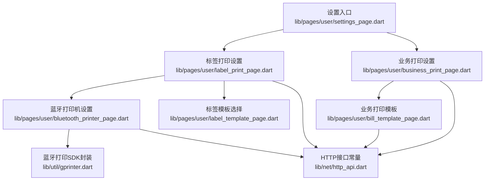
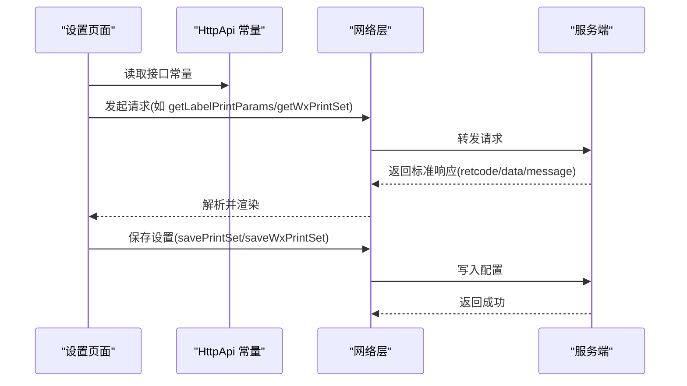
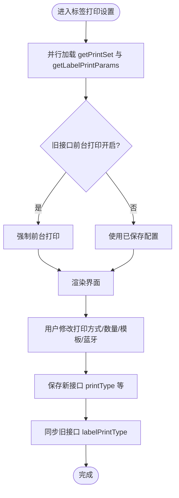
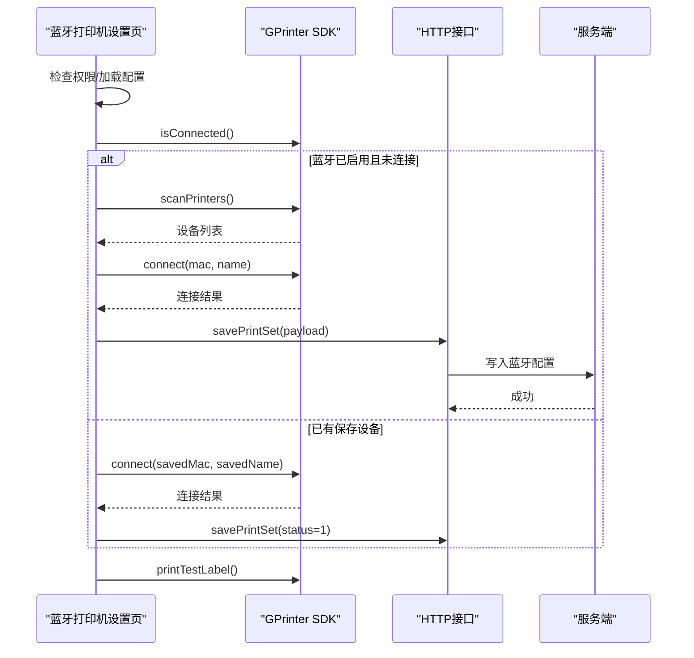
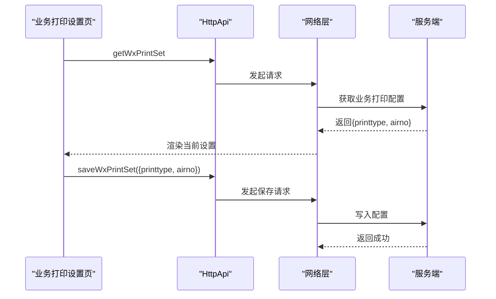
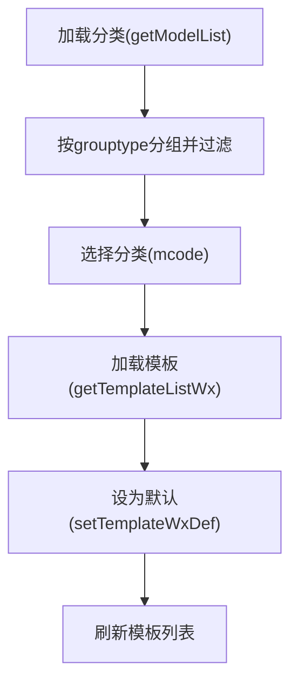
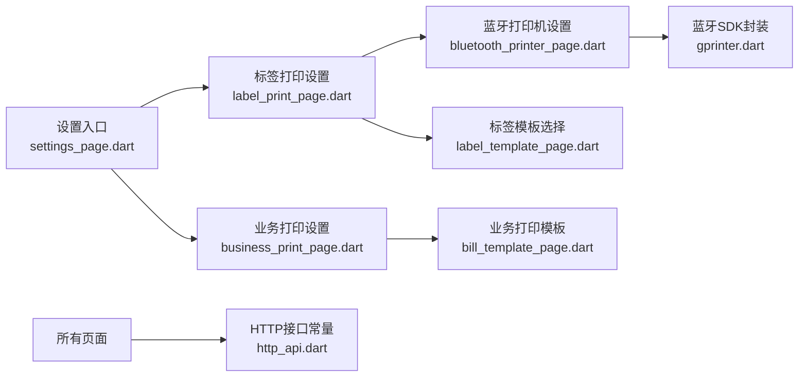

# 系统设置API

<cite>
**本文引用的文件**   
- [http_api.dart](file://lib/net/http_api.dart)
- [settings_page.dart](file://lib/pages/user/settings_page.dart)
- [label_print_page.dart](file://lib/pages/user/label_print_page.dart)
- [bluetooth_printer_page.dart](file://lib/pages/user/bluetooth_printer_page.dart)
- [business_print_page.dart](file://lib/pages/user/business_print_page.dart)
- [label_template_page.dart](file://lib/pages/user/label_template_page.dart)
- [bill_template_page.dart](file://lib/pages/user/bill_template_page.dart)
- [gprinter.dart](file://lib/util/gprinter.dart)
- [constant.dart](file://lib/res/constant.dart)
</cite>

## 目录
1. [引言](#引言)
2. [项目结构](#项目结构)
3. [核心组件](#核心组件)
4. [架构总览](#架构总览)
5. [详细组件分析](#详细组件分析)
6. [依赖关系分析](#依赖关系分析)
7. [性能与可靠性](#性能与可靠性)
8. [故障排除指南](#故障排除指南)
9. [结论](#结论)

## 引言
本文面向灵犀管店 Flutter 项目的“系统设置”能力，围绕主题设置、账户管理、打印机配置、标签模板等系统级配置的接口规范进行系统化说明。重点覆盖以下能力：
- 标签打印配置：wxprint/getLabelPrintParams（标签打印参数）
- 业务打印配置：airprint/getWxPrintSet / airprint/saveWxPrintSet（AirPrint 业务打印）
- 常用功能配置：MenuCommon/getMenuCommon（菜单常用功能开关）
- 蓝牙标签打印：wxprint/getPrintSet / wxprint/savePrintSet（含蓝牙设备绑定）
- 打印模板管理：airprint/getModelList / getTemplateListWx / setTemplateWxDef
- 系统参数管理与本地持久化策略

文档同时给出调用时序图、数据流图和最佳实践，帮助前端集成与后端对齐字段定义。

## 项目结构
与系统设置相关的主要代码集中在以下位置：
- 接口常量：lib/net/http_api.dart
- 设置入口页：lib/pages/user/settings_page.dart
- 标签打印设置：lib/pages/user/label_print_page.dart
- 蓝牙打印机设置：lib/pages/user/bluetooth_printer_page.dart
- 业务打印设置：lib/pages/user/business_print_page.dart
- 标签模板选择：lib/pages/user/label_template_page.dart
- 业务打印模板：lib/pages/user/bill_template_page.dart
- 蓝牙打印 SDK 封装：lib/util/gprinter.dart
- 全局常量与本地存储键：lib/res/constant.dart

**图表来源**
- [settings_page.dart:1-97](file://lib/pages/user/settings_page.dart#L1-L97)
- [label_print_page.dart:1-200](file://lib/pages/user/label_print_page.dart#L1-L200)
- [bluetooth_printer_page.dart:1-200](file://lib/pages/user/bluetooth_printer_page.dart#L1-L200)
- [business_print_page.dart:1-200](file://lib/pages/user/business_print_page.dart#L1-L200)
- [label_template_page.dart:1-200](file://lib/pages/user/label_template_page.dart#L1-L200)
- [bill_template_page.dart:1-200](file://lib/pages/user/bill_template_page.dart#L1-L200)
- [gprinter.dart:1-130](file://lib/util/gprinter.dart#L1-L130)
- [http_api.dart:468-595](file://lib/net/http_api.dart#L468-L595)

**章节来源**
- [settings_page.dart:1-97](file://lib/pages/user/settings_page.dart#L1-L97)
- [http_api.dart:468-595](file://lib/net/http_api.dart#L468-L595)

## 核心组件
本节聚焦系统设置相关的接口契约、请求参数、返回结构与默认值处理。

### 接口清单与职责
| 接口名称 | 用途 | 请求示例关键字段 | 主要返回字段 | 默认值与兼容说明 |
|---|---|---|---|---|
| `wxprint/getLabelPrintParams` | 获取标签打印参数（旧接口兼容） | `type=31` | `labelPrintType`（前台打印开关） | 用于与新版打印方式互斥控制 |
| `wxprint/getPrintSet` | 获取标签打印设置（含蓝牙配置） | `clientid` | `printType`、`print_num`、`print_template`、`lableBluetoothStatus`、`lableBluetoothCode`、`lableDeviceid`、`lableServiceid`、`lableCharacteristicid` 等 | 未保存时回退为默认值；兼容 `lableServiceId`、`lableCharacteristicId` 新旧字段名 |
| `wxprint/savePrintSet` | 保存标签打印设置（含蓝牙配置） | 同 getPrintSet 返回体 | 通用成功响应 | 保存后立即同步到服务端 |
| `airprint/getWxPrintSet` | 获取业务打印配置（AirPrint） | 无 | `printtype`、`airno` | 关闭=0，服务工具打印=1 |
| `airprint/saveWxPrintSet` | 保存业务打印配置 | `printtype`、`airno` | 通用成功响应 | 关闭时清空 airno |
| `MenuCommon/getMenuCommon` | 获取常用功能配置 | 通常为空或携带上下文参数 | 常用功能开关集合 | 由服务端下发，客户端按需渲染 |
| `airprint/getModelList` | 获取打印模板分类 | `is_page=0` | `grouptype`、`mcode`、`title` 等分组信息 | 过滤“其他”分组 |
| `airprint/getTemplateListWx` | 获取某分类下模板列表 | `menuid`、可选 `airno`、`is_page=0` | 模板项列表 | 可结合 airno 区分不同设备默认模板 |
| `airprint/setTemplateWxDef` | 设为默认模板 | `menuid`、`billid` | 通用成功响应 | 成功后刷新模板列表以更新默认标记 |

上述接口的常量定义集中在 `HttpApi` 类中，便于统一维护。

**章节来源**
- [http_api.dart:468-595](file://lib/net/http_api.dart#L468-L595)
- [label_print_page.dart:55-120](file://lib/pages/user/label_print_page.dart#L55-L120)
- [business_print_page.dart:55-120](file://lib/pages/user/business_print_page.dart#L55-L120)
- [bill_template_page.dart:1-120](file://lib/pages/user/bill_template_page.dart#L1-L120)

## 架构总览
系统设置的调用链路遵循“页面 -> HTTP接口常量 -> 网络层 -> 服务端”的单向流程，部分场景包含本地状态缓存与多端一致性校验。

**图表来源**
- [http_api.dart:468-595](file://lib/net/http_api.dart#L468-L595)
- [label_print_page.dart:55-120](file://lib/pages/user/label_print_page.dart#L55-L120)
- [business_print_page.dart:55-120](file://lib/pages/user/business_print_page.dart#L55-L120)

## 详细组件分析

### 标签打印配置：wxprint/getLabelPrintParams 与 wxprint/getPrintSet/savePrintSet
该模块负责标签打印方式的切换、打印数量、模板选择以及蓝牙设备绑定。

- 加载流程
  - 并行拉取新版打印设置与服务端标签打印参数（旧接口）。
  - 若旧接口开启前台打印，则强制前台打印（互斥规则）。
  - 对空值提供默认值：printType、print_num、print_template、lableBluetoothStatus 等。
  - 兼容旧字段名 lableServiceId/lableCharacteristicId。

- 保存流程
  - 修改 printType 后，同时保存新接口与旧接口状态，保持互斥一致。
  - 蓝牙配置通过 savePrintSet 整体回写，包含设备 MAC、服务 UUID、特征 UUID 等。

- 关键交互
  - 打印方式选项：关闭打印、前台打印、蓝牙打印。
  - 模板选择：跳转标签模板选择页，返回选中模板 ID。
  - 蓝牙打印机：跳转到蓝牙打印机设置页完成连接与测试打印。

**图表来源**
- [label_print_page.dart:55-120](file://lib/pages/user/label_print_page.dart#L55-L120)
- [label_print_page.dart:120-200](file://lib/pages/user/label_print_page.dart#L120-L200)

**章节来源**
- [label_print_page.dart:55-200](file://lib/pages/user/label_print_page.dart#L55-L200)
- [http_api.dart:468-595](file://lib/net/http_api.dart#L468-L595)

### 蓝牙打印机设置：wxprint/getPrintSet/savePrintSet 与蓝牙 SDK
蓝牙打印机设置页负责蓝牙开关、自动重连、扫描设备、连接/断开、测试打印等操作。

- 初始化
  - 检查蓝牙权限，加载服务端保存的配置。
  - 查询 SDK 实际连接状态，避免“已保存地址但实际未连接”的误判。
  - 若蓝牙已启用且有保存设备，尝试自动重连；否则开始扫描。

- 扫描与连接
  - 扫描失败时处理平台异常（如 BT_DISABLED），引导开启系统蓝牙。
  - 连接成功后保存设备 MAC、服务 UUID、特征 UUID 等。

- 测试打印
  - 仅当已连接时允许测试打印，调用原生通道执行打印任务。

**图表来源**
- [bluetooth_printer_page.dart:1-200](file://lib/pages/user/bluetooth_printer_page.dart#L1-L200)
- [bluetooth_printer_page.dart:201-722](file://lib/pages/user/bluetooth_printer_page.dart#L201-L722)
- [gprinter.dart:1-130](file://lib/util/gprinter.dart#L1-L130)
- [http_api.dart:468-595](file://lib/net/http_api.dart#L468-L595)

**章节来源**
- [bluetooth_printer_page.dart:1-722](file://lib/pages/user/bluetooth_printer_page.dart#L1-L722)
- [gprinter.dart:1-130](file://lib/util/gprinter.dart#L1-L130)

### 业务打印配置：airprint/getWxPrintSet/saveWxPrintSet
业务打印设置页负责 AirPrint 业务打印开关与设备 ID（airno）绑定。

- 加载流程
  - 调用 getWxPrintSet，解析 printtype 与 airno。
  - 类型 0=关闭打印，1=打印服务工具打印。

- 保存流程
  - 保存 printtype 与 airno；关闭打印时清空 airno。
  - 支持扫码输入设备 ID，确认后保存并提示成功。

- 模板管理
  - 跳转业务打印模板页，按分类加载模板列表，支持设为默认模板。

**图表来源**
- [business_print_page.dart:55-120](file://lib/pages/user/business_print_page.dart#L55-L120)
- [business_print_page.dart:120-200](file://lib/pages/user/business_print_page.dart#L120-L200)
- [http_api.dart:468-595](file://lib/net/http_api.dart#L468-L595)

**章节来源**
- [business_print_page.dart:55-200](file://lib/pages/user/business_print_page.dart#L55-L200)
- [bill_template_page.dart:1-200](file://lib/pages/user/bill_template_page.dart#L1-L200)

### 打印模板管理：airprint/getModelList / getTemplateListWx / setTemplateWxDef
业务打印模板页负责分类选择、模板列表加载与默认模板设置。

- 分类加载
  - 调用 getModelList，按 grouptype 分组，过滤“其他”。
  - 默认选中首个分类，并记录 mcode。

- 模板列表
  - 根据 menuid 与可选 airno 加载模板列表。
  - 列表为空时展示空状态。

- 设为默认
  - 调用 setTemplateWxDef，传入 menuid 与 billid。
  - 成功后刷新列表以更新默认标记。

**图表来源**
- [bill_template_page.dart:1-200](file://lib/pages/user/bill_template_page.dart#L1-L200)
- [http_api.dart:468-595](file://lib/net/http_api.dart#L468-L595)

**章节来源**
- [bill_template_page.dart:1-200](file://lib/pages/user/bill_template_page.dart#L1-L200)
- [label_template_page.dart:1-200](file://lib/pages/user/label_template_page.dart#L1-L200)

### 常用功能配置：MenuCommon/getMenuCommon
常用功能配置接口由服务端下发一组功能开关，客户端根据返回值渲染对应菜单或功能入口。

- 请求方式
  - 通常无需额外参数，或在特定上下文中携带用户/门店标识。
- 返回结构
  - 常见字段包括各功能开关布尔值与排序权重，具体以服务端定义为准。
- 客户端行为
  - 在首页或设置入口按返回结果动态显示/隐藏功能入口。
  - 建议在首次加载与登录后刷新，确保与服务器保持一致。

**章节来源**
- [http_api.dart:468-595](file://lib/net/http_api.dart#L468-L595)

## 依赖关系分析
系统设置相关组件之间的耦合关系如下：

**图表来源**
- [settings_page.dart:1-97](file://lib/pages/user/settings_page.dart#L1-L97)
- [label_print_page.dart:1-200](file://lib/pages/user/label_print_page.dart#L1-L200)
- [bluetooth_printer_page.dart:1-200](file://lib/pages/user/bluetooth_printer_page.dart#L1-L200)
- [business_print_page.dart:1-200](file://lib/pages/user/business_print_page.dart#L1-L200)
- [label_template_page.dart:1-200](file://lib/pages/user/label_template_page.dart#L1-L200)
- [bill_template_page.dart:1-200](file://lib/pages/user/bill_template_page.dart#L1-L200)
- [gprinter.dart:1-130](file://lib/util/gprinter.dart#L1-L130)
- [http_api.dart:468-595](file://lib/net/http_api.dart#L468-L595)

**章节来源**
- [settings_page.dart:1-97](file://lib/pages/user/settings_page.dart#L1-L97)
- [http_api.dart:468-595](file://lib/net/http_api.dart#L468-L595)

## 性能与可靠性
- 并发加载：标签打印设置页并行请求新版设置与旧接口参数，缩短首屏等待时间。
- 默认值保护：对缺失字段提供合理默认值，避免空白界面。
- 字段兼容：对新旧字段名（如 lableServiceId/lableServiceid）做兼容映射。
- 幂等保存：多次保存同一配置不会产生副作用，适合快速连续操作。
- 错误降级：网络异常时不阻断主流程，仅提示用户，保证基本体验。

[本节为通用指导，不涉及具体文件分析]

## 故障排除指南
- 蓝牙权限被拒绝
  - 现象：无法扫描或连接蓝牙打印机。
  - 处理：引导用户到系统设置开启权限，并在后续流程中重新检测。
  - 涉及实现：蓝牙权限请求与状态检查。

- 系统蓝牙未开启
  - 现象：扫描失败并返回平台异常码（如 BT_DISABLED）。
  - 处理：弹出提示引导开启系统蓝牙，开启后自动继续扫描或重连。
  - 涉及实现：平台异常分支与延迟重试。

- 连接成功但未打印
  - 现象：连接状态正常，测试打印失败。
  - 处理：检查打印机是否在线、纸张是否正确、SDK 通道是否正常；必要时断开重连。
  - 涉及实现：测试打印方法与连接状态校验。

- 业务打印配置未生效
  - 现象：切换 printtype 后仍按旧行为打印。
  - 处理：确认 airno 是否已正确保存；关闭打印时需清空 airno；检查模板默认设置是否覆盖。
  - 涉及实现：saveWxPrintSet 与模板默认设置。

- 标签打印方式冲突
  - 现象：前台打印与蓝牙打印同时生效。
  - 处理：确保旧接口 labelPrintType 与新接口 printType 同步更新，遵循互斥规则。
  - 涉及实现：标签打印设置页的双接口同步保存逻辑。

**章节来源**
- [bluetooth_printer_page.dart:201-722](file://lib/pages/user/bluetooth_printer_page.dart#L201-L722)
- [label_print_page.dart:120-200](file://lib/pages/user/label_print_page.dart#L120-L200)
- [business_print_page.dart:120-200](file://lib/pages/user/business_print_page.dart#L120-L200)

## 结论
本系统设置模块围绕标签打印、业务打印、蓝牙设备与模板管理构建了清晰的接口契约与前端交互流程。通过统一的接口常量、默认值保护、字段兼容与并发加载，保证了跨端一致性与良好用户体验。建议在后端扩展新功能时：
- 保持接口命名与返回结构的稳定性，新增字段采用可空设计。
- 对敏感配置增加版本兼容与灰度发布机制。
- 提供统一的错误码与消息规范，便于前端统一提示与降级。

[本节为总结性内容，不涉及具体文件分析]