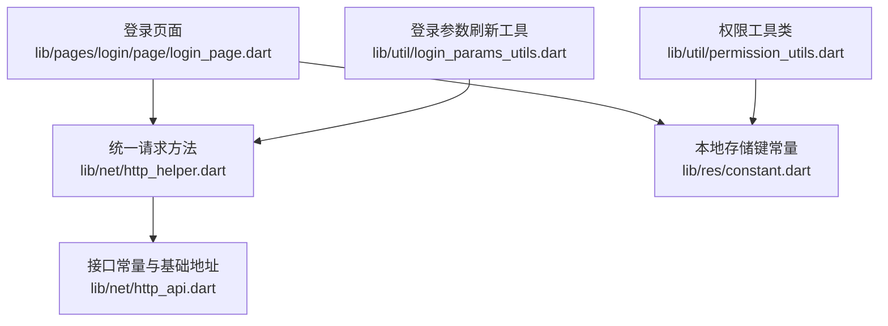
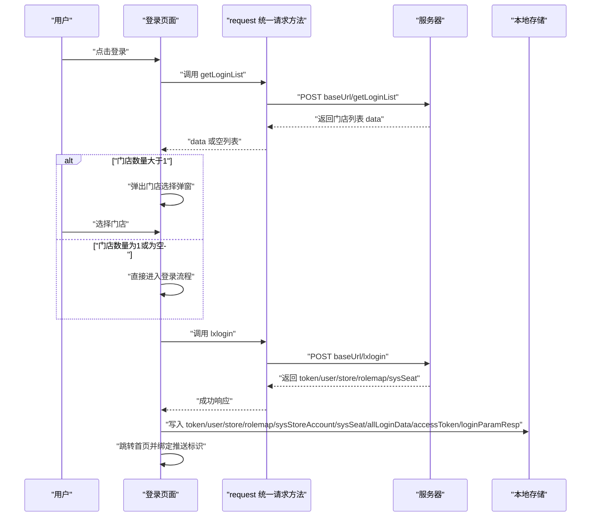
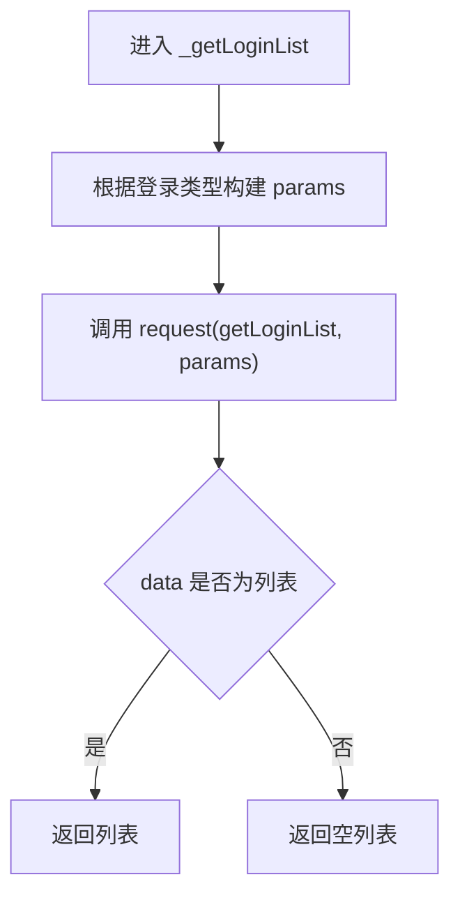
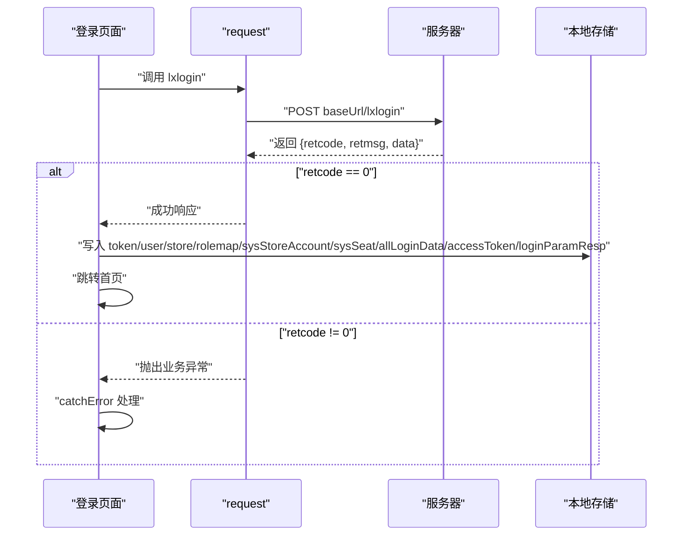
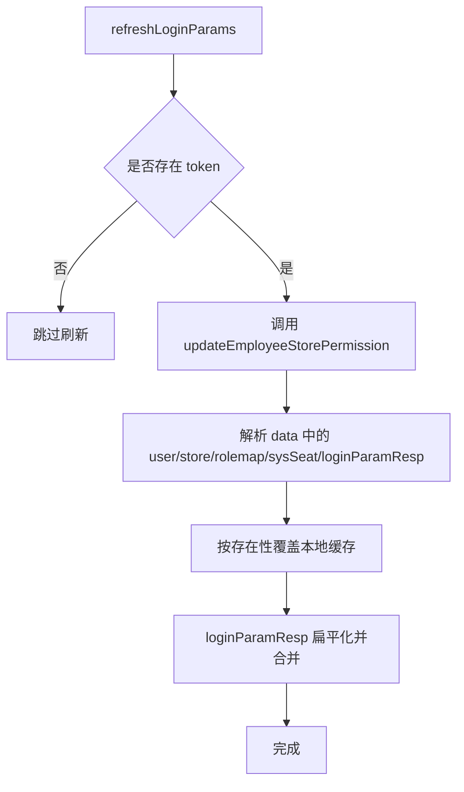
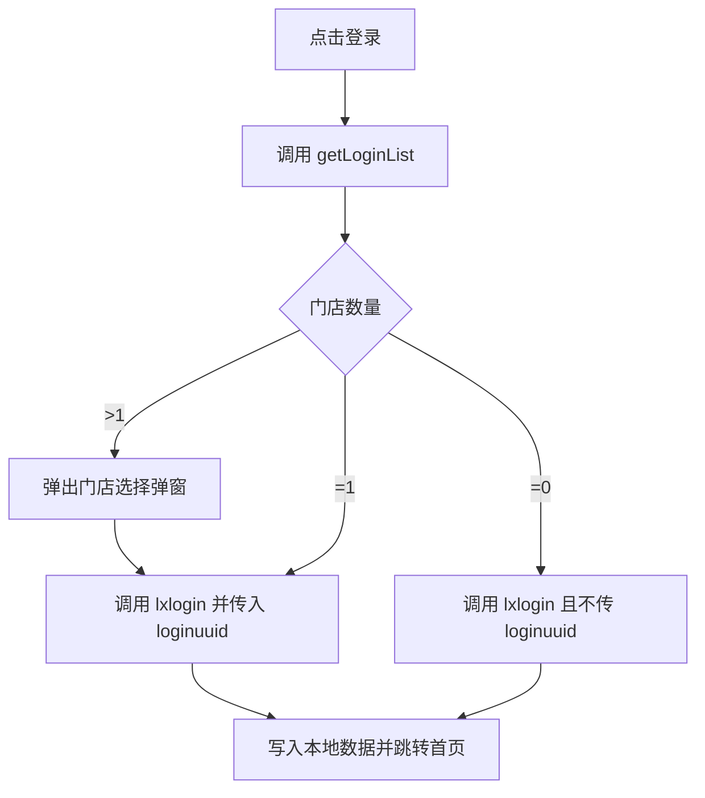
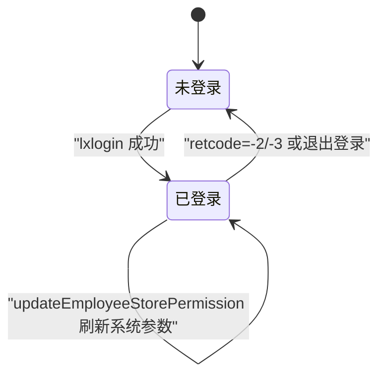
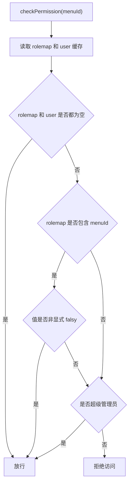
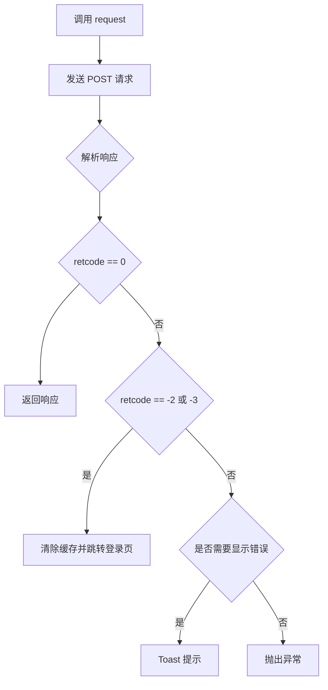
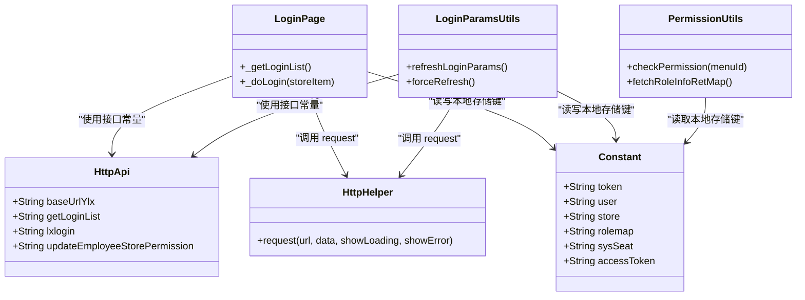

# 认证API

<cite>
**本文引用的文件**   
- [lib/net/http_api.dart](file://lib/net/http_api.dart)
- [lib/net/http_helper.dart](file://lib/net/http_helper.dart)
- [lib/pages/login/page/login_page.dart](file://lib/pages/login/page/login_page.dart)
- [lib/util/login_params_utils.dart](file://lib/util/login_params_utils.dart)
- [lib/util/permission_utils.dart](file://lib/util/permission_utils.dart)
- [lib/res/constant.dart](file://lib/res/constant.dart)
</cite>

## 目录
1. [简介](#简介)
2. [项目结构与定位](#项目结构与定位)
3. [核心接口总览](#核心接口总览)
4. [架构与调用链路](#架构与调用链路)
5. [接口详细文档](#接口详细文档)
6. [登录流程与状态管理](#登录流程与状态管理)
7. [权限验证与异常处理](#权限验证与异常处理)
8. [依赖关系分析](#依赖关系分析)
9. [性能与安全建议](#性能与安全建议)
10. [常见问题排查](#常见问题排查)
11. [结论](#结论)

## 简介
本文面向灵犀管店 Flutter 客户端，围绕“用户登录相关”的 HTTP 接口与本地认证机制编写技术文档。重点覆盖以下目标：
- 记录 `getLoginList`、`lxlogin`、`updateEmployeeStorePermission` 等接口的 URL 模式、请求参数、响应结构、错误处理和调用时机。
- 说明移动端登录的分步机制：先获取门店列表，再执行登录，最后刷新系统参数。
- 梳理 Token、用户信息、门店信息、权限映射、席位信息等本地存储策略。
- 给出登录状态检测、权限校验、异常处理的实现要点。
- 提供移动端安全存储与常见问题的实践建议。

本说明基于当前仓库中的网络层、登录页、工具类和常量定义进行分析，不假设后端字段未出现在源码中。

## 项目结构与定位
认证相关逻辑主要分布在以下位置：
- 接口名称与基础地址：`lib/net/http_api.dart`
- 统一请求封装、公共参数注入、登录过期处理：`lib/net/http_helper.dart`
- 登录 UI、分步登录流程、本地数据持久化：`lib/pages/login/page/login_page.dart`
- 启动后静默刷新登录相关数据：`lib/util/login_params_utils.dart`
- 权限读取与校验：`lib/util/permission_utils.dart`
- 本地存储键值常量：`lib/res/constant.dart`

**图示来源**
- [lib/net/http_api.dart:1-30](file://lib/net/http_api.dart#L1-L30)
- [lib/net/http_helper.dart:1-60](file://lib/net/http_helper.dart#L1-L60)
- [lib/pages/login/page/login_page.dart:140-220](file://lib/pages/login/page/login_page.dart#L140-L220)
- [lib/util/login_params_utils.dart:1-40](file://lib/util/login_params_utils.dart#L1-L40)
- [lib/util/permission_utils.dart:1-30](file://lib/util/permission_utils.dart#L1-L30)
- [lib/res/constant.dart:1-30](file://lib/res/constant.dart#L1-L30)

**章节来源**
- [lib/net/http_api.dart:1-30](file://lib/net/http_api.dart#L1-L30)
- [lib/net/http_helper.dart:1-60](file://lib/net/http_helper.dart#L1-L60)
- [lib/pages/login/page/login_page.dart:140-220](file://lib/pages/login/page/login_page.dart#L140-L220)
- [lib/util/login_params_utils.dart:1-40](file://lib/util/login_params_utils.dart#L1-L40)
- [lib/util/permission_utils.dart:1-30](file://lib/util/permission_utils.dart#L1-L30)
- [lib/res/constant.dart:1-30](file://lib/res/constant.dart#L1-L30)

## 核心接口总览
当前代码中与认证直接相关的接口常量如下：
- `getLoginList`：获取可登录门店列表，作为登录第一步。
- `lxlogin`：执行用户登录，返回 token、user、store、rolemap、sysSeat 等登录结果。
- `updateEmployeeStorePermission`：刷新员工门店权限及登录相关系统参数。

基础地址由 `HttpApi.baseUrlYlx` 决定，当前定义为云端地址；所有接口 URL 最终由 `request` 方法拼接基础地址和接口路径生成。

| 接口常量 | 实际接口名 | 用途 | 调用方 |
|---|---|---|---|
| `getLoginList` | getLoginList | 获取门店列表 | 登录页 `_getLoginList` |
| `lxlogin` | lxlogin | 用户登录 | 登录页 `_doLogin` |
| `updateEmployeeStorePermission` | updateEmployeeStorePermission | 刷新登录相关系统参数 | 登录参数刷新工具 |

**章节来源**
- [lib/net/http_api.dart:12-25](file://lib/net/http_api.dart#L12-L25)
- [lib/pages/login/page/login_page.dart:158-210](file://lib/pages/login/page/login_page.dart#L158-L210)
- [lib/util/login_params_utils.dart:10-25](file://lib/util/login_params_utils.dart#L10-L25)

## 架构与调用链路
登录相关调用链路分为三层：
1. 业务层：登录页负责输入校验、门店选择、触发登录；启动后通过登录参数刷新工具拉取最新系统参数。
2. 网络层：`request` 方法负责构建外层请求体、注入公共参数、发送 POST 请求、解析 `retcode`、处理登录过期。
3. 存储层：使用 `SpUtil` 写入 token、user、store、rolemap、sysSeat、accessToken、loginParamResp 等。

**图示来源**
- [lib/pages/login/page/login_page.dart:140-220](file://lib/pages/login/page/login_page.dart#L140-L220)
- [lib/net/http_helper.dart:40-120](file://lib/net/http_helper.dart#L40-L120)

**章节来源**
- [lib/pages/login/page/login_page.dart:140-220](file://lib/pages/login/page/login_page.dart#L140-L220)
- [lib/net/http_helper.dart:40-120](file://lib/net/http_helper.dart#L40-L120)

## 接口详细文档

### getLoginList：获取门店列表
- **URL 模式**：`baseUrl + '/getLoginList'`
- **Base URL**：`https://yun.bypos.net/LxSvr/web/`
- **HTTP 方法**：POST（由 `request` 默认 POST）
- **请求头**：无特殊认证头；Token 在请求体内注入。
- **请求体结构**：由 `request` 构造外层对象，业务参数位于 `params` 中。
- **业务参数**：
  - 手机号登录：`phone`、`pwd`、`logintype = '1'`
  - 商户号登录：`account`、`code`、`pwd`、`logintype = '2'`
- **密码处理**：前端对原始密码进行 MD5 后再传入。
- **响应结构**：
  - 顶层包含 `retcode`、`retmsg`、`data` 等通用字段。
  - `data` 为门店列表数组时，登录页会直接使用；否则视为空列表。
- **典型成功响应特征**：`retcode == 0`，`data` 是门店列表。
- **错误处理**：
  - `retcode != 0` 时，`request` 会根据 `showError` 决定是否 Toast。
  - `retcode == -2` 或 `-3` 时视为登录信息失效，清除缓存并跳转登录页。
  - 网络异常时，`request` 尝试提取服务端真实错误消息。

**图示来源**
- [lib/pages/login/page/login_page.dart:158-175](file://lib/pages/login/page/login_page.dart#L158-L175)
- [lib/net/http_helper.dart:60-120](file://lib/net/http_helper.dart#L60-L120)

**章节来源**
- [lib/net/http_api.dart:16-20](file://lib/net/http_api.dart#L16-L20)
- [lib/pages/login/page/login_page.dart:158-175](file://lib/pages/login/page/login_page.dart#L158-L175)
- [lib/net/http_helper.dart:60-120](file://lib/net/http_helper.dart#L60-L120)

### lxlogin：用户登录
- **URL 模式**：`baseUrl + '/lxlogin'`
- **HTTP 方法**：POST
- **请求体结构**：由 `request` 构造外层对象，业务参数位于 `params` 中。
- **业务参数**：
  - 手机号登录：`phone`、`pwd`、`logintype = '1'`
  - 商户号登录：`account`、`code`、`pwd`、`logintype = '2'`
  - 若已选择门店：附加 `loginuuid`
- **密码处理**：MD5。
- **响应结构**：
  - 顶层包含 `retcode`、`retmsg`、`data`。
  - `data` 可能是 Map；登录页兼容扁平结构，即当 `data` 不是 Map 时直接使用顶层响应作为数据源。
  - 登录成功后需写入以下本地存储键：
    - `token`
    - `user`
    - `store`
    - `rolemap`
    - `sysStoreAccount`
    - `sysSeat`
    - `allLoginData`
    - `accessToken`
    - `loginParamResp`（可能嵌套子对象，登录页会做扁平化处理）
- **成功行为**：
  - 保存凭证。
  - 记录操作日志和设备信息。
  - 绑定推送标识。
  - 跳转到首页。
- **错误处理**：
  - 登录失败时，`catchError` 打印异常并重置加载状态。
  - 登录过期由 `request` 统一处理：清除缓存并跳转登录页。

**图示来源**
- [lib/pages/login/page/login_page.dart:190-260](file://lib/pages/login/page/login_page.dart#L190-L260)
- [lib/net/http_helper.dart:80-140](file://lib/net/http_helper.dart#L80-L140)

**章节来源**
- [lib/net/http_api.dart:18-20](file://lib/net/http_api.dart#L18-L20)
- [lib/pages/login/page/login_page.dart:190-260](file://lib/pages/login/page/login_page.dart#L190-L260)
- [lib/net/http_helper.dart:80-140](file://lib/net/http_helper.dart#L80-L140)

### updateEmployeeStorePermission：更新员工门店权限
- **URL 模式**：`baseUrl + '/updateEmployeeStorePermission'`
- **HTTP 方法**：POST
- **调用时机**：
  - App 启动后由 `LoginParamsUtils.refreshLoginParams` 静默刷新一次。
  - 解绑席位等操作后可调用 `forceRefresh` 强制刷新。
- **请求参数**：空对象 `{}`。
- **响应结构**：
  - 顶层包含 `retcode`、`retmsg`、`data`。
  - `data` 应包含 `user`、`store`、`rolemap`、`sysSeat`、`loginParamResp` 等字段。
- **本地存储更新规则**：
  - 若接口返回对应字段，则用 JSON 字符串覆盖本地缓存。
  - `loginParamResp` 的一级嵌套对象会被解构合并到顶层，再与已有缓存合并。
- **失败行为**：
  - 静默失败，不弹提示，不影响启动流程。
  - 下次启动自动重试。

**图示来源**
- [lib/util/login_params_utils.dart:20-120](file://lib/util/login_params_utils.dart#L20-L120)

**章节来源**
- [lib/net/http_api.dart:22-25](file://lib/net/http_api.dart#L22-L25)
- [lib/util/login_params_utils.dart:10-120](file://lib/util/login_params_utils.dart#L10-L120)

## 登录流程与状态管理

### 分步登录机制
登录页采用两步登录：
1. 第一步：调用 `getLoginList` 获取门店列表。
   - 如果门店数量大于 1，弹出门店选择弹窗。
   - 如果门店数量为 1，直接执行登录。
   - 如果门店数量为 0，也执行登录，但不传 `loginuuid`。
2. 第二步：调用 `lxlogin` 完成登录。
   - 携带用户凭证、登录类型和可选门店标识。
   - 成功后持久化 token、user、store、rolemap、sysSeat 等。

**图示来源**
- [lib/pages/login/page/login_page.dart:140-220](file://lib/pages/login/page/login_page.dart#L140-L220)

**章节来源**
- [lib/pages/login/page/login_page.dart:140-220](file://lib/pages/login/page/login_page.dart#L140-L220)

### Token 管理策略
当前认证体系存在两套 Token 概念：
- 业务 Token：存储在 `Constant.token`，由 `request` 注入请求体，用于灵犀管店后端接口鉴权。
- 访问 Token：存储在 `Constant.accessToken`，由登录成功后同步写入，并被 `AuthInterceptor` 注入 `Authorization` 请求头。

此外，`TokenInterceptor` 提供了基于 `lgn/refreshToken` 的自动刷新能力，但认证 API 文档应以业务侧 `request` 和 `HttpApi` 为准，因为登录相关接口主要通过 `request` 发起，而不是走该拦截器链。

| 存储键 | 含义 | 写入时机 | 使用方式 |
|---|---|---|---|
| `token` | 业务登录 Token | 登录成功 | 注入请求体外层 |
| `accessToken` | 访问 Token | 登录成功后复制 token | 被 `AuthInterceptor` 放入 Authorization 头 |
| `refreshToken` | 刷新 Token | 常量定义存在，但未在当前登录流程写入 | 仅由旧版 Token 刷新拦截器逻辑参考 |

**章节来源**
- [lib/res/constant.dart:10-25](file://lib/res/constant.dart#L10-L25)
- [lib/pages/login/page/login_page.dart:210-240](file://lib/pages/login/page/login_page.dart#L210-L240)
- [lib/net/intercept.dart:1-80](file://lib/net/intercept.dart#L1-L80)

### 会话保持与自动刷新
- 会话保持：
  - 登录成功后，token、user、store、rolemap、sysSeat 等保存在本地。
  - App 启动后若存在 token，则调用 `updateEmployeeStorePermission` 刷新系统参数。
- 自动刷新：
  - 权限刷新有 10 秒节流和并发保护。
  - 增值服务列表刷新也有 10 秒节流和并发保护。
  - 登录参数刷新仅在 App 运行期间执行一次，失败静默重试。

**图示来源**
- [lib/util/login_params_utils.dart:20-120](file://lib/util/login_params_utils.dart#L20-L120)
- [lib/net/http_helper.dart:100-140](file://lib/net/http_helper.dart#L100-L140)

**章节来源**
- [lib/util/login_params_utils.dart:20-120](file://lib/util/login_params_utils.dart#L20-L120)
- [lib/net/http_helper.dart:100-140](file://lib/net/http_helper.dart#L100-L140)

## 权限验证与异常处理

### 权限数据来源与校验规则
权限数据主要来自 `lxlogin` 返回的 `rolemap`，以及后续通过权限工具类刷新的权限映射。权限校验规则如下：
1. 若 `rolemap` 和 `user` 均不存在，放行。
2. 若 `rolemap` 中包含菜单 ID 且值非显式 falsy，放行。
3. 若用户角色 ID 或用户编码为 `1001`，视为超级管理员，放行。
4. 其他情况拒绝访问并提示无权。

**图示来源**
- [lib/util/permission_utils.dart:30-110](file://lib/util/permission_utils.dart#L30-L110)

**章节来源**
- [lib/util/permission_utils.dart:1-110](file://lib/util/permission_utils.dart#L1-L110)

### 异常处理机制
`request` 方法承担大部分异常处理职责：
- 成功：`retcode == 0` 或兼容 `code == 0` 时返回完整响应。
- 业务异常：`retcode != 0` 时根据 `showError` 显示提示并抛出异常。
- 登录过期：`retcode == -2` 或 `-3` 时清除缓存并跳转登录页。
- 网络异常：捕获 Dio 异常，尽量提取服务端真实错误消息。

**图示来源**
- [lib/net/http_helper.dart:80-160](file://lib/net/http_helper.dart#L80-L160)

**章节来源**
- [lib/net/http_helper.dart:60-160](file://lib/net/http_helper.dart#L60-L160)

## 依赖关系分析

**图示来源**
- [lib/net/http_api.dart:12-25](file://lib/net/http_api.dart#L12-L25)
- [lib/pages/login/page/login_page.dart:140-260](file://lib/pages/login/page/login_page.dart#L140-L260)
- [lib/util/login_params_utils.dart:20-120](file://lib/util/login_params_utils.dart#L20-L120)
- [lib/util/permission_utils.dart:30-110](file://lib/util/permission_utils.dart#L30-L110)
- [lib/res/constant.dart:10-30](file://lib/res/constant.dart#L10-L30)
- [lib/net/http_helper.dart:40-120](file://lib/net/http_helper.dart#L40-L120)

**章节来源**
- [lib/net/http_api.dart:12-25](file://lib/net/http_api.dart#L12-L25)
- [lib/pages/login/page/login_page.dart:140-260](file://lib/pages/login/page/login_page.dart#L140-L260)
- [lib/util/login_params_utils.dart:20-120](file://lib/util/login_params_utils.dart#L20-L120)
- [lib/util/permission_utils.dart:30-110](file://lib/util/permission_utils.dart#L30-L110)
- [lib/res/constant.dart:10-30](file://lib/res/constant.dart#L10-L30)
- [lib/net/http_helper.dart:40-120](file://lib/net/http_helper.dart#L40-L120)

## 性能与安全建议

### 性能建议
- 登录流程应避免重复请求：
  - 门店列表只拉取一次。
  - 启动后的 `updateEmployeeStorePermission` 只在 App 运行期间执行一次。
- 权限刷新和增值服务刷新都实现了 10 秒节流和并发保护，避免频繁请求。
- 登录失败和网络异常应快速降级，不要阻塞主流程。

### 安全建议
- 密码在前端进行 MD5 传输，但仍建议使用 HTTPS，当前基础地址已是 HTTPS。
- 敏感信息优先使用平台安全存储方案；当前代码使用 `sp_util` 持久化 token、user、store、rolemap 等。
- 不要在日志中输出密码、验证码等敏感字段；当前登录日志仅记录账号和操作动作。
- Token 过期时应统一清理本地缓存并跳转登录页，避免脏数据继续参与请求。

[本节为通用指导，不直接分析具体文件]

## 常见问题排查

### 登录后仍提示无权限
- 检查 `rolemap` 是否已写入本地存储。
- 确认权限菜单 ID 是否与后端返回一致。
- 查看是否触发了超级管理员白名单。
- 必要时调用权限刷新方法强制刷新权限。

**章节来源**
- [lib/util/permission_utils.dart:30-110](file://lib/util/permission_utils.dart#L30-L110)

### 启动后某些配置未生效
- 检查是否已登录：`token` 为空时不会调用 `updateEmployeeStorePermission`。
- 检查 `loginParamResp` 是否被正确扁平化和合并。
- 查看静默刷新日志，确认是否发生异常。

**章节来源**
- [lib/util/login_params_utils.dart:20-120](file://lib/util/login_params_utils.dart#L20-L120)

### 登录成功后跳转异常或按钮一直转圈
- 门店选择弹窗关闭后，登录页会重新进入 `_doLogin`。
- 登录成功后会重置加载状态并跳转首页。
- 若回调中出现异常，`catchError` 会打印异常。

**章节来源**
- [lib/pages/login/page/login_page.dart:140-220](file://lib/pages/login/page/login_page.dart#L140-L220)
- [lib/pages/login/page/login_page.dart:190-260](file://lib/pages/login/page/login_page.dart#L190-L260)

### 接口返回 retcode 为非零
- 检查 `showError` 参数控制是否弹出错误提示。
- 检查 `retmsg` 是否包含后端提供的错误信息。
- 若是 `-2` 或 `-3`，应视为登录过期，清理缓存并跳转登录页。

**章节来源**
- [lib/net/http_helper.dart:80-160](file://lib/net/http_helper.dart#L80-L160)

## 结论
灵犀管店 Flutter 项目的认证体系以 `request` 统一请求方法为核心，结合 `HttpApi` 接口常量、登录页分步流程和工具类共同实现。认证流程的关键在于：
- 先获取门店列表，再执行登录。
- 登录成功后持久化 token、user、store、rolemap、sysSeat 等关键数据。
- 启动后静默刷新系统参数，保证权限和配置一致性。
- 通过权限工具类实现细粒度权限校验。
- 通过 `request` 统一处理登录过期和业务异常。

对于新增认证相关接口，建议遵循现有约定：使用 `HttpApi` 定义接口常量，通过 `request` 发起请求，将敏感数据写入 `Constant` 定义的本地存储键，并在需要时配合权限工具和登录参数刷新工具保持一致的用户体验。

[本节为总结，不直接分析具体文件]