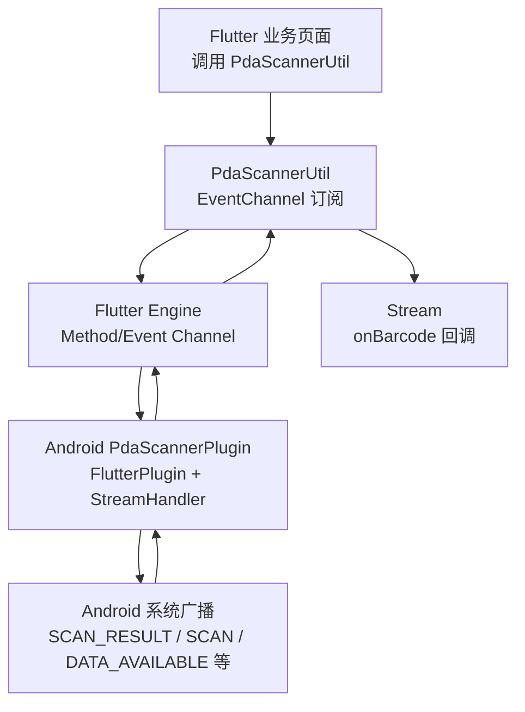
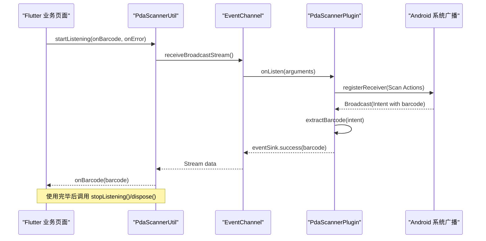
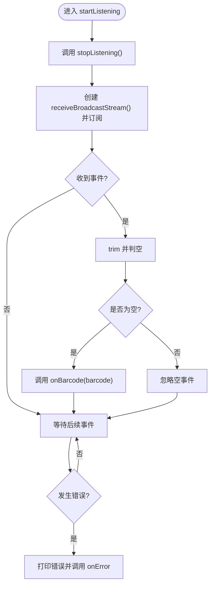
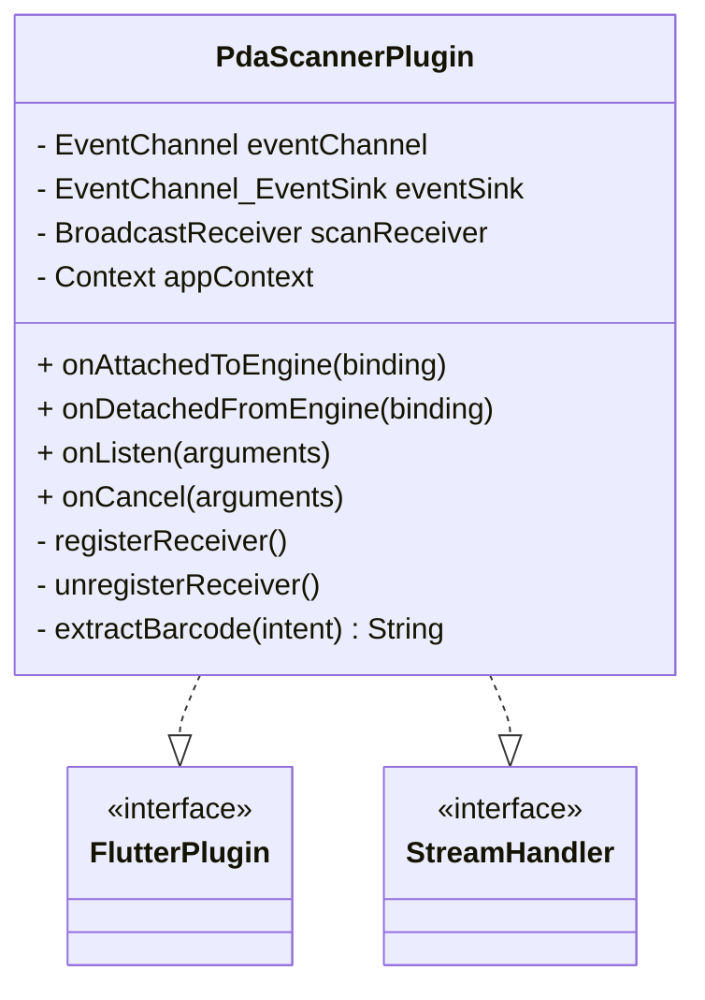
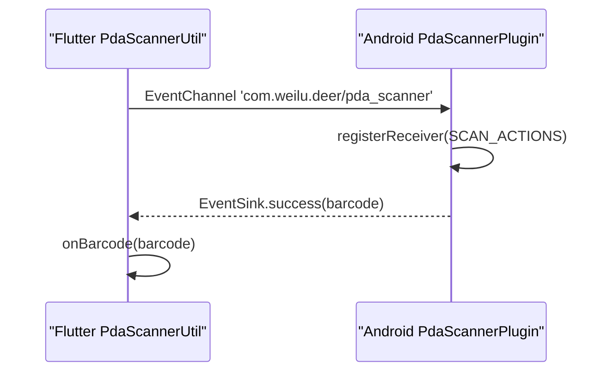
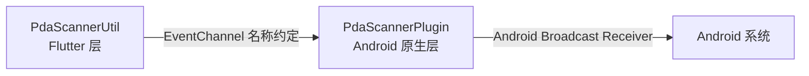
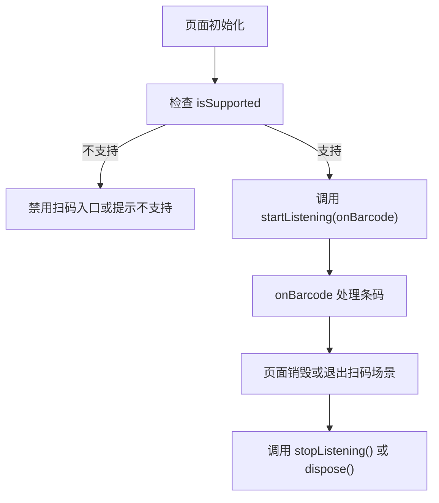

# PDA扫码枪API

<cite>
**本文引用的文件**   
- [lib/util/pda_scanner_util.dart](file://lib/util/pda_scanner_util.dart)
- [android/app/src/main/java/com/weilu/deer/PdaScannerPlugin.java](file://android/app/src/main/java/com/weilu/deer/PdaScannerPlugin.java)
</cite>

## 目录
1. [简介](#简介)
2. [项目结构](#项目结构)
3. [核心组件](#核心组件)
4. [架构总览](#架构总览)
5. [详细组件分析](#详细组件分析)
6. [依赖关系分析](#依赖关系分析)
7. [性能与可靠性](#性能与可靠性)
8. [集成示例与最佳实践](#集成示例与最佳实践)
9. [故障排查](#故障排查)
10. [结论](#结论)

## 简介
本文件为灵犀管店 Flutter 项目的 PDA 扫码枪 API 文档，重点说明 Flutter 层工具类 `PdaScannerUtil` 如何通过 `EventChannel` 监听 Android PDA 设备的硬件扫描广播，并以 Stream 的方式向业务页面提供条码数据。同时给出 Android 原生插件的实现原理、Flutter 与 Native 的消息协议、平台兼容性检测以及 Web 端的降级方案。

该能力主要面向商米、优博音、新大陆等主流 PDA 手持机设备，通过统一接口屏蔽不同厂商的广播 Action 与 Extra Key 差异。

## 项目结构
围绕 PDA 扫码枪功能，本项目涉及两个关键位置：
- Flutter 层：`lib/util/pda_scanner_util.dart`，封装 `PdaScannerUtil` 工具类，负责 EventChannel 订阅、Stream 分发、生命周期管理。
- Android 原生层：`android/app/src/main/java/com/weilu/deer/PdaScannerPlugin.java`，实现 FlutterPlugin 和 EventChannel.StreamHandler，注册系统广播并提取条码数据。

图示来源
- [lib/util/pda_scanner_util.dart:1-66](file://lib/util/pda_scanner_util.dart#L1-L66)
- [android/app/src/main/java/com/weilu/deer/PdaScannerPlugin.java:1-165](file://android/app/src/main/java/com/weilu/deer/PdaScannerPlugin.java#L1-L165)

章节来源
- [lib/util/pda_scanner_util.dart:1-66](file://lib/util/pda_scanner_util.dart#L1-L66)
- [android/app/src/main/java/com/weilu/deer/PdaScannerPlugin.java:1-165](file://android/app/src/main/java/com/weilu/deer/PdaScannerPlugin.java#L1-L165)

## 核心组件
- `PdaScannerUtil`（Flutter 层）
  - 暴露静态常量 EventChannel 名称：`com.weilu.deer/pda_scanner`。
  - 提供 `startListening(onBarcode, onError)` 开始监听。
  - 提供 `stopListening()` 停止监听。
  - 提供 `dispose()` 释放资源。
  - 提供 `isSupported` 判断当前平台是否支持 PDA 扫描。
  - 内部维护 `_subscription` 以跟踪监听状态，并提供 `isListening` 可读属性。

- `PdaScannerPlugin`（Android 原生层）
  - 实现 `FlutterPlugin` 和 `EventChannel.StreamHandler`。
  - 在 `onAttachedToEngine` 中注册 EventChannel。
  - 在 `onListen/onCancel` 中控制 BroadcastReceiver 的生命周期。
  - 维护一组主流 PDA 扫描广播 Action 与 Extra Key 列表，兼容多品牌设备。
  - 在 `extractBarcode` 中从 Intent 中提取条码字符串，并返回空值兜底逻辑。

章节来源
- [lib/util/pda_scanner_util.dart:1-66](file://lib/util/pda_scanner_util.dart#L1-L66)
- [android/app/src/main/java/com/weilu/deer/PdaScannerPlugin.java:1-165](file://android/app/src/main/java/com/weilu/deer/PdaScannerPlugin.java#L1-L165)

## 架构总览
PDA 扫码枪采用 Flutter EventChannel 的单向事件推送模式：
- Flutter 层通过 `receiveBroadcastStream()` 建立订阅。
- 当 Android 系统收到 PDA 硬件扫描广播时，原生插件解析 Intent 中的条码字段。
- 原生插件将结果通过 `EventSink.success` 推送到 Flutter。
- Flutter 层在 Stream 的 onData 中触发 `onBarcode` 回调，供业务处理。

图示来源
- [lib/util/pda_scanner_util.dart:1-66](file://lib/util/pda_scanner_util.dart#L1-L66)
- [android/app/src/main/java/com/weilu/deer/PdaScannerPlugin.java:1-165](file://android/app/src/main/java/com/weilu/deer/PdaScannerPlugin.java#L1-L165)

## 详细组件分析

### Flutter 层：PdaScannerUtil
`PdaScannerUtil` 是一个轻量工具类，核心职责是封装 EventChannel 的订阅与取消订阅，并将底层广播转换为 Dart Stream 事件。

- 关键成员
  - `_eventChannel`：EventChannel 实例，通道名为 `com.weilu.deer/pda_scanner`。
  - `_subscription`：当前 StreamSubscription，用于管理监听生命周期。
  - `isListening`：只读属性，表示是否已有活跃订阅。
  - `isSupported`：静态方法，仅 Android 非 Web 平台返回 true。

- 关键方法
  - `startListening(onBarcode, onError)`
    - 先调用 `stopListening()` 确保不会重复订阅。
    - 创建 `receiveBroadcastStream()` 并订阅。
    - 对每个事件执行 trim 与非空校验后调用 `onBarcode`。
    - 异常路径打印调试信息并调用 `onError`。
  - `stopListening()`
    - 取消现有 subscription 并置空引用，避免内存泄漏。
  - `dispose()`
    - 委托给 `stopListening()`，便于外部统一释放资源。

- 复杂度与性能
  - 订阅/取消订阅时间复杂度近似 O(1)。
  - Stream 事件处理为 O(1) 字符串处理。
  - 无后台线程切换，建议业务侧自行处理耗时逻辑。

图示来源
- [lib/util/pda_scanner_util.dart:1-66](file://lib/util/pda_scanner_util.dart#L1-L66)

章节来源
- [lib/util/pda_scanner_util.dart:1-66](file://lib/util/pda_scanner_util.dart#L1-L66)

### Android 原生层：PdaScannerPlugin
`PdaScannerPlugin` 是 Flutter 与 Android 系统之间的桥接插件，负责：
- 注册 EventChannel。
- 根据 Flutter 端监听生命周期注册/注销 BroadcastReceiver。
- 从多种 PDA 厂商的广播 Intent 中解析出条码数据。

- 关键常量
  - `SCAN_ACTIONS`：覆盖商米、优博音、新大陆、iData、霍尼韦尔、东大集成、智联天地、捷宝等常见广播 Action。
  - `EXTRA_KEYS`：覆盖不同厂商的条码字段 key，如 `barcode`、`data`、`BARCODE`、`scanData`、`value` 等。

- 生命周期
  - `onAttachedToEngine`：保存应用上下文，创建并设置 EventChannel。
  - `onDetachedFromEngine`：注销广播接收器，清理 EventChannel。
  - `onListen`：初始化 EventSink，注册广播接收器。
  - `onCancel`：清空 EventSink，注销广播接收器。

- 广播解析
  - `registerReceiver`：动态注册 BroadcastReceiver，按 SDK 版本选择是否使用 `RECEIVER_EXPORTED`。
  - `extractBarcode`：优先遍历 `EXTRA_KEYS`；若未命中，则遍历 Bundle 中所有 String 类型值作为兜底。

图示来源
- [android/app/src/main/java/com/weilu/deer/PdaScannerPlugin.java:1-165](file://android/app/src/main/java/com/weilu/deer/PdaScannerPlugin.java#L1-L165)

章节来源
- [android/app/src/main/java/com/weilu/deer/PdaScannerPlugin.java:1-165](file://android/app/src/main/java/com/weilu/deer/PdaScannerPlugin.java#L1-L165)

### Flutter 与 Native 消息传递协议
- 通道名称：`com.weilu.deer/pda_scanner`
- 方向：Native -> Flutter（事件流）
- 数据类型：字符串类型的条码内容
- 参数：无参监听，即 `onListen(arguments)` 中 arguments 未使用
- 错误处理：Flutter 层捕获 Stream 错误并透传 `onError`；原生层对注册/注销广播进行 try/catch 保护

图示来源
- [lib/util/pda_scanner_util.dart:1-66](file://lib/util/pda_scanner_util.dart#L1-L66)
- [android/app/src/main/java/com/weilu/deer/PdaScannerPlugin.java:1-165](file://android/app/src/main/java/com/weilu/deer/PdaScannerPlugin.java#L1-L165)

## 依赖关系分析
- Flutter 层依赖
  - `dart:async`：用于 Stream 与 Subscription。
  - `flutter/foundation`：用于 `kIsWeb`、`debugPrint`。
  - `flutter/services`：用于 `EventChannel`。
- Android 原生层依赖
  - `io.flutter.embedding.engine.plugins.FlutterPlugin`
  - `io.flutter.plugin.common.EventChannel`
  - Android SDK：`BroadcastReceiver`、`IntentFilter`、`Context`、`Build.VERSION`

耦合性方面：
- Flutter 层与原生层通过 EventChannel 解耦，仅依赖通道名与数据类型约定。
- 原生层集中维护厂商广播 Action 与 Extra Key，便于扩展新机型。

图示来源
- [lib/util/pda_scanner_util.dart:1-66](file://lib/util/pda_scanner_util.dart#L1-L66)
- [android/app/src/main/java/com/weilu/deer/PdaScannerPlugin.java:1-165](file://android/app/src/main/java/com/weilu/deer/PdaScannerPlugin.java#L1-L165)

章节来源
- [lib/util/pda_scanner_util.dart:1-66](file://lib/util/pda_scanner_util.dart#L1-L66)
- [android/app/src/main/java/com/weilu/deer/PdaScannerPlugin.java:1-165](file://android/app/src/main/java/com/weilu/deer/PdaScannerPlugin.java#L1-L165)

## 性能与可靠性
- 事件频率
  - PDA 扫描属于低频事件，通常由用户物理按键触发，Stream 事件开销可忽略。
- 内存与资源
  - 必须调用 `stopListening()` 或 `dispose()` 取消订阅，避免内存泄漏。
  - 原生层在 `onCancel` 与 `onDetachedFromEngine` 中注销广播，防止后台常驻。
- 健壮性
  - Flutter 层对空字符串事件做过滤，减少无效回调。
  - 原生层对广播注册/注销及 Intent 解析过程进行异常保护。
- 兼容性
  - `isSupported` 限制仅在 Android 非 Web 平台启用，避免在其他平台误用。
  - 原生层兼容高版本 Android 的 `RECEIVER_EXPORTED` 权限模型。

[本节为通用指导，不直接分析具体代码文件]

## 集成示例与最佳实践

### 基础用法
- 创建 `PdaScannerUtil` 实例。
- 在页面启动时调用 `startListening`，传入 `onBarcode` 回调。
- 在页面销毁或不再需要时调用 `stopListening()` 或 `dispose()`。
- 如需判断平台支持，可使用 `PdaScannerUtil.isSupported`。

推荐流程如下：

图示来源
- [lib/util/pda_scanner_util.dart:1-66](file://lib/util/pda_scanner_util.dart#L1-L66)

### 生命周期管理建议
- 单例或页面级持有 `PdaScannerUtil` 实例均可，但需保证同一时刻只有一个活跃订阅。
- `startListening` 内部会先 `stopListening()`，因此多次调用是幂等的，但仍建议业务侧明确生命周期。
- 在 `dispose` 或 `didChangeDependencies` 对应关闭时机调用释放方法。

### 扫描事件处理
- `onBarcode` 中应尽快完成必要校验与业务路由，避免阻塞主线程。
- 如果需要进行网络请求或数据库写入，请放入异步任务。
- 可对条码做去重、前缀匹配、长度校验等预处理。

### 异常处理
- `onError` 可用于记录日志、上报错误或降级到摄像头扫码。
- 若 EventChannel 不可用，Flutter 层会输出调试日志，并调用 `onError`。

### 平台兼容与 Web 降级
- `isSupported` 仅当非 Web 且目标平台为 Android 时返回 true。
- Web 端建议：
  - 隐藏 PDA 专用入口。
  - 或回退到摄像头扫码、手动输入等方案。

章节来源
- [lib/util/pda_scanner_util.dart:1-66](file://lib/util/pda_scanner_util.dart#L1-L66)

## 故障排查

常见问题与解决思路：
- 收不到扫描事件
  - 确认当前运行平台是否为 Android 非 Web。
  - 确认已调用 `startListening` 且未提前 `stopListening`。
  - 确认 PDA 设备厂商广播 Action 是否在插件内置列表中。
  - 检查设备系统版本，特别是 Android TIRAMISU 及以上是否具备正确权限模型。
- 回调为空或乱码
  - Flutter 层会对事件 trim 并判空，若仍为空，可能是原生层无法从 Intent 中提取条码。
  - 可在原生层新增对应厂商的 Extra Key，或在 `extractBarcode` 中调整优先级。
- 内存泄漏或崩溃
  - 确保页面销毁时调用 `stopListening()` 或 `dispose()`。
  - 确认原生层 `onCancel` 与 `onDetachedFromEngine` 正常执行。
- Web 端异常
  - `isSupported` 会阻止在 Web 端启用，若自定义实现需自行处理降级。

章节来源
- [lib/util/pda_scanner_util.dart:1-66](file://lib/util/pda_scanner_util.dart#L1-L66)
- [android/app/src/main/java/com/weilu/deer/PdaScannerPlugin.java:1-165](file://android/app/src/main/java/com/weilu/deer/PdaScannerPlugin.java#L1-L165)

## 结论
`PdaScannerUtil` 与 `PdaScannerPlugin` 共同实现了 Flutter 与 Android PDA 硬件扫描的统一接入方案。通过 EventChannel 的事件流机制，Flutter 层可以以简洁的 Stream API 消费条码数据；原生层则集中维护多品牌 PDA 的广播兼容逻辑，降低业务侧适配成本。在实际集成中，务必重视监听生命周期管理与平台兼容性检测，并在 Web 端做好降级策略，以保证跨平台体验的一致性与稳定性。