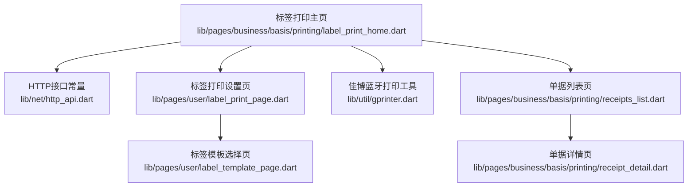
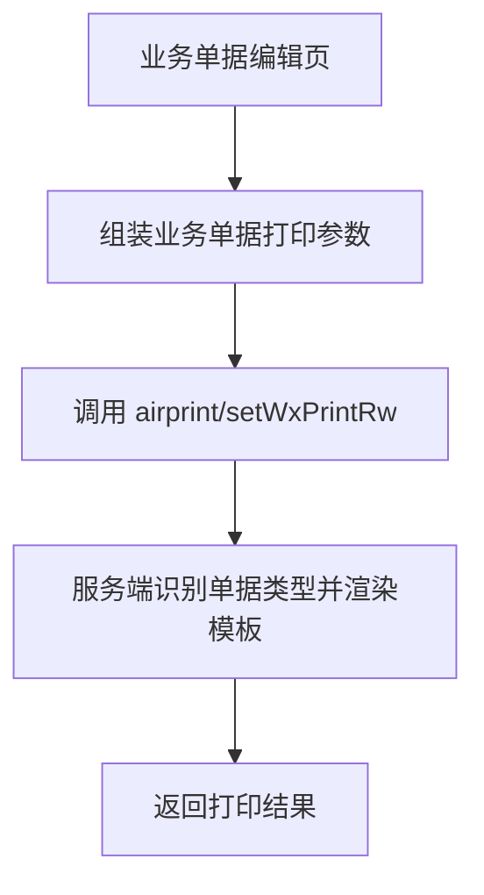
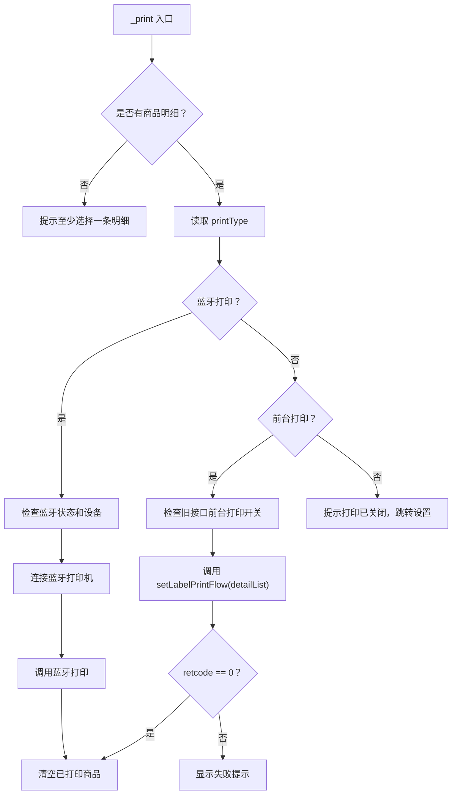
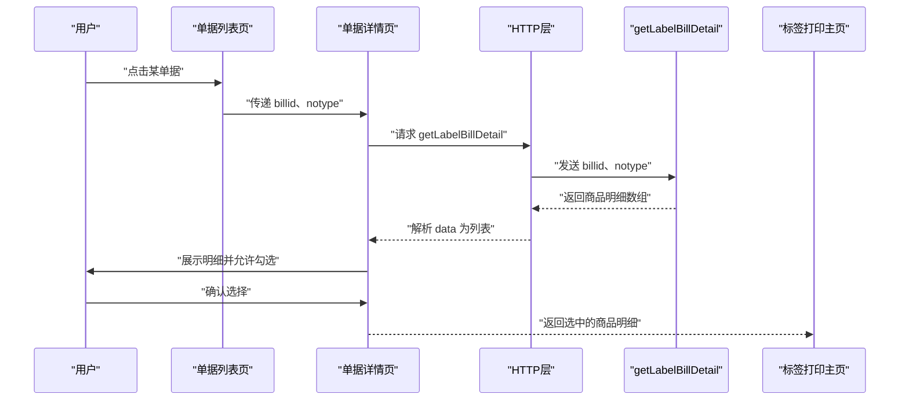
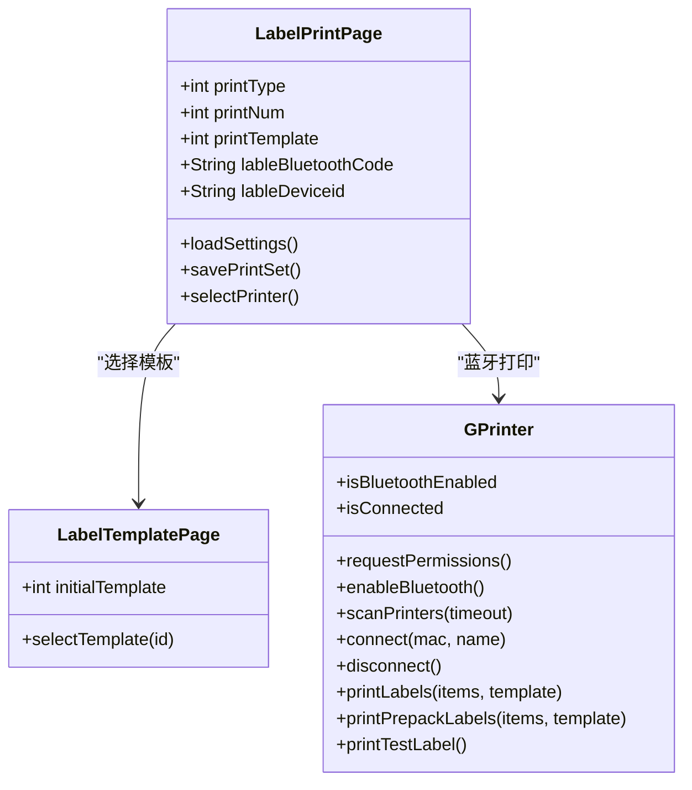
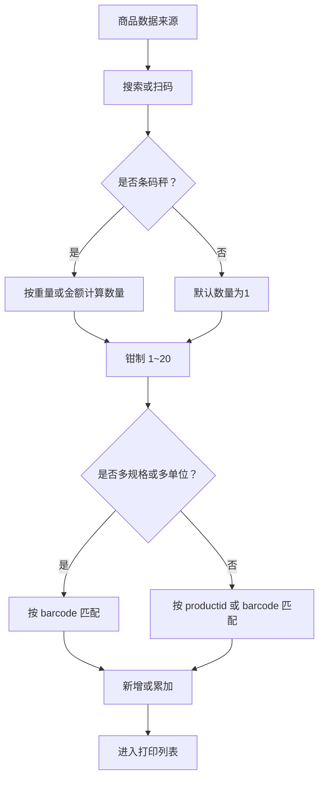
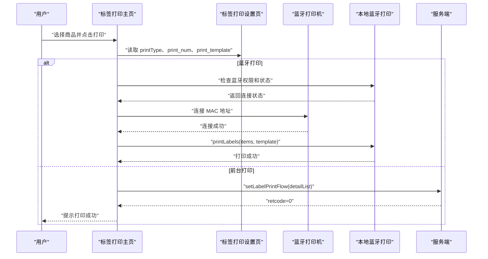
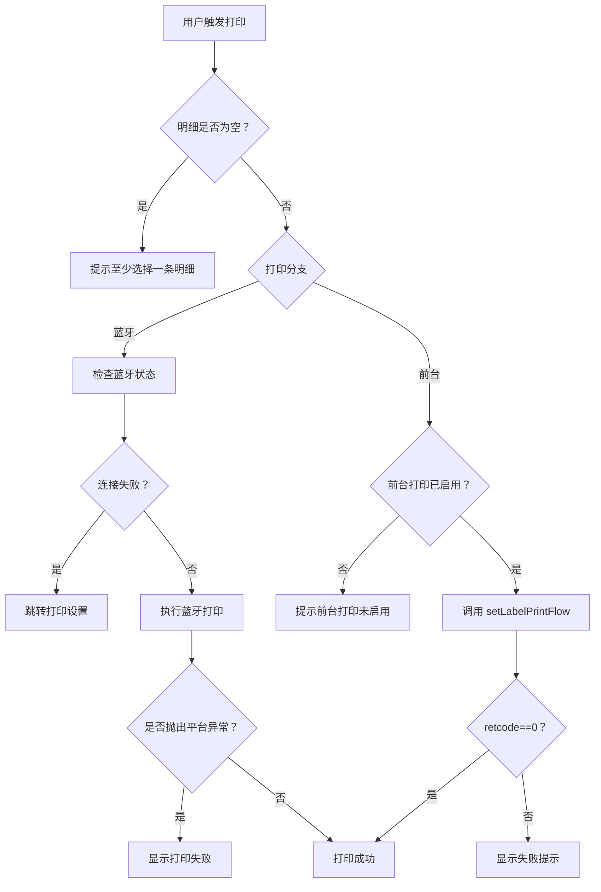

# 标签打印API

<cite>
**本文引用的文件**   
- [http_api.dart](file://lib/net/http_api.dart)
- [label_print_home.dart](file://lib/pages/business/basis/printing/label_print_home.dart)
- [receipts_list.dart](file://lib/pages/business/basis/printing/receipts_list.dart)
- [receipt_detail.dart](file://lib/pages/business/basis/printing/receipt_detail.dart)
- [label_print_page.dart](file://lib/pages/user/label_print_page.dart)
- [label_template_page.dart](file://lib/pages/user/label_template_page.dart)
- [gprinter.dart](file://lib/util/gprinter.dart)
</cite>

## 目录
1. [文档目标与适用范围](#文档目标与适用范围)
2. [项目结构中的标签打印位置](#项目结构中的标签打印位置)
3. [HTTP接口规范总览](#http接口规范总览)
4. [统一打印调用方式：airprint/setWxPrintRw](#统一打印调用方式airprintsetwxprintrw)
5. [标签打印执行流程：setLabelPrintFlow](#标签打印执行流程setlabelprintflow)
6. [单据列表接口：getLabelBill](#单据列表接口getlabelbill)
7. [单据明细接口：getLabelBillDetail](#单据明细接口getlabelbilletail)
8. [标签模板配置与蓝牙打印协作](#标签模板配置与蓝牙打印协作)
9. [商品条码生成、价格计算与业务数据封装规则](#商品条码生成价格计算与业务数据封装规则)
10. [完整数据流转示例](#完整数据流转示例)
11. [错误处理机制](#错误处理机制)
12. [常见问题排查](#常见问题排查)
13. [结论与建议](#结论与建议)

## 文档目标与适用范围
本文面向灵犀管店 Flutter 项目中“标签打印”相关功能，重点说明以下能力：
- 统一打印入口 `airprint/setWxPrintRw` 的调用约定。
- 标签打印主流程 `app/labelprint/setLabelPrintFlow` 的请求参数与返回语义。
- 标签单据列表 `app/labelprint/getLabelBill` 与单据明细 `app/labelprint/getLabelBillDetail` 的查询条件、分页字段和数据结构。
- 标签模板配置、蓝牙打印机协作关系。
- 商品条码来源、价格字段来源、份数限制等封装规则。
- 从用户操作到服务器响应、再到蓝牙或前台打印的完整数据流。

## 项目结构中的标签打印位置
标签打印在代码中由多个页面和工具类共同实现：
- HTTP 接口常量集中在网络层 API 定义文件中。
- 标签打印主页负责商品搜索、扫码、选择、打印份数控制以及打印分支调度。
- 单据列表页通过标签打印专用接口获取可打印单据。
- 单据详情页拉取选中单据的商品明细，并允许勾选后回传。
- 标签打印设置页管理打印方式、蓝牙设备、打印份数和模板 ID。
- 佳博蓝牙打印工具类负责 Android 端蓝牙权限、连接和 TSC 指令打印。



**图表来源**
- [label_print_home.dart:1-200](file://lib/pages/business/basis/printing/label_print_home.dart#L1-L200)
- [http_api.dart:360-565](file://lib/net/http_api.dart#L360-L565)
- [receipts_list.dart:1-200](file://lib/pages/business/basis/printing/receipts_list.dart#L1-L200)
- [receipt_detail.dart:1-120](file://lib/pages/business/basis/printing/receipt_detail.dart#L1-L120)
- [label_print_page.dart:1-120](file://lib/pages/user/label_print_page.dart#L1-L120)
- [label_template_page.dart:1-80](file://lib/pages/user/label_template_page.dart#L1-L80)
- [gprinter.dart:1-130](file://lib/util/gprinter.dart#L1-L130)

**章节来源**
- [label_print_home.dart:1-200](file://lib/pages/business/basis/printing/label_print_home.dart#L1-L200)
- [http_api.dart:360-565](file://lib/net/http_api.dart#L360-L565)
- [receipts_list.dart:1-200](file://lib/pages/business/basis/printing/receipts_list.dart#L1-L200)
- [receipt_detail.dart:1-120](file://lib/pages/business/basis/printing/receipt_detail.dart#L1-L120)
- [label_print_page.dart:1-120](file://lib/pages/user/label_print_page.dart#L1-L120)
- [label_template_page.dart:1-80](file://lib/pages/user/label_template_page.dart#L1-L80)
- [gprinter.dart:1-130](file://lib/util/gprinter.dart#L1-L130)

## HTTP接口规范总览
标签打印相关接口主要包含三类：
1. 统一打印接口：`airprint/setWxPrintRw`，用于采购入库单、采购订货单、采购退货单、采购计划单、自采申请单、调拨申请单、调拨出库单、调拨入库单、配送发货单、配送收货单、配退申请单、配退发货单、配退收货单等业务单据。
2. 标签打印专用接口：
   - `app/labelprint/setLabelPrintFlow`：执行标签打印。
   - `app/labelprint/getLabelBill`：获取标签打印可用单据列表。
   - `app/labelprint/getLabelBillDetail`：获取标签打印单据明细。
3. 标签打印配置接口：
   - `wxprint/getPrintSet`：获取打印设置，含蓝牙配置。
   - `wxprint/savePrintSet`：保存打印设置。
   - `wxprint/getLabelPrintParams`：获取旧接口标签打印参数。
   - `wxprint/saveLabelPrintParams`：保存旧接口标签打印参数。
   - `labelproductgroup/findList`：商品分组列表，配合标签打印“商品分组”类型使用。

| 接口名称 | 路径常量 | 用途 | 请求体关键字段 | 典型响应关键字段 |
|---|---|---|---|---|
| 统一打印 | `airprint/setWxPrintRw` | 各业务单据统一打印入口 | 业务单据标识、单据ID、打印渠道参数（由调用方按业务组装） | 服务端打印结果状态 |
| 标签打印执行 | `app/labelprint/setLabelPrintFlow` | 标签打印主页批量商品打印 | `detailList` | `retcode`、`data` |
| 标签单据列表 | `app/labelprint/getLabelBill` | 获取可打印单据列表 | `notype`、日期范围、单号、供应商、制单人 | `data.list` |
| 标签单据明细 | `app/labelprint/getLabelBillDetail` | 获取选中单据的商品明细 | `billid`、`notype` | 商品明细数组 |
| 打印设置读取 | `wxprint/getPrintSet` | 获取打印方式、蓝牙信息、模板ID | `clientid` | `printType`、蓝牙相关字段 |
| 打印设置保存 | `wxprint/savePrintSet` | 保存打印方式、蓝牙信息、模板ID | `clientid`、`printType`、蓝牙字段 | 保存结果 |
| 旧标签参数读取 | `wxprint/getLabelPrintParams` | 读取旧接口前台打印开关 | `type` | `labelPrintType` |
| 旧标签参数保存 | `wxprint/saveLabelPrintParams` | 同步旧接口前台打印开关 | `type`、`labelPrintType` | 保存结果 |
| 商品分组列表 | `labelproductgroup/findList` | 标签打印“商品分组”类型的数据源 | 分组筛选参数 | 分组列表 |

**章节来源**
- [http_api.dart:360-565](file://lib/net/http_api.dart#L360-L565)

## 统一打印调用方式：airprint/setWxPrintRw
`airprint/setWxPrintRw` 是灵犀管店中多个业务单据的统一打印接口常量。当前仓库将以下单据的打印方法都指向该路径：
- 采购入库单
- 采购订货单
- 采购退货单
- 采购计划单
- 自采申请单
- 调拨申请单
- 调拨出库单
- 调拨入库单
- 配送发货单
- 配送收货单
- 配退申请单
- 配退发货单
- 配退收货单

这意味着这些业务单据在 Flutter 端共享同一套打印通道，后端根据传入的业务单据类型、单据ID等信息渲染对应模板。Flutter 端并不在该常量文件中定义具体业务字段，而是由各业务单据编辑页面构造请求。



**图表来源**
- [http_api.dart:20-120](file://lib/net/http_api.dart#L20-L120)

需要注意：
- 标签打印主页并不直接调用 `airprint/setWxPrintRw`，而是通过 `app/labelprint/setLabelPrintFlow` 走标签打印流程。
- `airprint/setWxPrintRw` 更偏向传统业务单据打印；标签打印则使用专门的标签打印接口。

**章节来源**
- [http_api.dart:20-120](file://lib/net/http_api.dart#L20-L120)

## 标签打印执行流程：setLabelPrintFlow
标签打印主页在执行打印时，会根据当前打印设置决定走哪条分支：

1. **蓝牙打印**：当打印方式为蓝牙时，先检查系统蓝牙状态、已保存的蓝牙设备ID，然后尝试连接佳博蓝牙打印机，再调用本地蓝牙打印方法。
2. **前台打印**：当打印方式为前台打印时，会校验旧接口前台打印开关是否开启，如果开启则调用 `app/labelprint/setLabelPrintFlow`，并将当前标签打印商品明细作为请求体发送。
3. **打印关闭**：当打印方式被关闭时，提示用户前往打印设置开启。

### setLabelPrintFlow 请求格式
| 字段 | 类型 | 必填 | 说明 |
|---|---|---:|---|
| `detailList` | 数组 | 是 | 标签打印商品明细数组 |

`detailList` 中的商品条目通常包含：
| 字段 | 类型 | 说明 |
|---|---|---|
| `name` 或 `productname` | 字符串 | 商品名称 |
| `barcode` | 字符串 | 商品条码 |
| `mprice1` | 数字 | 会员价或折后价 |
| `sellprice` | 数字 | 零售价 |
| `qty` | 整数 | 打印份数，取值范围为 1~20 |
| 其他扩展字段 | 动态 | 如规格、单位、货架号等 |

### setLabelPrintFlow 响应格式
| 字段 | 类型 | 说明 |
|---|---|---|
| `retcode` | 整数 | 0 表示成功，非 0 表示失败 |
| `data` | 任意类型 | 成功时的返回数据，通常为 null 或空对象 |

### 业务流程图


**图表来源**
- [label_print_home.dart:300-420](file://lib/pages/business/basis/printing/label_print_home.dart#L300-L420)
- [label_print_home.dart:420-500](file://lib/pages/business/basis/printing/label_print_home.dart#L420-L500)

**章节来源**
- [label_print_home.dart:300-500](file://lib/pages/business/basis/printing/label_print_home.dart#L300-L500)

## 单据列表接口：getLabelBill
标签打印“单据”入口使用 `app/labelprint/getLabelBill` 获取可打印单据列表。列表页支持按单据类型、时间范围、单号、供应商、制单人筛选。

### 请求参数
| 字段 | 类型 | 必填 | 说明 |
|---|---|---:|---|
| `is_page` | 整数 | 是 | 是否分页 |
| `field` | 字符串 | 是 | 排序字段，例如 `createtime` |
| `type` | 字符串 | 是 | 排序方向，例如 `desc`；商品分组时为 `asc` |
| `page` | 整数 | 是 | 当前页码 |
| `pagesize` | 整数 | 是 | 每页数量，默认 20 |
| `notype` | 整数 | 是 | 单据类型：1=采购入库单、2=调价单、3=调拨入库单、4=配送收货单、5=商品分组 |
| `starttime` | 字符串 | 否 | 开始时间，格式为 `yyyy-MM-dd 00:00:00` |
| `endtime` | 字符串 | 否 | 结束时间，格式为 `yyyy-MM-dd 23:59:59` |
| `billno` | 字符串 | 否 | 单号模糊搜索 |
| `supid` | 字符串 | 否 | 供应商ID |
| `supname` | 字符串 | 否 | 供应商名称 |
| `buyerid` | 字符串 | 否 | 制单人ID |
| `buyeridname` | 字符串 | 否 | 制单人名称 |
| `groupname` | 字符串 | 否 | 商品分组名称（仅 notype=5） |

### 响应结构
| 字段 | 类型 | 说明 |
|---|---|---|
| `retcode` | 整数 | 0 表示成功 |
| `data` | 对象 | 列表数据容器 |
| `data.list` | 数组 | 单据记录列表 |

单据记录中常见字段包括：
| 字段 | 类型 | 说明 |
|---|---|---|
| `billid` | 字符串 | 单据ID，用于请求明细 |
| `billno` | 字符串 | 单据编号 |
| `supname` | 字符串 | 供应商名称（部分类型） |
| `createname` | 字符串 | 制单人名称 |
| `createtime` | 字符串 | 制单时间 |
| `signtime` | 字符串 | 审核时间 |

### 分页行为
- 首次加载 `_page = 1`，刷新后重置为 1。
- 滚动到底部且 `_hasMore` 为真时继续加载下一页。
- 每次返回 20 条，若返回数量等于 `pagesize`，则认为还有更多数据。

**章节来源**
- [receipts_list.dart:1-120](file://lib/pages/business/basis/printing/receipts_list.dart#L1-L120)
- [receipts_list.dart:120-200](file://lib/pages/business/basis/printing/receipts_list.dart#L120-L200)
- [receipts_list.dart:200-360](file://lib/pages/business/basis/printing/receipts_list.dart#L200-L360)

## 单据明细接口：getLabelBillDetail
单据详情页通过 `app/labelprint/getLabelBillDetail` 获取指定单据的商品明细，用户勾选需要打印的商品后返回给标签打印主页。

### 请求参数
| 字段 | 类型 | 必填 | 说明 |
|---|---|---:|---|
| `billid` | 字符串 | 是 | 单据ID |
| `notype` | 整数 | 是 | 单据类型 |

### 响应结构
| 字段 | 类型 | 说明 |
|---|---|---|
| `retcode` | 整数 | 0 表示成功 |
| `data` | 数组 | 商品明细数组 |

每个商品明细通常包含：
| 字段 | 类型 | 说明 |
|---|---|---|
| `productid` | 字符串 | 商品ID |
| `barcode` | 字符串 | 商品条码 |
| `name` 或 `productname` | 字符串 | 商品名称 |
| `size` | 字符串 | 规格 |
| `unit` | 字符串 | 单位 |
| `sellprice` | 数字 | 零售价 |
| `mprice1` | 数字 | 会员价或折后价 |
| `qty` | 数字或字符串 | 原始数量，前端会转为 1~20 的整数 |

前端会在本地为每条明细添加 `checked` 布尔字段，用于全选和单项选择。



**图表来源**
- [receipt_detail.dart:1-120](file://lib/pages/business/basis/printing/receipt_detail.dart#L1-L120)
- [receipts_list.dart:520-637](file://lib/pages/business/basis/printing/receipts_list.dart#L520-L637)

**章节来源**
- [receipt_detail.dart:1-120](file://lib/pages/business/basis/printing/receipt_detail.dart#L1-L120)
- [receipt_detail.dart:120-220](file://lib/pages/business/basis/printing/receipt_detail.dart#L120-L220)
- [receipts_list.dart:520-637](file://lib/pages/business/basis/printing/receipts_list.dart#L520-L637)

## 标签模板配置与蓝牙打印协作
标签打印设置页维护以下关键配置：
- `printType`：打印方式，0=关闭打印，1=前台打印，2=蓝牙打印。
- `print_num`：蓝牙打印默认份数，界面限制 1~10。
- `print_template`：标签模板ID，1=60×40mm，2=50×30mm，3=40×30mm，4=45×20mm。
- `lableBluetoothCode`：蓝牙打印机名称或编码。
- `lableDeviceid`：蓝牙设备MAC地址。
- `lableBluetoothStatus`：蓝牙连接状态。
- `lableServiceid` / `lableCharacteristicId`：BLE服务与特征值ID。

### 模板选择
模板选择页提供四个系统模板卡片，每个模板包含：
- 模板ID
- 模板名称
- 预览宽度
- 预览高度

用户选择模板后，页面返回模板ID，标签打印设置页保存该ID。

### 蓝牙打印协作
蓝牙打印由佳博蓝牙打印工具类完成，其职责包括：
- 请求蓝牙运行时权限。
- 判断系统蓝牙是否开启。
- 扫描蓝牙打印机。
- 连接指定MAC地址的蓝牙打印机。
- 断开蓝牙连接。
- 打印普通标签。
- 打印预包装改价标签。
- 打印测试标签。

蓝牙打印方法要求每条明细包含：
| 字段 | 类型 | 说明 |
|---|---|---|
| `name` | 字符串 | 商品名称 |
| `size` | 字符串 | 规格 |
| `mprice1` | 数字 | 会员价或折后价 |
| `sellprice` | 数字 | 零售价 |
| `qty` | 整数 | 份数 |
| `barcode` | 字符串 | 条码 |
| `copies` | 整数 | 副本数，与 qty 一致 |



**图表来源**
- [label_print_page.dart:1-120](file://lib/pages/user/label_print_page.dart#L1-L120)
- [label_template_page.dart:1-120](file://lib/pages/user/label_template_page.dart#L1-L120)
- [gprinter.dart:1-130](file://lib/util/gprinter.dart#L1-L130)

**章节来源**
- [label_print_page.dart:1-120](file://lib/pages/user/label_print_page.dart#L1-L120)
- [label_print_page.dart:200-448](file://lib/pages/user/label_print_page.dart#L200-L448)
- [label_template_page.dart:1-120](file://lib/pages/user/label_template_page.dart#L1-L120)
- [gprinter.dart:1-130](file://lib/util/gprinter.dart#L1-L130)

## 商品条码生成、价格计算与业务数据封装规则
标签打印主页在接收商品数据时，会对商品进行以下处理：

### 商品来源
1. **输入框搜索**：按 `barcode` 模糊匹配条码、品名或自编码。
2. **摄像头扫码**：直接按 `scancode` 精确查询。
3. **条码秤解析**：支持重量码和金额码，自动换算初始数量。
4. **自定义商品选择**：多选商品后带入当前门店、商品状态等参数。
5. **单据明细选择**：从 `getLabelBillDetail` 返回的商品中选择。

### 多规格与多单位处理
- 当 `specflag=1` 或 `packageflag=1` 时，视为多规格或多单位商品。
- 多规格商品按 `barcode` 匹配，不同条码不累加。
- 普通商品优先按 `productid` 匹配，缺失时使用 `barcode` 兜底。
- 已存在商品累加数量，上限为 20。

### 数量限制
- 所有商品数量最终通过 `_clampQty` 钳制为 1~20。
- 批量修改对话框也强制 1~20。
- 蓝牙打印默认份数为设置页的 `print_num`，但单个商品的 `qty` 仍受 1~20 限制。

### 价格字段
- 前端展示和打印明细使用 `mprice1` 作为会员价或折后价。
- `sellprice` 作为零售价。
- 条码秤金额码反算数量时，优先使用 `sellprice`，为空或为 0 时回退 `inprice`。



**图表来源**
- [label_print_home.dart:200-300](file://lib/pages/business/basis/printing/label_print_home.dart#L200-L300)
- [label_print_home.dart:420-500](file://lib/pages/business/basis/printing/label_print_home.dart#L420-L500)

**章节来源**
- [label_print_home.dart:200-300](file://lib/pages/business/basis/printing/label_print_home.dart#L200-L300)
- [label_print_home.dart:420-500](file://lib/pages/business/basis/printing/label_print_home.dart#L420-L500)
- [label_print_home.dart:620-700](file://lib/pages/business/basis/printing/label_print_home.dart#L620-L700)

## 完整数据流转示例
下面以“从标签打印主页发起标签打印”为例，说明完整数据流转。



**图表来源**
- [label_print_home.dart:300-500](file://lib/pages/business/basis/printing/label_print_home.dart#L300-L500)
- [label_print_page.dart:1-120](file://lib/pages/user/label_print_page.dart#L1-L120)
- [gprinter.dart:1-130](file://lib/util/gprinter.dart#L1-L130)

### 请求示例：setLabelPrintFlow
请求体：
```json
{
  "detailList": [
    {
      "name": "大米",
      "barcode": "6901234567890",
      "mprice1": 5.00,
      "sellprice": 5.00,
      "qty": 1
    }
  ]
}
```

### 响应示例：setLabelPrintFlow
成功：
```json
{
  "retcode": 0,
  "data": null
}
```

失败：
```json
{
  "retcode": 非0值,
  "data": null
}
```

### 请求示例：getLabelBill
请求体：
```json
{
  "is_page": 1,
  "field": "createtime",
  "type": "desc",
  "page": 1,
  "pagesize": 20,
  "notype": 2,
  "starttime": "2026-10-27 00:00:00",
  "endtime": "2026-10-27 23:59:59",
  "billno": "",
  "supid": "",
  "supname": "",
  "buyerid": "",
  "buyeridname": ""
}
```

### 响应示例：getLabelBill
```json
{
  "retcode": 0,
  "data": {
    "list": [
      {
        "billid": "1001",
        "billno": "PJ202610270001",
        "supname": "某供应商",
        "createname": "张三",
        "createtime": "2026-10-27 10:00:00",
        "signtime": "2026-10-27 11:00:00"
      }
    ]
  }
}
```

### 请求示例：getLabelBillDetail
请求体：
```json
{
  "billid": "1001",
  "notype": 2
}
```

### 响应示例：getLabelBillDetail
```json
{
  "retcode": 0,
  "data": [
    {
      "productid": "P001",
      "barcode": "6901234567890",
      "name": "大米",
      "size": "5kg",
      "unit": "袋",
      "sellprice": 5.00,
      "mprice1": 5.00,
      "qty": 1
    }
  ]
}
```

**章节来源**
- [label_print_home.dart:300-500](file://lib/pages/business/basis/printing/label_print_home.dart#L300-L500)
- [receipts_list.dart:1-200](file://lib/pages/business/basis/printing/receipts_list.dart#L1-L200)
- [receipt_detail.dart:1-120](file://lib/pages/business/basis/printing/receipt_detail.dart#L1-L120)

## 错误处理机制
标签打印的错误处理主要集中在三个层面：

1. **界面交互层**
   - 无商品明细时提示“至少选择一条明细”。
   - 蓝牙未连接时提示“尚未在应用内连接蓝牙打印机，请前往打印设置连接”。
   - 前台打印未启用时提示“前台打印未启用，请前往打印设置开启”。
   - 打印已关闭时提示“打印已关闭，请前往打印设置开启”。
   - 蓝牙打印异常时捕获平台异常并显示失败提示。

2. **网络层**
   - 列表加载失败时，确保 UI 不再处于 loading 状态。
   - 明细加载失败时，同样恢复为非 loading 状态。
   - 多数网络调用使用 try-catch 包裹，避免崩溃。

3. **蓝牙层**
   - 权限拒绝时直接提示无法打印。
   - 连接失败时跳转标签打印设置页。
   - 打印完成后清理全屏 loading 和蓝牙打印进行中标志。



**图表来源**
- [label_print_home.dart:300-500](file://lib/pages/business/basis/printing/label_print_home.dart#L300-L500)
- [label_print_home.dart:500-620](file://lib/pages/business/basis/printing/label_print_home.dart#L500-L620)
- [receipts_list.dart:120-200](file://lib/pages/business/basis/printing/receipts_list.dart#L120-L200)
- [receipt_detail.dart:1-120](file://lib/pages/business/basis/printing/receipt_detail.dart#L1-L120)

**章节来源**
- [label_print_home.dart:300-620](file://lib/pages/business/basis/printing/label_print_home.dart#L300-L620)
- [receipts_list.dart:120-200](file://lib/pages/business/basis/printing/receipts_list.dart#L120-L200)
- [receipt_detail.dart:1-120](file://lib/pages/business/basis/printing/receipt_detail.dart#L1-L120)

## 常见问题排查
| 问题现象 | 可能原因 | 排查建议 |
|---|---|---|
| 点击打印无反应 | 明细为空 | 检查是否通过扫码、搜索或单据明细添加了商品 |
| 蓝牙打印提示未连接 | 未保存蓝牙设备或系统蓝牙关闭 | 进入标签打印设置页重新连接蓝牙打印机 |
| 蓝牙打印失败 | 权限不足或蓝牙驱动异常 | 检查 Android 蓝牙权限，重启蓝牙后再试 |
| 前台打印无效 | 旧接口前台打印开关未开启 | 在标签打印设置中将打印方式改为前台打印 |
| 打印份数异常 | 数量被钳制为 1~20 | 检查扫码数量、批量修改数量和设置页默认份数 |
| 单据列表为空 | 查询条件过严或单据不存在 | 调整时间范围、单号、供应商或制单人条件 |
| 单据明细为空 | 单据ID错误或单据无商品 | 确认 `billid` 和 `notype` 是否正确 |
| 模板选择不生效 | 未保存模板ID | 在标签打印设置页重新选择并保存模板 |

**章节来源**
- [label_print_home.dart:300-620](file://lib/pages/business/basis/printing/label_print_home.dart#L300-L620)
- [label_print_page.dart:200-448](file://lib/pages/user/label_print_page.dart#L200-L448)
- [receipts_list.dart:120-200](file://lib/pages/business/basis/printing/receipts_list.dart#L120-L200)
- [receipt_detail.dart:1-120](file://lib/pages/business/basis/printing/receipt_detail.dart#L1-L120)

## 结论与建议
标签打印在灵犀管店 Flutter 项目中采用“业务单据统一打印接口 + 标签打印专用接口 + 蓝牙打印本地能力”的组合架构：
- `airprint/setWxPrintRw` 面向传统业务单据，强调后端按单据类型渲染。
- `app/labelprint/setLabelPrintFlow` 面向标签打印主页，强调前端组装 `detailList`。
- `app/labelprint/getLabelBill` 和 `app/labelprint/getLabelBillDetail` 提供标签打印所需的单据与商品明细。
- 蓝牙打印依赖佳博 SDK，由 Flutter 侧构建打印数据并下发 TSC 指令。

建议后续维护和对接时注意：
1. 明确区分“业务单据打印”和“标签打印”，不要混用 `airprint/setWxPrintRw` 与 `app/labelprint/setLabelPrintFlow`。
2. 保持 `detailList` 中必要字段齐全，尤其是商品名称、条码、价格和份数。
3. 严格遵循数量 1~20 的限制，避免后端或打印机因超限异常。
4. 蓝牙打印必须优先检查权限、蓝牙状态和设备连接。
5. 模板ID应与后端标签模板保持一致，避免打印内容错位。
6. 对网络异常、蓝牙异常和用户误操作分别设计清晰提示，提升用户体验。