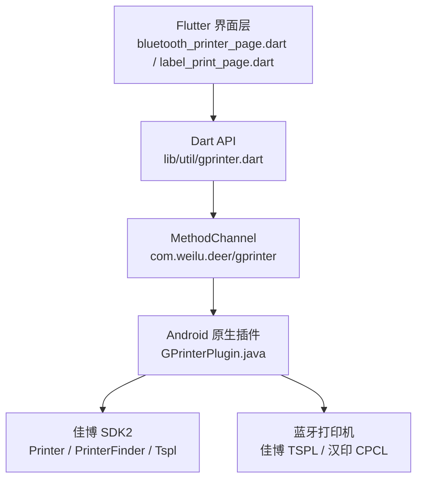
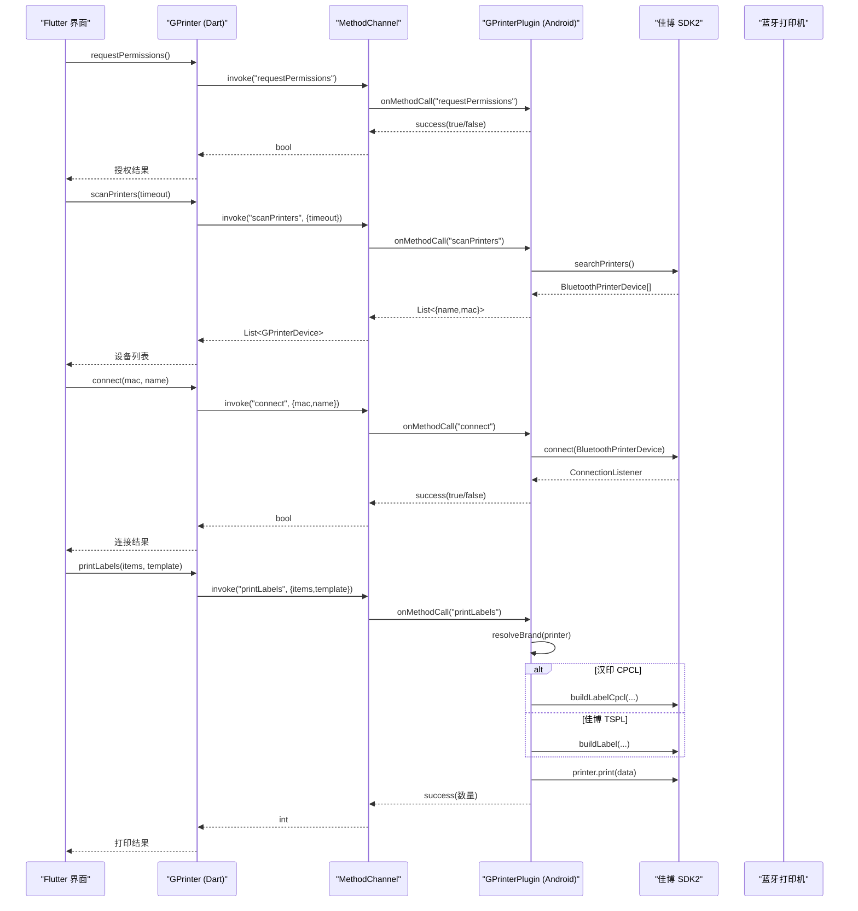
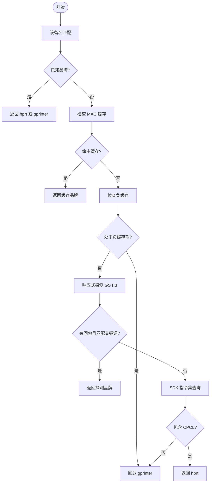
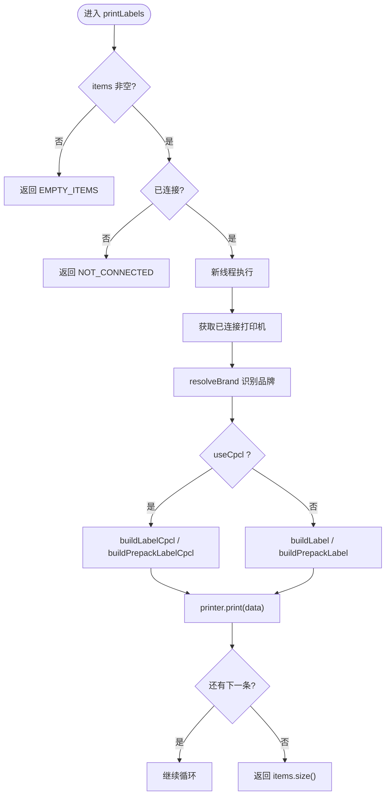
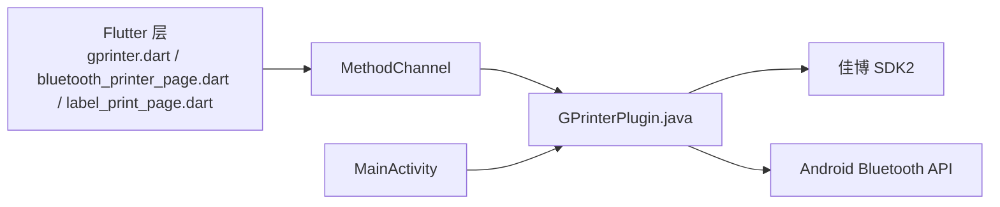

# 蓝牙打印机API

<cite>
**本文引用的文件**   
- [lib/util/gprinter.dart](file://lib/util/gprinter.dart)
- [lib/pages/user/bluetooth_printer_page.dart](file://lib/pages/user/bluetooth_printer_page.dart)
- [lib/pages/user/label_print_page.dart](file://lib/pages/user/label_print_page.dart)
- [lib/pages/business/basis/printing/label_print_home.dart](file://lib/pages/business/basis/printing/label_print_home.dart)
- [android/app/src/main/java/com/weilu/deer/GPrinterPlugin.java](file://android/app/src/main/java/com/weilu/deer/GPrinterPlugin.java)
- [android/app/src/main/java/com/weilu/deer/MainActivity.java](file://android/app/src/main/java/com/weilu/deer/MainActivity.java)
</cite>

## 目录
1. [引言](#引言)
2. [项目结构](#项目结构)
3. [核心组件](#核心组件)
4. [架构总览](#架构总览)
5. [详细组件分析](#详细组件分析)
6. [依赖关系分析](#依赖关系分析)
7. [性能与稳定性](#性能与稳定性)
8. [模板与协议配置](#模板与协议配置)
9. [完整调用流程示例](#完整调用流程示例)
10. [故障排查指南](#故障排查指南)
11. [结论](#结论)

## 引言
本文面向灵犀管店 Flutter 项目中“蓝牙标签打印”能力的开发者与实施人员，系统化说明 GPrinter Dart API、Android 原生插件实现、MethodChannel 通信机制、佳博 TSPL 与汉印 CPCL 双协议自动识别逻辑，以及 60×40mm、50×30mm、40×30mm、45×20mm 等标签模板的配置方式。文档同时给出从权限申请、蓝牙开启、设备扫描、连接、到打印标签和预包装改价标签的端到端流程说明。

## 项目结构
蓝牙打印能力由三层组成：
- Flutter 层：GPrinter Dart 封装与页面交互（权限引导、蓝牙开关、扫描、连接、测试打印）。
- MethodChannel 层：Flutter 与 Android 之间通过固定 channel 名称进行方法调用。
- Android 原生层：基于佳博 SDK2 实现蓝牙扫描、连接、指令构建与打印；同时内置品牌识别路由，在佳博 TSPL 与汉印 CPCL 间自动切换。



**图示来源**
- [lib/pages/user/bluetooth_printer_page.dart:1-762](file://lib/pages/user/bluetooth_printer_page.dart#L1-L762)
- [lib/util/gprinter.dart:1-130](file://lib/util/gprinter.dart#L1-L130)
- [android/app/src/main/java/com/weilu/deer/GPrinterPlugin.java:216-264](file://android/app/src/main/java/com/weilu/deer/GPrinterPlugin.java#L216-L264)
- [android/app/src/main/java/com/weilu/deer/GPrinterPlugin.java:306-395](file://android/app/src/main/java/com/weilu/deer/GPrinterPlugin.java#L306-L395)

**章节来源**
- [lib/pages/user/bluetooth_printer_page.dart:1-762](file://lib/pages/user/bluetooth_printer_page.dart#L1-L762)
- [lib/util/gprinter.dart:1-130](file://lib/util/gprinter.dart#L1-L130)
- [android/app/src/main/java/com/weilu/deer/GPrinterPlugin.java:1-1625](file://android/app/src/main/java/com/weilu/deer/GPrinterPlugin.java#L1-L1625)

## 核心组件
- GPrinterDevice：描述扫描到的蓝牙打印机设备，包含 name 与 mac。
- GPrinter：静态工具类，封装所有蓝牙打印相关 MethodChannel 调用。
- GPrinterPlugin：Android 侧 Flutter 插件，实现权限请求、蓝牙状态检测、开启蓝牙、扫描、连接、断开、打印标签、打印预包装改价标签、测试标签等原生逻辑，并负责佳博 TSPL 与汉印 CPCL 的协议路由。
- MainActivity：注册 GPrinterPlugin 插件，使其在应用启动时可用。

**章节来源**
- [lib/util/gprinter.dart:1-130](file://lib/util/gprinter.dart#L1-L130)
- [android/app/src/main/java/com/weilu/deer/GPrinterPlugin.java:1-1625](file://android/app/src/main/java/com/weilu/deer/GPrinterPlugin.java#L1-L1625)
- [android/app/src/main/java/com/weilu/deer/MainActivity.java:1-39](file://android/app/src/main/java/com/weilu/deer/MainActivity.java#L1-L39)

## 架构总览
Flutter 层通过 MethodChannel 与 Android 层通信。GPrinterPlugin 作为 FlutterPlugin 注册到 FlutterEngine，处理来自 Flutter 的方法调用，并调用佳博 SDK2 完成蓝牙发现、连接与打印。品牌识别逻辑位于原生层，根据设备名、探测回包及 SDK 指令集查询结果决定使用 TSPL 或 CPCL。



**图示来源**
- [lib/util/gprinter.dart:15-130](file://lib/util/gprinter.dart#L15-L130)
- [android/app/src/main/java/com/weilu/deer/GPrinterPlugin.java:216-264](file://android/app/src/main/java/com/weilu/deer/GPrinterPlugin.java#L216-L264)
- [android/app/src/main/java/com/weilu/deer/GPrinterPlugin.java:306-395](file://android/app/src/main/java/com/weilu/deer/GPrinterPlugin.java#L306-L395)
- [android/app/src/main/java/com/weilu/deer/GPrinterPlugin.java:672-760](file://android/app/src/main/java/com/weilu/deer/GPrinterPlugin.java#L672-L760)

## 详细组件分析

### GPrinterDevice 数据模型
- name：设备显示名称。
- mac：蓝牙 MAC 地址。

该类型用于承载 scanPrinters 返回的设备信息。

**章节来源**
- [lib/util/gprinter.dart:1-14](file://lib/util/gprinter.dart#L1-L14)

### GPrinter Dart API 总览
GPrinter 是纯静态工具类，提供以下接口：
- requestPermissions：请求系统蓝牙权限。
- isBluetoothEnabled：查询系统蓝牙是否已开启。
- enableBluetooth：尝试开启系统蓝牙。
- scanPrinters：扫描蓝牙打印机。
- connect：连接指定 MAC 的蓝牙打印机。
- disconnect：断开当前打印机连接。
- isConnected：查询是否已连接。
- printLabels：打印普通商品标签。
- printPrepackLabels：打印预包装改价标签。
- printTestLabel：打印测试标签。

```mermaid
classDiagram
    class GPrinterDevice {
        +String name
        +String mac
    }

    class GPrinter {
        <<static>>
        +requestPermissions() Future~bool~
        +isBluetoothEnabled Future~bool~
        +enableBluetooth() Future~bool~
        +scanPrinters({int timeout}) Future~List~GPrinterDevice~~
        +connect(String mac, {String name}) Future~bool~
        +disconnect() Future~void~
        +isConnected Future~bool~
        +printLabels(List~Map~ items, {int template}) Future~int~
        +printPrepackLabels(List~Map~ items, {int template}) Future~int~
        +printTestLabel() Future~void~
    }

    GPrinter --> GPrinterDevice : "返回"
```

**图示来源**
- [lib/util/gprinter.dart:1-130](file://lib/util/gprinter.dart#L1-L130)

**章节来源**
- [lib/util/gprinter.dart:15-130](file://lib/util/gprinter.dart#L15-L130)

### Android 原生插件 GPrinterPlugin
GPrinterPlugin 实现 FlutterPlugin、MethodChannel.MethodCallHandler、ActivityAware，主要职责包括：
- 初始化 MethodChannel 并监听连接事件。
- 处理 Flutter 调用的各类方法。
- 管理蓝牙扫描生命周期。
- 管理连接超时与断连回调。
- 品牌识别与协议路由（TSPL/CPCL）。
- 生成 TSPL 与 CPCL 标签指令并发送打印。

#### 关键常量与缓存
- CHANNEL_NAME：Flutter 与 Android 通信 channel 名称。
- CONNECT_TIMEOUT：连接超时时间。
- PROBE_TIMEOUT、PROBE_API_TIMEOUT：品牌探测等待超时。
- PROBE_NEG_TTL：探测失败负缓存时长。
- brandCache：MAC → 品牌缓存。
- brandNegCache：MAC → 可重试时间戳。
- deviceNameCache：MAC → 设备名缓存。
- currentConnectedMac：当前连接设备 MAC。

**章节来源**
- [android/app/src/main/java/com/weilu/deer/GPrinterPlugin.java:54-106](file://android/app/src/main/java/com/weilu/deer/GPrinterPlugin.java#L54-L106)

#### MethodChannel 方法分发
onMethodCall 将 Flutter 方法映射到具体实现：
- requestPermissions
- isBluetoothEnabled
- enableBluetooth
- scanPrinters
- connect
- disconnect
- isConnected
- printLabels
- printPrepackLabels
- printTestLabel

未支持的方法返回 notImplemented。

**章节来源**
- [android/app/src/main/java/com/weilu/deer/GPrinterPlugin.java:216-264](file://android/app/src/main/java/com/weilu/deer/GPrinterPlugin.java#L216-L264)

#### 权限请求
- Android S 及以上：BLUETOOTH_SCAN、BLUETOOTH_CONNECT、ACCESS_FINE_LOCATION。
- Android M-S：ACCESS_FINE_LOCATION。
- 旧版本直接返回成功。
- 缺少权限时动态申请，并通过 RequestPermissionsResultListener 返回全部授予与否。

错误处理：
- 无 Activity：返回 NO_ACTIVITY。
- 部分权限拒绝：返回 false。

**章节来源**
- [android/app/src/main/java/com/weilu/deer/GPrinterPlugin.java:269-305](file://android/app/src/main/java/com/weilu/deer/GPrinterPlugin.java#L269-L305)

#### 蓝牙状态检测与开启
- isBluetoothEnabled：通过 BluetoothAdapter 判断是否启用。
- enableBluetooth：
  - Android TIRAMISU 之前：ACTION_REQUEST_ENABLE 弹出系统开启弹窗。
  - Android TIRAMISU 及以上：跳转系统蓝牙设置页，并立即返回 false，需用户手动开启后再次检查。

错误处理：
- 无 Activity：NO_ACTIVITY。
- 不支持蓝牙：NO_BLUETOOTH。
- 已开启：直接返回 true。

**章节来源**
- [android/app/src/main/java/com/weilu/deer/GPrinterPlugin.java:221-232](file://android/app/src/main/java/com/weilu/deer/GPrinterPlugin.java#L221-L232)
- [android/app/src/main/java/com/weilu/deer/GPrinterPlugin.java:464-491](file://android/app/src/main/java/com/weilu/deer/GPrinterPlugin.java#L464-L491)

#### 扫描设备
scanPrinters 使用 PrinterFinder.searchPrinters 扫描蓝牙打印机，合并重复 MAC，按超时停止扫描。

输入参数：
- timeout：扫描超时毫秒数，默认 10000。

返回值：
- List<Map{name, mac}>。

错误处理：
- 无 Activity：NO_ACTIVITY。
- 不支持蓝牙：NO_BLUETOOTH。
- 蓝牙未开启：BT_DISABLED。

**章节来源**
- [android/app/src/main/java/com/weilu/deer/GPrinterPlugin.java:306-395](file://android/app/src/main/java/com/weilu/deer/GPrinterPlugin.java#L306-L395)

#### 连接与断开
connect：
- 记录当前 MAC 与设备名缓存。
- 使用 Printer.connect 发起连接，连接成功/失败通过 ConnectionListener 回调。
- 设置 CONNECT_TIMEOUT 超时，避免长时间阻塞。

disconnect：
- 遍历已连接打印机并调用 disconnect。

isConnected：
- 通过 Printer.getConnectedPrinters 是否为空判断。

错误处理：
- 连接超时或失败：返回 false。

**章节来源**
- [android/app/src/main/java/com/weilu/deer/GPrinterPlugin.java:395-463](file://android/app/src/main/java/com/weilu/deer/GPrinterPlugin.java#L395-L463)
- [android/app/src/main/java/com/weilu/deer/GPrinterPlugin.java:498-505](file://android/app/src/main/java/com/weilu/deer/GPrinterPlugin.java#L498-L505)
- [android/app/src/main/java/com/weilu/deer/GPrinterPlugin.java:244-246](file://android/app/src/main/java/com/weilu/deer/GPrinterPlugin.java#L244-L246)

#### 品牌识别与协议自动选择
品牌识别策略（多级阶梯）：
1. 设备名匹配：HPRT/HANIN/汉印/E3PLUS/E3 PLUS/IDPRT 判定为 hprt；GPRINTER/GAINSCHA/佳博/PRINTER_ 前缀判定为 gprinter。
2. 探测缓存：按 MAC 缓存已识别品牌。
3. 响应式探测：发送 GS I B 指令并等待回包，解析 ASCII/GBK 中的厂商关键词。
4. 指令集查询：getPrinterInstruction 返回含 CPCL 即判定为 hprt。
5. 回退：未知则回退 gprinter，保持佳博 TSPL 既有行为不变。

探测失败会写入负缓存，避免短时间内重复探测。



**图示来源**
- [android/app/src/main/java/com/weilu/deer/GPrinterPlugin.java:507-669](file://android/app/src/main/java/com/weilu/deer/GPrinterPlugin.java#L507-L669)

**章节来源**
- [android/app/src/main/java/com/weilu/deer/GPrinterPlugin.java:507-669](file://android/app/src/main/java/com/weilu/deer/GPrinterPlugin.java#L507-L669)

#### 打印标签与预包装改价标签
printLabels：
- 校验 items 非空、已连接。
- 线程中获取当前打印机，resolveBrand 决定 useCpcl。
- 对每个 item 生成指令并打印，多张标签间短暂 sleep 防止缓冲区溢出。
- 成功后返回打印条目数量。

printPrepackLabels：
- 校验 items 非空、已连接。
- 同样走品牌识别与协议路由。
- 针对预包装改价字段（sellprice、packQty、packDiscount、packAmount、packBarcode/barcode）生成相应指令。

错误处理：
- EMPTY_ITEMS：明细为空。
- NOT_CONNECTED：未连接。
- PRINT_FAIL：打印异常。



**图示来源**
- [android/app/src/main/java/com/weilu/deer/GPrinterPlugin.java:672-760](file://android/app/src/main/java/com/weilu/deer/GPrinterPlugin.java#L672-L760)

**章节来源**
- [android/app/src/main/java/com/weilu/deer/GPrinterPlugin.java:672-760](file://android/app/src/main/java/com/weilu/deer/GPrinterPlugin.java#L672-L760)

#### 测试标签
printTestLabel：
- 校验已连接。
- 根据品牌识别选择 CPCL 或 TSPL 测试布局。
- 成功后返回 true。

错误处理：
- NOT_CONNECTED：未连接。

**章节来源**
- [android/app/src/main/java/com/weilu/deer/GPrinterPlugin.java:745-760](file://android/app/src/main/java/com/weilu/deer/GPrinterPlugin.java#L745-L760)
- [android/app/src/main/java/com/weilu/deer/GPrinterPlugin.java:767-791](file://android/app/src/main/java/com/weilu/deer/GPrinterPlugin.java#L767-L791)
- [android/app/src/main/java/com/weilu/deer/GPrinterPlugin.java:1482-1496](file://android/app/src/main/java/com/weilu/deer/GPrinterPlugin.java#L1482-L1496)

### Flutter 层页面集成
- BluetoothPrinterPage：蓝牙打印机设置页，负责权限请求、蓝牙开关、保存配置、自动重连、扫描、连接、测试打印。
- LabelPrintPage：标签打印设置页，负责打印方式（关闭/前台/蓝牙）、打印份数、模板选择、新旧接口同步。
- LabelPrintHomePage：标签打印主页，负责商品搜索、扫码、添加/累加商品、调用 GPrinter 打印。

这些页面通过 GPrinter API 与原生插件交互，并将服务端打印设置与本地状态同步。

**章节来源**
- [lib/pages/user/bluetooth_printer_page.dart:1-762](file://lib/pages/user/bluetooth_printer_page.dart#L1-L762)
- [lib/pages/user/label_print_page.dart:1-448](file://lib/pages/user/label_print_page.dart#L1-L448)
- [lib/pages/business/basis/printing/label_print_home.dart:1-200](file://lib/pages/business/basis/printing/label_print_home.dart#L1-L200)

## 依赖关系分析
- Flutter 层依赖：
  - flutter/services.dart MethodChannel。
  - sp_util 存储本地设置。
  - http_helper 拉取服务端打印设置。
- Android 层依赖：
  - io.flutter.embedding.engine.plugins.FlutterPlugin。
  - com.gainscha.sdk2.*（佳博 SDK2）。
  - android.bluetooth.*（蓝牙 API）。



**图示来源**
- [lib/util/gprinter.dart:1-130](file://lib/util/gprinter.dart#L1-L130)
- [android/app/src/main/java/com/weilu/deer/GPrinterPlugin.java:1-1625](file://android/app/src/main/java/com/weilu/deer/GPrinterPlugin.java#L1-L1625)
- [android/app/src/main/java/com/weilu/deer/MainActivity.java:1-39](file://android/app/src/main/java/com/weilu/deer/MainActivity.java#L1-L39)

**章节来源**
- [lib/util/gprinter.dart:1-130](file://lib/util/gprinter.dart#L1-L130)
- [android/app/src/main/java/com/weilu/deer/GPrinterPlugin.java:1-1625](file://android/app/src/main/java/com/weilu/deer/GPrinterPlugin.java#L1-L1625)
- [android/app/src/main/java/com/weilu/deer/MainActivity.java:1-39](file://android/app/src/main/java/com/weilu/deer/MainActivity.java#L1-L39)

## 性能与稳定性
- 扫描扫描：
  - 使用 PrinterFinder 异步扫描，按超时终止，避免长时间占用。
  - 去重 MAC，减少重复设备。
- 连接：
  - 使用 ConnectionListener 与超时任务，防止卡死。
- 打印：
  - 后台线程生成指令并打印，避免阻塞主线程。
  - 多张标签之间增加短暂延迟，降低缓冲区溢出风险。
- 品牌探测：
  - 使用负缓存避免频繁探测导致的耗时与误判。
  - 优先使用设备名匹配与缓存，零成本快速决策。

[本节为通用指导，不直接分析特定代码片段]

## 模板与协议配置

### 模板编号与尺寸
- 模板 1：60×40mm（默认）。
- 模板 2：50×30mm。
- 模板 3：40×30mm。
- 模板 4：45×20mm（紧凑布局）。

模板在 printLabels 与 printPrepackLabels 中生效，影响标签宽高、文本缩放、条码宽度与布局。

**章节来源**
- [lib/util/gprinter.dart:67-90](file://lib/util/gprinter.dart#L67-L90)
- [android/app/src/main/java/com/weilu/deer/GPrinterPlugin.java:791-884](file://android/app/src/main/java/com/weilu/deer/GPrinterPlugin.java#L791-L884)
- [android/app/src/main/java/com/weilu/deer/GPrinterPlugin.java:1200-1290](file://android/app/src/main/java/com/weilu/deer/GPrinterPlugin.java#L1200-L1290)

### 协议自动识别
- 佳博 TSPL：
  - 默认路径：未知品牌或佳博设备。
  - 使用 Tspl 指令构建标签。
- 汉印 CPCL：
  - 当品牌识别为 hprt 时使用 CPCL。
  - 使用 TEXT/BARCODE/SETBOLD/SETMAG 等 CPCL 指令构建标签。

协议选择优先级：
- 设备名匹配。
- 缓存命中。
- 响应式探测。
- SDK 指令集查询。
- 回退佳博 TSPL。

**章节来源**
- [android/app/src/main/java/com/weilu/deer/GPrinterPlugin.java:507-669](file://android/app/src/main/java/com/weilu/deer/GPrinterPlugin.java#L507-L669)
- [android/app/src/main/java/com/weilu/deer/GPrinterPlugin.java:672-760](file://android/app/src/main/java/com/weilu/deer/GPrinterPlugin.java#L672-L760)
- [android/app/src/main/java/com/weilu/deer/GPrinterPlugin.java:1105-1429](file://android/app/src/main/java/com/weilu/deer/GPrinterPlugin.java#L1105-L1429)

### 字段规范

#### printLabels 明细字段
- name：商品名称。
- size：规格后缀（可选），拼接至名称。
- mprice1：折后单价（若为空则回退 sellprice）。
- sellprice：零售价。
- qty：数量（默认 1）。
- barcode：CODE128 条码（可选）。
- copies：打印份数（默认 1）。

#### printPrepackLabels 明细字段
- name：商品名称。
- size：规格后缀（可选）。
- sellprice：零售价。
- packQty：包装数量（默认 1）。
- packDiscount：包装折扣百分比（默认 100）。
- packAmount：包装金额。
- packBarcode：包装条码（可选，回退 barcode）。
- barcode：商品条码（备选）。
- copies：打印份数（默认 1）。

**章节来源**
- [lib/util/gprinter.dart:67-114](file://lib/util/gprinter.dart#L67-L114)
- [android/app/src/main/java/com/weilu/deer/GPrinterPlugin.java:791-884](file://android/app/src/main/java/com/weilu/deer/GPrinterPlugin.java#L791-L884)
- [android/app/src/main/java/com/weilu/deer/GPrinterPlugin.java:885-1101](file://android/app/src/main/java/com/weilu/deer/GPrinterPlugin.java#L885-L1101)
- [android/app/src/main/java/com/weilu/deer/GPrinterPlugin.java:1291-1429](file://android/app/src/main/java/com/weilu/deer/GPrinterPlugin.java#L1291-L1429)

## 完整调用流程示例

### 步骤一：请求权限
Flutter 层调用 GPrinter.requestPermissions()。原生层根据 Android 版本请求 BLUETOOTH_SCAN、BLUETOOTH_CONNECT、ACCESS_FINE_LOCATION 等权限，并在回调中返回是否全部授予。

注意：
- MissingPluginException 在 Dart 层被捕获并视为已授权，便于跨平台兼容。

**章节来源**
- [lib/util/gprinter.dart:24-38](file://lib/util/gprinter.dart#L24-L38)
- [android/app/src/main/java/com/weilu/deer/GPrinterPlugin.java:269-305](file://android/app/src/main/java/com/weilu/deer/GPrinterPlugin.java#L269-L305)

### 步骤二：检查并开启蓝牙
- 调用 GPrinter.isBluetoothEnabled() 判断系统蓝牙状态。
- 如未开启，调用 GPrinter.enableBluetooth()：
  - Android TIRAMISU 之前：弹出系统开启对话框。
  - Android TIRAMISU 及以上：跳转系统蓝牙设置页。

页面层会在蓝牙开启后继续后续流程（自动重连或扫描）。

**章节来源**
- [lib/util/gprinter.dart:40-65](file://lib/util/gprinter.dart#L40-L65)
- [android/app/src/main/java/com/weilu/deer/GPrinterPlugin.java:464-491](file://android/app/src/main/java/com/weilu/deer/GPrinterPlugin.java#L464-L491)

### 步骤三：扫描设备
调用 GPrinter.scanPrinters(timeout)。原生层使用 PrinterFinder 扫描蓝牙设备，返回包含 name 与 mac 的设备列表。

建议：
- 首次扫描使用默认 10 秒。
- 在界面层展示设备列表并提示用户选择。

**章节来源**
- [lib/util/gprinter.dart:67-82](file://lib/util/gprinter.dart#L67-L82)
- [android/app/src/main/java/com/weilu/deer/GPrinterPlugin.java:306-395](file://android/app/src/main/java/com/weilu/deer/GPrinterPlugin.java#L306-L395)

### 步骤四：连接打印机
调用 GPrinter.connect(mac, name)，其中 name 可为空。原生层记录设备名并尝试连接，连接成功返回 true，否则返回 false。

注意：
- 名称用于品牌识别；未识别时会连接后自动探测。
- 连接失败可能是蓝牙距离、干扰或设备不可用。

**章节来源**
- [lib/util/gprinter.dart:84-96](file://lib/util/gprinter.dart#L84-L96)
- [android/app/src/main/java/com/weilu/deer/GPrinterPlugin.java:395-463](file://android/app/src/main/java/com/weilu/deer/GPrinterPlugin.java#L395-L463)

### 步骤五：打印标签
调用 GPrinter.printLabels(items, template)。原生层根据模板与品牌识别生成 TSPL 或 CPCL 指令并打印。

建议：
- items 必须包含必要字段。
- template 推荐使用 1 或 2，视实际标签纸尺寸选择。
- copies 控制单条打印份数。

**章节来源**
- [lib/util/gprinter.dart:98-114](file://lib/util/gprinter.dart#L98-L114)
- [android/app/src/main/java/com/weilu/deer/GPrinterPlugin.java:672-760](file://android/app/src/main/java/com/weilu/deer/GPrinterPlugin.java#L672-L760)

### 步骤六：打印预包装改价标签
调用 GPrinter.printPrepackLabels(items, template)。原生层根据预包装改价字段生成对应指令。

建议：
- 若 packBarcode 为空，会使用 barcode 作为包装条码。
- packDiscount 默认为 100，表示不打折。

**章节来源**
- [lib/util/gprinter.dart:116-130](file://lib/util/gprinter.dart#L116-L130)
- [android/app/src/main/java/com/weilu/deer/GPrinterPlugin.java:709-760](file://android/app/src/main/java/com/weilu/deer/GPrinterPlugin.java#L709-L760)

### 步骤七：断开连接
调用 GPrinter.disconnect()。原生层遍历已连接打印机并断开。

**章节来源**
- [lib/util/gprinter.dart:98-100](file://lib/util/gprinter.dart#L98-L100)
- [android/app/src/main/java/com/weilu/deer/GPrinterPlugin.java:498-505](file://android/app/src/main/java/com/weilu/deer/GPrinterPlugin.java#L498-L505)

## 故障排查指南

### 常见错误码与含义
- NO_ACTIVITY：Android 侧无可用 Activity。
- NO_BLUETOOTH：设备不支持蓝牙。
- BT_DISABLED：蓝牙未开启。
- EMPTY_ITEMS：明细为空。
- NOT_CONNECTED：未连接打印机。
- PRINT_FAIL：打印过程中发生异常。

### 常见问题定位
- 权限被拒：
  - 检查 AndroidManifest 与运行时权限。
  - requestPermissions 返回 false 时提示用户在系统设置中开启。
- 蓝牙未开启：
  - 使用 isBluetoothEnabled 检测。
  - 使用 enableBluetooth 引导开启。
- 扫描不到设备：
  - 确认蓝牙已开启且设备处于可被发现状态。
  - 增大 scanPrinters timeout。
- 连接失败：
  - 检查 MAC 是否正确。
  - 确认设备未被其他程序占用。
  - 查看连接超时与 ConnectionListener 回调。
- 打印失败：
  - 确认 items 字段完整。
  - 检查模板与标签纸尺寸匹配。
  - 查看日志中的品牌识别与协议选择（TSPL/CPCL）。

**章节来源**
- [android/app/src/main/java/com/weilu/deer/GPrinterPlugin.java:269-305](file://android/app/src/main/java/com/weilu/deer/GPrinterPlugin.java#L269-L305)
- [android/app/src/main/java/com/weilu/deer/GPrinterPlugin.java:306-395](file://android/app/src/main/java/com/weilu/deer/GPrinterPlugin.java#L306-L395)
- [android/app/src/main/java/com/weilu/deer/GPrinterPlugin.java:672-760](file://android/app/src/main/java/com/weilu/deer/GPrinterPlugin.java#L672-L760)

## 结论
本项目的蓝牙标签打印方案以 Flutter 层 GPrinter API 为核心，结合 Android 原生 GPrinterPlugin 与佳博 SDK2，实现了权限管理、蓝牙状态检测、设备扫描、连接、断开、打印标签与预包装改价标签、测试标签等完整能力。品牌识别与协议自动选择机制确保佳博 TSPL 与汉印 CPCL 设备均能正确打印，模板体系覆盖 60×40mm、50×30mm、40×30mm、45×20mm 多种标签尺寸。通过清晰的错误码与稳定性的线程与缓存设计，系统在真实门店场景中具备较好的鲁棒性与可扩展性。