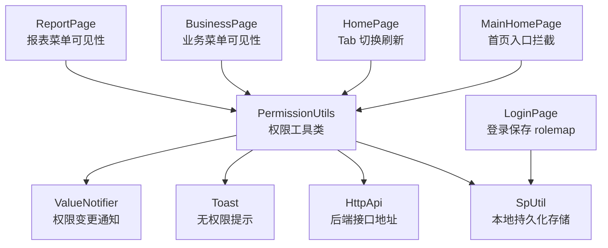
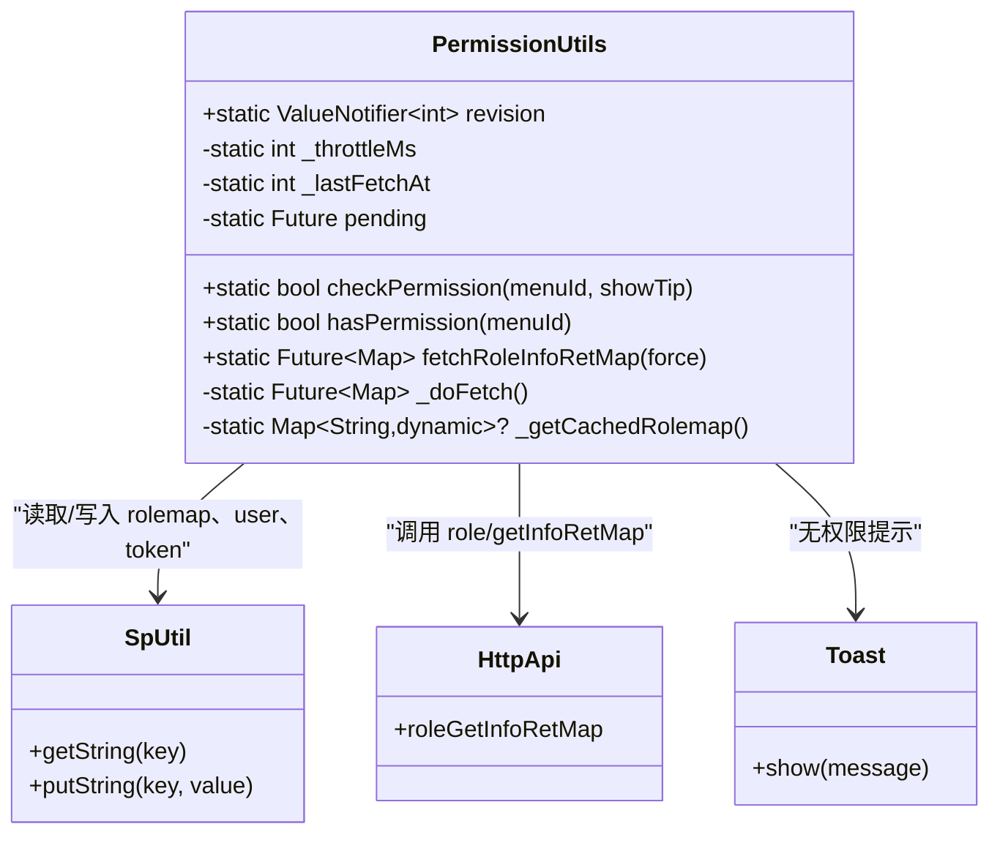
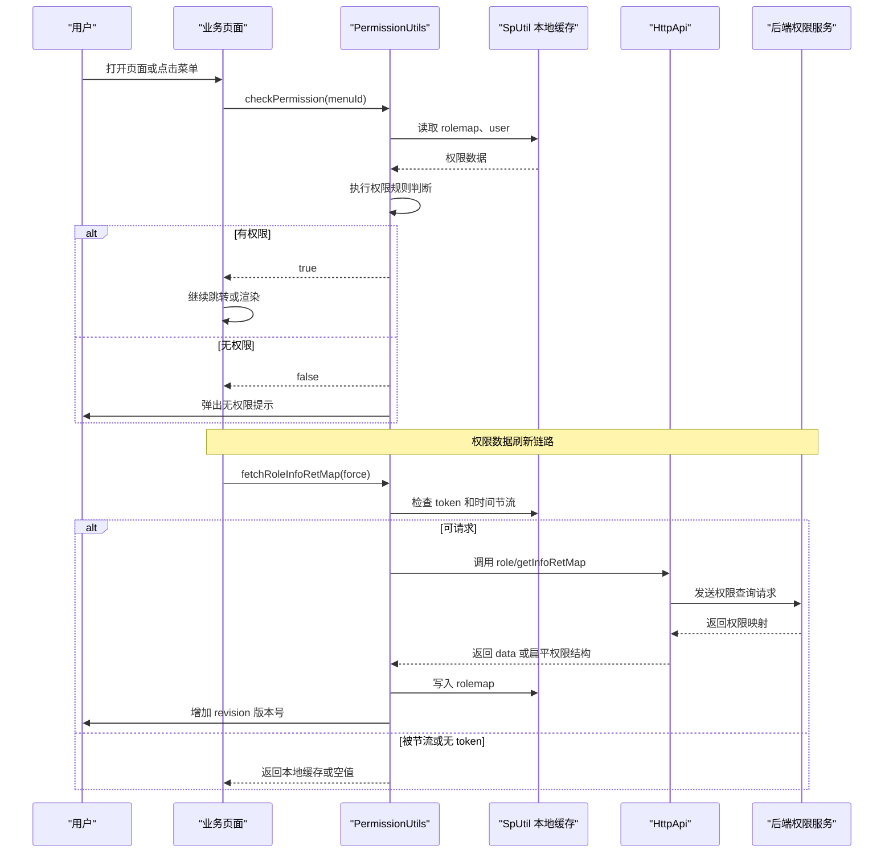
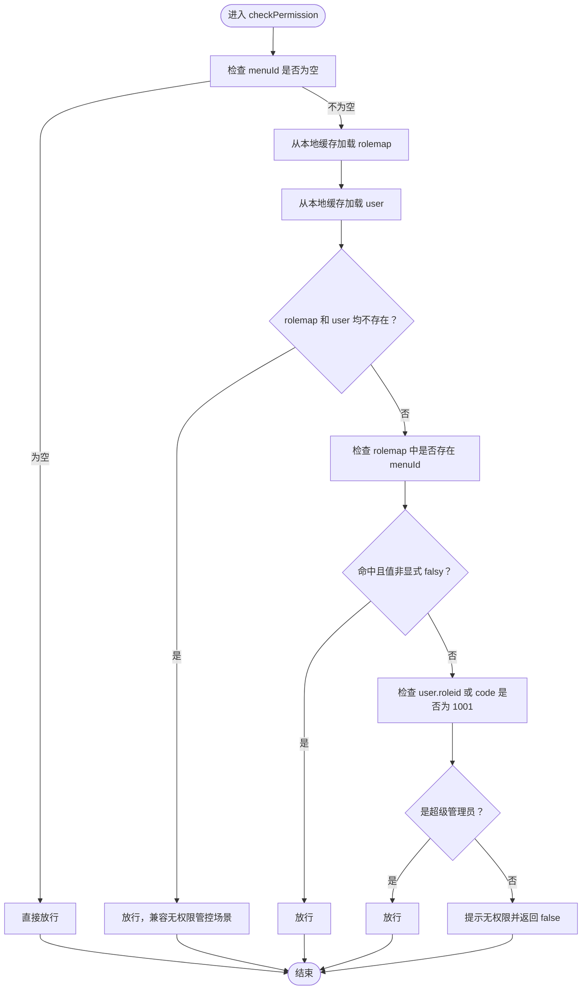
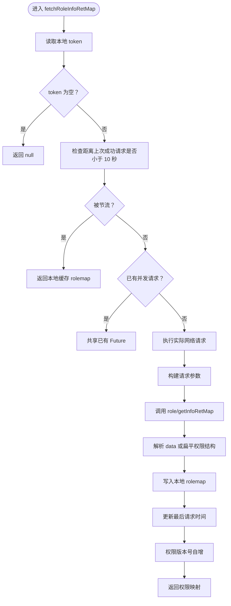
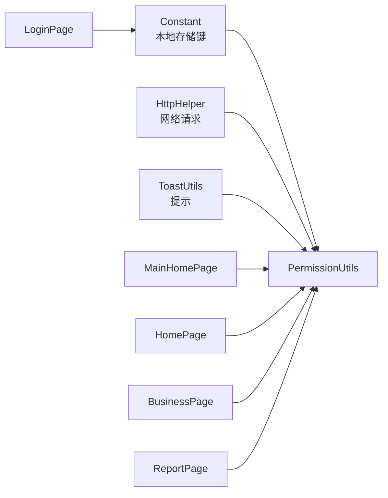
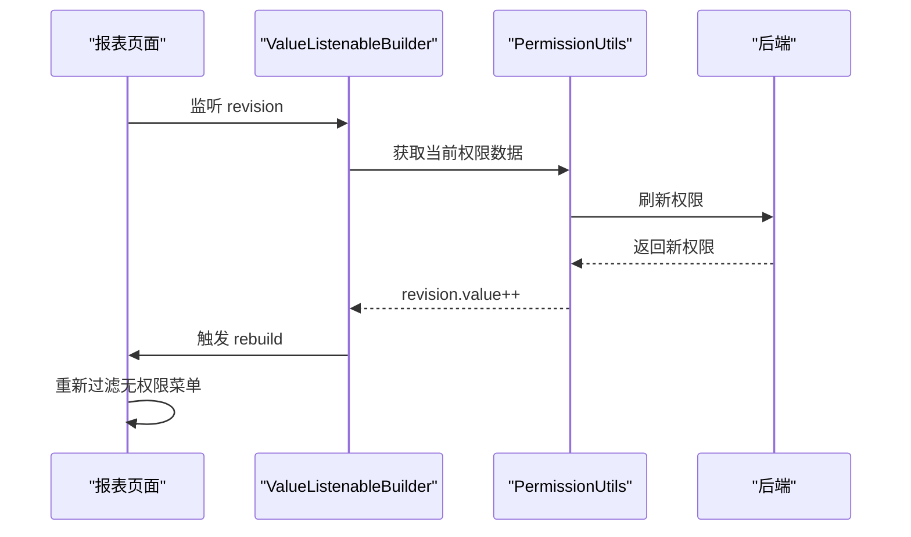
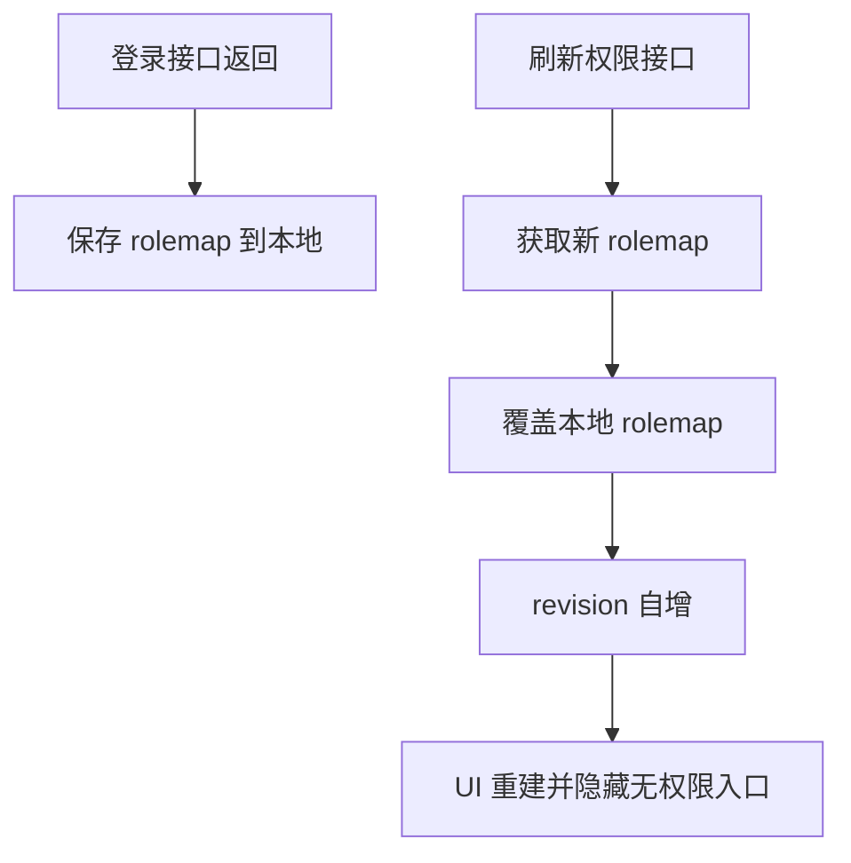

# 设备权限管理

<cite>
**本文引用的文件**   
- [lib/util/permission_utils.dart](file://lib/util/permission_utils.dart)
- [lib/net/http_api.dart](file://lib/net/http_api.dart)
- [lib/res/constant.dart](file://lib/res/constant.dart)
- [lib/pages/home/main_home_page.dart](file://lib/pages/home/main_home_page.dart)
- [lib/pages/home/home_page.dart](file://lib/pages/home/home_page.dart)
- [lib/pages/home/business_page.dart](file://lib/pages/home/business_page.dart)
- [lib/pages/home/report_page.dart](file://lib/pages/home/report_page.dart)
- [lib/pages/home/set_cylist_page.dart](file://lib/pages/home/set_cylist_page.dart)
- [lib/pages/system/management/sys_user_list_page.dart](file://lib/pages/system/management/sys_user_list_page.dart)
- [lib/pages/system/management/sys_user_edit_page.dart](file://lib/pages/system/management/sys_user_edit_page.dart)
- [lib/pages/system/management/sys_seat_list_page.dart](file://lib/pages/system/management/sys_seat_list_page.dart)
- [lib/pages/user/settings_page.dart](file://lib/pages/user/settings_page.dart)
- [lib/pages/login/page/login_page.dart](file://lib/pages/login/page/login_page.dart)
</cite>

## 目录

1. [引言](#引言)
2. [项目结构中的权限相关位置](#项目结构中的权限相关位置)
3. [核心组件：PermissionUtils 权限工具类](#核心组件permissionutils-权限工具类)
4. [架构总览](#架构总览)
5. [关键流程详解](#关键流程详解)
6. [依赖关系分析](#依赖关系分析)
7. [性能与节流策略](#性能与节流策略)
8. [UI 实时可见性与权限变更通知](#ui-实时可见性与权限变更通知)
9. [完整权限控制示例](#完整权限控制示例)
10. [后端同步机制与本地缓存失效策略](#后端同步机制与本地缓存失效策略)
11. [常见问题与排错指南](#常见问题与排错指南)
12. [结论](#结论)

## 引言

本文件面向灵犀管店 Flutter 项目的权限子系统，重点说明 `PermissionUtils` 类的权限校验、权限刷新、超级管理员特权、权限节流和 UI 可见性联动机制。该项目将“业务菜单是否可见”“用户能否跳转页面”“按钮能否操作”统一收敛到 `PermissionUtils`，并通过 `ValueNotifier<int>` 把权限数据变化广播给需要重建的界面。

权限数据来源包括：

- 登录成功后由后端接口返回的 `rolemap`，存入本地持久化存储；
- 切换底部标签页时调用 `/role/getInfoRetMap` 刷新权限；
- 首页、业务 Tab、报表 Tab 等入口在合适时机触发权限刷新；
- 业务页面通过 `checkPermission` / `hasPermission` 判断具体菜单项权限。

该设计与前端 boss 项目中的权限配置逻辑保持一致，使移动端行为与小程序/后台保持一致。

## 项目结构中的权限相关位置

权限能力集中在 `lib/util/permission_utils.dart`，其他模块主要承担以下职责：

| 模块 | 职责 | 与权限的关系 |
|---|---|---|
| `lib/util/permission_utils.dart` | 权限校验、权限刷新、节流、权限变更通知 | 权限子系统唯一实现 |
| `lib/net/http_api.dart` | 定义后端 API 地址 | 提供 `role/getInfoRetMap` 路径 |
| `lib/res/constant.dart` | 常量定义 | 提供 `rolemap`、`user`、`token` 等本地存储键名 |
| `lib/pages/home/main_home_page.dart` | 首页入口权限拦截 | 无权限时阻止业务接口请求并显示遮罩 |
| `lib/pages/home/home_page.dart` | 底部 Tab 切换入口 | 切换 Tab 时调用权限刷新 |
| `lib/pages/home/business_page.dart` | 业务功能列表 | 按 `menuId` 过滤无权限入口 |
| `lib/pages/home/report_page.dart` | 报表功能列表 | 监听权限版本号，自动隐藏无权限入口 |
| `lib/pages/home/set_cylist_page.dart` | 常用功能设置页 | 过滤已选和默认列表中无权限的模块 |
| `lib/pages/system/management/*` | 系统管理页面 | 使用 `checkPermission` 控制查看、新增、编辑、删除等操作 |
| `lib/pages/login/page/login_page.dart` | 登录流程 | 登录后保存后端返回的初始 `rolemap` |

**图表来源**   
- [lib/util/permission_utils.dart:1-190](file://lib/util/permission_utils.dart#L1-L190)
- [lib/net/http_api.dart:440-441](file://lib/net/http_api.dart#L440-L441)
- [lib/res/constant.dart:25](file://lib/res/constant.dart#L25)
- [lib/pages/home/main_home_page.dart:39-162](file://lib/pages/home/main_home_page.dart#L39-L162)
- [lib/pages/home/home_page.dart:72-111](file://lib/pages/home/home_page.dart#L72-L111)
- [lib/pages/home/business_page.dart:70-834](file://lib/pages/home/business_page.dart#L70-L834)
- [lib/pages/home/report_page.dart:226-519](file://lib/pages/home/report_page.dart#L226-L519)
- [lib/pages/login/page/login_page.dart:206](file://lib/pages/login/page/login_page.dart#L206)

**章节来源**   
- [lib/util/permission_utils.dart:1-190](file://lib/util/permission_utils.dart#L1-L190)
- [lib/net/http_api.dart:440-441](file://lib/net/http_api.dart#L440-L441)
- [lib/res/constant.dart:25](file://lib/res/constant.dart#L25)

## 核心组件：PermissionUtils 权限工具类

`PermissionUtils` 是一个静态工具类，对外暴露三个核心能力：

| 方法或字段 | 作用 | 返回值或副作用 |
|---|---|---|
| `checkPermission(menuId, showTip)` | 检查当前用户是否拥有指定菜单权限 | 返回布尔值，失败时可弹 Toast |
| `hasPermission(menuId)` | 快速判断是否有权限，不弹提示 | 返回布尔值，适合 UI 渲染 |
| `fetchRoleInfoRetMap(force)` | 从后端拉取最新权限并写入本地缓存 | 返回权限 map 或空值 |
| `revision` | 权限数据版本号 | 每次刷新成功自增，用于 UI 重建 |

该类还维护以下内部状态：

| 内部成员 | 含义 |
|---|---|
| `_throttleMs` | 权限接口节流间隔，固定为 10 秒 |
| `_lastFetchAt` | 上次成功请求的时间戳 |
| `_pending` | 并发保护标记，避免重复发起相同请求 |

**图表来源**   
- [lib/util/permission_utils.dart:21-190](file://lib/util/permission_utils.dart#L21-L190)
- [lib/net/http_api.dart:440-441](file://lib/net/http_api.dart#L440-L441)

### 权限校验规则

`checkPermission` 的实现遵循以下优先级：

1. 如果传入的 `menuId` 为空，直接放行；
2. 如果本地同时不存在 `rolemap` 和 `user`，放行；
3. 如果 `rolemap` 中存在对应 `menuId`，且其值不是显式的 falsy 值，则放行；
4. 如果当前用户的 `roleid` 或 `code` 等于 `'1001'`，作为超级管理员放行；
5. 否则视为无权限，可弹出提示并返回 false。

其中“显式 falsy 值”包括：

- `false`
- `'false'`
- `0`
- `'0'`
- `null`
- `''`

这种设计允许后端返回多种权限标识形式，例如布尔值、数字、字符串权限名等。

**章节来源**   
- [lib/util/permission_utils.dart:44-99](file://lib/util/permission_utils.dart#L44-L99)

### rolemap 权限映射表结构

`rolemap` 是一个以菜单 ID 为键、权限值为值的映射表。它通常具有以下特征：

| 维度 | 说明 |
|---|---|
| 键 | 菜单 ID，例如 `'04'`、`'0302'`、`'014801'` 等业务模块编号 |
| 值 | 权限标志，可能是布尔值、数字、字符串权限名或空值 |
| 空值或 falsy 值 | 表示无权限 |
| 非 falsy 值 | 表示有权限 |
| 缺失键 | 表示未配置该菜单权限 |

典型使用场景：

- `rolemap['04']` 用于首页入口整体权限判断；
- `rolemap['0302']`、`rolemap['0303']` 用于设置页具体菜单项；
- `rolemap['014801']`、`rolemap['014802']`、`rolemap['014803']`、`rolemap['014804']` 用于系统用户管理的查看、新增、编辑、删除；
- 报表和业务模块中的每个 item 也有自己的 `menuId`。

**章节来源**   
- [lib/util/permission_utils.dart:71-89](file://lib/util/permission_utils.dart#L71-L89)
- [lib/pages/home/main_home_page.dart:106-128](file://lib/pages/home/main_home_page.dart#L106-L128)
- [lib/pages/user/settings_page.dart:59-72](file://lib/pages/user/settings_page.dart#L59-L72)
- [lib/pages/system/management/sys_user_list_page.dart:37-129](file://lib/pages/system/management/sys_user_list_page.dart#L37-L129)
- [lib/pages/system/management/sys_user_edit_page.dart:192-249](file://lib/pages/system/management/sys_user_edit_page.dart#L192-L249)

### 超级管理员特权处理

当 `user` 对象存在，且 `roleid` 或 `code` 等于 `'1001'` 时，权限校验会直接放行。这意味着超级管理员可以绕过普通角色对菜单的权限限制。

需要注意：

- 超级管理员判断发生在 `rolemap` 判断之后；
- 即使 `rolemap` 中某菜单是 falsy 值，超级管理员仍可访问；
- 该逻辑只影响权限判断结果，不会修改 `rolemap` 本身；
- 若后端未返回 `user`，则不会进入超级管理员分支。

**章节来源**   
- [lib/util/permission_utils.dart:84-90](file://lib/util/permission_utils.dart#L84-L90)

### 权限节流机制

`fetchRoleInfoRetMap` 实现了两层防护：

| 防护点 | 行为 |
|---|---|
| 时间节流 | 距上次成功请求不足 10 秒时跳过网络请求，直接返回本地缓存 |
| 并发保护 | 同一时刻只有一个 `_doFetch` 在执行，其他调用共享同一个 Future |

节流参数定义如下：

| 成员 | 值 | 含义 |
|---|---|---|
| `_throttleMs` | `10 * 1000` | 10 秒 |
| `_lastFetchAt` | 毫秒时间戳 | 上次成功刷新时间 |
| `_pending` | Future 或 null | 正在进行的请求 |

强制刷新参数 `force = true` 可用于需要立即获取最新权限的场景，但应谨慎使用，避免频繁请求后端。

**章节来源**   
- [lib/util/permission_utils.dart:24-42](file://lib/util/permission_utils.dart#L24-L42)
- [lib/util/permission_utils.dart:111-140](file://lib/util/permission_utils.dart#L111-L140)

## 架构总览

权限子系统采用“工具类 + 本地缓存 + 后端接口 + UI 监听”的结构：

**图表来源**   
- [lib/util/permission_utils.dart:50-171](file://lib/util/permission_utils.dart#L50-L171)
- [lib/net/http_api.dart:440-441](file://lib/net/http_api.dart#L440-L441)

## 关键流程详解

### 权限检查流程

权限检查的核心步骤如下：

**图表来源**   
- [lib/util/permission_utils.dart:50-99](file://lib/util/permission_utils.dart#L50-L99)

### 权限刷新流程

权限刷新流程关注登录后的初始数据和后续 Tab 切换时的增量刷新：

**图表来源**   
- [lib/util/permission_utils.dart:111-171](file://lib/util/permission_utils.dart#L111-L171)

## 依赖关系分析

### 外部依赖

| 依赖 | 用途 | 风险或注意事项 |
|---|---|---|
| `sp_util` | 本地持久化 `rolemap`、`user`、`token` | 存储结构损坏时需要防御性解析 |
| `flutter/foundation` | `ValueNotifier` | 需要确保监听方正确订阅和释放 |
| `http_helper.request` | 调用后端权限接口 | 权限接口静默失败，不应阻断主流程 |
| `http_api.HttpApi` | 提供接口地址 | 接口地址变更会影响权限刷新 |
| `toast_utils.Toast` | 无权限提示 | 仅在 `showTip=true` 时弹出 |

### 内部耦合

- `PermissionUtils` 直接依赖 `Constant` 中的本地存储键；
- 业务页面通过 `PermissionUtils.checkPermission` 做跳转前拦截；
- 列表类页面通过 `PermissionUtils.hasPermission` 做菜单可见性过滤；
- 报表和业务页面通过 `PermissionUtils.revision` 做 UI 重建；
- 首页和 Tab 页负责触发权限刷新。

**图表来源**   
- [lib/res/constant.dart:25](file://lib/res/constant.dart#L25)
- [lib/util/permission_utils.dart:1-190](file://lib/util/permission_utils.dart#L1-L190)
- [lib/pages/home/main_home_page.dart:39-162](file://lib/pages/home/main_home_page.dart#L39-L162)
- [lib/pages/home/home_page.dart:72-111](file://lib/pages/home/home_page.dart#L72-L111)

**章节来源**   
- [lib/util/permission_utils.dart:1-190](file://lib/util/permission_utils.dart#L1-L190)
- [lib/res/constant.dart:25](file://lib/res/constant.dart#L25)

## 性能与节流策略

### 节流效果

权限刷新接口具有 10 秒节流：

- 正常调用：若距离上次成功请求不到 10 秒，直接返回本地缓存；
- 强制调用：`force=true` 可绕过节流；
- 并发调用：多个异步调用会共享同一个 `_pending` Future，避免重复请求。

这适合 Tab 切换、首页初始化、常用功能设置等高频触发场景。

### 本地缓存读取成本

权限检查会读取 `rolemap` 和 `user` 两个本地字段，并进行 JSON 解析。由于这两个字段通常较小，解析开销很低，但应避免在高频循环中反复解析。推荐做法：

- 列表渲染中使用 `hasPermission`；
- 跳转前使用 `checkPermission`；
- 不要在每个子 widget 中重复触发权限刷新。

### 网络请求成本

权限刷新接口在网络不可用、后端异常或返回结构异常时会静默失败，不会弹出错误提示。这样能保证用户体验稳定，但也意味着开发者需要结合日志和 `debugPrint` 输出排查问题。

**章节来源**   
- [lib/util/permission_utils.dart:24-42](file://lib/util/permission_utils.dart#L24-L42)
- [lib/util/permission_utils.dart:111-174](file://lib/util/permission_utils.dart#L111-L174)

## UI 实时可见性与权限变更通知

### ValueNotifier 权限版本号

`PermissionUtils.revision` 是一个 `ValueNotifier<int>`，每次权限刷新成功后自增。业务页面可以通过 `ValueListenableBuilder` 监听该值，从而在权限变更后自动重建界面。

典型用法：

- 报表页面监听 `revision`，刷新后重新计算菜单可见性；
- 业务页面监听 `revision`，刷新后重新排序分区，并将无权限分区隐藏；
- 常用功能设置页根据 `hasPermission` 过滤已选模块和默认模块。

### 常见 UI 模式

| 场景 | 推荐方式 |
|---|---|
| 页面入口处跳转拦截 | 使用 `checkPermission(menuId)`，失败时返回或提示 |
| 菜单项动态显示或隐藏 | 使用 `hasPermission(menuId)` |
| 整个分区因无权限而隐藏 | 先过滤菜单项，再判断分区内是否还有可见项 |
| 权限变更后即时生效 | 外层包裹 `ValueListenableBuilder(PermissionUtils.revision)` |
| 用户主动刷新权限 | 调用 `fetchRoleInfoRetMap(force: true)` |

### 报表页面示例

报表页面通过监听权限版本号实现无权限入口即时隐藏：

**图表来源**   
- [lib/pages/home/report_page.dart:226-228](file://lib/pages/home/report_page.dart#L226-L228)
- [lib/pages/home/report_page.dart:324-327](file://lib/pages/home/report_page.dart#L324-L327)
- [lib/pages/home/report_page.dart:516-519](file://lib/pages/home/report_page.dart#L516-L519)
- [lib/util/permission_utils.dart:35-42](file://lib/util/permission_utils.dart#L35-L42)

**章节来源**   
- [lib/pages/home/report_page.dart:226-327](file://lib/pages/home/report_page.dart#L226-L327)
- [lib/pages/home/business_page.dart:421-425](file://lib/pages/home/business_page.dart#L421-L425)
- [lib/pages/home/set_cylist_page.dart:51-97](file://lib/pages/home/set_cylist_page.dart#L51-L97)
- [lib/util/permission_utils.dart:35-42](file://lib/util/permission_utils.dart#L35-L42)

## 完整权限控制示例

### 示例一：页面入口处权限拦截

适用于用户尝试跳转到某个受控页面时进行权限拦截。

建议流程：

1. 在页面跳转前调用 `checkPermission(menuId)`；
2. 若无权限，返回上一页或停留在当前页面；
3. 若有权限，继续执行页面逻辑。

参考路径：

- [lib/pages/system/management/sys_user_list_page.dart:37-38](file://lib/pages/system/management/sys_user_list_page.dart#L37-L38)
- [lib/pages/system/management/sys_user_list_page.dart:118-129](file://lib/pages/system/management/sys_user_list_page.dart#L118-L129)
- [lib/pages/system/management/sys_seat_list_page.dart:241-318](file://lib/pages/system/management/sys_seat_list_page.dart#L241-L318)

### 示例二：动态显示或隐藏菜单项

适用于首页、业务 Tab、报表 Tab 的菜单列表。

建议流程：

1. 为每个菜单项绑定 `menuId`；
2. 渲染时使用 `hasPermission(menuId)` 判断是否显示；
3. 若分区内所有菜单项都无权限，则隐藏整块分区；
4. 使用 `ValueListenableBuilder(PermissionUtils.revision)` 实现权限变更后即时隐藏。

参考路径：

- [lib/pages/home/business_page.dart:260-266](file://lib/pages/home/business_page.dart#L260-L266)
- [lib/pages/home/business_page.dart:644-658](file://lib/pages/home/business_page.dart#L644-L658)
- [lib/pages/home/report_page.dart:324-327](file://lib/pages/home/report_page.dart#L324-L327)
- [lib/pages/home/report_page.dart:398-399](file://lib/pages/home/report_page.dart#L398-L399)

### 示例三：处理无权限提示

`checkPermission` 默认会在无权限时弹出提示。若业务需要自定义提示文案，可使用 `showTip=false`，然后自行展示提示。

参考路径：

- [lib/pages/system/management/sys_user_list_page.dart:37-38](file://lib/pages/system/management/sys_user_list_page.dart#L37-L38)
- [lib/pages/system/management/sys_user_edit_page.dart:192-249](file://lib/pages/system/management/sys_user_edit_page.dart#L192-L249)

### 示例四：首页入口权限拦截

首页在进入时会对 `rolemap['04']` 做整体权限判断。若无权限，则不请求业务数据，并在首页内容上叠加半透明遮罩。

参考路径：

- [lib/pages/home/main_home_page.dart:91-105](file://lib/pages/home/main_home_page.dart#L91-L105)
- [lib/pages/home/main_home_page.dart:106-162](file://lib/pages/home/main_home_page.dart#L106-L162)
- [lib/pages/home/main_home_page.dart:452-554](file://lib/pages/home/main_home_page.dart#L452-L554)
- [lib/pages/home/main_home_page.dart:741](file://lib/pages/home/main_home_page.dart#L741)

### 示例五：设置页菜单权限

设置页在具体菜单点击前调用 `checkPermission`，例如设置中的不同子菜单分别对应不同权限码。

参考路径：

- [lib/pages/user/settings_page.dart:59-72](file://lib/pages/user/settings_page.dart#L59-L72)

**章节来源**   
- [lib/pages/system/management/sys_user_list_page.dart:37-129](file://lib/pages/system/management/sys_user_list_page.dart#L37-L129)
- [lib/pages/system/management/sys_user_edit_page.dart:192-249](file://lib/pages/system/management/sys_user_edit_page.dart#L192-L249)
- [lib/pages/system/management/sys_seat_list_page.dart:241-318](file://lib/pages/system/management/sys_seat_list_page.dart#L241-L318)
- [lib/pages/home/business_page.dart:260-266](file://lib/pages/home/business_page.dart#L260-L266)
- [lib/pages/home/business_page.dart:644-658](file://lib/pages/home/business_page.dart#L644-L658)
- [lib/pages/home/report_page.dart:324-327](file://lib/pages/home/report_page.dart#L324-L327)
- [lib/pages/home/report_page.dart:398-399](file://lib/pages/home/report_page.dart#L398-L399)
- [lib/pages/home/main_home_page.dart:91-162](file://lib/pages/home/main_home_page.dart#L91-L162)
- [lib/pages/home/main_home_page.dart:452-554](file://lib/pages/home/main_home_page.dart#L452-L554)
- [lib/pages/home/main_home_page.dart:741](file://lib/pages/home/main_home_page.dart#L741)
- [lib/pages/user/settings_page.dart:59-72](file://lib/pages/user/settings_page.dart#L59-L72)

## 后端同步机制与本地缓存失效策略

### 权限数据来源

权限数据有两个主要来源：

1. **登录响应**：登录成功后保存后端返回的 `rolemap`；
2. **权限接口**：通过 `/role/getInfoRetMap` 刷新权限。

**图表来源**   
- [lib/pages/login/page/login_page.dart:206](file://lib/pages/login/page/login_page.dart#L206)
- [lib/util/permission_utils.dart:150-171](file://lib/util/permission_utils.dart#L150-L171)

### 何时刷新权限

项目中常见的刷新时机包括：

| 时机 | 行为 |
|---|---|
| 登录成功后 | 保存初始 `rolemap` |
| 首页启动后 | 预取权限数据，确保缓存最新 |
| 底部 Tab 切换时 | 调用权限刷新，但受 10 秒节流保护 |
| 业务 Tab 切换时 | 同样触发权限刷新 |
| 解绑席位后 | 重新拉取员工门店权限和相关数据 |
| 用户主动需要最新权限时 | 使用 `force=true` 强制刷新 |

参考路径：

- [lib/pages/login/page/login_page.dart:206](file://lib/pages/login/page/login_page.dart#L206)
- [lib/pages/home/home_page.dart:72-73](file://lib/pages/home/home_page.dart#L72-L73)
- [lib/pages/home/home_page.dart:109-111](file://lib/pages/home/home_page.dart#L109-L111)
- [lib/pages/home/business_page.dart:118-123](file://lib/pages/home/business_page.dart#L118-L123)

### 本地缓存失效策略

当前实现的失效策略以“时间节流 + 主动刷新”为主：

| 策略 | 行为 |
|---|---|
| 首次无缓存 | 直接调用后端接口 |
| 10 秒内重复刷新 | 返回本地缓存，不请求后端 |
| 强制刷新 | 忽略节流，直接请求后端 |
| 并发刷新 | 共享同一个 Future，避免重复请求 |
| 接口失败 | 不覆盖旧缓存，保持原权限状态 |
| 权限变更后 | 更新 `revision`，让 UI 感知变化 |

如果需要更严格的失效策略，可以考虑：

- 增加权限数据过期时间；
- 在用户信息变更、角色变更、解绑席位后强制刷新；
- 在应用重新启动时判断是否需要刷新；
- 为不同角色或门店提供独立缓存键（当前实现共用全局 `rolemap`）。

**章节来源**   
- [lib/pages/login/page/login_page.dart:206](file://lib/pages/login/page/login_page.dart#L206)
- [lib/pages/home/home_page.dart:72-111](file://lib/pages/home/home_page.dart#L72-L111)
- [lib/pages/home/business_page.dart:118-123](file://lib/pages/home/business_page.dart#L118-L123)
- [lib/util/permission_utils.dart:111-171](file://lib/util/permission_utils.dart#L111-L171)

## 常见问题与排错指南

### 问题一：无权限却能看到菜单

可能原因：

- 菜单没有设置 `menuId`；
- `menuId` 与后端配置的权限键不一致；
- `rolemap` 尚未刷新；
- 当前用户是超级管理员；
- 本地 `rolemap` 或 `user` 不存在，触发了“兼容无权限管控”的放行逻辑。

排查建议：

1. 确认菜单的 `menuId` 与后端权限键一致；
2. 打印本地 `rolemap` 是否包含该键；
3. 检查用户是否为超级管理员；
4. 调用 `fetchRoleInfoRetMap()` 刷新权限；
5. 使用 `hasPermission` 替代 `checkPermission` 做 UI 判断。

**章节来源**   
- [lib/util/permission_utils.dart:44-99](file://lib/util/permission_utils.dart#L44-L99)
- [lib/pages/home/business_page.dart:644-658](file://lib/pages/home/business_page.dart#L644-L658)
- [lib/pages/home/report_page.dart:398-399](file://lib/pages/home/report_page.dart#L398-L399)

### 问题二：权限变更后 UI 没有实时更新

可能原因：

- 没有监听 `PermissionUtils.revision`；
- 没有在权限刷新后触发界面重建；
- 使用了旧的权限快照，而不是重新计算可见性。

修复建议：

- 使用 `ValueListenableBuilder(PermissionUtils.revision)` 包裹需要重建的 UI；
- 在权限刷新完成后重新计算菜单过滤结果；
- 避免在 `build` 外缓存不可变的权限判断结果。

**章节来源**   
- [lib/pages/home/report_page.dart:226-228](file://lib/pages/home/report_page.dart#L226-L228)
- [lib/pages/home/business_page.dart:421-425](file://lib/pages/home/business_page.dart#L421-L425)
- [lib/util/permission_utils.dart:35-42](file://lib/util/permission_utils.dart#L35-L42)

### 问题三：权限接口频繁请求

可能原因：

- 频繁切换 Tab；
- 多次调用 `fetchRoleInfoRetMap()`；
- 没有正确使用节流；
- 误用 `force=true`。

修复建议：

- 只在必要时机调用权限刷新；
- 利用内置 10 秒节流；
- 避免在高频回调中强制刷新；
- 只在用户主动刷新或关键状态变更后使用 `force=true`。

**章节来源**   
- [lib/util/permission_utils.dart:24-42](file://lib/util/permission_utils.dart#L24-L42)
- [lib/util/permission_utils.dart:111-140](file://lib/util/permission_utils.dart#L111-L140)

### 问题四：权限接口失败但没有提示

这是预期行为。权限接口调用时明确关闭了错误提示，目的是避免权限刷新失败干扰主流程。

排查建议：

- 检查网络是否正常；
- 检查 token 是否存在；
- 检查后端接口地址是否正确；
- 查看调试日志中的权限刷新输出。

**章节来源**   
- [lib/util/permission_utils.dart:150-174](file://lib/util/permission_utils.dart#L150-L174)

## 结论

`PermissionUtils` 是灵犀管店 Flutter 项目权限能力的核心。它将权限校验、权限刷新、超级管理员特权、节流保护和 UI 通知整合为一个稳定的工具类。业务页面只需要关注 `menuId`、`checkPermission`、`hasPermission` 和 `fetchRoleInfoRetMap`，即可实现完整的权限控制。

在实际使用中，建议遵循以下原则：

- 所有菜单项都应绑定明确的 `menuId`；
- 页面跳转前使用 `checkPermission`；
- 菜单显示隐藏使用 `hasPermission`；
- 需要权限变更后即时生效的 UI 监听 `PermissionUtils.revision`；
- 只在必要时机触发权限刷新，优先使用内置节流；
- 超级管理员特权属于业务策略，不应随意绕过后端权限校验。

这套机制既保证了权限控制的准确性，也兼顾了性能和用户体验，是当前项目中权限子系统的主要实现方式。