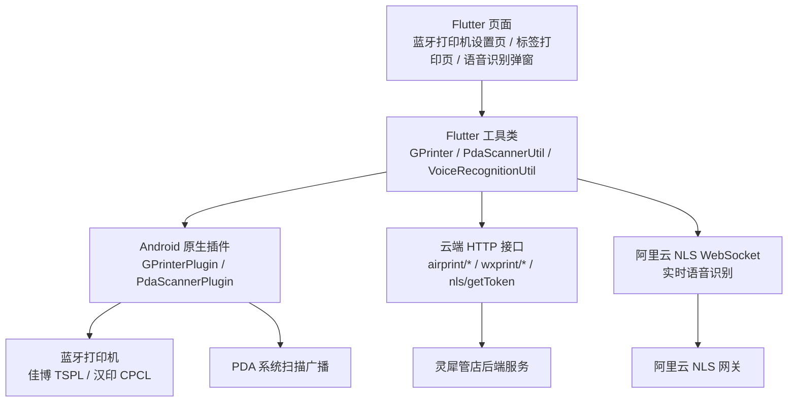
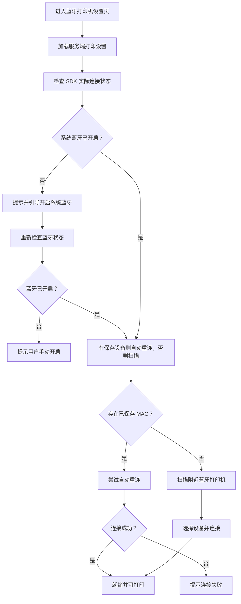
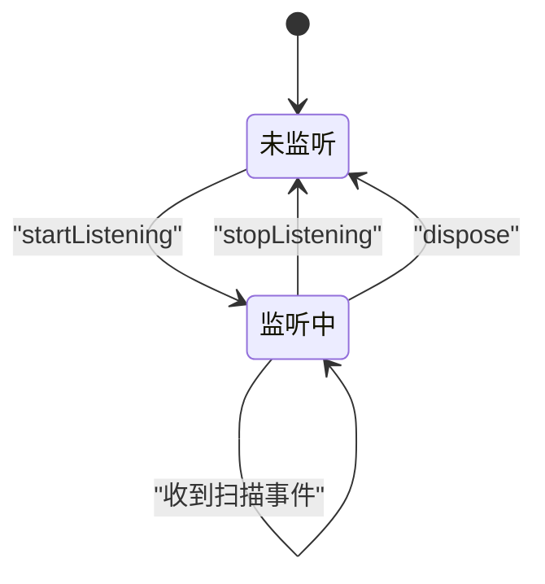
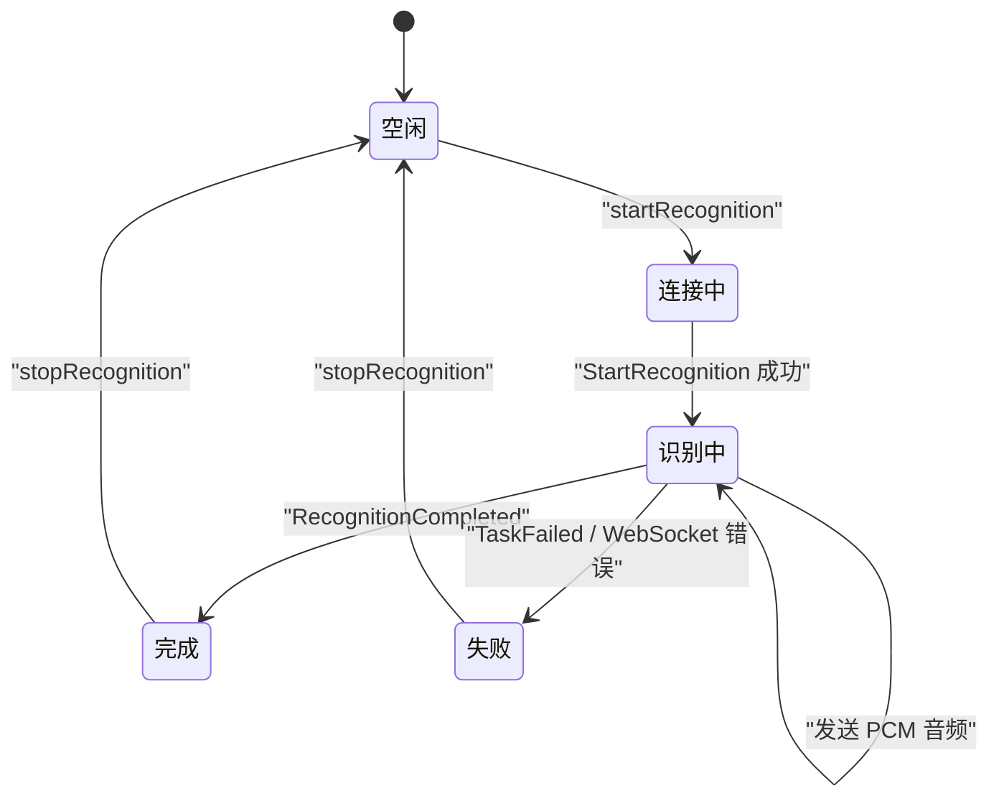

# 设备集成API

<cite>
**本文引用的文件**   
- [gprinter.dart](file://lib/util/gprinter.dart)
- [pda_scanner_util.dart](file://lib/util/pda_scanner_util.dart)
- [voice_recognition_util.dart](file://lib/util/voice_recognition_util.dart)
- [http_api.dart](file://lib/net/http_api.dart)
- [bluetooth_printer_page.dart](file://lib/pages/user/bluetooth_printer_page.dart)
- [label_print_page.dart](file://lib/pages/user/label_print_page.dart)
- [voice_recognition_dialog.dart](file://lib/widgets/voice_recognition_dialog.dart)
- [GPrinterPlugin.java](file://android/app/src/main/java/com/weilu/deer/GPrinterPlugin.java)
- [PdaScannerPlugin.java](file://android/app/src/main/java/com/weilu/deer/PdaScannerPlugin.java)
- [AndroidManifest.xml](file://android/app/src/main/AndroidManifest.xml)
- [Info.plist](file://ios/Runner/Info.plist)
- [pubspec.yaml](file://pubspec.yaml)
</cite>

## 目录
1. [文档目标与适用范围](#文档目标与适用范围)
2. [整体架构总览](#整体架构总览)
3. [项目结构与硬件相关入口](#项目结构与硬件相关入口)
4. [核心设备接口规范](#核心设备接口规范)
5. [设备连接管理与状态模型](#设备连接管理与状态模型)
6. [数据传输协议与消息结构](#数据传输协议与消息结构)
7. [错误处理、重试机制与离线策略](#错误处理重试机制与离线策略)
8. [权限配置要求](#权限配置要求)
9. [跨平台兼容性说明](#跨平台兼容性说明)
10. [完整实现示例参考](#完整实现示例参考)
11. [故障诊断指南](#故障诊断指南)
12. [性能优化建议](#性能优化建议)
13. [结论](#结论)

## 文档目标与适用范围
本文面向灵犀管店 Flutter 项目的设备集成开发者和维护者，重点记录以下硬件能力：
- 蓝牙打印机标签打印与单据打印。
- PDA 硬件扫码枪扫描事件接入。
- 阿里云 NLS 语音识别 Token 获取与实时音频流识别。
- 标签打印设置与业务打印设置。

需要特别注意：
- 文档中提到的“airprint/setWxPrintRw”“nls/getToken”“app/labelprint/setLabelPrintFlow”等命名，应结合代码实际常量进行对照；当前仓库中部分路径为 `airprint/setWxPrintRw`、`nls/getToken`、`wxprint/getLabelPrintParams` 等，并非完全一致。
- 蓝牙标签打印在 Android 端通过佳博 SDK 的 MethodChannel 实现，iOS 端未暴露相同原生插件方法，因此蓝牙标签打印属于 Android 优先能力。
- PDA 扫码枪基于 Android EventChannel 广播，iOS 和 Web 不支持。
- 语音识别使用 WebSocket 直连阿里云网关，并依赖本地签名逻辑或后端 Token 服务。

## 整体架构总览
灵犀管店的设备集成采用“Flutter 工具类 + Android 原生插件 + 云端 HTTP/WebSocket 服务”的分层架构：

**图示来源**  
- [gprinter.dart:1-130](file://lib/util/gprinter.dart#L1-L130)  
- [pda_scanner_util.dart:1-66](file://lib/util/pda_scanner_util.dart#L1-L66)  
- [voice_recognition_util.dart:1-200](file://lib/util/voice_recognition_util.dart#L1-L200)  
- [GPrinterPlugin.java:1-200](file://android/app/src/main/java/com/weilu/deer/GPrinterPlugin.java#L1-L200)  
- [PdaScannerPlugin.java:1-165](file://android/app/src/main/java/com/weilu/deer/PdaScannerPlugin.java#L1-L165)  
- [http_api.dart:1-200](file://lib/net/http_api.dart#L1-L200)

**章节来源**  
- [gprinter.dart:1-130](file://lib/util/gprinter.dart#L1-L130)  
- [pda_scanner_util.dart:1-66](file://lib/util/pda_scanner_util.dart#L1-L66)  
- [voice_recognition_util.dart:1-200](file://lib/util/voice_recognition_util.dart#L1-L200)  
- [http_api.dart:1-200](file://lib/net/http_api.dart#L1-L200)

## 项目结构与硬件相关入口
硬件相关代码主要集中在以下位置：

| 层级 | 文件 | 职责 |
|---|---|---|
| Flutter 工具层 | [gprinter.dart](file://lib/util/gprinter.dart) | 蓝牙标签打印 MethodChannel 封装 |
| Flutter 工具层 | [pda_scanner_util.dart](file://lib/util/pda_scanner_util.dart) | PDA 扫描 EventChannel 监听 |
| Flutter 工具层 | [voice_recognition_util.dart](file://lib/util/voice_recognition_util.dart) | 阿里云 NLS Token 与 WebSocket 语音识别 |
| Flutter 页面层 | [bluetooth_printer_page.dart](file://lib/pages/user/bluetooth_printer_page.dart) | 蓝牙打印机连接、自动重连、测试打印 |
| Flutter 页面层 | [label_print_page.dart](file://lib/pages/user/label_print_page.dart) | 标签打印设置、新旧接口联动 |
| Flutter 组件层 | [voice_recognition_dialog.dart](file://lib/widgets/voice_recognition_dialog.dart) | 录音、麦克风权限、语音识别交互 |
| Android 原生层 | [GPrinterPlugin.java](file://android/app/src/main/java/com/weilu/deer/GPrinterPlugin.java) | 蓝牙打印机扫描、连接、指令打印 |
| Android 原生层 | [PdaScannerPlugin.java](file://android/app/src/main/java/com/weilu/deer/PdaScannerPlugin.java) | PDA 扫描广播接收与数据推送 |
| 配置层 | [AndroidManifest.xml](file://android/app/src/main/AndroidManifest.xml) | Android 蓝牙、定位、网络、录音权限 |
| 配置层 | [Info.plist](file://ios/Runner/Info.plist) | iOS 相机、定位、相册、麦克风权限声明 |
| 接口常量层 | [http_api.dart](file://lib/net/http_api.dart) | 打印、标签、语音 Token 等接口路径 |

**章节来源**  
- [gprinter.dart:1-130](file://lib/util/gprinter.dart#L1-L130)  
- [pda_scanner_util.dart:1-66](file://lib/util/pda_scanner_util.dart#L1-L66)  
- [voice_recognition_util.dart:1-200](file://lib/util/voice_recognition_util.dart#L1-L200)  
- [bluetooth_printer_page.dart:1-200](file://lib/pages/user/bluetooth_printer_page.dart#L1-L200)  
- [label_print_page.dart:1-200](file://lib/pages/user/label_print_page.dart#L1-L200)  
- [voice_recognition_dialog.dart:1-200](file://lib/widgets/voice_recognition_dialog.dart#L1-L200)  
- [GPrinterPlugin.java:1-200](file://android/app/src/main/java/com/weilu/deer/GPrinterPlugin.java#L1-L200)  
- [PdaScannerPlugin.java:1-165](file://android/app/src/main/java/com/weilu/deer/PdaScannerPlugin.java#L1-L165)  
- [AndroidManifest.xml:1-98](file://android/app/src/main/AndroidManifest.xml#L1-L98)  
- [Info.plist:1-76](file://ios/Runner/Info.plist#L1-L76)  
- [http_api.dart:1-200](file://lib/net/http_api.dart#L1-L200)

## 核心设备接口规范

### 蓝牙打印机接口（GPrinter）
GPrinter 是 Flutter 层对佳博蓝牙标签打印能力的统一封装，底层通过 MethodChannel 调用 Android 原生插件。

| 方法 | 参数 | 返回值 | 说明 |
|---|---|---|---|
| `requestPermissions()` | 无 | `Future<bool>` | 请求蓝牙相关运行时权限；缺失插件时返回 true，避免阻断流程 |
| `isBluetoothEnabled` | 无 | `Future<bool>` | 查询系统蓝牙是否已开启 |
| `enableBluetooth()` | 无 | `Future<bool>` | 引导开启系统蓝牙；Android 13+ 跳转设置页 |
| `scanPrinters({timeout})` | `timeout` 毫秒 | `Future<List<GPrinterDevice>>` | 扫描蓝牙打印机，默认 10 秒超时 |
| `connect(mac, {name})` | `mac`、可选 `name` | `Future<bool>` | 连接指定 MAC 的蓝牙打印机 |
| `disconnect()` | 无 | `Future<void>` | 断开当前打印机连接 |
| `isConnected` | 无 | `Future<bool>` | 查询 SDK 实际连接状态 |
| `printLabels(items, {template})` | 商品明细列表、模板编号 | `Future<int>` | 打印普通标签 |
| `printPrepackLabels(items, {template})` | 预包装明细列表、模板编号 | `Future<int>` | 打印预包装改价标签 |
| `printTestLabel()` | 无 | `Future<void>` | 打印测试标签，用于验证连接 |

GPrinter 支持两类标签：
- 普通商品标签：包含名称、规格、折后单价、小计、零售价、折扣、CODE128 条码、数量。
- 预包装改价标签：包含名称、规格、条码、售价、包装数量、包装金额、包装折扣、包装条码、数量。

模板编号含义：
- 1：60×40mm
- 2：50×30mm
- 3：40×30mm
- 4：45×20mm

**章节来源**  
- [gprinter.dart:1-130](file://lib/util/gprinter.dart#L1-L130)

### PDA 扫码枪接口（PdaScannerUtil）
PdaScannerUtil 通过 EventChannel 订阅 Android PDA 设备的硬件扫描广播，将条码以 Stream 形式暴露给 Flutter 层。

| 方法 | 参数 | 返回值 | 说明 |
|---|---|---|---|
| `startListening(onBarcode, {onError})` | 回调函数、可选错误回调 | void | 开始监听扫描事件 |
| `stopListening()` | 无 | void | 停止监听 |
| `dispose()` | 无 | void | 释放资源 |
| `isListening` | 无 | bool | 当前是否正在监听 |
| `isSupported` | 无 | bool | 仅 Android 非 Web 平台支持 |

EventChannel 通道名为 `com.weilu.deer/pda_scanner`，底层由 [PdaScannerPlugin.java](file://android/app/src/main/java/com/weilu/deer/PdaScannerPlugin.java) 注册多个主流 PDA 厂商的 Action 与 Extra Key。

**章节来源**  
- [pda_scanner_util.dart:1-66](file://lib/util/pda_scanner_util.dart#L1-L66)  
- [PdaScannerPlugin.java:1-165](file://android/app/src/main/java/com/weilu/deer/PdaScannerPlugin.java#L1-L165)

### 语音识别接口（VoiceRecognitionUtil）
VoiceRecognitionUtil 提供两类能力：
1. 获取阿里云 NLS Token。
2. 通过 WebSocket 建立实时语音识别会话。

#### Token 获取接口
当前实现直接在 Flutter 端构造阿里云 NLS Meta API 请求，使用 HMAC-SHA1 签名，并缓存 Token。同时，[http_api.dart](file://lib/net/http_api.dart) 中还定义了 `nls/getToken` 常量，可用于未来改为后端代理模式。

| 方法 | 参数 | 返回值 | 说明 |
|---|---|---|---|
| `getToken()` | 无 | `Future<String>` | 获取阿里云 NLS Token，带过期前刷新缓存 |
| `startRecognition(token)` | Token 字符串 | `Future<void>` | 建立 WebSocket 连接并发送 StartRecognition |
| `sendAudioData(data)` | PCM 字节数组 | void | 发送音频流数据 |
| `stopRecognition()` | 无 | `Future<void>` | 发送 StopRecognition 并关闭连接 |
| `dispose()` | 无 | `Future<void>` | 清理回调与连接 |

WebSocket 地址为 `wss://nls-gateway.cn-shanghai.aliyuncs.com/ws/v1`，连接参数中包含 token。

#### 语音识别消息协议
| 消息方向 | 类型 | 关键字段 | 含义 |
|---|---|---|---|
| Flutter → 服务端 | StartRecognition | header.appkey、payload.format=pcm、sample_rate=16000 | 启动识别 |
| Flutter → 服务端 | 音频数据 | 二进制 PCM 流 | 实时语音输入 |
| Flutter → 服务端 | StopRecognition | header.task_id、header.message_id | 停止识别 |
| 服务端 → Flutter | RecognitionResultChanged | payload.result | 中间识别结果 |
| 服务端 → Flutter | RecognitionCompleted | payload.result | 最终识别结果 |
| 服务端 → Flutter | TaskFailed | status、status_text | 识别失败 |

**章节来源**  
- [voice_recognition_util.dart:1-200](file://lib/util/voice_recognition_util.dart#L1-L200)  
- [voice_recognition_util.dart:201-347](file://lib/util/voice_recognition_util.dart#L201-L347)  
- [http_api.dart:465-595](file://lib/net/http_api.dart#L465-L595)

### 业务打印接口（airprint/setWxPrintRw）
项目中大量单据类型的打印都复用同一个接口常量：

| 单据类型 | 打印接口常量 |
|---|---|
| 采购入库单 | purchaseInstorePrint |
| 采购订货单 | cgorderPrint |
| 采购退货单 | cgthPrint |
| 采购计划单 | cgplanPrint |
| 自采申请单 | cgzcPrint |
| 调拨申请单 | dborderPrint |
| 调拨出库单 | dbstockoutPrint |
| 调拨入库单 | dbstockinPrint |
| 配送发货单 | psstockoutPrint |
| 配送收货单 | psstockinPrint |
| 配退申请单 | psrefundapplyPrint |
| 配退发货单 | psrefundoutPrint |
| 配退收货单 | psrefundinPrint |
| WMS 上架任务 | wmsReceivePrint |
| 直配订单 | cgotherPrint |
| 要货申请单 | yhorderPrint |

这些常量值均为 `airprint/setWxPrintRw`，表示通过后端 airprint 模块触发微信打印或云端打印能力。前端通常先拉取打印配置，再按业务单据发起打印。

**章节来源**  
- [http_api.dart:1-200](file://lib/net/http_api.dart#L1-L200)  
- [http_api.dart:200-464](file://lib/net/http_api.dart#L200-L464)

### 标签打印设置接口（wxprint/getLabelPrintParams 与 saveLabelPrintParams）
标签打印设置不是直接对应 `app/labelprint/setLabelPrintFlow`，而是由以下两个接口组成：

| 接口常量 | 值 | 说明 |
|---|---|---|
| getLabelPrintParams | `wxprint/getLabelPrintParams` | 获取标签打印配置 |
| saveLabelPrintParams | `wxprint/saveLabelPrintParams` | 保存标签打印配置 |

标签打印页面会并行拉取新接口配置与旧接口互斥状态，并在切换打印方式时同步新旧接口。

**章节来源**  
- [label_print_page.dart:1-200](file://lib/pages/user/label_print_page.dart#L1-L200)  
- [http_api.dart:465-595](file://lib/net/http_api.dart#L465-L595)

## 设备连接管理与状态模型

### 蓝牙打印机连接状态模型
蓝牙打印机连接涉及三层状态：

| 状态维度 | 含义 | 数据来源 |
|---|---|---|
| 用户配置 | 是否启用蓝牙打印、已保存设备名称和设备 ID | 服务端打印设置 |
| 系统状态 | 系统蓝牙是否开启 | GPrinter.isBluetoothEnabled |
| SDK 实际连接 | 是否真正连接到打印机 | GPrinter.isConnected |

连接流程图如下：

**图示来源**  
- [bluetooth_printer_page.dart:1-200](file://lib/pages/user/bluetooth_printer_page.dart#L1-L200)  
- [gprinter.dart:1-130](file://lib/util/gprinter.dart#L1-L130)

**章节来源**  
- [bluetooth_printer_page.dart:1-200](file://lib/pages/user/bluetooth_printer_page.dart#L1-L200)  
- [gprinter.dart:1-130](file://lib/util/gprinter.dart#L1-L130)

### PDA 扫描生命周期
PdaScannerUtil 的生命周期简单清晰：

**图示来源**  
- [pda_scanner_util.dart:1-66](file://lib/util/pda_scanner_util.dart#L1-L66)

**章节来源**  
- [pda_scanner_util.dart:1-66](file://lib/util/pda_scanner_util.dart#L1-L66)

### 语音识别会话状态
语音识别会话包含 Token 获取、WebSocket 连接、音频流传输、中间结果、最终结果、断开等阶段：

**图示来源**  
- [voice_recognition_util.dart:1-200](file://lib/util/voice_recognition_util.dart#L1-L200)  
- [voice_recognition_util.dart:201-347](file://lib/util/voice_recognition_util.dart#L201-L347)

**章节来源**  
- [voice_recognition_util.dart:1-200](file://lib/util/voice_recognition_util.dart#L1-L200)  
- [voice_recognition_util.dart:201-347](file://lib/util/voice_recognition_util.dart#L201-L347)

## 数据传输协议与消息结构

### MethodChannel 蓝牙打印协议
Flutter 层通过 `com.weilu.deer/gprinter` MethodChannel 调用原生能力。

| Flutter 调用 | 原生参数 | 原生行为 |
|---|---|---|
| requestPermissions | 无 | 请求蓝牙及定位权限 |
| isBluetoothEnabled | 无 | 查询系统蓝牙开关 |
| enableBluetooth | 无 | 弹出开启蓝牙或跳转设置 |
| scanPrinters | timeout | 扫描蓝牙打印机 |
| connect | mac、name | 连接蓝牙打印机 |
| disconnect | 无 | 断开连接 |
| isConnected | 无 | 查询连接状态 |
| printLabels | items、template | 打印普通标签 |
| printPrepackLabels | items、template | 打印预包装标签 |
| printTestLabel | 无 | 打印测试标签 |

品牌识别路由：
- 名称匹配：根据设备名判断佳博或汉印。
- 响应式探测：连接后发送探测指令，依据响应决定 TSPL 或 CPCL。
- 负缓存：探测失败在一定时间内不再重复探测，减少延迟。

**章节来源**  
- [gprinter.dart:1-130](file://lib/util/gprinter.dart#L1-L130)  
- [GPrinterPlugin.java:1-200](file://android/app/src/main/java/com/weilu/deer/GPrinterPlugin.java#L1-L200)

### EventChannel PDA 扫描协议
Flutter 层通过 `com.weilu.deer/pda_scanner` EventChannel 订阅扫描事件。原生侧注册多个广播 Action，并遍历常见 Extra Key 提取条码。

| 厂商 | 典型 Action | 典型 Extra Key |
|---|---|---|
| 商米 | SCAN_RESULT、SCAN | barcode、barcode_string |
| 优博音 | DECODE、UROVO_SCANNER_ACTION | SCAN_BARCODE |
| 新大陆 | DATA_AVAILABLE、nlscan.action.SCANNER_RESULT | data、DECODE_DATA_MODE |
| iData | idata.scanner.ACTION_BARCODE | scanData |
| Honeywell | HONEYWELL_SCAN、com.honeywell.scan.broadcast | BARCODE |
| 东大集成 | com.android.server.scannerservice.broadcast | KEY_SCAN_DATA |

**章节来源**  
- [pda_scanner_util.dart:1-66](file://lib/util/pda_scanner_util.dart#L1-L66)  
- [PdaScannerPlugin.java:1-165](file://android/app/src/main/java/com/weilu/deer/PdaScannerPlugin.java#L1-L165)

### WebSocket 语音识别协议
语音识别使用 JSON 控制消息与二进制音频流混合传输。

| 消息类型 | 载荷 | 说明 |
|---|---|---|
| StartRecognition | JSON | 设置格式、采样率、中间结果、标点预测、语音检测等 |
| AudioStream | 二进制 PCM | 16kHz、单声道、PCM16 |
| StopRecognition | JSON | 结束识别 |
| RecognitionResultChanged | JSON | 中间文本 |
| RecognitionCompleted | JSON | 最终文本 |
| TaskFailed | JSON | 错误码与错误描述 |

**章节来源**  
- [voice_recognition_util.dart:1-200](file://lib/util/voice_recognition_util.dart#L1-L200)  
- [voice_recognition_util.dart:201-347](file://lib/util/voice_recognition_util.dart#L201-L347)

## 错误处理、重试机制与离线策略

### 蓝牙打印错误处理
- 权限拒绝：返回 false，页面提示用户在系统设置中开启。
- 系统蓝牙未开启：弹窗引导开启，开启后继续自动重连或扫描。
- 连接失败：保持 `_connected` 为 false，允许用户重新扫描或重连。
- 打印失败：MethodChannel 返回 false 或未返回成功时，上层可提示重试。

自动重连逻辑：
- 页面初始化时加载服务端蓝牙配置。
- 若蓝牙已启用且未连接，且有保存 MAC，则尝试自动重连。
- 若没有保存 MAC，则直接进入扫描。

**章节来源**  
- [bluetooth_printer_page.dart:1-200](file://lib/pages/user/bluetooth_printer_page.dart#L1-L200)  
- [gprinter.dart:1-130](file://lib/util/gprinter.dart#L1-L130)

### PDA 扫描错误处理
- 监听异常：debugPrint 输出错误，并调用 onError 回调。
- 空条码：忽略空字符串，只上报非空条码。
- 平台不支持：`isSupported` 在非 Android 或非 Web 平台返回 false。

**章节来源**  
- [pda_scanner_util.dart:1-66](file://lib/util/pda_scanner_util.dart#L1-L66)

### 语音识别错误处理
- Token 为空：直接报错，提示管理员配置 NLS 服务。
- WebSocket 连接超时：8 秒超时保护，返回连接超时错误。
- 消息解析失败：捕获 JSON 解析异常并上报错误。
- 静音检测：1.5 秒无新结果自动停止录音，避免长时间占用麦克风。

Token 缓存策略：
- 缓存命中：剩余时间大于提前刷新阈值时直接使用。
- 过期刷新：过期前 60 秒主动刷新。
- 兜底过期：ExpireTime 非数字时使用 1 小时兜底。

**章节来源**  
- [voice_recognition_util.dart:1-200](file://lib/util/voice_recognition_util.dart#L1-L200)  
- [voice_recognition_util.dart:201-347](file://lib/util/voice_recognition_util.dart#L201-L347)  
- [voice_recognition_dialog.dart:1-200](file://lib/widgets/voice_recognition_dialog.dart#L1-L200)

### 离线处理策略
当前仓库中未发现完整的离线队列、重试队列或持久化待打印任务实现。针对硬件相关操作的离线建议如下：

| 场景 | 当前行为 | 建议改进 |
|---|---|---|
| 蓝牙不可用 | 提示用户开启蓝牙或扫描 | 可缓存打印任务，连接恢复后重试 |
| PDA 扫描离线 | 无网络不影响本地广播 | 无需额外离线逻辑 |
| 语音识别离线 | WebSocket 无法连接，提示错误 | 可降级为本地离线录音后上传 |
| 单据打印接口不可用 | 依赖 HTTP 网络 | 可记录待打印单据，网络恢复后批量提交 |

**章节来源**  
- [bluetooth_printer_page.dart:1-200](file://lib/pages/user/bluetooth_printer_page.dart#L1-L200)  
- [pda_scanner_util.dart:1-66](file://lib/util/pda_scanner_util.dart#L1-L66)  
- [voice_recognition_util.dart:1-200](file://lib/util/voice_recognition_util.dart#L1-L200)

## 权限配置要求

### Android 权限
AndroidManifest 中声明了蓝牙、定位、网络、录音、通知等权限：

| 权限 | 用途 | 适用场景 |
|---|---|---|
| BLUETOOTH、BLUETOOTH_ADMIN | 蓝牙扫描与连接 | 蓝牙打印机 |
| BLUETOOTH_SCAN、BLUETOOTH_CONNECT | Android 6.0+ 动态蓝牙权限 | 蓝牙打印机 |
| ACCESS_FINE_LOCATION、ACCESS_COARSE_LOCATION | 蓝牙扫描需要定位权限 | 蓝牙打印机 |
| INTERNET | HTTP 与 WebSocket 网络访问 | 打印接口、语音 Token、NLS |
| RECORD_AUDIO | 录音 | 语音识别 |
| POST_NOTIFICATIONS | Android 13+ 通知权限 | 极光推送 |

**章节来源**  
- [AndroidManifest.xml:1-98](file://android/app/src/main/AndroidManifest.xml#L1-L98)

### iOS 权限
Info.plist 中声明了相机、定位、相册、麦克风权限，并允许任意网络访问：

| 权限键 | 说明 |
|---|---|
| NSCameraUsageDescription | 相机权限，用于扫码 |
| NSLocationWhenInUseUsageDescription | 定位权限 |
| NSPhotoLibraryUsageDescription | 相册权限 |
| NSMicrophoneUsageDescription | 麦克风权限，用于语音识别 |
| NSAllowsArbitraryLoads | 允许 HTTP 明文请求，便于局域网调试 |

**章节来源**  
- [Info.plist:1-76](file://ios/Runner/Info.plist#L1-L76)

### Flutter 运行时权限
语音识别弹窗中使用 permission_handler 请求麦克风权限，未授权时提示用户。

**章节来源**  
- [voice_recognition_dialog.dart:1-200](file://lib/widgets/voice_recognition_dialog.dart#L1-L200)

## 跨平台兼容性说明

### 平台支持矩阵
| 能力 | Android | iOS | Web |
|---|---:|---:|---:|
| 蓝牙标签打印 | 支持 | 未暴露原生插件 | 不支持 |
| PDA 扫码枪 | 支持 | 不支持 | 不支持 |
| 语音识别 | 支持 | 支持 | 取决于浏览器与麦克风 |
| 云端打印接口 | 支持 | 支持 | 支持 |
| 标签打印设置 | 支持 | 支持 | 支持 |

### 关键差异点
- GPrinter 的 MethodChannel 仅在 Android 原生插件存在时可用；Flutter 层对 MissingPluginException 做了兼容处理。
- PdaScannerUtil 明确标记仅 Android 支持。
- 语音识别依赖 Flutter 麦克风录制与 WebSocket，Web 端需浏览器支持。
- iOS 端 Info.plist 已声明麦克风权限，但蓝牙标签打印未提供等效原生插件。

**章节来源**  
- [gprinter.dart:1-130](file://lib/util/gprinter.dart#L1-L130)  
- [pda_scanner_util.dart:1-66](file://lib/util/pda_scanner_util.dart#L1-L66)  
- [voice_recognition_util.dart:1-200](file://lib/util/voice_recognition_util.dart#L1-L200)  
- [Info.plist:1-76](file://ios/Runner/Info.plist#L1-L76)

## 完整实现示例参考

### 示例一：蓝牙打印机连接与测试打印
推荐调用顺序：
1. 调用 `GPrinter.requestPermissions()`。
2. 加载服务端打印设置。
3. 检查系统蓝牙状态。
4. 如有保存设备则自动重连，否则扫描设备。
5. 连接成功后调用 `printTestLabel()` 验证。

参考文件：
- [bluetooth_printer_page.dart:1-200](file://lib/pages/user/bluetooth_printer_page.dart#L1-L200)
- [gprinter.dart:1-130](file://lib/util/gprinter.dart#L1-L130)

### 示例二：PDA 扫码枪监听
推荐调用顺序：
1. 创建 `PdaScannerUtil`。
2. 调用 `startListening` 传入条码回调。
3. 在页面销毁时调用 `stopListening` 或 `dispose`。

参考文件：
- [pda_scanner_util.dart:1-66](file://lib/util/pda_scanner_util.dart#L1-L66)

### 示例三：语音识别录入商品信息
推荐调用顺序：
1. 打开 `VoiceRecognitionDialog`。
2. 请求麦克风权限。
3. 调用 `VoiceRecognitionUtil.getToken()`。
4. 调用 `startRecognition(token)`。
5. 使用 `record` 包录制 PCM 音频流并发送给识别器。
6. 收到 `RecognitionCompleted` 后解析文本并返回业务结果。

参考文件：
- [voice_recognition_dialog.dart:1-200](file://lib/widgets/voice_recognition_dialog.dart#L1-L200)
- [voice_recognition_util.dart:1-200](file://lib/util/voice_recognition_util.dart#L1-L200)
- [voice_recognition_util.dart:201-347](file://lib/util/voice_recognition_util.dart#L201-L347)

### 示例四：标签打印设置与打印方式切换
推荐调用顺序：
1. 并行拉取新接口打印设置与旧接口互斥状态。
2. 根据旧接口前台打印状态决定是否强制前台打印。
3. 切换打印方式时同步保存新旧接口配置。
4. 蓝牙模式下跳转到蓝牙打印机设置页。

参考文件：
- [label_print_page.dart:1-200](file://lib/pages/user/label_print_page.dart#L1-L200)
- [http_api.dart:465-595](file://lib/net/http_api.dart#L465-L595)

### 示例五：单据打印接口调用
通用流程：
1. 从 HttpApi 中选择对应单据的打印常量。
2. 使用 http_helper 发起请求。
3. 后端 airprint 模块根据设备配置执行微信打印或云端打印。

参考文件：
- [http_api.dart:1-200](file://lib/net/http_api.dart#L1-L200)
- [http_api.dart:200-464](file://lib/net/http_api.dart#L200-L464)

**章节来源**  
- [bluetooth_printer_page.dart:1-200](file://lib/pages/user/bluetooth_printer_page.dart#L1-L200)  
- [label_print_page.dart:1-200](file://lib/pages/user/label_print_page.dart#L1-L200)  
- [pda_scanner_util.dart:1-66](file://lib/util/pda_scanner_util.dart#L1-L66)  
- [voice_recognition_dialog.dart:1-200](file://lib/widgets/voice_recognition_dialog.dart#L1-L200)  
- [voice_recognition_util.dart:1-200](file://lib/util/voice_recognition_util.dart#L1-L200)  
- [voice_recognition_util.dart:201-347](file://lib/util/voice_recognition_util.dart#L201-L347)  
- [http_api.dart:1-200](file://lib/net/http_api.dart#L1-L200)  
- [http_api.dart:200-464](file://lib/net/http_api.dart#L200-L464)

## 故障诊断指南

### 蓝牙打印机常见问题
| 现象 | 可能原因 | 排查步骤 |
|---|---|---|
| 权限被拒绝 | 系统未授予蓝牙或定位权限 | 检查 `GPrinter.requestPermissions()` 返回值 |
| 蓝牙未开启 | 系统蓝牙关闭 | 调用 `enableBluetooth()` 并确认系统状态 |
| 扫描不到设备 | 蓝牙未开启、距离过远、设备未配对 | 重启蓝牙、靠近设备、检查设备可见性 |
| 连接失败 | MAC 错误、设备忙、SDK 连接超时 | 重新扫描、确认 MAC、查看连接日志 |
| 打印无反应 | 指令集不匹配、打印机不支持 | 检查品牌识别、使用测试标签验证 |

### PDA 扫码枪常见问题
| 现象 | 可能原因 | 排查步骤 |
|---|---|---|
| 收不到扫描事件 | 非 Android 平台 | 检查 `PdaScannerUtil.isSupported` |
| 扫描结果为空 | 广播 Extra Key 不匹配 | 检查原生插件支持的 Action 与 Key |
| 多次触发 | 多个广播同时触发 | 在 Flutter 层做去抖或业务层过滤 |

### 语音识别常见问题
| 现象 | 可能原因 | 排查步骤 |
|---|---|---|
| Token 为空 | 未配置 AccessKey 或签名失败 | 检查 VoiceSecret 配置 |
| WebSocket 连接超时 | 网络问题、防火墙拦截 | 检查网络连通性与域名解析 |
| 无中间结果 | 音频未发送或采样率不匹配 | 确认 PCM 16kHz、单声道 |
| 一直录音 | 静音检测未触发 | 检查 1.5 秒静音逻辑 |

### 打印设置相关问题
| 现象 | 可能原因 | 排查步骤 |
|---|---|---|
| 标签打印方式无效 | 新旧接口不同步 | 检查 `getLabelPrintParams` 与 `saveLabelPrintParams` |
| 蓝牙打印未生效 | 未选择蓝牙打印机 | 跳转蓝牙打印机设置页并保存 |
| 单据打印无响应 | 后端 airprint 配置错误 | 检查服务器打印配置与设备绑定 |

**章节来源**  
- [bluetooth_printer_page.dart:1-200](file://lib/pages/user/bluetooth_printer_page.dart#L1-L200)  
- [pda_scanner_util.dart:1-66](file://lib/util/pda_scanner_util.dart#L1-L66)  
- [voice_recognition_util.dart:1-200](file://lib/util/voice_recognition_util.dart#L1-L200)  
- [label_print_page.dart:1-200](file://lib/pages/user/label_print_page.dart#L1-L200)

## 性能优化建议

### 蓝牙打印优化
- 控制扫描超时时间，避免长时间阻塞 UI。
- 连接失败时使用负缓存，避免频繁探测指令集。
- 打印前校验模板与设备匹配，减少无效打印。
- 断线后延迟重试，避免瞬间连续重连。

### PDA 扫描优化
- 避免在高频扫描场景中重复创建 EventChannel。
- 在 Flutter 层对条码结果做短暂去抖，防止重复录入。
- 对空结果和非法字符进行快速过滤。

### 语音识别优化
- 缓存 Token，避免每次识别都重新签名。
- 合理设置 WebSocket 连接超时，避免长时间挂起。
- 使用 1.5 秒静音检测自动停止录音，降低功耗。
- 避免在弱网环境下长时间维持 WebSocket 连接。

### 网络与配置优化
- 打印配置与标签配置尽量合并请求，减少网络往返。
- 对 HTTP 请求设置合理超时与重试上限。
- 对 WebSocket 错误进行分级处理，区分网络错误与服务端错误。

**章节来源**  
- [gprinter.dart:1-130](file://lib/util/gprinter.dart#L1-L130)  
- [pda_scanner_util.dart:1-66](file://lib/util/pda_scanner_util.dart#L1-L66)  
- [voice_recognition_util.dart:1-200](file://lib/util/voice_recognition_util.dart#L1-L200)  
- [voice_recognition_util.dart:201-347](file://lib/util/voice_recognition_util.dart#L201-L347)

## 结论
灵犀管店的设备集成以 Flutter 工具类为核心，结合 Android 原生插件与云端服务，形成了相对清晰的硬件接入体系：
- 蓝牙标签打印通过 GPrinter 与 GPrinterPlugin 实现，适合 Android 设备。
- PDA 扫码枪通过 PdaScannerUtil 与 PdaScannerPlugin 接入主流厂商广播。
- 语音识别通过 VoiceRecognitionUtil 对接阿里云 NLS，支持 Token 缓存与实时流识别。
- 业务打印与标签打印分别通过 airprint 与 wxprint 系列接口管理。

在实际落地时，应重点关注：
- 权限申请与平台差异。
- 设备连接状态一致性。
- 网络与 WebSocket 的错误边界。
- 离线场景下的降级与重试策略。
- 多厂商 PDA 与打印机的兼容性测试。